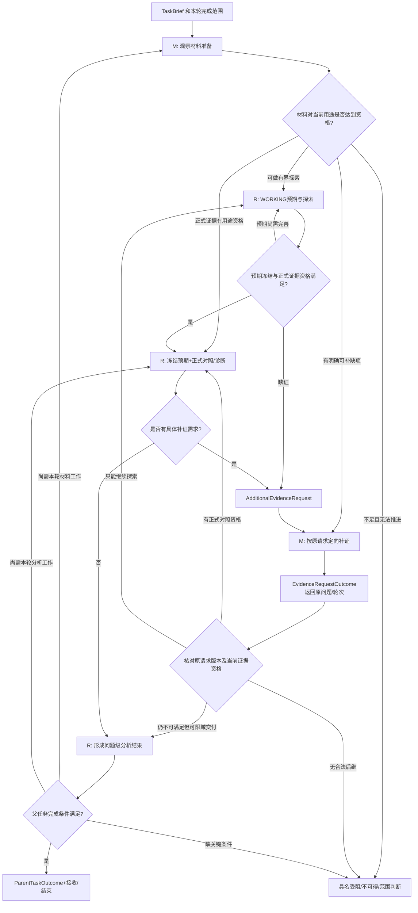

# L0｜完整业务任务：材料准备 ↔ 合理性分析 ↔ 本轮收束

> 来源：【S-M】材料准备目标与交接；【S-R】合理性分析 README 的渐进式预期—证据循环与事实/判断双轨；【P】父子任务和补证设计。【N】以下具体控制节点、输入输出约束与 Gate 为本轮待确认设计。

## 1. 先定义这个大的业务任务做什么

本轮任务的目标不是让一套固定工具逐项跑完，而是：**围绕一个事先明确范围的业务观察/合理性问题，准备可追溯的真实观察材料；在已有材料上进行合理性分析；因分析产生新证据需求时回到材料准备，补足并返回原分析问题；最后把本轮已回答和未能回答的内容、证据与后继分清楚。**

这包含两块业务工作：

- **M｜观察材料准备**：识别数据与图来源、选择必要输入/中间/输出材料、实际取得、核对并标明可用范围；交付的是材料，不是合理性结论。【S-M】
- **R｜合理性分析**：建立或修订最小业务预期、探索、冻结用于正式对照的预期、比较证据、必要时诊断、受限标定和复验，交付支持/反证/未决、适用范围及后继。【S-R】

两个业务部分具有阶段身份，但**不强制严格互斥、全部先后完成**。在 M 提供真实且标明限制的探索性样本后，R 可开展预期探索；正式对照还需要相应预期冻结与证据资格。【S-R】【N】

## 2. L0 的总输入 / 总输出

| 对象 | 本轮最低需要什么 | 来源属性 |
|---|---|---|
| 总输入 `TaskBrief` | 观察/判断目的、特征或处理对象、需要回答的问题、目标范围和历史约束、目前已有材料/入口线索 | 【S-M】【S-R】业务目的/对象要求；【N】统一封面 |
| 总输入 `TaskBoundary` | 哪些问题本轮必答、允许做到哪一步（观察/诊断/标定）、什么未决可如实交付、哪些新问题只记建议、成本/操作边界 | 【N】建议前置，现行 Skill 没有唯一的父任务完成合同 |
| 过程输入 | 现有已核实材料、既有预期与证据、代码/数据/参数/时间绑定、来自前轮的结果 | 【S-M】【S-R】
| 总输出 `ParentTaskOutcome` | 每个本轮问题的结论类型及事实证据、适用/不适用范围、缺口、已接受材料/分析引用、已留待后续的问题、任务结束或停止原因 | 【S-M】【S-R】分别定义交付；【N】统一父任务包 |

**缺口标识 L0-D01**：源 Skill 不会替父任务决定“本次到底要诊断到哪里”。任务若缺 `required_questions / authorized_depth / acceptable_unresolved`，一项分析可能不断产生新问题而永不结束。此处须形成明确管理判断或外部已给约束；不能由控制面默默把新发现加入本轮必做。

## 3. L0 流程图：保留合法往返，不强制瀑布式



图中 `B→H` 代表补证的返回渠道，不要求每次补证都重新打开全套 M 阶段；`H→E` 也不允许绕过已冻结预期或旧数据版本检查。

## 4. L0 四个控制接口（不是重新定义专业 Skill 输出）

| L0 接口 / 提议 Gate | 生产内容 | 消费时必须核对 | 成功后继 | 不成功/分歧后继 |
|---|---|---|---|---|
| **L0-START：任务接管** | `TaskBrief + TaskBoundary + question_id` | 本轮目标、判断对象、深度、至少一条明确完成路径是否可理解 | M 开始调查与准备；已存在可复用材料可直接检查进入 R 的资格 | 形成具体缺失的任务边界判断，不猜范围；未查清的源码数据允许留给 M 调查 |
| **L0-M→R：材料可用性交接** | `MaterialPackage`（包括 `PLAN_READY/DATA_READY/PARTIAL_WITH_LIMITS/BLOCKED` 的真实来源和证据） | 当前消费用途 `exploration/formal`、所需材料项、对象/窗口、数据阶段、时间、代码/参数/版本、完整性/限制 | 合格探索材料可进入 R 的 `WORKING` 探索；合格正式证据可参与冻结预期后的正式对照 | 仅规划/预览不能冒充正式数据；缺某项时限定使用或产生补证；不强制整个 M 结束后才能探索 |
| **L0-R→M：补证请求** | `AdditionalEvidenceRequest`：问题、原轮次、缺证要区分的解释、对象/窗口、现有依据、所需交付和约束 | 同一证据是否已存在、是否可在当前工作内局部查证、是否超出既有任务范围 | 必要时建立定向材料工作；回给原 `request_id + question_id + origin_context`（若已有冻结预期则再绑定 expectation_version；冻结前的事实探索请求明确标注 `unfrozen`） | 明确不可得、部分、取消、过期都形成关闭/续作决定；不得永远等待 |
| **L0-CLOSE：父任务收束 Gate** | `QuestionCompletionRecord[] + ParentTaskOutcome` | 每个必需问题是否达到原完成定义；必要检查、范围、授权深度、保留问题与后继引用 | 全部必需问题可合法交付时结束；业务反证亦可交付 | 未满足者明确剩余工作或无法完成原因；新增问题转 `FutureQuestionProposal` 而非自动扩大任务 |

**Gate 类型严格区分**：材料/分析*工作质量*是否合格，与*业务现象是否符合预期*是两回事。`COUNTERS`、有据 `PROVEN_NOT_ADJUSTABLE` 可以是合格专业成果；`UNKNOWN` 的必需验证不能当 PASS。【S-R】【P】

## 5. 材料交接的关键 I/O 对齐

建议使用统一 `MaterialUseRecord`（【N】待确认封面，不替代现有 manifest），描述：

```yaml
material_package_ref: <固定 GitHub 原件>
material_plan_ref: <固定材料计划>
question_id: <消费的问题>
analysis_round_id: <消费轮次/探索时可未建立>
use_kind: exploration | formal_comparison
required_material_ids: [<材料要求>]
accepted_material_refs: [<真实产物+版本+数据阶段>]
object_scope: <对象/品种/参数>
time_basis: <时点/确认/日历等>
loaded_range: <已加载范围>
visible_range: <若涉及视窗则填写>
limitations: [<缺项与风险>]
qualification_ref: <对该用途作出的检查或正式接收>
```

**重要**：已经取得某些材料，既不保证可以检验任何新预期，也不代表 M 父阶段已全部完成。特定问题需要的材料与该材料真实范围相符，才可具名放行；否则精确指出差的是哪个证据条件。

## 6. 补证闭环：必须覆盖所有合法结果

| `EvidenceRequestOutcome`【P】 | 请求侧可以如何继续 | 禁止发生什么 |
|---|---|---|
| `OBTAINED` | 检查原问题/轮次/预期和版本后绑定真实材料，恢复被阻断的对照/诊断 | 不因补到数据而无条件宣布业务预期成立 |
| `PARTIAL` | 对可以继续的问题解锁，其余仍未决；若本轮允许，形成有界结果 | 不假装所有必需数据齐全 |
| `PROVEN_UNAVAILABLE` | 接收“无法可靠取得”的事实，判断是否可替代/限制/停止 | 不无证据重新请求同一缺项，不伪称已取得 |
| `NOT_APPLICABLE` | 说明原因，修订需求或结束该请求 | 不对不适用场景反复取数 |
| `CANCELLED` | 依据有效撤销关闭原等待 | 不删除历史事实 |
| `SUPERSEDED` | 旧轮次的返回作为历史，后继轮次另验复用资格 | 不把迟到证据自动并到新的冻结预期 |

需要强调：**不是什么查字段、读一行数据都要生成跨 Workflow 请求**。能在既有工作和授权内完成的局部事实查证，保留原工作内执行；真正跨专业准备、独立交付或资源基线变化才走正式补证路径。【S-R】【P】

## 7. L0 的闭环成立判据

L0 不能只拥有正常箭头：每个前进箭头都必须满足 `上游可核实输出 → 下游最小必要输入 → 明确使用资格 → 实际可触发后继`，每个返回箭头都满足 `具体缺口 → 唯一请求 → 回交对象 → 各种结果下解除或延续原等待`。

冻结前的事实准备/探索也可能提出补证：这时不得伪造 `FrozenExpectationSet`。应通过 `question_id + request_id + origin_call_id + exploratory_context_version` 记录返回点，`expectation_version` 明确记为 `not_frozen`；在正式对照前再建立冻结版本和用途映射。【N】

如果 `TaskBoundary` 未明确、材料只有 `PLAN_READY`、正式预期未冻结、补证永远没有结案、或发现新问题被无条件加进本轮，整个父任务都**不能据此声称已闭环**。具体缺口见 `06_接口对齐与缺环审查.md`。
