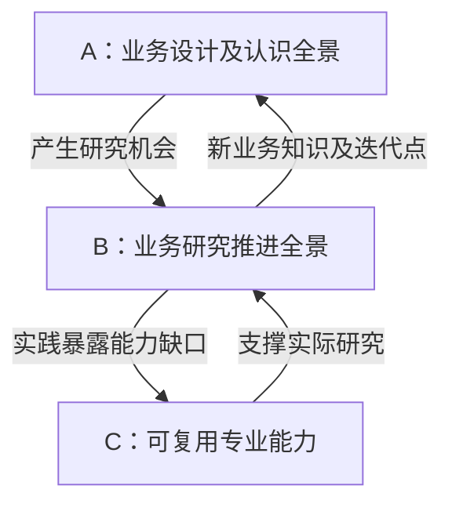

# EAW用例价值分析

- 来源 chat：[EAW用例价值分析](https://chatgpt.com/c/6b053285-a5f8-83e8-83dd-cb8145f24117)，ID 为 `6b053285-a5f8-83e8-83dd-cb8145f24117`。
- 归档日期：2026-11-25（北京时间）。
- 本次实际取得最近 5 轮问答，含用户消息 5 条、AI 回复 5 条。记录按开始时间从早到晚排列，下列第 1～5 轮为本文件的归档编号。
- 读取范围：2026-11-24 19:07:59 至 2026-11-25 11:29:27（北京时间）。以本批最旧 turn 的游标继续向前读取，返回 0 轮。**更早的聊天内容本次未取得，本文件仅覆盖这五轮。**
- 轮次标题时间由接口开始时间换算，消息正文中原有的时间行照录。
- 正文保留原问题、回复、选中文本、引用、表格、代码及消息 ID。回复中包含完整地址的网址标记转换为 Markdown 链接。
- 本文件记录 discussion provenance。讨论中的 AI 判断、候选方法与建议，以原对话当时的表述保存；正式采用以 Owner 明确决定和相应正式文档／实现为准。

## 第 1 轮 · 2026-11-24 19:07:59

<!-- turn:7f311f34-975c-43c2-a66e-0321845fa4c1 -->

### 问：

by: 樊月

<!-- message:7f311f34-975c-43c2-a66e-0321845fa4c1 -->
- November 24th 202607:06 PM; by : fy

“”“@常远方(常远方)你对于比如eaw用例大致要怎么去迭代，如果有预期，可以把相关内容艾特我一下，因为毕竟是你做的叙事，还是你要敏感一点儿，也就是更可能哪些地方有大问题需要去迭代我不太敏感，就比如wall、Build、AttackSegment、Absorb这些特征，你是倾向于先迭代wall，还是wall+build、wall+AttackSegment、wall+Absorb这种组合关系分别去看，还是4个特征一起。也就是我感觉不合理问题的严重性可能是有区别的，可能是要优先找那种影响最大的问题，但是按什么顺序最能达到这个预期我感觉不是特别拿得准。@樊月(樊月)我自己对这个问题也没有什么预期的，自己之前讨论压根就没讨论到这里来。但是基本的想法肯定是，这个特征完全是和llm讨论出来的，我们连它们到底是不是或者多大程度上真的找出了tick上的有用的微观结构是没个底的。那么可能如果我来推我会关心找出来的那些wall(毕竟这个结构是attack和absorb的基础，wall和build要一起说好像才完整来着，但是细节我不是记得很清楚)是不是真的明显的，是不是真的对我们找对那些关键地方有所帮助。而且这个地方，很大的风险就是llm给的点子其实不是很靠谱(比如墙找出来都比较牵强之类的)，那么基于对实际数据的观察(毕竟这里关键就是我们之前的特征没怎么用挂单数据，这里用上了)是不是能有对其他类似特征的启发之类的。@常远方(常远方)“是不是真的对我们找对那些关键地方有所帮助”，这个想法好像和wall本身其实关系不大，因为这个wall的开始条件是大挂单和挂单不薄，在大挂单位置，挂单不薄这个条件比较宽松，基本能满足，所以相当于主要就是靠大挂单在选wall的位置了。进一步能看的就只是wall的状态变化事件和结束点是不是符合预期的问题了。@樊月(樊月)我说的关键地方是比如之前搞物理意义化的时候，希望高频特征发生的位置能把关键的那些小的拐头位置覆盖得比较好之类的，这种意思(依旧注意这个是我的不可靠的第一反应，我针对这些话题是没有和gpt讨论过的)。然后你其实可以看一下我最开始和gemini讨论它给eaw这些思路的时候当时的一些想法(但是都注意时效性)：

feature-refinement-implementation-agent-evolution/candidate_gold_cases/eaw/narrative_origins/AIChat/gemini_cyf - 基于micro的叙事_2025-10-15T15-32-51+0800.md  ”“” 这是我对想要怎么去观察和做 EAW用例的同事讨论的想法， 他的意思是这个聊天记录里面应该是有在初版设想实现之后再回头看合理性所需要的预期，先大概解释一下聊天记录的内容。我再看怎么深入，提取到我需要的内容。你就主要是去介绍这里面的prompt。然后如果他是可以分阶段,你就分阶段给我介绍。因为它可能某些 prompt围绕一个问题，然后它几个 prompt之后认为能固定下来，认为能有一些新的方向之后他可能就会讨论另外一起或者更深层次的问题。所以我会说如果他能分阶段，你可以把阶段给我分一下。但是不要强硬地去分
<!-- /message:7f311f34-975c-43c2-a66e-0321845fa4c1 -->

### 回答：

<!-- message:d5e8c9f9-597d-4e32-9195-d6adb5a6c018 -->
我找到了这份聊天记录：[《cyf - 基于micro的叙事》](https://github.com/daowei2026/feature-refinement-implementation-agent-evolution/blob/main/candidate_gold_cases/eaw/narrative_origins/AIChat/gemini_cyf%20-%20%E5%9F%BA%E4%BA%8Emicro%E7%9A%84%E5%8F%99%E4%BA%8B_2025-10-15T15-32-51%2B0800.md)。

它一共有 **30 轮对话**，从 2025 年 9 月 30 日持续到 10 月 15 日。

从常远方自己的 prompt 来看，这份记录确实很有价值。特别是它并不是一开始就在讨论如何定义 Wall、Build、Absorb，而是从一个更大的业务问题出发，逐渐收敛到一个具体的叙事用例，再开始考虑实现和实际数据观察。

其中，**Chat 8 就直接讨论了你们今天所说的这个问题：初版特征实现之后，应该如何通过实际数据观察，并推动后续迭代。**

下面我主要介绍常远方在各个 prompt 中提出的问题、他的考虑和思路变化。Gemini 的回答只在解释为什么会产生下一个 prompt 时补充，不把 Gemini 提出的方案直接当成常远方已经确认的业务预期。

# 一、整份聊天记录的思路脉络

从实际讨论内容看，我认为可以大致分成六个阶段。这个划分是我为了便于阅读所做的归纳，原聊天没有正式划分阶段。

1. **寻找合适的微观结构 micro**
   
   Chat 1～5 · 9月30日～10月9日
   
   什么样的高频现象值得成为基础叙事单元？怎样区分 micro 与 micro 的组合？
2. **用 micro 描述完整的业务现象，并引入数据观察**
   
   Chat 6～8 · 10月9日
   
   收敛到 Exhaustion.Absorption\_Wall，开始担心典型性、业务效果及后续迭代。
3. **确定已有特征能否支撑叙事，以及如何标准化**
   
   Chat 9～13 · 10月9日～10日
   
   尽量复用已有特征，控制新增成本；考虑不同市场场景应采用怎样的 micro。
4. **把业务 micro 落到已有特征、锚点及实现分层**
   
   Chat 14～21 · 10月10日～14日
   
   讨论 VolConsum、HugeVolLife 等特征是否需要拆分，厘清 Numba 与 FRP 的职责。
5. **细化需要新增的两个 micro**
   
   Chat 22～27 · 10月14日～15日
   
   Liquidity.Iceberg、Flow.Exhaustion 的业务定义、锚点、参数及标准化。
6. **回头检查整个业务叙事与实现清单是否一致**
   
   Chat 28～30 · 10月15日
   
   发现前后使用的 micro 对不上，重新整理 EAW 叙事并纠正实现方案。

对于你现在的任务，我认为最值得优先理解的是**第一、第二阶段和最后一个阶段**。中间几个阶段主要是在解决如何把业务叙事落地的问题。

# 二、第一阶段：到底什么样的现象值得成为 micro？

**Chat 1～5**

这一阶段其实还没有 EAW 这个具体用例，主要是在寻找值得描述的高频业务现象。

## [Chat 1](https://github.com/daowei2026/feature-refinement-implementation-agent-evolution/blob/main/candidate_gold_cases/eaw/narrative_origins/AIChat/gemini_cyf%20-%20%E5%9F%BA%E4%BA%8Emicro%E7%9A%84%E5%8F%99%E4%BA%8B_2025-10-15T15-32-51%2B0800.md#chat-1)：为什么要做新的高频特征？

常远方首先解释了已有高频特征的不足。这段原话很重要：

> 这里这个原始高频，在密集段内的内容基本啥都没有（我们目前只有很少的信息，比如密集段内是买卖偏向某一方吗，还是势均力敌，但这远远不够），这不行。

他举了几个自己已经想到的例子：

- 有的密集段内，大单发生的时间很短，但几次大单的强度都很高。
- 有的大单持续时间相对长，但强度没那么高。
- 有的连续发生密集，但价格没怎么变化。
- 有的一边发生密集，价格一边快速上涨。

他希望能够区分这些**高矮胖瘦、量价关系、内部结构都不一样的高频现象**。

原来一个密集段可能持续几分钟到十几分钟，而他预期这样一个密集段的内部，应该存在若干 micro 组成的序列。

他还提供了一个更大的动力学叙事背景，即市场从常态、趋势萌芽、趋势强化，到临界慢化、鸭子轨道、崩溃解体的六幕过程，希望最终能够用高频 micro 为其中的业务叙事提供材料。

## Chat 2：Gemini 给出的 micro 太简单，需要重新找

常远方认为 Gemini 第一轮给出的 micro 太基础，不符合他们实际要做的高频特征复杂度。

于是他补充了大量公司已有的高频特征，包括：

| 已有特征 | 描述的现象 |
|--------|--------|
| VolQuant | 异常大的挂单 |
| VolConsum | 大挂单出现后，在一定时间和价格范围内的成交消耗 |
| HugeVolLife | 大挂单降至危险水平及其他结束情况 |
| ATOV | 相邻 Tick 同价位挂单量的变化 |
| ATOVLC | 相邻 Tick 同价位挂单量的显著变化 |
| CTATOVLC | 考虑品种特性后识别挂单量的大变化 |
| ThinOrderTime | 挂单量降到指定水平所需时间 |
| OrderRatioTime | 买卖挂单量比例发生指定变化所需时间 |

他希望 Gemini 在理解这些已有特征的复杂度后，再提出有价值的 micro。

Gemini 在这一轮给出了四类业务概念：

| 类别 | Gemini 提出的 micro |
|--------|--------|
| 流动性 | Build、Pull、Iceberg |
| 主动成交 | Burst、Grind、Sweep |
| 交互 | Consume、Absorb、Evade、Stalemate |
| 状态 | Imbalance、Vacuum、Momentum |

这里有一个与你之前提出的问题直接相关的发现。

**Gemini 在 Chat 2 就明确提出过 Liquidity.Pull（流动性撤离）。**

它想描述的正是：

> 在某个关键价位上的大量挂单，在并未被大量成交的情况下，于极短时间内（1～2个ticks）发生大规模减少。

Gemini 将它称为 Liquidity.Build 的重要对偶行为。

所以，你前面提出的“大挂单连续几拍维持，随后快速减少到正常水平”的现象，并不是之前完全没有考虑过。它在非常早期的 micro 讨论中就已经有了对应的候选概念。

不过，后面收敛到 EAW 实现清单时，没有将 Liquidity.Pull 单独列为必须实现的 micro。为什么没有继续使用，目前这份记录没有给出明确的专门解释。

## Chat 3～5：哪些应该是 micro，哪些应该是 micro 的组合？

这一部分常远方主要是在纠正 Gemini 对业务抽象层级的理解。

| Prompt | 常远方主要在讨论什么 |
|--------|--------|
| Chat 3 | Gemini 给出的交互类和状态类概念，有些可能不是 micro 本身，而是多个 micro 组合出来的东西，需要重新判断。 |
| Chat 4 | 不能把锚点机械地理解成价格转折点。要区分单个 micro 内部的特征提取，与多个独立 micro 之间的关系判定。 |
| Chat 5 | 质疑 Gemini 为什么认为订单簿失衡、流动性真空不是 micro，以及是否真的需要引入新的“环境特征”概念。 |

Chat 4 中常远方用了一个图像识别的类比。

一个物体识别器可以通过很复杂的算法识别出一只猫，这些复杂的内部处理仍然是在识别一个对象；而判断一只猫和一只老鼠之间是否形成捕食场景，则是在判断两个独立对象之间的关系。

他希望 micro 也采用类似的理解方式。

这一阶段最终没有形成一套经过实际数据验证的 micro 分类体系。Chat 6 中，他暂时结束了这个话题，开始讨论如何利用 micro 表达更完整的业务过程。

---

# 三、第二阶段：形成 EAW 用例，并开始考虑实际数据观察

**Chat 6～8**

这是我认为对你当前工作最重要的阶段。

## Chat 6：micro 和最终业务叙事之间，还缺少一层特征

常远方认为，直接使用这些 micro 去描述鸭子轨道，跨度太大。

他提出：

> 我们预期还存在一些中间的特征，这样的特征可能还有10来个，才能拿去讲鸭子轨道。

这些中间特征主要是由多个 micro 组合出来的，表达密集段内部的各种复杂模式。

**高频 micro**

更小尺度的具体市场现象

**十来个相对完整的中间特征**

密集段内由多个 micro 形成的复杂模式，EAW 是其中一个候选

**更完整的动力学业务叙事**

例如鸭子轨道及其后续崩溃

另外，他纠正了最开始给出的叙事范围：实际上主要想讲第五幕，最多加上第六幕，而不是全部六幕。

## [Chat 7](https://github.com/daowei2026/feature-refinement-implementation-agent-evolution/blob/main/candidate_gold_cases/eaw/narrative_origins/AIChat/gemini_cyf%20-%20%E5%9F%BA%E4%BA%8Emicro%E7%9A%84%E5%8F%99%E4%BA%8B_2025-10-15T15-32-51%2B0800.md#chat-7)：先给一个来龙去脉完整的特征

Gemini 又给了一批组合特征，但常远方认为复杂度还是不够。

于是他要求先只给一个特征，把复杂度和业务细节做到位：

> 要讲一个来龙去脉都很清楚的特征。就像散户讲故事一样，只是更加专业。

他还明确要求：

- 这一阶段只说业务，不要给代码。
- 整个过程主要持续几分钟。
- 几分钟内应该包含各种 micro 组合形成的现象。
- 先确定一个这样的特征，再往下做。

**就是在这一轮，Gemini 提出了 Exhaustion.Absorption\_Wall（力竭·吸收墙），也就是后来的 EAW 用例。**

Gemini 当时给出的业务故事，大致是：

```svg
<svg viewBox="0 0 340 185" width="100%" xmlns="http://www.w3.org/2000/svg"><rect x="65" y="34" width="191" height="22" rx="3" fill="#2563eb" fill-opacity=".13" stroke="#2563eb" stroke-opacity=".6" /><text x="160" y="26" font-size="11" fill="#2563eb" text-anchor="middle">流动性防守区域</text><path d="M15 141 L33 123 L52 102 L66 85 L82 67 L98 79 L115 52 L132 68 L149 46 L165 53 L182 43 L198 76 L216 59 L232 83 L249 95 L268 117 L289 133 L322 158" fill="none" stroke="currentColor" stroke-width="2.2" stroke-linejoin="round" /><path d="M82 102 V60 M149 118 V49 M216 98 V61" stroke="#dc2626" stroke-width="2" fill="none" stroke-dasharray="3 2" /><text x="75" y="115" font-size="10" fill="#dc2626" text-anchor="middle">试探</text><text x="149" y="132" font-size="10" fill="#dc2626" text-anchor="middle">总攻</text><text x="216" y="111" font-size="10" fill="#dc2626" text-anchor="middle">最后冲击</text><text x="297" y="108" font-size="10" fill="#d97706" text-anchor="middle">反向反馈</text><text x="20" y="169" font-size="10" fill="currentColor" opacity=".6">原有趋势</text></svg>
```

根据 Chat 7 的 Gemini 业务故事绘制的示意图，不是真实行情。

---

**背景：** 已经存在一个微观趋势，价格接近重要流动性区域，墙得到加固。

**扰动：** 经过几轮攻击，特别是主力攻击期间，挂单不断得到补充，大量成交没有带来相应的价格推进。

**反馈：** 攻击力量减弱，最终出现快速反向运动，或者成交活性下降、价格缓慢退离。

Gemini 当时希望用这个特征描述一个具有较高信息含量的小尺度顶部或底部反转过程。

这里特别需要注意：三轮攻击、先加固后攻击等具体情节，是 **Gemini 当时提出的业务故事模板**。常远方没有逐项确认它们是真实市场规律，更没有通过数据验证。

这与我们前面讨论的情况很相似。

## [Chat 8](https://github.com/daowei2026/feature-refinement-implementation-agent-evolution/blob/main/candidate_gold_cases/eaw/narrative_origins/AIChat/gemini_cyf%20-%20%E5%9F%BA%E4%BA%8Emicro%E7%9A%84%E5%8F%99%E4%BA%8B_2025-10-15T15-32-51%2B0800.md#chat-8)：担心这个业务故事本身就不靠谱

这是常远方直接提出实际数据观察要求的一轮。

他的原话是：

> 我们给出来的这些特征，它典型性不一定够（体现在比如我们实现出来一看，10年只发生了寥寥数次），而且还存在其他担忧，比如这个特征虽然总体发生次数合适但有其他问题，使得如果按原计划把鸭子轨道这种比较完整的东西叙出来，就引入了过多的不确定性。

所以他希望从这里开始：

> 引入实际数据，快速实现-观察-观察后出现问题的迭代。

而且，他当时已经明确倾向于通过统计等方式，由机器高效地进行观察，而不是由人低效地看图。

他让 Gemini 给出需要观察的内容和预期。

Gemini 的回答分为三层，共八项预期：

| 观察层次 | 观察内容 |
|--------|--------|
| **统计画像** | 发生频率是否合适 |
|  | 内部结构、持续时间和成交强度是否存在稳定形态 |
|  | 参数小幅变化后，识别结果是否稳定 |
| **预测能力** | 特征发生之后的价格走向是否符合预期 |
|  | 按指定业务条件衡量的成功率 |
| **情境依赖性** | 在不同市场状态下是否表现不同 |
|  | 多品种共同确认是否有助于提高效果 |

Gemini 还提出了每周发生数次、参数变化后核心事件重合度超过80%、成功率达到60%～70%等示例性数值预期。

这些数值没有经过真实数据验证，也没有看到常远方正式确认，所以目前不能直接采用。

更重要的是，**这一轮的观察对象是完整的 EAW 组合特征，而不是单独的 Wall、Build、AttackSegment、Absorb。**

这是你后面提取观察预期时一定要注意的区别。

---

# 四、第三阶段：考虑如何用低成本把 EAW 实现出来

**Chat 9～13**

前面已经提出了一个候选业务故事，也确定了要尽快引入数据观察。接下来开始考虑实现成本和标准化。

| Prompt | 常远方的主要考虑 |
|--------|--------|
| Chat 9 | 不应该把 Gemini 给出的所有 micro 都新增实现。先盘点公司已有高频特征，尽量复用，实在表达不了才新增。 |
| Chat 10 | 补充一档盘口的限制，排除依赖五档盘口的 JiaBan；追问为什么又提出一个新的 Flow.Exhaustion，是否真的有必要。 |
| Chat 11 | 讨论 micro 的标准化。希望预先生成多组参数的特征，在不同时间段选取适合的参数组。 |
| Chat 12 | 担心单一宽松识别器只提供一套锚点，无法覆盖不同场景所需的不同锚点位置；同时希望先考虑三四个重要业务场景。 |
| Chat 13 | 纠正 Gemini 对场景的理解：不是同一个 EAW 特征发生后，在不同场景中怎样解读它；而是不同场景下，构成 EAW 的 micro 本身应该不同，或者对 micro 的解读不同。 |

这一阶段有两个比较重要的思路。

## 1\. 只补必须新增的 micro

Gemini 认为最初的 EAW 故事大部分可以通过已有高频特征表达，但有两个重要缺口。

**Liquidity.Iceberg（冰山流动性）**

原有大挂单特征不能充分区分两种不同过程：

Gemini 的原始举例：初始都是500手，都经历400手成交，但剩余可见量明显不同。

---

**Flow.Exhaustion（流动性枯竭）**

用于描述一段激烈的市场活动结束后，主动成交迅速减少、市场陷入静默的现象。它与发生一轮强烈反向成交，是不同的反馈过程。

这里的冰山仍然只是基于可见量和成交关系推断的业务概念，不能直接证明存在某种真实冰山订单。

## 2\. 不同场景可能需要不同的 micro 识别方式

Chat 12 中，常远方用了一个学生考试的比喻：

> 一个学生考试考了30分，不一定是真的不好，可能只是题目确实太难了，或者本人生病了。

他的意思是：不能脱离业务背景，单纯根据数值判断一个 micro 的性质。

例如，在不同的市场活跃程度下，怎样的大成交才值得被视为一次明显的进攻，可能是不一样的。不同的背景下，连锚点的位置都可能不同，并不是在同一套固定锚点上事后贴标签就能解决的。

这一部分主要是在为后续的标准化和特征可替换性做准备。

---

# 五、第四阶段：把业务 micro 落到具体锚点和实现上

**Chat 14～21**

这一阶段开始更加深入工程实现。

| Prompt | 常远方提出的问题 |
|--------|--------|
| Chat 14 | EAW 需要哪些 micro？分别如何用已有特征表达？已有特征实际提供的是锚点，还是已经完整形成了 micro？ |
| Chat 15 | 发现 Gemini 对 PastOrderVolSum 的理解错误，要求重新分析这个错误对实现方案造成的影响。 |
| Chat 16 | 补充已有 Dense 特征，考虑用它表达主动成交的脉冲流，并重新整理所需特征清单。 |
| Chat 17 | 希望移除使用受限的 PastOrderVolSum，询问不使用它的影响。 |
| Chat 18 | 仍然担心 VolConsum、HugeVolLife 的处理没有分层到位，直接提供代码让 Gemini 判断。 |
| Chat 19 | 补充 FRP 不能全量扫描半秒 Tick 的性能限制；同时质疑 Gemini 的特征拆分反而造成了信息丢失。 |
| Chat 20 | 纠正 Gemini 的极端理解：不是所有具有开始和结束的过程都必须放在 Numba 中实现，基于稀疏事件的过程也可以由 FRP 实现。 |
| Chat 21 | 继续追问能否在 Numba 层进一步拆分已有特征，使提供给 FRP 的锚点更加丰富。 |

这里有一个与当前 P1 很相关的考虑：

原先的 VolConsum 和 HugeVolLife 可能在整个过程结束之后，才给出一份包含过程信息的结果。

但是常远方担心，如果这些信息全部由 Numba 提前组织好，就可能把 micro 和某套特定参数的锚点绑定得过死。

因此，他在探索能否将一个复杂过程的中间关键变化也表达出来。

Gemini 在 Chat 21 提出的部分候选锚点包括：

| 候选锚点 | 希望保留的市场信息 |
|--------|--------|
| HugeVolAppeared | 大挂单出现 |
| InteractionStarted | 第一次成交命中 |
| ConsumptionMilestone | 成交消耗到达某个重要程度 |
| PriceReturnedToWall | 价格重新回到大挂单位置 |
| HugeVolResolved | 交互最终结束 |
| VolatilitySpike | 近期波动性发生明显变化 |
| DoomThresholdShift | 危险水平的判断标准发生变化 |

这些还只是当时的拆分建议，但从这里已经可以看到目前 Absorb 的 InteractionStarted、ConsumptionMilestone、Resolved 等事件的思想来源。

**当时拆分特征的重要目的之一，是让上层叙事能够获得更加丰富、更加灵活的中间过程信息，而不只是得到一个最终结论。**

---

# 六、第五阶段：细化 Iceberg 和 Exhaustion

**Chat 22～27**

这一阶段主要围绕两个必须新增的 micro 展开。

| Prompt | 常远方的主要考虑 |
|--------|--------|
| Chat 22 | 两个 micro 由怎样的锚点连接而成？分别哪些工作由 Numba 完成，哪些由 FRP 完成？ |
| Chat 23 | 纠正 Flow.Exhaustion 对 PastOrderVolSum 的错误依赖，并补充 Fight 特征，使其能够考虑单向活跃和双方对抗的不同背景。 |
| Chat 24 | 给出两个 micro 的具体参数，但要求 Exhaustion 不与 Dense、Fight 的具体业务逻辑绑定。 |
| Chat 25 | 质疑时间参数、固定成交量门槛、单一补单比例阈值，以及为何又把 Exhaustion 放回 Numba 实现。 |
| Chat 26 | 明确 Numba → FRP 的单向数据关系，FRP 运行过程中的事件不能回传 Numba；同时可以考虑在 FRP 用较低频的时点检查。 |
| Chat 27 | 讨论 Iceberg 是否也应当由 Numba 提供多组参数的锚点，再由 FRP 按不同场景组合成合适的 micro。 |

其中 Chat 25 有一个很具体的想法。

常远方希望 Iceberg 不只是达到一个固定补单比例时才发出事件，而是可以同时给多个阈值，每次补单相关比例跨过一个阈值，都输出一个锚点。

这个考虑的出发点也是：**尽可能保留过程中的阶段性变化，使后续叙事具有选择和解读的余地。**

不过，这里的比率公式和参数形式都是当时讨论中的候选，并不是已经确定合理的标准。

---

# 七、第六阶段：重新审视完整的 EAW 业务叙事

**Chat 28～30**

我觉得这一阶段也特别值得你看。

## Chat 28：发现业务故事和最终实现清单对不上

常远方发现，最初 EAW 故事里涉及的 micro 很丰富，包括：

State.Momentum、Flow.Grind、Flow.Burst、Interaction.Absorb、Liquidity.Build、Interaction.Stalemate、Flow.Sweep、Assault.Coordinated、Liquidity.Iceberg、Hesitation-micro 等。

但是经过一系列实现分析后，Gemini 给出的清单却只剩下少数几个核心 micro。

所以他要求解释为什么对不上。

Gemini 的解释是：有些 micro 可以通过已有特征的不同参数或不同解读表达，有些属于多个 micro 的组合，不必全部作为独立特征实现。

例如，Gemini 建议将 Burst、Grind、Sweep 的一部分区别交给 Dense 及其强度、持续时间等信息表达。

这种归并是否真的能够保留业务上的重要差异，当时并未通过数据验证。

## [Chat 29](https://github.com/daowei2026/feature-refinement-implementation-agent-evolution/blob/main/candidate_gold_cases/eaw/narrative_origins/AIChat/gemini_cyf%20-%20%E5%9F%BA%E4%BA%8Emicro%E7%9A%84%E5%8F%99%E4%BA%8B_2025-10-15T15-32-51%2B0800.md#chat-29)：业务预期不能被当前实现方式所替代

常远方发现，Liquidity.Wall 在最初的 EAW 叙事中甚至没有被明确提出来，于是让 Gemini 重新整理整个 EAW 业务故事。

他提出了一个非常关键的要求：

> 我要求你的叙事用micro来说而不是用为了表达这些micro的我们已经实现或将要实现的高频特征来说。因为用micro来说的叙事才是实际上我们想要表达的业务，而用具体的高频特征来表达，里面可能掺入了成本等等很多妥协，我们之后针对某种micro可能会用更准确的特征来表达。

我认为，这是整份聊天记录中与你现在的工作联系最紧密的一句话。

它明确区分了两件事：

**业务上想描述的现象**

Liquidity.Wall

Liquidity.Build

Flow.Burst / Grind

Interaction.Absorb

Liquidity.Iceberg

Flow.Exhaustion

真正希望表达的市场过程。

**目前选择的识别方法**

VolQuant

ATOVLC

Dense

VolConsum

HugeVolLife

新增 Numba / FRP 特征

现阶段尝试使用的方法，允许后续替换。

所以，**不能因为当前实现是通过大挂单来确定 Wall 的起点，就把 Wall 的业务预期缩小为大挂单的发生位置。**

按照常远方当时的立场，大挂单只是现阶段用于表达 Liquidity.Wall 的一种方法，真正需要通过数据观察的是这种表达方法到底有没有把希望描述的业务现象找出来。

Gemini 随后重新整理了 EAW 的业务故事，明确把 Wall 放进了整个攻防过程中。

这也是这份聊天中最后一版相对完整的 EAW 业务叙事。

## Chat 30：最后纠正 Exhaustion 的实现分析

最后一轮没有继续讨论观察预期，而是要求 Gemini 统一 Flow.Exhaustion 的实现分析格式、明确锚点和参数，并继续强调触发事件的可替换性。

但 Gemini 最后一轮提出的 Numba 订阅 FRP 高活性结束事件的实现，仍然与 Chat 26 明确提出的单向数据流约束存在冲突。

因此，不能认为这份聊天结束时，所有实现问题已经彻底解决了。

---

# 八、这份聊天中哪些内容最可能是你现在想找的？

我先不进一步提取和制定观察方案，只把相关内容的位置和性质列出来，方便你判断接下来重点深入哪里。

| 原文位置 | 与当前观察任务的关系 | 重要程度 |
|--------|--------|--------|
| Chat 1 的 prompt | 最初为什么希望增加微观结构，现有高频特征缺少哪些信息 | 很重要 |
| Chat 2 的 prompt 和回答 | 候选微观结构的业务含义，包括挂单增加、撤离、消耗、补充等现象 | 很重要 |
| Chat 6～7 | EAW 在整个业务叙事中的定位，以及最初希望描述的完整市场过程 | 很重要 |
| Chat 8 的 prompt 和回答 | 直接讨论实际数据观察、典型性、统计、效果、迭代 | **最重要** |
| Chat 9～10 | 为什么选择某些已有特征，以及为什么需要增加 Iceberg、Exhaustion | 重要 |
| Chat 12～13 | 不同业务场景下 micro 的选取和解读问题 | 重要 |
| Chat 19～21 | 为什么需要保留更加丰富的中间过程信息 | 重要 |
| Chat 28～29 | 业务预期与具体实现方法的区分，以及最终更新的 EAW 业务故事 | **最重要** |

# 九、读完这份记录后，我对你们刚才讨论的初步理解

常远方刚才说，自己对于如何安排 Wall、Build、AttackSegment、Absorb 的迭代顺序没有明确预期。

这一点和原聊天记录是相符的。

因为原聊天中实际考虑的验证对象，主要是**完整的 EAW 用例是否典型、是否能够表达有价值的微观结构、是否对理解市场反转有帮助**。

但当时并没有进一步讨论：

- 应该怎样先验收单个 Wall；
- 应该先观察 Wall + Build，还是 Wall + AttackSegment；
- 哪个底层特征的问题对最终 EAW 的影响最大；
- 应该按什么顺序进行局部迭代。

也没有明确给出常远方今天提到的“小拐头位置覆盖效果”的具体统计方法和验收标准。

这些确实是后来才需要解决的问题。

不过，这份聊天至少提供了三个很有价值的原始立场：

**第一，做 EAW 的出发点是希望找到原有 Dense 等高频特征没有描述出来的、更加细致且有价值的微观结构，而不只是多实现几个盘口特征。**

**第二，这些业务现象及其组合关系，最初主要是由 LLM 提出的，因此本身的典型性和真实性就需要接受实际数据检验。**

**第三，现有特征的计算方法并不是最终的业务定义。观察过程中完全可能发现，当前方法没有很好地表达原先希望描述的现象，甚至原先设想的现象本身也需要改变。**

我建议你接下来优先深入 Chat 2、Chat 7～8、Chat 28～29。这几处连接起来，应该最有希望提取出你真正需要的业务观察预期。

尤其是可以进一步区分：哪些是当时人明确提出的业务目的，哪些是 Gemini 提出的待验证业务假设，以及哪些是为了降低实现成本而采取的临时表达方法。

本次梳理基于这份30轮聊天原文，没有进一步展开其中引用的其他需求文档，也没有把2025年10月的早期方案直接认定为2026年11月当前 P1 的有效需求。
<!-- /message:d5e8c9f9-597d-4e32-9195-d6adb5a6c018 -->

## 第 2 轮 · 2026-11-24 21:54:07

<!-- turn:71254d8a-5b6a-454a-a228-16f1c6f915f9 -->

### 问：

by: 樊月

<!-- message:71254d8a-5b6a-454a-a228-16f1c6f915f9 -->
# Selected text:

## Selection 1
Chat 7：先给一个来龙去脉完整的特征
Gemini 又给了一批组合特征，但常远方认为复杂度还是不够。

于是他要求先只给一个特征，把复杂度和业务细节做到位：
要讲一个来龙去脉都很清楚的特征。就像散户讲故事一样，只是更加专业。

他还明确要求：

这一阶段只说业务，不要给代码。


整个过程主要持续几分钟。


几分钟内应该包含各种 micro 组合形成的现象。


先确定一个这样的特征，再往下做。


就是在这一轮，Gemini 提出了 Exhaustion.Absorption_Wall（力竭·吸收墙），也就是后来的 EAW 用例。

Gemini 当时给出的业务故事，大致是：
根据 Chat 7 的 Gemini 业务故事绘制的示意图，不是真实行情。
背景： 已经存在一个微观趋势，价格接近重要流动性区域，墙得到加固。

扰动： 经过几轮攻击，特别是主力攻击期间，挂单不断得到补充，大量成交没有带来相应的价格推进。

反馈： 攻击力量减弱，最终出现快速反向运动，或者成交活性下降、价格缓慢退离。

Gemini 当时希望用这个特征描述一个具有较高信息含量的小尺度顶部或底部反转过程。

这里特别需要注意：三轮攻击、先加固后攻击等具体情节，是 Gemini 当时提出的业务故事模板。常远方没有逐项确认它们是真实市场规律，更没有通过数据验证。

这与我们前面讨论的情况很相似。
## My request:
- November 24th 202608:15 PM; by : fy

“”“那EAW用例目的上可以理解成，是想去把那个小尺度顶部底部的反转过程去讲出来。然后业务故事模板就是相对应的，比如说流动性防守区、试探、总攻、最后冲击、反馈，这一些概念。然后现在选了一种具体翻译，包括翻译成什么特征，以及这些特征怎么一层一层搭起来讲新的对象。那现在就这一层具体的翻译有了之后，我要去看合理性。而且还不是EAW用例完整的翻译，只是里面更基础的部分(wall特征)，但这部分已经把EAW会发生的区域锁定了，所以已经可以做一些有价值的观察了。比如可以看这个wall的持续区间对这个小尺度拐点的覆盖情况，如果这个覆盖比例很低，eaw用例当前的翻译方向就得暂停，值得进一步分析原因；如果覆盖比例很高，还需不需要进一步看什么有价值的内容我还拿不准，但是我已知的想法是，如果这个覆盖比例还行，那该是进一步通过内部的细节结构来看对后续走势的分辨力，但是现在还只有组成细节结构的原子(absorb、attach、build)，首先是看这几种细节结构在小尺度拐头位置的发生比例。如果覆盖比例相对乐观，接着往后面走的部分要看什么可以再讨论，现在应该要先把覆盖比例这一步看了，看这个需要先定小尺度参数，关于小尺度参数这是曹总的提醒：“”“@樊月(樊月)你给AI讲的尺度大小它不会理解偏差吧？多少算小、中、大？这个也不是固定值，和品种、时段、绝对值都有一定关系 @樊月(樊月)类似的不要我提醒了，所有参数都是合理函数，打底常常是mf函数支持的模糊语义 ”“” ，我本来打算在cyf做的高频标准化的小尺度转折点上看，但是那个是5min尺度上的转折点，如果我要用5min尺度上的转折点来看，那应该就是看转折点附近发生wall事件的比例了，假设转折点就用5min尺度，就看附近的定义要不要再往外扩1个5m，甚至更多？那关于小尺度转折参数用合理函数的问题怎么处理？我目前还没理解到这个问题的必要性，以及这个想法是要解决什么问题？去看wall特征对小尺度拐点的覆盖率从价值上好像只是防止这条路有大的偏，本质上只是防止一种大的合理性风险？对wall理论上只需要看到这个程度，其它非小尺度拐点位置即使发生了很多，也不保证后续不能被build、attack、absorb这一系列内部结构特征所区分开吧？”“”  这些内容暂时是把当前最新的想法更新给你，你看看有没有大问题，或者有没有意见可以给到我。要注意我现在的大意图是为EAW用例的特征提供迭代方向或者下一个有价值的特征的方向，只给真正有价值的分析出来，细枝末节或者价值不明显的反馈不用给。
<!-- /message:71254d8a-5b6a-454a-a228-16f1c6f915f9 -->

### 回答：

<!-- message:eef52c53-4e24-43c3-9a5a-151dc1c6ea06 -->
我认为你现在的思路有一个很重要的进步：**已经开始从 EAW 的最终业务目的反过来检验底层特征的设计方向，而不只是检查底层特征自身的识别逻辑是否合理。**

这比之前逐个观察 WALL 的状态变化、结束条件等设计分支，更有可能发现影响整个用例的大问题。

总体上，我赞成先做覆盖率观察。不过有几个关键问题需要调整，否则即使得到了覆盖率，可能也无法很好地指导下一步迭代。

# 一、先看 WALL 对小尺度拐点的覆盖率，确实是有价值的

可以把当前 EAW 用例的设计理解成下面几层。

**业务目的**

描述有重要微观结构的小尺度顶部、底部反转过程

**业务故事模板**

流动性防守、攻击、吸收、力竭、反馈

当前选择的特征翻译

**Wall**

提供候选业务区域

```svg
<svg viewBox="0 0 300 30" width="100%" height="30px" xmlns="http://www.w3.org/2000/svg"><path d="M150 0 V12 H50 V29 M150 12 V29 M150 12 H250 V29" stroke="currentColor" stroke-opacity=".45" fill="none" /></svg>
```

进一步提供候选区域内的细节结构

**未来的组合叙事**

利用内部结构区分不同类型的市场过程及后续走势

由于当前三个下游特征都依赖 WALL，所以 WALL 实际上限定了当前 EAW 翻译方案能够进一步描述的业务区域。

如果这个区域从一开始就漏掉了大量真正希望描述的市场过程，那么后续把 Build、Attack、Absorb 做得再精细，也很难弥补这个问题。

因此，你的判断是成立的：

> 先检验底层特征有没有把值得进一步叙事的地方找出来，再考虑内部叙事够不够细致。

这是一项具有较高价值的、针对整体设计方向的风险检查。

# 二、但我认为有一个最大的潜在问题：EAW 究竟需要覆盖哪些小尺度拐点？

原始 Chat 7 和 Chat 29 中的 EAW 业务故事，并不是想描述所有小尺度反转，而是想描述其中一种具有特定微观结构的反转：

**原有方向运动遇到流动性防守，在经历攻击、吸收和力竭后发生反转。**

这意味着，所有小尺度拐点不一定都是 EAW 应该覆盖的对象。

假设存在以下几种反转过程：

| 小尺度反转的候选类型 | 是否属于原始 EAW 的主要意图 |
|--------|--------|
| 大量主动成交受到明显流动性阻挡，无法继续推进 | 是 |
| 持续攻击但挂单不断补充，最后价格反转 | 是 |
| 原方向主动成交自然减少，价格逐渐反向 | 未必 |
| 对手方向突然出现很强的主动成交，直接引发反转 | 未必 |
| 普通的小幅价格折返 | 未必 |

这些只是候选分类，还不是经过验证的市场类型。

```svg
<svg viewBox="0 0 340 200" width="100%" xmlns="http://www.w3.org/2000/svg"><rect x="10" y="10" width="320" height="180" rx="9" fill="currentColor" fill-opacity=".025" stroke="currentColor" stroke-opacity=".3" /><text x="170" y="33" font-size="13" font-weight="bold" text-anchor="middle" fill="currentColor">全部小尺度拐点</text><ellipse cx="133" cy="113" rx="96" ry="63" fill="#2563eb" fill-opacity=".13" stroke="#2563eb" stroke-width="1.2" /><ellipse cx="208" cy="113" rx="94" ry="63" fill="#d97706" fill-opacity=".13" stroke="#d97706" stroke-width="1.2" /><text x="92" y="97" font-size="11" text-anchor="middle" fill="#2563eb">EAW真正</text><text x="92" y="113" font-size="11" text-anchor="middle" fill="#2563eb">想描述的</text><text x="92" y="129" font-size="11" text-anchor="middle" fill="#2563eb">反转现象</text><text x="255" y="106" font-size="11" text-anchor="middle" fill="#d97706">Wall覆盖的</text><text x="255" y="122" font-size="11" text-anchor="middle" fill="#d97706">拐点</text><text x="170" y="113" font-size="10" font-weight="bold" text-anchor="middle" fill="currentColor">交集</text></svg>
```

概念示意，集合大小不代表实际市场比例。

所以，如果发现 WALL 只覆盖了全部小尺度拐点中的20%，其实存在两种完全不同的可能：

- WALL 的识别方法不好，漏掉了大量 EAW 真正想描述的反转。
- EAW 原本想描述的反转现象，就只占全部小尺度拐点中的一部分，而 WALL 恰好覆盖了其中的大部分。

前者需要迭代 WALL，后者不一定有问题。

**这两种原因对应的后续研发方向完全不同。**

不过我并不建议你现在就花很多时间定义各种拐头类型。可以先统计全部小尺度拐点的覆盖率；如果结果比较低，再去观察未覆盖的拐点主要是什么样的。

这比一开始就设计复杂的分类特征成本低得多，而且符合你当前防止设计方向出现大偏差的目的。

# 三、覆盖率很高之后，还需不需要进一步观察 WALL？

你认为非小尺度拐点位置即使发生了很多 WALL，也不保证后续不能通过 Build、Attack、Absorb 区分开。

**这个判断我是赞成的。不能要求一个底层业务对象提前具备上层组合特征的分辨力。**

但我认为还有一项成本很低、价值很高的观察需要同时做：看 WALL 所覆盖的区域，相对于整个市场时间范围，到底缩小了多少。

例如以下两种假设结果：

**情况 A：覆盖率高，候选区域也很集中**

初步看，WALL 有助于把值得研究的位置集中到较小的范围。

---

**情况 B：覆盖率高，但几乎到处都是 WALL**

虽然覆盖率同样很高，但 WALL 在定位关键区域方面可能没有提供多少新增信息。

以上数值仅用于说明问题。正式比较时需要采用一致的时空覆盖条件，并考虑市场活跃程度等背景。

情况 B 并不意味着 WALL 一定没有价值。

它仍然可能是一个很好的业务对象，能够提供后续攻击、加固和吸收所需要的坐标、身份和生命周期。

但是在这种情况下，不能仅凭覆盖率高就认为当前 WALL 已经找到了有价值的关键区域。

所以我建议区分两个预期：

| WALL 承担的作用 | 需要多大的分辨力 |
|--------|--------|
| 为 EAW 提供候选区域 | 希望覆盖重要位置，同时不要完全失去筛选能力 |
| 为 Build、Attack、Absorb 提供业务对象 | 不要求 WALL 自身能够区分反转和非反转 |

前者可以现在观察，后者可以在后续组合时继续观察。

# 四、我认为还特别值得增加一个对照：WALL 和原始大挂单的覆盖能力有什么区别？

这一点来自你和常远方前面的讨论。

你提到，目前 WALL 的开始位置本质上主要还是由大挂单决定的。

既然如此，除了观察 WALL 对拐点的覆盖情况，其实可以顺便观察：

**原始 VolQuant 大挂单直接对小尺度拐点的覆盖情况，与经过 WALL 生命周期组织后的覆盖情况，有什么区别？**

| 对照对象 | 希望了解什么 |
|--------|--------|
| 原始大挂单事件 | 单纯利用异常挂单，已经能在多大程度上找到关键位置 |
| WALL 持续区间 | 把大挂单组织成持续对象后，是否保留或增加了有价值的覆盖 |
| WALL 开始、变化、结束事件 | 生命周期处理是否提供了原始大挂单位置之外的重要信息 |

比较的时候要注意，不能因为 WALL 持续的时间长，就直接认为它比大挂单的覆盖能力强。还需要考虑双方覆盖的区域有多大。

这个对照可能直接提供下一个有价值的特征方向。

例如，如果发现真正与小尺度拐点关联比较强的，并不是大挂单最初出现的时点，而是大挂单快速减少、持续被消耗或者重新增厚的位置，那么就可能说明：

**相比进一步优化 WALL 的起点识别，描述挂单演化过程的特征可能更值得优先迭代。**

这只是一个待数据检验的可能性，但这样的观察结果会很有研发价值。

# 五、关于小尺度参数，以及曹总说的合理函数

我觉得这里其实混合了两个不同的问题。

## 5.1 什么样的转折算小尺度？

曹总提醒的主要问题，我理解是：尺度大小具有相对性。

例如同样是5分钟内发生的一段价格运动：

| 市场背景 | 这段运动可能具有的业务意义 |
|--------|--------|
| 低活跃、低波动品种 | 相对显著的运动 |
| 高活跃、高波动品种 | 比较普通的运动 |
| 开盘后剧烈波动时段 | 局部很小的波动 |
| 平静交易时段 | 比较明显的转折 |

因此，真正的“小尺度”未必能够直接由统一的时间长度或价格幅度决定。

所谓参数使用合理函数，我理解是希望尺度的判断能够考虑品种、活跃程度、时段、绝对运动幅度等背景，而不是在所有情况下机械地使用同一个固定阈值。

MF 支持的模糊语义，还能够避免两个实际很接近的过程，因为恰好跨过某个固定阈值，就被判断成完全不同的尺度。

但**这不意味着你当前必须先解决一套全新的小尺度定义，才能进行 WALL 的覆盖率观察。**

你现在已经有常远方做的高频标准化5分钟尺度转折点，那么我建议先用它作为第一轮参照。

我没有在本次分析中重新核查这套转折点标准化的具体算法，因此不能判断它是否已经充分处理了曹总所说的尺度相对性。如果已经处理了一部分，就更没有必要现在重复做。

## 5.2 转折点附近应该向外扩多大范围？

这是另一个问题，而且我认为比重新定义小尺度更值得你当前关注。

**转折点的尺度，与 WALL 和转折点之间允许的时间距离，不是同一个参数。**

转折点使用5分钟尺度，并不能直接推出 WALL 的匹配范围应该是前后5分钟。

我不建议现在就确定到底扩1个5分钟还是2个5分钟。可以先把多个范围的覆盖率都计算出来，看看覆盖率随范围扩大怎样变化。

### 覆盖率随观察范围的变化

较小范围内覆盖率就迅速上升

需要不断扩大范围才能获得较高覆盖率

假设曲线，不是真实统计结果。目的在于先观察规律，而不是预先选定一个窗口。

这两种曲线反映的业务含义很不一样。

如果 WALL 在距离转折点很近的位置就有较好的覆盖，说明 WALL 与这些小尺度拐点在时间上可能确实存在紧密联系。

如果必须扩大到十几分钟才有很高的覆盖率，那么这种联系的业务意义就需要进一步怀疑。

而且这里还有一个必须保留的条件：**顶部主要观察附近的卖墙，底部主要观察附近的买墙，同时考虑拐点价格与墙价带的距离。**

否则，仅仅因为某个时点存在一堵距离很远的墙，就算覆盖了拐点，也没有太大的业务意义。

另外，转折前已经存在的 WALL，与转折发生后才出现的 WALL，要分别统计。前者可能为反转过程提供解释材料，后者可能是反转后的反馈，不能混成一种覆盖。回顾性分析可以同时看两者，但如果以后考察预测能力，就必须区分实际发生时间和当时可确认时间。

# 六、如果 WALL 的覆盖率相对乐观，接下来观察三个下游特征的发生比例是否有价值？

有价值，而且我认为不需要等完整 EAW 实现之后才能做。

但是除了观察它们在拐点位置的发生比例，还应该有一组对照：**在同样存在 WALL、但没有形成目标尺度拐点的位置，这些细节结构的发生比例又是多少？**

假设得到下面这样的结果：

| 特征 | WALL 覆盖的小尺度拐点附近 | WALL 覆盖的非拐点对照区域 |
|--------|--------|--------|
| Build | 60% | 58% |
| AttackSegment | 75% | 30% |
| Absorb | 65% | 20% |

示例数据，不代表实际 EAW 运行结果。正式对照需要尽量匹配原有运动方向、活跃度等背景。

这种结果可能会提示，AttackSegment 和 Absorb 更值得优先深入观察。

反过来，即使 Build 单独没有拉开差距，也不能说明它没有价值。可能 Build 与 Absorb 的某种组合关系才具有分辨力。

因此，三个特征目前虽然只是组成细节结构的原子，但已经可以初步观察它们：

- 在关键位置是否确实发生。
- 相比非关键位置是否具有差异。
- 它们的哪些属性或者组合关系可能值得进一步研究。

**这种观察的目的不是现在就完成 EAW，而是决定接下来应该在哪个方向投入精力。**

这与你目前的研发意图非常一致。

# 七、我建议当前只做这几项工作

暂时不需要再扩大成一套复杂的业务效果观察 Workflow。

| 顺序 | 工作 | 要解决的重大问题 |
|--------|--------|--------|
| 1 | 使用已有标准化5分钟尺度转折点作为参照 | 建立独立于 WALL 的关键位置集合 |
| 2 | 统计 WALL 对拐点的时空覆盖情况，同时看不同匹配范围下的覆盖率 | 当前 EAW 的底层翻译方向有没有大偏差 |
| 3 | 同时统计 WALL 的总体覆盖范围，并与原始大挂单对照 | WALL 是否真正缩小了候选区域，生命周期组织增加了什么信息 |
| 4 | 根据上述结果决定是进一步研究漏覆盖现象，还是进入三个下游特征的对照观察 | 找到下一项最值得迭代的特征或业务方向 |

至于参数合理函数、拐点类型分类、其他尺度等问题，可以在首轮统计结果表明它们确实影响判断时，再进一步展开。

---

# 八、总体意见

我赞成你现在优先做覆盖率观察，也赞成你暂时不要求 WALL 自身具备对后续走势的充分分辨力。

我认为需要特别避免的只有三个大的误区：

- 把 EAW 希望描述的特定反转，扩大成所有小尺度拐点。
- 单凭覆盖率高，就判断 WALL 找到了有价值的业务区域。
- 为了确定一个理论上完善的小尺度定义和匹配范围，反而迟迟无法开始真实数据观察。

**覆盖率在当前阶段最重要的作用，不是给 WALL 打一个合理性分数，而是帮助判断 EAW 当前的特征翻译方向是否值得继续，以及下一步在哪个业务角度上最值得增加信息。**

如果这一步能够达到这个目的，我认为就已经足够有价值，不必追求一次把 WALL 的所有合理性问题都解决。
<!-- /message:eef52c53-4e24-43c3-9a5a-151dc1c6ea06 -->

## 第 3 轮 · 2026-11-24 22:06:42

<!-- turn:08a8a3fa-a24a-4a08-a4fd-2d2b6fdc7b89 -->

### 问：

by: 樊月

<!-- message:08a8a3fa-a24a-4a08-a4fd-2d2b6fdc7b89 -->
# Selected text:

## Selection 1
所以，如果发现 WALL 只覆盖了全部小尺度拐点中的20%，其实存在两种完全不同的可能：

WALL 的识别方法不好，漏掉了大量 EAW 真正想描述的反转。


EAW 原本想描述的反转现象，就只占全部小尺度拐点中的一部分，而 WALL 恰好覆盖了其中的大部分。


前者需要迭代 WALL，后者不一定有问题。

这两种原因对应的后续研发方向完全不同。

不过我并不建议你现在就花很多时间定义各种拐头类型。可以先统计全部小尺度拐点的覆盖率；如果结果比较低，再去观察未覆盖的拐点主要是什么样的。

这比一开始就设计复杂的分类特征成本低得多，而且符合你当前防止设计方向出现大偏差的目的。

## Selection 2
例如，如果发现真正与小尺度拐点关联比较强的，并不是大挂单最初出现的时点，而是大挂单快速减少、持续被消耗或者重新增厚的位置，那么就可能说明：

## My request:
- November 24th 202610:03 PM; by : fy

选项1：也就是说即使WALL的覆盖比例低，也有两种解释，EAW类别现象发生比例低、EAW当前翻译遗漏，这个可以通过去看未覆盖的位置来判断?   选项2：你有提供怎么发现这个可能结论的分析吗？这个信息本身是有意义，但是我没看懂怎么能得到这个结论？ 另外，覆盖率怎么看要再给个具体逻辑吧？拐点通常使用贴近转折，它是基于K线的(可能也可以基于tick吧，但是目前可能会有性能问题，之前有基于5m的数据，我拿不准要不要基于1m数据？这里我担心我自己也还没把这个问题实质在问什么想清楚？)，如果用基于1m的数据，那这个覆盖率具体打算怎么算？
<!-- /message:08a8a3fa-a24a-4a08-a4fd-2d2b6fdc7b89 -->

### 回答：

<!-- message:920e4713-e766-448b-8f72-9fad3fc553d9 -->
我觉得你现在其实遇到了三个需要分别想清楚的问题：

1. WALL 覆盖率低之后，怎样判断是业务现象本身较少，还是当前特征翻译有问题？
2. 怎样通过覆盖率及进一步的统计，发现比当前 WALL 更值得研究的高频特征方向？
3. 我们究竟希望 WALL 覆盖什么尺度的拐点，以及怎样定义覆盖？

其中第三个问题是当前最需要先想清楚的，因为它直接决定前两个问题的统计结果有没有业务意义。

# 一、关于选项1：覆盖率低，可以通过观察未覆盖的位置来判断原因吗？

**可以，但不能仅仅看这些位置有没有大挂单，而是要回到原始盘口和成交数据，看有没有 EAW 原本想描述的微观结构。**

例如，假设 WALL 只覆盖了20%的小尺度顶部转折点，那么对于另外80%的转折点，可以观察有没有下面这些现象。

| 未覆盖位置的实际情况 | 可能得到的结论 |
|--------|--------|
| 原始盘口中存在明显的流动性防守，发生大量主动成交但价格推进困难，WALL 却没有识别出来 | 当前 WALL 的翻译可能存在遗漏 |
| 没有明显的大挂单防守，主要是原方向成交活性逐渐下降后发生反转 | 可能属于 EAW 之外的另一种微观结构 |
| 没有明显的防守过程，主要由反向主动成交突然增强而发生反转 | 可能需要另一类特征描述 |
| 没有单次特别大的挂单，但持续有挂单补充，导致价格难以推进 | 当前以大挂单作为 WALL 起点的设计方向可能存在局限 |
| 仅凭现有 L1 数据无法判断 | 保持未决，不能强行归类 |

这里第四种情况尤其值得注意。

假设卖一挂单量始终没有达到 VolQuant 的大挂单阈值，但卖一不断受到成交消耗，同时不断有新的挂单补充，导致价格长时间无法向上推进。

从 EAW 原始业务目的来看，这个位置可能具有很重要的吸收结构。

但从当前 WALL 的实现来看，它可能根本无法形成一堵墙。

如果这种现象在真实数据中比较常见，就意味着问题可能不只是 WALL 的参数没调好，而是**通过异常大挂单寻找流动性防守区域这一翻译方式本身存在局限**。

这时候就可能产生一个新的、有价值的特征方向：不通过挂单量本身是否异常大，而是通过持续补充量、成交消耗量与价格推进之间的关系寻找流动性防守区域。

不过这些都是待验证的可能性，不是目前已经发现的真实市场规律。

因此，我建议如果覆盖率比较低，就分别从已覆盖和未覆盖的拐点中选取一些具有代表性的样本进行对照。

**覆盖率低是启动进一步分析的理由，而不是直接否定 WALL 或 EAW 的依据。**

如果需要进一步估计 EAW 类现象实际占全部拐点的比例，那么样本还需要具有代表性，不能只挑最明显的例子。

# 二、关于选项2：怎样发现大挂单的变化过程比大挂单本身更值得描述？

我前面给出的只是一个**可能通过观察发现的结论**，确实还没有给出如何发现它的具体方法。

我的考虑是，可以把大挂单及其后续变化拆成几个不同的观察角度，再分别看它们与小尺度拐点的关系。

## 2.1 先独立取得几种高频现象的发生位置

| 观察对象 | 大致的取数方法 |
|--------|--------|
| 大挂单出现 | VolQuant |
| 大挂单持续存在 | WALL 持续区间 |
| 挂单显著增加 | 同价位挂单量正向大变化 |
| 挂单显著减少 | 同价位挂单量负向大变化 |
| 挂单持续被消耗 | 累计同价位方向成交 |
| 挂单持续得到补充 | 挂单量变化与成交消耗的关系 |

其中，挂单量变化可以先考虑复用常远方在原聊天中提到的 ATOV、ATOVLC，不一定需要开发正式的新特征。

而且这些现象尽量直接从原始盘口中提取，不全部限制在当前 WALL 的范围内。否则，还是有可能遗漏 WALL 没识别出来的有价值位置。

## 2.2 分别观察这些现象与拐点的时间关系

观察思路示意：把不同拐点对齐到同一个相对时间坐标，研究各种微观现象主要在什么位置发生。

将大量拐点的发生时间对齐为零，再统计各类高频现象相对于拐点的发生时间分布。

例如，假设统计之后得到下面这样的结果：

### 各类高频现象在拐点附近的发生分布

假设结果，仅用于解释分析方法。

假设大挂单出现的位置分布比较分散，而挂单显著减少的位置高度集中在拐点附近，那么挂单减少这一现象就值得进一步研究。

但这还不能说明它具有分辨力，因为挂单减少也可能在其他位置大量发生。

所以还需要和非拐点区域作对照。

例如：

| 高频现象 | 拐点附近发生比例 | 相似的非拐点区域发生比例 |
|--------|--------|--------|
| 大挂单出现 | 70% | 65% |
| 挂单显著减少 | 45% | 10% |
| 持续成交消耗 | 60% | 20% |
| 挂单显著补充 | 35% | 25% |

*以上均为假设数据。对照区域需要尽量具有相似的方向运动背景、活跃程度，并使用相同的观察范围。*

如果真实统计结果是这样的，那么挂单显著减少、持续成交消耗就可能比大挂单出现本身更值得进一步分析。

进一步再看挂单减少究竟是由成交造成的，还是成交不足以解释其减少，就可能得到更有价值的特征方向。

**所以，这个分析方法的本质是：分别寻找挂单及成交的不同变化现象，看哪些变化与关键位置具有更紧密、更有区别的关系。**

不过我不建议把这整项工作都加入当前首轮任务。可以先完成 WALL 覆盖率观察，再根据结果判断是否值得展开。

---

# 三、关于1min还是5min：你现在实质上在问什么？

我认为这里有三个容易混淆的尺度问题。

| 问题 | 实际含义 |
|--------|--------|
| K线的数据尺度 | 用1min还是5min K线来识别转折 |
| 业务转折的尺度 | 我们希望研究多大程度的价格转折 |
| 高频现象的匹配范围 | WALL 与转折点相距多久，仍然认为两者有关 |

这三个参数不是一回事。

## 3.1 基于1min K线识别转折，不等于识别的是持续1分钟的转折

同一个价格过程，可以同时存在多个内部小转折和一个更大尺度的转折。使用更细的数据，不代表只能识别更小的转折。

1min K线和5min K线首先是对原始价格数据进行不同粒度的组织。

而最终识别出来的转折有多大，还取决于贴近转折算法本身、尺度约束、价格幅度约束及标准化方式。

所以，你现在真正需要考虑的是：

> EAW 想描述的、持续几分钟的微观攻防过程，它所对应的关键价格转折，应该在哪一个业务尺度上观察？

这个问题和用什么粒度的数据来识别转折有关，但并不等价。

## 3.2 我倾向于先使用已有的5min标准化转折，再补充1min观察

原因是你当前并不是在寻找最准确的小尺度转折定义，而是在判断 WALL 这条翻译路线是否存在明显的方向性问题。

已有的5min标准化转折点，可以作为一个相对独立的观察基准。

但是5min K线内部可能已经包含了完整的 EAW 微观过程，所以仅看5min转折，也可能把许多较小的、有价值的反转过程忽略掉。

我建议区分两种工作：

| 处理方式 | 目的 |
|--------|--------|
| 用已有5min尺度转折，进一步通过1min或Tick数据定位实际极值发生位置 | 提高现有转折点的时间定位精度 |
| 用1min K线重新识别一组转折 | 研究 WALL 对更细尺度转折的覆盖情况 |

第一种没有改变观察对象，只是更准确地定位它。

第二种可能改变了观察对象，识别出原本5min尺度没有包含的内部转折。

如果现有贴近转折特征支持较低成本地切换到1min数据，我倾向于两组都统计，分别保留结果，不需要现在就二选一。

我尚未核查常远方现有高频标准化转折特征的具体实现，因此还不能确定它的5min究竟是输入K线粒度，还是已经具有进一步标准化的业务尺度含义。这个需要在正式取数前确认。

# 四、如果使用1min K线，WALL 的覆盖率具体怎么计算？

我建议第一版采用以下逻辑。

## 4.1 第一步：取得独立的小尺度转折点集合

每个转折点至少有这些信息：

| 字段 | 含义 |
|--------|--------|
| 品种 | 对应哪个品种 |
| 转折类型 | 顶部或底部 |
| 转折所在K线 | 对应哪个1min K线 |
| 转折价格 | 顶部最高价或底部最低价 |
| 实际发生时间 | 极值实际发生的时点，能取得时保留 |
| 确认时间 | 贴近转折特征确认该转折的时点 |

这里的转折点必须独立于 WALL 产生。

特别是，当前是做回顾性的覆盖率观察，所以应该主要用转折的**实际发生位置**，而不是转折确认位置。

如果现有结果只知道转折发生在某根1min K线内，可以先用这一分钟的时间区间进行匹配。需要精确观察先后关系时，再读取这一分钟内部的原始 Tick 找到极值时点；不需要为了这个目的在 FRP 中扫描全量 Tick。

## 4.2 第二步：同时判断时间、价格和方向是否匹配

假设有一个1min尺度顶部转折：

- 转折实际发生时间：10:23:18。
- 转折价格：4000。

有一堵卖墙：

- 开始时间：10:21:20。
- 结束时间：10:23:45。
- 转折发生时的价带：4001～4002。

假设场景：时间上墙覆盖了转折，方向上是卖墙对应顶部，价格上两者相距一个最小变动单位。

这种情况下，如果允许一个 Tick 的价格距离，就可以认为该 WALL 覆盖了这个顶部转折。

具体要同时满足三个条件：

| 条件 | 判断逻辑 |
|--------|--------|
| 方向匹配 | 顶部匹配卖墙，底部匹配买墙 |
| 时间匹配 | Wall 在转折时点存在，或在转折前的指定范围内存在 |
| 价格匹配 | 当时的 Wall 价带距离转折价格足够近 |

其中价格匹配一定要使用当时的价带，而不能使用整个 WALL 生命周期结束后得到的最终价带。

Alive 和 Dormant 也建议分开统计，先不要把休眠墙当成与活墙同等的覆盖证据。

## 4.3 第三步：不要只用一个时间范围算覆盖率

我认为至少需要区分下面三种覆盖。

这三种情况的业务含义显然不一样。

尤其是 C，它不能用来说明 WALL 在反转发生之前已经找到了关键区域。

因此，第一轮可以计算不同前向回看范围下的累计覆盖率，而不是先确定一个固定的匹配时间。例如：

- 转折时点直接覆盖。
- 转折前30秒内覆盖。
- 转折前1分钟内覆盖。
- 转折前2分钟内覆盖。
- 转折前5分钟内覆盖。

同样，也可以计算几个不同的价格距离，例如0跳、1跳、2跳，先观察覆盖率对价格距离的敏感性。

这些只是我建议的第一轮探查参数，不是已确定的业务合理参数。

## 4.4 第四步：计算覆盖率矩阵

## WALL 对1min尺度顶部转折的覆盖率

模拟统计结果，假设共有1000个有效顶部转折点。可选择不同的时空匹配条件，查看统计口径。

| 时间范围 |
|--------|

---

当前选择：，价带距离不超过

覆盖率

# %

被覆盖的拐点

# / 1000

同一个转折即使匹配多堵 Wall，也只计作一个被覆盖的转折。

具体公式很简单：

\[
覆盖率=
\frac{至少匹配到一堵符合条件的墙的拐点数}
{全部有效拐点数}
\]

但这里有一个重要条件：时间和价格匹配必须在同一个观测时点成立，不能用 WALL 生命周期中不同时间的价带拼出一次匹配。

这个矩阵出来之后，你就不必提前纠结到底应该往外扩1个5min还是更多。

可以直接观察，WALL 在多小的时空范围内就能够覆盖多少拐点。

此外，再使用相同的匹配条件，对非拐点的可比区域进行一次统计，就可以大致判断这种覆盖是有集中性的，还是因为 WALL 本身到处都有。

# 五、关于合理函数的问题，当前有必要深入处理吗？

我倾向于暂时不深入。

曹总提醒的合理函数和模糊语义，主要是在解决业务尺度以及判断条件在不同背景下的适用性问题。

例如：

- 2跳对不同品种是否具有相同的价格意义？
- 2分钟对开盘活跃时段和普通平静时段是否具有相同的时间意义？
- 相同价格幅度的转折，在不同波动背景下是否属于同一尺度？

但我们现在是做探索性观察，目的是发现规律，而不是立即形成一个正式的拐点与 WALL 关系特征。

因此可以先保留原始时间距离和价格距离，按品种、尺度和时段分别观察其分布。

如果发现不同品种的覆盖率随着距离变化的规律明显不同，那么我们才获得了进一步设计合理函数的实际依据。

后续可以形成类似这样的模糊评价：

```svg
<svg viewBox="0 0 330 170" width="100%" xmlns="http://www.w3.org/2000/svg"><line x1="40" x2="315" y1="138" y2="138" stroke="currentColor" opacity=".5" /><line x1="40" x2="40" y1="138" y2="20" stroke="currentColor" opacity=".5" /><line x1="40" x2="315" y1="20" y2="20" stroke="currentColor" opacity=".1" stroke-dasharray="3 3" /><text x="30" y="24" font-size="10" fill="currentColor" text-anchor="end">1</text><text x="30" y="142" font-size="10" fill="currentColor" text-anchor="end">0</text><path d="M40 20 H75 C110 20 137 84 183 138 H315" stroke="#2563eb" stroke-width="2.5" fill="none" /><path d="M40 20 H118 C164 20 202 95 277 138 H315" stroke="#d97706" stroke-width="2.5" fill="none" /><text x="7" y="10" font-size="10" fill="currentColor">接近程度</text><text x="315" y="158" font-size="10" fill="currentColor" text-anchor="end">时间或价格距离 →</text></svg>
```

某种市场背景下的接近程度

另一种市场背景下的接近程度

合理函数及MF的概念示意，不是本次建议直接采用的函数。

这类函数最终可以根据品种、活跃度、时段、转折尺度等信息调整。

但是现在如果直接凭想象给出这些函数，反而会引入新的不确定性。先得到距离与覆盖率的实际关系，更符合你们原本数据驱动发现业务知识的目的。

---

# 六、我建议现在真正落地的观察任务

暂时只做以下内容即可。

| 工作 | 预期成果 |
|--------|--------|
| 确认现有贴近转折特征的尺度含义 | 知道自己到底在使用什么样的关键位置 |
| 分别取得5min及可低成本取得的1min转折点 | 两组独立参照对象 |
| 计算 WALL 的时空覆盖率矩阵 | 判断 WALL 对不同尺度关键位置的覆盖程度 |
| 计算可比非拐点区域的 WALL 覆盖率 | 判断覆盖是否具有集中性 |
| 根据结果定向观察未覆盖的位置 | 判断是 EAW 适用范围较窄，还是 WALL 翻译存在遗漏 |

后续工作根据实际结果决定：

| 观察结果 | 值得进一步做的事情 |
|--------|--------|
| 覆盖低，且遗漏大量明显防守、吸收现象 | 优先研究 WALL 的起点及对象识别方式 |
| 覆盖低，但未覆盖位置主要是其他反转类型 | 考虑其他微观结构特征方向，不必强行扩大 WALL |
| 覆盖高，且具有明显集中性 | 进入 Build、Attack、Absorb 的内部结构观察 |
| 覆盖高，但基本所有地方都有 WALL | 判断 WALL 是否至少提供了有用的下游对象，以及其他结构能否增加分辨力 |
| 覆盖结果随尺度变化非常大 | 进一步研究尺度定义及标准化方法 |

**我现在最不建议的是，在尚未得到第一次覆盖率统计之前，就投入大量精力去完善尺度定义、模糊函数或者给所有拐点分类。**

这些事情有可能重要，但现在还不知道它们是不是当前业务瓶颈。

先利用现有特征做一次低成本的时空覆盖统计，才更有可能知道接下来应该迭代 WALL、研究挂单量演化、深入三个下游特征，还是去寻找另一类微观结构。
<!-- /message:920e4713-e766-448b-8f72-9fad3fc553d9 -->

## 第 4 轮 · 2026-11-24 22:23:21

<!-- turn:e7dc5887-f0e3-490f-a001-134bcf08db03 -->

### 问：

by: 樊月

<!-- message:e7dc5887-f0e3-490f-a001-134bcf08db03 -->
# Selected text:

## Selection 1
4.2 第二步：同时判断时间、价格和方向是否匹配
假设有一个1min尺度顶部转折：

转折实际发生时间：10:23:18。


转折价格：4000。

## My request:
如果是1m 尺度的转折，那转折发生事件是记在1m 上的，不会到tick上去，因为输入会是1m K线。
<!-- /message:e7dc5887-f0e3-490f-a001-134bcf08db03 -->

### 回答：

<!-- message:5cee9f26-f831-4d4c-9024-f8fdf1ebc4d0 -->
对，这里是我之前的理解有偏差。

如果贴近转折的输入是 **1min K线**，那么转折的实际发生位置也是某根1min K线，而不是这根K线内部的某个 Tick。即使能够通过原始 Tick 找到最高价的具体发生时点，当前也没有必要额外做这一步处理。

因此，覆盖率的计算应该基于 **转折所在的K线区间与 WALL 持续区间之间的关系**。

## 一、直接覆盖的定义

假设：

- 顶部转折所在K线：10:23:00～10:24:00。
- 转折价格：该K线最高价4000。
- 卖墙持续时间：10:21:20～10:23:45。
- 卖墙价带：4001～4002。

只知道转折发生在灰色区域对应的1min K线内，不假设其具体Tick位置。

如果满足以下三个条件，就认为 WALL 直接覆盖了这个转折：

- 时间：WALL 的 Alive 区间与转折所在K线区间存在交集。
- 价格：在上述时间交集内，WALL 当时的价带与转折价格足够接近。
- 方向：顶部对应卖墙，底部对应买墙。

不要求 WALL 覆盖整根K线。

## 二、向外扩展的覆盖率也可以直接以K线为单位

例如分别统计：

| 统计口径 | 时间范围 |
|--------|--------|
| 直接覆盖 | 转折所在K线 |
| 向前扩1根 | 转折所在K线及前1根K线 |
| 向前扩2根 | 转折所在K线及前2根K线 |
| 向前扩3根 | 转折所在K线及前3根K线 |
| 向前扩5根 | 转折所在K线及前5根K线 |

向后扩展的情况可以单独统计。

这样对于1min和5min的贴近转折，都可以采用同一种统计逻辑。不过比较两者时，还应保留实际扩展的时间长度，因为扩展一根1min K线和扩展一根5min K线并不等价。

## 三、这个修正还带来一个需要注意的业务区别

由于我们不知道转折在K线内部的具体发生时点，因此：

**直接覆盖只能说明 WALL 与转折发生在同一根K线所代表的时间范围内，不能说明 WALL 一定先于转折发生。**

如果要观察明确先于转折的 WALL，可以单独统计转折所在K线之前的覆盖情况。

但对于你目前的目的——防止 EAW 的特征翻译方向出现大的偏差——我认为基于K线区间统计覆盖率已经足够，暂时没有必要进一步精确到 Tick。
<!-- /message:5cee9f26-f831-4d4c-9024-f8fdf1ebc4d0 -->

## 第 5 轮 · 2026-11-25 11:29:17

<!-- turn:81824ebc-b1f3-4a7c-aa25-a7dc351c3b33 -->

### 问：

by: 樊月

<!-- message:81824ebc-b1f3-4a7c-aa25-a7dc351c3b33 -->
# Selected text:

## Selection 1
你说的那种观察不是没有价值，而是它更接近于特征实现与设计逻辑的核对。它能帮助发现特征识别结果不合理的地方，却不一定能回答这个特征有没有真正描述出你想描述的市场现象。

这里至少有三个不同的问题：

实现正确性： 特征是否按照已有设计运行？各个分支是否按预期触发？


识别合理性： 即使严格按设计运行，它识别出来的 WALL 是否符合业务上想识别的现象？


业务有效性： 即使识别得合理，这些 WALL 对后续理解市场、识别其他 EAW 特征，或者区分有利与不利情况，究竟有没有帮助？
## My request:
- November 25th 202611:28 AM; by : fy

"""还缺一个参数合理性。根据前面在知道需求的来龙去脉后的分析，好像当前的真实逻辑是先在做这三点中第三点，然后再是第二点，然后再是第一点(但是事实上好像又是交杂的，就是也可能顺着第三点问题会找出是第二点问题/第一点的问题/参数问题)。不过真实情况其实更复杂，可能设计了多个关联特征来讲一个现象，但不是一定要等全部特征都实现之后再来看这四个问题，能先看的就可以先看着，如果前面的特征已经暴露出明显问题就不能直接往后了。然后所以前面给的去看wall对小尺度转折点的覆盖率，其实是对于第三个问题的观察计划，是我们基于它来龙去脉的了解，基于它现在所设计的特征的关系来得出这个想法的。看wall对小尺度转折点的覆盖率本质上对应的产出是什么呢？这个统计好像是有一定可复用性的？好像是增加了一个 业务价值评价的统计方式(感觉我说的不是很准确)？""" 这是对合理性分析的思考方式的一个整理，为后续做agent/skill做准备，你看看这个想法有没有大问题、明显不合理。小问题可以先不考虑。
<!-- /message:81824ebc-b1f3-4a7c-aa25-a7dc351c3b33 -->

### 回答：

<!-- message:2c81ca0d-f2be-4d83-ac65-6bddf4515ce3 -->
我认为你现在整理出来的思路总体是成立的，而且相比之前围绕合理性分析所设计的 Skill，有一个比较重要的深化：**开始从特征的业务目的出发，决定什么问题值得优先观察，而不是从特征已有的设计和实现出发，全面寻找不合理的地方。**

不过，如果后续要将这套思路沉淀为 Agent 或 Skill，我认为有几个比较重要的地方需要进一步明确。

# 一、四类合理性问题的划分是成立的，但它们不是四个依次执行的阶段

补充参数合理性之后，可以这样理解：

| 问题类别 | 核心问题 | 以 EAW 的 WALL 为例 |
|--------|--------|--------|
| 业务有效性 | 这个特征是否能够为原本的业务目的提供有价值的信息？ | WALL 是否有助于找到值得进一步描述的小尺度反转区域？ |
| 识别合理性 | 当前选择的业务识别方法，是否能够恰当地描述想要描述的现象？ | 通过大挂单及后续存在性证据来识别墙，是否是合理的方法？ |
| 参数合理性 | 在当前识别方法下，使用的参数及参数生成方式是否合理？ | 大挂单的分位值、墙的时间尺度、价格尺度及其参数关系是否合理？ |
| 实现正确性 | 实际代码是否正确实现了预期的方法和参数逻辑？ | WALL 的状态维护、事件触发是否符合设计？ |

你说现在真实的逻辑好像是先看业务有效性，再看识别合理性，再看实现正确性，但又存在交杂。

我认为可以进一步抽象为：

**从业务有效性出发确定值得观察的问题，再根据实际观察结果，向下追溯问题所在的层次。**

而不是按照四类问题依次进行全面检查。

**理解特征的来龙去脉及其业务目的**

**提出当前最值得观察的业务问题**

例如 WALL 是否覆盖值得关注的小尺度转折区域

**设计观察方法，取得真实数据证据**

如果发现明显偏离预期，进一步诊断

```svg
<svg viewBox="0 0 320 35" width="100%" height="35px" xmlns="http://www.w3.org/2000/svg"><path d="M160 0 V12 H40 V34 M120 34 V12 M200 34 V12 M160 12 H280 V34" stroke="currentColor" stroke-opacity=".45" fill="none" /></svg>
```

业务假设问题

识别方法问题

参数问题

实现问题

**确定最有价值的迭代方向**

当然，如果已经知道某个实现存在明显错误，或者参数导致特征严重退化，那么不必先做业务有效性观察才能处理它。

所以这里需要区分：

- **思考的出发点：** 应当优先理解业务目的及其有效性。
- **实际工作的顺序：** 根据当前已知问题、可获得的证据和观察成本决定。

我认为这是后续设计 Agent 时非常重要的原则。四类问题更适合作为**问题的分析与归因维度**，而不是四个固定的 Workflow 节点。

# 二、多个特征共同描述一个业务现象时，确实可以提前开展局部业务有效性观察

你提出的这一点，我认为特别有价值。

原先可能容易认为：

> 必须等完整的 EAW 组合特征实现出来，才能观察 EAW 的业务有效性。

但实际上，理解了特征之间的关系之后，就可以将最终业务目的转化为对各层特征的局部业务预期。

例如 EAW：

**最终业务目的**

描述具有特定攻防微观结构的小尺度反转过程

**WALL**

候选流动性区域

**当前就可以观察**

是否覆盖值得关注的转折区域？有没有明显遗漏？

**Build / Attack / Absorb**

内部细节结构

**实现后即可观察**

这些细节结构在关键位置怎样发生？是否具有新增的分辨能力？

**完整组合叙事**

**进一步观察**

不同微观结构的组合，是否能够有效区分后续市场走势？

这里我建议引入一个区分：

| 层次 | 业务有效性评价 |
|--------|--------|
| 基础特征 | 是否有效承担了它在上层业务叙事中的职责 |
| 组合特征 | 多个基础特征组合之后，是否提供了所期望的业务分辨力 |
| 完整用例 | 是否实现了最初的业务目的 |

这样就不会要求 WALL 本身具有预测反转的能力，也不需要等整个 EAW 完成后才开始发现底层翻译方向的问题。

不过，你说的「如果前面的特征已经暴露出明显问题就不能直接往后了」，我认为需要加一个限定：

**如果这个问题会实质影响后续工作的业务基础，就不能直接往后；而不是任何已知的不合理问题都必须先解决。**

因为有些问题只有结合下游特征，才能真正判断其严重程度。下游观察也可能反过来帮助发现上游的问题。

# 三、WALL 对小尺度转折点的覆盖率统计，本质上是什么产出？

我认为你感觉它具有可复用性，这个判断是对的。

但这里其实产生了三种不同层次的成果，需要分开。

| 产出层次 | WALL 用例中的具体内容 | 可复用性 |
|--------|--------|--------|
| 具体业务观察问题 | WALL 是否覆盖了值得进一步叙事的小尺度反转区域？ | 主要服务于 EAW |
| 业务评价方法 | 观察某个特征产生的事件或持续区域，对独立业务参照对象的覆盖情况 | 可以跨用例复用 |
| 业务观察结果及迭代方向 | 实际覆盖率、未覆盖的位置及原因、是否需要调整 WALL 的识别方式 | 与本次用例和数据相关 |

你所说的「增加了一个业务价值评价的统计方式」，我认为基本正确。

但更准确地说，可以暂时称为：

**业务参照对象覆盖性评价方法。**

它的本质是：

> 当一个特征承担着寻找、限定或覆盖某类重要业务位置的职责时，通过一个独立定义的业务参照对象集合，评价该特征是否有效承担了这一职责。

## 3.1 这个评价方法可以怎样复用？

它不只是用于 WALL。

| 待评价特征 | 独立的业务参照对象 | 想了解的问题 |
|--------|--------|--------|
| WALL | 小尺度转折点 | 是否覆盖值得进一步分析的反转区域 |
| 高频 Dense | 明显的方向运动区间 | 是否覆盖重要的高频方向运动 |
| 不利条件特征 | 对某类策略明显不利的行情区间 | 是否覆盖应该识别的不利环境 |
| 突破前兆特征 | 实际发生的突破位置 | 是否能够提前覆盖突破机会 |
| 多品种同步特征 | 明显的多品种共同运动过程 | 是否识别出了重要的同步过程 |

这些只是用来说明复用性的候选用例，并不是已经确定的各特征验收预期。

其中变化的是：

- 被评价的特征；
- 业务参照对象；
- 两者之间什么关系算覆盖；
- 希望达到怎样的业务效果。

不变的是：**通过特征与独立业务参照对象之间的关系，评价特征对某项业务目的的支持程度。**

这已经有一定的抽象价值。

## 3.2 但覆盖率本身还不能直接称为业务价值

这是我认为必须明确的一个区别。

例如 WALL 对小尺度转折点的覆盖率很高，可能是因为它确实找到了重要位置，也可能是因为 WALL 几乎处处存在。

同样，覆盖率很低，可能是识别方法遗漏，也可能是业务现象本身只占小尺度转折的一部分。

因此，覆盖率统计提供的是**业务有效性评价的一项证据**，而不是直接完成业务有效性评价。

它真正需要支持的，是进一步的业务判断和迭代决策。

# 四、这里可能还产生了一个更值得沉淀的可复用能力

我认为比「覆盖率评价方法」更加重要的，是你这一次**怎样想到应该去看覆盖率的**。

回顾前面的讨论，实际上经历了这样一个思考过程：

1. **理解原始业务目的**
   
   EAW 原本想描述什么市场现象，为什么要描述这种现象。
2. **理解当前选择的特征翻译方式**
   
   WALL、Build、Attack、Absorb 分别承担什么职责，相互之间有什么依赖关系。
3. **从当前特征的职责推导局部业务预期**
   
   WALL 应当能够覆盖需要进一步描述的候选流动性区域。
4. **寻找能够检验该预期的观察方法**
   
   考虑使用独立的小尺度转折点作为业务参照，进行覆盖性统计。
5. **考虑不同观察结果能够产生什么迭代方向**
   
   是继续深入内部结构，还是重新审视 WALL 的识别方法，或者寻找新的微观结构。

这一次，覆盖率统计并不是因为我们事先有一个覆盖率统计工具，所以决定拿它来评价 WALL。

而是因为理解了业务之后，认为覆盖情况是当前最值得了解的问题，才进一步提出了这个统计方法。

**我认为这才是未来 Agent 最需要具备的能力。**

它应该能够根据不同用例的业务目的、特征关系及当前实现进度，自主提出有价值的观察问题，并为这些问题选择或设计相应的观察方法。

覆盖率、发生频率、分布统计、参数敏感性、条件发生比例、后续走势分布等，则是它可以使用、组合和继续积累的评价方法。

# 五、对后续 Agent / Skill 设计的启发

我暂时不建议将上面的思路直接拆成多个新的 Skill，但可以先形成两类不同的长期资产。

| 资产 | 主要沉淀什么 |
|--------|--------|
| **业务观察问题的提出方法** | 怎样理解用例来龙去脉，怎样从业务目的和当前特征关系中，找到最值得优先观察的问题 |
| **可复用的业务评价方法库** | 覆盖性评价、对照评价、分辨力评价、参数敏感性评价等具体方法，以及它们的适用条件 |

第一类解决的是：**为什么要看这个东西？**

第二类解决的是：**这个东西具体怎么看？**

然后通过实际观察和偏差诊断，才形成第三类成果，即具体特征的迭代方向。

这也能够避免未来 Agent 出现一种问题：学会了大量统计方法，却不知道对当前特征而言，哪些统计真正值得做。

---

# 六、总体判断

你的思考没有明显的方向性问题。我建议主要修正和补充三个地方：

- 四类合理性问题不是固定执行顺序，而是从业务目的出发开展观察后，可以用于诊断和归因的不同维度。
- 多个关联特征可以分层开展业务有效性观察，但局部通过不等于整体有效；是否阻断下游取决于问题对下游业务基础的实际影响。
- 除了沉淀覆盖率这类可复用的评价方法，还要沉淀**怎样从业务理解中推导出有价值的观察问题**的思考方法。

尤其是最后一点，我认为可能是这轮 EAW 讨论中，对合理性分析 Agent 建设最有价值的新增认识。

之前更多是在教 AI：**怎样发现一个特征不合理。**

现在进一步需要教 AI：**怎样判断一个特征当前最值得弄清楚什么，以及弄清楚这件事情之后，能不能为业务研发提供有价值的下一步方向。**

这两者的区别相当大。
<!-- /message:2c81ca0d-f2be-4d83-ac65-6bddf4515ce3 -->

## 2026-11-25 追加记录

本次返回的最早一轮与此前第 5 轮的消息 ID 和正文一致。去重后新增 4 轮问答，按开始时间追加为第 6～9 轮，当前累计保存 9 轮。原消息中的时间行和消息模板标记照录，带有完整地址的网址标记转换为 Markdown 链接。

本次接口还返回了两个 Word 附件，原文件按原始字节保存。接口没有提供附件与各条上传消息的逐一对应关系，以下按原文件名列出：

- [工作群-樊月 2026年11月25日(1).docx](附件/%E5%B7%A5%E4%BD%9C%E7%BE%A4-%E6%A8%8A%E6%9C%88%202026%E5%B9%B411%E6%9C%8825%E6%97%A5%281%29.docx)
- [工作群-樊月 2026年11月25日(2).docx](附件/%E5%B7%A5%E4%BD%9C%E7%BE%A4-%E6%A8%8A%E6%9C%88%202026%E5%B9%B411%E6%9C%8825%E6%97%A5%282%29.docx)

## 第 6 轮 · 2026-11-25 13:28:28

<!-- turn:93cb49c9-a10f-4e70-a800-1f65083b4c5b -->

### 问：

by: 樊月

<!-- message:93cb49c9-a10f-4e70-a800-1f65083b4c5b -->
- November 25th 202601:28 PM; by : fy

新上传的 Word文档是背景，里面是聊天信息。你理解一下聊天的内容，然后我要对最后曹总在问我的、我现在要做什么给一个反馈。 我给了一段内容，你把我没有讲出来的地方给它补一下。因为有的具体表达我一时说不出来。“”“ EAW的业务目的是去表达xx现象，之所以表达这种现象，是假设它会在小尺度转折底部或者顶部出现。因为EAW用例的设计现在包含这几部分:  P1是这些，P2是这些，然后P2好像还没实现好，根据P1部分已有的wall可以去做一些业务有效性的分析，而且是避免大风险的分析，先是打算去看对小尺度转折的覆盖率，因为后续的现象按设计来看它一定是会在这个Wall的周期内发生。 然后去统计就应该是在顶部转折看卖墙这种。所以就是得转折带方向。然后就去找带方向的转折， 假设用前面我截图那种转折来统计，我也拿不准会不会有明确的问题，按理来说感觉是有点问题，比如说那种它是一个区域的，你可能就不应该按两个来统计嘛；还有的是那种其实只反了一点点的，你就是相当于是错了的，你也不应该拿来统计。不过我还是拿不准现在有没有必要考虑这么细，好像又涉及各方面的处理成本了。”“”

[User attached 1 file; file contents were not included]
<!-- /message:93cb49c9-a10f-4e70-a800-1f65083b4c5b -->

### 回答：

<!-- message:402b0324-60b7-4082-bdf6-5b2e49dcc458 -->
看了群里的聊天，我认为曹总主要是没有理解你为什么突然去研究贴近转折的方向，以及判断这个方向有问题的业务依据是什么。他实际上在追问的是**当前工作目的、观察对象、尺度，以及为什么需要这样的观察对象**。

建议先把 EAW 这条工作主线讲清楚，再解释为什么涉及贴近转折，以及目前真正拿不准的地方。

可以这样反馈，尽量保留你原本的表达方式：

:::writing{variant="chat_message" id="58321"}
@曹可飞(曹可飞) 我把现在想做的事情的来龙去脉说一下。

1. EAW用例原本的业务目的是想表达这样一种现象：原本存在一个方向的价格运动，在遇到流动性防守区域后，经过一定的攻击、吸收、进攻力量逐渐减弱等过程，最终出现反向运动或者活性衰减。之所以想表达这种现象，是假设这种微观结构会在一部分小尺度顶部或底部反转的过程中出现，能够为理解这些反转提供有价值的信息。但这个假设本身还没有经过实际数据验证。

2. 现在EAW用例的设计中，P1主要是在识别基础的微观结构，包括Wall（墙的生命周期）、Build（墙的加固活动）、AttackSegment（贴墙的主动成交攻势段）、Absorb（具体大挂单价位的成交交互），以及基础的方向成交压力和方向大成交。P2则是在这些基础结构之上，进一步判断攻势的重要程度、连续性、是否形成正式开战、交战怎样收官，并组织出战役及相关的时间范围等。后面还有更上层的叙事。目前我还没有确认P2完整可用的结果，但是根据P1已有的Wall，已经可以先做一些业务有效性的观察，不一定要等整个EAW用例实现完。

3. 当前想先排除一个影响比较大的风险，就是现在以Wall为基础的这种特征翻译方向，到底有没有把值得进一步叙事的区域找出来。因为按当前设计，后续的Build、AttackSegment、Absorb都是以Wall为共同的基础，如果一个原本想描述的攻防过程所在的区域没有被识别成Wall，后面的特征就很难把这个过程表达出来。所以想先统计Wall对小尺度转折位置的覆盖情况。如果覆盖比例很低，就进一步看未覆盖的位置，到底是因为EAW想描述的这类现象本身发生得少，还是现在识别Wall的方法存在较大的遗漏。如果覆盖情况还可以，再进一步看Build、AttackSegment、Absorb这些内部结构在转折区域和非转折区域的发生情况及分辨力。

4. 因为做这个统计时，业务上是想在顶部反转区域看卖墙，在底部反转区域看买墙，所以才涉及需要什么样的转折特征，以及转折携带怎样的属性。这里是用上帝模式找事后实际发生的反转，作为评价Wall的参照，不是要在当时确定性地判断接下来会反转。前面截图只是为了了解目前贴近转折携带方向的逻辑，并不是打算直接用截图中的尺度和参数做统计。

5. 现在还拿不准的是，怎样的转折对象适合作为这次统计的参照。比如如果价格在一个区域内反复运动之后才反转，那么其中的多个小波峰可能属于同一个值得关注的反转区域，不一定应该分别作为多个独立的反转来统计；另外，一些虽然存在局部方向变化、但反向运动相对于当前关注尺度很小的位置，是否值得纳入统计也需要考虑。这些并不是说现有贴近转折的识别或者方向一定有问题，而是它所描述的对象和属性是否适合我当前的用途，需要进一步明确。尺度上也还要考虑Wall是Tick上的特征，究竟用基于1min还是5min K线得到的转折，以及在什么样的价格和时间范围内算覆盖。

我目前拿不准的是，为了先排除EAW当前特征翻译方向上的大风险，有没有必要把反转区域、尺度及其属性先细化到很完整，还是先找一个基本合理、成本较低的统计参照做一轮观察，再根据结果判断这些细节是否真的会影响结论。

另外，我也在考虑把这次从理解用例来龙去脉、理解各特征承担的业务职责，到提出有价值的观察问题的思考过程沉淀成Skill，而不只是沉淀覆盖率这个具体统计方法。
:::

---

**我主要帮你补充和调整了三个地方：**

- **明确为什么观察 Wall。** 不是因为 Wall 本身应该预测反转，而是因为它承担了当前 EAW 翻译方案中提供基础业务对象的职责。
- **明确为什么需要带方向的转折。** 方向是这次覆盖性评价所需的信息，但不能因此反过来判断现有贴近转折的方向设计一定不合理。群聊第3页曹总关于尺度、区域型反转及其他属性的追问，实际上就是在提醒这一点。
- **明确目前尚未解决的真正问题。** 不是立即修改贴近转折，而是先确定什么样的转折对象能够作为此次业务评价的有效参照，以及解决这个问题值得投入多大成本。

其中 P1、P2 的业务职责，我重新核对了 [P1 最终架构](https://github.com/daowei2026/feature-refinement-implementation-agent-evolution/blob/8d58ddd3392a3e67ef5ba44adf2c4cd0c9077f9f/candidate_gold_cases/eaw/taskpacks_and_checkpoints/p1/EAW_P1_PREL0_BASE_PRODUCTS_ENGINEERING_DESIGN_AND_VCC_V1_6_1_20260818/02_FINAL_P1_ARCHITECTURE.md) 和 [P2 需求范围](https://github.com/daowei2026/feature-refinement-implementation-agent-evolution/blob/8d58ddd3392a3e67ef5ba44adf2c4cd0c9077f9f/candidate_gold_cases/eaw/taskpacks_and_checkpoints/p2/EAW_P2_SEGMENTOR_OPENED_FATE_BATTLE_ENGINEERING_AND_VCC_V2_1_1_20260819/00_CURRENT_SCOPE_NON_GOALS_AND_PRESERVED_DECISIONS.md)。但没有重新核实 P2 最新的实际运行完成情况，所以反馈中没有直接说 P2 还没实现好。
<!-- /message:402b0324-60b7-4082-bdf6-5b2e49dcc458 -->

## 第 7 轮 · 2026-11-25 15:11:49

<!-- turn:b6116723-4e80-402f-a763-0a78377045bf -->

### 问：

by: 樊月

<!-- message:b6116723-4e80-402f-a763-0a78377045bf -->
- November 25th 202602:57 PM; by : fy 先理解最后这个新上传文件的对话记录。理解前面之后，先看一下最后的一条信息，想先把整体说清楚，就是想把我这边零零散散的思路再理清楚一点，就是感觉整体在围绕细节处理了，没能把细节和各种层次的目的管的起来，你帮我整理一下。最开始我的假设是先画图\拿数据，然后再给预期、看数据、问题分析这样。 后来感觉先看统计数据就已经能找到一些问题并解决。所以变成两个分支。 一条是统计数据找问题然后解决。一条是画图找问题然后解决。 然后统计数据找问题这个方式，我感觉找到的都是一些bug性质的就是特征正确性那一类的。然后所以我也感觉这个不是我这边重点要找的问题然后往画图那类去找问题，我又感觉卡在不确定特征的预期。然后回头去看需求的来龙去脉，发现可以从大的预期上推出单个特征的局部预期所以根据这个预期去做去获取数据然后做分析， 而且从这个大的预期直接给了一套分析的思路就先看覆盖性来看够不够用，再找覆盖到的位置和没覆盖到的位置 来看识别方法给的对不对。 合理性分析要做的事情是根据数据来看设计意图达没达到，哪些地方可能存在问题。如果更深一层是回答这个问题：“”“这里其实还是叙事基于假设，能把假设怎么快速通过数据得到初步知识，这个事要怎么尽可能分解出来快速得到信息用于叙事设计。这个应该是工程上我们之前考虑不深没有这个环节，这个有点像参数函数怎么给才能有合理性一样。这个其实是很多时候数据分析的大头，这个其实可能是你这边工作重点里面比较重要的”“”

[User attached 1 file; file contents were not included]
<!-- /message:b6116723-4e80-402f-a763-0a78377045bf -->

### 回答：

<!-- message:5bc28e42-b442-4cba-933f-5a4e3f104841 -->
我把新上传的群聊记录和你前面围绕 EAW 做的工作串起来看了一遍。

我认为你现在的思路并不是零散的，而是**随着实际工作推进，逐渐发现了原先工作定位中缺失的一个重要层次**。只是目前你还在用最初的「观察迭代」「合理性分析」「画图」「统计」这些工作名称去组织新的认识，所以感觉各种细节和目的没有被统管起来。

曹总最后说的“有主干有细节”，我理解不是要求你把目前的 Workflow 再整理得更加完整，而是希望你先明确：**你负责的这部分工作，在整个业务叙事研发过程中究竟解决什么问题，产生什么价值，然后再看已有的工作分别处于什么位置。**

# 一、先从整个业务叙事的研发过程来看你这边的工作

结合群聊中曹总14:31、14:35的两条反馈，我认为整个研发过程中存在这样一个主干。

**1\. 提出假设性的业务叙事**

基于已有业务认识、人和LLM的讨论，提出可能存在且有价值的市场现象

**2\. 将业务叙事细化成具体特征设计**

选择怎样的特征、参数、属性和组合关系来表达这些现象

**3\. 特征实现与正确性验证**

使设计能够正确运行，并获得真实数据结果

你这边需要重点建设的能力

### 4\. 通过数据将假设转化为初步业务知识

---

理解整体意图及其包含的假设

分解出当前最值得弄清楚的问题

以较低成本取得有价值的数据证据

认识真实现象、设计的有效性及可能的偏离

发现值得进一步改进或研究的方向

**5\. 改进业务叙事与特征设计**

修改原有叙事、识别方法、参数，或者提出新的特征和业务词汇

重新实现、取得数据、继续验证和发现

这个图只是职责关系，不是要求所有工作严格按这五步串行执行。特别是第4部分，可以在特征设计之前、部分特征实现之后，以及完整叙事实现之后分别开展。

我觉得你目前真正需要重新认识的就是第4部分。

**之前你更多是把自己的工作理解为：特征实现之后，通过观察寻找不合理的问题，并推动迭代。**

而曹总现在提出的更深一层的工作目的，是：

**如何将假设性的业务叙事，通过合理的问题分解和高效的数据分析，转化为能够用于进一步叙事设计的初步业务知识。**

两者有很大的重合，但后者的范围更广，产出也不只是问题清单。

---

# 二、回过头看，你之前的工作思路实际上经历了几个层次的变化

我按照你刚才描述的过程重新梳理了一下。

## 第一阶段：建立观察迭代的基本工作流程

最初的设想是：

这一阶段主要是在解决：**特征实现之后，怎么让人和 AI 能够方便地观察，并把发现的问题处理掉。**

对应之前投入比较多精力的观察材料准备、画图、数据取得、展示预期、合理性分析等 Skill。

这部分工作不是没有价值。它是在建设后续开展业务数据分析的基本能力。

但此时还没有充分考虑一个问题：面对一个已经实现的特征，究竟什么东西值得观察，为什么值得观察。

## 第二阶段：发现统计能够更高效地处理一部分问题

后来在 WALL 等特征的实际观察中发现，并不是所有问题都需要画图才能找到。

例如通过全量统计，就可以发现状态退化、生命周期异常、参数导致的分支不可达、异常发生频率等问题。

于是你把工作分成了两条：

**统计观察路线**

取得统计结果

发现异常

诊断并解决

**画图观察路线**

准备图形及数据

发现不符合预期的现象

诊断并解决

这一阶段解决的是观察效率问题。

但是随后你发现，目前通过统计找到的很多问题，主要还是特征实现正确性、基本参数退化等问题。

这些问题虽然应该解决，但不是你最希望通过业务数据分析找到的那些问题。

而且按照曹总在群聊14:11提出的分工，特征正确性和测试本身主要应该由常远方那边的特征实现 Agent 负责。

## 第三阶段：发现画图观察缺少业务预期

当你转向画图，希望寻找更加有价值的业务问题时，又遇到了一个新的困难：

**即使图画出来了，你也不清楚应该在图上观察什么。**

当时想到的办法是，把 WALL 设计中的各个分支找出来，看看这些分支在真实数据中具体怎样发生。

但这样很容易变成：拿着已有设计检查已有设计。

例如找出 Dormant、Revival、End 等分支的发生位置，确认这些分支是否符合相应的判断条件。

即使全部检查完成，你仍然可能不知道：

这个特征到底有没有表达出有价值的市场微观结构？目前选择这样的特征设计，是否值得继续往下走？

这说明缺少的不是画图能力，而是**从业务目的出发提出观察问题的能力**。

## 第四阶段：从用例来龙去脉中推导局部特征的业务预期

于是你回头去了解 EAW 最开始为什么被提出来、想描述什么样的现象，以及为什么后来选择 WALL、Build、AttackSegment、Absorb 等特征来表达。

这时候才发现：

虽然单个特征没有专门整理过完整的业务设计意图，但从整体用例的设计意图、各个特征的职责与关系中，是可以推导出一部分局部业务预期的。

例如：

**EAW 的整体业务意图**

尝试描述流动性防守、攻击、吸收及力竭所形成的一类小尺度反转过程。

**当前选择的具体翻译**

使用 WALL 提供基础流动性对象，再由其他特征描述内部攻防结构。

**推导出的 WALL 局部业务预期**

至少应该能够覆盖一批值得进一步描述的微观反转区域，否则后续的叙事缺少业务基础。

**由此提出的观察方法**

先统计覆盖情况，再结合已覆盖与未覆盖的真实过程，分析当前 WALL 设计可能存在的偏离。

这次的观察问题不是从 WALL 自身的设计分支出发的，而是从它在整个业务叙事中承担的职责出发的。

**这是前面几个阶段没有充分考虑到的工作。**

## 第五阶段：认识到合理性分析背后还有一个更大的目的

这就是今天曹总14:35提出的：

> 这里其实还是叙事基于假设，能把假设怎么快速通过数据得到初步知识，这个事要怎么尽可能分解出来快速得到信息用于叙事设计。

这个认识又比第四阶段往前推进了一步。

第四阶段是在问：**怎样判断当前特征设计是否满足业务意图？**

第五阶段进一步在问：**怎样利用数据，增加我们对业务现象本身及其表达方式的认识，从而指导新的叙事设计？**

这两个问题不完全相同。

# 三、我认为最需要调整的是：不要再把统计和画图作为两条主要业务分支

这是你原先整体工作组织中一个比较大的问题。

统计和画图都是取得、组织和观察数据证据的方法，而不是两种本质不同的业务目的。

比如：

| 业务问题 | 适合采用的方法 |
|--------|--------|
| WALL 是否存在明显的生命周期退化？ | 统计 |
| WALL 是否覆盖了值得进一步叙事的区域？ | 统计 |
| 为什么大量转折位置没有被 WALL 覆盖？ | 统计分层、图形观察、原始数据分析 |
| 未覆盖位置是否存在另一类有价值的微观结构？ | 图形观察、数据探索、进一步统计 |
| 这种新结构在市场中是否具有一定典型性？ | 全量统计和对照分析 |

同样是统计，可能发现实现问题，也可能发现非常重要的业务问题。

同样是画图，可能只是在确认代码是否正确，也可能发现原有叙事根本没有考虑到的市场现象。

你之前觉得统计主要找到了 Bug，我理解是因为**当时选择的统计问题主要是针对特征自身的运行行为是否正常，而不是统计方法本身只能发现 Bug。**

现在 WALL 对转折位置的覆盖率就是一个反例。它仍然是统计，但其目的是评价业务设计方向，而不是检查实现正确性。

因此，新的主干应该是：

**业务问题决定观察方法，而不是观察方法决定业务问题。**

---

# 四、重新明确你这边工作的几个层次的目的

我建议用下面这个结构来组织目前的所有工作。

| 层次 | 目的 | 具体内容 |
|--------|--------|--------|
| **最上层目的** | 推动业务叙事研发 | 通过真实数据不断增加业务知识，减少叙事中的不确定性，提供有价值的设计及迭代方向 |
| **核心工作** | 将假设分解成可以高效取得信息的问题 | 理解叙事意图、提出局部预期、判断什么问题最值得优先分析、设计观察方式 |
| **合理性分析** | 检查现有设计是否满足意图 | 够用程度、业务有效性、识别方法、参数合理性，以及可能偏离意图的设计 |
| **数据探索** | 发现原来没有充分认识的业务现象 | 现有假设不成立的原因、新的现象类型、可能有价值的属性或特征 |
| **基础支持能力** | 使上述工作能够高效开展 | 取数、统计、画图、人和AI围绕数据讨论、定位具体案例 |
| **反馈与交付** | 使分析成果能够真正推动下一轮研发 | 初步业务知识、明确问题、改进方向、可进一步细化的特征需求 |

这里我特别把「合理性分析」和「数据探索」区分开了。

## 4.1 合理性分析：已有设计是否满足原来的意图

例如 WALL 原本希望作为流动性区域的基础业务对象，那么去看它是否覆盖了值得进一步描述的反转区域。

如果没有达到预期，就进一步分析为什么没有达到。

这是你之前一直在考虑的工作。

## 4.2 数据探索：实际数据还能告诉我们什么？

假设 WALL 没有覆盖到的一批小尺度反转中，发现有一种现象：

可见挂单量并不是特别大，但在一段时间内持续发生同价位成交，并且挂单不断得到补充，价格一直难以推进。

那么这个发现产生的价值，不仅是说明 WALL 当前的识别方式可能不够合理。

它还可能使我们认识到：

**寻找有价值的流动性防守结构，不一定只能从异常大挂单开始，还可以从挂单补充、成交消耗和价格推进之间的关系出发。**

这样就可能产生一个新的叙事方向，或者一个有价值的新特征方向。

当然，这里只是候选发现的示例，不是已经从实际行情中得到的结论。

这种工作甚至不一定要等 WALL 实现之后才能做。如果已经有足够的原始数据和基础特征，就可以提前探索。

我认为这更接近曹总所说的「通过数据得到初步知识」。

# 五、曹总所说的“把假设分解出来快速得到信息”，具体应该怎么理解？

我认为这是目前整个工作中最需要新建的核心能力。

以 EAW 为例，最初的业务叙事其实包含了一系列尚未验证的假设。

### EAW 的假设及其可分解的观察问题

以下是根据此前 EAW 讨论所作的归纳，不是已经确定的正式验收要求。

不是说现在就要把这些假设全部细化、全部验证。

而是要根据当前信息、实现进度及处理成本，选择其中最值得先弄清楚的问题。

例如，目前已经有 WALL 的结果，就可以先低成本地观察假设二，不需要等待整个 EAW 实现完成。

如果发现 WALL 对希望关注的区域覆盖得非常差，就值得进一步区分：是假设一中的业务现象并不常见，还是假设二中当前选择的翻译方法有问题。

**这种分解的价值，是能够尽早获得足以改变后续研发安排的信息，而不必先承担完整叙事的实现成本。**

我认为今后判断一项数据分析工作是否值得优先做，可以主要考虑三个问题：

- 如果发现这个假设不成立，会不会对后续研发产生很大的影响？
- 当前能否以相对低的成本取得有意义的信息？
- 得到不同的结果之后，是否会导致不同的设计或研发方向？

WALL 对转折的覆盖性观察之所以有价值，并不是因为覆盖率这个指标本身多么重要，而是因为它同时比较符合这三个条件。

---

# 六、最终应该向常远方那边交付什么？

这一点是曹总最早在13:33提出的问题，也是你们现在两边还没有完全接上的地方。

结合常远方14:13提出的 A、B、C，我理解可以这样组织。

| 常远方提出的需要 | 对应你这边的工作 |
|--------|--------|
| A：特征实现后能够方便地看图 | 基础数据与观察能力 |
| B：知道需要观察什么、有什么预期、怎样分析及提出改进思路 | 业务假设分解、观察问题提出、数据分析和知识发现 |
| C：形成真正的改进想法，并最终转化成实现 Agent 能消费的需求 | 业务分析成果反馈、叙事改进和需求交接 |

我认为当前特别需要明确的是，你这边不能只交付一份统计结果或者一个合理性分析报告。

应该能够逐步形成以下几类有实际研发价值的成果：

| 交付内容 | 举例 |
|--------|--------|
| **对现有设计意图的评价** | WALL 在当前业务参照下是否基本够用，哪些场景存在明显遗漏 |
| **通过数据获得的初步业务知识** | 哪类盘口与成交演化现象在关键位置更加集中，哪些原先设想的关系并不典型 |
| **需要迭代的明确问题** | 当前使用异常大挂单作为流动性区域的起点，可能遗漏某类持续补充过程 |
| **值得进一步研究的业务方向** | 是否应从补充与消耗关系寻找新的流动性防守结构 |
| **能够交给下游继续处理的任务输入** | 有明确业务目的、真实数据证据、问题边界及期望变化的改进需求 |

最后一类交付尤其关系到常远方能不能安排机器继续工作。

对于简单、明确的实现问题，可以直接反馈给实现 Agent；对于参数问题，可以进一步形成参数迭代任务；对于涉及新业务现象、新叙事、新词汇的改进，则需要进一步与常远方及 ontology、Binder、词汇相关工作衔接。

这里的具体交接职责和输入合同，群聊中还没有完全确定，暂时不能认为已经有了一套成熟流程。

但方向上已经比较明确了：**你的产出应该能够推动新的研发工作，而不只是评价已经完成的研发工作。**

# 七、再回过头看之前已经建设的 Skill，分别放在哪里

我认为之前的工作大部分还是有用的，只是需要重新定位。

### 核心业务分析能力

**目前需要重点补充和积累**

理解业务来龙去脉、分解业务假设、推导局部预期、提出高价值观察问题、根据数据形成新的业务认识。

决定具体需要什么分析

### 专业分析方法

调用基础支持能力

### 观察材料及工程支持

特征理解、数据取得、数据组织、选取时间范围、画图、展示、人和AI围绕数据讨论。

这张图不是建议现在就重新拆分 Skill，而是用于理解各项工作的主次关系。

之前你主要是在建设下面两层，现在发现最上面一层还缺少比较完整的思考方法。

如果最上面这一层没有弄清楚，那么下面的画图、统计和偏差诊断即使做得非常完善，AI也可能只是在机械地完成一堆分析工作，而没有找到真正值得研究的问题。

---

# 八、当前工作应该怎样分清轻重缓急？

结合目前 EAW 的具体情况，我觉得不应该马上把所有新认识都变成一套完整的 Agent 或 Workflow。

| 优先程度 | 当前工作 | 目的 |
|--------|--------|--------|
| 最高 | 实际完成一轮基于业务意图的 WALL 覆盖性观察 | 把新的业务分析思路真正走通 |
| 高 | 根据观察结果进一步分析已覆盖及未覆盖的现象 | 获得对叙事设计有用的初步知识 |
| 高 | 记录人和AI是怎样提出问题、选择方法、解释结果并形成改进方向的 | 积累未来教给Agent的材料 |
| 按需开展 | 统计、取数、画图、转折参照特征调整 | 为当前业务分析服务，解决实际阻碍 |
| 后续逐步完善 | 通用Skill、问题分解方法库、业务评价方法库、需求交接机制 | 使这类工作能够重复、高效、并行地开展 |

特别是现在贴近转折方向、区域型反转、尺度、参数函数这些问题，都需要放回这条主线判断。

它们是否值得现在深入处理，取决于：**不解决这个问题，是否会实质影响当前业务分析能够获得的知识，以及是否会导致错误的研发方向。**

如果影响不大，可以先采用一个基本合理、边界清楚的参照完成首轮观察。

如果它会导致覆盖率统计严重失真，甚至改变后续研发判断，那么它就是当前值得解决的重要问题。

这样就不会因为遇到一个局部细节，又进入一个新的、没有明确结束条件的研究任务。

# 九、把整体思路收敛成一段话

我觉得目前可以把你这边的整体工作定位暂时整理为：

> 我这边工作的整体目的，是通过实际数据帮助假设性的业务叙事逐步获得业务知识，并为后续叙事设计和特征迭代提供有价值的方向。
>
> 具体来说，需要理解用例的整体业务意图及当前选择的特征翻译方式，将其中的假设分解为当前能够观察、且值得优先弄清楚的问题，再根据问题选择合适的统计、画图或其他数据分析方法，尽可能低成本地获得有用的信息。
>
> 一方面是评价当前特征设计是否满足其业务意图，包括够用程度、可能偏离的设计、识别方法及参数等；另一方面是通过真实数据进一步认识业务现象本身，发现原来叙事中没有考虑到的情况，或者更有价值的业务表达方向。
>
> 最终产出不只是特征的不合理问题，而是对现有设计的评价、通过数据获得的初步业务知识，以及能够推动后续叙事设计和特征实现的改进方向。
>
> 在此过程中，逐步将人提出观察问题、分析数据、形成业务认识及提出改进思路的过程教给AI，使这项工作能够适应后续大量特征并行研发的需要。

这是我根据今天的群聊以及你之前的实际工作过程所做的定位归纳，不是已经由你们三方确认的正式分工。

---

我认为这次整理中最大的变化，可以概括成下面的区别：

| 原先的工作定位 | 现在进一步认识到的工作定位 |
|--------|--------|
| 画图、统计，方便观察特征 | 建立能够高效取得业务信息的能力 |
| 根据预期寻找特征不合理的问题 | 从整体业务意图出发，确定最值得研究的问题 |
| 判断特征设计是否合理 | 通过数据检验假设并形成初步业务知识 |
| 解决已发现的问题 | 为后续叙事和特征研发提供有价值的方向 |
| 沉淀观察迭代 Skill | 沉淀从业务假设到数据知识，再到叙事改进的能力 |

**合理性分析没有被否定，而是被放进了一个更大的工作目的里面。**

我认为这是目前最需要理清楚的主干。至于具体怎样拆 Skill、怎样制定覆盖率统计、怎样处理贴近转折等问题，都可以在这个主干之下，按照它们对于获取业务知识和推动研发的实际价值来安排。
<!-- /message:5bc28e42-b442-4cba-933f-5a4e3f104841 -->

## 第 8 轮 · 2026-11-25 16:04:21

<!-- turn:6dfaab98-8da2-41b8-806f-9e99e234695a -->

### 问：

by: 樊月

<!-- message:6dfaab98-8da2-41b8-806f-9e99e234695a -->
- November 25th 202603:51 PM; by : fy  目前我对这个事情的理解是这样的：首先围绕这个大的用例比如EAW、比如U2U3， 它其实有一个偏大的业务意图以及围绕该业务意图它本身已经有一个推导过程比如说 EAW用例大的意图是去把小尺度转折区域这些位置用高频特征来讲好。然后现在它就推导过程是：提出一个假设，认为某某某现象会在这种区域经常出现。然后呢又去给了识别这种现象的一种翻译或者细节设计。然后因为现在这个细节设计的部分特征已经有结果了。基于数据的分析是可以根据这些已经实现的特征来的。所以就进一步去围绕单个特征从前面大的业务意图及得到细节设计的推导过程来推出单个特征的意图或者目的，然后围绕单个特征的意图目的可以去给出一个具体分析思路。这个思路可能会是先回答什么问题？然后再回答什么问题，然后基于上一个问题的回答以后再回答什么问题，然后每个问题都会细写它要基于什么数据(但这里所谓数据有两种形式。一种是统计结果，一种是图)去回答，然后就会去获取数据，获取到数据之后就去回答问题。然后里面对于假设和意图这两个概念的区别感觉还没有讲清楚？另外你看看，我想的对吗？我担心有些地方定义的还是不够清楚，而且和曹总提那个把假设怎么快速通过数据得到初步认识的思路还没有串起来、统一起来，感觉是不是该统一起来，可能只是用词的不同？
<!-- /message:6dfaab98-8da2-41b8-806f-9e99e234695a -->

### 回答：

<!-- message:9466d857-0619-4bca-9505-f88c0a87d4a7 -->
我觉得你现在的理解已经比较接近曹总所说的工作了。相比上一轮，你又进一步明确了一个很重要的环节：**不是直接从大的业务意图去提出观察问题，而是要理解从大的业务意图到当前具体特征设计的整个推导过程，再从中找到值得通过数据进一步认识的东西。**

不过，目前还有两个地方没有完全理清：

- **业务意图、业务假设、细节设计之间是什么关系？**
- **从单个特征的意图出发进行合理性分析，与曹总所说的将假设通过数据转化为初步知识，是不是同一件事？**

我认为两者可以统一在一个主干里，但不完全只是用词不同。

# 一、先把业务意图、业务假设、细节设计区分清楚

还是以 EAW 为例。

| 概念 | 要回答的问题 | EAW 中的例子 |
|--------|--------|--------|
| **大的业务意图** | 我们最终想认识、描述什么？为什么要描述它？ | 希望利用高频信息，更好地描述和理解小尺度顶部、底部反转区域内的微观结构 |
| **业务假设** | 我们认为真实市场中可能存在什么现象或关系？ | 一部分小尺度反转可能经历流动性防守、攻击、吸收、力竭及反馈等过程 |
| **业务叙事** | 如果这个假设成立，这个现象可以怎样完整地讲出来？ | 将流动性墙、加固、攻势、吸收及力竭组织成一个相对完整的市场过程 |
| **细节设计** | 具体选择什么特征、属性、计算方法和组合关系来表达这个现象？ | 通过 Wall、Build、AttackSegment、Absorb 等基础特征，以及后续战役结构进行表达 |
| **局部特征意图** | 在这套具体表达方式中，某个特征承担什么业务职责？ | Wall 需要提供能够承载后续攻防叙事的流动性对象和候选区域 |

这里最大的区别是：

**意图是我们想达到的目的，假设是我们目前对真实市场的某种尚未充分验证的认识。**

例如：

- 希望把小尺度反转区域讲好，这是意图。
- 认为流动性防守和吸收现象在这些区域具有重要作用，这是假设。
- 选择用异常大挂单及其后续存在性证据来识别 Wall，这是基于假设提出的一种具体设计。

即使最后发现流动性墙并不是理解小尺度反转的重要角度，最初的业务意图也不一定需要改变。我们只是需要换一种业务假设，或者换一种表达方式。

# 二、还有一个重要的补充：细节设计本身也包含假设

我认为这是把你当前的思路与曹总的反馈统一起来的关键。

EAW 的整个推导过程，其实不只是从一个业务假设直接推导出一套特征设计。**在不断细化的过程中，每一层都可能引入新的假设。**

**大的业务意图**

利用高频信息讲好小尺度反转区域

**第一层：关于市场现象的假设**

一部分重要的反转过程中，存在流动性防守、攻击、吸收及力竭等微观结构。

**第二层：关于业务表达的假设**

将这种过程分解成 Wall、Build、Attack、Absorb 等对象和活动，可以保留重要的业务信息。

**第三层：关于具体识别方法的假设**

通过异常大挂单起墙、价带连接和存在性维护，可以识别出足够有价值的流动性区域。

**第四层：关于参数的假设**

当前大挂单阈值、时间尺度、价格尺度及参数生成方式，能够恰当地支持上述识别方法。

**具体实现与真实数据结果**

以上是我根据 EAW 的设计过程归纳出的假设层次，不是原需求已经明确列出的四层结构。

这样就能理解为什么之前讨论的业务有效性、识别合理性、参数合理性之间是交杂的。

因为一次数据观察可能同时涉及多个层次的假设。

例如，发现 Wall 对小尺度转折的覆盖率很低，可能是：

- 原始业务假设有问题：这种流动性防守现象并没有想象中那么常见。
- 业务表达有问题：通过 Wall 组织整个攻防叙事可能遗漏了其他重要结构。
- 识别方法有问题：异常大挂单不足以识别所有值得关注的流动性防守区域。
- 参数有问题：当前参数导致大量原本能够识别的对象没有被识别出来。
- 实现有问题：代码没有正确执行已有设计。

所以你现在从单个特征出发进行合理性分析，实际上也是在检验前面整个推导过程中的一部分假设。

# 三、你所说的从整体意图推导单个特征意图，我认为是成立的

而且这里要特别强调，**既要理解大的业务意图，也要理解为什么最终选择了当前的细节设计。**

仅仅知道 EAW 希望描述小尺度反转，还不足以直接推出 Wall 应该做什么。

还需要知道：

当前的设计选择了将 EAW 的攻防过程建立在 Wall 对象之上，Build、AttackSegment、Absorb 等下游结构需要引用 Wall。

有了这层设计关系，才能推导出 Wall 的局部意图：

> 为后续攻防叙事提供足够的、具有业务意义的流动性对象，使真正值得描述的市场过程不会在最基础的对象识别环节就被大量遗漏。

再从这个局部意图推出当前最值得回答的问题：

> Wall 所识别的候选区域，能否覆盖我们希望进一步研究的小尺度反转位置？

因此，你这次想到覆盖率的完整推导过程实际上是：

我认为这就是未来 Agent 需要学习的一种非常重要的推导过程。

# 四、关于你说的具体分析思路，我认为可以理解为一个有目的的问题组织过程

你说：

> 这个思路可能会是先回答什么问题？然后再回答什么问题，然后基于上一个问题的回答以后再回答什么问题，然后每个问题都会细写它要基于什么数据去回答。

这个理解很好。

不过，我建议这里不要理解成预先给出一个固定的问题列表，然后把所有问题都回答完。

更准确地说，应该是**围绕某项业务意图或假设，形成一个能够根据已有认识不断深入的数据分析过程。**

例如当前 WALL 的分析思路：

**问题1：当前 Wall 对小尺度反转位置的覆盖程度如何？**

所需材料：独立的小尺度转折结果、Wall 生命周期及价带结果、时空覆盖统计。

```svg
<svg viewBox="0 0 320 28" width="100%" height="28px" xmlns="http://www.w3.org/2000/svg"><path d="M160 0 V9 H80 V27 M160 9 H240 V27" stroke="currentColor" stroke-opacity=".5" fill="none" /></svg>
```

**覆盖比例较低**

---

**问题2A：为什么没有覆盖？**

未覆盖的位置是否实际存在明显的流动性防守结构？

所需材料：未覆盖及已覆盖的代表性案例、原始盘口和成交图、必要的补充统计。

**进一步区分**

现象本身较少，还是当前识别方法存在遗漏？

**覆盖比例较高**

---

**问题2B：这种覆盖是否有意义？**

是否因为 Wall 几乎处处存在而获得高覆盖率？

所需材料：总体覆盖范围、原始大挂单的覆盖情况、非反转区域的对照统计。

**进一步决定**

是否值得进入 Build、Attack、Absorb 的细节结构分析？

这里问题之间并不只是执行上的先后关系，而是**认识上的递进关系**。

后一个问题之所以值得问，是因为前一个问题的答案已经帮助我们缩小了不确定性。

这实际上就已经在落实曹总所说的：

> 怎么尽可能分解出来快速得到信息用于叙事设计。

## 4.1 每个问题除了说明需要什么数据，还应该明确为什么要回答它

我认为这个补充很重要，否则 AI 仍然可能给出大量看起来合理、实际上对研发没有多少帮助的统计问题。

一个值得开展的数据分析问题，至少要能说清楚：

| 内容 | 以 WALL 覆盖率为例 |
|--------|--------|
| 为什么要回答这个问题？ | 排查当前 EAW 底层翻译方向存在重大偏差的风险 |
| 这个问题对应什么假设？ | 当前 Wall 足以提供一批值得进一步描述的流动性区域 |
| 基于什么数据回答？ | 小尺度转折、Wall 结果、覆盖统计 |
| 怎样通过数据回答？ | 判断时空覆盖关系，统计覆盖比例并进行必要对照 |
| 不同答案会带来什么影响？ | 继续下游研究，或回头审视 Wall 识别方法及原始业务假设 |

最后一个尤其重要。

**如果一个问题无论得到什么样的答案，都不会对我们接下来的认识或研发工作产生影响，那么它通常不值得优先分析。**

## 4.2 统计结果和图应该放在哪个层次？

你说数据有两种形式，一种是统计结果，一种是图。作为目前实际工作的组织方式，这样理解是可以的。

但如果后面要抽象成 Skill，我建议稍微区分一下。

**原始数据与特征运行结果**

盘口、成交、K线、Wall、其他特征结果

**统计分析**

发生比例、覆盖率、分布、对照关系等

**具体过程观察**

图形展示、真实案例、内部结构、时序关系等

**用于回答业务问题的证据**

统计和图是获取、组织和呈现证据的不同方式。

两者可以交替使用。例如先通过统计发现问题集中在哪些位置，再通过图认识具体发生了什么，形成新的业务假设，之后再通过统计验证新认识是否具有一定普遍性。

它们不再是两条独立的业务工作主线。

---

# 五、与曹总所说的「假设怎么快速通过数据得到初步知识」怎么统一？

我认为你现在提出的工作方式，实际上可以统一到下面这个主干之中。

已有的业务设计过程

**大的业务意图**

**提出业务假设及业务叙事**

**细化设计及部分特征实现**

过程中继续引入关于表达、识别、参数等方面的假设

---

你这边的核心工作

**对现有设计的认识**

是否够用、哪些地方偏离了意图、问题可能在哪一层

**对业务现象的新认识**

原有假设是否成立、发现了什么新现象或重要关系

**用于下一轮业务叙事与特征设计**

改进原有设计，或者形成新的业务假设和研发方向

这里其实已经把你之前所说的合理性分析与曹总所说的数据知识发现统一起来了。

只是有一个范围上的区别。

### 合理性分析

主要是已有一个设计，通过数据回答：

> 这个设计有没有达到它的意图，哪些地方可能存在偏离？

### 从假设到初步业务知识

范围更大，通过数据回答：

> 我们之前对这个业务现象及其表达方式的认识，哪些得到了支持，哪些需要改变，还有哪些重要现象是之前没有认识到的？

例如：

| 假设的数据观察结果 | 合理性分析的成果 | 更进一步的业务认识 |
|--------|--------|--------|
| 部分明显的防守区域没有被 Wall 识别 | 当前 Wall 可能存在漏识别 | 流动性防守未必表现为单次异常大挂单 |
| 许多高成交区域价格推进很小，但挂单量一直保持 | 当前仅看挂单量可能不够 | 挂单补充与成交消耗之间的关系可能是重要的业务属性 |
| 原先设想的多轮攻击模式很少出现 | 当前 EAW 组合设计可能过于严格 | 真实市场中的攻防结构可能需要采用另一种组织方式 |

这些都是说明方法的假设结果，并非已经得到的真实数据结论。

所以，**合理性分析可以作为将假设转化为初步业务知识的一条重要途径，但不是全部。**

# 六、你的当前思路还有一个范围上的限制，需要避免将来固化进 Skill

你现在说：

> 因为细节设计的部分特征已经有结果了，基于数据的分析可以根据这些已经实现的特征来。

对于当前 EAW 的工作，这完全成立。

但如果作为通用的工作方法，我认为应该放宽两个限制。

**第一，不一定只围绕单个特征提出问题。**

观察问题可以针对整个业务假设、单个特征、多个关联特征，或者特征的某项属性。

例如 Wall 的覆盖率是单特征层面的观察；Wall 与 Absorb 的关系可能需要两个特征结合观察；流动性防守与反转之间是否存在明显联系，则是在检验更上层的业务假设。

**第二，不一定要等特征实现之后才能分析。**

有些假设只需要原始数据和已有的基础特征，就可以取得初步认识。

例如在设计 WALL 之前，如果已经有大挂单、成交消耗、同价位挂单量变化以及转折位置的数据，就可以先了解这些信息与小尺度反转的关系，从而帮助决定到底应该怎样设计 WALL。

这也符合曹总在新上传群聊记录第3页14:31提到的观点：特征细化设计的时候，本来就应该分析各个必要细节是否足够合理、能否满足整体意图，而每次迭代观察也是在达到这个目的。

因此，更通用的原则应该是：

**根据当前已经具备的业务认识和数据条件，在整个叙事及设计推导过程中，寻找现在就能够验证、且验证后具有较大价值的假设。**

而不是必须遵守某个固定的特征实现和分析顺序。

# 七、我认为现在可以将你这边的工作明确成四个层次

| 层次 | 具体工作 | 主要产出 |
|--------|--------|--------|
| **业务理解** | 理解整体意图、业务假设、叙事及细节设计的推导过程 | 各层次的意图和待验证假设 |
| **分析思路设计** | 分解假设，提出有价值的问题，组织问题之间的关系，明确所需数据和分析方法 | 具体业务分析计划 |
| **数据分析与认识形成** | 按需取得统计和图形材料，回答问题，根据已有回答提出进一步的问题 | 初步业务知识、设计意图达成情况及可能的偏离 |
| **研发反馈** | 判断哪些认识值得用于修改原有叙事、改进特征设计或提出新特征 | 有证据支撑的迭代方向及后续研发输入 |

在这四个层次中，之前建设的取数、画图、统计、偏差诊断等 Skill 都有自己的位置。

而现在新增的、最需要重点认识的能力，是前两个层次，以及从数据分析结果到初步业务知识的过程。

---

# 八、将你现在的想法重新整理成一段相对完整的表述

我认为可以暂时这样定义你这边的工作思路：

围绕一个较大的业务用例，首先需要理解它的整体业务意图，以及从整体业务意图到当前业务叙事和具体特征细节设计的推导过程。这个过程中实际上包含了多个层次的假设，包括对市场现象本身的假设、对业务表达方式的假设，以及对具体识别方法和参数的假设。

基于对这些内容的理解，以及当前已经具备的数据和特征实现情况，可以进一步抽取或推导各层次的局部业务意图和待验证假设，判断目前哪些问题最值得优先回答。

围绕这些问题，形成具体的业务分析思路，包括先回答什么问题、根据不同答案再进一步回答什么问题、每个问题需要基于什么数据，以及采取怎样的统计、图形观察或其他分析方法。

通过实际获取数据并回答这些问题，一方面认识现有特征设计是否达到了其业务意图、哪些地方可能存在偏离；另一方面进一步认识真实业务现象本身，判断原有假设是否得到支持，发现原来没有考虑到的业务信息。

最终将这些初步业务知识用于后续业务叙事设计、特征设计改进，以及新的有价值的特征方向探索。

---

**我认为目前最重要的统一点是：你现在所说的「根据局部特征意图给出具体分析思路」，实际上就是「将叙事中的假设分解为可以通过数据回答的问题」的一种具体形式。**

只需要注意，不要将其限制为单特征合理性分析，也不要将最终产出限制为发现不合理问题。

其更大的目的，是尽可能高效地减少业务叙事设计中的不确定性，获得能够真正指导下一步研发的业务知识。
<!-- /message:9466d857-0619-4bca-9505-f88c0a87d4a7 -->

## 第 9 轮 · 2026-11-25 16:37:43

<!-- turn:59b89aaf-d623-4030-a644-62576cdb3f2b -->

### 问：

by: 樊月

<!-- message:59b89aaf-d623-4030-a644-62576cdb3f2b -->
- November 25th 202604:24 PM; by : fy 原来给细节设计的过程中，怎么从那个现象假设推出后来的细节设计的，我觉得逻辑还是不够清楚，这个推导逻辑感觉会影响对于单个特征数据要用来回到什么问题，你再看看前面给的gemini文档中有没有相关分析。
<!-- /message:59b89aaf-d623-4030-a644-62576cdb3f2b -->

### 回答：

<!-- message:7776f249-8bdc-4e6e-8325-fe6563b32752 -->
我重新看了之前那份 [《cyf - 基于micro的叙事》Gemini 聊天记录](https://github.com/daowei2026/feature-refinement-implementation-agent-evolution/blob/main/candidate_gold_cases/eaw/narrative_origins/AIChat/gemini_cyf%20-%20%E5%9F%BA%E4%BA%8Emicro%E7%9A%84%E5%8F%99%E4%BA%8B_2025-10-15T15-32-51%2B0800.md)，这次重点关注的是：**为什么从原始业务现象，最终推导出了这些特征，而不是再去理解这些特征各自是怎么计算的。**

我认为你的担心是有道理的。

之前我们把这个推导过程概括为：

> 大的业务意图 → 业务现象假设 → 细节设计 → 特征实现

但实际上中间省略了一个非常重要的过程：

**为了描述假设中的业务现象，我们需要获得哪些业务信息？这些信息需要保留哪些差异？现有特征能否提供这些信息？如果不能，需要增加怎样的表达？**

而这个过程，可能才是后续从单个特征推导出有价值的数据分析问题的主要依据。

Gemini 原始聊天中确实有相关分析，特别是 Chat 9、10、14、21、28、29。不过，这些分析分散在不同轮次中，而且并没有形成一套完整、严密的推导。

# 一、Gemini 聊天中实际发生的推导过程

我认为原来的设计过程可以分成四层。这里不是按时间划分聊天阶段，而是按每一层在业务推导中解决的问题来划分。

| 推导层次 | 解决的问题 | 对应聊天 |
|--------|--------|--------|
| 业务现象假设 | 市场中可能存在怎样的、值得描述的现象？ | Chat 7 |
| 业务信息分解 | 为了讲清楚这种现象，需要哪些 micro？分别要表达什么？ | Chat 7、9、14、28、29 |
| 特征翻译 | 这些 micro 可以通过哪些已有特征表达？还缺少什么信息？ | Chat 9～17 |
| 细节设计 | 怎样组织对象、锚点、属性、参数及特征关系，才能提供所需信息？ | Chat 18～27，以及后续专门的设计讨论 |

其中第二层和第三层，是我们之前讨论时没有充分展开的地方。

## 1\. 从现象假设中分解出需要表达的业务信息

Chat 7 中，Gemini 提出的 EAW 假设，大致是：在一段原有方向运动中，价格遇到流动性防守，进攻方经过多次攻击仍无法有效推进，进攻力量由盛转衰，最终发生反向运动或者力竭后的退离。

为了讲清楚这个故事，实际上需要回答不同方面的问题。

| 业务故事中的内容 | 需要获得的业务信息 | 对应 micro |
|--------|--------|--------|
| 原本存在一段方向运动 | 原来有没有明显的方向动能 | State.Momentum |
| 运动遇到了防守区域 | 在什么位置存在值得关注的流动性对象 | Liquidity.Wall |
| 防守力量不断增强 | 挂单是否持续增加、补充 | Liquidity.Build |
| 进攻方不断发起攻击 | 主动成交的方向、强度、持续性及节奏 | Flow.Burst、Grind、Sweep |
| 大量成交没有带来价格推进 | 成交消耗与价格推进之间的关系 | Interaction.Absorb |
| 防守在持续消耗下仍然维持 | 成交消耗与可见挂单量变化之间的关系 | Liquidity.Iceberg |
| 攻防结束后原有力量减弱 | 活性是否由高转低 | Flow.Exhaustion |

这张表是我根据 Chat 7、14、29 归纳的，不是原文中已经存在的一张完整推导表。

但它体现了一层重要逻辑：

**提出某个 micro，不只是因为市场中可能存在这种现象，还因为这种现象能够提供讲述上层业务故事所需要的某种信息。**

如果不清楚这种信息的作用，后面即使知道特征的计算逻辑，也不容易判断它是否够用。

## 2\. 从所需的业务信息出发，寻找已有特征来表达

在 [Chat 9](https://github.com/daowei2026/feature-refinement-implementation-agent-evolution/blob/main/candidate_gold_cases/eaw/narrative_origins/AIChat/gemini_cyf%20-%20%E5%9F%BA%E4%BA%8Emicro%E7%9A%84%E5%8F%99%E4%BA%8B_2025-10-15T15-32-51%2B0800.md#chat-9) 中，常远方提出了一个很重要的约束：

> 我们的预期是实在不行我们才加micro，所以你之前给我的那堆micro并不是我们就会对应实现的。

于是 Gemini 开始做这样的映射：

| 所需业务信息 | 当时选择的表达方式 |
|--------|--------|
| 存在明显的流动性防守位置 | VolQuant 或 JiaBan |
| 流动性持续增厚 | ATOVLC 中的大额挂单积累事件 |
| 一波主动成交攻势 | 最初考虑 PastOrderVolSum，后来考虑 Dense |
| 大挂单受到成交消耗及其结果 | VolConsum、HugeVolLife |
| 持续受到消耗但流动性仍然维持 | 认为已有特征不够，需要补充 Iceberg |
| 高活性之后转入静默 | 认为已有特征不够，需要补充 Exhaustion |

这个过程并不是严格意义上的从业务假设必然推导出这些特征。

而是：

> 在希望表达的业务信息已经大致明确的情况下，结合已有特征、数据限制及实现成本，选择一套可能够用的表达方式。

因此这里已经引入了新的假设：**选择的这些特征，能够提供上层业务叙事真正需要的信息。**

这类假设，恰好是后续数据分析应该重点研究的。

# 二、原始聊天中有一个推导得比较好的例子：为什么需要 Iceberg？

我认为这一段最值得作为你后续设计分析思路的参考。

Chat 9 中，Gemini 举了两个对照场景。

### 两种成交消耗相同、但业务意义不同的过程

**场景A：普通消耗**

```svg
<svg viewBox="0 0 150 145" width="100%" xmlns="http://www.w3.org/2000/svg"><rect x="15" y="20" width="44" height="90" rx="3" fill="#64748b" opacity=".75" /><rect x="91" y="92" width="44" height="18" rx="3" fill="#64748b" opacity=".75" /><text x="37" y="13" text-anchor="middle" font-size="12" fill="currentColor">500手</text><text x="113" y="85" text-anchor="middle" font-size="12" fill="currentColor">100手</text><path d="M64 65 H85 M80 60 L85 65 L80 70" stroke="currentColor" fill="none" /><text x="37" y="124" font-size="11" text-anchor="middle" fill="currentColor">初始</text><text x="113" y="124" font-size="11" text-anchor="middle" fill="currentColor">剩余</text><text x="75" y="143" font-size="11" text-anchor="middle" fill="#d97706">成交400手</text></svg>
```

原有挂单被大量消耗，可见量相应减少。

**场景B：持续补充**

```svg
<svg viewBox="0 0 150 145" width="100%" xmlns="http://www.w3.org/2000/svg"><rect x="15" y="20" width="44" height="90" rx="3" fill="#64748b" opacity=".75" /><rect x="91" y="20" width="44" height="90" rx="3" fill="#16a34a" opacity=".75" /><text x="37" y="13" text-anchor="middle" font-size="12" fill="currentColor">500手</text><text x="113" y="13" text-anchor="middle" font-size="12" fill="currentColor">500手</text><path d="M64 65 H85 M80 60 L85 65 L80 70" stroke="currentColor" fill="none" /><text x="37" y="124" font-size="11" text-anchor="middle" fill="currentColor">初始</text><text x="113" y="124" font-size="11" text-anchor="middle" fill="currentColor">剩余</text><text x="75" y="143" font-size="11" text-anchor="middle" fill="#d97706">成交400手</text></svg>
```

同样受到大量消耗，但可见流动性仍然维持。

Gemini 在 Chat 9 中提出的假设场景。假定报价同价且成交归属可靠；场景B支持存在补充行为的推断，但不能证明真实冰山订单或参与者意图。

这里实际上存在一个相对清楚的推导逻辑：

1. EAW 希望讲清楚进攻力量为什么在防守区域难以继续推进。
2. 为了讲清楚这件事，需要知道防守区域在受到消耗时是否仍然能够维持。
3. 仅仅知道初始挂单量和累计成交消耗量，不足以区分上面两种情况。
4. 因此，还需要获得实际可见挂单剩余量及其与理论消耗量之间的关系。
5. 通过这些信息表达 Liquidity.Iceberg。

这个推导对后续数据分析非常有帮助。

因为知道了为什么需要 Iceberg，就能进一步提出问题：

- 真实市场中，这两种过程是否都比较常见？
- 挂单持续得到补充的情况，是否真的比普通挂单消耗更值得关注？
- 当前选择的补充量计算方法，能否有效区分两种过程？
- 这种差异是否有助于理解后续价格推进、停滞或者反转？

注意，这四个问题分别在增加不同层次的认识。

而不是简单地看 Iceberg 特征有没有发生、发生多少次、参数是否合理。

**这类推导的关键是：先明确希望区分哪些业务上不同的情况，再决定需要什么信息及特征。**

我觉得这是之前所说的「从大意图推导局部意图」中缺少的一块。

# 三、当前 P1 四个特征的推导逻辑，在原始 Gemini 文档中讲清楚了吗？

我认为讲清楚了一部分，但远远没有全部讲清楚。

而且需要注意，现在 P1 的四个特征并不是在这份 Gemini 聊天里就全部确定下来的。后来又发生了进一步的设计演化。

## 3.1 Wall：为什么需要一个具有生命周期的墙对象？

在 [Chat 10](https://github.com/daowei2026/feature-refinement-implementation-agent-evolution/blob/main/candidate_gold_cases/eaw/narrative_origins/AIChat/gemini_cyf%20-%20%E5%9F%BA%E4%BA%8Emicro%E7%9A%84%E5%8F%99%E4%BA%8B_2025-10-15T15-32-51%2B0800.md#chat-10) 中，Gemini 的主要考虑是：

> 在我们构建 Exhaustion.Absorption\_Wall 这个叙事时，我们需要的核心前提是一个可被攻击的、显著的 Liquidity 墙。

当时基本上认为使用 VolQuant 的大挂单就可以表达这个对象。

到了 Chat 28，Gemini 又解释为什么需要专门提出 Liquidity.Wall：

> 在制定拍摄清单时，我们必须明确“被攻击的对象是什么”。

所以这一阶段能够明确的是：**需要 Wall，是因为攻防叙事必须有一个明确的业务对象。**

但是，为什么单次大挂单不足以承担这个职责？为什么后来要形成具有价带、身份和生命周期的 Wall？

这份 Gemini 文档没有充分展开。

我又对照了后来的[《01.04.01 EAW叙事一个小范围完整的部分-preL0细节》§1.1](https://github.com/daowei2026/feature-refinement-implementation-agent-evolution/blob/8d58ddd3392a3e67ef5ba44adf2c4cd0c9077f9f/candidate_gold_cases/eaw/preL0_source_materials_20261102/%E5%8E%9F%E6%96%87%E5%BF%AB%E7%85%A7/mquant/ssot/eaw/01.04.01%20EAW%E5%8F%99%E4%BA%8B%E4%B8%80%E4%B8%AA%E5%B0%8F%E8%8C%83%E5%9B%B4%E5%AE%8C%E6%95%B4%E7%9A%84%E9%83%A8%E5%88%86-preL0%E7%BB%86%E8%8A%82.md#L7-L26)，其中明确补充了：

- 一档盘口下，墙可能暂时不可见；
- 墙并不是一个 Tick 上的大挂单，而是时间中逐渐形成的流动性认知对象；
- 需要将墙相关的变化压缩成少量关键事件，供后续叙事使用。

这已经提供了另一部分业务意图。

由此我认为，Wall 至少可以推导出两个不同的分析方向。

| Wall 的设计意图 | 数据分析应回答的问题 |
|--------|--------|
| 找到值得描述的流动性防守区域 | 对小尺度反转区域的覆盖程度如何？遗漏了什么？ |
| 将零散盘口现象组织成具有连续性的对象 | 相比直接使用大挂单，Wall 的身份、生命周期和价带组织是否保留了更多有用信息？ |

之前我们只重点推导出了第一个。

第二个实际上也有来源依据，而且它可能比全面检查 WALL 的各个状态分支更有业务意义。

## 3.2 Build：为什么需要单独描述加固过程？

原始 Gemini 的 Chat 2 对 Liquidity.Build 的描述是：

> 这不是一次性的大挂单，而是一种“砌墙”行为。

最开始考虑用 ATOVLC 的大额挂单积累事件来表达。

但后来详细设计变成了根据挂单量变化和同价位成交，估计净新增挂单：

\[
net\_add_t=\Delta q_t+exec_{at\_best,t}
\]

这意味着它的表达方向发生了一次重要的扩展：

| 早期表达 | 后来的表达 |
|--------|--------|
| 看到挂单量增加 | 考虑成交消耗之后，判断挂单是否实际得到补充 |
| 描述明显的增厚时点 | 描述一段持续的加固活动 |

这样，Build 所对应的数据分析问题就不应该只是「Build 有没有正确发生」。

更值得回答的是：**持续净增厚、单次显著增厚、持续被打但厚度维持，这些真实过程之间有什么区别？当前 Build 能否提供上层叙事所需要的区别？**

但原始 Gemini 聊天没有完整说明后来为什么选择目前 Build 的具体活动划分方法。这部分仍然存在推导上的缺环。

## 3.3 AttackSegment：为什么要把主动成交组织成攻势段？

Chat 7 的故事中，需要描述试探、总攻、最后冲击等不同形状和不同强度的主动成交过程。

而 Chat 28 中，Gemini 提出 Burst、Grind、Sweep 不一定需要分别实现，可以考虑通过 Dense 的强度和持续时间等信息来表达。

这里其实引入了一个很重要的业务表达假设：

> 不同的进攻形态，可以通过同一种基础成交段及其属性来进一步区分。

后来详细设计又形成了 AttackSegment，将贴墙方向大成交组织成攻势候选段，供后续 Segmentor 升级或降级。

因此，AttackSegment 的局部分析问题应该包括：

- 在墙附近，真实的方向大成交通常形成怎样的时间聚集结构？
- 现有 AttackSegment 是否把这些活动组织得基本合理？
- 段内携带的成交量、强度、节奏、价格运动等信息，是否足以支持后续区分不同的攻势形态？

尤其是第三个问题，它直接关系到后续是否需要新增特征，或者补充已有特征的属性。

不能仅凭 Dense 或 AttackSegment 已经实现，就认为 Burst、Grind、Sweep 等业务差异一定能够被表达。

## 3.4 Absorb：为什么要保留交战中的多个关键点？

这部分的推导在 Gemini 文档中相对清楚。

原本已有的 VolConsum、HugeVolLife，已经能够提供大挂单从出现到终结的一部分过程信息。

但是在 [Chat 14](https://github.com/daowei2026/feature-refinement-implementation-agent-evolution/blob/main/candidate_gold_cases/eaw/narrative_origins/AIChat/gemini_cyf%20-%20%E5%9F%BA%E4%BA%8Emicro%E7%9A%84%E5%8F%99%E4%BA%8B_2025-10-15T15-32-51%2B0800.md#chat-14) 和 [Chat 18～21](https://github.com/daowei2026/feature-refinement-implementation-agent-evolution/blob/main/candidate_gold_cases/eaw/narrative_origins/AIChat/gemini_cyf%20-%20%E5%9F%BA%E4%BA%8Emicro%E7%9A%84%E5%8F%99%E4%BA%8B_2025-10-15T15-32-51%2B0800.md#chat-18) 中，常远方不断追问：是否应该拆出更加丰富的锚点，以支持后续灵活的业务叙事。

这里的目的并不是单纯把一个复杂特征拆小，而是**避免在形成底层特征时过早地丢失过程信息和限制上层解读。**

后来就有了首次命中、消耗里程碑、交互结束等关键点的设计。

所以 Absorb 的分析除了看这些事件识别得是否合理，还应该考虑：

**这些关键点是不是已经足够描述交战过程？有没有一些对后续区分吸收、突破或其他交互结果很重要的变化，当前没有被保留下来？**

你之前提出的挂单量迅速减少、可见剩余量变化等问题，其实就可以从这个局部意图出发考虑其业务价值。

---

# 四、我认为需要对前面整理的通用推导过程再做一次补充

原来我们的表达是：

> 理解大的业务意图和推导过程 → 推导单个特征的局部意图 → 给出分析思路。

现在我认为需要把这个推导过程内部的逻辑讲得更清楚。

**大的业务意图**

最终希望认识、描述或区分什么？

**假设性的业务现象**

认为真实市场中可能存在怎样的过程及关系？

**分解业务信息需求**

为了讲清楚该现象，哪些对象、过程、属性和关系需要被描述？哪些业务上不同的情况必须能够区分？

**选择具体的业务表达方式**

哪些已有特征能够提供这些信息？哪些信息需要新增？为什么认为这样表达已经足够？

**细节设计**

具体采用怎样的识别方法、参数、锚点、属性及组合关系。

---

**从上述推导中抽取待验证的问题**

业务现象是否真实、是否典型？

希望获得的业务信息是否确实有价值？

选择的特征能否提供足够的信息？

识别方法及细节设计是否保留了重要差异？

**组织具体的数据分析思路**

先回答什么、再回答什么、分别需要怎样的数据证据，以及得到答案后能够指导什么设计。

其中「分解业务信息需求」是我认为最需要补上的概念。

因为它可以解释：为什么业务意图是讲好小尺度反转，却需要一个 Wall 特征？为什么还需要 Build？为什么不能仅仅使用大挂单和主动成交，而需要描述消耗与补充？

如果没有这一层，单个特征的局部意图很容易被简单地归纳成它的计算定义。

例如：

| 仅根据特征定义理解 | 根据业务推导理解 |
|--------|--------|
| Wall 是识别流动性墙 | Wall 要提供上层攻防叙事所需的、足够且具有连续性的业务对象 |
| Build 是识别挂单增厚 | Build 要提供用于区分不同防守活动的过程信息 |
| AttackSegment 是组织贴墙大成交 | AttackSegment 要为后续区分不同进攻形态及攻势演化提供基础信息 |
| Absorb 是识别大挂单交互 | Absorb 要提供能够理解成交消耗及交互结果的关键过程信息 |

后者才能更自然地推出有价值的数据分析问题。

# 五、这与曹总所说的假设分解又怎样统一？

我现在进一步认为，**不是等细节设计全部出来之后，再把已有特征逐一分解成需要分析的问题。**

而是从业务假设到细节设计的每一次推导，都可能存在一个值得通过数据回答的问题。

例如 Wall：

| 设计推导中的某一步 | 隐含的假设 | 可以通过数据获得的认识 |
|--------|--------|--------|
| 想描述小尺度反转中的流动性防守 | 这种结构在反转区域中有一定典型性 | 实际发生比例及表现形态 |
| 选择异常大挂单作为主要起点 | 大挂单是寻找这类流动性结构的有效入口 | 大挂单覆盖情况及遗漏现象 |
| 将大挂单组织成具有生命周期的 Wall | 持续对象比孤立的大挂单更适合承载叙事 | 对象组织带来的信息增量 |
| 将其他攻防活动挂到 Wall 上 | 这种对象关系能够支持上层叙事 | 攻防过程是否能得到足够完整的表达 |

因此，所谓将假设分解出来快速获得初步知识，可以理解成：

**沿着原来的设计推导过程，找到那些影响较大、尚未充分验证、目前又能够通过数据取得信息的推导环节，对它们展开分析。**

分析结果可能支持原来的推导，也可能发现原来选择的表达方式不够好，甚至发现原来希望表达的业务现象本身就有问题。

这几种结果，都可以用于下一轮叙事设计。

# 六、原始材料目前还缺什么？

我的判断是，Gemini 原始文档能够提供：

- EAW 最初的业务现象假设；
- 需要哪些 micro 的初步分解；
- 为什么选择部分已有特征；
- 为什么需要补充某些信息；
- 部分锚点及细节设计的考虑。

但它没有完整记录从这些早期想法到当前 P1、P2 具体设计的所有推导过程。尤其是后来为什么以具有生命周期的 Wall 为核心，为什么将攻势组织成当前的 AttackSegment，以及哪些细节足以满足整体意图。

后来的《01.04.01 EAW叙事一个小范围完整的部分-preL0细节》明确指出，其中的 Wall 和主动成交设计又分别来自两份讨论记录：

| 后续来源 | 值得重点追溯的内容 |
|--------|--------|
| `cyf - 墙定义讨论` | 为什么要把墙定义成现在这样的业务对象，为什么需要各类关键点 |
| `cyf - Burst Grind特征设计讨论` | 为什么要形成贴墙攻势段，以及怎样支持进一步的进攻形态区分 |

本次还没有完整追溯这两份聊天，所以不能把上面的归纳全部认为是原设计者已经明确给出的推导。

---

**我认为这次最有价值的新增认识，是后续 Agent 需要理解的，不仅仅是业务意图、业务假设和特征设计，还包括从假设到特征设计之间的业务信息需求，以及每一次表达方式选择的理由。**

因为数据分析真正需要检验的，往往就是这些选择背后的假设。

如果某一个特征只知道它是怎么计算的，却不知道为什么需要它、希望它提供什么信息、原本希望通过它区分什么，那么就很难给出真正有研发价值的分析思路。
<!-- /message:7776f249-8bdc-4e6e-8325-fe6563b32752 -->

## 2026-11-25 再次追加记录

本次返回的最早一轮与此前第 9 轮的消息 ID 和正文一致，去重后新增 4 轮问答，按开始时间追加为第 10～13 轮，当前累计保存 13 轮。正文沿用此前的原文保存与链接排版方式。

本次上传的附件按原始字节保存为 [另一份思路.md](附件/%E5%8F%A6%E4%B8%80%E4%BB%BD%E6%80%9D%E8%B7%AF.md)，与原问题中的附件占位说明一并保留。

## 第 10 轮 · 2026-11-25 17:17:49

<!-- turn:1051de80-d703-4a2f-85ba-8a587020d23b -->

### 问：

by: 樊月

<!-- message:1051de80-d703-4a2f-85ba-8a587020d23b -->
- November 25th 202605:17 PM; by : fy  那两份讨论记录在这里：[https://github.com/daowei2026/feature-refinement-implementation-agent-evolution/tree/main/candidate_gold_cases/eaw/narrative_origins/AIChat/%E6%95%B0%E6%8D%AE%E9%A9%B1%E5%8A%A8%E6%B6%89%E5%8F%8A%E7%9A%84%E8%AE%A8%E8%AE%BA](https://github.com/daowei2026/feature-refinement-implementation-agent-evolution/tree/main/candidate_gold_cases/eaw/narrative_origins/AIChat/%E6%95%B0%E6%8D%AE%E9%A9%B1%E5%8A%A8%E6%B6%89%E5%8F%8A%E7%9A%84%E8%AE%A8%E8%AE%BA)
<!-- /message:1051de80-d703-4a2f-85ba-8a587020d23b -->

### 回答：

<!-- message:6ea3c1a6-1b25-4f6d-bdf5-8f5aa1531a01 -->
这两份讨论记录找到了：

| 原始记录 | 主要讨论内容 |
|--------|--------|
| [cyf - 墙定义讨论](https://github.com/daowei2026/feature-refinement-implementation-agent-evolution/blob/main/candidate_gold_cases/eaw/narrative_origins/AIChat/%E6%95%B0%E6%8D%AE%E9%A9%B1%E5%8A%A8%E6%B6%89%E5%8F%8A%E7%9A%84%E8%AE%A8%E8%AE%BA/cyf%20-%20%E5%A2%99%E5%AE%9A%E4%B9%89%E8%AE%A8%E8%AE%BA.md) | 2025年12月3日～9日，Wall、Build、Absorb 的业务定义及拆分 |
| [cyf - Burst Grind特征设计讨论](https://github.com/daowei2026/feature-refinement-implementation-agent-evolution/blob/main/candidate_gold_cases/eaw/narrative_origins/AIChat/%E6%95%B0%E6%8D%AE%E9%A9%B1%E5%8A%A8%E6%B6%89%E5%8F%8A%E7%9A%84%E8%AE%A8%E8%AE%BA/cyf%20-%20Burst%20Grind%E7%89%B9%E5%BE%81%E8%AE%BE%E8%AE%A1%E8%AE%A8%E8%AE%BA.md) | 2025年12月9日～11日，AttackSegment、Exhaustion 以及向 Segmentor 的过渡 |

**这两份记录比最初的 Gemini 聊天更有价值的一点是：常远方自己已经提出了不少针对具体设计的业务担忧，并且有意识地把一些不确定的判断留给后续的数据驱动迭代。**

其中甚至直接提到了我们前面讨论过的两个问题：

- 以大挂单作为 Wall 的识别起点，会不会遗漏有价值的流动性防守结构？
- 只使用大成交来表达进攻，会不会遗漏持续发生的小成交所形成的有效攻势？

这说明你现在希望通过真实数据获得的部分业务认识，在当时的设计过程中其实就已经被意识到了，只是没有真正通过数据回答。

# 一、Wall 的设计推导：为什么从大挂单变成了具有生命周期的对象？

## 1\. 原来认为 VolQuant 就能够表达 Wall，后来发现有问题

最初 Gemini 的讨论中，Liquidity.Wall 基本上由 VolQuant 大挂单特征表达。

但到了《墙定义讨论》，常远方开始追问一个更具体的问题：

> 不同的价位上，有的价位明显挂单多有的少，墙该怎么确认（比如怎么算一堵连续的墙，怎么算该分开）的问题。

这是一个从业务现象向具体设计过渡时产生的问题。

因为上层叙事中需要的是一堵可以被持续攻击、加固和吸收的墙，而 VolQuant 给出的只是某个时点的大挂单事件。

如果后续要描述多轮攻防，仅有这些零散时点，就缺少一个可以持续引用的对象。

因此，需要进一步回答：

| 需要解决的业务问题 | 后来形成的设计 |
|--------|--------|
| 哪些大挂单是在表达同一个流动性区域？ | 墙的身份、价带、核心价 |
| 暂时看不到墙，是否意味着墙不存在了？ | Dormant、Revival |
| 当前观察到的挂单不再特别大，是否仍然是原来的墙？ | Presence、Support |
| 一次攻击结束，是否意味着墙也结束？ | 将 Absorb.Resolved 与 Wall.End 区分 |

这几项设计并不是随意增加的，它们分别是为了处理原始表达无法满足的具体业务信息需求。

## 2\. 为什么需要休眠与恢复？

《墙定义讨论》[Chat 6](https://github.com/daowei2026/feature-refinement-implementation-agent-evolution/blob/main/candidate_gold_cases/eaw/narrative_origins/AIChat/%E6%95%B0%E6%8D%AE%E9%A9%B1%E5%8A%A8%E6%B6%89%E5%8F%8A%E7%9A%84%E8%AE%A8%E8%AE%BA/cyf%20-%20%E5%A2%99%E5%AE%9A%E4%B9%89%E8%AE%A8%E8%AE%BA.md#L1383-L1804) 中，常远方专门补充了曹总之前提醒的一档盘口风险。

假设卖一在101元存在大挂单，后来卖一变成100.9元。

这时候原来101元的大挂单可能仍然存在，只是变成卖二，当前数据已经看不到了。

原设计希望处理的若隐若现现象。具体何时休眠还取决于时间、距离等条件，图中并非当前代码触发规则。

所以，休眠状态存在的业务目的，是尽可能避免把一个真实的连续流动性过程错误地拆成多个对象。

由此可以推出一个有价值的分析问题：

> 在真实行情中，相同或相近价位的厚挂单暂时离开最优档、后来重新出现的情况有多少？当前 Wall 的生命周期组织，是否恰当地保留了这种连续性？

这比单独检查 Dormant 和 Revival 的触发条件更接近当初设计它们的意图。

当然，只有L1数据，无法证明暂时不可见的挂单仍然存在，也无法证明重新出现的是原来的订单。因此应该评价这种业务对象组织方式是否够用，而不是要求还原真实订单身份。

## 3\. 一个非常重要的发现：以大挂单起墙的风险，常远方当时已经明确提出过

在《墙定义讨论》[Chat 14，2025年12月5日16:18](https://github.com/daowei2026/feature-refinement-implementation-agent-evolution/blob/main/candidate_gold_cases/eaw/narrative_origins/AIChat/%E6%95%B0%E6%8D%AE%E9%A9%B1%E5%8A%A8%E6%B6%89%E5%8F%8A%E7%9A%84%E8%AE%A8%E8%AE%BA/cyf%20-%20%E5%A2%99%E5%AE%9A%E4%B9%89%E8%AE%A8%E8%AE%BA.md#L4409-L4669)，常远方的原话是：

> 还有一件事，以大挂单为感知墙的开始会不会存在重大风险？比如如果相邻几个价位上存在挂单，但是分别量都不是很大，只是合起来量比较大，我要是以大挂单为感知的开始，岂不是就漏了？而且还有一种情况，就是虽然挂单不怎么大，但是一直在补充一直在补充一直在补充，这个也会漏？
>
> 注意我们讨论的前提都是中国商品期货市场中的典型情况，典型很重要，如果我这种情况是钻牛角尖，那就没啥价值，如果是的话你就指出来。

这个 prompt 非常重要。

因为它已经不只是讨论 Wall 的定义，而是在质疑**为什么选择大挂单作为识别墙的入口，这个选择是否会遗漏重要的业务现象。**

当时讨论了三种可能的流动性防守结构。

**类型一：某个价位有显著大挂单**

当前采用的 VolQuant 起墙方式可以捕捉到这类现象。

---

**类型二：相邻价位分别不大，但可能形成流动性合力**

可能没有任何一个价位触发 VolQuant。由于只有L1，不能直接同时观察到这些档位。

---

**类型三：单次挂单并不大，但持续受到消耗和补充**

虽然没有特别大的可见挂单，但可能具有相当强的持续吸收能力。

当时 AI 认为，后两种现象虽然可能存在，但对于 EAW 希望描述的典型攻防战役来说，可能不是主要情况。它认为能够阻挡强劲进攻的墙，通常至少会有某些时刻表现出异常大的可见挂单。

因此建议暂时只做 HardWall，把 SoftWall 留作后续扩展。

随后常远方在 Chat 15 中确认：

> 我们需要有一个“认知一堵墙”的开始点，目前可以暂定为大挂单。

这里的“暂定”很关键。

**原设计不是没有意识到大挂单起墙可能存在遗漏，而是基于一个未经数据验证的判断，认为这些遗漏在当前用例中可能不重要。**

甚至 AI 在 Chat 14 的最后明确说：

> 等你以后真的在数据上看到很多“明明 trend 被阻断，但我们没打出任何 VolQuant”的 case，再回来专门给 SoftWall 开一条入口会更合适，现在这一步不用先背上复杂度。

这已经直接给出了一个值得在数据驱动阶段回答的问题。

### 这如何影响你现在的分析思路？

你之前提出看 Wall 对小尺度转折的覆盖率，其实可以进一步明确它的来源。

它不仅是根据 Wall 在整个 EAW 中的基础地位推导出来的，也是对当初选择 HardWall 时所做业务假设的一次初步检验。

| 当时的设计判断 | 现在值得回答的问题 |
|--------|--------|
| 典型的 EAW 防守区域通常会出现显著大挂单 | 重要的小尺度反转区域是否确实经常出现大挂单？ |
| 从未出现大挂单的流动性结构不是当前 EAW 的主角 | 未被覆盖的位置中，是否有大量明显的持续补充、吸收和价格受阻现象？ |
| 可以先不考虑 SoftWall | 实际遗漏程度是否足以影响整个 EAW 的研发方向？ |

因此，即使先不考虑 Wall 的状态机和其他细节，**仅仅验证以大挂单作为起墙入口是否够用，就已经是一项有明确历史来源、有明确业务目的的数据分析工作。**

这比笼统地说「Wall 是上游，所以看一下覆盖率」，逻辑更加完整。

# 二、Build 和 Absorb 的设计推导：为什么一定要区分这两种信息？

这部分也比之前理解得更加清楚了。

## 1\. 最初常远方认为它们之间可能存在语义重复

在《墙定义讨论》[Chat 16](https://github.com/daowei2026/feature-refinement-implementation-agent-evolution/blob/main/candidate_gold_cases/eaw/narrative_origins/AIChat/%E6%95%B0%E6%8D%AE%E9%A9%B1%E5%8A%A8%E6%B6%89%E5%8F%8A%E7%9A%84%E8%AE%A8%E8%AE%BA/cyf%20-%20%E5%A2%99%E5%AE%9A%E4%B9%89%E8%AE%A8%E8%AE%BA.md#L5529-L5947) 和 [Chat 17](https://github.com/daowei2026/feature-refinement-implementation-agent-evolution/blob/main/candidate_gold_cases/eaw/narrative_origins/AIChat/%E6%95%B0%E6%8D%AE%E9%A9%B1%E5%8A%A8%E6%B6%89%E5%8F%8A%E7%9A%84%E8%AE%A8%E8%AE%BA/cyf%20-%20%E5%A2%99%E5%AE%9A%E4%B9%89%E8%AE%A8%E8%AE%BA.md#L5948-L6381) 中，他提出了两个问题：

> B系的特征，和W系的墙\_强度提升 / 减弱里程碑，语义有重叠吧，怎么处理？

> build这里“过程层的净增厚”，和“消耗里程碑”也是语义重复的吧，一个正一个负而已？是这样吗？它们有必要区分吗？

这说明当时并不是先有 Wall、Build、Absorb 三个确定要实现的特征，然后再分别给它们寻找业务含义。

而是在分析：**为了讲清楚围绕墙发生的过程，究竟需要区分哪些性质不同的信息？哪些信息不应该被合并？**

## 2\. 为什么仅仅观察挂单量的增加、减少不够？

AI 在 Chat 17 中给出了几个对照场景。

我把这些场景按照后来 Chat 19 明确的净增厚公式重新列一下：

| 市场过程 | 初始挂单 | 结束挂单 | 期间同价成交 | 估计净新增挂单 |
|--------|--------|--------|--------|--------|
| 大量成交，但挂单持续补充 | 500 | 500 | 1000 | \+1000 |
| 没有明显成交，但挂单减少 | 500 | 100 | 0 | \-400 |
| 挂单受到成交消耗，没有补充 | 500 | 100 | 400 | 0 |
| 没有明显成交，但挂单增厚 | 500 | 900 | 0 | \+400 |

根据原讨论中的业务场景整理的示例，假设最佳报价在观察期间保持同价，且成交量能够合理归属于该价位。

这里真正需要区分的是三个不同的量：

**当前挂单量**

## Wall

这一刻还有多少可见流动性？

**净新增挂单**

## Build

这一段时间获得了多少流动性补充？

**成交消耗量**

## Absorb

这一段时间承受了多少成交消耗？

这三个量不是简单的正负关系。

对于 EAW 的上层叙事来说，恰恰需要知道它们之间怎样形成关系。例如，遭受了大量攻击，但可见流动性仍然维持，这和几乎没有发生攻击、可见流动性同样维持，是完全不同的业务过程。

因此，Build 和 Absorb 分开表达的真正理由是：**上层叙事需要保留挂单补充与成交消耗这两个不同的业务信息维度。**

值得注意的是，Chat 17 的 AI 回答中曾经把边打边补的净增厚理解成接近零，这和后来 Chat 19 明确的净增厚公式并不一致。这里应采用后来明确的量变关系，而不能照搬早期回答。

## 3\. 你之前提出的挂单快速减弱问题，实际上是设计过程中主动简化掉的

这个发现也很有价值。

在 Chat 15 中，AI 最初给出的 Wall 事件包含：

- `Wall.Presence.StrengthUp`：墙强度提升；
- `Wall.Presence.StrengthDown`：墙强度减弱。

但是在 Chat 16 中，考虑到与 Build、Absorb 的语义重叠，以及 FRP 对稀疏事件的要求，AI 建议将这两个事件删除。

原文明确说：

> 在 pre-L0 层我们把“减弱过程”压成一类 `Wall.End.ByThinContact` 终止事件，避免跟 Absorb 线重复刷。

因此这里需要修正我们前面的一部分认识。

**挂单强度演化并不是原来没有考虑过，而是曾经被明确考虑，后来为了减少语义重复和输出事件数量，被简化处理了。**

**早期设计：保留强度变化过程**

---

**收敛后的设计：墙的生命线和终结事件**

```svg
<svg viewBox="0 0 340 105" width="100%" xmlns="http://www.w3.org/2000/svg"><path d="M20 80 H45 V52 H85 V25 H135 V25 H175 V42 H210 V63 H255 V80 H325" fill="none" stroke="#2563eb" stroke-width="2.4" opacity=".4" /><rect x="45" y="39" width="210" height="25" rx="4" fill="#16a34a" fill-opacity=".13" stroke="#16a34a" stroke-opacity=".7" /><text x="150" y="55" font-size="11" text-anchor="middle" fill="#16a34a">Wall 持续存在</text><circle cx="255" cy="51" r="5" fill="#d97706" /><text x="255" y="19" font-size="11" text-anchor="middle" fill="#d97706">Wall.End</text><path d="M255 23 V45" stroke="#d97706" stroke-dasharray="3 3" /></svg>
```

概念示意：删除独立的强度变化事件，并不意味着其他输出一定能够完整恢复这些变化。

这个简化背后其实还有一个待验证的假设：

> 对当前 EAW 的叙事来说，Wall 的强度减弱过程不必独立表达，只保留 Wall.End 和 Build、Absorb 等信息就已经够用。

但这个假设有没有道理，需要数据分析。

比如你最早说的，挂单连续三拍维持，之后迅速减少到正常水平。如果这类过程经常出现在重要的小尺度反转或突破区域，而且当前三个特征无法有效区分，就说明当初被简化掉的信息可能具有重要业务价值。

所以这里已经能够推出一个非常具体的迭代方向：**被压缩或舍弃的挂单量演化信息，是否值得重新表达？**

# 三、AttackSegment 的设计推导：为什么后来放弃了 Dense？

我觉得这份讨论对于你研究数据分析思路，甚至比 Wall 的讨论还要直接。

因为常远方当时明确提出了多个候选方案，并讨论了每种方案可能丢失什么业务信息。

## 1\. 最初希望用 Dense 表达 Burst、Grind

最初 Gemini 认为，通过 Dense 的强度、持续时间等属性，可以表达不同形态的进攻。

但是常远方在《Burst Grind特征设计讨论》Chat 1 中提出：

> 我目前的这个burst和grind使用的dense特征，只是很简单地用一个固定窗口内大成交单的分数和来判断开始和结束……我担心这样搞出来的一个dense就可能跨越多堵墙，太粗糙了。

例如：

原讨论中的候选场景：一段全局主动成交密集可能包含多个不同局部战场。

如果直接使用整个 Dense 段，就可能无法准确表达针对某一堵墙的攻击。

于是最初提出方案 A：先识别 Dense，再根据 Wall 对 Dense 进行二次切割。

## 2\. 为什么又放弃了先做 Dense 再切割的方案？

常远方随后发现，先形成 Dense 可能带来两个问题。

| 问题 | 后果 |
|--------|--------|
| Dense 的整体汇总可能丢失内部信息 | 按墙截取其中一小段之后，不一定还能知道这一小段内大成交的实际强度和组成 |
| Dense 本身又做了一层开始、结束和强度过滤 | 可能把 EAW 需要的成交信息提前排除掉 |

所以在 [Chat 5，2025年12月10日11:01](https://github.com/daowei2026/feature-refinement-implementation-agent-evolution/blob/main/candidate_gold_cases/eaw/narrative_origins/AIChat/%E6%95%B0%E6%8D%AE%E9%A9%B1%E5%8A%A8%E6%B6%89%E5%8F%8A%E7%9A%84%E8%AE%A8%E8%AE%BA/cyf%20-%20Burst%20Grind%E7%89%B9%E5%BE%81%E8%AE%BE%E8%AE%A1%E8%AE%A8%E8%AE%BA.md#L1713-L2222) 中，常远方自己提出了方案 B：

> 我们EAW叙事里，其实想考虑的是墙附近的主动成交，那么其实HugeDealUTL特征本身给出的大成交单就已经可以满足这种需要了，它本身就带着“强度够大”这样的过滤。

> 多了一层dense判断……不仅带来了额外复杂性，还把可能需要的信息丢掉了。

最终选择的方向，就是直接使用 HugeDealUTL 的方向大成交，在墙附近组织攻势候选段。

**方案 A：先形成 Dense，再按墙切割**

方向大成交

Dense

按墙切割

先压缩并筛选，再形成局部攻击段。

---

**方案 B：直接组织墙附近的大成交**

方向大成交

根据 Wall 的时空关系形成 AttackSegment

尽量保留原始方向大成交的信息，减少不必要的前置筛选。

所以 AttackSegment 的设计，并不是单纯为了找密集成交，而是为了让后续叙事能够获得：

**针对某一堵墙的攻击波次、强弱、节奏和价格位置等信息，同时避免全局 Dense 对这些局部信息造成不必要的压缩。**

这就明确了后续评价 AttackSegment 时应该关注什么。

## 3\. 只考虑大成交，会不会遗漏持续的小成交？

这一点常远方也提前意识到了。

在 [Chat 3](https://github.com/daowei2026/feature-refinement-implementation-agent-evolution/blob/main/candidate_gold_cases/eaw/narrative_origins/AIChat/%E6%95%B0%E6%8D%AE%E9%A9%B1%E5%8A%A8%E6%B6%89%E5%8F%8A%E7%9A%84%E8%AE%A8%E8%AE%BA/cyf%20-%20Burst%20Grind%E7%89%B9%E5%BE%81%E8%AE%BE%E8%AE%A1%E8%AE%A8%E8%AE%BA.md#L1052-L1383) 中，他提出：

> 我们具体这个EAW用例里的burst/grind，光用基于大成交单来算到底合不合适，那些不算大成交单，但是慢慢细水长流的情况被我们忽略掉的话会不会漏掉什么重要的场景。

当时 AI 认为：

- 战术级大成交的宽松参数可能已经能够覆盖一部分持续性攻击；
- 完全没有异常大成交的过程，可能不属于当前 EAW 希望重点描述的高强度攻防；
- 部分遗漏仍可以通过 VolConsum、HugeVolLife 等成交消耗信息反映。

这里其实与 Wall 起点的选择形成了一个非常相似的结构。

| 特征 | 选择的识别入口 | 当时暂时接受的遗漏 |
|--------|--------|--------|
| Wall | 异常大挂单 | 单次挂单不大，但持续补充形成的防守 |
| AttackSegment | 异常大的方向成交 | 单次成交不大，但持续累积形成的进攻 |

这两项设计都基于一个类似的业务假设：**EAW 所关心的主要过程，通常会通过某些异常量级的局部事件表现出来。**

这并不是已经获得的业务知识。

因此，对于 AttackSegment，也可以像 Wall 一样先看够用程度，再观察遗漏的位置具体发生了什么。

# 四、最值得你直接阅读的一轮：当时已经提出了具体的数据分析预期

在《Burst Grind特征设计讨论》[Chat 4，2025年12月9日19:26](https://github.com/daowei2026/feature-refinement-implementation-agent-evolution/blob/main/candidate_gold_cases/eaw/narrative_origins/AIChat/%E6%95%B0%E6%8D%AE%E9%A9%B1%E5%8A%A8%E6%B6%89%E5%8F%8A%E7%9A%84%E8%AE%A8%E8%AE%BA/cyf%20-%20Burst%20Grind%E7%89%B9%E5%BE%81%E8%AE%BE%E8%AE%A1%E8%AE%A8%E8%AE%BA.md#L1384-L1712) 中，常远方说：

> 我想把“墙”相关特征和burst，grind分开搞，其实有一个前提就是，大的挂单和大的成交单基本上能对上，但对这一点我没看真实数据之前是拿不准的。
>
> 这个如果不能对上，可能发生那种墙和burst，grind分别找出来后发现它们很多时候发生都错开得很厉害。

这就是一个明确的、关于多个业务现象之间关系的待验证假设。

而 AI 在回答中直接提出了三个后续需要做的数据分析：

| 当时 AI 建议观察的内容 | 希望获得的业务认识 |
|--------|--------|
| 每个 Wall episode 在一生中有多少时间受到显著大成交攻击 | 流动性墙与攻击活动是否经常形成关系 |
| 每个 Burst/Grind episode 到最近 Wall/Absorb 的价格距离、时间距离分布 | 攻击活动与墙之间的时空联系有多强 |
| Absorb 的发生频率及背后大成交、墙的对应情况 | 成交消耗、攻击和流动性对象之间是否存在预期关系 |

原文位置：[Chat 4 §3.1，真实数据需要重点验证的假设](https://github.com/daowei2026/feature-refinement-implementation-agent-evolution/blob/main/candidate_gold_cases/eaw/narrative_origins/AIChat/%E6%95%B0%E6%8D%AE%E9%A9%B1%E5%8A%A8%E6%B6%89%E5%8F%8A%E7%9A%84%E8%AE%A8%E8%AE%BA/cyf%20-%20Burst%20Grind%E7%89%B9%E5%BE%81%E8%AE%BE%E8%AE%A1%E8%AE%A8%E8%AE%BA.md#L1608-L1640)。

虽然之后方案从 Dense 改成了直接使用方向大成交，但这几个业务问题依然有参考价值，只是统计对象需要适应后来的设计。

特别是，AI 当时建议将三种情况都视为合法场景，而不是认为其中某种一定有问题。

```svg
<svg viewBox="0 0 340 188" width="100%" xmlns="http://www.w3.org/2000/svg"><circle cx="117" cy="87" r="78" fill="#2563eb" fill-opacity=".12" stroke="#2563eb" stroke-width="1.2" /><circle cx="223" cy="87" r="78" fill="#dc2626" fill-opacity=".10" stroke="#dc2626" stroke-width="1.2" /><text x="93" y="58" font-size="12" text-anchor="middle" font-weight="bold" fill="#2563eb">Wall-only</text><text x="90" y="79" font-size="10" text-anchor="middle" fill="currentColor">存在墙</text><text x="90" y="94" font-size="10" text-anchor="middle" fill="currentColor">没有明显攻击</text><text x="247" y="58" font-size="12" text-anchor="middle" font-weight="bold" fill="#dc2626">Flow-only</text><text x="251" y="79" font-size="10" text-anchor="middle" fill="currentColor">存在主动成交</text><text x="251" y="94" font-size="10" text-anchor="middle" fill="currentColor">没有明显墙</text><text x="170" y="85" font-size="10" font-weight="bold" text-anchor="middle" fill="currentColor">两者</text><text x="170" y="100" font-size="10" font-weight="bold" text-anchor="middle" fill="currentColor">耦合</text><text x="170" y="182" font-size="10" text-anchor="middle" fill="currentColor" opacity=".7">EAW 进一步关注其中发生有效攻防交互的部分</text></svg>
```

根据 Chat 4 的三种 regime 绘制。集合大小不代表实际发生比例。

这里可以进一步得到三种不同的认识：

如果现实中 Wall 与 Flow 经常重合，说明继续研究两者的交互有比较充分的材料；如果经常错开，可能说明 EAW 的适用范围比较小；如果错开主要是因为现有特征遗漏重要结构，就需要重新审视特征翻译方法。

**这项分析已经不只是检查某个特征的合理性，而是在检验原本假设的业务现象中，各个组成部分之间是否真的存在那种关系。**

这很接近曹总所说的数据分析工作。

---

# 五、为什么后面还需要 Segmentor，而不是直接使用这些基础特征？

这个地方也有明确的推导过程。

在《Burst Grind特征设计讨论》Chat 7～8 中，常远方质疑：

> 我其实对自己目前这个用例，有点不清楚这么处理一次，对于投资业务本身的价值有多大。

他还认为用第一次接触、第二次接触这样的具体步骤去定义交战开始，没有充分体现真正具有投资业务价值的抽象。

后面讨论得到的方向是：

| 层次 | 需要提供的业务信息 |
|--------|--------|
| pre-L0 / SLS | 基础的、相对宽松的候选事件和候选段落 |
| Segmentor | 在具体业务场景下，判断哪些候选材料真正具有结构意义 |

例如同样是一次方向大成交命中墙：

- 它可能只是一次孤立试探；
- 也可能是后面连续进攻的开始；
- 在不同的市场语境下，它作为业务锚点的意义可能不同。

所以基础特征不需要直接确定哪一次属于总攻、哪一次属于正式开战。它应该保留足以支持后续判断的材料。

这对你当前分析 P1 的影响很大。

**P1 的合理性分析，不应该要求 P1 已经能够完成 P2 才需要做的业务判断，而应该评价 P1 是否提供了足够的候选材料，以及是否保留了后续判断所需要的业务差异。**

具体的历史讨论见 [Chat 7](https://github.com/daowei2026/feature-refinement-implementation-agent-evolution/blob/main/candidate_gold_cases/eaw/narrative_origins/AIChat/%E6%95%B0%E6%8D%AE%E9%A9%B1%E5%8A%A8%E6%B6%89%E5%8F%8A%E7%9A%84%E8%AE%A8%E8%AE%BA/cyf%20-%20Burst%20Grind%E7%89%B9%E5%BE%81%E8%AE%BE%E8%AE%A1%E8%AE%A8%E8%AE%BA.md#L2845-L3319)、[Chat 8](https://github.com/daowei2026/feature-refinement-implementation-agent-evolution/blob/main/candidate_gold_cases/eaw/narrative_origins/AIChat/%E6%95%B0%E6%8D%AE%E9%A9%B1%E5%8A%A8%E6%B6%89%E5%8F%8A%E7%9A%84%E8%AE%A8%E8%AE%BA/cyf%20-%20Burst%20Grind%E7%89%B9%E5%BE%81%E8%AE%BE%E8%AE%A1%E8%AE%A8%E8%AE%BA.md#L3320-L3675)。

# 六、现在可以更清楚地还原从业务假设到特征设计的推导过程了

把最初的 Gemini 聊天和这两份讨论结合起来，我认为不是简单的：

> 业务假设 → 拆分几个特征 → 实现

而是经历了下面几个环节。

其中，我认为以前讨论中漏掉的最重要的环节是：

**在选择某一种特征设计之前，实际上已经对它能表达什么、可能遗漏什么、为什么暂时接受这种遗漏，做了一系列判断。**

这些判断就是现在值得通过数据获得初步知识的主要来源之一。

# 七、那么，怎样从这个推导过程进一步得到具体的数据分析思路？

我尝试根据原讨论，整理出下面一组候选分析问题。

它不是直接列出一批要执行的统计任务，而是说明每个问题为什么值得问。

| 当初的设计选择 | 选择背后的待验证假设 | 现在可以回答的问题 | 可能得到的研发方向 |
|--------|--------|--------|--------|
| 大挂单作为 Wall 起点 | 典型防守结构通常会表现为异常大挂单 | 对关键反转区域的覆盖程度如何？未覆盖处是否有明显防守？ | 保留起墙方式，或探索 SoftWall 等其他入口 |
| 将大挂单组织成持续 Wall | 连续的流动性对象能够提供比孤立大挂单更多的信息 | 真实数据中的连续对象是怎样的？现有 Wall 组织得是否够用？ | 调整对象身份、价带、生命周期设计 |
| 不单独输出强度减弱事件 | 其他事件足以表达重要的强度演化 | 被舍弃的快速减弱、消退等信息是否具有明显业务价值？ | 补充挂单演化信息 |
| 分开表达 Build 和 Absorb | 挂单补充与成交消耗是有价值的不同信息维度 | 这些信息能否区分不同防守和交互过程？ | 改进量变表达或补充属性 |
| 直接用方向大成交形成 AttackSegment | 大成交足以捕捉当前所需的主要攻势 | 有多少重要的进攻由持续小成交形成、却没有被捕捉？ | 调整攻击材料的选择方式 |
| Wall、Flow、Absorb 相对独立地形成 | 它们在真实市场中能够形成有意义的攻防关系 | 它们的时空耦合程度及具体组合方式是什么？ | 调整上层叙事的对象关系 |
| 基础候选段再经 Segmentor 升级 | 基础材料足以支撑场景化判断 | 当前候选材料是否保留了区分试探、有效交战等现象所需的信息？ | 补充 P1 信息或迭代 P2 判断 |

这张表中的历史设计选择有原文依据，但具体分析问题和研发方向是我在此基础上进一步推导的，不是当时常远方已经制定好的正式观察计划。

# 八、这对你正在整理的 Agent 思考方式有什么启发？

我认为现在可以把你之前说的「理解推导过程」再讲得更加具体一些。

原来我们的思路是：

> 理解业务意图及设计推导过程，从中推导出单个特征的局部意图，再根据局部意图提出分析问题。

现在我认为还应该增加两项理解。

## 1\. 理解每个特征为什么需要提供这些信息

例如 Wall 的局部意图不是简单地识别墙，而是为后续叙事提供一个可以持续引用的流动性对象。

Build 的局部意图也不是简单地识别量增加，而是为上层叙事提供关于流动性补充活动的独立信息。

这一层主要帮助我们知道：**哪些信息的缺失会真正影响上层叙事。**

## 2\. 理解当前设计是在什么假设下被认为够用的

例如：

当初认为使用异常大挂单起墙，不会遗漏太多典型 EAW 现象；认为只使用方向大成交也能够表达主要的攻击过程；认为删除独立的墙强度变化事件不会对当前叙事产生太大影响。

这一层主要帮助我们知道：**哪些尚未验证的判断值得优先通过真实数据获得认识。**

这两项内容结合起来，才能从原来的设计过程自然地推导出具体的数据分析问题。

**局部业务意图**

这个特征为什么存在、需要提供什么信息？

**设计选择及其假设**

为什么采用现在这种表达？认为哪些遗漏可以接受？

**发现影响较大的、尚未解决的业务不确定性**

**形成具体的数据分析思路**

分解问题、确定所需数据、根据回答进一步分析

**形成初步业务知识，反馈给叙事设计**

这样就与曹总说的「把假设怎么快速通过数据得到初步知识」更加完整地串起来了。

---

# 九、对你当前 WALL 分析工作的具体影响

我认为现在不必急着扩大观察范围，但可以把原来的覆盖率分析思路明确为三个递进的问题。

| 顺序 | 要回答的问题 | 目的 |
|--------|--------|--------|
| 第一 | 当前 Wall 对目标尺度反转区域的覆盖程度怎样？ | 初步排查当前特征翻译是否够用 |
| 第二 | 未覆盖的区域中，是否存在没有触发大挂单、但具有明显防守和吸收特征的过程？ | 验证当初暂不考虑 SoftWall 的判断 |
| 第三 | 相比直接使用大挂单，Wall 的生命周期及价带组织是否提供了有价值的信息增量？ | 判断当前进一步组织 Wall 对象的设计是否值得 |

第三个问题值得保留，但不一定必须在前两个问题之后才进行，也不需要现在就把所有相关分析设计完整。

我觉得这比前面仅仅围绕覆盖率展开，主线要更清楚。

特别是第二个问题，**已经不只是我们现在想到的一个可能有价值的观察方向，而是当时常远方明确提出过、由于缺少实际数据而暂时没有解决的业务疑问。**

本次分析重点追溯了你给出的这两份讨论中与 P1 业务设计相关的关键轮次，并结合此前的 Gemini 原文进行归纳；没有重新审核全部后续工程改版，也没有运行实际市场数据。因此，早期讨论中的判断仍应视为待验证假设，不能直接作为当前代码的正式验收标准。

如果从建设 Agent 的角度总结，我认为这次最有价值的认识是：**理解一个用例的来龙去脉时，特别需要识别设计过程中那些被暂时接受的风险、被省略的业务信息，以及因为缺少数据而暂时确定的设计选择。**

这些地方通常就是最值得优先通过数据取得新认识的地方。
<!-- /message:6ea3c1a6-1b25-4f6d-bdf5-8f5aa1531a01 -->

## 第 11 轮 · 2026-11-25 19:10:59

<!-- turn:50766184-f873-4763-b8b4-7e39f0b6cf8d -->

### 问：

by: 樊月

<!-- message:50766184-f873-4763-b8b4-7e39f0b6cf8d -->
- November 25th 202606:31 PM; by : fy 前面说去看wall对小尺度拐点的覆盖比例的设想，我觉得还是没有太大价值，只是作为一个信息提供出来而已，不值得专门去做？因为大概率还是有一部分吧？至于这个比例是高是低，只是对于这个方向的价值有个初步感受，但是对于能给叙事迭代提供方向感觉还远远不够的？有没有更有价值的方向？不过，我们先来明确一下我的意图，我始终觉得这个意图还在比较模糊的层面，还没细的下去，就是给叙事迭代提供方向。但是还完全不行，这个给叙事迭代提供方向，可干的事情也很多。倒也不是说要把具体怎么改都明确出来，但是可能至少要明确出当前的设计里哪些东西要改？而且最好不是bug那种性质的问题。
<!-- /message:50766184-f873-4763-b8b4-7e39f0b6cf8d -->

### 回答：

<!-- message:58f8bf48-18d4-43b2-a0b2-cc2133b41383 -->
我觉得你现在重新质疑覆盖率分析的价值，是有必要的。因为前面虽然从 EAW 的业务意图推导出了覆盖率这个观察问题，但我们没有进一步追问：**回答了这个问题之后，究竟能够在多大程度上指导叙事迭代？**

覆盖率高或者低，主要是让我们对当前设计方向的潜在价值有一个初步感受。但是它距离明确哪些设计需要改变，中间确实还有很长的分析过程。

我建议这次先不急着找新的统计方式，而是把你这边工作的意图再往下细化一层。

# 一、重新明确你的工作意图

前面我们对这项工作的定位大致经历了以下变化。

| 之前的定位 | 存在的不足 |
|--------|--------|
| 通过观察找出特征不合理的问题 | 容易把大量精力花在 Bug 和局部逻辑问题上 |
| 评价特征的设计意图是否达到 | 即使得到了评价结果，也不一定知道下一步该做什么 |
| 将业务假设通过数据转化为初步知识 | 方向是对的，但获得的知识也有价值大小之分 |
| 为叙事迭代提供方向 | 仍然比较宽泛，没有明确到什么程度才算提供了方向 |

我认为，可以进一步收敛为：

**通过对真实数据的分析，发现当前业务叙事及其特征设计中，哪些重要的设计选择需要重新审视，明确为什么需要改变、当前表达有什么不足，以及改进后希望获得怎样的业务信息。**

这里有三个关键点。

- 不只是发现结果不合理，而是发现**设计本身可能不够合理**。
- 不只是评价效果好不好，而是明确**问题具体落在哪一项设计选择上**。
- 不一定需要给出完整的新设计，但至少能够明确**新的设计需要解决什么业务问题**。

这样就能够和常远方那边的特征细化设计、实现 Agent 形成更明确的衔接。

## 1.1 什么样的产出才算真正提供了迭代方向？

还是以 WALL 为例。

| 分析产出 | 对后续叙事迭代的帮助 |
|--------|--------|
| WALL 对小尺度转折的覆盖率为30% | 提供一个参考信息 |
| WALL 在部分重要转折区域没有发生 | 指出一种可能的问题 |
| 未覆盖区域中存在较多持续补充、持续吸收，但从未出现异常大挂单的过程 | 开始获得有价值的业务认识 |
| 当前以异常大挂单作为唯一的起墙入口，会系统性遗漏某类值得描述的防守过程 | **定位到需要重新审视的设计选择** |
| 需要增加一种能够识别持续补充型流动性防守的入口，是否与现有 Wall 合并再进一步设计 | **形成可以继续开展研发的方向** |

这里的结果都是假设性的，不是实际已经得到的数据结论。

但通过这个例子可以看到，你所希望的产出应该更接近最后两行，而不是前两行。

当然，也不应该预设每次分析都必须得出某项设计需要修改的结论。能够通过数据说明某个原来比较担心的设计基本够用，从而避免不必要的研发投入，同样有价值。

# 二、我觉得真正需要关注的是「当前设计中的选择」

结合前面追溯 EAW 的设计过程，我现在认为这个角度可能比单纯围绕单个特征的意图更加有用。

因为从业务假设到最终特征设计，中间实际上做出了很多选择。

**假设性的业务叙事**

流动性防守、攻击、吸收、力竭可能构成重要的小尺度反转现象

**为了表达这种现象，做出了一系列设计选择**

---

选择异常大挂单作为 Wall 的识别入口

---

选择将零散的大挂单组织成具有生命周期的对象

---

选择将 Build 与 Absorb 作为不同的信息维度

---

选择不单独输出 Wall 强度减弱事件

---

选择只使用方向大成交来组织 AttackSegment

**当前具体的特征设计及实现**

**通过真实数据重新审视这些设计选择**

哪些选择基本够用？哪些选择丢失了重要信息？哪些需要改变？

这些选择有些是出于业务考虑，有些是出于实现成本、性能或者数据条件的限制，有些是当时认为基本合理、但没有经过数据验证的假设。

**数据分析可以重点研究这些选择到底带来了什么影响。**

这样，分析对象就不再只是 WALL 这个特征，而可以具体到：

- 选择大挂单起墙是否合适？
- 选择当前这种生命周期组织方式是否合适？
- 选择不保留强度减弱过程是否合适？

分析结论也就更加容易直接对应到后续需要改进的设计。

# 三、相比覆盖率，我认为有三个更值得考虑的分析方向

这三个方向有一个共同特点：它们都能够比较直接地指向某项业务设计，而不是仅仅提供一个统计信息。

## 3.1 当前设计是否把业务上不同的现象表达成了相同的东西？

我认为这是现阶段特别值得关注的方向。

因为做叙事的一个重要目的，本身就是要把市场中不同性质的过程区分开。

假设存在下面两堵 Wall。

**过程 A：大挂单一直维持**

---

**过程 B：大挂单迅速减弱至正常水平**

假设两个过程在现有设计下都被表达为持续 Alive 的 Wall。实际是否如此，需要检查真实运行结果及其他特征携带的信息。

这里就可以提出一个比较有价值的问题：

**这两种流动性状态明显不同的过程，当前设计有没有提供足够的信息去区分？**

但还不能停在这个问题上，因为并不是所有真实数据上的差异都有必要表达。

进一步需要研究：

| 分析问题 | 希望弄清楚什么 |
|--------|--------|
| 这两种过程在真实市场中是否比较常见？ | 是值得研究的典型现象，还是很少发生的边界情况 |
| 两种过程对应的价格推进、后续攻防及反转情况是否存在明显差异？ | 这种业务差异是否值得保留 |
| 当前 Wall、Build、Absorb 的输出能否区分它们？ | 现有叙事材料是否够用 |
| 如果不能区分，具体是哪里丢失了信息？ | 定位需要重新审视的设计 |

如果发现这种差异确实有价值，但当前几个特征联合起来也没有保留，那么就能够直接指出：

> 当初删除独立的墙强度变化事件、将减弱过程压缩为 Wall.End 的设计，需要重新审视。

至于最终应该增加 Wall 的属性、增加关键事件，还是增加新的特征，可以交给下一轮设计讨论。

**这种分析比单纯看覆盖率更容易产生明确的设计改进方向。**

而且它和你最开始观察到的挂单量突然减少的问题，能够直接联系起来。

## 3.2 当前设计中哪些复杂处理，实际上没有提供预期的信息增量？

这个角度我觉得也很重要，而且我们之前讨论得比较少。

例如 WALL 的设计已经不只是大挂单，而是增加了价带、身份维护、状态变化和生命周期等处理。

这些处理原本是为了将零散的大挂单组织成一个更适合叙事的对象。

那么可以进一步问：

**相比直接使用 VolQuant 大挂单，这些复杂处理到底为上层叙事增加了什么信息？**

**原始大挂单事件**

---

**经过 WALL 组织之后**

示意：WALL 对原始信息进行了组织。这种组织是否有业务价值，需要结合下游用途来判断。

例如可以结合 Attack、Absorb 来分析：

当真实数据中反复出现针对同一区域的成交时，WALL 是否确实能够将这些活动组织到同一个有意义的对象上？

还是说它经常把几次实际上相互独立的交互合在一起，或者把一段连续交互拆成了很多堵墙？

这种分析能够直接帮助判断：

| 可能的发现 | 对应的迭代方向 |
|--------|--------|
| 连续的局部交互被频繁拆散 | 重新审视 Wall 的身份延续和结束设计 |
| 不同价位、不同性质的交互被合并 | 重新审视价带连接及对象边界设计 |
| 当前生命周期信息对后续叙事几乎没有新增作用 | 考虑简化部分设计 |
| Wall 能够很好地组织多个局部活动 | 保留当前对象设计，优先研究下游业务结构 |

这里要评价的不是 Wall 有没有严格按照规则组织，而是**组织之后的结果，有没有达到当初增加这种设计的目的。**

## 3.3 当初为了降低成本而接受的信息遗漏，到底是否可以接受？

前面两份原始讨论中，其实明确存在这样的设计选择。

| 特征 | 当初暂时接受的遗漏 |
|--------|--------|
| Wall | 没有异常大挂单，但持续补充形成的防守结构 |
| AttackSegment | 没有异常大成交，但持续累积形成的进攻活动 |
| Wall / Build / Absorb | 不独立表达完整的挂单强度减弱过程 |
| Iceberg | 当前小范围用例暂时不完整实现冰山流动性 |

这些都不是 Bug。

它们是为了控制成本、尽快形成初版叙事，有意识地采取的简化。

因此可以专门研究这些被遗漏的现象：

它们在真实数据中是否足够典型？是否具有区别于当前已表达现象的业务意义？如果没有这些信息，会不会影响我们对市场过程的理解？

一旦发现某一类被遗漏的现象既比较常见，又具有较大的业务分辨价值，那么就能够比较明确地给出下一个值得研发的特征方向。

---

# 四、我认为需要进一步区分两种性质的业务分析

前面我们一直在讨论业务有效性，但这个词可能仍然比较宽泛。

| 分析性质 | 核心问题 | 典型产出 |
|--------|--------|--------|
| **业务价值评价** | 当前特征或者叙事有没有用？有多大用？ | 覆盖率、发生比例、后续走势分布等 |
| **面向设计改进的业务分析** | 当前设计为什么没有更好地满足业务目的？哪些信息、对象或关系值得改变？ | 明确需要重新审视的设计及其原因 |

WALL 对小尺度拐点的覆盖率，主要属于第一类。

而你现在更希望找到的，可能是第二类。

这不意味着第一类不需要做。很多时候第二类也需要以第一类提供的数据作为依据。但是，**不应该将取得一个评价指标作为分析任务的终点。**

我觉得这也是为什么你现在感觉覆盖率不值得专门开展一项工作的原因。

# 五、如果进一步统一到曹总所说的「将假设通过数据转化为初步知识」

我认为现在可以更加具体地理解这件事情了。

原始业务叙事的设计，本身是在基于不完整的业务知识做选择。

例如：

> 我们认为有意义的流动性防守通常会表现为大挂单，因此选择大挂单作为 Wall 的起点。

后续数据分析需要增加的知识是：

> 实际市场中，有意义的流动性防守究竟通过哪些不同形式表现出来？其中哪些形式被当前设计遗漏了？这些遗漏是否值得关注？

这个知识一旦获得，就可以直接用于下一轮设计。

**已有业务知识不足**

不知道哪些可见盘口现象真正能够表达有意义的防守结构。

**基于假设做出设计选择**

暂时选择以异常大挂单作为识别入口。

**通过数据增加针对性的业务知识**

认识不同流动性防守形态、它们的典型性及当前表达的局限。

**重新审视原来的设计选择**

决定保留、扩大、替换识别入口，或者继续研究其他表达方式。

所以，曹总说的初步业务知识并不是泛泛地认识一些市场规律。

在你当前的工作中，可以优先去获取这样一类知识：

**能够改变或者支持某项重要叙事设计选择的业务知识。**

这样，获取业务知识和为叙事迭代提供方向就真正统一起来了。

# 六、将来判断一个分析问题值不值得做，可以采用什么标准？

我建议暂时用四个问题来判断。

| 判断依据 | 具体含义 |
|--------|--------|
| 对应哪项设计选择？ | 能否指出目前设计中具体的对象、属性、关系、识别方法或者信息取舍 |
| 当前缺少什么业务知识？ | 为什么我们现在还不能确定这项设计是否合适 |
| 数据能否帮助补充这种知识？ | 是否存在成本可控、能够区分不同解释的观察方法 |
| 获得知识后能推动什么变化？ | 是否有可能明确需要保留、修改、补充或舍弃的设计 |

拿覆盖率来衡量：

它能够回答当前 WALL 在多大范围内出现，但仅凭这个结果，还很难直接决定应该改起墙方式、生命周期、参数还是更上层的业务叙事。

所以它可以作为其他分析的基础信息，而不一定值得被单独组织成一个重要的业务分析任务。

# 七、如果是现在的 EAW，我倾向于优先研究什么？

在还没有实际数据结论的前提下，我更倾向于以下顺序，而不是先把 WALL 的所有合理性问题都解决掉。

| 优先级 | 研究方向 | 主要价值 |
|--------|--------|--------|
| 1 | 真实市场中具有不同业务意义的挂单与成交过程，当前特征能不能区分 | 发现重要的信息遗漏和不恰当的业务表达 |
| 2 | WALL 的对象组织是否有效支持后续攻防叙事 | 判断生命周期、价带和身份设计的实际价值 |
| 3 | 当初暂时舍弃的业务现象是否值得重新纳入 | 发现新的特征及叙事方向 |
| 辅助信息 | 覆盖率、发生频率、持续时间、基本统计画像 | 为上述分析提供材料 |

其中第一项，我认为非常适合你目前的情况。

因为 EAW 的一个重要出发点，就是以前的高频特征主要在描述成交，而现在开始利用盘口挂单信息，希望获得更丰富的微观结构。

那么就值得优先弄清楚：

**增加了这些盘口相关的特征以后，我们到底能够区分哪些以前不能区分的市场现象？还有哪些重要差异，目前依然无法区分？**

这个问题的答案，比单纯知道 Wall 覆盖了多少小尺度拐点，更有可能为后续特征设计提供启发。

---

# 八、目前可以把你的工作意图暂时收敛为这样

> 围绕假设性的业务叙事，理解从整体业务意图到具体特征设计的推导过程，识别其中影响较大、但尚缺乏实际业务知识支撑的设计选择。
>
> 通过高效的数据分析，认识真实业务现象的表现形式、重要差异及其关系，进一步判断当前的业务表达是否够用，是否存在重要的信息遗漏、不恰当的对象组织或者不必要的设计。
>
> 最终希望能够明确哪些业务设计需要重新审视、为什么需要改变、改进后应该解决什么业务问题，为后续叙事设计和特征细化提供有数据依据的研发方向。

我觉得这一版比之前单纯说「给叙事迭代提供方向」要具体一些。

而且我认为，后续值得重点教给 Agent 的，并不是如何把一个特征的各种统计结果都做出来，而是：

**如何从已有设计中找到值得重新审视的选择，并通过尽可能少的数据分析，获得足以支持下一次设计决策的业务知识。**

这才更接近你现在希望承担的那部分工作。
<!-- /message:58f8bf48-18d4-43b2-a0b2-cc2133b41383 -->

## 第 12 轮 · 2026-11-25 19:41:17

<!-- turn:f29c3656-953a-4a5b-8d98-1d5391072801 -->

### 问：

by: 樊月

<!-- message:f29c3656-953a-4a5b-8d98-1d5391072801 -->
# Selected text:

## Selection 1
当然，也不应该预设每次分析都必须得出某项设计需要修改的结论。能够通过数据说明某个原来比较担心的设计基本够用，从而避免不必要的研发投入，同样有价值。

## Selection 2
七、如果是现在的 EAW，我倾向于优先研究什么？
在还没有实际数据结论的前提下，我更倾向于以下顺序，而不是先把 WALL 的所有合理性问题都解决掉。
优先级	研究方向	主要价值
1	真实市场中具有不同业务意义的挂单与成交过程，当前特征能不能区分	发现重要的信息遗漏和不恰当的业务表达
2	WALL 的对象组织是否有效支持后续攻防叙事	判断生命周期、价带和身份设计的实际价值
3	当初暂时舍弃的业务现象是否值得重新纳入	发现新的特征及叙事方向
辅助信息	覆盖率、发生频率、持续时间、基本统计画像	为上述分析提供材料


其中第一项，我认为非常适合你目前的情况。

因为 EAW 的一个重要出发点，就是以前的高频特征主要在描述成交，而现在开始利用盘口挂单信息，希望获得更丰富的微观结构。

那么就值得优先弄清楚：

增加了这些盘口相关的特征以后，我们到底能够区分哪些以前不能区分的市场现象？还有哪些重要差异，目前依然无法区分？

这个问题的答案，比单纯知道 Wall 覆盖了多少小尺度拐点，更有可能为后续特征设计提供启发。
## My request:
- November 25th 202607:20 PM; by : fy&#x20;

选项1：这个想法不对啊，就是要能尽可能发现迭代点才有价值呀，不然做这个事情有什么价值。选项2：这个初步想法我暂时觉得还没有什么可以否定的，不过这个想法还太粗了，完全不够可执行，我得给ai安排任务，必须要有更细致的、可具体去做的想法才行。
<!-- /message:f29c3656-953a-4a5b-8d98-1d5391072801 -->

### 回答：

<!-- message:9fb17f76-d390-419b-9dd9-8eb33801422f -->
对，我前面把“证明当前设计够用”放到了与你的目标并列的位置，确实偏了。**你现在要组织的，不是一次设计验收，而是主动寻找业务设计迭代点的研究。**

某条线索没有发现问题，主要作用是帮助研究转向其他线索，不应成为这项工作的主要交付。任务应当尽量推进到：

> **指出当前哪项设计丢失或混淆了重要的业务信息，提供真实数据依据，并说明下一轮设计需要解决什么。**

同时，迭代点仍然要靠证据发现，不能预先规定必须得出某几个修改结论。

下面把你暂时认可的第一方向，细化成一项可以交给 AI 开始执行的任务。**这一轮不再以转折覆盖率为主线，也不需要等待完整 P2。**

# 一、这次具体研究什么？

建议把任务定为：

## EAW P1：寻找挂单—成交演化中的重要信息遗漏

具体目标不是泛泛地问“这四个特征有没有用”，而是：

> **寻找真实行情中两种业务意义不同的挂单—成交过程，检查当前 Wall、Build、AttackSegment、Absorb 的联合输出能否保留这种差别。不能保留的，追到具体设计选择，形成迭代点。**

这里有一个直接的历史依据：原来的墙定义讨论明确区分了“累计成交消耗了多少”和“当前可见挂单还有多厚”，但为了减少事件数量，后来建议删除独立的 `StrengthUp/Down`，将减弱过程主要压缩到 `Wall.End.ByThinContact`，并依靠 Build、Absorb 提供其余过程信息。

**这就是可以直接拿来研究的一项设计取舍：压缩以后，原本需要的过程差异到底还剩下多少？**

不过，不能看完历史讨论就认定当前一定缺信息。AI 要核对当前正式结果，尤其要检查另外三个特征及其属性是否已经把这些信息补回来了。

# 二、先安排三个具体的查找方向，而不是让 AI 无目标地看图

这三个方向都围绕同一件事：**挂单如何维持、减少、补充，以及这些变化与成交怎样交织。** 它们不是预先规定的市场分类，而是寻找迭代点的线索。

## 方向 A：墙的身份还在，但异常大的可见挂单已经消退

这就是你最开始提出的问题，适合作为第一项。

### 要找什么样的真实过程？

寻找两类过程进行对照：

| 过程 | 原始盘口表现 | 要检查的特征表达 |
|---|---|---|
| A1：持续维持 | 某价位的异常大挂单持续保持较高水平 | Wall 及下游怎样表达这种维持 |
| A2：明显消退 | 同价位挂量先维持，随后迅速减少到普通水平 | 是否仍然只表现为同一堵 Wall 持续存在；其他输出有没有说明变化 |

例如，`1000 → 1000 → 350 → 100` 与始终保持在约 `1000`，是理解任务的示意，**不能拿人工数列替代真实分析样本**。

### AI 具体怎么找？

先在真实盘口中找**同侧最佳报价保持同价的连续片段**。在起始挂量较高的片段内，计算挂量下降比例、下降所用时间、下降后维持多久，再按明显程度排序。

另找同品种、同侧、起始相对挂量及观察长度相近，但挂量持续维持的片段作对照。

接着，把下降开始、主要下降完成，以及后续再次发生交互的时点，与四个特征的正式信息对齐。

要回答的不是“Wall 有没有 End”，而是：

> **在异常可见流动性已经明显消退以后，下游是否知道它消退了？还是只知道这个 Wall 身份仍然存在？**

### 这个方向可能产出什么迭代点？

例如，经真实数据和正式输出核对后，可能得到：

> 当前设计保留了 Wall 的身份连续性，但没有充分表达身份延续期间可见流动性的显著衰减。后续两次攻击虽然挂在同一 Wall 上，其面对的可见流动性规模已经不同，现有材料不足以描述这种变化。

这就定位到了**对象身份与当前流动性状态没有被充分区分**的问题。

后续可以讨论补属性、补关键变化点，或者由其他产品提供状态。**不能因为挂量下降就直接要求结束 Wall。** 身份是否延续，与强度是否减弱，是两回事。

---

## 方向 B：挂量变化看着相似，但成交消耗和补充关系完全不同

这一项更直接地检验 Build、Absorb 等特征增加了什么信息。

### 要找什么样的真实过程？

下面是用于解释检索目标的假设例子：

| 过程 | 初始挂量 | 最后挂量 | 期间同价位成交量 | 需要区分的情况 |
|---|---:|---:|---:|---|
| B1 | 1000 | 1000 | 很少 | 挂量维持，但没有承受明显成交消耗 |
| B2 | 1000 | 1000 | 800 | 承受了较大成交量，可见挂量仍维持 |
| B3 | 1000 | 200 | 800 | 可见量下降与成交消耗大致相称 |
| B4 | 1000 | 200 | 100 | 成交量不足以解释可见量的大幅下降 |

B1 与 B2 的挂量曲线可能很像；B3 与 B4 的挂量曲线也可能很像。但它们提供的攻防信息不一样。

### AI 具体怎么找？

在可比较的同价片段中，同时计算三项研究量：

\[
\text{可见量保留比例}=\frac{q_{\text{末}}}{q_{\text{初}}}
\]

\[
\text{累计成交比例}=\frac{C}{q_{\text{初}}}
\]

\[
\text{净补充代理}=\frac{q_{\text{末}}-q_{\text{初}}+C}{q_{\text{初}}}
\]

然后寻找“可见量保留比例相近，但累计成交比例差别较大”的真实样本。

原讨论明确说明，只有在最佳报价保持同价、成交可以合理归属时，才采用挂量变化加成交量估计净增厚；价格换档后不能继续直接配平，也不能分别还原新增与撤单。

**这里还有一项必要检查：成交量本身是不是根据盘口变化推算出来的。** 如果它就是同一组盘口变化的再表达，就不能又用它“独立证明”补单。这个来源问题由执行 AI 核实，不能把推算量当成交易所提供的真实订单过程。

### 要检查什么？

检查四个特征的联合信息能否回答：

> **这里究竟是没有明显交互的维持、承受成交后的维持，还是可见流动性正在消退？**

尤其检查 Build 所称的“加固量”、Absorb 所称的“消耗量”，各自实际保留了什么，是否存在度量含义不清、部分变化被截掉、需要的量没有传给下游等情况。

可能得到的迭代方向，就不只是“增加一个特征”，而可能是：

> **重新定义某个业务量，补充一个缺失属性，或者明确补充与消耗的组合关系。**

这类方向比单纯修改触发阈值更接近你要研究的问题。

---

## 方向 C：最终总量差不多，但中间经历了不同的阶段

前两项比较的是量和量之间的关系。这一项比较**过程形状**。

### 要找什么样的真实过程？

例如两段过程都具有相近的初始挂量、最终挂量和累计成交量，但：

- 一段一直保持较厚；
- 另一段先显著消退，随后才恢复。

或者：

- 一段始终有补充；
- 另一段前面补得上，后面开始补不上。

这些也是候选对照，不预设真实市场一定存在足够多的实例。

### AI 具体怎么找？

先筛出起止挂量、累计成交等总量相近的片段，再比较最低挂量、最低点发生时间、最长持续下降区间，以及前后阶段的成交与补充集中程度。

然后检查现有**完整事件历史和属性**有没有保留这种差别，不能只看最终汇总值。

核心问题是：

> **当前稀疏关键点是否让下游知道“过程在什么位置改变了性质”，还是只能在最后看到一个累计结果？**

这可能指向**关键点选择、阶段划分或者信息提供时机**的迭代，而不一定需要改 Wall 的起点、终点。

# 三、怎样执行，才能真正找到设计问题，而不是又变成看图找感觉？

建议让 AI 按下面的过程做。每一步都有具体产出。

## 第一步：拿到可联合比较的真实材料

优先复用已有的原始盘口、方向成交和四特征结果，不从重新跑一遍全年正确性闭环开始。

已有共同输入要求三个下游引用同一准确 Wall 实例，而且它们不消费彼此的正式产物。这意味着可以联合观察，但不能混用不同版本、参数或源范围的结果，也不应给它们安排固定先后顺序。

这一阶段只需要核实会影响结论的事情：字段含义、成交来源、数据对齐、正式输出范围，以及当前哪些结果确实已经存在。

若某个下游结果还没拿到，可以继续其他分析，**但不能把“没有拿到”解释为“没有识别”，更不能提前宣称四个特征联合也无法区分。**

## 第二步：先用程序找候选，再看少量具体过程

不是先画出所有 Wall 逐个浏览。

第一轮可让 AI 从已存在的结果中选两个品种、各几个完整交易日，先做方向 A。按下降幅度、速度、持续性等排序，挑出明显案例及对应的维持案例。

每个方向先取约 **4～6组真实对照**，尽量跨不同交易日。这个数量是探索预算，不是证明普遍性的样本门槛；同一个过程切出的多个重叠窗口不能重复算独立证据。

可以用少量不同观察宽度找候选，但这些参数只负责“把值得看的位置捞出来”，不是重新定义一个正式特征。暂时不需要把转折尺度、模糊函数和全套市场分类全部做完。

## 第三步：每个案例都做一次“原始过程—正式表达”对照

每个案例至少回答这四件事：

| 对照内容 | 必须写清楚什么 |
|---|---|
| 原始事实 | 哪个品种、哪段时间、哪个价位，挂量和成交怎样变化 |
| 业务差别 | 这种变化使我们对哪一项攻防过程的理解不同 |
| 现有表达 | 截至相关时点，四个特征的正式事件、属性和状态实际提供了什么 |
| 表达缺口 | 哪项需要的信息没有保留、保留得过迟，或者被表达成了另一种含义 |

例如，不能只写：

> 两段都是 Alive，所以无法区分。

必须继续检查：Build、Absorb 的属性能否恢复差别，之前的正式历史是否已经提供参照，是否只是图没有展示。

**“事件名字相同”不等于“正式信息相同”；“我看图看不出来”也不等于“特征没表达”。**

## 第四步：追到信息第一次丢失的环节

这是从“看见一个现象”走到“形成迭代点”的关键。

| 查到的情况 | 应怎样处理 |
|---|---|
| 原始数据就无法辨识 | 明确可观测性限制，不能编造撤单或补单事实 |
| 方法计算时已经把重要差别压掉 | 形成识别方法或业务量定义的迭代点 |
| 内部算出了，但正式输出没保留 | 形成输出属性或关键点的迭代点 |
| 正式信息已有，但上层没有组织或使用 | 指向上层叙事关系，而不是要求 P1 重做 |
| 只是图没有显示 | 归为展示改进，不冒充业务特征缺陷 |
| 需求已经要求，代码没做到 | 分流为实现问题，不以此充当这轮主要成果 |

这样才能回答你真正关心的：**当前设计里究竟哪一块值得改。**

## 第五步：发现线索后，先形成一条完整证据链，再继续扩大

不必等三类全部分析完才交付。

发现第一条较强线索后，优先找几个不同位置的复现和反例，确认不是换价、数据缺失、边界处理或某个任意阈值造成的假象。

随后可以在独立研究表里**试补一两个最小信息项**，看看是否就能补上原来无法回答的业务问题。例如补上某时点的相对可见量、主要衰减发生时点，或者某阶段补充与消耗的关系。

这不是立即修改生产特征，而是回答：

> **这个拟议迭代方向，真的能够增加我们需要的信息吗？**

如果能，就比停在“建议增加强度特征”更有依据。

# 四、怎样判断找到的是“值得迭代的差异”，而不是又发现了一堆细节？

不能因为两条曲线长得不一样，就建议增加特征。

每条候选差异都应当对应一个具体的下游业务问题。例如：

> 同一堵 Wall 上发生第二次交互时，它面对的仍然是明显异常的可见流动性，还是已经回到普通挂量？

> 挂量维持的这段时间，到底承受了较大的成交负荷，还是几乎没有受到成交触及？

> 一轮交互中，流动性补充什么时候开始跟不上消耗？

**这些问题如果回答不同，会改变对“交互对象、交互强弱、过程阶段”的描述，才具有进一步设计的价值。**

这里暂时不要求证明未来收益。否则又会变成必须等完整叙事完成，才能决定底层该补什么。

但也不能完全不讲价值：至少要明确，缺少这项信息会使上层**混淆哪两种过程、漏掉哪次变化，或者无法进行哪项比较**。

# 五、最终交付应该长什么样？

不是提交几十张图，让你自己从里面找方向，而是优先提交**有证据的迭代点**。

例如下面是一条合格交付的形式。**内容是待验证示例，不是已经发现的结论。**

| 项目 | 示例表达 |
|---|---|
| 需要重新审视的设计 | 将墙的强度减弱过程主要压缩到终结事件 |
| 真实证据 | 多个同价片段中，异常大挂量显著消退后，Wall 身份继续维持；附准确案例位置 |
| 联合输出核查 | 四特征的正式信息在相关时点不能恢复这次衰减，而非仅仅 Wall 没有新事件 |
| 业务影响 | 同一 Wall 上前后两次交互所面对的可见流动性条件不同，但下游无法表达这种变化 |
| 建议迭代的位置 | 补充身份存续期间的流动性状态或重要衰减变化；不直接把衰减等同于 Wall.End |
| 下一轮设计需要解决的问题 | 用哪些少量属性或关键点保留这种差异，避免退化成逐 Tick 输出 |

这已经足以让下一轮特征设计讨论有明确对象。它还没有决定一定新增哪个特征、采用什么函数，但已经不是泛泛的“继续观察”。

# 六、可以交给 AI 的任务书

我把上述内容整理成了一份独立任务书，包含真实数据入口、候选片段提取、研究量、三个检索方向、证据核对、问题定位、交付要求，以及启动提示词：

:chatgpt-content-reference{index="3"}[**EAW P1：挂单—成交演化的迭代点发现任务 V0.1**](sandbox:/mnt/data/EAW_P1_挂单成交演化_迭代点发现任务_V0.1_20261125.md)

这份任务书是**新的研究安排建议**，不是已完成的数据分析，也没有修改现有仓库或特征。

我建议第一项实际交给 AI 的任务就收敛为：

> **先找“Wall 身份仍在，但异常可见挂量已经明显消退”的真实过程，与持续维持的过程作对照。检查四个特征的完整正式信息是否保留这项差别，再追到需要重新设计的位置。找到后继续分析成交与补充关系，而不是返回去做一套全面的覆盖率统计。**

这样，分析从一开始就有一个可检索的现象、一项可核对的信息缺口和一个可能被修改的设计位置，产出会更直接地朝你要的业务迭代点推进。
<!-- /message:9fb17f76-d390-419b-9dd9-8eb33801422f -->

## 第 13 轮 · 2026-11-25 20:04:29

<!-- turn:86bb247e-3752-4eb2-8d5e-6fc5cea522d7 -->

### 问：

by: 樊月

<!-- message:86bb247e-3752-4eb2-8d5e-6fc5cea522d7 -->
- November 25th 202608:04 PM; by : fy

这是关于前一个prompt，之前给出的另一份思路，对比两份思路，给出综合结果。

[User attached 1 file; file contents were not included]
<!-- /message:86bb247e-3752-4eb2-8d5e-6fc5cea522d7 -->

### 回答：

<!-- message:10c91c6b-bcea-4260-944f-900f1a011050 -->
两份思路我都完整看了，包括上一轮给出的 V0.1 任务书和这次上传的《另一份思路》。

我认为两份思路的整体目标是一致的，但在**怎样发现迭代点、怎样判断迭代点的业务价值**上，各有侧重。综合以后，应该能够形成一份更完整、也更值得实际安排给 AI 执行的分析方案。

其中，另一份思路有两个重要补充，我认为应该吸收：

- 不应该只从已经识别出来的 Wall 出发，而应该从原始盘口和成交中主动寻找现有设计之外的业务现象。
- 不能仅仅因为两种市场过程存在差异、当前特征没有表达这种差异，就认为值得迭代；还需要进一步研究这种差异的业务价值。

而上一份思路中关于具体怎么寻找对照样本、怎么核对联合输出、怎么追踪信息丢失位置的处理，则更细致，更有利于 AI 实际执行。

# 一、两份思路的主要区别

为了方便讨论，下面把上一轮回复及其任务书称为方案一，把新上传的《另一份思路》称为方案二。

| 比较维度 | 方案一 | 方案二 |
|--------|--------|--------|
| 分析出发点 | 当前设计中已知的信息取舍和可能存在的表达缺口 | 原始市场中可能存在的重要业务差异 |
| 样本寻找 | 优先研究已经形成 Wall 的过程，同时保留无 Wall 线索 | 从大挂单、显著挂量变化、持续成交三个入口寻找 |
| 主要研究内容 | 可见流动性消退、成交与补充关系、过程阶段变化 | 挂量变化相同但成交不同、成交相似但挂量不同、过程形状不同 |
| 业务价值判断 | 是否影响上层攻防叙事中的具体业务判断 | 进一步比较价格推进、后续攻防和反向运动 |
| 设计问题定位 | 细致追踪信息在哪一层丢失、何时可知 | 区分底层识别、正式输出和上层组合问题 |
| 初始数据 | 优先复用已有兼容运行结果，选择完整交易日 | 优先使用已有30个 Tick 观察窗口进行探索 |
| 最终交付 | 有完整证据链的具体设计迭代点 | 有业务价值依据的候选设计迭代点 |

两者最本质的区别是：

**方案一更擅长从现有设计中发现问题，方案二更擅长从真实市场中发现值得表达的东西。**

只使用方案一，容易受到已有特征及设计思路的限制；只使用方案二，又可能发现很多市场差异，却迟迟不能落实到具体应该改什么。

所以我不建议直接选择其中一个，而是将两条分析路径统一起来。

# 二、综合之后，有两个地方需要进一步调整

## 2.1 将研究盘口信息的新增业务价值作为主线

方案二中有一句话，我认为特别值得保留：

> 在成交表现比较相似的情况下，挂单的不同演化过程，能否帮助我们更好地区分市场中发生的事情？而目前 P1 的特征能否保留这些差异？

这比方案一单独研究 Wall 强度消退的出发点更好。

因为 EAW 一个值得探索的方向，就是利用原来较少使用的盘口信息，增加对市场微观结构的认识。

假设原有的成交特征已经能够说明，某两个位置都发生了较强的主动买入，但如果进一步看盘口，会发现两个位置实际发生的过程完全不同。

**过程 A：主动买入持续发生，卖方挂量持续维持**

在持续受到成交消耗的情况下，可见流动性仍然维持。

---

**过程 B：主动买入持续发生，卖方挂量不断减少**

相似的成交活动下，可见流动性逐渐消退。

构造的业务对照示意，不是真实行情。

如果真实市场中这两种过程比较典型，那么接下来就值得回答：

这两种盘口演化是否对应不同的价格推进、攻防过程和后续表现？现有特征能不能区分它们？如果不能，缺少的究竟是什么信息？

这就能够真正研究**引入盘口数据之后，有哪些值得增加到业务叙事中的信息**，而不是只围绕 Wall 的已有定义找问题。

## 2.2 不宜严格规定先判断业务价值，再检查特征表达

方案二给出的顺序是：

发现真实差异 → 研究差异的业务价值 → 检查现有表达 → 定位迭代点。

这个逻辑整体是成立的，但实际执行时，我建议将中间两个环节结合起来。

因为可能出现这样的情况：AI 花费很大成本研究出两类盘口过程确实具有不同的后续表现，最后却发现目前的 Build、Absorb 已经提供了充分的表达材料。

或者反过来，AI 很容易发现某个细节没有被表达，但花了很长时间之后，仍然无法说明这个细节值得表达。

所以应该先对两方面都做低成本的初步判断，再针对有价值的发现深入分析。

**从真实数据中发现业务差异**

**初步判断业务价值**

这种差异会影响我们对哪些市场过程的理解？

**初步检查表达情况**

当前已有的特征能不能提供这种差异的信息？

**选择最可能产生迭代点的线索深入研究**

补充真实案例、统计对照、设计出处及正式输出分析。

**形成有证据的设计迭代点**

这样既保留了方案二主动发现业务知识的思路，又保留了方案一面向设计问题、高效定位的特点。

---

# 三、综合后的具体分析任务

## 3.1 任务目标

通过真实盘口和成交数据，研究不同挂单—成交演化过程具有哪些重要业务差异，以及当前 EAW P1 对这些差异的表达存在哪些局限。

最终尽可能明确：

**当前哪些业务信息值得增加、哪些表达方式需要改变、哪些对象或关系需要重新组织，以及这些迭代具体涉及什么设计。**

## 3.2 从三个入口寻找真实观察位置

这里采用方案二的思路，而不再主要依赖已有 Wall 结果选择观察位置。

| 取样入口 | 寻找的现象 | 主要用途 |
|--------|--------|--------|
| 异常大挂单 | 大挂单出现后的维持、增厚、消退及受到成交的过程 | 研究目前 Wall 主要表达的业务对象 |
| 挂量显著变化 | 同价位挂量明显增加、减少、恢复的位置 | 研究当前可能没有充分表达的挂单变化 |
| 同价位累计成交较大 | 持续成交、持续补充或者逐渐消耗的位置 | 研究大挂单、大成交作为识别入口可能存在的遗漏 |

特别是后两个入口，不能要求一定存在 Wall。

否则，AI 即使分析得非常细致，也只能找到当前 Wall 已经能够触及的业务现象。

## 3.3 提取统一的基础研究数据

不需要针对每项研究重新进行一次数据准备。以上三个入口可以共用一份挂单—成交演化研究表。

| 信息维度 | 需要提取的信息 |
|--------|--------|
| 挂单状态 | 初始量、末量、峰值、最低量、相对于正常水平的挂量 |
| 挂单过程 | 下降幅度、下降速度、增厚、恢复、低位持续时间 |
| 成交过程 | 方向成交量、累计量、成交强度与节奏 |
| 挂单与成交关系 | 同价位净新增代理量、成交消耗比例、可见量保留比例 |
| 价格运动 | 前期方向运动、价格推进、反向退离、重新接触 |
| 可见性 | 最佳报价是否换档、原价位何时不可见、何时再次可见 |
| P1 表达 | Wall、Build、AttackSegment、Absorb 的事件、属性及完整时序 |

这样，后续不同研究问题主要是改变样本选取和对照方式，而不是重复计算基础信息。

其中，同价位净新增挂单的估计采用：

\[
N=Q_{\text{末}}-Q_{\text{初}}+C
\]

但必须注意 L1 的观测限制，以及成交方向和价位归属本身可能是推算得到的，不能将这个量直接理解为精确的补单量或撤单量。

# 四、综合后优先开展三组业务对照

我将两份方案中的具体研究方向重新合并了一下。它们存在不少重合，不需要分别安排六个分析任务。

## 第一组：成交背景相似，挂单演化不同

**我现在更倾向于将这一组作为首要研究方向。**

要寻找的是初始挂量、累计主动成交量、成交节奏及前期运动背景比较相近的过程，再看挂单演化有什么明显差异。

例如：

| 观察量 | 过程 A | 过程 B | 过程 C |
|--------|--------|--------|--------|
| 初始挂量 | 1000 | 1000 | 1000 |
| 累计同价成交 | 800 | 800 | 800 |
| 最终挂量 | 950 | 500 | 200 |
| 估计净新增 | \+750 | \+300 | 0 |

*构造示例，用于明确真实数据检索方向。*

这组对照需要 AI 回答：

**问题1：** 在相似的成交背景下，真实盘口中存在怎样不同的维持、补充和消退过程？

**问题2：** 这些过程对后续价格推进、退离、再次交互等方面的描述有什么影响？

**问题3：** 当前 Wall、Build、Absorb 的联合表达能否提供这些差异？

**问题4：** 如果不能，问题具体在于识别入口、业务量的定义、属性缺失，还是关键点选择？

可能产生的迭代点：

- 增加墙身份延续期间的流动性强度信息。
- 改变 Build 对补充活动的表达方式。
- 补充 Absorb 中成交消耗与可见剩余量之间的关系。
- 重新考虑没有异常大挂单但持续获得补充的对象识别入口。

这些是可能的设计方向，而不是要求 AI 必须发现的问题。

## 第二组：挂量变化相似，成交过程不同

这一组主要研究相同的挂单变化背后，实际上可能包含哪些不同性质的攻防过程。

例如：

| 观察量 | 过程 A | 过程 B | 过程 C |
|--------|--------|--------|--------|
| 初始挂量 | 1000 | 1000 | 1000 |
| 最终挂量 | 400 | 400 | 400 |
| 累计同价成交 | 600 | 20 | 1200 |
| 估计净新增 | 0 | \-580 | \+600 |

### 相同的挂量减少，不同的交互过程

假设同价成交归属可靠的示例数据。

需要 AI 回答：

在真实市场中，挂量明显减少的过程是否经常包含这些不同的情况？这些情况对理解攻防有什么重要区别？现有 P1 是否能够分辨？

特别要检查：原来为了稀疏化而取消独立 StrengthDown 事件的设计，会不会使某些没有明显成交、但可见流动性快速消退的过程缺少表达。

这一组和第一组实际上是从两个相反的角度研究挂单与成交的关系。

## 第三组：起止量和累计成交相似，但中间过程不同

这一组主要研究现有特征的关键点及过程信息是否够用。

三种具有相同起止挂量，但内部结构不同的假设过程。

需要 AI 进一步弄清楚：

如果当前特征只给出累计成交、累计补充和最终结果，那么这三类过程能不能得到区分？

其中某些变化是否对应重要的攻防阶段变化？原来稀疏关键点的设计是不是遗漏了这些位置？

这一组特别可能为**关键点设计、属性设计和阶段划分**提供迭代方向。

---

# 五、怎样判断差异具有业务价值？

我认为这是方案二相比方案一最值得补充的地方，但不能将价值判断全部等同于后续走势分析。

应该有两个层次。

| 价值层次 | 需要回答的问题 |
|--------|--------|
| 叙事表达价值 | 缺少这种差异，会不会导致我们对实际攻防过程的描述产生重要遗漏或混淆？ |
| 进一步的业务分辨价值 | 这种差异是否对应不同的价格推进、回退、再次接触及后续攻防情况？ |

例如，一次 Wall 在其生命周期中，从异常厚挂变成普通挂量。如果后面又发生了一次攻击，那么即使还不知道这种情况会不会带来更大的反转概率，知道前后两次攻击面对的流动性条件不同，本身就具有叙事价值。

但如果 AI 只是发现两条挂量曲线在细节上有所不同，而这种差异为什么值得表达并不明确，那就应该进一步研究其实际业务表现，再判断是否值得投入。

## 关于价格表现，具体怎么统计？

我建议暂时不引入贴近转折，而是采用相对连续的价格运动信息。

示意：对齐不同盘口过程的比较位置，观察多个时间范围内的实际价格表现。

例如，对卖墙统一以价格上涨作为攻击方向，对买墙则反过来。统计不同挂单演化样本在后续若干时间范围内的同向推进、最大推进、反向退离及再次交互情况。

这样可以暂时避免重新陷入小尺度转折究竟如何定义的问题。

但这里还要注意一个重要的分析问题：我们在计算挂单变化时选择了最佳报价保持同价的片段，不能又因为这个片段内价位没有推进，就认为发现了吸收现象。

因此需要将**挂单量变的计算区间与评价后续价格及攻防表现的区间适当分开**，也要保留很快发生报价切换的过程，避免筛选样本时就排除容易突破的情况。

# 六、综合后的执行流程

我认为可以让 AI 按照以下主线工作。

1. **准备统一的研究数据**
   
   从原始盘口和成交中提取候选过程及必要的 P1 结果，不以现有 Wall 为唯一入口。
2. **主动寻找具有明显差异的真实过程**
   
   优先从前面的三组对照出发，同时允许 AI 发现其他值得研究的现象。
3. **初步判断价值及表达缺口**
   
   这种差异是否影响重要的业务理解？当前正式信息是否已经保留了这种差异？
4. **针对有价值的线索深入取证**
   
   补充对照统计、真实案例、后续市场表现及反例，避免将个别现象当成普遍问题。
5. **追溯具体设计选择**
   
   明确问题涉及识别方法、关键点、属性、对象组织还是上层业务关系。
6. **形成迭代点并继续寻找**
   
   尽早交付已经形成证据链的迭代点，同时继续研究其他有价值的线索。

这里与以前合理性分析思路的一个重要区别是：**观察对象首先是真实市场中的过程，而不是当前已经定义的特征分支。**

这样才有可能发现设计者之前没有考虑到的业务现象。

# 七、实际执行可以分成两轮，降低成本

这次我也重新读取了之前上传的 `caegraph-data-30tick.zip` 的 manifest 和字段清单，确认现有材料中确实包含：

品种

# 3

rb、hc、i

Tick观察窗口

# 30

品种—窗口数据表

# 90

数据中有买卖一价、买卖一挂量、成交量、主动成交代理，以及四个 P1 特征的展示证据表。

所以方案二提出的先利用已有数据开展探索，是值得采用的。

| 工作轮次 | 具体执行 | 目的 |
|--------|--------|--------|
| 第一轮：探索发现 | 利用已有30个 Tick 窗口，对三组业务差异进行检索和案例分析 | 尽快获得真实现象及候选迭代点 |
| 第二轮：重点深入 | 针对第一轮发现的有价值线索，获取兼容的现行正式结果和更充分的数据，补充对照分析 | 形成能够真正交给下游设计的业务迭代点 |

第一轮不需要把所有统计都做完整，第二轮也不需要针对所有发现平均投入成本。

但现有30个窗口是经过选择的，并不能用来证明某种现象在整个市场中的发生比例。此外，这次还没有核实其中的 P1 结果对应哪一个实现版本，展示数据也不一定包含全部正式属性。这两个限制需要在正式定位设计缺口时解决。

# 八、最终产出要求

我建议统一采用上一份思路的证据链要求，同时增加方案二对初步业务知识的要求。

每条迭代点至少包含：

| 交付内容 | 要求 |
|--------|--------|
| 真实市场现象 | 具体发生了什么，存在哪些具有意义的对照过程 |
| 初步业务知识 | 为什么这种差异值得关注，影响哪些攻防认识 |
| 当前表达局限 | 联合现有特征后，仍然缺少什么信息 |
| 对应的设计选择 | 明确当前需要重新审视哪一个具体设计 |
| 迭代需求 | 改进之后至少需要能够表达什么、区分什么 |
| 数据证据 | 真实案例位置、图、必要统计、当前正式输出及设计出处 |

其中，迭代需求不需要细化到完整的算法和参数，但应该达到常远方拿到之后，能够围绕一个明确的业务问题开展下一轮设计的程度。

---

# 九、综合任务书

我已经将两份思路合并成了 V0.2 的任务书，可以直接作为后续 AI 执行任务的输入。

**EAW P1 挂单—成交演化的迭代点发现任务 V0.2**

综合版 · Markdown · 包含具体分析方法及启动提示词

[下载完整任务书](sandbox:/mnt/data/EAW_P1_%E6%8C%82%E5%8D%95%E6%88%90%E4%BA%A4%E6%BC%94%E5%8C%96_%E8%BF%AD%E4%BB%A3%E7%82%B9%E5%8F%91%E7%8E%B0%E4%BB%BB%E5%8A%A1_V0.2_%E7%BB%BC%E5%90%88%E7%89%88_20261125.md)

相比 V0.1，这次主要增加了独立于 Wall 的样本寻找方式、成交背景相似条件下的盘口差异分析、业务价值的进一步取证，以及先利用已有30个窗口进行探索的安排。

我主动做了两项安排上的调整：将「成交相似、挂单演化不同」作为首要研究方向；将业务价值判断与现有表达检查交叉进行，而不是严格串行。这些都是为了提高发现迭代点的效率，尚未通过实际执行验证。

**综合后，我认为最值得保留的分析方法是：从真实业务过程的差异出发，发现值得增加的业务信息，再回到现有设计中定位具体的信息缺口。**

这次不仅是为了寻找 EAW 的迭代点，也是在尝试走通一种将来可以沉淀给 Agent 的、面向业务设计迭代的数据分析方法。
<!-- /message:10c91c6b-bcea-4260-944f-900f1a011050 -->

## 2026-11-25 继续追加记录（第 14～15 轮）

本次返回的前三轮与已保存的第 11～13 轮逐条匹配。去重后新增 2 轮问答，含用户消息 2 条、AI 回复 2 条，按开始时间追加为第 14～15 轮。第 15 轮的回复在后续复读时取得，以下保存逐轮读取返回的正文。

本次接口再次提供的《另一份思路.md》与此前已保存的附件字节一致，继续使用原附件链接。第 15 轮回复中的 V0.3 执行计划和 CSV 下载链接按原文保留，接口未提供这两个生成文件的实体。

## 第 14 轮 · 2026-11-25 20:34:55

<!-- turn:d60ac301-11f5-4558-be75-1b6abec6ec79 -->

### 问：

by: 樊月

<!-- message:d60ac301-11f5-4558-be75-1b6abec6ec79 -->
- November 25th 202608:28 PM; by : fy 1.对于上述工作思路还有一个担忧，如果只是根据某次对照现象得到的思路，就能证明这个迭代点成立吗？感觉这样应该不够有说服力？2.前面给的方案因为还没限制很多细节，所以我担心ai去具体执行的过程中会有偏差，比如寻找真实观察位置做到什么程度合适？开展三组业务对照，对案例数量有没有要求。当然有可能好的解决方式并不是我们直接去限制很多细节，但是也得确保ai去具体做的时候不会有偏差？
<!-- /message:d60ac301-11f5-4558-be75-1b6abec6ec79 -->

### 回答：

<!-- message:6f6d533f-673e-4cf5-b57f-115562aba8d5 -->
我重新看了一遍 V0.2 综合任务书，觉得你的两个担忧都成立，而且它们实际上对应着这份方案目前最需要补充的两个部分：

1. **证据充分性：** 从发现一种业务差异，到认为某项设计值得迭代，中间还需要怎样的分析？
2. **执行充分性：** 怎样确保 AI 进行了足够深入、足够广泛的探索，而不是随便找几个案例，就给出一个看起来合理的结论？

V0.2 虽然已经提出了两轮分析、每组约4～6个对照组、反例核查等要求，但还没有充分定义这些工作的完成程度，以及什么样的证据能够支撑什么样的结论。

不过，我不建议通过规定大量固定参数和操作步骤来解决。更合适的方式可能是：**明确分析需要达到的认识深度、证据要求和阶段完成条件，同时给 AI 保留根据真实数据调整分析方法的空间。**

# 一、一次对照现象，能不能证明一个迭代点成立？

我认为需要区分三个不同的结论。前面我们实际上把它们混在了一起。

| 结论层次 | 要证明什么 | 一次真实案例是否足够 |
|--------|--------|--------|
| 表达缺口确实存在 | 当前设计不能表达某一种真实发生的过程 | 有时足够 |
| 这个表达缺口具有业务价值 | 被遗漏的信息会影响重要的业务认识 | 通常还需要进一步分析 |
| 这个设计值得优先迭代 | 这种信息的价值、典型性及影响程度值得投入研发成本 | 通常不够 |

例如，找到两次真实的 Wall 过程：

- 一次挂单持续保持在异常高的水平。
- 另一次挂单在 Wall 存续期间迅速减少到了普通水平。

如果经过完整的正式输出及源码核查，发现当前四个 P1 特征确实无法表达这种差异，那么即使只有这一组案例，也可能足以说明：**当前设计存在某种信息表达上的局限。**

但还远远不能据此得出：

> 当前应该优先增加一个挂单强度减弱特征。

因为还不知道这种差异是否重要、影响范围有多大，以及应该通过增加属性、改变关键点还是调整其他特征来表达。

## 1.1 应该增加一个从「发现线索」到「形成迭代点」的过程

**第一层：发现真实现象**

找到两种挂单与成交演化明显不同的真实过程。

产出：业务分析线索

**第二层：发现表达缺口**

核实当前联合特征信息是否能够表达这种区别。

产出：有真实证据的候选迭代点

**第三层：研究缺口的业务影响**

研究实际发生规模、不同表现、重要关系，以及对上层叙事的影响。

产出：值得进一步迭代的业务依据

**第四层：定位并形成迭代需求**

明确应该重新审视哪项设计、为什么值得改，以及改进后需要解决什么问题。

产出：能够交给下一轮特征设计的迭代点

这几个层次不一定严格按顺序执行，但最终需要区分已经得到了什么程度的认识。

特别是，**第一轮探索性分析的主要价值在于尽可能多地发现有潜力的线索，第二轮针对性分析的价值在于让这些线索真正具备说服力。**

# 二、具体怎样进一步证明一个迭代点值得做？

还是以之前研究的挂单强度消退为例，我认为至少可以从四个角度补充证据。

## 2.1 这种现象在真实市场中到底有多大规模？

最开始可能是通过几张图发现，Wall 存续期间挂单量会明显下降，但当前特征没有充分表达。

接下来就不应该继续随意挑图，而应该根据已经发现的现象，形成一个能够批量检索类似过程的方法。

例如统计：

| 研究内容 | 希望得到的认识 |
|--------|--------|
| 大挂单出现之后，可见量明显下降但 Wall 仍然存续的比例 | 这种表达缺口是否影响了相当一部分对象 |
| 挂单下降幅度、速度及下降后维持时间的分布 | 实际市场中主要存在怎样的衰减形态 |
| 这些过程中有多少能够由成交消耗解释 | 哪些过程还需要额外的挂单变化信息 |
| 下降之后是否再次发生贴墙交互 | 信息遗漏是否实质影响后续攻防叙事 |

这里的统计与之前单独看 Wall 对小尺度拐点覆盖率有一个区别。

**现在的统计已经是为一个明确的候选迭代点服务的。** 得到的结果会直接影响我们是否值得进一步表达挂单强度演化。

而且发生比例也不是唯一标准。某类现象即使不多，但发生时对重要攻防过程的描述影响非常大，也可能值得迭代。

## 2.2 这种差异到底有没有重要的业务影响？

这是我认为 V0.2 还需要重点加强的部分。

例如，我们已经发现异常大挂单消退和持续维持这两类过程，那么进一步选择前期价格运动、初始挂量、攻击强度及持续时间等比较相似的案例，研究它们后续的实际表现。

### 假设的研究结果

以下曲线仅用于说明分析目的，不是真实行情或统计结论。

```svg
<svg viewBox="0 0 340 212" width="100%" xmlns="http://www.w3.org/2000/svg"><rect x="35" y="17" width="123" height="158" fill="#64748b" fill-opacity=".07" /><line x1="158" y1="17" x2="158" y2="179" stroke="currentColor" stroke-dasharray="4 3" opacity=".5" /><line x1="35" y1="105" x2="321" y2="105" stroke="currentColor" stroke-opacity=".2" /><text x="28" y="29" font-size="10" text-anchor="end" fill="currentColor">同向</text><text x="28" y="173" font-size="10" text-anchor="end" fill="currentColor">反向</text><path d="M35 145 L65 131 L85 119 L105 124 L130 105 L158 105" stroke="currentColor" stroke-width="2" fill="none" /><path d="M158 105 C183 96 190 79 216 76 S268 49 320 29" stroke="#d97706" stroke-width="2.5" fill="none" /><path d="M158 105 C181 108 196 133 218 138 S270 157 320 167" stroke="#2563eb" stroke-width="2.5" fill="none" /><path d="M158 105 C190 84 200 118 226 100 S280 108 320 92" stroke="#64748b" stroke-width="1.7" stroke-dasharray="4 3" fill="none" /><text x="91" y="45" font-size="11" text-anchor="middle" fill="currentColor">相似的</text><text x="91" y="60" font-size="11" text-anchor="middle" fill="currentColor">前期成交背景</text><text x="320" y="19" font-size="11" text-anchor="end" fill="#d97706">挂单快速消退组</text><text x="320" y="184" font-size="11" text-anchor="end" fill="#2563eb">挂单持续维持组</text><text x="320" y="83" font-size="10" text-anchor="end" fill="#64748b">其他情况</text><text x="158" y="201" font-size="10" text-anchor="middle" fill="currentColor">比较起点</text><text x="320" y="201" font-size="10" text-anchor="end" fill="currentColor">后续时间 →</text></svg>
```

假设真实数据表明，在相近的成交背景下，这两类挂单演化过程对应的价格推进、再次交互及后续运动存在比较稳定的差异，那么增加挂单强度演化信息的理由就充分了很多。

当然，不能只看两组平均走势。还要看组内分布、反例及不同交易日上的表现，避免所谓的差异仅仅来自几个特殊案例或者其他市场背景。

这里也不是必须证明具有预测能力。

例如，在同一个 Wall 上发生了两次攻击，第一次面对的可见挂单量是1000手，第二次只有100手。即使不知道最终行情会怎样走，这两次攻击所面对的流动性条件不同，本身也可能是描述攻防强弱时的重要信息。

所以业务影响至少可以有两种证据来源：

| 证据来源 | 说明 |
|--------|--------|
| 对实际业务过程的描述产生重要影响 | 当前信息不足以描述攻击负荷、流动性条件、补充能力及其变化 |
| 对进一步区分市场表现具有价值 | 不同盘口演化对应不同的推进、退离、突破或后续交互表现 |

前者可以直接支持部分业务表达迭代；后者则能进一步支持这些信息为什么值得保留。

## 2.3 这种差异确实是当前设计没有表达的吗？

这部分必须比最初的案例观察深入。

比如当前 Wall 没有输出强度减弱事件，但可能存在以下情况：

| 核查结果 | 真正应该迭代的内容 |
|--------|--------|
| Build 和 Absorb 联合起来已经能够表达 | 可能需要改进上层组合，而不是增加底层特征 |
| 内部已经计算，但正式输出未保留 | 关键点或属性设计 |
| 现有度量方式根本不能表达该差异 | 业务量定义或识别方法 |
| 只有出现大挂单才开始计算，因而漏掉这种过程 | 识别入口或对象设计 |

因此，需要证明的不只是“现在 Wall 没有提供这个信息”，而是**当前可供上层叙事使用的材料究竟缺什么，以及第一次丢失信息发生在哪里。**

这项工作应该核对现行正式结果、属性及代码，而不能仅凭历史设计讨论或现有图形下结论。

## 2.4 初步考虑增加什么信息，能不能真的解决问题？

我认为还可以增加一个轻量的研究步骤，不需要完整实现新特征。

例如，AI 发现目前缺少挂单衰减过程的信息，可以在独立的研究表中临时计算：

- 当前挂量相对于初始异常挂量的保留程度；
- 显著衰减发生的位置；
- 衰减速度及持续程度；
- 同期成交消耗与挂量变化之间的关系。

然后在没有用于最初发现问题的其他真实样本中，观察这些信息能不能帮助区分原来无法区分的过程。

这不是要求 AI 把新的生产特征设计出来，而是让它进一步回答：

> 我们认为需要补充的业务信息，确实有可能解决前面发现的问题吗？

如果可以，就为后续特征细化提供了更加具体的依据。

---

# 三、一个候选迭代点最终需要达到什么程度？

我建议不要对所有迭代点规定完全相同的分析深度，而是根据证据成熟度进行区分。

| 状态 | 已取得的认识 | 下一步用途 |
|--------|--------|--------|
| 研究线索 | 观察到一种可能重要的市场差异 | 值得进一步分析 |
| 候选迭代点 | 真实差异存在，初步发现当前表达局限 | 安排针对性研究 |
| 有充分依据的迭代点 | 经过独立案例复现、业务影响分析和正式表达核查，明确了具体设计问题 | 可以交给特征设计 Agent |
| 具有初步改进依据的迭代点 | 进一步试查了拟补充的信息，能够解决原来的表达问题 | 可以更直接地进入设计细化 |

这里的分级不是为了增加复杂的管理流程，而是避免 AI 把一次发现直接包装成正式研发结论。

**你真正希望 AI 尽可能多地交付的，应该主要是后两类，而不是大量研究线索。**

但有些非常有潜力的候选点，如果因为数据成本或当前实现进度暂时不能进一步分析，也应该保留，不必强行凑出完整结论。

# 四、关于寻找真实观察位置，究竟做到什么程度合适？

我认为这里应该区别两项工作：

**用程序寻找候选位置，与对具体位置开展深入分析，是两种成本完全不同的工作。**

如果不区分，就很容易出现 AI 随便找几个位置，或者反过来花大量时间对所有位置画图。

## 4.1 候选位置的寻找应该尽可能广

对于目前已有的30个 Tick 窗口，我建议在计算成本可接受的前提下，全部扫描，而不是事先随意挑几个窗口。

扫描的目的不是把所有位置都观察一遍，而是形成一张候选研究表。

例如：

| 品种 | 日期时间 | 侧别 | 初始挂量 | 末量 | 累计成交 | 最大下降 | 是否存在 Wall | 候选形态 |
|--------|--------|--------|--------|--------|--------|--------|--------|--------|
| rb | … | 卖方 | … | … | … | … | 是 | 快速消退 |
| hc | … | 买方 | … | … | … | … | 否 | 持续补充 |
| i | … | 卖方 | … | … | … | … | 是 | 减弱后恢复 |

这里的候选形态不是正式特征分类，只是方便研究的标签。

在这一阶段，我建议明确以下完成要求：

| 要求 | 目的 |
|--------|--------|
| 扫描全部已约定的有效数据范围 | 避免 AI 只找容易找到的案例 |
| 三种检索入口都要实际尝试 | 避免只观察已有 Wall 所覆盖的现象 |
| 保留连续研究量及其分布 | 不要过早用固定阈值排除有价值的位置 |
| 去除同一个过程的重复窗口 | 避免同一现象被多次当作独立证据 |
| 记录各类候选数量及无法分析的范围 | 知道实际寻找工作进行到了什么程度 |
| 保留极端、典型及不符合预想的案例 | 避免只挑能够支持已有想法的位置 |

这个阶段的完成依据，主要是**约定数据范围内的候选检索是否充分**，而不是找到多少条问题。

## 4.2 具体案例的深入观察则应该有重点

取得候选位置之后，不需要全部画图。

例如，从候选表中发现了200个挂单明显下降的位置，可以根据下降程度、成交消耗、持续性等属性进行筛选。

### 从大量真实位置中选择有价值的对照

示意图。灰点为候选位置，彩色点为需要进一步开展具体过程观察的样本。

具体观察的样本应该具有明确的选取目的。

例如，选择成交背景相近但挂单演化差异很大的两个位置，或者选择演化形态类似但特征输出存在明显差异的位置。

**AI 不应该为了满足案例数量要求，而随意抽取一些无法形成有效对照的位置。**

# 五、开展三组业务对照，是否应该规定案例数量？

我认为应该给出初始工作量要求，但不能把某个固定数量当作证据充分的标准。

具体建议如下。

## 5.1 第一轮探索

| 研究方向 | 初始候选检索 | 深入观察的建议工作量 |
|--------|--------|--------|
| B1：成交相似、挂单演化不同 | 扫描全部约定窗口 | 约4～6组真实对照 |
| B2：挂量变化相似、成交过程不同 | 扫描全部约定窗口 | 约4～6组真实对照 |
| B3：起止量及累计成交相似、内部过程不同 | 复用前两组候选并补充检索 | 约4～6组真实对照 |

这里说的4～6组，不是4～6个位置。

例如一组 B1 对照，至少包含两个成交背景相似、挂单演化不同的真实过程。有些对照可能需要三个过程。

而且这些案例应该尽量覆盖不同交易日、有代表性的形态和一些边界情况。

**这个数量只是第一轮探索的工作量参考，并不意味着分析了4～6组就可以证明迭代点成立。**

如果候选不足，AI 需要说明究竟是当前材料中这种现象较少、检索方法不合适，还是数据条件不足，不能为了满足数量而降低样本质量。

## 5.2 第二轮针对性分析

第二轮不再按照 B1、B2、B3 平均分配工作量，而是围绕第一轮发现的具体候选迭代点开展。

例如第一轮找到三个候选：

| 候选迭代点 | 第一轮发现 | 第二轮投入 |
|--------|--------|--------|
| 挂单快速衰减没有被表达 | 多个真实案例显示存在较大信息缺口 | 优先深入 |
| 补充活动的度量可能不够合理 | 部分案例存在较强线索 | 补充案例和统计 |
| 缓慢减弱与快速减弱未被区分 | 目前还不知道差异是否重要 | 暂时降低优先级 |

对于第一项，可以选取多个此前没有用于发现该线索的完整交易日，批量检索类似现象，再开展统计分析。

如果条件允许，可以先从两个可用品种、每个品种3～5个分散的完整交易日开始。日期选取不应根据是否出现预期现象来决定。如果计算成本不高，可以直接扩大扫描范围。

这个数字同样只是**建议的初始分析预算**，不是统计有效性的保证。

第二轮真正的完成依据，应该是：

| 要判断的内容 | 证据要求 |
|--------|--------|
| 是否只是个别现象 | 在独立于最初发现位置的新样本中得到复现 |
| 影响范围怎样 | 有明确的可比过程集合、统计分母及发生规模 |
| 业务差异是否稳定 | 不完全依赖某一个案例、交易日或任意参数口径 |
| 是否有其他解释 | 检查不同市场背景、反例、数据限制等 |
| 当前设计是否确实有局限 | 核实准确版本的正式输出及设计逻辑 |
| 是否能够指导下一轮设计 | 明确需要增加、改变或重新组织的业务信息 |

如果涉及后续走势的分组比较，还需要根据有效独立样本数量、组内波动及估计的不确定程度判断是否继续扩样，不能规定分析了多少个案例之后就自动得出有效结论。

# 六、怎样限制 AI 的执行，才不会发生偏差？

我认为你现在面临的是一个很典型的 Agent 设计问题。

如果只告诉 AI 最终要发现迭代点，它可能随意给出分析结论。

但如果提前规定每个参数、每个统计方法、每种情况下应该看什么，也可能导致 AI 只是在机械地执行一套分析方法，失去主动发现业务知识的能力。

因此，我建议将执行要求分成三个层次。

| 层次 | 应该怎样规定 |
|--------|--------|
| **必须完成的工作** | 由任务书明确规定，不允许 AI 自行省略 |
| **分析方法的原则及默认方案** | 提供相对细致的初始方法，允许 AI 根据实际数据调整 |
| **具体研究判断** | 交给 AI 根据真实数据、业务知识和已有发现决定 |

例如：

| 执行事项 | 是否应该限制 |
|--------|--------|
| 必须使用真实数据 | 严格限制 |
| 是否可以只从已有 Wall 中找样本 | 不可以 |
| 必须检查三组初始业务对照 | 是，至少进行初步检索 |
| 每组必须使用完全固定的参数 | 否 |
| 每组必须找到某种预想现象 | 否 |
| 必须检查案例的可比性 | 是 |
| 如何对成交强度和挂量规模进行相对化 | AI 可以选择合理方法，但需要说明 |
| 必须考虑业务价值和正式表达缺口 | 是 |
| 必须对每一个发现都做全量统计 | 否，根据潜在价值决定 |
| 必须追溯到具体设计选择 | 正式迭代点必须达到这个程度 |

这类约束主要控制的是**工作充分性和分析质量**，而不是把 AI 的具体分析过程全部写死。

# 七、我更倾向于增加一种「先给具体分析计划，再执行」的机制

这一点可能比我们现在继续把任务书写得更细更有价值。

目前 V0.2 主要定义了分析目标、三组业务对照和基本的分析方法。

但 AI 真正拿到数据之后，才知道这些数据的分布、字段质量、候选数量及可比样本的情况。

所以可以让 AI 在开始正式深入分析之前，先根据任务书和数据情况，形成一份**针对本次真实数据的具体分析计划**。

**Owner 提供总体业务分析任务**

意图、研究方向、证据要求、业务边界

**AI 了解数据及初步分布**

知道有哪些材料、哪些问题实际上能够分析

**AI 给出本次具体执行方案**

---

怎样检索三组候选？

如何保证对照案例具有可比性？

如何选择案例，初始工作量是多少？

怎样判断某条线索值得继续研究？

如何获得足够证据支撑迭代点？

**检查执行方案是否满足总体意图**

根据明确的质量要求自检，必要时由人参与

**实际分析，并根据发现调整后续计划**

这里不一定每次都要等你确认之后才能继续。

如果 AI 给出的方案符合总体任务的意图和质量要求，就可以直接执行；如果存在重大的业务定义问题、数据无法满足要求、或者需要大幅扩大计算成本，才有必要反馈给你。

这种机制更适合后续大量并行任务的情况。

因为你真正需要教给 AI 的，不只是一个固定的数据分析过程，而是**怎样针对当前实际材料，设计一项足够充分、能够产生业务迭代点的研究。**

# 八、综合来看，建议调整 V0.2 的哪些部分？

我暂时不建议推翻原来的方案。主要是在其中补充以下几个内容。

| 需要补充的部分 | 具体调整 |
|--------|--------|
| 迭代点的证据标准 | 区分研究线索、候选迭代点和有充分依据的迭代点 |
| 候选位置的检索完成要求 | 明确数据范围、检索入口、候选分布、去重及遗漏说明 |
| 初始案例观察工作量 | 给出对照组数量参考，同时要求案例具有代表性和可比性 |
| 进一步分析的方法 | 针对有价值的候选点开展独立复现、发生规模及业务影响分析 |
| 具体执行方案 | 要求 AI 结合真实数据先形成实际可执行的分析方案 |
| 分析完成条件 | 不以画图数量、统计数量或回答完预设问题为主要完成标准 |

特别是最后一项。

我认为 AI 的任务应该采用一种**发现驱动的完成条件**：对有潜力的线索，需要继续追到能够支持下一轮设计的程度；一条线索没有价值，就应该继续寻找其他线索，而不是直接结束整个任务。

当然，也需要有明确的研究范围或成本边界。否则“尽可能发现迭代点”会变成永远做不完的任务。

---

# 九、这对后续沉淀 Skill 还有一个重要启发

我认为这次实际工作中，至少有三种值得分别积累的能力。

| 能力 | 解决的问题 |
|--------|--------|
| **业务迭代点发现能力** | 怎样从真实市场中主动找到值得进一步表达的业务差异 |
| **业务迭代点取证能力** | 怎样将个别发现发展成有说服力的业务知识和设计改进依据 |
| **具体分析方案设计能力** | 怎样根据业务问题、实际数据和成本条件，确定合理的取数、取样、对照和深入分析方法 |

之前我们比较关注第一种，现在你的两个担忧实际上指出了后两种能力的不足。

如果只教给 AI 怎样发现现象，它可能会提出大量缺乏说服力的改进想法。

如果只教给 AI 怎样严格验证，它又可能花费大量成本研究一些并不值得迭代的问题。

**真正需要的是先较广泛、低成本地寻找有价值的线索，再将分析资源集中到最可能产生重要设计迭代的地方，并把这些发现做深、做实。**

我这次给出的案例数量、交易日数量以及证据分级，是建议性的执行安排，尚未经过 EAW 实际分析验证。本次也没有修改 V0.2 任务书。我更建议先确认上述思路，再将其中的证据要求、执行充分性要求及分析计划机制补入下一版，而不是单纯增加大量固定操作细节。
<!-- /message:6f6d533f-673e-4cf5-b57f-115562aba8d5 -->

## 第 15 轮 · 2026-11-25 20:52:58

<!-- turn:0312d5be-5af6-42fd-94fc-a5dd8d2ab85d -->

### 问：

by: 樊月

<!-- message:0312d5be-5af6-42fd-94fc-a5dd8d2ab85d -->
# Selected text:

## Selection 1
所以可以让 AI 在开始正式深入分析之前，先根据任务书和数据情况，形成一份针对本次真实数据的具体分析计划。
## My request:
- November 25th 202608:46 PM; by : fy 因为我晚上打算长程跑这个任务，我担心让ai自己去给这个计划，如果有什么问题会卡住，仓库里不是有那30个tick窗口的zip数据文件，你能先根据这个数据，把计划给细吗？当然有可能这30个tick窗口的数据还不够。
<!-- /message:0312d5be-5af6-42fd-94fc-a5dd8d2ab85d -->

### 回答：

<!-- message:e06525af-57b7-4ee6-a659-8065b56701fb -->
我已经直接解包并实际扫描了 `caegraph-data-30tick.zip` 中的 Tick 数据，不只是查看 manifest。这次可以基于真实数据把计划定得更细一些。

**我的判断是：这30个窗口足够启动第一轮业务迭代点发现，而且有一些很值得深入的真实线索；但不适合单独承担第二轮的业务典型性验证，也不足以直接判定现行生产特征存在设计缺口。**

今晚的长程任务可以先用这批数据开展探索，再根据具体发现自动进入有针对性的扩样和现行特征核查，不必让 AI 等你确认一套新的总体分析计划。

# 一、实际检查30个 Tick 窗口后，发现了什么？

## 1\. 数据范围比之前认为的更集中

实际半秒 Tick 记录

# 65,610

按品种与 UTI 检查，无重复记录

涉及自然日期

# 6天

2021年8月6日～9月6日

每品种 Tick 记录

# 21,870

rb、hc、i，各约3小时的交易内数据

观察窗口

# 30个

单个窗口通常约5分钟

genui{"charts_widget_v2":{"content":{"chartType":"bar","xKey":"date","series":[{"dataKey":"ticks","label":"\u6bcf\u54c1\u79cd Tick \u6570"}],"data":[{"date":"8/6","ticks":2765},{"date":"8/9","ticks":2582},{"date":"8/13","ticks":1081},{"date":"8/16","ticks":3726},{"date":"8/18","ticks":7090},{"date":"9/6","ticks":4626}]}}}

从这个分布可以看出，数据实际上集中在少数几天，并不是30个相互独立、分散的市场样本。

所以，第一轮即使找到十几个不同的真实案例，也还需要区分它们是否来自同一段行情及相近的市场背景。不能因为案例数量多，就认为已经具有充分的代表性。

## 2\. 真实数据支持哪些观察时间尺度？

我按品种、买卖侧分别提取了最佳报价保持同价、时间连续、数据有效的片段。

实际得到：

| 品种 | 至少持续2秒的同价片段 | 至少持续10秒 | 至少持续30秒 |
|--------|--------|--------|--------|
| rb | 2,486 | 91 | 0 |
| hc | 2,299 | 48 | 0 |
| i | 2,778 | 453 | 30 |
| 合计 | 7,563 | 592 | 30 |

这对今晚的分析计划有直接影响。

如果要求所有候选过程都在同价位上持续30秒，那么研究对象会几乎完全变成铁矿石 i。这不是业务上证明 i 更有价值，而是样本选取方式造成的偏差。

因此，我建议：

**首轮以2秒和10秒的同价量变作为候选检索的主要粒度，30秒仅作补充。** 这些时间长度只是帮助寻找真实现象的研究参数，不是最终特征定义。

后续观察价格推进、反向退离及再次交互，可以使用另外的10秒、30秒、60秒范围，不需要要求最佳报价一直保持同价。

## 3\. 已经找到可以直接开始研究的真实位置

我在全部30个窗口中，初步检索了几类挂单与成交演化过程。

这里暂时采用同品种、同侧挂量的样本90%分位值作为较高挂量的检索参照，不是正式的 VolQuant 定义。

| 候选现象 | 2秒同价过程 | 10秒同价过程 |
|--------|--------|--------|
| 较高挂量减少50%以上 | 473 | 53 |
| 较高挂量基本维持 | 702 | 39 |
| 较高挂量减少50%以上，期间没有成交 | 2 | 0 |
| 较高挂量显著减少后又恢复 | 29 | 4 |
| 初始挂量不属于较高水平，但累计成交较大、挂量基本维持 | 2,698 | 307 |

这些数量已经按同价连续片段进行了初步去重，但不同类别之间可能存在重合。累计成交目前使用的是总成交量，还没有完成同价方向成交的归属核查。

因此，**首轮不是缺少值得观察的位置，而是需要从这些位置中选出具有较高业务价值、真正能够形成对照的样本。**

我还实际找到了一些值得直接研究的过程。

### 真实案例：没有成交，但可见挂单迅速消退

**铁矿石 i · 2021-08-06**

tick\_000002 · 买一价格始终为904.5

genui{"charts_widget_v2":{"content":{"chartType":"line","xKey":"time","series":[{"dataKey":"q","label":"\u4e70\u4e00\u6302\u5355\u91cf"}],"data":[{"time":"14:20:44.5","q":599},{"time":"14:20:45.0","q":13},{"time":"14:20:45.5","q":13},{"time":"14:20:46.0","q":22},{"time":"14:20:46.5","q":24}]}}}

挂量变化

# 599 → 24

变化期间原始成交量

# 0

这是实际市场数据，不是之前为了说明问题而构造的例子。

这个位置很值得作为今晚任务的起点之一：研究这种没有成交的可见流动性快速消退，在现有叙事中是否得到了有价值的表达。

但我还没有确认该位置对应的完整 Wall、Build、AttackSegment、Absorb 正式结果，因此不能现在就认定它构成设计问题。

## 4\. 发现一个会实质影响分析结论的数据问题

ZIP 中有 `buy_order_vol` 和 `sell_order_vol`，原本可能打算直接用它们作为方向成交量。

但实际检查发现：

| 品种 | 原始成交量为0、方向代理量却非0的 Tick 数 |
|--------|--------|
| rb | 95 |
| hc | 715 |
| i | 574 |
| 合计 | 1,384 |

例如刚才铁矿石的真实案例，在买一挂量从599减少到13的那个 Tick 上，`sell_order_vol` 是 -586，但原始成交量是0。

这意味着如果 AI 直接把这个字段当作主动卖成交，就可能把一次没有成交的挂单消退解释成一次猛烈的攻击。

这会导致后续关于 Build、Absorb 的业务分析产生根本性的偏差。

所以今晚的任务中，我专门规定了处理方式：

- 优先核实这些字段的生成逻辑和实际业务含义。
- 核实之前，可以使用原始总成交量寻找候选，但不能将其称为同价方向成交量。
- 如果暂时无法获取更可靠的成交分解数据，继续研究零成交消退、可见量演化、过程形状等能够可靠取得证据的方向，不因此阻断整个任务。

这是这次提前检查实际数据的一个重要价值。

---

# 二、我已经提前为三组业务对照找了一批候选位置

我按照上一版方案的三组业务对照，实际进行了初步匹配。

B1

# 12组

成交背景相似，挂单演化不同

B2

# 8组

挂量变化相似，成交负荷不同

B3

# 9组

起止量相似，内部过程不同

总共29组、58个案例位置，已经整理成独立的 CSV 文件。

[下载：30 Tick 窗口预筛对照线索](sandbox:/mnt/data/EAW_P1_30tick_%E9%A2%84%E7%AD%9B%E5%AF%B9%E7%85%A7%E7%BA%BF%E7%B4%A2.csv)

里面包含品种、窗口编号、起止时间、UTI、价位、初始挂量、最终挂量、累计总成交量、最低挂量等信息。

不过，这些只是**预筛候选对照**。目前匹配了品种、侧别、持续长度、挂量及总成交等基础条件，还没有充分匹配前期价格运动、成交方向、市场活跃度，也没有核查正式特征表达。

今晚的 AI 可以直接从这些真实位置开始，不必完全从零寻找，但仍需要按照下面的要求筛选和补充。

# 三、今晚具体应该安排 AI 做什么？

我建议正式任务采用以下五个节点。

| 节点 | 具体工作 | 完成产出 |
|--------|--------|--------|
| S0 | 核查数据字段、成交代理含义、已有特征结果及版本 | 数据可用范围及限制 |
| S1 | 全部扫描30个窗口，从三个入口建立统一候选研究表 | 候选位置、连续研究量、分布及检索代码 |
| S2 | 开展三组业务对照，主动发现可能有价值的表达缺口 | 真实案例及候选迭代点 |
| S3 | 围绕有价值的候选点补充现行结果、独立样本及业务影响证据 | 具有说服力的设计迭代点 |
| S4 | 定位具体设计、形成改进需求，并继续寻找其他高价值线索 | 可交给后续特征设计 Agent 的输入 |

这五个节点不是必须全部串行。有些高价值线索在 S2 就可以进入 S3，不需要等所有案例分析完毕。

## 3.1 寻找观察位置做到什么程度？

这一点现在可以明确规定。

全部30个窗口、三个品种、买卖两侧都要扫描。以下三个入口都要实际执行：

| 入口 | 默认检索方法 |
|--------|--------|
| 异常较大的挂单 | 初始挂量较高，寻找后续维持、减少、恢复等过程 |
| 挂量显著变化 | 不要求存在 Wall，寻找明显增厚、消退及恢复 |
| 累计成交活动较大 | 特别寻找挂量并不异常大、但持续成交且挂量仍能维持的过程 |

具体检索参数已经根据这次预扫描给出了初始值，执行者不需要重新从头讨论。

但这些参数只用于发现值得看的位置，不是预先规定正式业务分类。AI 需要保留连续研究量、实际分布和其他有价值的形态。

## 3.2 三组业务对照做到什么程度？

| 对照组 | 初始深入观察工作量 | 优先观察长度 |
|--------|--------|--------|
| B1：成交相似、挂单演化不同 | 4～6组 | 2秒、10秒 |
| B2：挂量变化相似、成交不同 | 4～6组 | 2秒为主 |
| B3：起止量相似、过程形状不同 | 4～6组 | 2秒、10秒，i 可补充30秒 |
| 合计 | 12～18组 | 约24～36个案例位置 |

对照组内的样本需要具有可比性；对照组之间则尽量来自不同时间、不同市场过程。

每个方向优先寻找明显的典型对照，同时保留临界案例、反例和当前没有识别出 Wall 的位置。

不要求 AI 为了凑够数量而选择质量很差的案例。如果样本不足，则必须说明已经尝试了怎样的检索、为什么不足，并按后续扩样安排处理。

**这批案例数量只是首轮发现工作的预算，不是证明迭代点成立的依据。**

## 3.3 首轮发现有价值的现象后，不允许直接结束

例如找到多次没有成交但挂量迅速消退的过程。

AI 接下来需要回答：

| 要回答的问题 | 需要的证据 |
|--------|--------|
| 这类现象是否只是个别情况？ | 独立交易日的批量检索及具体复现 |
| 为什么值得表达？ | 对实际攻防过程理解的影响，必要时比较价格及后续交互 |
| 现有设计真的没有表达吗？ | 当前四特征的完整正式输出及相关基础信息 |
| 具体应该重新审视什么？ | 追溯识别入口、业务量、属性、关键点或对象组织 |
| 补充什么信息可能解决问题？ | 必要时在独立研究表中试补信息，检查能否区分原来的过程 |

这样才能避免一次案例观察就直接得出修改特征的结论。

---

# 四、如果30个窗口的数据不够，今晚应该怎样自动往下做？

我已经将扩样逻辑提前写进了计划，不建议再让 AI 遇到这种情况时停下来等你决定。

**已有30个窗口**

全部扫描、三组对照、发现有价值的线索

**针对最有潜力的1～3条迭代线索**

**第一批补充数据**

两个可用品种，各3个分散的完整交易日。优先复用兼容的现行正式产物及原始数据。

**若证据仍然不足**

增至每品种5个交易日，必要且成本允许时进一步扩至10个交易日或授权范围内的更多数据。

**形成设计迭代点**

明确复现情况、业务影响、正式表达局限、具体设计位置及改进需求。

这里有几个重要的执行边界。

第一，补充交易日不能根据是否出现想要的现象来选择，需要在看到分析结果之前确定日期及选择方式。

第二，不一定要增加到10天。如果更大范围的已有正式结果可以低成本扫描，也可以直接使用；如果数据成本较高，则优先研究最可能形成迭代点的线索。

第三，之前三条下游长程任务的共同输入是 rb、m 的2021年数据，而当前 ZIP 是 rb、hc、i。后续需要核实实际可用的正式结果，不能把不同版本、参数或品种范围的材料直接混起来分析。

# 五、怎样避免今晚的长程任务卡住？

这次我特意没有采用上一轮提出的「AI 自己给出具体执行计划，再确认计划」的方式。

因为我们现在已经有实际数据，而且初始检索方法也已经做过预扫描，可以直接给出默认安排。

| 执行中遇到的问题 | 预定处理方式 |
|--------|--------|
| 预筛对照质量不好 | 从全量候选表中重新匹配 |
| 30秒同价样本不足 | 改用2秒、10秒，不强制所有品种统一 |
| 方向成交字段含义不清楚 | 核查来源，同时继续能够可靠分析的其他方向 |
| 某个下游正式结果未取得 | 继续其他业务分析，将该部分结论保留为候选 |
| 30个窗口不够支撑典型性 | 按计划补充完整交易日 |
| 某条预设线索没有发现迭代价值 | 转向其他真实现象，不直接结束任务 |
| 发现生产特征存在普通 Bug | 记录并分流，不擅自修改生产实现 |

除了需要额外授权的操作之外，这些情况都不应该成为等待 Owner 反馈的理由。

# 六、更新后的完整执行计划

我已经将前面的 V0.2 方案更新成了 V0.3。它不是只增加了几个注意事项，而是根据本次实际数据预扫描，补充了具体的检索参数、案例匹配方法、证据要求、扩样安排以及异常情况下的继续执行方式。

**EAW P1 挂单—成交演化的迭代点发现任务 V0.3**

完整长程执行计划，包含启动提示词

[下载 V0.3 执行计划](sandbox:/mnt/data/EAW_P1_%E6%8C%82%E5%8D%95%E6%88%90%E4%BA%A4%E6%BC%94%E5%8C%96_%E8%BF%AD%E4%BB%A3%E7%82%B9%E5%8F%91%E7%8E%B0%E4%BB%BB%E5%8A%A1_V0.3_%E6%89%A7%E8%A1%8C%E8%AE%A1%E5%88%92_20261125.md)

---

**30 Tick 窗口预筛对照线索**

29组真实候选对照，可直接用于启动研究

[下载候选案例 CSV](sandbox:/mnt/data/EAW_P1_30tick_%E9%A2%84%E7%AD%9B%E5%AF%B9%E7%85%A7%E7%BA%BF%E7%B4%A2.csv)

今晚建议直接采用 V0.3 作为业务任务输入，同时把候选案例文件交给执行者。

## 七、目前还有哪些不确定性？

本次已经完成真实数据预扫描，但没有完成29组案例的深入业务分析，也没有核实这批展示数据对应的现行 P1 代码版本和完整正式输出。另外，我实际读取的是项目上传的 ZIP 附件，尚未核实同一文件在 GitHub 仓库中的准确路径。

V0.3 中的4～6组案例、2秒与10秒检索粒度、3～10个交易日扩样安排，是我结合实际数据自主给出的初始执行方案，不是已经验证过的正式业务参数。

**总体上，我认为现在已经具备启动今晚长程任务的条件。** 不需要再单独安排一次让 AI 研究该怎么制定计划的任务。真正需要在运行过程中解决的，应该是具体业务线索的取证与深入分析，而不是重新讨论整个任务应该怎样做。
<!-- /message:e06525af-57b7-4ee6-a659-8065b56701fb -->

## 2026-11-26 追加归档说明

- 本次 fresh 读取该 chat，接口返回最近 5 轮；其中 3 轮与已归档第 12～14 轮消息 ID 对应，另有 2 轮完整新增问答，按本文件归档顺序追加为第 16～17 轮。
- 此次返回的对话路径未包含此前已归档的第 15 轮（turn ID：`0312d5be-5af6-42fd-94fc-a5dd8d2ab85d`）。保留该轮既有原文，不推断缺失原因；第 16～17 轮编号表示本文件追加顺序，不据此认定当前源路径包含第 15 轮。
- 本次只保存实际取得的用户问题和可见 AI 回复；源消息中的内部 URL 标记转换为等价 Markdown 链接，其他原文照录。源问题中原有的异常链接目标照原样保留。
- 问答时间按接口返回的 turn 开始时间换算为北京时间；用户正文自带的时间文字同时保留。

## 第 16 轮 · 2026-11-25 21:21:42

<!-- turn:60997c57-0306-40e8-be0b-9a8503c26507 -->

### 问：

by: 樊月

<!-- message:60997c57-0306-40e8-be0b-9a8503c26507 -->
# Selected text:

## Selection 1
所以可以让 AI 在开始正式深入分析之前，先根据任务书和数据情况，形成一份针对本次真实数据的具体分析计划。
## My request:
- November 25th 202608:46 PM; by : fy 因为我晚上打算长程跑这个任务，我担心让ai自己去给这个计划，如果有什么问题会卡住，还是先不加这个。把前面的想法补充到任务书，更新一版任务书，并且把任务书提交到仓库这个位置[https://github.com/daowei2026/observe-iterate/tree/feat/statistics-driven-feature-closure-v0.3-20261122/ai_chat/%E4%B8%9A%E5%8A%A1%E6%9C%89%E6%95%88%E6%80%A7。然后任务书里面30个tick的数据路径空着，我晚点儿给，不要](https://github.com/daowei2026/observe-iterate/tree/feat/statistics-driven-feature-closure-v0.3-20261122/ai_chat/%E4%B8%9A%E5%8A%A1%E6%9C%89%E6%95%88%E6%80%A7。然后任务书里面30个tick的数据路径空着，我晚点儿给，不要。)说是30个tick窗口，实质上里面会有100多个tick窗口
<!-- /message:60997c57-0306-40e8-be0b-9a8503c26507 -->

### 回答：

<!-- message:9186d6a8-00f4-4ce4-bddc-00b0d536a124 -->
已经在 V0.2 的基础上更新了 **V0.3 长程执行版任务书**，并提交到指定仓库、分支和目录，提交后已重新读取核对。

## 一、任务书

[**EAW P1 挂单成交演化——迭代点发现任务 V0.3 长程执行版**](https://github.com/daowei2026/observe-iterate/blob/feat/statistics-driven-feature-closure-v0.3-20261122/ai_chat/%E4%B8%9A%E5%8A%A1%E6%9C%89%E6%95%88%E6%80%A7/EAW_P1_%E6%8C%82%E5%8D%95%E6%88%90%E4%BA%A4%E6%BC%94%E5%8C%96_%E8%BF%AD%E4%BB%A3%E7%82%B9%E5%8F%91%E7%8E%B0%E4%BB%BB%E5%8A%A1_V0.3_%E9%95%BF%E7%A8%8B%E6%89%A7%E8%A1%8C%E7%89%88_20261125.md)

## 二、本次主要修改

| 修改内容 | 具体要求 |
|--------|--------|
| 候选位置检索的充分性 | 扫描提供的全部有效窗口，实际尝试三种检索入口，记录候选数量、分布、去重及排除原因 |
| 三组业务对照的工作量 | 每组默认深入观察约4～6个对照组，每组至少包含两个可比较的真实过程，不机械凑数 |
| 迭代点的证据要求 | 不能仅凭一次对照就认定值得迭代，需要进一步研究发生规模、业务影响、独立复现及其他可能解释 |
| 进一步取证 | 针对高价值候选，补充独立样本、对照统计及当前正式特征输出核查 |
| 证据成熟度 | 区分研究线索、候选迭代点、有充分依据的迭代点、具有初步改进依据的迭代点 |
| 长程执行要求 | 局部问题不阻断其他分析，普通分析方法调整由 AI 自行处理并记录 |
| 任务完成条件 | 不以案例数量或回答完预设问题作为完成标准，而是尽可能将有价值的线索推进到可交付的迭代点 |

## 三、针对今晚长程任务的特殊处理

**没有增加独立的分析计划制定和确认环节。**

任务书明确要求 AI：

- 直接执行任务书规定的工作。
- 遇到普通分析问题，自行处理并继续。
- 遇到局部数据不足，记录限制，继续其他能够开展的工作。
- 持续保存中间成果，便于查看进度和中断后续接。
- 发现有充分依据的迭代点后，继续寻找其他有价值的迭代点，而不是立即结束任务。

数据路径在第3.1节留空：

```yaml
tick_observation_data_path: ""
```

窗口数量已经改为预期一百多个，实际执行以提供的数据清单为准，不再引用旧的30个窗口及其数据路径。

## 四、提交信息

分支

feat/statistics-driven-feature-closure-v0.3-20261122

Commit

[76149eaf](https://github.com/daowei2026/observe-iterate/commit/76149eaf219846f77c9a34426eb2aebcfafa154a)

(已核验)

本次仅新增这一份任务书，没有修改现有 Workflow、Skill 或其他任务文件。

案例数量和第二轮扩样规模仍然是建议性的初始工作量，而不是固定的完成门槛。本版尚未实际运行验证；今晚启动时，在提示词中补充真实数据路径即可，无需为了分析计划再安排一次人工确认。
<!-- /message:9186d6a8-00f4-4ce4-bddc-00b0d536a124 -->

## 第 17 轮 · 2026-11-25 21:34:55

<!-- turn:4f216889-5dc7-4359-80d5-e42b6f99cf6f -->

### 问：

by: 樊月

<!-- message:4f216889-5dc7-4359-80d5-e42b6f99cf6f -->
- November 25th 202609:29 PM; by : fy 特征逻辑从什么地方查，是不是也最好能把背景信息提供一下? 而且我预期第二轮也暂时先用着那100多个tick窗口的数据。另外任务执行步骤最好还是再明确一下，因为长程任务还是要按步骤一点儿一点儿执行的。
<!-- /message:4f216889-5dc7-4359-80d5-e42b6f99cf6f -->

### 回答：

<!-- message:ac4e4b31-4f22-4dc4-9134-b4a1955c2a3f -->
已经更新了 **V0.4 长程执行版任务书**，并提交到原来的仓库目录。本次主要针对你提出的三个问题进行了补充。

[**查看 EAW P1 迭代点发现任务 V0.4 长程执行版**](https://github.com/daowei2026/observe-iterate/blob/feat/statistics-driven-feature-closure-v0.3-20261122/ai_chat/%E4%B8%9A%E5%8A%A1%E6%9C%89%E6%95%88%E6%80%A7/EAW_P1_%E6%8C%82%E5%8D%95%E6%88%90%E4%BA%A4%E6%BC%94%E5%8C%96_%E8%BF%AD%E4%BB%A3%E7%82%B9%E5%8F%91%E7%8E%B0%E4%BB%BB%E5%8A%A1_V0.4_%E9%95%BF%E7%A8%8B%E6%89%A7%E8%A1%8C%E7%89%88_20261125.md)

# 一、补充业务背景和特征逻辑的查阅入口

任务书第2节现在包含以下内容：

| 背景信息 | 提供的材料 |
|--------|--------|
| 整体业务意图及假设 | EAW 原始叙事、希望表达的市场现象 |
| 设计推导过程 | 为什么以大挂单起墙、为什么取消强度变化事件、为什么放弃 Dense 等 |
| 局部特征意图 | Wall、Build、AttackSegment、Absorb 各自承担的职责 |
| 特征依赖关系 | P1 六个特征的关系，以及 P1 与 P2 的分工 |
| 历史业务设计 | Gemini 原始讨论、墙定义讨论、Burst Grind 特征设计讨论及重点阅读轮次 |
| 正式需求 | P1 最终架构、各特征 DSU 合同、字段及参数合同 |
| 实际实现 | TIS Python/Numba 源码、FRP Haskell 正式产品及输出逻辑 |

其中，四个特征的实际计算逻辑已经给出了直接查阅入口：

| 特征 | Feature 入口 | 核心算法 |
|--------|--------|--------|
| Wall | [wall\_assembler.py](https://github.com/daowei2026/tis/blob/179016111ed0394f92025313e46bd13534932a74/hf/prel0/wall_assembler.py) | [wall\_assembler\_core.py](https://github.com/daowei2026/tis/blob/179016111ed0394f92025313e46bd13534932a74/hf/prel0/wall_assembler_core.py) |
| Build | [build\_assembler.py](https://github.com/daowei2026/tis/blob/179016111ed0394f92025313e46bd13534932a74/hf/prel0/build_assembler.py) | [build\_assembler\_core.py](https://github.com/daowei2026/tis/blob/179016111ed0394f92025313e46bd13534932a74/hf/prel0/build_assembler_core.py) |
| AttackSegment | [attack\_flow\_assembler.py](https://github.com/daowei2026/tis/blob/179016111ed0394f92025313e46bd13534932a74/hf/prel0/attack_flow_assembler.py) | [attack\_flow\_assembler\_core.py](https://github.com/daowei2026/tis/blob/179016111ed0394f92025313e46bd13534932a74/hf/prel0/attack_flow_assembler_core.py) |
| Absorb | [absorb\_assembler.py](https://github.com/daowei2026/tis/blob/179016111ed0394f92025313e46bd13534932a74/hf/prel0/absorb_assembler.py) | [absorb\_assembler\_core.py](https://github.com/daowei2026/tis/blob/179016111ed0394f92025313e46bd13534932a74/hf/prel0/absorb_assembler_core.py) |

另外还提供了盘口基础量、方向成交、挂单追踪、正式输出合同及 FRP 产品实现的查阅位置。

**需要注意，上述代码版本是此前单特征闭环任务采用的参考版本，不一定是你今晚提供的数据对应的版本。** 所以任务书要求执行 AI 核实实际数据来源，避免用不同版本的逻辑解释当前结果。

理解特征也不要求一开始就穷尽所有细节，只需先理解到能够开展本次业务分析的程度，发现具体迭代点后再深入相关逻辑。

# 二、第一轮和第二轮使用同一批数据

已经取消第二轮获取更多完整交易日数据的安排。

| 轮次 | 数据范围 | 工作重点 |
|--------|--------|--------|
| 第一轮 | Owner 提供的100多个 Tick 窗口 | 广泛寻找有价值的业务差异和候选迭代点 |
| 第二轮 | 同一批 Tick 窗口 | 针对候选点进行独立案例复现、批量统计、反例分析及设计定位 |

为了尽量避免第二轮只是反复引用第一轮的案例，增加了一项要求：在首次深入观察之前，尽量在这批数据中保留一部分独立窗口或过程，供第二轮进一步取证。

全部窗口仍然需要进行程序化候选检索，但用于形成假设和用于验证假设的具体案例需要有所区分。

如果本批材料不足以支持更强的结论，就保留候选迭代点及其证据限制，**不自行扩大数据范围，也不因此卡住整个任务。**

# 三、明确长程任务的执行步骤

任务书第8.0节现在明确了九个执行步骤，每个步骤都有实际工作要求、必要产物以及进入下一步的条件。

第一轮：业务理解与探索发现

1. **S01 业务及特征理解**
   
   理解原始业务意图、设计推导及四个特征的职责和逻辑。
   
   产出：业务及特征理解记录
2. **S02 数据接入与实际版本核查**
   
   读取实际文件，核实字段、版本、有效范围及独立样本关系。
   
   产出：数据清单、字段及版本说明
3. **S03 全范围候选检索**
   
   程序化扫描全部有效窗口，实际尝试三个检索入口。
   
   产出：统一候选研究表、检索程序及扫描记录
4. **S04 第一轮 B1 对照**
   
   成交背景相似、挂单演化不同。
   
   产出：真实对照案例、业务认识及候选迭代点
5. **S05 第一轮 B2 对照**
   
   挂量变化相似、成交负荷不同。
   
   产出：B2 对照结果及候选迭代点
6. **S06 第一轮 B3 对照及线索归并**
   
   起止量及累计成交相似、内部过程不同。汇总全部有潜力的线索。
   
   产出：B3 对照结果、第一轮汇总及候选迭代点清单

---

第二轮：针对候选迭代点深入分析

**S07 逐条深入取证**

独立案例复现、发生规模、业务影响、反例和其他解释。

**S08 逐条设计定位与最小信息试查**

核查实际表达缺口，追溯具体设计，明确需要改变什么。

完成一条，继续下一条候选迭代点

**S09 总体归并与交付**

汇总有充分依据的迭代点、尚需补证的候选、证据材料及下一轮设计输入。

这里特意将 B1、B2、B3 分成了独立的执行步骤，避免 AI 只完成第一组，发现了一两个问题，就认为整个探索工作已经完成。

第二轮则不是把所有候选先统计一遍、再统一分析，而是**围绕每条候选迭代点，把证据和设计定位尽可能做完整，再继续下一条。**

# 四、长程执行的接续处理

任务书要求持续维护 `TASK_PROGRESS.md`，记录当前步骤、实际完成情况、成果位置、发现的迭代点、证据等级、局部限制及下一步工作。

如果任务中途被中断，可以依据真实产物继续，不需要重新执行已经完成的分析。

仍然没有增加独立分析计划或人工审批环节。

# 五、提交信息

| 项目 | 内容 |
|--------|--------|
| 仓库 | `daowei2026/observe-iterate` |
| 分支 | `feat/statistics-driven-feature-closure-v0.3-20261122` |
| 版本 | V0.4 长程执行版 |
| 最新提交 | [ffd533c](https://github.com/daowei2026/observe-iterate/commit/ffd533c7c8ddce731e5774336c62e377c9d5f83c) |
| 提交后核验 | 已完成 |

本次提交时仓库已存在同名 V0.4 文件，我读取核查后沿用了它，并进一步补充了代码入口及独立复现的约束，没有覆盖其他文件，也没有修改原有 Workflow 或 Skill。

**数据路径仍然留空，今晚启动时补充即可。** 任务书尚未实际运行验证。
<!-- /message:ac4e4b31-4f22-4dc4-9134-b4a1955c2a3f -->

## 2026-11-26 分支续聊追加归档说明

- Owner 已明确：“安排长程任务”是“EAW用例价值分析”开分支后继续进行的讨论，仍在本文件接续归档。
- 本批来源：[安排长程任务](https://chatgpt.com/c/6b06e7e2-78ec-83e8-8111-f2b9ef264fb6)；分支 chat ID：`6b06e7e2-78ec-83e8-8111-f2b9ef264fb6`。来源标题与 ID 保留，用于追溯，不再单独维护一份 chat 记录。
- 将此前误单独保存的 5 轮完整问答并入本文件，按归档顺序续为第 18～22 轮；已有第 1～17 轮原文、编号及历史说明不改写，新增问答正文及 turn/message ID 原样保留。
- 接口本次仅返回此分支最近 5 轮，沿返回游标读取后未取得更早记录；不据此声称已取得该分支全部历史，也不补写未取得内容。
- 本次覆盖从“Manager 已确定用一项 D 覆盖 S01～S09……这个处理感觉不太符合预期？”到“查询任务运行情况。主要是看有没有按照预期在推进”。
- 时间沿用接口 turn 开始时间换算的北京时间，用户正文时间照录；内部 URL 标记转换为等价 Markdown 链接。文中的授权、启动、运行及修改指令仅为讨论原文，本次不执行其中的任务。

## 第 18 轮 · 2026-11-25 23:00:41

<!-- turn:7351d22d-4018-449c-974e-98a7f918cbae -->

### 问：

by: 樊月

<!-- message:7351d22d-4018-449c-974e-98a7f918cbae -->
“Manager 已确定用一项 D 覆盖 S01～S09，并按任务书逐步保存成果，正在准备正式委派和双进度记录。这符合本次允许合并连续步骤的配置。”  这个处理感觉不太符合预期？
<!-- /message:7351d22d-4018-449c-974e-98a7f918cbae -->

### 回答：

<!-- message:2971fe3f-4944-4a15-80d4-073dd6b3d99f -->
确实不太符合预期。**允许合并连续步骤，是为了减少不必要的交接成本，而不是把整个长程任务合并成一次委派。**

上一版提示词对合并范围的表达不够准确，导致 Manager 的处理走向了另一个极端。

## 一、为什么不应该用一个 D 覆盖 S01～S09

这样虽然符合当前通用协议允许的委派形式，但会削弱 Manager 在本次长程任务中的实际作用。

- Manager 无法在关键业务阶段之间消费实际成果、组织后继。
- Executor 承担了整个任务的执行和内部推进，实际上接近单 Agent 长程执行。
- 第一轮和第二轮之间的重要工作衔接，缺少明确的正式回交。
- 中途发生任务中断、上下文压缩或者分析方向偏离时，恢复和纠正的难度更大。

## 二、建议的委派粒度

按照本次任务的实际业务结构，建议这样组织：

| 委派 | 工作内容 |
|--------|--------|
| D001 | S01＋S02：业务理解与数据核查 |
| D002 | S03：全范围候选检索 |
| D003 | S04：B1 对照 |
| D004 | S05：B2 对照 |
| D005 | S06：B3 对照及第一轮线索归并 |
| D006 | S07＋S08：第一条候选迭代点深入分析 |
| D007 | S07＋S08：下一条候选迭代点深入分析 |
| …… | 根据实际发现继续 |
| 最后一项 D | S09：总体归并与交付 |

这样合并的是业务上紧密衔接的工作，而不是为了减少派发次数而合并整个任务。

每个 D 完成之后，Manager 消费成果并直接安排后继，**不需要 Owner 审批，也不要求 Manager 重新进行专业分析。**

## 三、现在给主控补充一条消息即可

:::writing{variant="chat_message" id="62941"}
纠正一下委派粒度。

允许合并连续步骤，是为了避免过细的工作拆分，并不是让一项 D 覆盖整个 S01～S09。

本次建议 S01＋S02 合并委派，S03、S04、S05、S06 分别委派；第二轮按照每条候选迭代点合并 S07＋S08 进行委派，最后单独执行 S09。

Manager 应在这些具有实际业务意义的工作节点消费成果并安排后继，不增加专业复审或 Owner 审批。继续使用同一个 Executor session，减少上下文损失。

请让 Manager 调整当前委派安排后直接继续执行。如果已经实际派发，则保留已有成果，按当前真实执行状态合理调整接续，不需要重新启动整个 Run。
:::

## 四、是否需要再次修改公共运行文件？

暂时不需要。具体任务的委派粒度本来就属于 Manager 根据任务结构组织工作的范畴，不适合在公共运行协议中写死。

不过这次实践暴露了一个值得以后完善的通用原则：

**委派粒度应该依据实际工作依赖、阶段性成果、后继决策和恢复价值来确定，而不是单纯追求减少委派次数。**

既不能拆得太碎，让 AI 大量时间耗费在运行管理上，也不能合得太粗，使 Manager 的协调作用基本消失。
<!-- /message:2971fe3f-4944-4a15-80d4-073dd6b3d99f -->


## 第 19 轮 · 2026-11-26 11:12:14

<!-- turn:ad40d06a-7b37-4873-9e54-e4bdc87d3cb0 -->

### 问：

by: 樊月

<!-- message:ad40d06a-7b37-4873-9e54-e4bdc87d3cb0 -->
- November 26th 202611:06 AM; by : fy 查看昨晚任务执行情况。任务意图和效率两个方面的情况都要看。但是在任务意图还没达到的情况下，任务意图这部分需要看得更重。然后基于这个情况，我们预计是要去看怎么下次我安排任务它能避免类似性质的问题。就是我现在其实 管理角色和执行角色其实是没有的。我只是说了任务就以及围绕任务我适当提了一些要求和信息。但是在这种情况下有可能我不去把管理角色和执行角色做得更细会频繁地因为一些小问题而拿不到业务进展。
<!-- /message:ad40d06a-7b37-4873-9e54-e4bdc87d3cb0 -->

### 回答：

<!-- message:ea76eddf-947d-4ed2-ba5b-da81933c359a -->
我先说一个初步判断：**昨晚这次长程任务在运行机制上确实走完了，但业务任务的主要意图没有充分达到。** 这次比之前单纯卡在技术执行环节的情况更值得分析，因为 AI 已经进行了相当多的真实业务工作，最后却没有形成能够直接交给特征设计侧的迭代点。

所以这次不能仅仅分析长程任务哪里耗时太久，更重要的是看：**AI 在执行过程中是否一直在做最有可能实现业务目标的事情，以及 Manager 有没有在发现业务进展不佳时发挥应有的作用。**

## 一、昨晚任务最终执行情况

根据最新的 [BUSINESS\_PROGRESS.md](https://github.com/daowei2026/observe-iterate/blob/0e3f79e454363d2cd5bca4c695e322819efdaaf2/longrun/runs/OI-EAW-P1-BUSINESS-DISCOVERY-20261125-01/business_control/BUSINESS_PROGRESS.md) 和 [TASK\_PROGRESS.md](https://github.com/daowei2026/observe-iterate/blob/0e3f79e454363d2cd5bca4c695e322819efdaaf2/longrun/runs/OI-EAW-P1-BUSINESS-DISCOVERY-20261125-01/business_control/TASK_PROGRESS.md)，截至今天北京时间约 09:58，整个 Run 已经正式结束，工作区也已释放。

任务步骤

# 9/9

S01～S09 均已实际执行

主要业务目标

# 部分达成

未充分取得预期成果

深入观察次数

# 69

不等同于独立攻防案例数

可直接交设计的迭代点

# 0

保留了 3 条研究线索

---

证据成熟度分布

从实际工作量来看，并不是 AI 没有去做分析：它扫描了 886 个有效窗口侧单元，实际完成三组对照、三条研究线索的深入分析，最后又尝试了额外的研究方向。

但任务的根本目的是**获得能够推动业务设计迭代的新认识**，并不是把 S01～S09 执行一遍。两者必须分开评价。

## 二、从任务意图看，昨晚到底做出了什么，又差在哪里？

### 1\. 三条业务认识并不是没有价值

我详细阅读了 [Executor 最终业务报告](https://github.com/daowei2026/observe-iterate/blob/a64775f0e4a355bfa781c31fdd9c7c3a89411650/longrun/runs/OI-EAW-P1-BUSINESS-DISCOVERY-20261125-01/calls/C0020/EXECUTOR_REPORT.md)。为了判断这次工作值不值得，我把三条结论还原成具体业务含义。

**R1｜挂量最终恢复了，不代表中间没有出现明显薄弱**

案例 A

案例 B

根据报告 R1-01 的真实起量、最低量、末量示意；连线不是完整 Tick 路径，最低量位置不代表准确发生时点。

两个案例的末量相对于起量都保持得比较好，但是 B 中间曾只剩下 2 手。若叙事只说挂量一直保持，就会漏掉中间的薄弱过程。

**价值：** 有一定业务价值，但尚未证明现有正式特征联合起来无法表达这种情况。

---

**R2｜Build 活动很强，不等于此刻的墙很厚**

真实案例：rb，2021-09-16 13:55:53.5，卖一 5620

各项业务量角色不同，不是可直接相加或互换的存量。

Build 的活动累计量很大，但实际面对的挂单已经很薄。这揭示了累计活动、当前存量、活动基线、参考价之间的区别。

**价值：** 我认为这是三个方向中最值得继续追查设计逻辑的一个，因为它已经涉及具体业务度量和正式字段投影，而不只是形状不同。

---

**R3｜当前数据不能独立区分真实成交消耗与撤单**

例如，在一个实际半秒 Tick 中：

盘口可见量减少

# 525

总成交量字段

# 15

报告发现，这批数据里的方向成交量代理实际上由盘口减少量推算。因此不能仅凭这个代理，把盘口减少解释为主动成交消耗。

**价值：** 这是一个很重要的观测方法问题，但它首先属于数据及业务量的可识别性约束，不一定是 P1 特征设计的迭代点。

这里需要肯定 Executor 做对的一件事：它没有为了交付迭代点而捏造正式特征存在缺陷，也没有把真实市场无法辨认的部分强行解释成补单或撤单。

**问题不在于它最后不肯提高证据等级，而在于它有没有更积极地寻找能够改变证据状况的办法。**

### 2\. 最大的业务问题，其实在 S02 就已经发现了

这是我认为昨晚执行过程中最重要的转折。

在 [S02 数据接入与实际版本核查报告](https://github.com/daowei2026/observe-iterate/blob/0e3f79e454363d2cd5bca4c695e322819efdaaf2/longrun/runs/OI-EAW-P1-BUSINESS-DISCOVERY-20261125-01/calls/C0002/S02_DATA_AUDIT.md) 中，Executor 已经确认了两个重大限制。

| S02 已经发现的问题 | 对最终目标的影响 |
|--------|--------|
| 方向成交代理与盘口可见减少量同源 | 原本希望比较的成交与挂量演化，实际上不能作为两个独立的观测维度 |
| 缺少本批数据对应的实际 producer 版本、参数凭证、完整正式特征历史和发布时间 | 即使发现有价值的业务差异，也很难证明差异在现有正式表达中确实丢失 |

第一个问题有多严重，可以用公式说明。

设 \(q_t\) 是每个 Tick 的可见挂量，实际研究使用的方向成交代理为：

\[
C_{\mathrm{quote}}=\sum_t\max(q_{t-1}-q_t,0)
\]

那么原本希望用来研究净补充的量：

\[
n=\frac{q_1-q_0+C_{\mathrm{quote}}}{q_0}
\]

实际上就变成了：

\[
n=\frac{\sum_t\max(q_t-q_{t-1},0)}{q_0}
\]

它已经不再是独立成交信息与挂单变化联合得到的净新增估计，而只是另一种盘口变化描述。

这意味着，任务书原来希望通过 B1、B2 从两个角度寻找新的攻防业务知识，到了实际数据上，**很大一部分变成了从盘口变化中寻找不同盘口变化形状。**

后面的分析仍然可以做，但其取得新业务认识的潜力已经明显改变了。

---

### 3\. 关键问题：发现限制之后，AI 没有充分改变工作方向

我专门回查了 S02 结束后的 [Manager C0004 协调报告](https://github.com/daowei2026/observe-iterate/blob/0e3f79e454363d2cd5bca4c695e322819efdaaf2/longrun/runs/OI-EAW-P1-BUSINESS-DISCOVERY-20261125-01/calls/C0004/MANAGER_REPORT.md)。

Manager 实际的处理是：

1. 消费 S01、S02 的成果。
2. 确认它们满足任务书规定的最低产出。
3. 记录两个证据限制。
4. 确认限制不影响 S03 的执行。
5. 签发 S03。

**这套处理对于流程推进是正确的，但对于业务目标管理是不充分的。**

它回答的是：

> 发现这些问题后，还能不能做下一步？

却没有充分回答：

> 发现这些问题后，继续按原来的方式做下一步，还有多大可能实现 Owner 真正想要的业务目标？有没有更值得优先投入的工作？

这两个问题差别很大。

| 实际发生的处理 | 我认为更值得考虑的处理 |
|--------|--------|
| 缺少正式产物凭证，后续结论保持待证 | 尽早判断能否从同批数据的生成记录、原始运行目录、历史任务材料中取得凭证 |
| 方向成交不独立，带代理限制继续 B1/B2 | 在保留三组研究的同时，重新判断哪些差异能够由现有数据有效辨认 |
| 按原归并清单逐条研究 R1/R2/R3 | 根据哪条线索最可能形成具体设计依据，动态调整深入资源 |
| 第二轮仍未形成高等级点，最后补查额外方向 | 更早寻找其他有业务潜力、且不依赖同一个缺失前提的研究方向 |

我不是说昨天 AI 完全没有做这些考虑。它确实尝试了总成交量的条件性上界、Wall 案例的放宽匹配、联合字段恢复、价格反例和其他方向补查。

但从实际文件看，**这些调整主要发生在各个 Executor 工作项内部，并没有形成一次真正针对整体目标的研究方向重新判断。**

### 4\. 有一个特别值得追查的例子：正式版本和历史缺失

到了 R3，Executor 又做了一次来源核查。

它的 [SOURCE\_AUDIT.json](https://github.com/daowei2026/observe-iterate/blob/0e3f79e454363d2cd5bca4c695e322819efdaaf2/longrun/runs/OI-EAW-P1-BUSINESS-DISCOVERY-20261125-01/calls/C0017/report/SOURCE_AUDIT.json) 明确写了实际检查范围：

> 仅同批 data 目录浅层文件清单、既有逐文件字段索引及 manifest。

它在这些材料中没有找到相应 receipt。

但任务书 §3.2 实际允许：

> 读取相应业务文档、代码和可取得的同源版本证据。

所以，**限制使用同一批行情数据，并不意味着只能在你指定的 data 文件夹中寻找证据。**

如果由一个真正承担业务目标推进责任的角色来处理，它应该想到：

- 这些数据原本是如何生成的？
- data 的上一级生成目录有没有运行日志、源码、参数或者结果引用？
- 能否通过 11 月 16 日的原始任务记录找到生成时采用的版本？
- 是否有同批已有正式产物可以读取，而不需要重新运行生产特征？

我目前不能确认这些地方一定有需要的证据，也不能排除本地未公开记录中还做过其他搜索。但从已发布成果看，**没有找到一条充分说明这些具体取证途径已经被尝试、并确认不可行的证据链。**

这里很可能存在一个成本不高、但能够显著改变后续研究结果的机会。

如果相容的正式历史能够取得，那么已经发现的 R2、R1 就可能继续深入设计定位；如果依然找不到，也应当尽早知道这一点，而不是大量分析做完以后，所有候选都停在同一个缺证据的位置。

### 5\. R2 已经接近一个具体设计问题，却没有继续突破关键证据缺口

[R2 的设计定位报告](https://github.com/daowei2026/observe-iterate/blob/0e3f79e454363d2cd5bca4c695e322819efdaaf2/longrun/runs/OI-EAW-P1-BUSINESS-DISCOVERY-20261125-01/calls/C0015/R2_DESIGN_POSITIONING.md) 其实已经发现：

- 参考 TIS numeric 结果中存在实际观测的 ratio、baseline 和 level。
- 参考 FRP typed Build 里程碑读取的是 level。
- 1,585 条 raw milestone 中，有 1,579 条观测 ratio 与 level 不相等。
- 参考 typed payload 没有直接承接 raw baseline 和观测 ratio。

这已经不是一个很宽泛的「需要更好表达挂量」的问题，而是一个相当具体的业务设计问题：

> 下游实际消费 Build 里程碑时，能不能区分触发门槛与真实观察到的活动强度，并且知道计算使用了哪个参考量？

Executor 没有直接认定这是正式设计缺陷，这一点是合理的，因为实际采用版本和完整消费接口未核实。

但从目标推进角度，应该优先尝试解决这项关键缺证问题，而不仅仅继续证明更多案例中的 ratio 和 level 不相等。

**发现问题与取得更多同类问题的实例，和解决阻止结论升级的关键问题，是三种不同的工作。**

昨晚 AI 在第一、第二种工作上做得比较多，在第三种工作上的主动性还不够。

## 三、从执行效率看，这次仍有比较大的改进空间

我根据实际 GitHub 调用记录、正式 Return 发布时间和最终回收时间，整理了昨晚的执行时间线。

以下均为北京时间。时间区间包含相关角色执行、成果整理及部分发布操作，不等于纯 AI 推理耗时。

| 时间 | 实际工作 | 耗时约 |
|--------|--------|--------|
| 22:53～23:30 | 启动、Manager 首次委派、Owner 纠正粒度、实际派发 | 37 分钟 |
| 23:30～23:55 | S01＋S02：业务理解与数据核查 | 25 分钟 |
| 23:55～00:56 | Return 格式补正、发布恢复、Manager 消费及 S03 派发 | 61 分钟 |
| 00:56～01:22 | S03：全范围候选检索 | 26 分钟 |
| 01:48～02:17 | S04：B1 对照 | 29 分钟 |
| 02:56～03:21 | S05：B2 对照 | 25 分钟 |
| 04:05～04:34 | S06：B3 对照及第一轮归并 | 29 分钟 |
| 05:15～05:49 | R1 深入取证及设计定位 | 35 分钟 |
| 06:27～06:56 | R2 深入取证及设计定位 | 29 分钟 |
| 07:38～07:56 | R3 来源及设计核查 | 18 分钟 |
| 08:34～09:02 | S09：额外方向补查及最终交付 | 28 分钟 |
| 09:02～09:57 | 最终回收、Manager 结束判断、资源释放 | 55 分钟 |

中间没有单独列出的时间，主要分布在各轮的回收、Manager 调用和后续派发之间。

本次任务总经过时间

# 11 小时 04 分钟

基于 INVOCATION、报告及 Return 提交时间估算。其余时间不能全部认定为无效等待；Executor 区间也包含成果整理和发布。

### 1\. Manager 和 Executor 的交接成本还是过高

从第一轮 B1、B2、B3 和第二轮各条线索来看，普遍出现这样的情况：

**Executor 实际工作约 25～35 分钟**

主控回收、Manager 消费、发布下一委派、主控再次派达

**约 25～45 分钟**

**Executor 开始下一项业务工作**

如果这中间 Manager 确实进行了有价值的任务方向调整，那么这部分耗时是值得的。

但昨晚很多 Manager 调用主要是在重新陈述上游报告、记录限制、更新双进度和组织已经明确的下一步。

**花费的协调成本与它实际提供的管理价值不匹配。**

### 2\. 存在一些不应该消耗专业 AI 的技术问题

例如 S01＋S02 完成后的 [C0003 补正记录](https://github.com/daowei2026/observe-iterate/blob/0e3f79e454363d2cd5bca4c695e322819efdaaf2/longrun/runs/OI-EAW-P1-BUSINESS-DISCOVERY-20261125-01/calls/C0003/RETURN_NOTE.md)。

Executor 已经完成了 D002，但在正式 Return 中，把父任务剩余的 S03～S09 写到了 `remaining_scope_ref`。

按照 V2 协议，该字段描述的是**本次 D 的剩余工作**。既然 D002 已完成，就应该为空。

这只是一个机器字段填写问题，却导致重新调用 Executor 补正 Return。S01＋S02 的专业成果并不需要重做。

类似问题应该通过确定性程序、统一 Return 生成方法和发布前检查解决，而不是再次消耗一轮专业模型调用。

另外，[C0019 派发失败记录](https://github.com/daowei2026/observe-iterate/blob/0e3f79e454363d2cd5bca4c695e322819efdaaf2/longrun/runs/OI-EAW-P1-BUSINESS-DISCOVERY-20261125-01/calls/C0019/DELIVERY_STATUS.json) 表明，最后一个任务派发时又遇到了原会话空闲卸载及 V2 状态核验问题。这次最终恢复了，值得将恢复经验沉淀到通用运行能力中。

### 3\. 成果核验也存在进一步轻量化的空间

本次各 Executor 阶段累计登记了 795 个冻结文件条目。

仅 S09 的最终汇总，Executor 又进行了：

- 718 个历史冻结文件的完整性核查；
- 2,924 个原始数据文件的核查；
- 56 个 Python 脚本的语法检查；
- 33 张 PNG 和 33 份 PDF 的文件检查。

这些工作并非没有价值，但一部分事实已经在前面步骤验证过了。

尤其在主业务目标尚未达到的情况下，我认为应该考虑：**是不是应该把更多成本用在突破业务证据缺口，而不是进一步证明已经完成的研究材料保存得非常完整。**

完整性核验应尽量增量执行，已经核实且没有变化的产物应该复用其核验事实。

---

## 四、我理解你现在说的「管理角色和执行角色其实是没有的」

我认为你说的不是物理上没有创建 Manager 和 Executor 两个 Chat。

而是：

> 目前只定义了两个 AI 在运行协议中的位置，却没有充分赋予它们作为管理者和执行者应当具有的工作能力、责任意识和问题处理方式。

这个区别很重要。

我重新读取了昨晚实际采用的两个角色指南：

- [PRO\_MANAGER\_GUIDE.md](https://github.com/daowei2026/observe-iterate/blob/b1bf8025dd49091e71c8814caf36c2e02aced198/longrun/professional/PRO_MANAGER_GUIDE.md)
- [PRO\_EXECUTOR\_GUIDE.md](https://github.com/daowei2026/observe-iterate/blob/b1bf8025dd49091e71c8814caf36c2e02aced198/longrun/professional/PRO_EXECUTOR_GUIDE.md)

目前定义的角色，更接近下面这种情况：

**Owner**

定义任务目标、具体步骤、方法和要求

**Manager**

按照既定流程安排下一项工作

**Executor**

按照指定任务完成当前工作项

这里有一个隐含假设：

**Owner 已经充分考虑了任务执行过程中可能发生的问题，而且任务书定义的工作顺序足以实现业务目标。**

但这个假设在探索性业务研究中很难成立。

你只是提出了任务意图，并根据当时能够想到的情况，适当规定了一些方法和要求。真实数据有哪些问题，哪些研究方向不值得继续，哪里需要调整，你在安排任务之前也不一定能想到。

如果 Manager 和 Executor 只是按照任务书依次执行，那么很多本应由 AI 在运行过程中主动解决的问题，就被隐含地留给了 Owner。

这正是你担心的情况：每次任务都需要你不断补充要求，稍有遗漏就可能导致业务进展不理想。

## 五、我认为下一步应该真正建立两个角色的通用工作能力

不是继续修改主控，而是把管理角色和执行角色建设成两个有明确职责、可复用工作方法的 Agent。

**Owner**

提出业务意图、任务范围及必要约束

**Manager：对任务整体目标的推进负责**

理解目标、组织工作、发现偏离、判断投入价值、处理依赖与阻碍、调整后继

**Executor：对实际专业问题的解决负责**

理解业务问题、实际取证、选择专业方法、主动解决困难、检验结论、提出有价值的后继

主控仍然只负责物理运行、派发、回交和恢复，不参与业务判断。

### 5.1 Manager 应该增加哪些职责？

我认为最重要的不是让 Manager 更擅长维护任务进度，而是让它具备以下管理能力。

| 管理能力 | 在昨晚任务中的具体体现 |
|--------|--------|
| **目标管理** | 持续判断当前工作距离获得业务迭代点还有多远，而不是只关心完成了几个 S |
| **工作组织** | 根据任务的实际依赖和决策需要确定委派粒度 |
| **方向判断** | 发现原分析方法的关键假设不成立时，要求 Executor 考虑可行替代方向 |
| **关键问题识别** | 发现 R1、R2、R3 都受同一个证据缺口影响，优先安排解决共同问题 |
| **资源投入判断** | 判断再分析二十个相似案例，与查找实际正式产物凭证，哪一个更可能推进目标 |
| **阻碍处理** | 区分真正不可解决的问题、暂时未找到解决办法的问题和普通方法困难 |
| **结束判断** | 不仅核任务步骤和结束条件，还要判断目标未达到时是否仍存在值得开展的工作 |

其中，我认为**方向判断和资源投入判断**是目前 Manager 最缺失的能力。

但需要注意，不应该因此把 Manager 变成专业审查专家。

例如：

| Manager 可以做 | Manager 不应该做 |
|--------|--------|
| 发现方向成交量并非独立观测，要求 Executor 重新考虑 B1/B2 的有效性 | 自己编写未经验证的成交估算算法 |
| 要求优先查找缺失的同源版本证据 | 自己宣称现有 Feature 设计错误 |
| 对一项研究继续投入的价值提出质疑 | 强行要求 Executor 提高证据等级 |
| 根据实际回交调整后续工作优先级 | 修改 Owner 的业务目标或扩大授权 |

Manager 应该可以指出专业工作尚未有效推进目标，并要求继续探索更有价值的路径；具体专业判断仍由 Executor 作出。

这不是新增一轮专业审批，而是本来就应该具有的任务管理能力。

### 5.2 Executor 应该增加哪些职责？

Executor 目前更接近「给什么工作单，就完成什么工作单」。

以后应当明确：

**工作单描述的是本次要解决的业务问题，不是只允许照着做的操作清单。**

当然，Owner 明确要求的工作方法和边界仍然必须遵守。

| 执行能力 | 具体要求 |
|--------|--------|
| 理解工作意图 | 知道这项工作为什么做、对整体目标有什么贡献 |
| 主动寻找材料 | 不局限于已经明确列出的文件；在授权内沿来源查找必要证据 |
| 识别方法有效性 | 判断原定方法的假设在真实数据上是否成立 |
| 自主处理困难 | 对普通数据、统计、代码和工具问题主动寻找解决办法 |
| 寻找替代路径 | 原路径无法得到结论时，研究哪些其他路径还能解决同一个业务问题 |
| 判断新增价值 | 不在已经充分明确的问题上反复堆积同类案例 |
| 有效回交 | 说明实际解决了什么、还有什么关键缺口、下一步怎样最有可能取得进展 |

例如昨晚 S02 发现方向成交代理同源以后，一个目标导向的 Executor 应当主动区分：

- 原任务希望了解的真实成交消耗与补撤关系，目前哪些不可辨认。
- 哪些可以通过已有总成交和可见盘口信息获得有条件的业务认识。
- 哪些设计问题不依赖真实订单归因，仍然可以深入。
- 能否从同批生成材料中找到关键缺失证据。

这里不需要 Owner 事先教 AI 每种情况应该如何处理。应该沉淀的是一种通用的问题解决方法。

---

## 六、特别需要建立一种能力：区分哪些困难应该解决，哪些限制应该接受

我认为这可能是你最关心的部分。

现在 AI 往往发现一个问题，就把它记录为限制，然后继续下面的步骤。这样虽然避免了虚构结果，但也可能导致整个任务最后都没有解决实质问题。

我建议 Manager 和 Executor 共享一种基本的问题处理方法。

| 问题性质 | 应有的处理 |
|--------|--------|
| 材料暂时没找到 | 沿已有来源主动寻找，不直接当作材料不存在 |
| 原分析方法不适用 | 在任务允许范围内选择替代方法 |
| 证据强度不足 | 找到阻止结论升级的关键证据，针对性补足 |
| 技术操作失败 | 在授权范围内自行排查、修复和接续 |
| 某个方向没有价值 | 停止该方向，把成本转向其他方向 |
| 多项工作受同一个问题限制 | 优先组织解决共同问题，避免各自重复受阻 |
| 客观数据不可观测或超出真实授权 | 接受这一边界，保留准确限制，寻找其他合法工作 |

```svg
<svg viewBox="0 0 340 300" width="100%" xmlns="http://www.w3.org/2000/svg"><rect x="80" y="4" width="180" height="32" rx="7" fill="#888888" fill-opacity=".12" stroke="#888888" stroke-opacity=".5" /><text x="170" y="24" font-size="12" text-anchor="middle" fill="currentColor">发现阻碍业务进展的问题</text><path d="M170 36 V55" stroke="currentColor" opacity=".6" /><path d="M166 51 L170 56 L174 51" fill="none" stroke="currentColor" /><polygon points="170,57 303,96 170,135 37,96" fill="#888888" fill-opacity=".07" stroke="#888888" stroke-opacity=".6" /><text x="170" y="92" text-anchor="middle" font-size="11" fill="currentColor">能否在现有授权和</text><text x="170" y="108" text-anchor="middle" font-size="11" fill="currentColor">资源范围内解决？</text><path d="M65 104 V155" stroke="#0d9488" stroke-width="1.4" fill="none" /><path d="M275 104 V155" stroke="#64748b" stroke-width="1.4" fill="none" /><text x="53" y="143" font-size="10" fill="currentColor" text-anchor="end">能</text><text x="285" y="143" font-size="10" fill="currentColor">不能</text><rect x="4" y="156" width="145" height="49" rx="6" fill="#0d9488" fill-opacity=".10" stroke="#0d9488" stroke-opacity=".6" /><text x="76" y="176" font-size="11" fill="currentColor" text-anchor="middle">主动解决或补充证据</text><text x="76" y="193" font-size="11" fill="currentColor" text-anchor="middle">核实解决后的实际结果</text><rect x="191" y="156" width="145" height="49" rx="6" fill="#888888" fill-opacity=".09" stroke="#888888" stroke-opacity=".6" /><text x="263" y="176" font-size="11" fill="currentColor" text-anchor="middle">保留准确限制</text><text x="263" y="193" font-size="11" fill="currentColor" text-anchor="middle">寻找其他可行路径</text><path d="M76 205 V225 H170 V246 M263 205 V225 H170" stroke="currentColor" stroke-opacity=".6" fill="none" /><path d="M166 242 L170 247 L174 242" fill="none" stroke="currentColor" /><rect x="68" y="247" width="204" height="36" rx="6" fill="#888888" fill-opacity=".12" stroke="#888888" stroke-opacity=".5" /><text x="170" y="269" text-anchor="middle" font-size="12" fill="currentColor">选择最有价值的下一项工作</text></svg>
```

这是一种角色内在的问题处理方法，不是要求每个问题都新增工单、报告或审批。

尤其要区别：

**暂时不能解决，不等于已经确认在当前条件下不能解决。**

昨晚有价值的改进机会，就在这个区别里面。

## 七、如果重新安排昨晚任务，理想的 Manager 会怎么处理？

我尝试用实际发生过的事情，反推改造后的角色应该怎么工作。

| 实际阶段 | 改造后希望发生的管理行为 |
|--------|--------|
| S01＋S02 完成 | 识别影响整体目标的两个关键缺口，组织 Executor 有界追查同批数据来源及正式产物；同时不阻断候选检索 |
| S03 完成 | 判断三种检索入口提供的是哪些真正不同的业务信息，明确代理同源导致的分析能力下降 |
| B1 完成 | 发现五组标准对照缺少对应 P1 展示、只有一组较宽 Wall 对照；考虑增加以已有 Wall 为中心的直接业务研究 |
| 第一轮完成 | 三条线索均未达到候选迭代点，重新比较各线索的业务潜力、关键缺证和下一步投入价值 |
| R1 完成 | 已经复现形状差异，但正式表达缺口仍未定位；不再优先增加同类形状案例 |
| R2 完成 | 已定位具体参考代码及字段压缩选择，优先尝试突破实际正式消费链的缺证问题 |
| 最终结束前 | 区分确实已经没有可行研究方向，以及仅仅原先安排的研究方向已经走完 |

这并不能保证重新执行一定能够发现高等级迭代点。数据本身存在的可识别性限制是真实的。

但这样安排，更有可能在任务进行到中途的时候改变局面，而不是等所有步骤执行结束才发现没有取得预期的业务成果。

## 八、接下来怎样落地，才能避免每次任务都要你不断补充要求

我暂时不建议针对这次 EAW 再修改任务书、增加专业 Skill 或设计一套更加复杂的长程协议。

建议先迭代以下两个通用角色资产：

| 文件 | 改造方向 |
|--------|--------|
| `PRO_MANAGER_GUIDE.md` | 从 Workflow 协调指南升级为目标导向的任务管理角色指南 |
| `PRO_EXECUTOR_GUIDE.md` | 从指定工作执行指南升级为目标导向的专业问题解决角色指南 |
| `PRO_DELEGATION.md` | 必要的小幅调整，使委派体现本项工作对整体目标的意义，而不只是步骤及产出列表 |
| `BUSINESS_PROGRESS.md` 通用模板 | 重点体现目标达成程度、当前最关键业务问题和下一步投入价值，而不只是工作完成情况 |

主控 Skill 和 V2 机器协议暂时不需要因为这个问题大规模改造。

此外，关于效率问题，可以单独处理三件有明确依据的事：Return 的机械生成与检查、已有核验结果的增量复用、真实回交后的接续等待成本。不要把效率改造与角色能力改造混成一件事情。

### 不要把角色能力建设变成增加限制

我特别建议这次不要引入：

- 每个阶段都要新增一次目标审核；
- 每个困难都要单独形成问题工单；
- 每个专业决定都要 Manager 审批；
- 每次方法调整都要重新制定计划；
- 每次研究都要满足一套统一且复杂的自检清单。

这些做法可能反而降低业务推进效率。

真正需要定义的是**角色有责任主动推进目标、有权在既定范围内解决问题，并且知道什么情况下值得调整方向**，而不是规定它必须多做几份管理材料。

---

## 九、总体评价和改造优先级

| 方面 | 本次评价 | 后续优先级 |
|--------|--------|--------|
| 业务目标达成 | 获得了一些有价值的研究认识，但没有形成预期的高价值迭代点 | 最高 |
| Manager 管理能力 | 流程协调基本有效，整体目标管理和方向调整不足 | 最高 |
| Executor 执行能力 | 实际研究能力较强，证据态度严谨，但主动突破关键困难的能力需要加强 | 高 |
| 长程运行连续性 | 本次成功跨越多次调用和技术问题，完成全部步骤 | 保留已有能力 |
| 执行效率 | 角色间交接、成果发布和核验成本较大 | 高，但次于业务目标 |
| 成果可查阅性 | 双进度及专业报告齐全，主控全文归档仍有欠账 | 后续处理 |

**我认为昨晚最重要的收获，不是证明了通用长程任务终于能跑起来，而是暴露了长程任务能够跑完之后的下一层问题：怎样让 AI 真正承担目标推进和问题解决的责任。**

这次审查依据的是实际发布的专业报告、Manager 报告、C/D/Return、Git 提交记录及主控最终回收记录。由于主控全文归档没有完成，我无法准确拆解全部等待时间，也不能断言本地未公开记录中没有做过其他取证尝试。

本次只做分析和改造方向建议，没有修改仓库。我建议下一轮先把 Manager 与 Executor 各自需要具备的通用工作能力具体定义清楚，再考虑如何形成角色 Skill。这样以后你只需要安排任务本身，而不必每次重新教 AI 怎样管理一个任务、怎样真正解决一个问题。
<!-- /message:ea76eddf-947d-4ed2-ba5b-da81933c359a -->


## 第 20 轮 · 2026-11-26 11:56:14

<!-- turn:cff59153-aee2-4b4b-9cc1-4eec08a98028 -->

### 问：

by: 樊月

<!-- message:cff59153-aee2-4b4b-9cc1-4eec08a98028 -->
# Selected text:

## Selection 1
建议先迭代以下两个通用角色资产：
文件	改造方向
PRO_MANAGER_GUIDE.md	从 Workflow 协调指南升级为目标导向的任务管理角色指南
PRO_EXECUTOR_GUIDE.md	从指定工作执行指南升级为目标导向的专业问题解决角色指南
PRO_DELEGATION.md	必要的小幅调整，使委派体现本项工作对整体目标的意义，而不只是步骤及产出列表
BUSINESS_PROGRESS.md 通用模板	重点体现目标达成程度、当前最关键业务问题和下一步投入价值，而不只是工作完成情况
## My request:
- November 26th 202611:39 AM; by : fy 1.升级的说法可能未必合适，新增部分可能对于偏探索性的工作适用，但如果是确定性工作就未必适用，那种情况，新增部分反而可能带来副作用，看怎么解决这种担忧？不过探索性工作和确定性工作这个二分说法本来也有问题，因为现实情况可能并没有那么绝对。而且其实我之前并没有提出管理角色和执行角色，虽然有这个名字，那只是旧名字没改，之前只是从运行角度落地来给了职责。2.关于解决问题，除了我真实去看问题、判断问题该怎么解决外，能给的帮助是，如果实在不确定该怎么解决，可以先从observe....仓库看能否搜集到有用信息，还有当前这个聊天chat(从后往前读 [https://github.com/daowei2026/observe-iterate/blob/feat/statistics-driven-feature-closure-v0.3-20261122/ai_chat/%E4%B8%9A%E5%8A%A1%E6%9C%89%E6%95%88%E6%80%A7/EAW%E7%94%A8%E4%BE%8B%E4%BB%B7%E5%80%BC%E5%88%86%E6%9E%90.md](https://github.com/daowei2026/observe-iterate/blob/feat/statistics-driven-feature-closure-v0.3-20261122/ai_chat/%E4%B8%9A%E5%8A%A1%E6%9C%89%E6%95%88%E6%80%A7/EAW%E7%94%A8%E4%BE%8B%E4%BB%B7%E5%80%BC%E5%88%86%E6%9E%90.md))也是重要的信息获取资源。数据获取是在/dwdhome/fy/cgpterm项目下的这个chat“运行eaw用例图”，然后实在认为被卡住才把对应问题反馈给我。3. 改了之后我要接着把任务往后跑，管理角色重新考虑怎么处理，需要改哪些内容，也从这个角度明确一下。
<!-- /message:cff59153-aee2-4b4b-9cc1-4eec08a98028 -->

### 回答：

<!-- message:c460e878-d9a5-4e09-9fee-8a71f126a519 -->
我觉得这次需要重新区分两件事情，而不是直接把昨天的 Manager 和 Executor 指南升级成两个更复杂的角色。

**之前定义的是长程运行中的职责分工，现在讨论的是 AI 在承担实际任务时需要具备的工作能力。这是两个不同的层次。**

我也同意你的担忧：如果把昨晚探索性任务中暴露出来的问题，直接转化成所有任务的强制执行要求，很可能解决了这一类任务的问题，却给其他任务带来新的问题。

## 一、不应将工作简单分为探索性和确定性两类

现实中的同一个任务，甚至同一项工作，往往同时包含确定和不确定的部分。

例如昨晚的 EAW 任务：

| 工作内容 | 已经确定的部分 | 尚未确定的部分 |
|--------|--------|--------|
| 数据接入 | 使用哪批数据、需要读取哪些材料 | 实际数据缺什么、缺失信息能否取得 |
| 候选检索 | 扫描全部有效窗口、尝试三个入口 | 具体检索口径是否有业务分辨价值 |
| 业务对照 | 需要开展 B1、B2、B3 | 哪些真实差异值得研究、如何处理数据限制 |
| 设计定位 | 要找到可能需要改变的具体设计 | 问题在哪里、需要什么证据才能确认 |
| 成果发布 | 已有明确运行协议及保存要求 | 某些技术操作失败时如何恢复 |

之前的统计闭环任务也是如此。正式运行一个已确定的 Feature 实例，可能是相对确定的工作；但根据统计发现问题、定位原因、决定怎么修改，又有相当大的不确定性。

所以我不建议增加两个模式，例如 `EXPLORATORY` 和 `DETERMINISTIC`，再让 Owner 每次选择。

更合适的是根据**具体工作中尚未确定的事情是什么、Owner 已经确定了什么、AI 被允许自主决定什么**，来决定实际采用什么工作方法。

### 新增能力什么时候应该发挥作用？

| 实际情况 | 希望 AI 怎么做 |
|--------|--------|
| 任务、方法和输入都已明确，实际执行没有问题 | 直接执行，不增加分析、管理和复审 |
| 方法已经确定，但出现普通技术困难 | 自主解决困难，继续原任务 |
| 方法已经确定，但实际发现其关键假设不成立 | 判断影响，寻找解决办法；不能擅自改变已明确的要求 |
| 目标明确，但具体方法尚未确定 | 在授权内主动选择有价值的解决路径 |
| 已取得部分结果，但继续原路径对目标帮助不大 | 考虑改变工作重点 |
| 涉及 Owner 尚未确定的重要业务取舍 | 先获取信息、分析可行方案，实在不能解决才反馈 Owner |

这样新增的能力不是每项任务都必须执行的一组新步骤，而是 **当实际问题出现时，AI 应当能够使用的工作方法**。

## 二、重新理解目前的 Manager 和 Executor

你补充的这一点很重要：之前虽然有 Manager 和 Executor 这两个名字，但实际上你并没有完整定义过管理角色和执行角色，只是为了让长程任务能够运转，定义了它们在运行过程中的职责。

我重新看了一下，现在的文件确实是这样。

| 目前已经定义的内容 | 实质 |
|--------|--------|
| Manager 签发 D、消费 Return、维护任务进度、安排后继 | 长程运行协调职责 |
| Executor 接收 D、实际执行、形成产物、回交结果 | 长程运行执行职责 |
| 主控创建会话、派发、回收、处理异常 | 物理运行职责 |

这些职责已经有一定的稳定性，不应该因为昨晚的任务没有达到预期就被整体替换。

我现在更倾向于将这次新增的内容理解为：**在既有运行职责之外，补充 AI 推进实际任务和解决问题所需要的工作能力。**

**第一层：既有长程运行职责**

主控

Manager

Executor

身份、委派、回交、状态、权限、运行恢复。基本保持不变。

**第二层：实际任务工作能力**

**任务统筹能力**

目标理解、工作组织、投入判断、方向调整

**问题解决能力**

信息获取、专业判断、寻找解决办法、实际验证

根据实际工作需要发挥作用，不是固定执行流程。

**第三层：本次具体任务**

Owner 给出的任务意图、已确定的方法、相关信息、业务边界及自主处理空间。

目前可以让 Manager 主要承担任务统筹能力，让 Executor 主要承担专业问题解决能力。但这只是一种在当前运行架构中的职责安排，并不意味着我们已经完整定义了两个通用 Agent。

暂时也没有必要改名字或调整物理执行架构。

## 三、怎么避免新增能力反而带来副作用

我认为关键是明确三个原则。

### 3.1 已经确定的事情，不需要重新考虑

假设 Owner 已经明确了某个 Feature 的运行范围、版本、参数、运行方式和输出要求。

Manager 不应该因为新增了目标管理能力，就重新考虑：

- 这个运行范围有没有更好的选择；
- 这些参数是否应该改变；
- 是否应该先增加一次小规模实验；
- 原来的运行任务是否值得执行。

这些事情已经确定了，正常执行即可。

只有当实际工作发现已确定事项与真实情况存在冲突，或者已经无法有效实现原本的目的时，才需要针对具体问题进行处理。

**不能把主动思考变成主动怀疑和重新设计所有已确定的事情。**

### 3.2 区分要求的约束力，而不是区分任务类型

Owner 给出的信息，其实可能具有不同的含义。

| 信息性质 | AI 的处理方式 |
|--------|--------|
| 明确的任务目标 | 围绕该目标推进，不自行改变 |
| 明确的业务或操作边界 | 遵守，不擅自扩大 |
| 已确定必须采用的方法 | 正常执行，遇到实质问题时反馈 |
| 初步建议的工作思路 | 根据实际情况选择、调整和完善 |
| 用于帮助理解的背景信息 | 按实际需要使用 |
| Owner 自己尚未想清楚的事情 | 在授权内探索，获取信息后形成认识 |

这比规定任务究竟属于探索性还是确定性更有价值。

同一个任务书中完全可以同时存在以上几种信息。AI 应该理解它们各自的性质，而不是一律当作不可调整的要求，也不是一律当作可以自行修改的建议。

### 3.3 只在新增工作具有实际价值时才做

例如 Manager 收到一份正常的 Feature 运行结果，下一步是已明确的统计工作。

直接签发下一项工作即可，不需要为了体现管理能力，另外写一份目标达成评价、风险分析和后继方案。

但如果它发现后续五项工作都依赖一个可能根本不存在的输入，那么就值得先组织解决这一问题。

我建议把这种原则明确写入新的工作能力说明：

> 正常工作直接推进。只有当实际情况出现重要不确定性、阻碍或明显偏离任务意图时，才针对它开展必要的思考和问题处理。不为了体现主动性而额外制造工作。

这样可以尽量避免我们昨天讨论的能力建设变成新一轮流程膨胀。

## 四、关于遇到问题时怎样获取帮助

这次你提供的几个信息，我认为可以进一步分为两层。

一层是通用的解决问题的方法，另一层是本次 EAW 任务可利用的具体信息资源。

### 4.1 通用的问题解决方法

之前的角色指南主要规定：

发现问题 → 记录限制 → 继续其他合法工作。

这个处理方式还缺了中间非常重要的一部分：**尝试解决问题。**

实际工作中发现影响目标的问题

根据已有知识、实际材料和工具尝试解决

**仍然不确定时，主动获取信息**

相关仓库、已有业务讨论、历史任务记录、数据生成来源、已有解决经验

**找到可行办法**

实际解决并继续工作

**仍无法解决**

判断具体影响、是否有替代路径，以及是否需要 Owner 帮助

这不是规定每个问题都要完整执行上述步骤。

小问题可能通过一两次操作就能解决，没必要查历史讨论；真正影响主要任务意图的问题，才值得投入更多成本寻找资料。

尤其需要避免两个极端：

- 发现问题就直接反馈 Owner，实际上 AI 自己还没有尝试解决。
- 为了证明已经充分尝试，漫无目的地搜索整个仓库、读取大量历史记录。

搜索信息应该由具体问题驱动，找到足够有用的信息后就回到实际工作。

### 4.2 本次任务可以利用的具体资源

| 信息资源 | 主要用于解决什么问题 |
|--------|--------|
| [observe-iterate 仓库](https://github.com/daowei2026/observe-iterate/tree/feat/statistics-driven-feature-closure-v0.3-20261122) | 查阅历史任务、业务材料、已有分析结果、相关代码入口和已经遇到过的问题 |
| [EAW 用例价值分析 Chat](https://github.com/daowei2026/observe-iterate/blob/725a6c54653c4762dace2cec89f9ad82e3a6dcb6/ai_chat/%E4%B8%9A%E5%8A%A1%E6%9C%89%E6%95%88%E6%80%A7/EAW%E7%94%A8%E4%BE%8B%E4%BB%B7%E5%80%BC%E5%88%86%E6%9E%90.md) | 理解你真正想做什么、为什么选择当前任务、之前放弃哪些方向、哪些限制原本是出于什么考虑 |
| `/dwdhome/fy/cgpterm` 下的「运行eaw用例图」Chat | 查找这批数据的实际生成过程、所使用的 Feature、数据来源、运行代码、版本、参数及已有正式产物的位置 |
| [昨晚的最终成果索引](https://github.com/daowei2026/observe-iterate/blob/725a6c54653c4762dace2cec89f9ad82e3a6dcb6/longrun/runs/OI-EAW-P1-BUSINESS-DISCOVERY-20261125-01/RESULTS_INDEX.md) | 复用已经取得的成果、明确还有哪些问题没有解决 |

其中你给的「EAW 用例价值分析」Chat，我已经从末尾往前阅读了相关讨论。

这里面确实有一些比单独阅读任务书更容易理解你的意图的信息。

例如：

**第 11 轮：** 你明确指出，Wall 对小尺度转折的覆盖比例即使有了，也远远不足以为叙事迭代提供方向。你希望至少能够明确当前设计中哪些东西值得改变，而且最好不是 Bug 性质的问题。

**第 12 轮：** 你明确纠正了之前 AI 认为证明现有设计够用也可以作为主要价值的想法，强调尽可能发现迭代点才是这次工作的主要价值。

**第 14 轮：** 你担心 AI 实际执行会产生偏差，但同时也提出，不一定应该通过限制大量具体细节来解决这个问题。

**第 16～17 轮：** 你不希望 AI 因额外制定分析计划而卡住；第二轮暂时沿用同一批 Tick 窗口。

这些信息有助于 AI 理解，为什么任务书既要求尽可能发现有价值的迭代点，又要求不要增加过多的限制和审批。

但它们并不意味着必须产生某个迭代点，更不意味着可以降低证据标准。

### 4.3 数据获取 Chat 可能对本次接续有较大价值

昨天的 AI 一直未能获得实际 producer 版本、参数及完整正式历史的依据。

现在你给出了一个更具体的信息入口：**原始数据是在哪个 Codex Chat 中生成的。**

我认为这比继续在现有 data 目录内搜寻更有价值。

下一次接续时，AI 可以通过这个历史 Chat 追查：

| 需要核实的问题 | 可能取得的信息 |
|--------|--------|
| 这些数据当初是怎么生成的？ | 实际生成程序及命令 |
| 使用的 Wall、Build、Attack、Absorb 是什么版本？ | 实际代码或已有结果的来源 |
| 参数是从什么地方取得的？ | 实例构造及参数记录 |
| 是否先运行了 Feature，再提取展示数据？ | 原始正式产物及其保存位置 |
| 导出展示数据时是否省略了某些信息？ | 导出脚本、原始字段和展示字段的对应关系 |
| 是否已经存在更完整的同批正式历史？ | 可能直接读取的已有成果 |

注意，这些是值得追查的问题，不是我已经确认该 Chat 中一定存在的信息。

我目前能够读取 GitHub 仓库，但不能直接访问你的 Linux 主机和这个本地 Codex Chat。实际历史会话定位、读取及数据来源验证，需要由 Codex 在现场完成。

查阅时只需要读取历史内容，不需要恢复或重新启动那个生成数据的 Chat。

## 五、什么情况下才应该把问题反馈给你

这里还有一个需要修改的地方，涉及之前设计的 `AUTONOMOUS` 政策。

我重新检查了 [LONGRUN\_PROTOCOL\_V2.md](https://github.com/daowei2026/observe-iterate/blob/725a6c54653c4762dace2cec89f9ad82e3a6dcb6/longrun/contracts/LONGRUN_PROTOCOL_V2.md) 和实际机械校验程序。

目前不只是规定不新增 Owner 审批节点，还有一些表述明确禁止运行中向 Owner 提出问题。机器协议也禁止自主运行模式使用 `WAITING_OWNER` 和 `owner_request_ref`。

但是你现在的要求实际上不是完全禁止 AI 问你，而是：

**AI 应当先自主获取信息并尝试解决，确实解决不了、需要你提供帮助或作出判断时，才把问题反馈给你。**

这两者不一样。

| 情况 | 处理方式 |
|--------|--------|
| AI 自己能够判断或解决 | 不找 Owner |
| 暂时不知道，但已有仓库或历史 Chat 可能提供信息 | 先查信息 |
| 普通方法选择不确定 | 在任务允许范围内自主处理 |
| 存在实质性阻碍，已尝试但仍无法解决 | 反馈具体问题及需要的帮助 |
| 某一项工作确实需要 Owner 决定 | 只保留该项的待解决状态，其他工作继续 |
| 整体已没有其他有价值且合法可执行的工作 | 可以有据停止，并反馈需要 Owner 解决的事情 |

反馈给你的问题，最好至少能够说明四件事情：遇到了什么问题、为什么影响任务、已经尝试了什么、具体需要你帮助解决什么。

而不是简单告诉你：

> 当前缺少正式 receipt，任务无法继续。

我认为暂时不需要修改 V2 Schema，引入新的等待状态。可以保留现有自主运行机制，将实质性问题通过 Manager、主控及业务进展反馈给你。

如果确实只能等待你补充信息，那么自然没有可执行的后继；但这不应成为常规的运行审批机制。

---

## 六、具体需要改哪些文件

基于以上考虑，我调整了上一轮的改造建议。

### 6.1 新增一份独立的工作能力说明

建议新增：

`longrun/professional/TASK_WORK_PRACTICE.md`

暂定名称：**《任务推进与问题解决的通用工作方法》**。

这份文件不定义新的长程 Workflow，也不要求每个任务按照固定步骤执行。

主要包含：

| 内容 | 需要表达的核心 |
|--------|--------|
| 任务意图理解 | 区分真正目标、已确定要求、初步建议及待解决问题 |
| 正常工作推进 | 已明确且没有实质困难的工作直接执行 |
| 任务统筹 | 在确有需要时判断当前方向是否有助于目标 |
| 问题解决 | 对重要问题主动寻找信息和解决办法 |
| 信息资源利用 | 按实际问题查阅相关仓库、历史 Chat、已有成果等 |
| 解决成本判断 | 判断继续投入的价值，不在低价值问题上消耗过多资源 |
| 实质性问题反馈 | 无法自主解决且确需 Owner 帮助时再反馈 |
| 结束判断 | 区分执行事项完成、任务意图达成和暂时无可行后继 |

其中明确规定：**这些是按实际情况使用的工作方法，不是每个任务都要完成的新增工作项。**

### 6.2 对现有角色文件做适当补充

| 文件 | 建议修改 |
|--------|--------|
| [PRO\_MANAGER\_GUIDE.md](https://github.com/daowei2026/observe-iterate/blob/725a6c54653c4762dace2cec89f9ad82e3a6dcb6/longrun/professional/PRO_MANAGER_GUIDE.md) | 保留现有运行协调职责；引用通用工作方法，明确有实际需要时组织问题解决、调整工作重点 |
| [PRO\_EXECUTOR\_GUIDE.md](https://github.com/daowei2026/observe-iterate/blob/725a6c54653c4762dace2cec89f9ad82e3a6dcb6/longrun/professional/PRO_EXECUTOR_GUIDE.md) | 保留现有执行职责；明确主动解决本项工作的困难，不默认把问题留给 Manager 或 Owner |
| [PRO\_DELEGATION.md](https://github.com/daowei2026/observe-iterate/blob/725a6c54653c4762dace2cec89f9ad82e3a6dcb6/longrun/templates/PRO_DELEGATION.md) | 允许在需要时补充本项工作的目的、关键待解决问题及可利用的信息入口，不新增必填机器字段 |
| [BUSINESS\_PROGRESS.md](https://github.com/daowei2026/observe-iterate/blob/725a6c54653c4762dace2cec89f9ad82e3a6dcb6/longrun/templates/BUSINESS_PROGRESS.md) | 已有目标达成及限制章节，只需补充存在重要困难时说明实际解决情况，不重做整份模板 |

### 6.3 处理与旧运行规则冲突的地方

这部分不能漏掉，否则新增的工作能力虽然写在文件里，AI 实际运行时仍然可能受到旧规定的限制。

| 文件 | 要解决的冲突 |
|--------|--------|
| `LONGRUN_PROTOCOL_V2.md` | 区分普通 Owner 审批与实质性问题反馈；明确协调角色可以组织授权范围内的问题解决 |
| `CONTROL_PLANE_ADAPTER.md` | 已确定事项正常执行，尚未确定的处理方法可以根据实际情况调整 |
| `CODEX_NATIVE_EXECUTION_PROFILE.md` | 删除 Manager 只能安排已确定下一项工作的过窄表述 |
| cgpterm 主控 Skill | 只在必要处说明如何把实质性问题反馈给 Owner，以及如何接收 Owner 的补充并继续任务 |
| 多 Run 接续相关文件 | 明确已正式结束并释放资源的 Run，如何在 Owner 新授权后合法接续原业务工作 |

不需要修改原来的统计闭环专业 Skill，也不需要改变已有任务的专业完成条件。

## 七、从继续执行昨晚任务的角度，还需要做什么？

这一点需要单独考虑。

因为昨晚的任务不是暂时中断，而是已经正式结束了。

我再次核查了：

- [C0021 最终 Manager Return](https://github.com/daowei2026/observe-iterate/blob/725a6c54653c4762dace2cec89f9ad82e3a6dcb6/longrun/runs/OI-EAW-P1-BUSINESS-DISCOVERY-20261125-01/calls/C0021/PRO_RETURN.json)
- [实际资源释放记录](https://github.com/daowei2026/observe-iterate/blob/725a6c54653c4762dace2cec89f9ad82e3a6dcb6/longrun/runs/OI-EAW-P1-BUSINESS-DISCOVERY-20261125-01/CURRENT_RESOURCE_STATUS.json)

当前不存在尚未执行的 D011，旧 Run 已从当前资源登记中移出。

因此，不能只修改公共文件，然后让主控按之前的剩余工作继续。因为从之前的运行状态看，它认为已经没有剩余工作。

### 7.1 应该让原 Manager 重新考虑怎样推进任务

我建议继续利用昨晚的 Manager 和 Executor 的已有上下文，而不是重新找两个完全不了解昨晚分析过程的 AI。

在旧 Run 身份及原会话仍可合法接续的情况下，通过新的 Owner 正式指令，重新激活该任务，重新取得工作区资源，并明确采用新增的工作方法。

如果当前机制不能可靠地重新激活一个已经正式结束的 Run，则应采用关联旧成果的新 Run，而不是伪造原 Run 尚未结束。

这里希望实现的业务过程是：

**昨晚已有成果**

S01～S09、69 次深入观察、3 条研究线索、全部已有研究材料

**Owner 补充信息及采用新的工作方法**

业务意图 Chat、observe-iterate 仓库、原数据生成 Chat

**Manager 重新考虑如何推进目标**

实际还有哪些可能取得有价值业务进展的工作？

**Executor 实际解决问题及进一步研究**

**根据新增的真实业务结果决定后继**

不重跑已完成的 S01～S09，也不要求为了采用新工作方法而重新写一遍分析计划。

### 7.2 不宜由我们现在替 Manager 决定所有后继工作

例如，我之前提出优先找实际正式产物和版本凭证。

现在有了数据生成 Chat 这个新的信息入口，这个方向确实值得考虑。

但是我们不应该直接规定：

- D011 必须查 producer；
- D012 必须解决 R2；
- D013 必须解决 R1；
- D014 必须继续研究方向成交。

因为这又回到了由 Owner 或其他 AI 预先安排所有管理细节的做法。

真正要验证的是：**Manager 获得新的工作方法和信息资源以后，能否自己根据昨晚的实际成果，重新判断怎样推进任务才更有价值。**

查找数据来源、突破 R2 的证据缺口、寻找其他真实业务差异，都可以是它考虑的方向，而不是预先规定的后继流程。

## 八、改造之后如何检验是否比现在更合理

我认为可以直接用两类真实情况来检验，不需要为此增加新的运行测试任务。

| 场景 | 希望看到的行为 |
|--------|--------|
| 已经明确方法和流程的 Feature 运行任务 | 正常执行，不额外增加目标审核、方案比较或管理工作 |
| 昨晚这种遇到重要业务困难的任务 | 能够主动考虑问题怎么解决，而不只是记录限制并依次完成步骤 |

如果第一种任务变慢了，说明新增能力的适用边界没有处理好。

如果第二种任务还是只按步骤执行，说明新增工作方法没有真正发挥作用。

---

**总体上，我现在不建议称这次改造为 Manager 和 Executor 的升级，而更倾向于称为：补充长程任务中的任务推进与问题解决能力。**

它不应该要求你以后每次安排任务都先定义两个角色，也不应该要求你选择任务属于哪种类型。AI 应当根据已经明确的事项、实际遇到的问题以及可以自主处理的空间，采用适当的工作方式。

本次我先完成了相关文件、历史讨论和实际 Run 状态的核查，并给出上述修改范围，尚未提交修改或重新启动任务。新增独立工作方法文件、沿用现有角色身份以及通过明确授权接续原 Run，是本次提出的设计方案；其中已结束 Run 的实际恢复路径仍需在落地时核实，不能仅凭当前协议认为已经支持。
<!-- /message:c460e878-d9a5-4e09-9fee-8a71f126a519 -->


## 第 21 轮 · 2026-11-26 12:11:32

<!-- turn:5bf8a25a-9977-4d7e-adb8-b09de41e53f2 -->

### 问：

by: 樊月

<!-- message:5bf8a25a-9977-4d7e-adb8-b09de41e53f2 -->
- November 26th 202612:09 PM; by : fy 提交修改。然后给我去跑的主控提示词，可以直接给新run。
<!-- /message:5bf8a25a-9977-4d7e-adb8-b09de41e53f2 -->

### 回答：

<!-- message:a1ae3cef-d43b-4e04-9868-e6de072cdea3 -->
已经完成修改，并提交到两个原有分支。此次不改变 Manager 和 Executor 原有的运行职责，而是在其基础上补充按实际需要使用的任务统筹和问题解决能力。

## 一、修改结果

### 核心新增文件

[《任务推进与问题解决的通用工作方法》TASK\_WORK\_PRACTICE.md](https://github.com/daowei2026/observe-iterate/blob/ff45aab0c8e66e4feb552b2c8a632210d9b58b56/longrun/professional/TASK_WORK_PRACTICE.md)

这是本次最值得阅读的文件，主要规定：

- 已经明确且能够正常执行的工作，直接执行，不增加额外管理工作。
- 根据任务中实际存在的不确定性和困难，决定是否需要主动思考、获取信息和调整工作方向。
- 遇到影响目标的重要问题，不能仅仅记录限制，而应适当尝试解决。
- 确实需要 Owner 帮助时才反馈具体问题，不因此阻断其他可以继续的工作。
- 接续已有任务时，充分复用有效成果，不机械重做。

### 其他修改

| 文件 | 修改内容 |
|--------|--------|
| [PRO\_MANAGER\_GUIDE.md](https://github.com/daowei2026/observe-iterate/blob/ff45aab0c8e66e4feb552b2c8a632210d9b58b56/longrun/professional/PRO_MANAGER_GUIDE.md) | 补充按需使用的任务统筹能力 |
| [PRO\_EXECUTOR\_GUIDE.md](https://github.com/daowei2026/observe-iterate/blob/ff45aab0c8e66e4feb552b2c8a632210d9b58b56/longrun/professional/PRO_EXECUTOR_GUIDE.md) | 补充按需使用的专业问题解决能力 |
| [PRO\_DELEGATION.md](https://github.com/daowei2026/observe-iterate/blob/ff45aab0c8e66e4feb552b2c8a632210d9b58b56/longrun/templates/PRO_DELEGATION.md) | 必要时说明工作意义、关键问题及信息入口，不增加必填字段 |
| [BUSINESS\_PROGRESS.md](https://github.com/daowei2026/observe-iterate/blob/ff45aab0c8e66e4feb552b2c8a632210d9b58b56/longrun/templates/BUSINESS_PROGRESS.md) | 有实质困难时记录解决情况及需要的帮助 |
| 运行协议及接入文件 | 消除与新增工作方法冲突的旧规定 |
| cgpterm 主控 Skill | 支持必要问题反馈、Owner 补充信息的接续，以及新 Run 继承旧业务成果 |

**提交记录：**

- [observe-iterate：ff45aab](https://github.com/daowei2026/observe-iterate/commit/ff45aab0c8e66e4feb552b2c8a632210d9b58b56)
- [cgpterm：0f02933](https://github.com/daowei2026/cgpterm/commit/0f029333a7fc4b568b5e49a77a5c8ab185baa336)

没有新增任务类型、审批节点、机器字段，也没有修改原有统计闭环专业 Skill 和 EAW V0.4 任务书。

## 二、给主控的启动提示词

这次直接启动新 Run，但业务上接续昨晚的工作。**不预先规定新的专业执行步骤，让新的 Manager 自己考虑接下来怎样推进更有价值。**

:::writing{variant="standard" id="83162"}
正式启动新的长程 Run，接续昨晚 EAW P1 挂单—成交演化的业务迭代点发现任务。

## 任务意图

原任务书：
https://github.com/daowei2026/observe-iterate/blob/ff45aab0c8e66e4feb552b2c8a632210d9b58b56/ai_chat/业务有效性/EAW_P1_挂单成交演化_迭代点发现任务_V0.4_长程执行版_20261125.md

昨晚任务的最终成果索引：
https://github.com/daowei2026/observe-iterate/blob/ff45aab0c8e66e4feb552b2c8a632210d9b58b56/longrun/runs/OI-EAW-P1-BUSINESS-DISCOVERY-20261125-01/RESULTS_INDEX.md

昨晚 S01～S09 已执行，但主要业务意图尚未充分达到。本次不是重新执行一遍原任务书，而是在已有成果基础上继续推进原业务目标。

请让 Manager 理解原任务意图、实际成果及尚未解决的问题，重新考虑接下来怎样开展工作最有价值，并实际组织 Executor 执行。不预先限定后继工作，不局限于昨晚的三条研究线索，不为此另外制定待审批的分析计划。

## 可以利用的信息资源

1. observe-iterate 仓库中的相关历史任务、业务资料及已有成果。
2. 以下业务讨论 Chat，从后往前按实际需要阅读，帮助理解 Owner 意图及任务来龙去脉：

https://github.com/daowei2026/observe-iterate/blob/ff45aab0c8e66e4feb552b2c8a632210d9b58b56/ai_chat/业务有效性/EAW用例价值分析.md

3. `/dwdhome/fy/cgpterm` 项目下的 Codex Chat「运行eaw用例图」，这是本次数据获取的原始 Chat，可以从中追查实际数据生成过程及相关信息。允许只读查阅该 Chat 及关联材料，不需要重新启动它。
4. 昨晚保留的本地研究成果及运行记录，具体入口见最终成果索引。

仍使用原任务书指定的同批 Tick 观察窗口，允许查找和读取相应已有正式产物及同源版本证据。

## 长程运行依据

- observe-iterate@ff45aab0c8e66e4feb552b2c8a632210d9b58b56 下的 longrun。
- cgpterm@0f029333a7fc4b568b5e49a77a5c8ab185baa336 下的 observe-iterate-longrun-v2-controller Skill。

确保实际加载新版文件，尤其是新增的 longrun/professional/TASK_WORK_PRACTICE.md 及相关角色指南。

## 执行配置

- run_id：OI-EAW-P1-BUSINESS-DISCOVERY-20261126-01
- work_id、business_case_id：沿用昨晚任务的业务身份。
- Linux 工作区：/dwdhome/fy/BASE_E6_2
- CODEX_NATIVE_DIRECT
- Manager、Executor 均新建 Codex session，使用 gpt-6.1-sol / max。
- workers=[]
- post_start_owner_policy：AUTONOMOUS

## 授权

允许读取任务相关仓库、历史 Chat、源码、数据、已有正式产物和研究成果，在指定工作区编写及执行独立研究程序、统计、绘图、保存成果。原任务书的生产特征及行情范围边界保持不变。

允许向 observe-iterate 的 feat/statistics-driven-feature-closure-v0.3-20261122 分支提交本次 Run 的记录及可披露成果、更新运行索引和主控 Chat 归档。

operation=eaw-business-discovery-research-and-publish execution_context=/dwdhome/fy/BASE_E6_2 allowed_writes=/dwdhome/fy/BASE_E6_2,daowei2026/observe-iterate:feat/statistics-driven-feature-closure-v0.3-20261122:longrun/runs/OI-EAW-P1-BUSINESS-DISCOVERY-20261126-01/

operation=eaw-business-discovery-controller-records execution_context=github:daowei2026/observe-iterate:feat/statistics-driven-feature-closure-v0.3-20261122 allowed_writes=longrun/runs/OI-EAW-P1-BUSINESS-DISCOVERY-20261126-01/,longrun/controller/RUN_REGISTRY.json,longrun/controller/chats/

## 运行要求

采用新增的任务推进与问题解决工作方法。遇到影响业务进展的问题，主动寻找有价值的解决办法及相关信息。确实无法自主解决且需要我帮助时，再反馈具体问题，其他可执行工作继续推进。

业务目标的达成比形式上的步骤完成和执行效率更重要，但不要增加没有实际价值的流程、限制或重复核验。

持续更新 TASK_PROGRESS.md 和 BUSINESS_PROGRESS.md，保留昨晚成果，不覆盖旧 Run 记录。

授权使用现有 Goal、长任务、计划休眠和恢复机制持续推进。

本消息是正式 Owner GO，请实际启动并执行任务。
:::

## 三、这次运行特别值得观察什么

相比昨晚，我希望这次能够看到以下实际变化：

| 观察重点 | 符合预期的表现 |
|--------|--------|
| Manager 首次工作 | 根据昨晚成果和原业务意图，组织有实际价值的后继工作 |
| 遇到关键证据缺口 | 主动寻找解决办法，而不是直接接受缺件限制 |
| 获取历史信息 | 按问题查找仓库及相关 Chat，取得有用信息后回到业务研究 |
| 已有研究成果 | 直接复用，不重新开展全范围扫描和三组对照 |
| 业务进展 | 关注是否取得新的业务知识、是否进一步明确具体设计迭代方向 |
| 实在无法解决的问题 | 向你反馈具体困难及需要的帮助 |

尤其是 Manager 第一次安排的工作值得关注。它应该能够体现出对整个任务的重新考虑，但不应该花大量时间重新制定完整分析方案。

本次两个仓库的提交均已回读核实。选择新 Run、沿用原工作区及模型配置，是根据本次接续需求作出的安排。昨晚工作区已有释放记录，但当前实际占用、新版 Skill 的现场加载及本地历史 Chat 的可读性，仍需主控核实。此次尚未进行真实运行验证，也没有实际启动任务。
<!-- /message:a1ae3cef-d43b-4e04-9868-e6de072cdea3 -->


## 第 22 轮 · 2026-11-26 13:49:47

<!-- turn:eb162539-95bf-466c-9530-52d647869631 -->

### 问：

by: 樊月

<!-- message:eb162539-95bf-466c-9530-52d647869631 -->
- November 26th 202601:45 PM; by : fy 查询任务运行情况。主要是看有没有按照预期在推进
<!-- /message:eb162539-95bf-466c-9530-52d647869631 -->

### 回答：

<!-- message:5ea3909a-c936-4d6a-90c6-729ce36a5457 -->
目前来看，**今天这次任务的推进明显比昨晚更符合预期，而且已经取得了实质性的业务进展。** 最值得关注的不是又完成了几个步骤，而是 AI 主动解决了昨晚制约业务成果的关键问题，并且形成了一个有充分依据的迭代点。

我查到的新 Run 是 `OI-EAW-P1-BUSINESS-DISCOVERY-20261126-01`。

截至北京时间今天 13:17 的最新正式业务进展：

有充分依据的迭代点

# 1

昨晚为 0

整体运行状态

# 继续推进

D001 已完成，D002 已签发

已取得同源 TIS 产品凭证

# 24 份

昨晚的关键缺证得到部分解决

正式源与展示记录匹配

# 9,537 条

所比较的原生数值零差异

当前主要业务目标仍然是部分达成，AI 没有因为找到一个迭代点就宣布整个任务完成。

## 一、这次 Manager 有没有按照预期工作？

有，而且第一次委派就体现出了明显的变化。

查看 [Manager 首次工作报告 C0001](https://github.com/daowei2026/observe-iterate/blob/28fb31b515f259b2e59256e7c9ec9edb60fdefb2/longrun/runs/OI-EAW-P1-BUSINESS-DISCOVERY-20261126-01/calls/C0001/MANAGER_REPORT.md) 和 [D001 委派正文](https://github.com/daowei2026/observe-iterate/blob/28fb31b515f259b2e59256e7c9ec9edb60fdefb2/longrun/runs/OI-EAW-P1-BUSINESS-DISCOVERY-20261126-01/delegations/D001/DELEGATION.md)，可以看到它实际做出了以下判断：

| 预期行为 | 实际表现 | 评价 |
|--------|--------|--------|
| 理解 Owner 的真正意图 | 明确目标是取得能够推动设计迭代的业务依据，而不是特征验收 | 符合 |
| 根据已有成果重新考虑工作方向 | 发现昨晚多条研究线索受同一个证据缺口影响 | 符合 |
| 优先安排有价值的问题解决 | 优先追查数据生成来源及正式产物，而不是继续堆积相似案例 | 符合 |
| 不预先限定所有后继工作 | 允许 Executor 根据实际发现选择研究方向 | 符合 |
| 避免新增无价值限制 | 没有要求统一补齐所有材料，没有新增审批计划 | 符合 |

这次 Manager 不再只是组织已经确定的下一项工作，而是根据实际业务困难决定下一项工作。

这正是我们上午新增工作方法时希望看到的变化。

## 二、Executor 是怎样解决昨晚的问题的？

根据 [D001 实际专业报告](https://github.com/daowei2026/observe-iterate/blob/83abc94304fe4f00419848a2010a143946011ca2/longrun/runs/OI-EAW-P1-BUSINESS-DISCOVERY-20261126-01/calls/C0002/EXECUTOR_REPORT.md)，它确实利用了你提供的「运行eaw用例图」Chat。

**昨晚的问题**

不知道数据对应的实际生产版本、参数和完整正式输出

只读获取原数据生成 Chat 的 21 轮记录

找到原始提取环境

`/dwdhome/cyf/trainA`

找到 24 份 receipt、18 个实际 Feature 实例、匹配的源码与参数

实际取得原窗口对应的正式特征稀疏流

**用于真实业务研究，形成新的设计依据**

这里尤其值得肯定的是，它发现实际运行源码并不完全等同于对应 Git commit 的干净代码，所以进一步通过 receipt 中的源码摘要找到了匹配的实际源码组合。

它没有简单地拿一个参考版本代替实际运行版本。

而且整个过程没有重新运行生产特征，没有扩大行情范围，也没有因为访问历史 Chat 的问题来询问你。

## 三、新发现的迭代点是什么？价值够不够？

新发现 N1 涉及 AttackSegment 的业务结束时点、实际确认闭合时点，以及在此期间发生的其他攻防交互。

具体真实案例：

**rb，2021-09-30，买一价 5600。**

根据报告中的三个实际挂量观测点及事件时点绘制，虚线为示意连接，不是完整 Tick 曲线。

---

09:58:05.5

最后一次合格 F4 原子发生。

09:58:06.5

旧 Absorb 交互结束。

09:58:07

新 Absorb 交互开始。

09:58:09

完整 AttackSegment 确认闭合。

如果直接将最后一次合格大成交的时点理解为整个攻击段已经确认结束，就可能错误描述期间发生的攻防过程。

AI 进一步核查了 653 条完整时序过程，其中：

等待期间仍有同墙 Build 或 Absorb 事件  **574 条**

没有这两类中途事件  **79 条**

仅代表本批符合条件的观察过程，不代表全市场发生率。

它已经定位到实际展示投影中省略闭合时点和 FormationEvidence 读口的位置。

### 但是，这个迭代点的价值需要准确理解

**目前找到的是复盘展示及叙事组合读口的设计迭代点，不是 P1 底层 Feature 本身的设计迭代点。**

实际上，TIS 正式源已经保留了这些信息。

因此，我认为这个发现有实际价值，也比昨晚的三条研究线索更具体，但还不能因此认为本次任务的主要目标已经充分达到。

后面仍然值得进一步寻找涉及识别方式、业务量、属性、关键点和对象组织的迭代点。

## 四、Manager 收到这个成果之后，有没有继续正确安排？

我又查看了 [C0003 Manager 报告](https://github.com/daowei2026/observe-iterate/blob/28fb31b515f259b2e59256e7c9ec9edb60fdefb2/longrun/runs/OI-EAW-P1-BUSINESS-DISCOVERY-20261126-01/calls/C0003/MANAGER_REPORT.md) 以及 [D002 委派正文](https://github.com/daowei2026/observe-iterate/blob/28fb31b515f259b2e59256e7c9ec9edb60fdefb2/longrun/runs/OI-EAW-P1-BUSINESS-DISCOVERY-20261126-01/delegations/D002/DELEGATION.md)。

它没有直接照着 Executor 建议去落实 N1 的展示设计，而是考虑到当前主要任务仍然是发现迭代点，所以保留 N1 成果，继续安排新的业务研究。

当前 D002 的重点是：

> 利用已经取得的实际 P1 联合材料，继续研究当前可见量、中途薄弱、恢复和再次接触时的流动性条件，以及现有特征能否充分表达这些区别。

选择这个方向的理由也比较合理：昨晚 R1 已有真实市场案例，但缺少正式特征材料；现在这一证据缺口得到了部分解决，因此继续投入有机会获得新的设计依据。

同时，它允许 Executor 根据实际研究价值转向其他方向，并未把 R1 变成不可调整的固定任务。

## 五、当前整体执行状态

1. **C0001｜Manager 首次统筹**
   
   重新理解任务、识别关键问题、签发 D001
2. **C0002｜Executor D001**
   
   解决来源缺件，取得 N1 迭代点
3. **C0003｜Manager 消费及重新安排**
   
   接受实际成果，签发 D002，继续业务发现
4. **C0004｜Executor D002**
   
   正式调用文件已发布，尚未看到专业回交

当前最新的 GitHub 记录已经出现 C0004，说明主控正在推进下一项工作。但我还没有取得该调用的实际物理执行回执，因此暂时不能确认 Executor 此刻正在运行，还是处于派发环节。

## 六、我的总体判断

| 关注方面 | 当前评价 |
|--------|--------|
| 是否真正理解任务意图 | 符合预期 |
| Manager 是否发挥了新增的统筹能力 | 已有实际体现 |
| Executor 是否主动解决问题 | 已有明显体现 |
| 是否有效利用 Owner 提供的信息资源 | 符合预期 |
| 是否取得新增业务成果 | 已取得一项有界迭代依据 |
| 是否出现新增流程和限制造成的阻碍 | 暂未发现明显问题 |
| 是否充分达到最终业务目标 | 还没有，需要继续 |

**目前不建议给主控补充新的指令，也不建议再次修改角色文件。** 先让它按照当前方式继续执行，观察下一次 Manager 消费结果时，是否仍然能够根据实际业务价值调整工作重点。

最新查看入口：

- [业务进展 BUSINESS\_PROGRESS.md](https://github.com/daowei2026/observe-iterate/blob/feat/statistics-driven-feature-closure-v0.3-20261122/longrun/runs/OI-EAW-P1-BUSINESS-DISCOVERY-20261126-01/business_control/BUSINESS_PROGRESS.md)
- [运行进展 TASK\_PROGRESS.md](https://github.com/daowei2026/observe-iterate/blob/feat/statistics-driven-feature-closure-v0.3-20261122/longrun/runs/OI-EAW-P1-BUSINESS-DISCOVERY-20261126-01/business_control/TASK_PROGRESS.md)

本次判断依据是已发布的实际报告、委派和进度记录，尚未独立查看 Linux 现场及完整运行日志，所以对实时执行状态和整体效率暂不作最终评价。但就目前最重要的任务意图推进而言，这次改造已经出现了积极的实际效果。
<!-- /message:5ea3909a-c936-4d6a-90c6-729ce36a5457 -->

## 2026-11-26 分支续聊追加归档（第 23～26 轮）

- 继续归档原讨论分支 [安排长程任务](https://chatgpt.com/c/6b06e7e2-78ec-83e8-8111-f2b9ef264fb6)（chat ID：`6b06e7e2-78ec-83e8-8111-f2b9ef264fb6`），按 Owner 此前明确的接续方式保存于本文件。
- 本次 fresh 读取返回最近 5 轮；其中 1 轮与已归档第 22 轮的 turn/message ID 及正文一致，其后 4 轮完整新增问答续为第 23～26 轮。已有第 1～22 轮不改写。
- 最新一轮问题为提供重新生成的 QT 数据后是否应继续长程任务，以及是否先做约四小时的试验性任务。时间取自接口 turn 开始时间并换算为北京时间，用户正文自带时间照录。
- 内部 URL 标记转换为等价 Markdown 链接，其余原文保留，包括回复中的 SVG 代码和接口返回的图表数据标记；本次未取得独立图像文件，不以重绘内容代替原图。仅归档讨论，不执行其中的运行、修改或授权指令。

## 第 23 轮 · 2026-11-26 14:05:21

<!-- turn:de7d68d6-7c4a-40c4-9ad0-0b076815dbee -->

### 问：

by: 樊月

<!-- message:de7d68d6-7c4a-40c4-9ad0-0b076815dbee -->
- November 26th 202601:59 PM; by : fy 一方面是任务在我们前面增加了业务目标推进能力和解决问题的能力之后在接着跑，另一方面我们自己也还得真实去看昨天的任务卡到底是碰到了什么问题导致没有得出迭代点。有点类似于我现在和ai并行做目标推进的工作，我好及时给它纠偏之类的。这涉及我先要理解在昨天的任务书设想之下，ai具体是怎么按照任务书执行，没拿到结果的原因是任务书已经给的想法有问题？还是因为缺细节导致的问题？或者也有可能是别的问题？
<!-- /message:de7d68d6-7c4a-40c4-9ad0-0b076815dbee -->

### 回答：

<!-- message:3e816918-4142-47a5-a14a-ce17df3930a6 -->
我理解你现在要做的事情，已经不只是检查长程任务是否正常运行了。你是想和正在执行任务的 AI 并行开展一部分**业务目标推进工作**：自己理解昨天为什么没得到迭代点，判断问题出在哪里，并在发现更有价值的研究方向时及时给 AI 纠偏。

这次我们就不先讨论 Agent、Skill 或角色职责，而是回到昨天任务书本身，分析它作为一份**业务研究方案**是否合理。

我重新读取了昨天实际采用的 V0.4 任务书、S01/S02 的理解与数据核查报告，以及 B1、B2、B3 三组实际对照报告。目前有一个初步判断：

**昨天没有得到迭代点，不能全部归因于 AI 缺少主动解决问题的能力。任务书的研究设想本身也存在值得重新审视的地方。**

主要有四个不同性质的问题：

| 问题 | 初步判断 |
|--------|--------|
| 没有取得实际正式特征产物 | 已确认的重要原因，而且今天已经证明其中一部分可以解决 |
| 方向成交与盘口量变并非独立信息 | 原研究设想在实际数据上的关键前提不成立 |
| 具体研究位置和对照方式 | AI 的选择符合任务书字面要求，但未必最有利于发现 EAW 设计迭代点 |
| 从市场差异推导业务设计需求 | 任务书对证据要求讲得比较清楚，但对如何发现真正重要的业务差异仍然讲得不够 |

下面逐项拆开看。

## 一、先还原昨天任务书本来希望通过什么方式发现迭代点

原来并不是打算直接检查 Wall、Build、Attack、Absorb 哪个特征设计错了，而是想从真实市场现象出发，反过来找当前设计中值得改变的地方。

**真实市场中的挂单与成交过程**

**B1**

成交近似，挂量演化不同

**B2**

挂量变化近似，成交不同

**B3**

起止量与累计成交近似，内部过程不同

发现具有不同业务意义的市场现象

检查现有 P1 联合表达能否区分

定位具体的设计取舍或表达缺口

**有真实依据的业务迭代点**

这个总体思路没有明显问题。它比直接统计各特征覆盖率、触发频率，或者检查实现正确性，更接近你的业务目标。

但要让这条推导链成立，至少需要解决两个问题：

第一，B1、B2、B3 确实能够找到具有不同**业务意义**的现象，而不只是数学上不同的曲线。

第二，找到差异之后，能够判断当前特征的哪些设计没有充分表达这些差异。

昨天这两个环节都出现了问题，而且问题性质不同。

## 二、S01～S03 实际做了什么？在这里就出现了第一个比较大的问题

### 2.1 AI 是怎么把市场数据变成研究材料的？

昨天的任务书第 4 节给出的设想是，先从全部真实 Tick 窗口中，通过三个入口找到值得研究的位置。

AI 实际落实成了下面的逻辑。

| 检索入口 | AI 实际采用的检索逻辑 |
|--------|--------|
| 异常大挂单 | 用此前最多 60 秒的同侧报价量作为背景，当前挂量达到背景中位数的 2 倍，并达到其 95% 分位数 |
| 明显挂量变化 | 起末量变化、最大回落或最低点后的恢复，至少有一项达到起量的 30% |
| 累计成交较大、挂量仍然维持 | 累计方向成交代理达到起量的 50%，末量仍保持在起量的 70% 以上 |

这些阈值是 AI 自己根据任务书落实的探索口径，并不是原任务书规定的固定业务参数。

AI 首先按照品种、买卖侧、价格、连续可见时间，将行情切成一个个**同价报价片段**，再在这些片段内尝试 2 秒、10 秒、30 秒的观察窗口，计算起量、末量、最大量、最低量、累计成交代理、恢复程度等信息。

实际切分方法示意，非真实行情。价格变化时，同价量变片段结束，后面另起一个片段。

最终得到的研究材料规模是：

| 检索结果 | 数量 |
|--------|--------|
| 完整同价观察片段 | 190,829 |
| 保留下来的研究区间 | 261,497 |
| 异常大挂单入口命中片段 | 17,089 |
| 明显挂量变化入口命中片段 | 74,779 |
| 累计代理负荷入口命中片段 | 20,712 |
| 三种入口去重并集 | 85,036 |

来源：[S03 全范围候选检索报告](https://github.com/daowei2026/observe-iterate/blob/b9f722c3802b3380081946eb957a2c856f6466f9/longrun/runs/OI-EAW-P1-BUSINESS-DISCOVERY-20261125-01/calls/C0005/EXECUTOR_REPORT.md)。

从计算和数据准备的角度看，这部分执行得比较完整。AI 没有少做全范围检索，也没有仅凭几个案例作判断。

### 2.2 但这里有一个原任务书设想上的实质问题

在同价量变片段内，AI 已经实查确认：

**本批方向成交代理，就是盘口可见挂量的减少量。**

例如一个半秒 Tick：

前一时点挂量

# 525

当前挂量

# 0

假设示意

方向成交代理

# 525

方向成交代理是根据前后挂量变化推出来的，不是独立取得的一份成交信息。上面的起末量是原理示意；实际 B2-05-B 中确实出现了单半秒挂量减少 525、而总成交量字段只有 15 的情况。

这导致原任务书希望联合研究的三个量，在实际数据中变成了下面的关系：

| 任务书原本希望研究的量 | 昨天实际得到的量 |
|--------|--------|
| r：挂量保留程度 | 挂量保留程度 |
| c：累计方向成交程度 | 累计可见挂量下降程度 |
| n：净新增代理 | 累计可见挂量增加程度 |

而且：

\[
n=r+c-1
\]

三者本身就存在代数关系。

这不是说这些量没有价值，而是它们所能回答的业务问题发生了变化。

原来我们想用成交信息和挂量信息，联合认识真实攻防过程中消耗、补充、撤减之间的关系。实际分析却主要变成了对**同一条可见挂量曲线的不同描述**。

**这是原任务书的业务研究设想在具体数据上的适用性问题，不是补充更多筛选细节就能解决的问题。**

当然，任务书已经提醒需要核查同源性，所以它并没有错误地断言方向成交一定独立。真正缺少的是：当发现这个关键前提不成立以后，应该怎样重新组织研究方向。

---

## 三、具体看 B1：成交背景相似、挂量演化不同

### 3.1 原来希望回答什么问题？

假设两个真实攻击过程，主动成交的负荷和节奏相近，但是：

- 一个过程中，防守侧挂单不断补充，流动性保持得比较好；
- 另一个过程中，补充跟不上消耗，防守侧越来越薄。

我们希望知道这种差异是否值得表达，以及当前 Wall、Build、Absorb 的联合设计是否已经足够。

### 3.2 AI 实际怎么选的案例？

根据 [B1 实际报告](https://github.com/daowei2026/observe-iterate/blob/0e3f79e454363d2cd5bca4c695e322819efdaaf2/longrun/runs/OI-EAW-P1-BUSINESS-DISCOVERY-20261125-01/calls/C0007/EXECUTOR_REPORT.md)，AI 在第一轮发现集里，从 165,932 个研究区间中，选出符合下列条件的 34,848 个区间：

- 观察长度为 1～10 秒；
- 起始挂量至少为 5；
- 有此前局部背景和价格运动；
- 成交代理达到一定范围。

接着选择两类过程：

|  | A 类 | B 类 |
|--------|--------|--------|
| 末量/起量 | 0.9～1.4 | 0.2～0.6 |
| 直观含义 | 挂量保持较好 | 挂量明显消退 |

再通过起量、此前背景量、累计成交代理、总成交、前期价格运动、报价变化节奏等条件进行匹配。

### 3.3 看一个实际选出的对照组

B1-06，hc 买一，两个过程均为 1.5 秒。

**案例 A**

# 15 → 16

起量与末量

```svg
<svg viewBox="0 0 150 65" width="100%" xmlns="http://www.w3.org/2000/svg"><line x1="20" y1="51" x2="130" y2="51" stroke="currentColor" opacity=".15" /><path d="M20 18 L130 15" stroke="#0d9488" stroke-width="2.5" stroke-dasharray="4 3" fill="none" /><circle cx="20" cy="18" r="3.5" fill="#0d9488" /><circle cx="130" cy="15" r="3.5" fill="#0d9488" /><text x="20" y="63" font-size="10" fill="currentColor" text-anchor="middle">起点</text><text x="130" y="63" font-size="10" fill="currentColor" text-anchor="middle">末点</text></svg>
```

累计下降代理：13

总成交：58

**案例 B**

# 17 → 5

起量与末量

```svg
<svg viewBox="0 0 150 65" width="100%" xmlns="http://www.w3.org/2000/svg"><line x1="20" y1="51" x2="130" y2="51" stroke="currentColor" opacity=".15" /><path d="M20 12 L130 39" stroke="#d97706" stroke-width="2.5" stroke-dasharray="4 3" fill="none" /><circle cx="20" cy="12" r="3.5" fill="#d97706" /><circle cx="130" cy="39" r="3.5" fill="#d97706" /><text x="20" y="63" font-size="10" fill="currentColor" text-anchor="middle">起点</text><text x="130" y="63" font-size="10" fill="currentColor" text-anchor="middle">末点</text></svg>
```

累计下降代理：12

总成交：58

根据真实案例起末量绘制，虚线不代表内部完整轨迹。

---

**之后价格的攻击向位移**

| 观察时长 | A | B |
|--------|--------|--------|
| 10 秒 | \+2 | −2 |
| 30 秒 | \+4 | −5.5 |
| 60 秒 | \+2 | −6 |

正值为攻击方向推进，负值为反向退离，单位沿用研究观察格点。

A 的挂量保持得更好，但之后价格反而更向攻击方向推进。B 的挂量下降得比较明显，反而出现了退离。

所以 AI 得出：挂量保持程度不同是事实，但不能据此认为保持得越好就越能够阻挡价格。

这个结论没有问题。

**但我们应该进一步问：这样的对照，为什么能够为 EAW 的设计提供新的知识？**

两个案例的起始挂量都只有十几个，比较的是 1.5 秒内的普通报价变化。即使它们总成交接近、代理下降量接近，也没有证据表明两者处于相近的流动性防守情境，或者承担相近的业务作用。

### 3.4 B1 更大的问题：选出来的案例与 EAW 对象的关联太弱

B1 六组对照的实际情况是：

标准匹配、但对应 Wall 状态未知  **5 组**

放宽匹配条件后取得的 Wall 对照  **1 组**

报告明确记载，有 Wall 展示的 540 个标准适格区间，没有形成符合原匹配条件的对照。因此 AI 最后放宽了条件，才选出一组有 Wall 的案例。

我认为这时真正值得考虑的，并不一定是进一步放宽匹配条件，而是：

> 我们为什么需要通过这种严格的区间匹配来寻找业务迭代点？能不能先从实际 Wall 的攻防过程中寻找有价值的差异，再根据具体发现决定怎样做对照？

因为普通同价片段中存在不同的挂量演化，并不必然说明 EAW 需要保留这些差异。

### 3.5 B1 唯一的 Wall 对照，反而比其他案例更值得深入

B1-05-B 的实际过程：

| 时间 | 买一价 | 可见挂量 | 特征结果 |
|--------|--------|--------|--------|
| 13:36:41.5 | 720 | 94 | Wall 存续 |
| 13:36:42 | 720 | 98 | Wall 存续 |
| 13:36:42.5 | 720 | 5 | Build Started，基线为 5 |
| 13:36:43 | 720 | 12 | Build 累计量 177，ratio=35.4 |

genui{"charts_widget_v2":{"content":{"chartType":"line","xKey":"time","series":[{"dataKey":"q","label":"\u53ef\u89c1\u6302\u91cf"}],"data":[{"time":"41.5\u79d2","q":94},{"time":"42\u79d2","q":98},{"time":"42.5\u79d2","q":5},{"time":"43\u79d2","q":12}]}}}

真实 B1-05-B 挂量轨迹。Wall 展示起始挂量为 958，整个片段内身份仍然延续。

---

Build 活动 ratio

# 35.4

当前可见挂量

# 12

这个案例就很有意思。

一方面，Wall 当前已经很薄；另一方面，Build 活动却表达出相对于自身基线很强的加固活动。

这里至少可以提出几个真正针对设计的问题：Build 所描述的加固对当前流动性条件有何意义？再次发生攻击时，怎样同时描述当前薄厚和之前的加固活动？原来取消 StrengthDown 的设计取舍是否会影响这类叙事？

昨天 AI 也意识到了这些问题，后来形成了 R1、R2。

所以 B1 并非没有找到有价值的现象。只是找到这些现象以后，**没有充分围绕具体业务问题继续发散和推进**，而是回到了原来规定的匹配、正式表达核查和证据分级路径。

---

## 四、具体看 B2：挂量变化相似、成交负荷不同

我认为 B2 是昨天任务书的三个设想中，受数据条件影响最大的一组。

### 4.1 原来的业务意图

假设一面墙原来有 100 手挂单，之后还有 100 手。

这个结果背后可能是两种完全不同的情况。

**情形 A：平静维持**

```svg
<svg viewBox="0 0 150 104" width="100%" xmlns="http://www.w3.org/2000/svg"><rect x="20" y="27" width="110" height="40" rx="4" fill="#64748b" fill-opacity=".35" /><text x="75" y="51" font-size="13" text-anchor="middle" fill="currentColor">100</text><text x="75" y="89" font-size="11" text-anchor="middle" fill="currentColor">几乎没有成交</text></svg>
```

**情形 B：受到攻击后维持**

```svg
<svg viewBox="0 0 150 104" width="100%" xmlns="http://www.w3.org/2000/svg"><rect x="20" y="34" width="110" height="33" rx="4" fill="#64748b" fill-opacity=".35" /><text x="75" y="54" font-size="13" text-anchor="middle" fill="currentColor">100</text><path d="M45 7 V29 M40 24 L45 30 L50 24" fill="none" stroke="#0d9488" stroke-width="2" /><path d="M105 29 V7 M100 12 L105 6 L110 12" fill="none" stroke="#d97706" stroke-width="2" /><text x="32" y="84" font-size="10" fill="#0d9488">补充</text><text x="100" y="84" font-size="10" fill="#d97706">消耗</text></svg>
```

原业务假设示意。这两种过程即使起末挂量相同，业务意义也可能完全不同。

这个业务问题本身很有价值。

但前提是我们至少能够得到相对独立的成交活动信息，而不是只用挂量减少去推算成交，再用这个成交估计去解释挂量维持。

### 4.2 AI 实际找到的对照是什么？

根据 [B2 实际报告](https://github.com/daowei2026/observe-iterate/blob/0e3f79e454363d2cd5bca4c695e322819efdaaf2/longrun/runs/OI-EAW-P1-BUSINESS-DISCOVERY-20261125-01/calls/C0009/EXECUTOR_REPORT.md)，它主要做了两类对照：

| 对照类型 | 选择方法 |
|--------|--------|
| 近似维持 | 末量与起量接近，比较累计下降代理很低与很高的过程 |
| 近似消退 | 起末挂量下降程度相近，比较下降代理接近净下降量与远高于净下降量的过程 |

实际找到 467 个配对候选，深入观察了六组。

其中 B2-06 就特别能说明问题。

**案例 A**

**案例 B**

| 实际数值 | A | B |
|--------|--------|--------|
| 起末量之差 | 0 | 0 |
| 方向成交代理 | 0 | 20 |
| 原始总成交量 | 12 | 4 |

如果按照方向成交代理理解，B 经历了更大的攻击负荷。

但原始总成交量恰恰是 A 更大。

这说明当前对照所依据的变量，无法支持原来想比较的两种真实攻防机制。

B 的盘口活动更大，这件事成立；B 的真实成交消耗更大，则并不成立为已证结论。

### 4.3 AI 有没有尝试补救？

有，而且这个补救值得我们进一步关注。

AI 找到了 **5,423 个原始总成交量小于净挂量下降量的研究区间**。

如果总成交的量尺、时间归属和覆盖口径能够核实，那么即使不知道真实方向成交量，也可能获得一个有业务意义的条件上界。

例如，挂量净减少 100，而期间全部成交只有 20。若两者单位及统计范围一致，那么成交最多只能解释其中 20 的减少，至少还有一部分净减少需要由非成交因素解释。

这不能恢复每笔撤单，更不能证明具体参与者的行为，但有可能帮助我们认识负向挂量变化。

昨天 AI 因为未核实成交量口径，并且找不到符合原背景匹配条件的补充对照，所以没有进一步推进。

我认为这里其实有两项可以考虑的工作：

第一，主动查清 `trade_volume` 的数据来源、单位和时间定义，看看条件上界能否成立。

第二，即使暂时不能形成严格配对，也可以先研究那些差距特别明显、实际业务影响又比较大的过程，明确可支持的有限结论。

这两项工作都不需要先恢复完整的真实方向成交。

**所以 B2 的原业务问题不必放弃，但原定的核心分析方法需要改变。**

## 五、具体看 B3：起末量及累计量相似，内部形状不同

B3 相对来说更容易在现有数据上成立，因为它主要研究的是可见挂量轨迹本身。

AI 通过最低点、下降集中度、前后阶段和恢复顺序四个维度实际选择对照。

例如 [B3 实际报告](https://github.com/daowei2026/observe-iterate/blob/0e3f79e454363d2cd5bca4c695e322819efdaaf2/longrun/runs/OI-EAW-P1-BUSINESS-DISCOVERY-20261125-01/calls/C0011/EXECUTOR_REPORT.md) 中的 B3-06：

genui{"charts_widget_v2":{"content":{"chartType":"line","xKey":"time","series":[{"dataKey":"a","label":"\u6848\u4f8b A"},{"dataKey":"b","label":"\u6848\u4f8b B"}],"data":[{"time":"\u8d77\u70b9","a":34,"b":29},{"time":"+0.5\u79d2","a":55,"b":2},{"time":"+1\u79d2","a":28,"b":24}]}}}

真实案例，两个过程的累计可见下降量均为 27。

A 是先增加后下降，B 是先大幅下降后恢复。

如果只保存起量、末量和累计量，确实不能很好地区分它们。

但这里有一个很关键的问题：

**发现现有摘要不能恢复内部形状，是不是就意味着应该增加一个 Feature？**

答案显然不是。

我们还需要知道：

- 为什么这个内部差异对攻防叙事很重要？
- 差异发生的时候是否真的存在相关攻击或接触？
- 当前其他特征的关键事件是否已经能够保留相关信息？
- 是不是只需要在某个关键时点读取已有挂量，而不是持续保存最低点？

昨天 AI 在第二轮主要选择了试补最低量及其发生位置。

在 18 个实际试查案例中，有 4 个存在比起末量更低的中途挂量。但是这两个新增信息仍然不能区分很多早期下降与晚期下降的过程。

来源：[R1 设计定位及最小信息试查](https://github.com/daowei2026/observe-iterate/blob/0e3f79e454363d2cd5bca4c695e322819efdaaf2/longrun/runs/OI-EAW-P1-BUSINESS-DISCOVERY-20261125-01/calls/C0013/R1_DESIGN_POSITIONING.md)。

我的判断是，**B3 的原始设想没有太大的错误，但从形状差异到业务价值的推导不够具体。**

这里缺的不是再规定更多曲线指标，而是找到这些指标在什么具体业务情境下有意义。

---

## 六、现在回过头看，昨天的三个对照其实有些重复

原来觉得 B1、B2、B3 是三个不同角度。

但在实际使用的方向成交代理条件下，三个方向的研究内容发生了很大的重叠。

B1 实际变成

下降量接近，挂量恢复程度不同

B2 实际变成

起末量接近，中间变动幅度不同

B3 实际变成

起末及累计变动接近，内部顺序不同

```svg
<svg viewBox="0 0 300 40" width="100%" xmlns="http://www.w3.org/2000/svg"><path d="M50 0 V15 H150 V32 M150 0 V32 M250 0 V15 H150" fill="none" stroke="currentColor" stroke-opacity=".5" /><path d="M145 26 L150 33 L155 26" fill="none" stroke="currentColor" /></svg>
```

**共同研究对象：可见挂量轨迹的不同性质**

这也是为什么昨天做了三组、18 对真实案例之后，最后归并出来的主要认识集中在：

- 当前挂量、中途薄弱、恢复和复见；
- 存量与累计活动的区别；
- 方向成交代理的来源限制。

三组分析并没有产生原来预期中那么丰富的、相对独立的攻防业务知识。

如果昨天 S02 发现方向代理同源之后，我们自己在场指导，可能就不会继续在这三个方向上平均投入那么多成本。

## 七、我现在认为任务书还缺少一个更重要的研究角度

昨天任务书主要采用的是：

**先找具有不同量变形状的区间，然后判断这些区别是否值得由 EAW 表达。**

这个角度有价值，但可能过于依赖研究者能够从普通盘口变化中抽象出真正重要的业务问题。

我认为可以补充另一个方向：

**从一个需要被讲清楚的真实攻防过程出发，研究当前 Feature 的联合结果究竟能不能把这个过程讲清楚。**

两者并不矛盾，也不是要重新回到单 Feature 合理性分析。

**昨天主要采用的方向**

真实挂量轨迹

找出不同曲线形状

判断有无业务价值

检查特征表达

**建议补充的方向**

真实攻防过程

发现值得讲清的业务区别

找到决定区别的真实信息

检查特征是否充分表达

例如下面三个问题，都来自原任务书已经记载的历史设计取舍，但昨天没有被充分展开成独立业务研究。

### 7.1 取消 StrengthDown 的取舍是否有问题？

不应只是比较快速下降与缓慢下降的两条曲线。

更值得研究的是：当价格再次接触同一个流动性对象时，此时面对的流动性条件是否已经发生了重要变化？这种变化在 Wall 仍然存续的情况下，能不能由已有 Build、Absorb 等结果充分表达？

如果旧 Wall 仍然 Alive，已有 Build 也记录了加固活动，但下一次攻击实际面对的挂量已经很薄，那么就值得具体看现有叙事材料能否表达这一点。

这里的主要业务观察单位，应当是**一次接触与另一次接触之间的关系**，而不仅是某个同价片段的最低量。

### 7.2 以异常大挂单起墙的取舍是否遗漏了有意义的过程？

不应只是去找没有 Wall 展示的普通量变片段。

而可以尝试寻找没有明显异常大挂单、但价格在一个区域内反复接触、推进受阻、可见量持续恢复的真实过程。

这些过程是否具有 EAW 想要表达的某部分业务意义？如果有，而正式 Wall 入口确实无法组织这些过程，那么才可能指向入口设计的迭代。

不能因为没有 Wall 展示就判定正式漏识别，也不能用 L1 证明不可观测的多档合力；但这些限制并不妨碍对可见过程进行研究。

### 7.3 放弃 Dense、采用方向大成交组织 Attack 的取舍是否充分？

昨天的累计方向成交入口因为代理同源而受到较大限制。

但我们仍然可以直接围绕真实价格推进、退离、反复接触、总成交活动以及已有 AttackSegment 的形成情况，寻找有业务意义而没有被完整攻段表达的过程。

这有可能指向 Attack 的识别入口、攻势连续性的表达，或者另一种辅助业务材料，而不一定要求恢复真实逐笔主动成交。

以上三个方向的重点是：**先围绕具体设计曾经作出的取舍，寻找能够帮助我们重新评价这些取舍的真实市场知识。**

不要预设这些取舍必须改，也不要直接把这三个方向变成新的固定执行流程。

## 八、关于昨天没有形成迭代点，还有一个证据判断上的问题

昨天 AI 比较严格地认为，不能从研究材料或展示结果中的信息缺失，推断正式 Feature 存在表达缺口。

这个原则是合理的。

但需要注意，以下三个问题并不完全相同。

| 问题 | 含义 |
|--------|--------|
| 原始 L1 能不能恢复信息 | 市场数据本身是否包含这一信息 |
| 现有 Feature 联合结果能不能恢复信息 | 当前业务表达是否已经提供充分材料 |
| 上层叙事能否以合理成本、正确时点取得信息 | 现有信息组织方式是否适合后续使用 |

昨天很多结论停留在第一层：完整 L1 已经可以恢复相关信息。

但几乎所有可观测的盘口 Feature，本来都是由 L1 等基础数据推导出来的。如果因为原始数据已经包含信息，就认为不值得在特征层表达，那么大量高频特征的存在价值都会受到质疑。

真正需要考虑的应该是：**为什么需要把这部分原始信息翻译成一种业务表达，以及哪种表达能够更好地支持后续叙事。**

所以，我认为昨天部分研究线索没有得到进一步推进，还与缺少一个明确的叙事消费问题有关。

例如，不是泛泛地问：

> 现有信息是否能够恢复最低量？

而应该问：

> 在下一次接触该 Wall 时，叙事需要判断当前面对的防守条件与前一次有什么变化。利用哪些当前业务材料，能够在正确时点、以合理成本回答这个问题？

这样更容易判断是否真的需要新的属性、关键事件、关联关系或业务对象。

也不要求 P2 已经实现。只要明确预期的上层业务判断，就可以围绕现有产品和真实案例研究信息是否足够。

## 九、综合判断：究竟哪些属于任务书的问题，哪些属于 AI 的问题？

| 问题 | 性质 | 后续应怎样处理 |
|--------|--------|--------|
| B1、B2 使用的方向成交代理与挂量变化同源 | 原方法的关键前提在实际数据上不成立 | 重新考虑可用的成交与盘口研究方式 |
| 大量同价短片段与真正的 EAW 攻防过程联系不够紧 | 原研究方案的业务对象选择不够充分 | 补充围绕真实攻防对象及过程关系的研究 |
| AI 匹配出了大量普通、小挂量案例 | 具体执行选择问题，任务书也没有充分引导 | 不以数学可比性代替业务可比性 |
| B3 找到不同形状，却没有明确什么时候值得表达 | 缺少业务价值推导方法 | 明确实际需要回答的叙事问题 |
| 没有查到正式特征产物 | 信息获取和问题解决不足 | 今天已经解决了重要部分 |
| 对原始信息可恢复与业务表达充分的关系考虑不足 | 业务分析理解问题 | 区分原始可观测性、正式表达和叙事消费 |
| 多个方向受同一个缺证问题影响，仍逐步执行 | 任务统筹能力不足 | 上午已经针对这一点补充了工作方法 |
| 第二轮仍未发现迭代点，额外搜索范围较窄 | 任务方向调整不够充分 | 根据实际业务价值寻找不同研究入口 |

我不认为解决办法是把昨天任务书中的每个匹配参数、样本数量、统计方式再详细规定一遍。

**真正应该完善的是业务研究方法，而不是继续把原有研究方法规定得更细。**

---

## 十、对于现在正在运行的任务，是否需要及时纠偏？

我刚刚重新查看了今天 Run 的 [最新业务进展](https://github.com/daowei2026/observe-iterate/blob/aa158a22a98c06e6f43e88e1035799e106f338af/longrun/runs/OI-EAW-P1-BUSINESS-DISCOVERY-20261126-01/business_control/BUSINESS_PROGRESS.md)。

目前 AI 已经解决了昨天重要的同源正式产物缺件问题，正在安排 D002 进一步研究当前量、薄弱、恢复及再次接触。

这个方向与上面的 StrengthDown 取舍及再次接触研究有重合，所以我不建议现在要求它停止当前工作或者重跑 B1、B2、B3。

但我认为，可以给 Manager 补充一个业务角度，让它避免在后续研究中继续局限于昨天的分析结构。

:::writing{variant="chat_message" id="58239"}
补充一个业务研究角度，供你根据实际情况采用，不是新增固定执行步骤。

昨天 B1/B2/B3 的原始设想由于方向成交代理与可见挂量减少同源，实际分析较多变成了挂量曲线形状的比较。而普通同价短片段之间即使存在数学差异，也不一定能够提供足够有价值的 EAW 业务知识。

后续除了继续原有研究线索，也可以考虑从真实的攻防过程及具体叙事问题出发，判断哪些业务区别值得表达，再检查现有特征的联合表达是否充分。

尤其可以结合原来取消 StrengthDown、以异常大挂单起墙、放弃 Dense 后以方向大成交组织 Attack 等设计取舍，寻找能够重新评价这些取舍的真实业务知识，但不要预设它们一定有问题。

另外，原始 L1 能恢复某种信息，不等于现有业务表达已经足够。需要结合具体叙事判断，考虑信息的组织方式、可得时点及实际使用成本。

不要求重跑已经完成的工作，不增加新的审批或固定研究流程。请结合目前实际成果，自主判断这些角度是否有价值，以及如何继续推进原任务目标。
:::

## 十一、我们自己接下来最值得进一步分析什么？

我建议先不要同时深入昨天所有问题。

优先把 **B1-05-B 这个有 Wall 的真实案例**研究透。

它同时涉及：

- Wall 为什么继续存续；
- 当前挂量为什么已经很薄；
- Build 为什么在挂量很薄的时候启动，并达到很高的 ratio；
- 前面的 Absorb 和 Attack 与此时发生的 Build 有什么业务关系；
- 再次接触时，我们希望 EAW 讲出什么信息；
- 当前设计究竟能够讲出哪些，又有哪些重要区别讲不出来。

这个案例有机会帮助我们进一步理解：昨天任务书为什么找到了很多真实差异，却难以从这些差异推导出真正值得改变的设计。

**这可能比我们继续讨论怎样提高 B1、B2、B3 的统计匹配质量更有价值。**

本次分析依据的是昨天实际采用的任务书、已经发布的研究报告和今天取得的新证据。我尚未独立读取 Linux 本地的完整 Tick 轨迹和原始研究图，也没有重新计算昨天的统计。因此，上面关于研究方向和业务价值的判断是基于实际报告作出的分析，不是已经通过新一轮数据研究证实的迭代结论。本次没有修改任务书或干预正在运行的任务。
<!-- /message:3e816918-4142-47a5-a14a-ce17df3930a6 -->

## 第 24 轮 · 2026-11-26 15:36:43

<!-- turn:e85bcdd3-6692-47cc-9711-dd2b2cab96ff -->

### 问：

by: 樊月

<!-- message:e85bcdd3-6692-47cc-9711-dd2b2cab96ff -->
# Selected text:

## Selection 1
用此前最多 60 秒的同侧报价量作为背景，当前挂量达到背景中位数的 2 倍，并达到其 95% 分位数

## Selection 2
2.2 但这里有一个原任务书设想上的实质问题
在同价量变片段内，AI 已经实查确认：

本批方向成交代理，就是盘口可见挂量的减少量。

## My request:
- November 26th 202602:46 PM; by : fy

达到其 95% 分位数 是指此前最多六十秒的同侧报价量当中的百分之九十五吗？这里异常大挂单我没有说清楚，其实是想的是用直接用 volquant 这个特征，不过可能 tick窗上面是可能没有这个信息吧。不过这也还并不是一定就算错误，我还是先看后续的分析再说。我担心现在这个条件太宽松没有后续选择对照场景的价值。这里体现出的问题是任务书好像漏了为什么给该检索入口的原因，这有助于帮助ai能选择正确的检索逻辑。 然后明显选项2：“”“我核对了此前交付的钢铁 Tick 图，对应的是附图中的“主买量／主卖量”。数据来自基础行情特征 **`SubContinuousContract`**：

| 图中名称    | 来源字段             | 上游定义                     |
| ------- | ---------------- | ------------------------ |
| 主买量     | `buy_order_vol`  | 根据卖一盘口减量、档位消失等推测的主买量     |
| 主卖量     | `sell_order_vol` | 根据买一盘口变化推测的主卖量；绘图时取绝对值   |
| tick成交量 | `trade_volume`   | 相邻 Tick 间的总成交量，不区分主动买卖方向 |

”“” 这是特征字段的详细信息。那我们这里看成交，是该看 trade volume吗？而且要不要考虑 build的特征它看成交它是看的哪个字段？。
<!-- /message:e85bcdd3-6692-47cc-9711-dd2b2cab96ff -->

### 回答：

<!-- message:07c31e6e-2042-4866-a640-eceabb1203ab -->
## 一、关于异常大挂单的检索条件

是的。这里的 95% 分位数，是指**当前 Tick 之前最多 60 秒内，同一侧一档报价量的 95% 分位数**。这些历史报价允许跨价位，并不限定在当前价位。

我重新核对了昨天的 [S03 候选检索报告](https://github.com/daowei2026/observe-iterate/blob/b9f722c3802b3380081946eb957a2c856f6466f9/longrun/runs/OI-EAW-P1-BUSINESS-DISCOVERY-20261125-01/calls/C0005/EXECUTOR_REPORT.md)，实际条件是：

- 此前最多 60 秒，至少有 40 条连续有效的同侧报价。
- 当前挂量达到历史中位数的 2 倍。
- 当前挂量同时达到历史挂量的 95% 分位数。

也就是：

\[
q_t\geq \max(2Q_{50},Q_{95})
\]

这里的 95% 分位数不是历史最大挂量的 95%，而是历史挂量分布中约 95% 的观测值不超过的那个量。

### 1.1 与原本想用的 VolQuant 有什么区别？

我查了参考版本的 [LargeQuoteTick 实现](https://github.com/daowei2026/tis/blob/179016111ed0394f92025313e46bd13534932a74/hf/prel0/tick_quote_context.py#L685-L755) 和 [Wall 参数](https://github.com/daowei2026/tis/blob/179016111ed0394f92025313e46bd13534932a74/hf/prel0/wall_assembler.py#L727-L735)。

|  | 昨天 AI 使用的口径 | 参考实现的 VolQuant 口径 |
|--------|--------|--------|
| 背景范围 | 此前最多 60 秒 | 日频阈值，回看期参数为 30 |
| 分位数 | 95% | 默认 99.7% |
| 额外条件 | 至少达到中位数的 2 倍 | 默认达到 VolQuant 阈值 |
| 业务含义 | 相对于近期盘口明显偏大 | 按较长历史背景识别异常大挂单 |
| 与 Wall 起墙设计的关系 | 临时研究代理 | Wall 的正式上游判断依据之一 |

这里的 VolQuant 参数是参考实现的默认值，尚不能直接当作本批数据实际采用的参数。

你的担忧有道理。短期内显得很大的挂单，可能在该品种较长期的历史背景下其实很普通。不过两个条件的实际宽严关系不能仅凭 95% 和 99.7% 来判断，因为背景样本不同，昨天还有两倍中位数的附加限制。

昨天这个入口命中了 17,089 个同价片段，其中只有 805 个片段能匹配到同侧同价带的 Wall 展示，其余 16,284 个为未知。这不能证明它选出了大量错误案例，但确实说明它没有很好地建立与正式 Wall 识别口径的对应关系。

### 1.2 任务书确实漏了为什么要给这个入口

原任务书写的是：

> 异常大挂单出现（复用可解释的 VolQuant 或背景相对量）。

这实际上允许了 AI 使用替代方法，所以它昨天的做法不算直接违反任务书。

但如果补充这个入口的业务目的，AI 就更容易选择正确的方法。

我现在理解，这个入口至少有两个可能的价值：

| 检索目的 | 对检索逻辑的影响 |
|--------|--------|
| 找到具有潜在防守意义、值得深入观察的位置 | 应优先使用有历史业务意义的异常挂量判断，而不是随便选局部极大值 |
| 研究现有 Wall 起墙设计及其取舍 | 应尽可能使用与 Wall 实际采用的 VolQuant 相容的口径，否则难以区分入口差异与后续识别差异 |

我倾向于先明确这两个目的是否都是你想要的，再评价昨天的检索逻辑是否过于宽松。

另外，昨天只是确认提供的 Tick 窗口没有取得正式 VolQuant 历史阈值，并没有证明原数据生成环境中也不存在这些材料。今天已经找到了原生成环境和正式特征产物，因此现在也具备了进一步追查 VolQuant 的条件。

## 二、关于成交：是否应该直接看 trade\_volume？

**如果我们想从成交和挂单两个不同的信息维度认识真实市场，那么应该优先把 `trade_volume` 作为成交活动的基本观察量，而不是直接把 `buy_order_vol`、`sell_order_vol` 当成真实成交量。**

但这并不意味着后两个字段没有研究价值，也不意味着应该把所有方向成交字段直接替换成 `trade_volume`。

它们能够回答不同的问题。

| 字段 | 能帮助回答的问题 | 不能直接回答的问题 |
|--------|--------|--------|
| `trade_volume` | 这段时间实际发生了多少总成交，市场成交活动有多强 | 其中多少成交发生在当前研究的价位和方向上 |
| `buy_order_vol` | 根据卖方盘口变化估计的主买活动 | 真实主动买入成交量 |
| `sell_order_vol` | 根据买方盘口变化估计的主卖活动 | 真实主动卖出成交量 |
| `buy_vol1` / `sell_vol1` | 当前最优档可见挂量及其演化 | 挂量变化究竟由成交、撤单还是补单导致 |

昨天 B1、B2 的问题，主要就是把方向成交代理作为区分成交活动的核心变量，而这个变量与研究中的挂量变化存在直接的计算关系。

### 2.1 用 trade\_volume 可以增加什么业务认识？

假设有下面四种同价盘口过程。这是用于解释研究方法的假设性例子。

绿色表示可见挂量轨迹，橙色表示期间累计总成交量。

如果仅使用盘口下降代理：

- A、B 的方向成交代理可能相同，均为 0。
- C、D 的方向成交代理可能相同，均为 80。

这样就会丢掉 A 和 B、C 和 D 之间很重要的成交活动区别。

而引入 `trade_volume` 后，我们至少能够知道：

| 对照 | 可以研究的业务问题 |
|--------|--------|
| A 与 B | 为什么在成交活动明显不同的背景下，挂量都保持稳定？ |
| C 与 D | 相似的挂量消退，发生在低成交与高成交背景下，是否应该具有不同的业务解释？ |
| B 与 D | 成交活动都很强，但一个挂量保持、一个挂量减少，这种差异是否值得叙事表达？ |

当然，B 中的 300 手成交不一定都发生在这一个挂单价位，所以还不能直接认定这 300 手成交全部被该价位吸收了。

**但至少这次是在联合研究两种不同来源的信息，而不是对同一条挂量曲线进行两次计算。**

## 三、Build 特征到底使用哪个成交字段？

这个问题非常值得查。而且我实际查了代码之后，发现 Build 的处理比昨天研究时直接使用方向成交代理更进一步。

**Build 并不是直接使用 `buy_order_vol` 或 `sell_order_vol` 作为成交消耗量，它使用的是 F3 计算得到的方向成交压力，其中已经引入了 `trade_volume`。**

### 3.1 Build 使用的成交信息是怎样得到的？

在任务书指定的参考实现中，计算关系是这样的：

**总成交量**

trade\_volume

**主买估计量**

buy\_order\_vol

**主卖估计量**

sell\_order\_vol

```svg
<svg viewBox="0 0 300 40" width="100%" xmlns="http://www.w3.org/2000/svg"><path d="M50 0 V14 H150 V33 M150 0 V33 M250 0 V14 H150" fill="none" stroke="currentColor" stroke-opacity=".5" /><path d="M145 26 L150 34 L155 26" fill="none" stroke="currentColor" /></svg>
```

**F3：AggressorPressureTick**

根据主买、主卖估计的相对比例，对真实总成交量进行方向分配

买墙受到的成交压力  
sell\_pressure\_raw

卖墙受到的成交压力  
buy\_pressure\_raw

**Build**

结合 Wall 状态、价带、挂量变化计算 reload\_proxy

设：

- \(V\) 为该 Tick 的总成交量；
- \(B\) 为主买估计量的绝对值；
- \(S\) 为主卖估计量的绝对值。

那么忽略防止除零的工程常量，F3 的主要计算关系是：

\[
P_{\text{buy}}=V\times\frac{B}{B+S}
\]

\[
P_{\text{sell}}=V\times\frac{S}{B+S}
\]

主卖成交压力用于买墙，主买成交压力用于卖墙。

代码来源：[F3 方向成交压力计算](https://github.com/daowei2026/tis/blob/179016111ed0394f92025313e46bd13534932a74/hf/prel0/pressure_big_deal_core.py#L60-L165)、[Build 对 F3 的调用](https://github.com/daowei2026/tis/blob/179016111ed0394f92025313e46bd13534932a74/hf/prel0/build_assembler.py#L120-L160)。

### 3.2 可以具体感受一下 F3 和原始方向成交代理的区别

### F3 方向成交压力计算示例

Tick 总成交量

> **滑块**
>
> 当前值不可用。
>
> **范围：** 0 至 500
>
> **步长：** 5

主买估计量 B

> **滑块**
>
> 当前值不可用。
>
> **范围：** 0 至 500
>
> **步长：** 5

主卖估计量 S

> **滑块**
>
> 当前值不可用。
>
> **范围：** 0 至 500
>
> **步长：** 5

---

主买成交压力

主卖成交压力

可调整三个输入。这里仅示意 F3 的基础分配关系，不包含 Build 后续的 Wall、价带及有效性判断。

[试一下总成交 15、主卖代理 525 的情形]

这就解决了原始方向代理可能远大于总成交量的部分问题。

例如，当主卖估计量为 525，但真实总成交只有 15 时，如果主买估计量为 0，那么 F3 分配出的主卖压力就是 15，而不是 525。

不过，F3 依然使用了盘口变化来估计方向比例。因此它不是独立的真实方向成交量，只是引入真实总成交规模后形成的、更有约束的方向压力估计。

### 3.3 Build 最后怎么算加固量？

参考代码中，在满足相应 Wall 状态、价位稳定等条件时：

\[
\text{reload\_proxy}_t
=\max(q_t-q_{t-1},0)+P_t
\]

其中 \(P_t\) 是符合该 Wall 攻击位置条件的方向成交压力代理。

这里有一个特别值得注意的设计选择：

它没有使用我们原来任务书中的：

\[
\Delta q+C
\]

而是使用：

\[
\max(\Delta q,0)+P
\]

来源：[Build 的 attack 和 reload 计算](https://github.com/daowei2026/tis/blob/179016111ed0394f92025313e46bd13534932a74/hf/prel0/build_assembler_core.py#L77-L177)。

例如，假设当前同价挂量从 100 减少到 40，方向成交压力为 20，并且符合 Build 的其他计算条件。

| 计算方式 | 结果 |
|--------|--------|
| 原任务书设想的净新增代理 | −60 + 20 = −40 |
| Build 的 reload\_proxy | 0 + 20 = 20 |

也就是说，**即使挂量在明显减少，Build 仍然可能记录正向的加固代理活动。**

这不一定是设计错误，因为 Build 的度量本来就不等于净库存变化。但它为什么这样设计、这样的正向活动对于防守叙事到底意味着什么，是很值得通过真实数据研究的问题。

需要说明的是，我这里亲自核对的是任务书所引用的 TIS 参考版本。今天的 Executor 已经在 Linux 找到了与本批 receipt 摘要匹配的实际源码，但这些详细源码副本保存在本地。我还没有直接读到那份匹配源码，因此不能保证上述参考公式的每个细节与本批实际版本完全一致。

## 四、这对昨天的 B1、B2 分析有什么影响？

我现在认为，我们昨天其实遗漏了一个很有价值的分析维度：**既没有充分利用原始总成交，也没有把 Build 自身所采用的 F3 成交压力作为研究对象。**

如果重新考虑研究思路，我会同时保留以下几类量。

| 研究量 | 研究作用 |
|--------|--------|
| 原始总成交量 | 认识实际成交活动背景 |
| 原始方向成交代理 | 认识现有方向推测所使用的信息 |
| F3 方向成交压力 | 认识 Build 实际所依据的攻击压力估计 |
| 可见挂量及其变化 | 认识当前实际可见流动性 |
| Build reload\_proxy | 认识现有特征怎样将压力和挂量变化翻译成加固活动 |

这样就不仅仅能研究真实市场中有哪些不同现象，还可以进一步研究：**现有设计中的翻译过程，在哪些情况下可能丢失或者混淆重要业务信息。**

例如可以优先思考这些真实对照方向：

| 对照思路 | 可能指向的业务设计问题 |
|--------|--------|
| 总成交背景相似，挂量演化不同 | 当前流动性条件是否值得独立表达 |
| 挂量演化相似，总成交活动不同 | 平静维持与高成交背景下维持是否值得区分 |
| F3 压力相似，实际挂量演化明显不同 | Build 所用的加固度量是否能够充分区分防守条件 |
| Build 活动度量相似，实际当前挂量和后续交互明显不同 | Build 业务量的定义、属性或与其他特征的组合是否需要调整 |

这些对照也不必全部采用严格匹配后才开始研究。先找到有明确业务意义的真实过程，再决定怎样取证，可能更有价值。

## 五、现在正在运行的任务，恰好已经走到了 VolQuant 这个问题

我顺便查了一下最新的 [D003 委派正文](https://github.com/daowei2026/observe-iterate/blob/137001f2d73d9f5b63a6e3a183ef7368df618d4a/longrun/runs/OI-EAW-P1-BUSINESS-DISCOVERY-20261126-01/delegations/D003/DELEGATION.md)。

有两个新的情况值得你知道：

- 今天的 AI 实际核对正式 Wall 身份后，发现昨天 R1 的 29 个深入案例中，有 28 个在所核查的关键切点没有当前 Wall。这进一步说明昨天的研究较多落在普通盘口变化过程上。
- Manager 已经安排 D003 研究这些过程是否具有值得保留的业务价值，并明确要求追查实际 VolQuant 和 Wall 入口条件，不使用昨天的局部 q95 冒充正式 VolQuant。

所以，你刚刚提到的第一点，当前 Manager 已经在考虑了。

第二点——**原始成交量、F3 压力以及 Build 度量之间的关系**——则是我认为我们自己接下来特别值得深入的方向。

暂时不必修改任务书，也不需要立即要求正在运行的任务重新做 B1、B2。先把 Build 的业务量为什么这样定义、这种定义希望表达什么理解清楚，再考虑如何利用 `trade_volume` 和盘口真实过程去评价它的业务有效性，可能会比直接替换成交字段更有价值。
<!-- /message:07c31e6e-2042-4866-a640-eceabb1203ab -->

## 第 25 轮 · 2026-11-26 16:07:46

<!-- turn:704a34ed-8473-4f8c-9dac-f63168b992e3 -->

### 问：

by: 樊月

<!-- message:704a34ed-8473-4f8c-9dac-f63168b992e3 -->
- November 26th 202604:04 PM; by : fy 那现在问题是任务书里的检索入口和对照场景中说的成交该看哪项信息才合理？一方面在考虑这个细节问题，一方面还是需要再理解一下为什么在出迭代点的时候会被这个问题困住，这个问题是什么性质，之所以想带着这个理解，是我担心走偏、白费成本。
<!-- /message:704a34ed-8473-4f8c-9dac-f63168b992e3 -->

### 回答：

<!-- message:879e9b84-3042-430e-a68d-d69af4ee35cf -->
我认为现在需要把两个问题分开：**我们希望通过成交信息认识什么业务现象，以及当前数据中的哪项信息能够支持这种认识。**

如果只是讨论应该选哪个成交字段，很容易又走到如何更准确地估计主动买卖成交量的问题上。但那不一定是当前发现 EAW 迭代点这项任务需要解决的问题。

## 一、原任务书为什么要同时看成交和挂量？

回到最初的业务意图，我们之所以想联合研究成交和挂量，是因为单独看其中一项，可能无法很好地认识流动性防守过程。

例如，下面四种情况具有不同的潜在业务意义。

假设性业务场景。绿色为可见挂量，橙色为总成交量。

我们原本想研究的是：

- B 和 D 的成交活动都比较强，但挂量演化不同，这种差异有没有重要业务价值？
- A 和 B 的挂量都维持，但成交背景完全不同，是否值得区分？
- C 中成交很少，挂量却大量减少，这种流动性消退是不是当前设计没有充分考虑的现象？

这些问题本身都有一定价值，而且并不一定需要先知道准确的主动买卖成交量。

昨天的主要问题是，AI 选择的成交观察量，使得这些原本想要区分的场景，有一部分在计算上已经无法区分了。

## 二、检索入口和对照场景，具体应该使用哪个成交量？

我的建议是：**以 `trade_volume` 作为市场成交活动的基础观察量，以 F3 作为现有特征设计采用的方向压力估计，两者承担不同作用。**

原来的 `buy_order_vol`、`sell_order_vol` 也可以保留，但不要直接当作独立于盘口变化的成交证据。

### 2.1 检索入口

| 原检索入口 | 建议采用的信息 | 为什么 |
|--------|--------|--------|
| 异常大挂单 | 优先使用 VolQuant | 寻找可能具有重要流动性意义的挂单位置 |
| 挂量明显增加、消退或恢复 | 原始可见挂量轨迹 | 寻找流动性条件发生显著变化的位置 |
| 累计成交显著，但挂量仍然维持 | `trade_volume` 为基础，结合价格、侧别和 F3 | 寻找成交活动强但可见流动性没有明显消退的过程 |
| 持续成交但没有大成交标记 | 原始 `trade_volume` 与实际 F4、Attack 结果 | 寻找现有大成交入口可能未充分表达的持续活动 |

这里第三个入口的目的，首先是**找到值得观察的位置**，不是直接识别出一个真实吸收过程。

所以不需要在检索阶段就能够证明所有成交都发生在某个 Wall 上。找出有潜力的候选，再通过原始价格运动、盘口和正式特征结果进行具体分析即可。

同样，也可以关注低成交背景下显著消退的过程，不必拘泥于原来三个入口的字面形式。

### 2.2 B1、B2、B3 对照场景

| 原对照设想 | 建议的实际研究口径 |
|--------|--------|
| B1：成交背景相似，挂量演化不同 | 优先比较总成交规模、成交节奏、前期价格运动等相似的过程，研究不同挂量演化的意义 |
| B2：挂量变化相似，成交负荷不同 | 优先比较挂量变化近似，但实际总成交活动明显不同的过程 |
| B3：起止量及累计成交相似，内部过程不同 | 比较总成交背景及起末挂量近似，但挂量演化顺序、成交与挂量变化的时间关系不同的过程 |

上述口径中，`trade_volume` 可以结合观察长度、起始挂量及市场背景进行比较，不是简单地拿不同过程的绝对成交量硬比。

但还有一个重要区别：

**总成交背景相似，不等于对某个 Wall 的真实攻击负荷相似。**

如果进一步的业务结论需要明确攻击方向和归属价位，再结合 F3、成交价、盘口、Wall 位置等材料进行判断。仍不能准确确定时，结论就限定在成交活动背景，而不是声称已经识别了真实攻防机制。

这种处理已经足以开始很多有价值的研究，不必把准确方向成交估计作为全部研究的前置条件。

---

## 三、那 F3 和 Build 自身采用的成交量，应该什么时候看？

我认为这里实际上有两条不同的研究线。

**研究真实市场现象**

总成交量＋原始盘口＋价格

发现有价值的业务差异

**研究现有设计如何表达市场**

方向代理＋总成交量

F3 方向压力

Build 加固活动

---

比较真实业务差异与现有设计表达，寻找值得改变的地方

这两条研究线最终要汇合，但是不应该从一开始就完全混在一起。

例如，假设真实数据中存在这样一种过程：

- 同价挂量持续维持在 100。
- 期间实际总成交非常大。
- 由于盘口量没有减少，主买和主卖代理都为零。
- 因此 F3 压力也可能为零。
- Build 没有取得相应的加固活动信息。

这个例子真正值得研究的，不是简单地说 F3 算错了，而是：

**这种高成交背景下的可见流动性维持，是否具有重要的攻防业务意义，而现有的计算方式恰好无法识别其中值得表达的信息？**

如果有真实案例支持，就可能进一步指向：

| 可能的迭代方向 | 要解决的业务问题 |
|--------|--------|
| F3 的方向压力估计 | 是否遗漏了某类值得表达的成交活动 |
| Build 的活动度量 | 是否遗漏了某类有价值的流动性维持过程 |
| 增加独立业务材料 | 是否有必要保留无法归属方向、但有业务意义的成交活动信息 |
| 上层组合 | 是否利用已有信息就可以解决，不需要改底层特征 |

这些都只是可能的设计去向，要根据实际业务证据判断。

因此，**现有特征所使用的量，是我们要研究和评价的对象之一，不应该直接成为观察真实市场现象的唯一依据。**

否则容易形成一种循环：用现有特征的识别思路找案例，再用这些案例评价现有特征有没有遗漏。

## 四、为什么昨天在发现迭代点时，会被成交字段这个问题困住？

我认为需要区分三种不同性质的问题。

### 4.1 第一种：观察方法本身的有效性问题

这是昨天已经真实发生的问题。

我们想研究两个不同维度：

- 成交活动；
- 挂量变化。

但 AI 采用的方向成交代理，在同价片段中恰好就是挂量下降量。

设一段过程中的累计挂量增加为 \(U\)，累计挂量减少为 \(D\)，那么：

\[
q_1-q_0=U-D
\]

当 AI 使用的成交代理 \(C=D\) 时，原本想研究的净新增代理就变成：

\[
q_1-q_0+C=U
\]

所以昨天有些看起来是在研究成交与补充的关系，实际上只是在研究盘口的正负变化。

**这是业务分析方法中的变量选择问题，不是已经发现的 EAW 特征设计问题。**

它的影响很大，因为它会使研究者无法回答原来想回答的问题。但是解决它的成本未必很大：重新选择适合业务问题的观察量，就可能恢复一部分研究价值。

### 4.2 第二种：客观可观测性问题

即使改成 `trade_volume`，我们仍然不能准确知道：

- 有多少真实成交发生在当前挂单价位；
- 有多少是主动买入或主动卖出；
- 有多少挂单消失来自撤单；
- 有多少补单发生在两个 Tick 之间。

这是 L1 半秒聚合数据自身的能力边界。

它不是 AI 通过多做统计、多找案例就一定能够解决的。

但我们也不应该因此停下整个任务。因为很多有价值的业务差异，并不需要精确分解真实成交与撤单才能研究。

例如，在计量单位、时间归属和覆盖范围相容的前提下：

同价可见挂量净减少

# 80

期间全部成交量

# 5

最多由成交解释：5

至少无法由成交单独解释：75

假设示例。这是非成交净减量的条件性判断，不是精确撤单量。

即使不知道准确成交方向，也可以认识到：这种可见流动性消退与高成交消耗不是同一类现象。

昨天实际检索出了 5,423 个总成交量字段小于净挂量下降量的区间。只要相关计量口径能够核实，就有可能从其中获得有价值的业务知识。

这里真正需要解决的只是**现有总成交量是否足以支持这个判断**，而不是重新研究一套完整的方向成交估计算法。

### 4.3 第三种：从业务认识到设计迭代点的证据问题

即使我们解决了前两个问题，发现了很有价值的真实业务区别，仍然需要进一步回答：

> 现有 EAW 设计究竟有没有充分表达这个区别？

这才是形成设计迭代点的环节。

昨天这一环节又受到实际正式产物缺失的影响。今天已经解决了一部分正式来源问题，因此具备了更好的研究条件。

但不能把三种问题混在一起。

| 问题 | 性质 | 是否值得当前专项解决 |
|--------|--------|--------|
| 用盘口下降代理比较独立成交活动 | 观察方法选择不当 | 值得，直接调整 |
| 无法知道精确的真实主动买卖成交量 | 原始可观测性限制 | 不建议作为独立主任务解决 |
| 总成交量的单位及时间口径不清楚 | 具体证据问题 | 如果影响有价值的结论，值得定向核实 |
| F3、Build 是否遗漏重要业务差异 | 潜在业务设计问题 | 有真实现象支持后值得深入 |
| 缺少相容正式特征输出 | 设计定位的取证问题 | 按实际发现补充，今天已解决重要部分 |

## 五、怎么判断继续研究这个问题会不会走偏？

我建议用一个比较简单的判断方式：

**解决这个问题之后，能帮助我们回答哪个具体的 EAW 业务问题？**

例如：

| 准备开展的工作 | 对原目标的价值判断 |
|--------|--------|
| 查清 `trade_volume` 的单位和时间归属 | 较高，可以判断部分挂量消退是否无法由成交解释 |
| 找高成交但挂量稳定的真实过程 | 较高，可以研究当前特征对这类现象的表达 |
| 在真实案例中比较 F3、Build 与原始市场过程 | 较高，可能直接指向现有业务量的设计取舍 |
| 重新用总成交量全量执行昨天所有 B1/B2 对照 | 目前未必值得，先验证新口径是否能产生新的业务认识 |
| 研究更准确的主买主卖估计算法 | 暂时容易走偏，除非已经发现明确的重要业务表达问题 |
| 取得完整逐笔成交及撤单真值 | 不应成为本次任务的统一前置 |

我特别不建议现在单独安排一项「方向成交合理性分析」任务。

我们现在还不知道现有方向成交方法究竟造成了哪些重要业务问题。仅仅知道它是代理、与真实成交有差异，并不能证明值得投入研发成本修改它。

## 六、目前更值得做的一项小范围研究

如果我们自己想和正在运行的 AI 并行推进，我建议先尝试研究两个具体场景，而不是立即重新给出整个分析方法。

**场景一：总成交活跃，但同价挂量持续维持**

看真实价格、挂量及成交过程是否具有某种值得描述的防守意义，再看 F3、Build、Absorb 和 Attack 是否已经能够表达。

**场景二：成交很少，但原本较大的挂量显著消退**

尤其关注正式 Wall 仍存续的过程。看看这种流动性条件的变化是否会影响之后的攻防叙事，以及原来取消 StrengthDown 的设计取舍是否充分。

这两个场景分别对应原 B2 中比较重要的两类业务问题，而且能够比较直接地利用原始总成交量。

先看一些有业务意义的真实案例，判断到底能不能获得新的知识。如果确实能够指向某项设计，再做针对性的批量检索和证据强化。

这样即使研究方向不成立，试错成本也比较低。

---

## 七、这件事情反映出任务书需要怎样改进？

你前面提到，检索入口缺少为什么要这样检索的说明。我认为成交字段的问题也反映出类似的不足。

昨天任务书已经给出了不少细节：

- 检索什么；
- 计算什么量；
- 怎样进行对照；
- 需要什么证据。

但对于**为什么要做这项对照、它预计能够帮助回答哪个业务问题、哪些信息可以承担这个作用**，交代得还不够。

如果把这些讲清楚，AI 在发现原定字段不合适时，就可以主动寻找替代信息，而不是机械地继续使用原方法。

例如，B2 的表述可以从：

> 挂量变化相似、成交负荷不同。

进一步明确成：

> 希望发现可见挂量变化相近、但真实成交活动明显不同的过程，研究这种区别是否会改变对流动性维持、消耗和防守条件的认识，并据此评价现有业务表达。成交观察量应能提供区别于所研究挂量变化本身的信息。

这样不需要把所有字段、公式和阈值限制死，也能够帮助 AI 判断自己选择的分析方法是否有效。

**所以，我现在对这个问题的定位是：它首先属于业务知识获取方法的合理性问题，而不是 EAW 迭代点本身。**

我们有必要处理到能够恢复业务研究价值的程度，但没有必要把成交方向识别问题彻底解决之后，才继续寻找迭代点。

目前我建议保留原任务的业务目标，以总成交量作为基础观察量，利用 F3 和 Build 的实际逻辑研究现有表达，再通过少量有价值的真实过程验证这个方向是否值得进一步投入。这里尚未进行新的真实数据检索，具体场景的价值仍然是待验证的研究判断。
<!-- /message:879e9b84-3042-430e-a68d-d69af4ee35cf -->

## 第 26 轮 · 2026-11-26 16:30:14

<!-- turn:dfbbfb1e-8f47-42ad-851d-236d6e6ea371 -->

### 问：

by: 樊月

<!-- message:dfbbfb1e-8f47-42ad-851d-236d6e6ea371 -->
- November 26th 202604:17 PM; by : fy 前面我已经把长程任务停了，然后带qt值的tick图也已经重新生成了，trade_volume数据在旧的tick图就已经有了，可能需要声明一下看trade_volume数据优先，那现在我把新的数据给到ai继续跑长程任务合适吗？我还是很担心跑不出效果，跑不出想要的那种迭代点，担心的原因是觉得这个事情还不够可控，至于对我而言是这样，我只是觉得大概是这个思路，但是感觉不确定因素、可能的卡点细节很多，而且我在纠结，不一定是什么好想法，要不要用后面这4个小时左右先做一轮试验性的任务，然后晚上好有价值的去跑。看看有没有办法能解决我这种担忧？
<!-- /message:dfbbfb1e-8f47-42ad-851d-236d6e6ea371 -->

### 回答：

<!-- message:4188f3b7-bd7d-4d2b-a540-1e54395e5995 -->
**我建议先不要直接把新数据交给 AI 继续按照原任务书跑，而是利用下午这四个小时，做一轮你可以参与判断和纠偏的小范围业务研究试验。**

你现在担心的其实不只是数据或者执行细节有问题，而是还没有确认这套研究思路能不能有效地从真实数据中推导出你想要的迭代点。

如果这个问题没有解决，即使今天晚上 AI 能够更加主动地解决困难，也可能只是在更加高效地执行一个业务价值不够明确的研究方向。

## 一、为什么补齐 QT 和调整成交观察量，还不能完全解决你的担忧？

我刚才重新看了今天的[业务进展记录](https://github.com/daowei2026/observe-iterate/blob/ab59bf40b59a4e9d0c18bf5b0e311cc23073e389/longrun/runs/OI-EAW-P1-BUSINESS-DISCOVERY-20261126-01/business_control/BUSINESS_PROGRESS.md)。

今天已经获得了两个有充分依据的迭代点，但两项都主要属于已有信息的使用及上层组合需求，还没有明确指出 P1 的识别逻辑、业务量、属性、关键点或者对象组织中有哪些值得改变的设计。

这说明我们已经解决了一部分问题，但还有更深层的问题。

**数据与正式特征产物是否可得**

实际来源、参数、正式稀疏流

已有改善

---

**观察量的选择是否合理**

VolQuant、trade\_volume 等

具备改善条件

---

**能否找到真正有业务价值的观察位置**

不是仅仅找到量变明显的地方

待验证

---

**能否从真实现象推导出新的业务知识**

知道哪些区别值得叙事表达、为什么

待验证

---

**能否进一步指向具体设计的迭代**

明确当前设计中什么值得重新考虑

待验证

新数据和对 `trade_volume` 的明确要求，主要改善前两个问题。

你真正不放心的，我认为是后面三个问题。

而这三个问题很难仅仅通过进一步完善任务书、增加约束来解决。更好的办法是先让一小部分实际研究走通，看看从数据到设计迭代的推导过程究竟在哪里出现困难。

## 二、下午的试验任务应该与晚上长程任务有什么区别？

|  | 下午的试验任务 | 晚上的长程任务 |
|--------|--------|--------|
| 主要目的 | 验证、调整业务研究方法 | 利用已经有一定可行性的研究方法取得更多成果 |
| 工作范围 | 少量真实过程，深入研究 | 更大范围的检索、复现、取证 |
| 你的参与 | 在关键业务判断处参与 | 尽量由 AI 自主推进 |
| 主要风险 | 研究思路本身不合理 | 具体执行中遇到困难或研究深度不足 |
| 重要产出 | 一条真实的数据到设计迭代的推导过程 | 多个有依据、能够交给设计侧的迭代点 |

**下午不一定非要拿到完整的高等级迭代点，但最好能够实际走通一次从真实数据到具体设计问题的过程。**

如果没有走通，也要知道究竟是哪一个环节不成立。这比再写一版看上去更加严谨的任务书有价值。

## 三、下午具体应该试验什么？

我不建议重新完整执行 B1、B2、B3，而是先挑一个有潜力的业务问题，把它深入做下去。

例如，可以从下面两个方向中选择。

**方向 A：异常大挂单在低成交背景下显著消退**

业务场景示意，非真实行情。

**想研究的问题：** 原本具有较强流动性意义的挂量，在并不活跃的成交背景下消退。如果 Wall 仍然存续，这种变化是否值得作为独立的业务变化表达？

**可能关联的设计：** 取消 StrengthDown 的取舍、Wall 的当前强度、负向流动性变化的表达。

**方向 B：成交持续活跃，但异常挂量仍然维持**

业务场景示意。总成交活跃不证明成交均发生于该挂单价位。

**想研究的问题：** 在成交活动比较强的背景下，可见流动性持续保持，这种真实过程有没有值得表达的信息，而 F3、Build 或 Absorb 当前的度量和识别方式是否已经能够充分表达？

**可能关联的设计：** Build 加固度量、方向压力估计、Absorb 交互及 Attack 入口。

可见挂量

总成交量

这两个方向的好处是，能够同时利用你刚补充的 QT 信息和原有 `trade_volume` 数据，而且比较容易与当初的具体设计取舍建立联系。

我会倾向于先试方向 A。因为它可以相对少地依赖方向成交估计，而且与昨天已经发现的当前挂量消退问题有联系。

不过要注意，它不能只是重复今天 N2 已经取得的认识——再次接触时应当读取当前挂量。我们需要进一步研究：**流动性消退这个变化过程本身，是否具有值得保留的业务意义。**

如果实际数据表明这个方向没什么新增价值，就及时转向 B 或其他方向，不必把两项都做完。

## 四、建议的四小时安排

**0～20分钟**

准备

**明确本次试验要回答的业务问题**

给 AI 新的数据路径，说明 QT、trade\_volume 的使用目的。复用已有正式特征产物及来源信息，核查新旧数据是否相容。

不重新做全面数据审计。

---

**20～70分钟**

真实案例

**找到少量真实、值得深入的业务过程**

AI 先给出两三个实际案例，展示价格、挂量、QT、成交及相关特征结果，说明为什么选择它们。

**这里你参与第一次判断：** 这些案例是不是真的值得研究，还是又选出了一些普通量变？

---

**70～150分钟**

业务分析

**把有价值的案例真正分析透**

从真实过程推导业务认识，核查实际 Feature 逻辑，判断当前表达存在哪些局限。

**这里你参与第二次判断：** 得出的认识是否有价值，是否开始指向具体设计？如果没有，是该深入还是换方向？

---

**150～210分钟**

针对性验证

**验证前面得到的有潜力认识**

根据具体发现开展定向检索、真实对照、反例分析和必要统计，而不是事先规定大量匹配条件。

判断它是偶然现象，还是值得重新考虑的一项业务设计。

---

**最后30分钟**

整理

**决定晚上究竟值得跑什么**

整理实际走通的研究方法、仍存在的问题、值得扩展的方向以及已有可复用成果。

这些是建议的时间投入预算，不是固定执行时限或新增的长程任务审批流程。实际发现有价值时可以调整。

这样你不需要四个小时都在旁边指导 AI，只需要在少数真正影响研究方向的节点看一下实际成果。

尤其是第一个节点非常重要。**如果选出来的真实观察位置都没有业务价值，就不要等 AI 把统计、反例、代码核查全部做完才纠偏。**

## 五、怎么判断这次试验真的有效？

我建议下午重点验证下面这条链，而不是验证 AI 能不能完成某个流程。

| 环节 | 你需要判断的问题 |
|--------|--------|
| 为什么选择这个案例？ | 检索条件与我们真正想研究的业务现象有什么关系？ |
| 从案例中看到了什么？ | 是显而易见的盘口变化，还是有价值的新业务认识？ |
| 为什么值得表达？ | 如果不表达这种差异，攻防叙事会缺少什么重要信息？ |
| 当前设计怎么处理？ | 哪些信息已经有了，哪些被遗漏、压缩或者组织得不合适？ |
| 具体值得改变什么？ | 能不能明确指向某项识别、度量、属性、关键点或对象设计？ |

如果第三步就讲不清楚，那么继续研究第四步、第五步的价值往往也不大。

如果第四步发现现有设计已经充分表达了差异，就应当判断能否找到其他方向，而不是强行提出新 Feature。

下午最理想的结果，是至少得到一条这样的认识：

> 在某种具体业务场景中，实际存在 A、B 两种具有不同业务意义的过程。当前设计因为采用了 X 这一取舍，没有充分区分这种差异。下一轮设计需要解决 Y 问题。

具体算法可以留到后面，但业务逻辑要能够讲清楚。

## 六、下午还要不要用长程任务的 Manager 和 Executor？

我暂时建议**直接用一个 Codex 专业研究 Chat，与你交互式地开展这次试验**。

因为现在最需要验证的是业务研究方法，而不是长程运行机制。使用单个研究 Chat，你可以直接看它的实际分析、让它调整、进一步取数，不必每次经过主控、Manager 和 Executor 的完整交接。

晚上再将下午取得的实际经验、有效方法和成果，交给长程任务继续深入。

这也可以让我们区分：到底是专业研究方法的问题，还是长程任务组织方式的问题。

## 七、可以先给下午的 AI 这样一份任务

:::writing{variant="standard" id="72681"}
下午先开展一轮小范围的 EAW 业务迭代点发现试验，目的是验证原研究思路是否能够有效地从真实数据得到值得改变的具体业务设计，为晚上的长程任务做准备。

复用昨天和今天已有的业务研究成果、正式特征产物及实际版本信息，不重跑已经有效完成的工作。

本次提供重新生成的带 QT 值的 Tick 观察材料。异常大挂单优先依据实际 VolQuant/QT 信息研究；研究市场成交活动时优先使用 trade_volume，方向成交代理及 F3 用于辅助判断和核查现有特征的表达，不将盘口下降代理当作独立真实成交证据。

本次先不完整执行原任务书中的 B1、B2、B3。可以从以下方向考虑：

- 原本具有异常挂量意义的位置，在低成交背景下发生明显流动性消退。
- 成交持续活跃，但可见流动性仍然维持。

这些只是建议切入方向，不预设一定有价值或一定存在设计缺陷。

先选择一个有潜力的业务问题，实际检索少量真实案例。给我看完整的实际过程、选择理由、相关原始数据和特征结果，并说明这些过程可能具有怎样的业务价值。此时先与我讨论，再决定后续如何深入。

随后围绕有价值的实际过程，研究能够获得哪些新的业务认识、当前设计能否充分表达这些认识、具体哪一项设计值得重新审视。根据实际发现决定是否需要扩大检索、开展对照和统计验证。

特别注意，本次不只是发现不同的曲线形状，而是要尝试走通“真实市场过程—业务知识—表达局限—具体设计迭代需求”的推导过程。

如果当前方向没有价值或方法不成立，及时说明原因并讨论调整。不要为了完成试验而制造迭代点，也不要在尚未判断业务价值时大量投入统计和技术核验。

下午的时间预算约四小时，分阶段实际工作和反馈，为晚上的自主长程任务形成经过真实案例检验的研究思路。
:::

发送时补充新数据路径和已有成果入口即可。

## 八、晚上是否值得继续跑，下午再根据实际情况决定

| 下午实际结果 | 晚上的安排 |
|--------|--------|
| 已经找到有潜力的具体设计问题，并有可行的研究方法 | 围绕该问题扩大取证，同时寻找其他高价值迭代点 |
| 找到了有价值的现象，但尚不能定位设计 | 优先研究关键证据缺口和现有表达 |
| 发现检索逻辑选出来的都是低价值案例 | 改变检索入口及业务观察单位 |
| 研究方法本身不能回答想回答的问题 | 不再扩大执行，换一种业务研究思路 |

我认为你目前不必追求在启动长程任务之前消除所有不确定因素，那对于探索性业务研究也不现实。

**真正能够提高可控性的，是先通过实际工作验证几个最关键的假设，并且让 AI 尽早暴露它具体选了什么、看到了什么、怎么推导的。**

下午这四小时的价值，就在于以比较低的成本获得这些反馈。晚上跑的应当是下午已经看出一定价值、值得扩大投入的研究，而不是再次赌一整晚之后能否出现想要的结果。

目前我还没有读取你新生成的 QT 数据，因此上述两个试验方向的实际可行性尚未验证。GitHub 上今天的 Run 也尚未看到正式停止和资源释放记录；按你所说它已经停止，下午开始使用原工作区时，仍需确认没有残留执行占用。本次不需要先修改仓库里的任务书和角色规则。
<!-- /message:4188f3b7-bd7d-4d2b-a540-1e54395e5995 -->

## 2026-11-26 分支续聊追加归档（第 27～30 轮）

- 来源仍为原讨论的 [安排长程任务](https://chatgpt.com/c/6b06e7e2-78ec-83e8-8111-f2b9ef264fb6) 分支（chat ID：`6b06e7e2-78ec-83e8-8111-f2b9ef264fb6`），继续保存于本文件，不新建独立 chat 记录。
- 本次 fresh 读取返回最近 5 轮；其中 1 轮与已归档第 26 轮的 turn/message ID 及正文一致，其后 4 轮完整新增问答续为第 27～30 轮。已有第 1～26 轮保持原样。
- 本次覆盖合理性分析的迭代过程、已有工作与 Skill 1／2 的关系、关键对象及其关系全景，以及如何形成可逐步落地的全景；末轮问题为“那在前面的分析基础上，我如何能得到一个可以用于逐步落地、达到我的目的的全景。”
- 轮次标题沿用接口 turn 开始时间并换算为北京时间，用户正文自带时间照录。内部 URL 标记转为等价 Markdown 链接，其余可见问答、Markdown 和代码原样保留；只归档讨论，不执行其中的任务或采纳为正式合同。

## 第 27 轮 · 2026-11-26 18:14:37

<!-- turn:d03b21ba-bb25-40d7-bb6f-492748e98385 -->

### 问：

by: 樊月

<!-- message:d03b21ba-bb25-40d7-bb6f-492748e98385 -->
- November 26th 202606:11 PM; by : fy [https://github.com/daowei2026/observe-iterate](https://github.com/daowei2026/observe-iterate) 想让你先尽量先梳理一下我在做合理性分析时候的迭代过程，就是我觉得每一次迭代到底因为什么原因改不清晰，到底旧的部分要怎么用，或者新旧东西之间的关系不清晰，这样就会导致感觉一直在做新东西，但是事实上应该并不是这样的，事实上应该是大目的、大方向都没有变，只是在做的过程中有改进、有加东西。
<!-- /message:d03b21ba-bb25-40d7-bb6f-492748e98385 -->

### 回答：

<!-- message:e3c7b425-4a14-48f5-bc99-1732d419b8b1 -->
我查了 [observe-iterate 仓库](https://github.com/daowei2026/observe-iterate) 中从 10 月到现在的主要历史分支、讨论记录和专业工作文件。

目前有一个比较明确的认识：**你这段时间并不是在不断更换工作目标，而是在围绕同一个大的目标，逐步补充原先缺失的业务分析能力。**

之所以现在感觉一直在做新东西，是因为每次迭代实际上发生在不同的层次：有时是重新理解业务目的，有时是改进发现问题的方法，有时是补充取数能力，有时只是调整长程任务的组织方式。但这些变化在仓库中没有形成一条足够清晰的继承关系。

我这次先按实际演进过程整理，再把现在已有的东西放回同一个全景中，暂时不提出新的 Agent 或 Workflow 建设任务。

## 一、始终没有改变的大目标

从 10 月下旬关于 U2/U3 的讨论，到 11 月 9 日的《合理性观察迭代 Agent：当前思考全景》，再到现在的 EAW 业务有效性分析，贯穿始终的目标是：

**通过对真实数据的观察和分析，获得能够推进投资业务叙事及特征设计的新认识，使具体用例的设计不断迭代、最终能够出效果。**

这个目标下面，实际包含两个相互关联的工作方向。

**推进投资业务叙事及特征设计迭代**

**通过数据形成新的业务认识**

从真实市场过程获得业务知识，帮助形成、修正或扩展用例及叙事设计。

**对已经形成的设计进行观察迭代**

根据真实数据判断现有特征及其联合表达是否合理，发现需要修订的地方。

两者可以相互反馈：已有设计帮助提出新的业务问题，新业务认识又推动已有设计改变。

这里有一个历史细节值得保留：你在 11 月 1 日整理历史 Chat 时，就已经明确将其区分为「实现后观察」与「通过观察给用例」两部分，而不是把所有讨论看成同一条不断被替代的流程。

来源：[聊天记录首次提交时间与分类索引](https://github.com/daowei2026/observe-iterate/blob/1e2ed939519abf0d71272888d5bb51ee5b41c628/discuss-materials/%E8%81%8A%E5%A4%A9%E8%AE%B0%E5%BD%95%E9%A6%96%E6%AC%A1%E6%8F%90%E4%BA%A4%E6%97%B6%E9%97%B4%E4%B8%8E%E5%88%86%E7%B1%BB%E7%B4%A2%E5%BC%95.md)。

因此，现在做的 EAW 业务有效性研究，并不是突然改变了观察迭代的根本方向，而是让原先已经存在的「通过数据推进业务设计」这一目的变得更具体。

## 二、合理性分析的实际迭代过程

我认为从 10 月中旬到现在，可以分成以下八次比较有实质意义的变化。这里的划分是按问题性质整理的，不是仓库已有的正式版本编号。

### 第一次：10 月中旬，从已经实现的特征结果开展业务观察

**当时的设想**

最早是围绕 U2/U3 的已有特征结果开展观察，形成了 S1～S3 三项专业工作：

| 工作 | 内容 |
|--------|--------|
| S1 | 确定观察对象与业务问题 |
| S2 | 使用 aidata 取得图和对应数据 |
| S3 | 根据数据进行业务分析、形成想法 |

需要时由 S3 返回 S2 补充观察数据。

当时已经有两个比较重要的认识：AI 不一定需要直接看图，可以处理图对应的结构化数据；观察的产出应该能够让 Owner 核对，并形成后续设计修订方向。

**这一阶段积累的东西**

真实数据观察、图与数据的对应关系、业务分析的初步流程，以及 aidata 的实际使用方法。

来源：[10 月 17 日专业 V2](https://github.com/daowei2026/observe-iterate/blob/d719ad5887967b18955c330518ff268f063bdb53/README.md)。

### 第二次：10 月 21 日前后，从直接观察用例转向围绕具体 Feature 开展观察迭代

**为什么改？**

当实际可以拿来测试的是 CYF 已经跑通的具体上游特征时，原来 S1～S3 的工作划分不够适合直接处理一个 Feature 的完整观察任务。

你开始考虑，在真正开展合理性分析之前，还需要理解特征、确定实例、解决展示方式和实际绘图的问题。

因此提出了四项专业工作：

| 工作 | 内容 |
|--------|--------|
| 工作一 | 给出初始合理参数 |
| 工作二 | 确定特征展示方式 |
| 工作三 | 使用 aidata 画图 |
| 工作四 | 检查特征正确性和业务表达合理性 |

观察过程中可以从工作四返回前三项。

**新旧关系**

这是一次比较明确的**专业工作重新划分**，而不是把原来的工作内容全部作废。

你在当时的讨论第 4 轮中甚至已经明确提出：

> S1-S3 作为三项专业工作，可以被新的四项专业工作替代，但是之前写在这三项专业工作内部的专业知识，在新的几项专业工作还适用的部分是要保留的。

这和你今天提出的新旧关系问题，实际上是同一个考虑。

来源：[特征观察四项专业工作与长程任务准备讨论](https://github.com/daowei2026/observe-iterate/blob/1e2ed939519abf0d71272888d5bb51ee5b41c628/discuss-materials/%E5%AE%9E%E7%8E%B0%E5%90%8E%E8%A7%82%E5%AF%9F/%E7%89%B9%E5%BE%81%E8%A7%82%E5%AF%9F%E5%9B%9B%E9%A1%B9%E4%B8%93%E4%B8%9A%E5%B7%A5%E4%BD%9C%E4%B8%8E%E9%95%BF%E7%A8%8B%E4%BB%BB%E5%8A%A1%E5%87%86%E5%A4%87%E8%AE%A8%E8%AE%BA.md)。

### 第三次：10 月 26 日前后，发现单特征观察缺少上层业务目的

这是我认为此前最重要的一次业务方向修正。

**当时碰到的问题**

开始对 N 特征进行观察之后，你发现，即使能够把参数、展示和合理性分析做好，还是不知道这些工作到底能给 U2/U3 带来什么业务价值。

随后去追查 N 的下游，发现当时没有找到明确消费 N 进行后续计算的依赖关系。

你当时明确提出：

> 不能只是为了迭代特征而迭代，更深层的目的是要推进 U2/U3 的落地、出效果。

因此进一步去理解 WORK\_MAP、LOCAL\_CONTRACT，以及从大的业务问题、市场过程到具体特征设计的推导关系。

**原来考虑的方式**

已经实现的特征

观察特征是否合理

不知道下一步价值在哪里

**修正后的考虑**

U2/U3 总体业务目的

具体特征承担的业务作用

有针对性地开展观察

**新旧关系**

之前已经形成的单特征观察能力仍然有价值，只是需要有一个更上层的业务目的来决定：

- 应该观察哪个特征；
- 为什么值得观察；
- 要回答什么问题；
- 得到什么结果才真正推进了用例。

这一层实际上直到现在仍然没有完全解决。11 月 25 日重新讨论 EAW 原始设计来龙去脉，就是这个问题在另一个用例中的再次出现。

来源：[N 特征业务价值与 U2U3 下游依赖讨论](https://github.com/daowei2026/observe-iterate/blob/1e2ed939519abf0d71272888d5bb51ee5b41c628/discuss-materials/%E5%AE%9E%E7%8E%B0%E5%90%8E%E8%A7%82%E5%AF%9F/N%E7%89%B9%E5%BE%81%E4%B8%9A%E5%8A%A1%E4%BB%B7%E5%80%BC%E4%B8%8EU2U3%E4%B8%8B%E6%B8%B8%E4%BE%9D%E8%B5%96%E8%AE%A8%E8%AE%BA.md)。

### 第四次：11 月 9～13 日，将合理性分析本身的专业方法细化出来

**为什么改？**

前面的工作已经相当关注如何取得观察图和数据，但真正拿到数据以后，AI 应该怎样开展专业分析，仍然缺少具体方法。

曹总在相关录音中特别强调，画图和工具调用不是数据分析的核心，真正重要的是如何根据业务目的选择数据处理、识别、统计和分析方法，并且分析清楚哪里不合理、应该怎样改。

结合此前突破表现、高频标准化等实际用例，逐渐形成了四个合理性分析 Skill：

| Skill | 要解决的专业问题 |
|--------|--------|
| 1\. 业务预期推导 | 应该怎样表达这个业务现象？怎样将预期变成可观察的内容？ |
| 2\. 业务证据对照 | 真实数据和实际 Feature 结果，是否符合业务预期？ |
| 3\. 偏差诊断 | 如果不符合，问题到底发生在哪一层、哪项逻辑？ |
| 4\. 参数标定 | 如果属于参数问题，如何得到具有业务依据的合理参数？ |

这一版还有一个重要改进：不要求一开始就把全部业务预期想清楚，而是允许少量观察、形成预期、再观察、修订预期。只是在正式验证时，应保留当时的预期版本，避免事后解释。

**新旧关系**

这四个 Skill，实际上是对 10 月 21 日所定义的**工作四：合理性分析**的进一步细化。

并不是新增加了四项与旧工作平行的业务任务。

原先确定的特征理解、观察位置、展示和数据准备依然需要，只是它们不再被误当作合理性分析的全部。

相关原件：

- [11 月 9 日合理性观察迭代 Agent 当前思考全景](https://github.com/daowei2026/observe-iterate/blob/0bb014f9ed3fdacb7135dc74207adb05934cad7c/discuss-materials/observation-iteration-agent/%E5%90%88%E7%90%86%E6%80%A7%E8%A7%82%E5%AF%9F%E8%BF%AD%E4%BB%A3Agent_%E5%BD%93%E5%89%8D%E6%80%9D%E8%80%83%E5%85%A8%E6%99%AF_V0.1_20261109.md)
- [历史录音整理](https://github.com/daowei2026/observe-iterate/blob/0bb014f9ed3fdacb7135dc74207adb05934cad7c/discuss-materials/observation-iteration-agent/observation-iteration-recording-transcript.txt)
- [合理性分析 Skills V0.1](https://github.com/daowei2026/observe-iterate/tree/0bb014f9ed3fdacb7135dc74207adb05934cad7c/discuss-materials/reasonableness-analysis-skills-v0.1)

### 第五次：11 月 13～20 日，完善观察材料准备，并让两部分能够实际运行

**为什么改？**

原先已经分别有观察材料准备和合理性分析的专业方法，但还不能直接组织成长程任务，因为输入输出、工作依赖、补证回流和接续关系不够清楚。

因此，开始建设三层业务控制面，并逐步完善材料准备的 A～E 五项工作：

**A｜Feature occurrence 与处理关系理解**

B｜观察位置准备

C｜展示方式准备

D｜CAEGraph 定义集成

E｜实际运行、核图及取数

**观察材料交给合理性分析**

期间又进一步处理了多尺度选位、展示预期 HTML、脚本集成、Worker 执行，以及 E Skill 改为 Codex 直接执行等问题。

**新旧关系**

A～E 主要是在细化早期的特征理解、展示和绘图工作。

它们没有替代前面形成的四个合理性分析 Skill，也没有改变合理性分析的业务目的。

而控制面、主控、角色路由等改造，更多是在解决这些专业工作**怎样能够实际运行起来**的问题，并不是在研究新的投资业务方向。

来源：

[11 月 13 日控制面落地计划](https://github.com/daowei2026/observe-iterate/blob/0bb014f9ed3fdacb7135dc74207adb05934cad7c/discuss-materials/observe_iterate_control_plane_implementation_plan_v0.2_20261113.md)、[11 月 18 日后 A～E 观察材料准备流程](https://github.com/daowei2026/observe-iterate/blob/4ba455e6b258422b8951639f8860040f55295c2f/control/02_L1_%E8%A7%82%E5%AF%9F%E6%9D%90%E6%96%99%E5%87%86%E5%A4%87%E6%B5%81%E7%A8%8B.md)。

### 第六次：11 月 20～24 日，增加统计驱动的合理性分析路径

这又是一次具有实际业务意义的改进。

**为什么改？**

原来主要设想是先准备观察图和数据，再去形成预期、找问题。

后来你发现，对 Feature 的全量结果进行统计，本身就可以发现很多值得处理的问题，根本不需要先付出绘图和场景观察的成本。

因此，11 月 20 日的合理性分析 V0.2 增加了一个新的 Skill：

`feature-global-behavior-profiling`

即 **Skill 0：全量行为统计与结构疑点发现**。

当时的完整设想是：

共享 Feature 理解

运行 Feature

**新增：全量统计与问题发现**

已有 Skill 3／4：诊断、标定、修正

已有 A～E：观察材料准备

已有 Skill 1／2：场景预期与证据对照

发现新问题时仍可进入 Skill 3／4

这就是 V0.2 的严格串行闭环。

**之后你又亲自带着 AI 做了 WALL 和 F 两个 Feature 的统计分析。**

在实际过程中，又发现了一些原方法需要改进的地方。

| 实践中发现的问题 | 对应沉淀的改进 |
|--------|--------|
| AI 将工程步骤和配置误认为业务对象 | 补充业务对象判别方法 |
| 只统计最终输出，无法知道问题发生在哪一级 | 沿上下游业务对象、资格判断和处理链统计 |
| 多空、品种、不同计数单位混在一起 | 明确业务分层与计数口径 |
| 发现异常后，没有真正定位责任逻辑 | 强化 Skill 3 的诊断方法 |
| 参数标定容易变成找一个数让更多结果通过 | 强调参数的实际业务作用、合理范围及反例 |
| 修改之后仍沿用旧统计结果 | 新实例运行、全量复验和下游释放 |

这里最典型的是 F 特征的确认期限问题。你不仅要求 AI 分析为什么候选组大量被排除，还进一步要求回到原需求，理解为什么要设置确认期限、合理的约束究竟应当起什么作用。

这已经不只是正确性检查，其中也包含参数合理性和业务设计合理性的分析。

随后，在 11 月 22 日提出仓库改造，到 24 日逐步落地 V0.3 控制面。

**V0.3 做了什么？**

将统计闭环单独拿出来，可以先完成一个 Feature 的高置信问题发现、诊断、修正和重新统计，再释放给下游。

当前 V0.3 不自动进入原来的图形场景分析流程。

**新旧关系**

这里特别需要明确：

**V0.3 是统计分析这一条路径的进一步完善和独立使用，不是对整个合理性分析体系的完整替代。**

我还对仓库中的实际文件版本进行了比较。V0.3 中：

- 共享 Feature 理解 Skill 保持了 V0.2 的正文，并新增业务对象判别补充。
- 观察材料准备 B～E 的 Skill 正文与 V0.2 相同。
- 证据对照 Skill 正文与 V0.2 相同。
- 全量统计和偏差诊断得到进一步完善。
- 参数标定保留，调整了自主运行相关边界。
- 新增了《统计驱动实践规则》。

所以前面做的观察准备与场景分析能力并没有消失，只是当前统计闭环不需要自动调用它们。

主要原件：

[合理性分析 V0.2](https://github.com/daowei2026/observe-iterate/blob/692354644a6c0c4a5443474fcbac5da3e31105bf/control/03_L1_%E5%90%88%E7%90%86%E6%80%A7%E5%88%86%E6%9E%90%E6%B5%81%E7%A8%8B.md) · [WALL 统计闭环原始 Chat](https://github.com/daowei2026/observe-iterate/blob/692354644a6c0c4a5443474fcbac5da3e31105bf/ai_chat/%E6%A0%B9%E6%8D%AE%E7%BB%9F%E8%AE%A1%E6%89%BE%E4%B8%8D%E5%90%88%E7%90%86%E7%82%B9/WALL%20%E7%89%B9%E5%BE%81%EF%BC%9A%E7%BB%9F%E8%AE%A1%E7%BA%BF%E9%97%AD%E7%8E%AF.md) · [F 统计闭环原始 Chat](https://github.com/daowei2026/observe-iterate/blob/692354644a6c0c4a5443474fcbac5da3e31105bf/ai_chat/%E6%A0%B9%E6%8D%AE%E7%BB%9F%E8%AE%A1%E6%89%BE%E4%B8%8D%E5%90%88%E7%90%86%E7%82%B9/F%E7%89%B9%E5%BE%81%EF%BC%9A%E7%BB%9F%E8%AE%A1%E7%BA%BF%E9%97%AD%E7%8E%AF.md) · [统计驱动实践规则](https://github.com/daowei2026/observe-iterate/blob/1cb95d7f96b084d9c688ca5486bce7a6ab1a58f6/skills/reasonableness-analysis/STATISTICS_DRIVEN_PRACTICE.md)。

### 第七次：11 月 24～25 日，重新将重点放到业务有效性和设计迭代点发现

**为什么又开始做新的分析？**

统计闭环实际开展后，你感觉找到的不少问题偏向 Bug、正确性及明显参数问题。

这些问题值得解决，但距离你更关注的目标——推进叙事和特征的业务设计——还不够。

于是又重新回到 EAW 的整体业务目的，并开始追查：

- 为什么要表达小尺度顶部和底部的反转过程；
- 当初提出了怎样的市场现象假设；
- 为什么选择现在的 Wall、Build、Attack、Absorb 等表达方式；
- 哪些设计取舍当时没有经过充分的数据研究。

这实际上是 **10 月 26 日发现的“单特征观察需要上层业务目的”问题的进一步深化**。

只不过现在更加具体了。

你进一步将合理性分析中的问题分为：

| 问题性质 | 要回答什么 |
|--------|--------|
| 实现正确性 | 有没有按照设计正确实现 |
| 参数合理性 | 参数是否满足所希望表达的业务意义 |
| 识别合理性 | 识别方法是否合理表达了对应的市场现象 |
| 业务有效性 | 所表达的现象是否对更上层业务判断有价值 |

这四方面不是固定先后关系。可能从业务有效性出发，最终发现的是识别方法问题、参数问题或实现错误。

随后又出现了两个实际的业务研究方案。

| 研究方案 | 后来的考虑 |
|--------|--------|
| Wall 对小尺度转折的覆盖率 | 主要能够提供整体方向的初步认识、防止大偏差，但难以直接指向具体设计迭代 |
| 挂单—成交演化的真实过程对照 | 更有机会发现现有特征未充分表达的业务区别，从而指向具体设计 |

由此形成 11 月 25 日的 EAW V0.3、V0.4 业务迭代点发现任务书。

**新旧关系**

这是对合理性分析中**如何提出有价值的业务问题、如何选择证据、如何发现具体设计问题**的继续研究。

它并不需要取代原先的统计闭环、场景证据对照和偏差诊断 Skill。

相反，假设通过新的研究发现了一个具体问题，例如 Build 的度量可能无法区分某两类重要的流动性现象，后面完全可能使用原来的证据对照、偏差诊断和参数标定能力。

目前这一部分还处于通过具体用例研究方法的阶段，没有形成稳定、可复用的专业 Skill。

来源：[EAW 用例价值分析完整讨论](https://github.com/daowei2026/observe-iterate/blob/1cb95d7f96b084d9c688ca5486bce7a6ab1a58f6/ai_chat/%E4%B8%9A%E5%8A%A1%E6%9C%89%E6%95%88%E6%80%A7/EAW%E7%94%A8%E4%BE%8B%E4%BB%B7%E5%80%BC%E5%88%86%E6%9E%90.md)，尤其是第 5、7、8、9、11、12 轮。

### 第八次：11 月 26 日，发现两个不同层次的新问题

昨天晚上第一次完整执行 EAW 业务迭代点发现任务，虽然 S01～S09 全部做完，但没有得到预期的迭代点。

今天围绕这个结果，实际上又分别发现了两类问题。

**问题一：AI 推进任务的方式**

明明几个方向都受同一个证据缺口影响，AI 仍然按步骤继续执行，没有优先尝试解决问题。

**对应改进：** 新增任务推进与问题解决的通用工作方法。

**问题二：业务研究方法本身**

检索的案例是否有业务价值？成交字段选择是否合理？曲线差异如何推导为具体设计问题？

**对应改进：** 先通过小范围真实数据试验，验证和调整专业分析方法。

这两类问题不能混在一起。

上午增加的 [TASK\_WORK\_PRACTICE.md](https://github.com/daowei2026/observe-iterate/blob/1cb95d7f96b084d9c688ca5486bce7a6ab1a58f6/longrun/professional/TASK_WORK_PRACTICE.md)，是在解决第一类问题。

下午考虑的小范围业务试验，以及关于 VolQuant、trade\_volume、F3、Build 和真实对照场景的讨论，是在解决第二类问题。

前者是 AI 承担任务的一般工作能力，后者才是合理性分析专业方法自身的继续迭代。

---

## 三、把整个迭代过程放在一起看

下面这张图不是准备新建的 Workflow，而是我对已有工作之间关系的整理。

**始终不变的目标**

通过数据分析推进叙事和特征业务设计迭代

**第一层：业务问题的形成**

理解用例目的、原始业务假设、设计推导过程和具体特征的作用。

10 月 26 日、11 月 25 日重点完善

**第二层：发现有价值的业务问题**

**统计分析**

Skill 0：全量行为统计、发现高置信异常

已有实际闭环实践

**真实过程研究**

Skill 1／2：预期、场景、证据对照

正在深化业务有效性及设计迭代点发现方法

**第三层：问题诊断、解决方案与验证**

Skill 3 偏差诊断、Skill 4 参数标定、设计或实现修订、重新运行及效果验证。

---

**以上各层共享的支撑能力**

Feature 理解

业务对象、属性、处理逻辑与输出

观察材料准备

B～E、CAEGraph、选位、展示和取数

长程运行机制

委派、接续、状态、权限及恢复

任务推进能力

主动解决问题、必要时调整工作重心

实际上，每次迭代主要是在这张图里的某个位置增加或修正能力。

而不是每次迭代都要重新建立一整套东西。

## 四、当前仓库中，已有的东西到底应该怎样使用？

我认为这是这次梳理最需要明确的部分。

| 已有工作或能力 | 目前的定位 | 后续怎么使用 |
|--------|--------|--------|
| 早期 S1～S3 | 历史工作划分 | 不再直接采用旧流程，复用里面有效的专业知识 |
| 初期四项专业工作 | 历史整体划分 | 已被后续更详细的材料准备、分析和标定方法承接 |
| 业务对象及 Feature 理解 | 共享专业能力 | 统计分析、业务有效性分析、偏差诊断均可复用 |
| B～E 观察材料准备 | 取数和展示能力 | 需要新材料时调用；已有图和数据就直接使用 |
| Skill 0 全量统计 | 发现问题的方法之一 | 优先用于整体行为、结构异常、覆盖和分布问题，也可以服务更深入的业务研究 |
| Skill 1 业务预期推导 | 形成可观察业务预期 | 在有明确或初步业务问题时使用；不能机械要求探索前冻结所有预期 |
| Skill 2 证据对照 | 根据真实过程判断预期 | 在得到具体业务假设、候选设计问题后使用 |
| Skill 3 偏差诊断 | 从现象定位具体原因和责任逻辑 | 统计发现、真实案例发现均可以进入 |
| Skill 4 参数标定 | 解决有明确业务目的的参数问题 | 诊断为参数可调问题时使用，不是每次观察都要做 |
| V0.3 统计闭环 | 一种已经明确的业务 Workflow | 需要集中处理某 Feature 的明显问题时采用 |
| EAW 业务有效性任务书 | 具体用例的研究尝试 | 用来验证和改进如何发现高价值业务设计问题，目前不宜视为通用 Workflow |
| 通用任务推进与问题解决方法 | 按实际需要使用的一般工作能力 | 支持各类任务，不新增固定步骤 |

### 一个值得特别强调的关系

**统计和画图并不是两种彼此独立、互相竞争的合理性分析体系。**

它们是不同的证据获取和分析方式。

例如，研究某个 Build 设计问题，可以先利用统计程序检索一批高成交、挂量维持的真实过程；再查看其中有业务意义的具体案例；然后做统计复现；最后根据实际代码定位设计问题。

这里就同时使用了：

- 新的业务研究设想；
- 已有的统计能力；
- 已有的观察材料能力；
- 已有的证据对照和诊断方法。

并不需要因此再建设一套完整的新分析体系。

## 五、为什么一直会有在做新东西的感受？

我认为主要有三个原因。

### 5.1 每次遇到问题时，都倾向于围绕新问题重新组织整个工作流程

例如，最初发现绘图之前缺少特征展示准备，就重新划分四项工作；后来发现合理性分析缺少专业方法，就形成四个 Skill；发现统计有效，就增加统计闭环；发现统计主要找到明显问题，又开始研究业务有效性。

这些变化本身很多是有价值的。

但在形成新的方案时，往往比较关注新方案本身应该怎样完整表达，没有同时说明：

**这次究竟是在改原来哪部分能力，原来哪些能力继续用。**

### 5.2 不同层次的变化经常使用同一个“版本升级”的表达

例如：

| 变化 | 实质性质 |
|--------|--------|
| V0.1 四个分析 Skill | 专业方法初步建设 |
| V0.2 增加统计分析 | 新增发现问题的方法 |
| V0.3 统计闭环 | 特定任务的工作组织变化 |
| E Skill 改为 Codex 直接执行 | 物理执行方式调整 |
| EAW 业务有效性任务书 V0.4 | 具体业务研究方案 |
| Manager、Executor 工作方法补充 | 一般任务推进能力建设 |

如果都看成“合理性分析又出了一版新的”，就会很容易误认为前面的东西都过时了。

但实际上，这些东西大部分根本不在同一个层次。

### 5.3 真正的业务分析能力还没有完全沉淀，但运行文件已经积累了很多

从目前的实践看，观察材料准备、特征理解、统计闭环、长程运行等方面已经形成了比较多的具体文件和经验。

但你现在最关注的部分：

> 怎样围绕一个投资业务目的，迅速获得有价值的新业务知识，并推导出值得改变的具体设计？

这一部分仍然处于实际探索阶段。

所以现在最值得投入的，不一定是继续增加 Agent 运行材料，而是带着 AI 把这部分业务研究做出实际效果，再判断哪些方法值得沉淀。

---

## 六、当前这一次 EAW 研究，应该放在整个体系的什么位置？

我认为它现在主要是在完善下面这段能力：

EAW 整体业务目的和原始假设

**当前正在重点研究的部分**

怎样提出真正有价值的研究问题？

怎样选取真实数据、统计和对照场景？

怎样从真实市场过程获得业务知识？

怎样判断这些知识会不会指向具体设计的迭代？

形成具体业务设计疑点或候选迭代点

**已有能力可以继续发挥作用**

证据对照、诊断、参数分析、修订交接及验证

例如你今天讨论的 VolQuant 和 trade\_volume 问题，并不是需要新建立一个成交分析 Agent。

它只是暴露出：在当前业务问题之下，选择观察量和检索逻辑的方法还不够成熟。

如果通过实际研究能够解决这个问题，之后沉淀下来的可能只是几条很有价值的专业认识：

- 怎样从业务目的推导观察量；
- 怎样判断两个观察量是否真正提供了不同信息；
- 怎样从研究意图推导检索入口；
- 怎样避免将普通数学差异当作业务差异。

这些认识以后可以用于其他合理性分析，而不是只服务于 EAW。

## 七、后面怎样让每一次迭代都更加清楚？

我建议以后再出现需要改进的地方时，不要首先问“该新增什么 Skill、Workflow 或 Agent”，而是先明确下面几项内容。

| 需要明确的内容 | 以今天成交字段问题为例 |
|--------|--------|
| 原本的大目的 | 通过真实市场知识推进 EAW 设计迭代 |
| 原来采用的方法 | 比较成交背景与盘口挂量演化 |
| 实际暴露的问题 | 方向成交代理与盘口下降量同源，原本想比较的业务维度发生退化 |
| 需要改变什么 | 成交活动的观察量、具体检索与对照方法 |
| 哪些东西不变 | 业务目标、已有 Feature 理解、正式数据来源、证据对照和诊断能力 |
| 通过什么工作验证改变有效 | 少量真实案例试验，再根据结果扩大分析 |

这种整理不需要变成每次迭代必须填写的新表单。它首先是我们自己在判断是否值得修改某项能力时需要有的认识。

**以后每次改动都应该能够回答：这次增加的东西，是原有哪部分能力的补充、修正、替换，还是只是一种新的使用方式？**

---

## 八、对目前整个工作的阶段性判断

如果从现在的实际进展来评价：

| 能力 | 当前积累情况 |
|--------|--------|
| 长程任务实际运行 | 已经积累了较多真实运行与恢复经验 |
| Feature 业务结构理解 | 已形成可复用 Skill，并经过多次修正 |
| 观察图和数据准备 | 已形成比较具体的 A～E 方法 |
| 从全量统计中发现明显问题 | 已有较丰富的实际案例及闭环方法 |
| 对具体问题进行诊断和标定 | 已有初步专业方法，仍需继续验证 |
| 从数据中主动发现高价值设计迭代点 | **目前正在重点突破的部分** |
| 根据实际成果决定后续投入 | 刚补充通用工作方法，仍需实践检验 |

所以，我认为现在不是到了应该重新建设合理性分析 Agent 的阶段。

更准确地说，是**已经逐步建成了一些共享的专业能力和运行能力，而合理性分析中最关键、最具有业务价值的问题发现方法，仍然需要继续探索和积累。**

之前做的事情应该成为这次研究的基础，而不是因为新研究方法出现就被丢到一边。

本次梳理查阅了仓库的主要历史分支、Owner 原始讨论、控制面历史版本和当前专业 Skill，并对部分关键文件进行了版本比较。10 月部分日期使用的是仓库首次归档时间，不能完全等同于讨论发生时间；我也没有逐条审计全部 Run 和未归档的本地 Chat。因此，这是按有据的关键转折形成的第一版演进梳理，部分能力成熟度和层次关系属于我的归纳判断，尚未修改仓库。
<!-- /message:e3c7b425-4a14-48f5-bc99-1732d419b8b1 -->

## 第 28 轮 · 2026-11-26 18:36:07

<!-- turn:03531194-156b-46d6-8633-5234aeac8d76 -->

### 问：

by: 樊月

<!-- message:03531194-156b-46d6-8633-5234aeac8d76 -->
# Selected text:

## Selection 1
真实过程研究
Skill 1／2：预期、场景、证据对照正在深化业务有效性及设计迭代点发现方法

## My request:
- November 26th 202606:28 PM; by : fy 第三点对已有工作关系之间的梳理基本符合预期，但是真实过程研究部分，现在新给的方法和之前的skill1/2的关系感觉还没有理清楚？之前我也想过本质上是在去实践之前提出来的skill1/2，而且当时确实也是我想去实践skill1和2、但是不知道怎么开始，所以才有了后来的一系列讨论，但是感觉具体讨论的时候又会发现可能又不只是改了这一小部分。
<!-- /message:03531194-156b-46d6-8633-5234aeac8d76 -->

### 回答：

<!-- message:d5771a7b-8436-44a7-9df7-fe351cafec04 -->
我重新对照了最初的 Skill 1／2（V0.1）、11 月 20 日重构后的 Skill 1／2（V0.2），以及这几天 EAW 业务有效性分析的实际讨论。

我觉得你的感受是对的。**这几天的工作最初确实是为了实践 Skill 1／2，但在尝试实践的过程中，实际上暴露出了比 Skill 1／2 内部方法不够细更深层的问题。**

而且还有一个值得注意的历史变化：Skill 1／2 在从 V0.1 改成 V0.2 时，职责范围实际上已经有所收缩。这也是理解现在新旧方法关系的一个关键。

## 一、先重新理解原来的 Skill 1／2 到底想解决什么

### 1\. 最早的 V0.1：其实包含了比较宽泛的业务研究想法

我重新读取了最初的两个 Skill：

- [Skill 1：业务预期推导与可观察化 V0.1](https://github.com/daowei2026/observe-iterate/blob/0bb014f9ed3fdacb7135dc74207adb05934cad7c/discuss-materials/reasonableness-analysis-skills-v0.1/business-expectation-derivation/SKILL.md)
- [Skill 2：业务预期—真实证据对照 V0.1](https://github.com/daowei2026/observe-iterate/blob/0bb014f9ed3fdacb7135dc74207adb05934cad7c/discuss-materials/reasonableness-analysis-skills-v0.1/business-evidence-comparison/SKILL.md)

最早的 Skill 1 实际包含这些工作：

| 原有工作 | 想解决的问题 |
|--------|--------|
| 还原业务目的 | 为什么要做这个 Feature？ |
| 确定判断对象 | 具体需要判断哪部分业务表达？ |
| 推导业务候选预期 | 要实现业务目的，应该表达什么？ |
| 检查输入对目的的适用性 | 当前信息能否支持所希望的业务判断？ |
| 构造场景及选择对照范围 | 应该观察怎样的真实过程？ |
| 小样本探索及预期修订 | 通过真实数据补充原来没有考虑到的认识 |

最早的 Skill 2 除了进行证据对照，也包含选择具有区分力的场景、条件化效果比较、记录数据诱发的新发现等工作。

所以最初的设想并不是简单地拿一个已经给定的预期，然后验证它是否成立。

它已经允许：

已有业务意图

形成少量初步预期

小样本探索、发现新现象、修正预期

正式证据对照

形成业务判断及待诊断问题

这一基本想法现在仍然有价值。

但当时更多是从概念上认为应该这样工作，**并没有通过实际复杂用例，研究清楚怎样从业务目的推导出真正值得研究的具体问题。**

### 2\. 后来的 V0.2：Skill 1／2 变成了相对具体的场景分析工作

11 月 20 日增加全量统计 Skill，并重构合理性分析 Workflow 时，Skill 1／2 的职责发生了变化。

|  | 最初 V0.1 | 后来的 V0.2 |
|--------|--------|--------|
| Skill 1 | 理解目的、推导预期、构造场景、探索 | 从已准备的宽范围图和数据中选择真实场景，冻结场景预期 |
| Skill 2 | 证据选择、对照、条件化效果、新发现 | 对冻结的具体案例做原始、预期、实际三条过程链的对照 |
| Feature 理解 | 部分包含在 Skill 1 中 | 抽取为共享 Skill |
| 整体统计 | 部分可用于证据分析 | 增加独立的 Skill 0 |
| 业务目的 | 需要进一步还原 | 主要消费已经给定的 `CurrentReviewTarget` |

尤其是 V0.2 的 Skill 1，明确要求从已经准备好的图和图数据中选择六类案例：

- 明确正例、明确负例；
- 误报候选、漏报候选；
- 参数边界、当前覆盖外场景。

Skill 2 则明确要求对齐三条过程链：

```text
RawMarketProcess       原始市场过程
ExpectedFeatureProcess 预期 Feature 过程
ObservedFeatureProcess 实际 Feature 过程
```

这个方法对于研究**已经有相对明确业务预期的特征**是合理的。

但是它实际上隐含了一个前提：我们已经比较清楚地知道这次 Feature 应该表达什么、要观察什么业务问题。

而你这几天实践的时候，恰恰是卡在了这个前提上。

来源：[当前 Skill 1](https://github.com/daowei2026/observe-iterate/blob/1cb95d7f96b084d9c688ca5486bce7a6ab1a58f6/skills/reasonableness-analysis/business-expectation-derivation/SKILL.md) · [当前 Skill 2](https://github.com/daowei2026/observe-iterate/blob/1cb95d7f96b084d9c688ca5486bce7a6ab1a58f6/skills/reasonableness-analysis/business-evidence-comparison/SKILL.md)。

---

## 二、这几天的讨论，是怎样逐渐超出原 Skill 1／2 的？

我重新回看了 [EAW 用例价值分析](https://github.com/daowei2026/observe-iterate/blob/1cb95d7f96b084d9c688ca5486bce7a6ab1a58f6/ai_chat/%E4%B8%9A%E5%8A%A1%E6%9C%89%E6%95%88%E6%80%A7/EAW%E7%94%A8%E4%BE%8B%E4%BB%B7%E5%80%BC%E5%88%86%E6%9E%90.md) 的原始讨论。

我认为可以分成四次进一步的认识变化。

### 2.1 最初只是想解决 Skill 1 不知道怎么开始的问题

当时想对 Wall 开展合理性分析，但是不清楚业务预期应该怎样给。

于是回头去理解 EAW 最初的业务意图和设计的来龙去脉，发现可以按照下面的关系推导。

**用例业务目的**

讲清部分小尺度顶部、底部的反转过程

**市场现象假设**

流动性防守、攻击、吸收、力竭等现象具有业务价值

**具体设计翻译**

Wall、Build、Attack、Absorb 等对象和业务量

**单个 Feature 应承担的业务作用**

**推导具体观察问题和业务预期**

这个阶段，确实主要是在补充原 Skill 1 中的「还原业务目的、推导业务候选预期」。

之前只是说要从业务目的推导预期，现在开始理解，对于一套比较复杂的特征设计，必须通过它的**设计推导过程**才能得到有意义的局部业务预期。

### 2.2 后来发现，推导出的业务预期即使能够验证，也不一定有足够价值

最典型的就是 Wall 对小尺度转折的覆盖率。

我们当时已经能够形成一个具体研究问题：

> Wall 是否能够覆盖较多的小尺度转折位置？

也能够考虑怎样取数、统计、选取覆盖和未覆盖的真实位置。

这实际上已经有条件按照原来的 Skill 1／2 继续执行。

但你后来发现，即使这个问题回答了，也很难给出足够具体的设计迭代方向。

这时发生的变化就不只是如何推导预期了，而是进一步提出了一个问题：

**面对同一个大的业务目的，有很多可以研究的问题，究竟应该优先回答哪些问题，才能更有效地推进业务设计？**

原 Skill 1 虽然提到了优先选择具有区分力、业务风险高的场景，但没有充分处理这一层的研究问题选择。

### 2.3 再后来，从检验已有业务预期，转向主动获得新的业务知识

这是我认为最实质性的变化。

原 Skill 1／2 的主线，更倾向于：

```text
已有设计想表达什么
→ 推导它应该具有怎样的表现
→ 看真实结果是否符合预期
→ 发现不合理之处
```

而后来提出的挂单—成交演化研究，更倾向于：

```text
围绕总体业务目的
→ 研究真实市场中有哪些重要差异
→ 认识哪些业务信息值得表达
→ 检查现有设计是否充分表达
→ 发现值得重新审视的设计
```

**原 Skill 1／2 的主要方向**

已有业务表达预期

真实场景与结果对照

发现实际与预期的偏差

主要研究已有设计是否合理

**现在深化的研究方向**

总体业务目的与市场假设

从真实数据获得新业务知识

重新审视已有设计的表达范围与方式

还可能发现原本没有提出的业务需求

原来的 Skill 1／2 并非完全不允许右边这种情况。它有 `EvidenceInducedCandidate`，允许数据诱发新的候选预期。

但那更多是**在原有预期对照过程中，发现预期之外的新模式**。

现在则是主动把获得新业务知识、发现新的设计迭代机会作为主要任务，而不是原预期验证的附带产物。

### 2.4 实际执行以后，又暴露出了如何获取业务知识的问题

昨天和今天的讨论进一步发现：

| 实际暴露的问题 | 对应缺少的专业方法 |
|--------|--------|
| 异常大挂单的检索条件可能过于宽松 | 如何从研究目的推导有业务意义的检索入口 |
| 成交代理与挂量减少同源 | 如何判断选择的观察量能否真正回答业务问题 |
| 数学上匹配的案例未必在业务上可比 | 如何选择具有真实业务价值的对照过程 |
| 发现不同曲线形状，却很难形成设计需求 | 如何从数据差异形成业务认识 |
| 缺少正式输出时无法定位表达缺口 | 如何将新业务认识与具体设计建立证据关系 |

这些已经涉及专业数据分析方法本身。

原 Skill 1 有「场景选择」，原 Skill 2 有「证据映射和效果对照」，所以并不是完全没有考虑过这些内容。

但是当时的内容还不足以指导 AI 在 EAW 这样复杂的业务研究中实际把事情做好。

---

## 三、一个特别重要的区别：我们现在讨论的“预期”，实际上包含不同性质的东西

我认为之前一直用「业务预期」这个词，也使新旧方法之间的关系变得不够清晰。

以 EAW 为例：

| 不同层次 | EAW 示例 |
|--------|--------|
| **业务目的** | 希望通过高频信息讲清小尺度反转中的市场过程 |
| **市场现象假设** | 流动性防守、持续补充、攻击力竭等现象，可能有助于理解反转 |
| **业务表达需求** | 需要区分受到持续攻击仍能保持流动性的过程，以及流动性迅速消退的过程 |
| **具体设计预期** | Wall 应维持合理身份，Build 应表达有意义的加固活动 |
| **实现预期** | 满足现有触发条件时应产生相应事件 |

原来的 Skill 1／2 更容易落实后面几个已经有一定明确性的预期。

现在的研究则进一步向前延伸了：**市场现象假设是否有价值？应该保留哪些业务区别？原先形成的业务表达需求是否充分？**

甚至具体的业务表达需求也可能是数据分析之后才获得的。

例如，我们并不是先规定 Wall 必须有 StrengthDown 事件，然后通过真实数据检查它有没有输出。

我们希望通过真实市场研究，先回答：

1. 哪些流动性减弱过程具有重要的业务意义？
2. 这种意义是否值得在后续攻防叙事中表达？
3. 当前联合特征能不能充分表达？
4. 如果不能，原来取消 StrengthDown 的设计是否值得重新考虑？

第一、第二个问题回答出来之后，才更容易形成第三、第四个问题所需要的业务预期。

所以现在不只是把原 Skill 1 的预期写得更加具体，而是开始研究**预期本身应该怎样通过真实数据形成**。

## 四、新方法究竟改了原来的哪些部分？

我尝试做一个更准确的新旧关系映射。

| 现在开展的工作 | 与旧能力的关系 |
|--------|--------|
| 理解原始业务假设、设计来龙去脉 | 深化原 V0.1 Skill 1 的业务目的还原，也涉及共享 Feature 理解之外的业务背景 |
| 判断哪个研究问题最值得投入 | 原体系考虑不足，属于更上层的业务研究组织 |
| 根据研究问题选择数据、指标和检索入口 | 深化 Skill 1 的场景构造和 Skill 2 的证据映射，也需要观察材料准备能力 |
| 主动发现不同真实市场过程 | 扩展原有的小样本探索和场景选择 |
| 研究这些过程是否具有重要业务差异 | 深化 Skill 2 的条件化效果对照，但不一定已有明确 Feature 预期 |
| 根据真实认识形成新的表达需求 | 扩展原 Skill 1 的候选预期推导 |
| 检查当前 Feature 的单独和联合表达 | 可以大量复用 Skill 2 的过程证据对照方法，但需要扩展多特征联合表达的研究范围 |
| 查明第一处信息损失和具体设计取舍 | 涉及 Skill 2 的分歧定位，也与 Skill 3 偏差诊断有较大重合 |
| 试查新的业务量、属性或组合方式 | 可以复用证据对照、诊断及有条件的标定方法，但不一定是参数问题 |
| 批量检索、复现、条件统计 | 复用已有统计专业知识，不等于直接执行 V0.3 统计闭环 |

所以，我现在不会将这几天的工作简单地归为「升级 Skill 1／2」。

**更准确地说，它是在实践原来设想的合理性分析能力时，发现需要补充和深化业务研究问题的形成、业务知识获取、证据分析及设计定位之间的整段关系。**

---

## 五、重新整理上一次的全景图

上一轮我把真实过程研究直接放在 Skill 1／2 下面，确实容易让人误解为现在只是细化这两个 Skill。

我认为更合适的关系是这样：

**业务目的、市场现象假设与已有设计**

**业务研究问题的形成与选择**

当前最值得通过数据获得什么认识？这个认识可能推动哪些业务设计？

这几天实践中重点深化的部分

**围绕具体问题开展数据研究**

**已有预期的验证**

实际市场与 Feature 过程是否符合已有业务预期？

**新业务知识的获取**

真实市场中还有哪些重要区别？应该怎样表达？

两者共同使用：预期推导、选位、统计、真实案例、证据对照、反例、进一步取数等专业方法。

**形成具体业务问题或设计迭代需求**

明确当前表达是否充分，哪里值得改、为什么改。

**问题诊断、参数标定、设计修订及验证**

复用已有 Skill 3／4 和相应生产体系。

---

共享支撑：Feature 理解、观察材料准备、全量统计、长程运行、任务推进及问题解决能力。

这张图也不是新的固定 Workflow。

例如，从全量统计发现 F 的候选转折组比例异常，可以回到业务设计意图，研究为什么要设置确认期限，再形成新的业务问题。这同样会进入上面所说的业务知识获取过程。

**两条研究方向不是绝对分开的，它们可以在同一个实际问题中反复交织。**

## 六、现在应该怎样对待已有的 Skill 1／2？

我暂时不建议直接修改它们，也不建议马上新增一个「业务知识发现 Skill」。

原因是：这几天虽然获得了不少新的认识，但真正怎样高效、可靠地从真实数据形成有价值的迭代点，还没有实践成熟。

此时比较合理的做法是：

| 已有或新增内容 | 当前处理 |
|--------|--------|
| V0.1 Skill 1／2 中较宽泛的专业认识 | 重新作为重要参考，尤其是渐进式预期、输入目的适用性和条件化效果对照 |
| V0.2 Skill 1／2 的具体场景对照方法 | 保留，在已有相对明确业务预期时仍然可以直接使用 |
| EAW 新的研究方法 | 继续通过实际数据验证，暂不作为稳定通用方法 |
| 业务研究问题的选择能力 | 明确这是当前需要继续积累的内容 |
| 已有统计、诊断、标定能力 | 根据真实研究问题调用，不重新建设 |

这里还有一个我认为很重要的认识：**后面的实践不一定会证明现有 Skill 的划分就是最合适的。**

可能最后发现，部分新方法应该补到 Skill 1 中；部分应该补到 Skill 2 中；还有一部分应该作为它们共同使用的专业知识。也可能确实存在一项相对独立、值得单独沉淀的工作能力。

但应该等实际专业工作及其边界更加清楚之后再决定。

## 七、用一段话串起这几天的来龙去脉

我尝试把这几天的变化总结成一条连续的演进线：

> 原来已经初步提出了业务预期推导和证据对照两个 Skill，希望用于真实 Feature 的合理性分析。但是实际准备实践时，发现不知道怎样形成有价值的业务预期，于是回头理解用例总体业务目的和原始设计推导过程。随后发现，即使能够形成可检验的预期，也不一定能够取得有足够价值的设计迭代成果。因此进一步将重点放到如何从真实数据主动获得业务知识，并据此发现具体设计的迭代机会。实际执行又暴露出研究问题选择、观察量选择、候选检索、业务对照及价值判断等专业方法还不够成熟。目前正在通过 EAW 的具体实践补充这些能力，后续再根据实际工作关系，决定如何完善和组织已有 Skill。

**这实际上仍然是在继续建设最初的合理性分析能力，只是随着实践深入，我们对这项能力到底需要包含什么，有了更进一步的认识。**

本次整理中的 Skill 职责变化来自实际版本正文；新的能力层次与继承关系是我结合实际讨论作出的归纳，目前不是已经确定的 Skill 重构方案，也没有修改仓库。
<!-- /message:d5771a7b-8436-44a7-9df7-fe351cafec04 -->

## 第 29 轮 · 2026-11-26 19:06:37

<!-- turn:695fc095-112a-4584-803d-9a3a3ae338ba -->

### 问：

by: 樊月

<!-- message:695fc095-112a-4584-803d-9a3a3ae338ba -->
- November 26th 202606:57 PM; by : fy 考虑要不要去改skill1和2并不是我的目的，对当前做的事情形成一个更准确、完整的全景才是我的目的，完整是指要细下去。我说的全景更偏向是要把涉及的关键的对象性的内容讲清楚，就是比如我们有业务目的、市场现象假设、对应的细节设计(而且这里面可能还有层次区别我没有说清楚)、特征(当然这里特征和细节设计的关系也不清楚)、甚至设计的取舍项，假设、预期、迭代点、对照场景，真实案例。当然不一定是这些名字\概念，但是总之这些概念之间的关系感觉还是模糊，所以导致我的全景也还比较模糊。
<!-- /message:695fc095-112a-4584-803d-9a3a3ae338ba -->

### 回答：

<!-- message:808bcbc5-56a0-4cc8-a998-18905182b3f4 -->
我明白了。你现在不是想给现有 Skill 找一个新的划分方式，而是想真正理解：**我们正在研究的这件事情，究竟涉及哪些对象，这些对象之间是怎样关联的，我们每一次分析究竟是在改变对哪个对象的认识。**

如果这些关系不清楚，即使把工作步骤列得很详细，依然可能不知道自己做到了哪里、下一步为什么值得做。

我重新看了 11 月 25 日关于 EAW 设计推导过程的讨论，以及 EAW 原始叙事、Wall 设计取舍和 P1/P2 正式架构。相比上一次整理，我认为这次需要做一个比较重要的调整：

**不再以合理性分析的工作步骤作为全景的主线，而以业务设计体系、真实市场及其数据表达、业务认识及设计反馈之间的对象关系作为主线。**

下面的概念名称都是为了帮助当前理解，不意味着要在仓库中新增这些正式术语、数据结构或文档。

## 一、先给出对象关系的整体框架

我初步认为，整个事情涉及三个相互关联的世界。

**1\. 业务设计体系**

业务目的、市场现象假设、业务叙事、业务概念及其关系、特征设计、设计取舍、实现方式及参数

设计试图认识和表达 ↓ ↑ 真实证据反馈设计

**2\. 真实市场及其数据表达**

真实市场过程、原始行情、基础特征、特征实例运行结果、业务对象实例、状态、事件、属性及关系

数据支持认识 ↓ ↑ 研究问题决定取什么数据

**3\. 业务研究及认识形成**

待验证假设、研究问题、业务预期、观察量、对照场景、真实案例、证据、业务知识、设计问题、迭代点

**新的业务认识反馈到业务设计体系**

修正市场假设、改变叙事组织、改进具体设计，或者获得新的设计方向。

这里尤其需要区分：

- 设计出来的 Wall 是一种业务表达，不是真实市场中的某一堵墙本身。
- 数据中观察到的某种现象，不等于已经形成了关于该现象的业务知识。
- 发现新的业务知识，也不等于一定有必要改变当前设计。
- 迭代点不是从数据里直接读出来的，它来自新的业务认识与当前设计之间的关系。

这四个区别，是后面理解整个全景的基础。

## 二、业务设计体系内部，究竟有哪些对象？

我认为这里是最需要细化的地方。因为之前我们说的「业务目的—市场现象假设—细节设计」，实际上把很多不同性质的东西压缩在了三个概念里。

### 2.1 从大的业务目的到具体实现，中间有哪些层次？

以 EAW 为例，可以暂时这样展开。

**L1｜业务目的**

利用高频信息，更好地理解和描述部分小尺度顶部、底部的反转过程。

**L2｜关于市场现象的假设**

一部分反转可能伴随流动性防守、持续攻击、吸收、力竭及价格反馈等过程。

**L3｜业务叙事设想**

怎样利用一系列业务概念及其关系，把这种市场过程完整地讲出来？

例如防守区、试探、总攻、最后冲击、反馈。

**L4｜业务表达设计**

将叙事中的概念翻译成可以维护、计算和组合的业务对象。

Wall 对象

Build 活动

AttackSegment

Absorb 交互

以及它们形成的开战锚、收官锚、战役、战窗等更上层对象。

**L5｜具体业务规则设计**

怎样识别对象、定义业务量、维护身份、划分状态、产生事件、组织关系，以及怎样生成参数。

**L6｜工程实现设计及实际实现**

Feature 的拆分、输入输出接口、Numba 计算、FRP 状态维护、正式产物及数据存储等。

这六层是为了展示不同内容之间的关系而作的归纳，并不是 EAW 原来就采用的正式六层结构。真实设计过程也不一定严格从上往下进行。

下面逐层理解。

### 2.2 业务目的、市场现象假设、业务叙事之间的关系

这三个概念很容易混在一起。

| 对象 | 它是什么 | EAW 中的例子 |
|--------|--------|--------|
| 业务目的 | 希望获得什么业务能力或解决什么业务问题 | 希望更好地理解小尺度反转中的微观市场过程 |
| 市场现象假设 | 对真实市场可能存在的现象、关系或规律的一种认识，尚待验证 | 一部分有意义的反转前，可能出现流动性防守及攻击力竭 |
| 业务叙事 | 利用一系列业务概念和关系，对某类市场过程形成有组织的描述 | 原有方向运动遇到防守区域，发生攻击与吸收，随后可能出现力竭和反馈 |

其中，**业务叙事并不完全等同于市场现象假设。**

业务叙事除了包含对市场现象的认识，还包含我们选择怎样组织这些认识。

比如，即使市场中确实存在流动性防守、攻击和力竭，我们仍然可以采用不同的叙事组织方式：

- 按一面墙及其生命周期组织；
- 按一轮攻防交互组织；
- 按攻击力量与流动性条件的持续变化组织。

这几种组织方式可能描述的是相近的真实市场过程，但产生的业务对象、关系和后续细节设计会不同。

因此，迭代不仅可能改变我们对市场的假设，还可能改变**怎样叙述已经认识到的市场现象**。

### 2.3 业务概念和业务对象是什么关系？

再细一层。

例如「流动性防守」是一个业务概念，但它还没有规定：

- 什么样的市场位置属于一个防守区域；
- 防守区域是否具有持续身份；
- 价格离开又回来，是否仍然是原来的防守区域；
- 怎样确定它已经结束；
- 怎样将不同的攻击活动归属给它。

当我们对这些内容作出设计之后，就可能形成一个具有具体业务语义的 Wall 对象。

**业务概念：流动性防守区域**

**一种具体业务对象设计：Wall**

身份：哪一个 Wall

属性：侧别、价带、核心价

状态：Present／Dormant／Ended

事件：识别、价带变化、状态变化、结束

关联其他业务对象：Build、AttackSegment、Absorb。

这里的 Wall 是对流动性防守区域的一种业务翻译，而不是说市场中客观存在一个与程序 Wall 身份完全一致的实体。

所以我们要区分：

| 名称 | 含义 |
|--------|--------|
| 流动性防守 | 希望认识的市场现象 |
| Wall 的业务概念 | 我们对这类现象的一种抽象 |
| Wall 的业务对象设计 | 规定怎样组织身份、属性、状态、事件及关系 |
| Wall 的实际对象实例 | 根据具体规则，从真实数据中识别并维护出来的一个对象 |

这是以后判断识别合理性、对象组织合理性时非常重要的区分。

## 三、细节设计与 Feature 到底是什么关系？

我认为原来「设计了一些 Feature 来表达叙事」的说法还是太粗。

实际上，细节设计包含很多种不同性质的设计对象。

### 3.1 细节设计中的主要对象

| 设计对象 | 要决定什么 | Wall 中的例子 |
|--------|--------|--------|
| 业务职责 | 这个对象承担什么表达任务 | 提供可持续引用的流动性对象 |
| 识别入口 | 从什么市场条件开始考虑识别对象 | VolQuant 异常大挂单 |
| 业务量定义 | 用什么量表达某项业务性质 | 当前可见量、相对挂量、流动性强弱 |
| 对象身份规则 | 什么情况下仍然属于同一对象 | 价格离开后重新接近价带时如何处理 |
| 状态与生命周期 | 对象如何发展、休眠、恢复和结束 | Present、Dormant、Ended |
| 属性 | 对象需要保留哪些业务信息 | 核心价、价带、侧别 |
| 关键点及事件 | 哪些变化值得单独表达 | Recognized、BandChanged、PresenceChanged、Ended |
| 对象关系 | 不同业务对象怎样关联 | 一次 Build 活动引用哪个 Wall |
| 组合关系 | 底层对象怎样形成上层叙事对象 | Wall、Attack、Absorb 共同支持战役叙事 |
| 参数及参数函数 | 判断规则怎样适应不同市场背景 | 大挂单阈值、时间尺度、价带尺度 |
| 信息保留方式 | 哪些信息稠密保留，哪些以稀疏事件表达 | 是否独立输出 StrengthDown |

这些都可能是合理性分析或业务迭代点研究的对象。

所以，「当前设计哪里值得改」并不一定意味着改某一个 Feature 的整体逻辑。

可能只是需要改变其中一项业务量、增加一个属性，或者重新组织两个已有业务对象之间的关系。

### 3.2 Feature 是业务设计的计算和实现载体

一个比较重要的认识是：

**Feature 与业务对象、业务概念、细节设计并不是一一对应的关系。**

例如，在 [EAW P1 正式架构](https://github.com/daowei2026/feature-refinement-implementation-agent-evolution/blob/8d58ddd3392a3e67ef5ba44adf2c4cd0c9077f9f/candidate_gold_cases/eaw/taskpacks_and_checkpoints/p1/EAW_P1_PREL0_BASE_PRODUCTS_ENGINEERING_DESIGN_AND_VCC_V1_6_1_20260818/02_FINAL_P1_ARCHITECTURE.md) 中，实际设计了六个独立 Feature。

根据 P1 正式架构简化绘制。下方表示业务材料对上层的支持关系，不是精确的工程接口依赖图。Build、Attack、Absorb 共享 Wall，但彼此不消费对方的正式产物。

例如：

- 一个 Wall 业务概念的实现，涉及 LargeQuoteTick、VolQuant、价带判断及 WallAssembler 等多个计算环节。
- 一个 AttackSegment Feature，可以产生完整攻段、FormationEvidence 和 Barrier 等不同业务材料。
- 一项更上层的业务判断，可能需要联合消费多个 Feature 的业务结果。
- 同一种业务现象，也可能采用不同 Feature 组合来表达。

这就意味着，我们不能简单地把整个细节设计看成一张 Feature 清单。

更准确的关系应该是：

业务叙事与表达需求

被具体化为 ↓

业务对象、属性、事件、判断规则及关系设计

被计算和实现为 ↓

一个或多个 Feature 及相应处理链

在具体数据和参数上产生 ↓

真实业务对象实例及正式运行结果

因此，以 Feature 作为合理性分析的工作入口是可以的，但 Feature 并不是合理性分析最终唯一的业务对象。

---

## 四、设计取舍又是什么对象？它为什么特别重要？

我认为这是以前的全景中比较缺失的一类内容。

设计取舍不是一种业务对象，也不只是某个计算参数，而是**在形成设计的过程中，面对多个可能的表达或计算方式，作出某种选择的决定及其理由**。

例如 EAW 的三个历史取舍：

| 取舍项 | 当时选择了什么 | 当时主要考虑 | 仍存在的业务疑问 |
|--------|--------|--------|--------|
| Wall 识别入口 | 以 VolQuant 异常大挂单起墙 | L1 可观测性、典型场景、控制复杂度 | 没有明显大挂单但持续补充的过程，是否值得表达？ |
| 流动性强弱变化 | 取消独立 StrengthUp/Down | 避免与 Build、Absorb 重复，降低稀疏事件成本 | 是否存在其他特征无法充分表达的重要减弱过程？ |
| Attack 识别方式 | 改用贴墙方向大成交组织攻击段 | 避免全局 Dense 跨墙及丢失局部信息 | 持续小成交构成的有意义攻势，是否会被遗漏？ |

这些取舍不是我根据代码猜测出来的，原始讨论中确实有相关考虑：

[墙定义讨论：大挂单入口风险](https://github.com/daowei2026/feature-refinement-implementation-agent-evolution/blob/77d75079b64ff6f1d22bf8b6e18ae9aba45c17a8/candidate_gold_cases/eaw/narrative_origins/AIChat/%E6%95%B0%E6%8D%AE%E9%A9%B1%E5%8A%A8%E6%B6%89%E5%8F%8A%E7%9A%84%E8%AE%A8%E8%AE%BA/cyf%20-%20%E5%A2%99%E5%AE%9A%E4%B9%89%E8%AE%A8%E8%AE%BA.md#L4409-L4669)、[强度变化和稀疏化取舍](https://github.com/daowei2026/feature-refinement-implementation-agent-evolution/blob/77d75079b64ff6f1d22bf8b6e18ae9aba45c17a8/candidate_gold_cases/eaw/narrative_origins/AIChat/%E6%95%B0%E6%8D%AE%E9%A9%B1%E5%8A%A8%E6%B6%89%E5%8F%8A%E7%9A%84%E8%AE%A8%E8%AE%BA/cyf%20-%20%E5%A2%99%E5%AE%9A%E4%B9%89%E8%AE%A8%E8%AE%BA.md#L5529-L5819)、[Burst/Grind 设计讨论](https://github.com/daowei2026/feature-refinement-implementation-agent-evolution/blob/77d75079b64ff6f1d22bf8b6e18ae9aba45c17a8/candidate_gold_cases/eaw/narrative_origins/AIChat/%E6%95%B0%E6%8D%AE%E9%A9%B1%E5%8A%A8%E6%B6%89%E5%8F%8A%E7%9A%84%E8%AE%A8%E8%AE%BA/cyf%20-%20Burst%20Grind%E7%89%B9%E5%BE%81%E8%AE%BE%E8%AE%A1%E8%AE%A8%E8%AE%BA.md)。

### 4.1 一个设计取舍内部，实际上包含什么？

以取消 StrengthDown 为例。

### 设计取舍：是否独立表达 Wall 的强度下降

---

**方案 A**

保留独立的 StrengthDown 事件。

**方案 B：当时选择**

不独立保留，由其他业务材料承担必要表达。

选择理由

避免语义重复，减少稀疏事件数量。

选择所依赖的认识或假设

重要的流动性减弱信息，能够通过 Wall 生命周期、Build、Absorb 或其他既有材料得到足够表达。

可能的代价

有价值的中途减弱过程可能没有被保留，或者后续叙事使用起来不够方便。

可以通过数据重新研究的问题

现实中是否有重要的减弱过程，当前联合表达不能以合理方式区分？

注意，其中关于选择所依赖的认识，是从历史取舍理由中进一步推导出的待验证判断，不一定是当时已经明确写下来的命题。

我现在越来越倾向于认为，**设计取舍是连接原始业务设计与数据分析的重要对象之一。**

因为很多值得研究的问题，实际上可以从这里推导出来。

不是泛泛地问「Wall 合不合理」，而是问：

> 当初选择不独立保留流动性减弱信息，这项取舍在真实市场中到底是否值得维持？

这样研究问题就具有明确的设计指向。

但也不能局限于历史已经意识到的取舍。新的真实市场知识可能暴露当初完全没有考虑过的问题。

## 五、假设、意图、预期究竟应该怎样区分？

我认为需要放弃「假设都在设计之前、预期都在设计之后」这种简单的线性理解。

实际上，整个设计过程中可以有多种不同性质的假设。

### 5.1 假设存在于不同的设计层次

| 假设所处层次 | EAW 中的示例 | 如果假设不成立，可能需要改变什么 |
|--------|--------|--------|
| 市场现象假设 | 部分小尺度反转伴随重要的流动性防守及攻击力竭 | 原始业务叙事方向 |
| 业务价值假设 | 区分不同挂量演化，有助于理解攻击和防守条件 | 需要表达哪些业务信息 |
| 业务组织假设 | 以持续存在的 Wall 对象组织多次交互是有价值的 | 对象及其关系设计 |
| 识别方法假设 | 异常大挂单能够识别足够重要的防守区域 | Wall 识别入口 |
| 业务量假设 | 当前 reload\_proxy 能够表达有意义的加固活动 | Build 度量定义 |
| 信息保留假设 | 不独立保留 StrengthDown 也能满足后续叙事 | 属性、关键点、稀疏化方式 |
| 参数假设 | 当前阈值或参数函数可以较好地区分有关场景 | 参数设置及函数设计 |

这里的「假设」可以理解为某种尚未得到充分数据支持的认识。设计选择往往依赖这些认识，但设计决定本身并不等同于假设。

例如：

- 认为无异常大挂单的防守过程通常不重要，是一个待验证的认识。
- 暂时不表达无异常大挂单的过程，是一个设计取舍。
- 即使这种过程其实有一定价值，也可能由于成本原因暂时不表达。

数据能够帮助认识这个取舍的代价，但并不能单独决定所有成本和业务价值之间的权衡。

### 5.2 预期是从目的、假设及设计中推导出的、更具体的判断

比如：

| 对象 | 具体内容 |
|--------|--------|
| 业务目的 | 更好地表达流动性防守过程 |
| 识别方法假设 | 异常大挂单是有效的识别入口 |
| 设计 | 使用 VolQuant 起墙 |
| 可以进一步推导的预期 | 重要流动性防守过程应当有相当一部分能够通过异常大挂单进入 Wall 识别范围 |

这个预期是为了帮助研究而提出的。并不等于已经规定 Wall 必须覆盖所有流动性防守过程。

而且「预期」本身仍有不同类型。

| 预期类型 | 它主要描述什么 |
|--------|--------|
| 市场表现预期 | 在某类市场条件下，预期看到怎样的后续市场表现 |
| 业务价值预期 | 某种信息能够帮助区分什么业务情况 |
| 业务表达预期 | 现有叙事或特征应该保留怎样的重要区别 |
| 识别及行为预期 | 某个具体市场过程中，Feature 应当怎样创建、更新、结束对象 |
| 实现预期 | 根据已确定的设计规则，程序实际应该输出什么 |

例如，「同一拍已经结束 Wall，就不再产生没有业务意义的休眠事件」属于具体行为预期。

而「挂量急剧消退和持续受成交后消退，可能需要不同的业务表达」是一个更上层的候选表达预期。

后者有可能需要先经过真实数据研究，才能逐步明确。

### 5.3 不是所有研究都必须先有明确的预期

这是理解当前工作与原 Skill 1／2 关系的关键，但这里先不讨论 Skill 划分。

有时我们已经有一个明确预期，可以直接寻找证据。

有时只有一个业务目的和一个初步研究方向，需要通过观察真实市场，逐步形成新的认识，进而提出预期。

例如：

> 挂单和成交的不同演化，究竟有哪些值得叙事表达的业务区别？

这是一个研究问题，而不是一个已经具体确定了答案的预期。

随着真实研究展开，才可能形成：

> 在同一流动性对象再次被接触时，需要区分历史活动强度与当前可见量。

这是由实际研究产生的新的业务表达要求。

这两种工作方式都属于我们正在做的数据分析，只是起始时已经具备的业务认识不同。

---

## 六、研究问题、分析方法、观察量、对照场景、真实案例之间是什么关系？

这部分我认为也需要单独细化。因为最近很多执行问题，实际上都发生在这些对象之间的衔接上。

### 6.1 先理解几个不同的研究对象

| 对象 | 含义 | EAW 示例 |
|--------|--------|--------|
| **研究对象** | 当前想认识的业务对象、现象、关系或设计 | 流动性消退、Wall 入口、Build 加固度量 |
| **研究问题** | 希望通过研究解决的具体不确定性 | 低成交背景下的大挂单消退，是否存在重要的业务意义？ |
| **研究假设** | 对研究问题提出的一种可能答案 | 这类消退可能不能通过现有活动量充分表达 |
| **观察量** | 从数据中读取或计算，用于回答问题的信息 | trade\_volume、QT、挂量下降程度、价格推进 |
| **检索入口** | 用于从较大范围数据中找到值得研究位置的规则 | 原本达到 QT 的挂量，在低成交背景下显著消退 |
| **观察单位** | 实际作为一个完整研究单位的市场过程 | 一面 Wall 的一次接触、离档及再次接触过程 |
| **对照场景** | 为了认识某种差异而设想的可比较业务情境 | 相近挂量消退、不同成交背景的两类过程 |
| **真实案例** | 实际数据中具有准确品种、时间及过程内容的具体实例 | 某日 rb 某价位的真实消退和复见过程 |
| **对照组** | 将多个真实案例按具体问题组织起来形成的比较 | 一组低成交消退案例与高成交消退案例 |
| **统计研究范围** | 用于批量验证、估计条件分布的实际对象集合 | 本批中符合某项业务条件的全部有效过程 |

这些东西并不是彼此平行地独立设计出来的。

它们之间有一条很重要的关系：

**研究问题**

究竟想获得什么业务认识？

**需要什么信息**

决定观察量和数据需求

**需要观察什么过程**

决定观察单位、对照场景及检索入口

在真实数据中取得案例及统计材料

分析结果进一步改变研究问题或研究假设

### 6.2 对照场景不等于真实案例

例如，我们最初提出了 B2：

挂量变化相似，但成交活动不同。

这个时候我们只有一种**对照场景设想**。

**场景 A：低成交消退**

**场景 B：高成交消退**

这是对照场景的构造示意，不是真实案例。

---

场景 A 的真实案例

A1、A2、A3……

场景 B 的真实案例

B1、B2、B3……

实际检索以后才能确定有哪些案例、是否适合形成对照，以及原来设想的场景是否需要修改。

一个场景可以对应很多真实案例，一个真实案例也可能用于研究多个问题。

例如某个案例最初用于研究挂量变化，后来发现其中还存在对象身份、可知时点以及 Build 基线的问题，那么它可以被重新用于其他研究。

不需要每次都重新寻找案例。

### 6.3 今天遇到的 QT 和成交字段问题，实际上发生在哪个对象之间？

现在可以更准确地定位了。

| 实际遇到的问题 | 涉及的关系 |
|--------|--------|
| 用局部 q95 代替 VolQuant | 研究问题、业务概念与检索入口之间的关系没有确定好 |
| 使用盘口下降代理作为成交量 | 研究问题与观察量之间的关系不成立 |
| 选出大量普通同价短片段 | 检索入口与有业务意义的观察单位之间的关系不足 |
| 选出的案例数学上匹配，业务价值却不明显 | 对照场景、真实案例与研究目的之间的关系不足 |

这也解释了为什么之前已经给出很详细的任务书，执行时仍然会出现偏差。

**我们确定了不少分析对象，却没有充分确定它们为什么能够承担相应的研究作用。**

例如原来的任务书虽然明确说要比较成交与挂量，但没有充分明确成交观察量必须能够提供不同于挂量变化本身的信息。

这不是 EAW 的设计取舍，而是这次业务研究所采用的分析方法存在问题。

## 七、真实数据、Feature 结果、观察事实、证据、业务知识又是什么关系？

这里也需要将几个常常被称为「数据」的东西分开。

### 7.1 真实市场和数据表达

**实际发生的市场过程**

由有限的数据采集能力观测 ↓

原始行情及基础数据

价格、盘口挂量、总成交等

经过计算和业务翻译 ↓

基础及组合 Feature 的实际结果

VolQuant、F3、Wall、Build、Attack、Absorb 等

按研究需要组织、提取 ↓

统计表及分布

案例图及结构化数据

这里有三种不同的限制：

| 限制发生在哪 | 举例 |
|--------|--------|
| 原始可观测性 | L1 无法直接知道离开最佳档的旧价位当前挂量 |
| 业务表达 | 某些中间变化被压缩，没有进入正式稀疏结果 |
| 研究材料 | 正式结果中其实有信息，但当前拿到的图没有提供 |

昨天找不到正式 Feature 输出，主要是第三种问题。

而无法从盘口下降代理获得独立真实方向成交，是第一种限制与分析方法选择共同造成的问题。

这两类问题都不能直接当作 Feature 设计不合理。

### 7.2 一个真实事实什么时候成为证据？

假设我们观察到：

> 同一个 Wall，再次被接触时，挂量从此前的 1048 变成了 1。

这是一个具体观察事实。

但它对不同问题的证明作用不同。

| 如果研究的问题是 | 这条事实的作用 |
|--------|--------|
| 同一个 Wall 是否可能对应不同的当前挂量？ | 支持 |
| Wall 存续是否意味着当前仍然很厚？ | 提供反例 |
| 该 Wall 是否发生了大量真实撤单？ | 证据不足 |
| 当前 P1 是否完全无法表达当前量？ | 单独不能判断 |
| 是否需要恢复 StrengthDown？ | 单独不能判断 |
| 这种变化能否预测未来反转？ | 单独不能判断 |

**证据不是数据本身的一种固定属性，而是数据事实与具体研究问题、待验证假设之间的关系。**

这也是为什么并不是图越多、统计越多，业务证据就一定越充分。

### 7.3 业务知识与单个观察事实的区别

如果只是知道某一次复见时挂量从 1048 变成了 1，那我们得到的是一个事实。

进一步取得多个不同场景、反例和条件范围，可能得到这样一项业务知识：

> 同一流动性对象的身份延续，并不代表其在不同接触时刻所对应的流动性条件保持一致。

这项认识比单个案例更具有复用性。

它可能用于：

- 判断一个 Wall 的表达是否充分；
- 判断 Build 的活动历史能否代表当前防守条件；
- 指导更上层攻防叙事怎样使用这些信息；
- 帮助其他涉及持续业务对象的特征设计。

业务知识也不一定是经过严格统计验证的普遍规律。它可以是有范围限制的初步认识、某项重要区别的存在性、某种原假设的反例，以及某种表达方式在特定条件下的局限。

---

## 八、迭代点又是怎样形成的？

我认为这是整个对象关系全景中最后一个特别关键的连接。

**迭代点是将已有设计与新的业务认识联系起来之后，形成的值得改变设计的具体问题。**

它至少包含几个彼此不同的内容。

**已有设计**

原来选择怎样表达、为什么这样选择、已有信息及取舍。

**新的业务认识**

真实数据说明了哪些原来没有充分认识到的重要区别。

**设计问题**

两者之间是否存在重要的不足、混淆、遗漏或不必要的复杂度？

**候选迭代点**

具体值得重新审视哪项设计，以及预期改善什么业务问题。

**后续取证、诊断和价值判断**

**有依据的设计迭代点**

明确设计修改对象、业务理由、作用范围和下一轮设计需要解决的问题。

还要再区分下面几个概念。

| 概念 | 示例 |
|--------|--------|
| 业务知识 | 对象持续身份不能代替当前流动性条件 |
| 设计问题 | 当前联合表达可能没有充分区分历史活动量与当前可见量 |
| 迭代点 | 需要重新考虑当前流动性条件的组织及表达方式 |
| 改进需求 | 再次接触时，应能够取得对应对象及价位的当前可见量和可见状态 |
| 候选解决方案 | 增加属性、增加事件、按需关联 L1，或者改变上层对象组织方式 |
| 新设计 | 经过进一步研究和取舍后，最终采用的具体方案 |

迭代点不一定需要已经给出最后的解决方案。

但必须比「可能有点问题」更加具体，至少让后续设计工作知道为什么要改、改什么性质的内容，以及要解决什么业务问题。

## 九、用一个已经实际研究过的案例，把上述对象全部串起来

我们可以用今天 AI 得到的 N2 成果，检查前面的概念关系是否成立。

这里使用的是[实际 C0004 专业报告](https://github.com/daowei2026/observe-iterate/blob/fb278b545bdfb21311dc8b40a41287436bcaf975/longrun/runs/OI-EAW-P1-BUSINESS-DISCOVERY-20261126-01/calls/C0004/EXECUTOR_REPORT.md)，不是假设案例。

### 9.1 原有设计对象

EAW 通过 Wall 的持续身份，将不同时间发生的加固、攻击和吸收活动组织起来。

Wall 身份的持续性是当前设计中的一项重要内容。

曾经独立表达流动性强弱变化的设想，由于语义重复和性能成本等考虑，被作了取舍。

### 9.2 可以提出的研究问题

如果价格离开后再次接触同一个 Wall，原有身份和历史加固活动，是否足以描述这一次接触的流动性条件？

这不是在检查某个 Wall 的状态输出有没有写错，而是在研究：

**对象身份及活动历史，和当前业务条件之间有什么关系。**

### 9.3 实际取得的真实案例

三个真实案例不是严格匹配的对照组，而是用于认识同一问题的不同表现及边界。数量沿用实际报告口径。

随后 AI 统计了 867 次符合研究条件的复见过程，并保留了骤薄、增大及近似不变等情况。

### 9.4 形成的新业务知识

相同 Wall 身份的再次接触，可以对应完全不同的当前可见流动性条件。

历史活动强度、对象持续身份和当前挂量，是不同性质的业务信息。

但不能因此推导出再次接触必然减弱，也不能根据这些量直接推导未来的攻防胜负。

### 9.5 对照现有设计

进一步查到：

- Wall 的主要职责是维护对象身份，并不是表达所有时点的当前库存。
- Build 的活动基准可能来自其他价位或较早时点，不能直接当作当前核心价挂量。
- 部分 Absorb 正式属性能够恢复某个切点的可见量。
- 原始 L1 在价位可见时，已经包含当前可见量。

因此并没有得到「必须新增 StrengthDown」的结论。

### 9.6 得到的迭代点

在需要描述同一 Wall 的再次接触时，现有叙事读口或上层组合应能够区分：

- 当前可见挂量；
- 当前是否可观察；
- 历史活动及其参考价、参考时间。

这是一个有依据的上层组合需求。

同时，还留下了另外一个没有解决的研究问题：**某些流动性减弱过程本身是否具有足够独立的业务价值，值得在 P1 中进一步组织成属性或关键事件？**

这不是同一个迭代点，也不是 N2 已经回答的问题。

我认为这个例子很好地说明了为什么要将业务知识、设计问题、迭代点、候选改法分开。

---

## 十、合理性分析中的四类问题，应该怎样放回这个对象体系？

之前我们区分过业务有效性、识别合理性、参数合理性和实现正确性。

现在可以更准确地理解，它们主要是在研究设计体系中不同对象或不同对象之间的关系。

业务目的

↓ 业务有效性 ↓

市场假设、业务叙事及表达设计

↓ 识别及表达合理性 ↓

对象、识别规则、业务量和组合设计

↓ 参数合理性 ↓

具体参数及实例设计

↓ 实现正确性 ↓

实际 Feature 实现及运行结果

这是主要判断关系示意，不是固定执行顺序。参数问题、表达问题和业务价值问题可能相互影响。

| 分析性质 | 实际在判断哪种关系 |
|--------|--------|
| 业务有效性 | 所选市场现象及其业务表达，是否有助于达到业务目的 |
| 识别合理性 | 当前对象、业务量及识别方法，是否合理表达了希望表达的市场现象 |
| 参数合理性 | 在既有业务规则下，参数及参数函数是否具有合理的业务作用 |
| 实现正确性 | 实际代码及结果是否遵守已确定的设计 |

而现在的工作又进一步涉及：**原先的市场假设和表达需求本身是否值得改变，是否应增加新的业务概念。**

这并不是一定需要增加第五种合理性分类，而是说明我们的研究范围实际上已经延伸到设计产生之前的认识活动。

## 十一、最后，将所有关键对象放在一张更完整的关系图中

我认为目前可以暂时形成下面这张对象关系全景。

它不是工作流程，没有规定必须按照图中的顺序逐项执行。重点是弄清楚各类内容是什么，以及它们为什么会发生关系。

### A. 业务设计与知识体系

业务目的

围绕目的形成 ↓

市场现象假设

已有业务知识

支持 ↓

业务叙事与表达需求

具体化 ↓

**业务细节设计**

概念、对象、属性、关系、业务量、识别规则、关键点、参数函数

各层设计均可能包含设计取舍、依赖假设、选择理由、成本及未决问题。

由计算载体实现 ↓

Feature 及具体实现

产生业务表达 ↓　↑ 数据研究反馈设计

### B. 真实市场及数据

真实市场过程

有限观测 ↓

原始数据

经 Feature 计算和业务翻译 ↓

业务对象实例、状态、事件、属性和关系

按研究需要提取 ↓

全量或定向统计

真实案例及过程数据

提供研究材料 ↓　↑ 研究问题决定取材方式

### C. 业务研究与认识形成

业务目的、假设、设计取舍及实际未知项

提出 ↓

研究问题

研究认识

待验证假设、业务预期、竞争解释

分析方法

观察量、检索入口、观察单位、对照场景

真实事实、案例对照及统计证据

形成 ↓

新的业务认识及有范围的业务知识

与现有设计结合 ↓

设计问题及候选迭代点

进一步取证、诊断和研究 ↓

有依据的迭代点及改进需求

反馈到 A 中相应的设计对象，而不是笼统反馈到整个 Feature

我认为有了这张图之后，之前开展的各项工作也可以更加准确地定位。

| 我们之前实际做的事情 | 在全景中主要处理什么 |
|--------|--------|
| 理解 Feature 业务对象及处理关系 | A 中具体设计与实际实现的关系 |
| 准备观察图及对应数据 | B 中数据表达与可用研究材料的关系 |
| 全量统计找不合理点 | 从 B 中的实际运行结果取得 C 中的问题线索 |
| 原 Skill 1／2 的设想 | C 中的预期形成、场景研究及证据对照 |
| 回看 EAW 原始设计来龙去脉 | 还原 A 中业务目的、假设、叙事和设计取舍的关系 |
| 研究挂单—成交演化 | C 中如何主动获取新的市场业务知识 |
| 发现成交代理不合适 | C 中研究问题与观察量的关系出了问题 |
| 查找实际正式 Feature 结果 | 补齐 B 中必要的实际数据表达 |
| 诊断、参数标定 | 进一步判断具体设计问题及其改进方式 |
| 长程任务推进能力 | 支持上述实际研究，不属于这些业务对象本身 |

## 十二、我认为这次梳理得到的最重要认识

原来我们比较容易把合理性分析理解成：

**对已经设计并实现的 Feature，通过观察真实结果，发现它不合理的地方。**

现在这个全景实际上要大得多。

我们研究的对象不仅包括 Feature，还包括形成 Feature 之前的业务假设、业务叙事、业务表达需求、对象设计、设计取舍，以及用于认识这些内容的数据分析方法。

因此，一次有价值的数据分析可能得到不同层次的成果：

- 修正关于市场现象的认识；
- 发现以前没有认识到的重要业务区别；
- 提出新的业务表达需求；
- 发现已有对象组织或识别方法存在局限；
- 找到具体参数或者实现问题。

这些成果共同服务于原来那个没有改变的大目的。

而我们现在正在进行的工作，其实是在努力弄清楚：**怎样根据现有业务目的及设计中的不确定性，选择有价值的研究问题，通过真实数据获得新的业务知识，再将这些知识准确反馈到应该改变的那个设计对象上。**

本次全景基于 EAW 原始讨论、正式设计资料及实际研究成果展开。六个设计层次、三类对象体系和各术语之间的关系，是我为这次理解所作的归纳，并非原仓库已有的正式定义。其中哪些概念需要进一步合并、拆分，特别是业务概念、业务对象、业务量和 Feature 之间的关系，还可以结合 U2/U3 等不同性质的用例继续校正。目前不涉及修改任何 Skill 或仓库结构。
<!-- /message:808bcbc5-56a0-4cc8-a998-18905182b3f4 -->

## 第 30 轮 · 2026-11-26 19:24:24

<!-- turn:98b9401e-7f50-4438-a63e-73c8df1e150e -->

### 问：

by: 樊月

<!-- message:98b9401e-7f50-4438-a63e-73c8df1e150e -->
- November 26th 202607:23 PM; by : fy 那在前面的分析基础上，我如何能得到一个可以用于逐步落地、达到我的目的的全景。
<!-- /message:98b9401e-7f50-4438-a63e-73c8df1e150e -->

### 回答：

<!-- message:56593889-e94d-4a73-9181-31dbe583b651 -->
我认为，前面的对象关系全景解决的是**我们正在做的事情究竟包含什么**，但还不足以直接指导你逐步落地。

你现在还需要在这个全景上进一步建立三种关系：

- **目标与成果的关系**：最终希望得到什么，中间得到哪些认识才算真正向目标推进了。
- **对象与工作的关系**：针对前面梳理出的业务假设、设计取舍、业务预期等对象，究竟可以开展哪些有价值的工作。
- **已有能力与待建设能力的关系**：哪些工作已经有办法完成，哪些还需要通过实际用例继续探索。

我不建议再从头设计一套完整的 Agent Workflow。更适合你的，是形成一个**相对稳定的业务工作全景，在其中逐步落实具体工作，并通过实际结果继续完善全景**。

## 一、先区分你现在实际上在推进的两件事情

**最终目的**

通过数据获取业务知识，持续推动投资业务叙事及特征设计出效果

**实际业务推进**

例如从 EAW、U2/U3 的真实数据中发现有价值的知识和设计迭代点。

**专业能力建设**

逐步让 AI 具备独立开展上述业务研究的能力。

通过实际业务推进暴露能力缺口，通过能力改进提高下一次业务推进的质量和效率。

之前很多迭代都是在这两件事情之间来回切换。

例如，昨天研究 EAW 没有得到预期迭代点，这是业务推进遇到的问题；进一步发现成交观察量选择不合理，这是专业分析能力的缺口。

接下来应该先在 EAW 的实际问题中尝试解决它，再判断怎样将解决经验复用到其他用例。

**不必每次发现能力缺口，就暂停业务推进，转而建设一整套新的专业能力。**

## 二、在对象关系全景上，增加一个能够实际推进工作的主干

前面我们已经梳理了业务目的、市场假设、细节设计、设计取舍、Feature、研究问题、真实案例、业务知识和迭代点。

现在最需要建立的是它们之间的**工作关系**。

**1\. 当前业务设计全景**

业务目的、已有市场认识、叙事、分层细节设计、设计取舍及当前实现情况。

识别还有哪些重要的认识不足 ↓

**2\. 值得研究的业务问题**

哪些假设需要检验？哪些业务关系还不了解？哪些设计可能值得重新考虑？

针对具体问题形成 ↓

**3\. 具体数据分析思路**

研究单位、观察量、检索入口、对照场景、所需数据，以及问题之间的递进关系。

通过实际数据研究取得 ↓

**4\. 新的业务认识**

真实现象、关系、适用条件、反例、原有假设的支持或修正。

与现有业务设计建立关系 ↓

**5\. 设计迭代成果**

具体迭代点、修改理由、改进需求，以及必要的候选解决思路。

交回设计与生产体系 ↓

**6\. 更新后的设计及其实际效果**

原业务问题是否改善？是否形成新的业务能力？还有哪些值得继续研究的问题？

持续更新第 1、2 项中的业务认识与研究问题

这里的六部分不是六个需要依次执行的阶段，而是六类持续发展、互相影响的工作内容。

例如，当全量统计直接发现一个 Wall 生命周期的问题时，可以很快进入设计定位和修正，不需要把前面几个环节全部重做。

而当我们尚不知道异常大挂单是不是一个有价值的识别入口时，就需要在第 2、3、4 项之间反复研究。

## 三、怎样从已有业务设计全景，推导出真正可以开展的工作？

我认为这是目前最缺少的一段关系。

前面我们已经知道，业务设计存在不同层次。那么可以进一步看：在每个层次上，有什么值得通过数据获得的认识。

| 研究所针对的对象 | 可以开展的业务研究 | 可能推动的迭代 |
|--------|--------|--------|
| 市场现象假设 | 研究假设中的现象是否真实存在、在什么条件下发生、是否具有业务价值 | 修正原始假设 |
| 业务叙事 | 研究实际市场过程是否可以由现有叙事讲清楚，有没有重要阶段或关系遗漏 | 改变叙事组织 |
| 业务概念及对象 | 研究哪些真实过程值得作为同一对象维护，哪些应当区分 | 对象定义、身份及生命周期 |
| 对象之间的关系 | 研究不同对象在真实市场中的时间、空间及业务联系 | 对象关联及上层组合 |
| 业务量 | 研究当前度量是否能够区分具有不同业务意义的过程 | 改变业务量定义 |
| 识别方法 | 研究当前方法识别了什么、遗漏了什么、混淆了什么 | 改变识别入口及判断方法 |
| 属性与关键点 | 研究哪些过程信息值得保留，已有稀疏表达是否足够 | 属性、事件及信息保留方式 |
| 参数及参数函数 | 研究不同市场条件下合理的判断范围及约束关系 | 参数标定、函数设计 |
| 实际实现 | 研究实际结果是否符合已经确定的设计 | 实现修正 |

这张表的价值，不是要求每个用例把九项工作都做一遍。

而是当你面对一套比较复杂的已有设计时，能够知道**可以从哪些角度发现有价值的研究机会，以及每种研究最终可能推进哪一部分设计**。

### 3.1 设计取舍可以作为发现研究机会的重要入口

例如，EAW 已经有三个相对明确的历史取舍。

**取舍一：以异常大挂单作为 Wall 入口**

尚不确定：没有异常大挂单的持续流动性过程，是否具有足够业务价值？

可能推动：识别入口、业务对象定义。

---

**取舍二：取消独立 StrengthDown**

尚不确定：流动性减弱过程中哪些信息值得保留，其他对象能否充分表达？

可能推动：属性、关键点、业务量及联合表达。

---

**取舍三：以贴墙方向大成交组织 Attack**

尚不确定：没有明显大成交的持续活动，是否构成值得描述的攻势？

可能推动：攻击识别方法、对象组织及辅助信息。

这些都是已经存在的设计内容，并不是为了寻找迭代点而临时发明的问题。

但需要注意，**发现研究机会不等于决定一定要开展研究**。还需要结合业务影响、现有数据及预计成本判断优先级。

### 3.2 研究机会也可以来自已有设计之外

假设通过实际数据发现了一种以前完全没有考虑过的、有价值的盘口与成交关系，那么也可以由此形成新的业务研究问题，甚至提出新的业务概念。

所以研究问题的来源至少包括：原始市场假设中的不确定性、已有设计中的取舍、实际 Feature 结果中的异常，以及真实市场观察中的新发现。

这几种来源都可以进入同一个业务研究全景。

---

## 四、我认为逐步落地时，应该以“具体业务研究问题”为基本推进单位

之前我们一直在考虑以单个 Feature、一个 Skill 或一项长程任务作为工作单位。

这些可以是执行单位，但从业务推进角度看，我更倾向于以一个具体业务研究问题作为基本单位。

因为一个研究问题可能：

- 涉及多个 Feature，而不只涉及单个 Feature；
- 需要多次取数和分析；
- 产生多个相关迭代点；
- 在暂时没有对应 Feature 实现时，也可以先进行研究。

例如，可以把当前 EAW 的一个研究问题展开成下面的内容。

## 业务研究问题示例

**异常大挂单的显著消退，是否包含当前 EAW 值得进一步表达的业务信息？**

---

与原有设计的关系

Wall 主要维护对象身份，历史设计取消了独立 StrengthDown。尚不确定这项信息取舍是否充分。

希望获得的业务认识

在怎样的情境下，流动性消退会改变对攻防过程的理解？哪些差异不是普通的盘口变化？

初步分析思路

利用 VolQuant/QT 定位具有历史异常意义的挂单，结合 trade\_volume、价格运动、真实对象及交互过程研究消退差异。

实际研究材料

带 QT 的 Tick 数据、正式 Wall 及其他 P1 结果、少量具有业务意义的真实案例、必要的条件统计。

潜在的业务成果

明确哪些流动性减弱信息值得表达、现有表达是否充分、原来哪项设计取舍值得改变。

这是当前可以尝试的研究问题，不是已经证实的设计迭代点。

这个问题在实际研究中，还可能进一步分解为多个问题。

例如：

在异常大挂单出现后，真实市场中有哪些不同性质的消退过程？

这些过程是否会改变后续接触、攻击和防守条件的认识？

现有 Wall、Build、Absorb 等联合结果能否充分表达重要差异？

**能够表达**

研究是否需要改变已有信息的组合方式，或者转向其他更有价值的问题。

**表达不足**

定位具体信息损失和责任设计，形成候选迭代点。

这样就有了比较清晰的逐步落地对象。

每次取得一个问题的答案，都会改变我们对原业务问题的认识，并帮助决定下一步工作。

并不是一开始就要把全部分析步骤确定好。

## 五、整个业务推进全景，需要能够反映当前实际进展

我觉得你真正需要掌握的，并不是某个 Workflow 已经完成了多少，而是下面这些内容之间的变化关系。

| 内容 | 随着研究推进应该发生什么变化 |
|--------|--------|
| 已有业务设计 | 逐渐明确其真实作用、限制和未验证的取舍 |
| 市场假设 | 获得支持、反证、适用条件，或形成新的假设 |
| 研究问题 | 部分得到回答，部分被修正，部分分解出更具体的问题 |
| 真实案例 | 逐渐积累，可以被多个研究问题复用 |
| 业务知识 | 逐渐形成有真实依据、可用于设计的认识 |
| 设计迭代点 | 从初步线索发展到有依据、可交给设计侧的具体问题 |
| 分析方法 | 经过实际使用逐渐明确哪些有效、哪些需要修正 |

例如，今天已经得到的 N2，可以这样放回全景中：

| 对象 | 实际进展 |
|--------|--------|
| 原研究问题 | 同一 Wall 的身份及活动历史，是否足以表达再次接触的流动性条件 |
| 已获得的知识 | 同一 Wall 复见时的可见量可能骤薄、增大或近似不变 |
| 已取得的证据 | 867 次条件复见、真实案例及已有正式属性核查 |
| 当前迭代点 | 上层组合应区分当前可见量、可见状态及历史活动的时价角色 |
| 还未解决的问题 | 流动性减弱过程本身是否值得独立表达 |
| 已经排除的结论 | 不能据此认定 P1 必须新增字段或恢复 StrengthDown |

这样，下一次研究流动性消退时，就不会感觉是重新做一件新的事情。

它是在已有知识之上，继续处理一个尚未回答的相关问题。

来源：[N2 实际研究报告](https://github.com/daowei2026/observe-iterate/blob/fb278b545bdfb21311dc8b40a41287436bcaf975/longrun/runs/OI-EAW-P1-BUSINESS-DISCOVERY-20261126-01/calls/C0004/EXECUTOR_REPORT.md)。

## 六、在这个全景中，专业能力应该怎样逐步落地？

现在可以把前面已经做过的事情放回来了。

| 实际需要具备的能力 | 已有基础 | 目前怎样继续 |
|--------|--------|--------|
| 理解业务设计及其推导关系 | Feature 理解、历史设计讨论 | 继续深入具体用例的总体意图和设计取舍 |
| 形成有价值的研究问题 | 已有 U2/U3、EAW 讨论经验 | 重点通过实践积累 |
| 设计具体数据分析思路 | 原 Skill 1／2、EAW B1～B3 | 重点解决观察量、选位、对照及业务价值的问题 |
| 取得实际研究材料 | A～E、CAEGraph、已有取数能力 | 按研究问题复用，不重复建设 |
| 统计与发现异常 | Skill 0、统计驱动实践 | 继续复用已有成熟度较高的部分 |
| 真实过程分析与证据判断 | 原 Skill 1／2 | 在具体业务研究中继续积累 |
| 设计问题定位 | Skill 2／3、实际 WALL 和 F 诊断经验 | 进一步用于非 Bug 性质的业务问题 |
| 参数与改进方案验证 | Skill 4、重新运行和复验经验 | 有具体需要时使用 |
| 长程自主推进 | 现有主控及通用工作方法 | 继续根据实际运行效果修正 |

**能力建设的优先级，应当由实际业务推进所遇到的困难决定。**

例如：

如果下午的试验发现 AI 根本选不到有业务价值的案例，那么当前最值得完善的是研究问题到案例选择之间的推导方法。

如果案例已经找得很好，却无法形成业务知识，则应该研究真实数据的专业分析方法。

如果已经获得业务知识，却不知道指向哪个具体设计，则应重点完善业务认识与设计体系之间的关系分析。

这比直接决定下一步要改哪个 Skill 更接近实际需要。

---

## 七、我建议你逐步形成三个相互关联的全景

它们并不一定需要是三个文件，首先是三种不同的理解视角。

**全景 A｜业务设计及业务认识全景**

当前 EAW 想解决什么问题，形成了怎样的叙事和设计，依赖哪些假设，作出了哪些取舍，已经取得了哪些数据支持的业务知识。

它回答：我们现在对这个业务认识到了什么程度？

---

**全景 B｜业务研究推进全景**

当前有哪些值得研究的问题，每个问题与什么业务目的、设计或未知项相关，已经取得哪些结果，接下来哪些工作有实际价值。

它回答：我们现在应该继续推进什么，为什么？

---

**全景 C｜可复用的专业能力全景**

为了开展上述研究，需要具备哪些专业能力，哪些已经形成，哪些有实际成果支撑，哪些还需要研究。

它回答：怎样逐步让 AI 更好地独立完成这些工作？

三者之间的关系是：



其中，A 和 B 会随着 EAW 具体业务研究不断更新，而 C 是跨用例逐渐积累的。

这样既可以保留业务推进的来龙去脉，又能解释为什么每次需要增加某项新能力。

## 八、具体从现在开始，我认为可以这样逐步落实

暂时不用追求一次性把三个全景全部写完整。

| 落地阶段 | 实际做什么 | 做到什么程度 |
|--------|--------|--------|
| 第一步 | 以 EAW 为例，建立当前业务设计及认识的基本全景 | 能明确主要设计关系、重要取舍、已有知识和真正未知的地方 |
| 第二步 | 从中推导少量值得优先研究的业务问题 | 能说明为什么研究、可能推动什么设计、目前是否有条件开展 |
| 第三步 | 选择一个问题开展真实数据研究 | 取得实际案例、业务认识，尽量定位具体设计问题 |
| 第四步 | 根据实际结果更新业务全景 | 知道原问题回答到哪里，哪些新问题值得继续 |
| 第五步 | 从实际研究中提炼有效的方法和暴露的能力缺口 | 只针对有实际依据的内容进行专业能力建设 |
| 后续 | 继续推进 EAW，并在其他用例中复用有效能力 | 逐步建立真正可以迁移的业务分析能力 |

这里的第一步也不要演变成一次耗费大量时间的 EAW 全部设计资料整理。

只要理解到能够支持当前有价值的研究问题，就可以开始做实际工作；需要深入其他设计时再补充。

**全景的完整性不是要求提前知道所有细节，而是要求已经知道的内容、尚未知道的内容、正在做的事情和最终目的能够建立关系。**

## 九、我认为你下一步最值得做的事情

结合目前的实际进展，我建议先形成一个具体的 **EAW 业务研究推进全景初版**，而不是再给一套通用的分析方法。

这个初版至少应该能够把下面几项真正串起来：

- EAW 的业务目的及原始市场假设；
- 当前主要业务设计及有意义的设计取舍；
- 昨天和今天已经获得的实际业务认识；
- 尚未解决、可能具有较大价值的研究问题；
- 每个问题预计怎样通过真实数据推进；
- 已经具备、可以直接使用的专业能力。

然后选择其中一个问题实际往下做，在执行过程中继续补充这个全景。

我认为这样做，才能逐渐解决你一直担心的事情：不是担心每一次具体研究都失败，而是担心做了很多事情之后，发现这些事情并没有积累到同一个大的业务目的上。

**后续每次实际取得的业务知识、设计迭代点和专业方法，都应该能够找到在这个全景中的位置。** 即使某种分析方法经过实践被否定，也能清楚知道否定的是哪种方法、为什么被否定，以及此前哪些成果仍然有效。

目前这里提出的是基于前面对象关系分析形成的落地构想，还不是经过充分实践验证的完整方法。其中 EAW 的具体研究问题及优先级仍需要结合新数据和实际试验结果进一步确定。我暂时不建议为此修改已有 Skill、控制面或长程任务架构。
<!-- /message:56593889-e94d-4a73-9181-31dbe583b651 -->

## 2026-11-26 分支续聊追加归档（第 31 轮）

- 来源仍为原讨论的 [安排长程任务](https://chatgpt.com/c/6b06e7e2-78ec-83e8-8111-f2b9ef264fb6) 分支（chat ID：`6b06e7e2-78ec-83e8-8111-f2b9ef264fb6`），继续保存于本文件。
- 本次 fresh 读取返回最近 5 轮，其中 4 轮与已归档第 26～29 轮的 turn/message ID 及正文一致，另有 1 轮完整新增问答，续为第 31 轮。
- 此次返回的对话路径未包含此前已归档的第 30 轮（turn ID：`98b9401e-7f50-4438-a63e-73c8df1e150e`）。保留该轮既有原文，不推断缺失原因；第 31 轮表示本文件追加顺序，不据此认定当前源路径包含第 30 轮。
- 新问题继续讨论可逐步落地的全景，并进一步追问假设、设计、认识及数据所提供认识之间的关系。时间沿用接口 turn 开始时间换算的北京时间，正文自带时间照录。
- 内部 URL 标记转为等价 Markdown 链接，其余可见原文保留。仅归档讨论，不执行其中的任务或自动采纳为正式合同。

## 第 31 轮 · 2026-11-26 19:37:55

<!-- turn:dc5207a7-7233-4bfc-9905-7847cdbe1be4 -->

### 问：

by: 樊月

<!-- message:dc5207a7-7233-4bfc-9905-7847cdbe1be4 -->
- November 26th 202607:23 PM; by : fy 那在前面的分析基础上，给出一个可以用于逐步落地、达到我的目的的全景。而且前面关于“假设存在各个层面，然后假设不等于设计，假设来源于认识，数据能提供的是认识”，好像是一个比较关键的逻辑链条，因为我做的事情就是要把数据能提供的认识给出来，而且可能还涉及新的认识或者纠正既有的认识(而且如果想要真的出现迭代，好像后者还比较重要)，但是既有认识这个说法我都还拿不准是否恰当，因为既有认识又从哪儿来，也是个问题？
<!-- /message:dc5207a7-7233-4bfc-9905-7847cdbe1be4 -->

### 回答：

<!-- message:384c140d-e55f-4be8-a953-3f8c6b753022 -->
我认为你这次抓住了一个很关键的逻辑。前面我们一直在讨论合理性分析、业务预期、真实案例和设计迭代，但还没有把这些事情统一到一个足够清晰的核心上。

这个核心可能就是：**业务设计依赖于我们当前对业务的认识，而数据分析的主要价值，是通过真实数据改变、补充和深化这些认识，从而为业务设计的迭代提供依据。**

不过，「假设来源于认识，数据能提供认识」这条逻辑还需要进一步梳理。因为如果这里的关系没有搞清楚，后面很容易又变成笼统地要求 AI 验证假设、发现新知识，却不知道具体应该研究什么。

下面我尝试形成一个既能解释当前整个工作，又能够用于逐步落地的全景。

# 一、先从最核心的对象——认识——开始

## 1.1 「既有认识」这个说法是否恰当？

我认为这个说法基本恰当，但它所包含的东西比较复杂，不能把既有认识都理解为已经成立的业务知识。

例如，在 EAW 的设计过程中，曾经存在这样一些判断：

| 当时的认识或判断 | 性质 |
|--------|--------|
| 部分小尺度反转可能伴随流动性防守和攻击力竭 | 关于市场现象的初步假设 |
| 有重要防守意义的价位通常会出现异常大挂单 | 关于市场表现的经验性或推测性判断 |
| 用持续身份的 Wall 对象组织多次攻防活动具有价值 | 关于业务表达方式的判断 |
| 不保留独立 StrengthDown，也可以通过其他材料表达必要信息 | 关于表达充分性的待验证判断 |
| FRP 不适合逐半秒处理全部 Tick | 关于工程能力和成本的认识 |
| 当前只使用 L1 数据 | 已明确的数据条件与设计边界 |

这些内容都可能参与了最后的设计，但它们的性质、来源和可靠程度不同。

所以我倾向于先使用一个比较宽泛的概念：

**当前业务认识。**

这里包含我们目前对市场现象、业务信息价值、业务表达方式及其适用条件的各种判断。其中有些已有真实依据，有些来自经验或理论推导，有些还只是猜测。

当回顾某一版设计时，则可以进一步关注：

**形成该设计时所依据的认识和判断。**

后面这个概念特别重要，因为它能把数据分析与具体设计迭代直接联系起来。

## 1.2 认识从哪里来？

认识并不一定都来自数据分析。

**已有投资业务经验**

过去观察、交易和研究中积累的认识。

**理论与业务逻辑推导**

基于已有知识推导出的可能关系。

**人或 AI 提出的设想**

可能有启发价值，但尚未取得真实证据。

**真实数据分析**

基于实际事实、案例、统计及对照得到的认识。

**当前业务认识**

不同来源、不同证据充分程度、不同适用范围的认识共同存在。

例如，EAW 最初的市场故事是通过 CYF 和 Gemini 的讨论形成的。

当时 Gemini 提出的流动性防守、攻击、吸收、力竭等过程，可以看作关于市场的一些候选认识。但它们不因为被写进业务叙事、进一步形成特征设计，就自动变成经过验证的业务知识。

这一点非常重要。

**设计已经完成甚至已经实现，不代表支撑它的认识已经成立。**

而这可能正是你现在这部分数据分析工作存在的重要原因。

## 1.3 假设与认识是什么关系？

我不太倾向于把两者理解为两个严格先后出现的对象，即先产生认识，再产生假设。

更准确地说，假设通常是**一项被暂时提出、采用或有待检验的认识命题**。

例如：

> 有重要业务意义的流动性防守过程，通常会出现异常大挂单。

这是关于市场的一个判断。

当我们尚不确定这个判断是否成立，但暂时用它指导业务设计时，它就承担了设计假设的作用。

当经过真实数据分析以后，我们可能发现：

- 这个判断在一部分条件下成立；
- 这个判断所适用的范围比原来想象的小；
- 还存在另外一种没有异常大挂单、却有重要业务价值的过程；
- 目前数据不足以区分不同解释。

于是，我们对于同一业务问题的认识发生了改变。

初步认识

来自经验、推导、已有知识或 AI 提议

作为尚未充分证实的判断 ↓

待验证的假设

通过真实数据研究 ↓

获得进一步支持

修正原有认识

扩展新的认识

保留尚未解决的疑问

更新后的业务认识

因此，假设不一定是与认识并列的一个独立层次。它更多体现了一项认识目前的性质，以及它在设计或研究中所承担的作用。

## 1.4 数据能够提供的究竟是什么？

这里还需要稍微区分一下。

严格来说，数据首先提供的是**可观测的事实**，经过有目的的分析，事实才成为支持或反驳某项认识的证据，最终帮助我们形成业务认识。

\[
\text{数据}\rightarrow\text{观察事实}\rightarrow\text{证据}\rightarrow\text{业务认识}
\]

例如：

| 层次 | 内容 |
|--------|--------|
| 数据 | 某个价位两次接触时的挂量分别为 1048 和 1 |
| 观察事实 | 同一个 Wall 的再次接触，实际可见挂量发生了极大变化 |
| 证据 | 这个案例能够反驳「Wall 身份延续意味着当前流动性条件基本不变」 |
| 业务认识 | 对象身份、历史活动及当前流动性条件需要分别认识 |
| 对设计的启发 | 上层叙事不能只依据 Wall 身份和历史活动量描述当前防守条件 |

因此，你所说的「把数据能提供的认识给出来」，我认为作为工作意图是成立的。

只不过实际专业工作的核心，恰恰是中间那部分：**怎样从真实数据得到具有业务意义、又具有可靠依据的认识。**

# 二、认识和业务设计是什么关系？

我认为这是整个全景的第二个核心。

业务设计不只是根据业务目的推导出来的。它还依赖于我们当时对业务的认识，以及当前具备的技术和资源条件。

**业务目的**

希望达到什么效果

**当前认识**

认为哪些现象和信息有价值

**现实条件**

数据、计算能力、成本等

```svg
<svg viewBox="0 0 300 38" width="100%" xmlns="http://www.w3.org/2000/svg"><path d="M50 0 V14 H150 V31 M150 0 V31 M250 0 V14 H150 M145 25 L150 32 L155 25" stroke="currentColor" stroke-opacity=".55" stroke-width="1.5" fill="none" /></svg>
```

**业务设计与设计取舍**

具体业务规则、Feature 设计及实现

这就意味着，即使业务目的完全相同，如果对于市场的认识不同，最后选择的业务设计也可能不同。

反过来，即使业务认识相同，因为数据能力和计算成本不同，也可能选择不同的设计。

## 2.1 用 EAW 的起墙设计举例

| 设计所依赖的内容 | 具体内容 |
|--------|--------|
| 业务目的 | 找到具有潜在防守意义的流动性区域，组织后续攻防叙事 |
| 当时对市场的认识 | 重要防守区域通常会表现出比较明显的挂量 |
| 表达方式的判断 | 可以通过持续存在的 Wall 对象组织相关过程 |
| 数据条件 | 主要能够观察 L1 |
| 成本考虑 | 不希望引入过于复杂的多档流动性识别 |
| 最后选择的设计 | 以 VolQuant 异常大挂单作为起墙入口 |

这里最后一项是设计，前面的认识和条件是形成设计的依据。

所以，数据分析真正有机会推动迭代的地方，是重新研究前面那些认识是否充分，以及已经作出的取舍是否仍然值得维持。

如果发现没有明显异常大挂单的流动性过程，也具有重要的业务意义，那么原来的起墙设计就可能值得重新审视。

但并不意味着一定要改变它。因为仍需考虑这种现象是否具有足够价值、是否能够识别、额外成本怎样，以及是不是应该由 Wall 承担表达。

这也说明了为什么**数据分析能够为设计迭代提供依据，但不一定直接决定最终设计。**

## 2.2 各个设计层次都可能依赖尚不充分的认识

| 设计层次 | 对应的认识或假设 | 可能产生的迭代 |
|--------|--------|--------|
| 市场现象及叙事方向 | 哪些微观现象值得用来理解反转 | 改变叙事方向 |
| 业务表达内容 | 哪些市场差异具有重要业务意义 | 增加、减少或改变表达内容 |
| 业务对象组织 | 用 Wall、Attack、Absorb 等对象组织过程是否合适 | 改变对象、身份及关系 |
| 识别方法 | 异常大挂单、大成交等是否是有价值的识别入口 | 改变识别逻辑 |
| 业务量定义 | 某个计算量是否具有希望表达的业务含义 | 改变业务量及计算方式 |
| 属性与关键点 | 哪些信息值得保留，哪些可以舍弃 | 改变属性、事件及稀疏化方式 |
| 参数及参数函数 | 什么样的区分程度具有合理业务意义 | 改变参数及生成方式 |

所以，我们现在所做的事情，不应该被限制为验证某个 Feature 的业务预期。

**每个设计层次中，尚未充分认识清楚、而又可能影响设计的内容，都可能成为有价值的数据研究对象。**

---

# 三、为什么纠正既有认识对迭代特别重要？

你的判断是有道理的。

假如一项设计建立在某些认识之上，而数据分析最终只是进一步证明了这些认识，那么现有设计可能暂时不需要改变。

但如果数据分析纠正、补充或拓展了对设计具有重要影响的认识，就更容易产生实质性的设计迭代。

不过，我认为这里不必只强调纠正。认识的变化至少有以下几种。

**纠正原有认识**

原来认为有业务价值的防守过程通常会出现异常大挂单，但真实数据可能揭示其中有重要的遗漏。

可能导致识别入口的迭代。

---

**补充原来没有的认识**

原先没有充分考虑，同一 Wall 再次接触时的当前流动性条件可能与历史活动情况明显不同。

可能产生新的业务表达需求。

---

**细化原来比较笼统的认识**

原来笼统地认为流动性减弱有价值，现在进一步区分减弱程度、发生位置、持续时间及与其他活动的关系。

可能使业务量、关键点和属性设计更合理。

---

**明确原有认识的适用边界**

某种识别方法在一类市场环境中有意义，在另一类环境中却容易产生误导。

可能导致适用条件、参数函数或组合规则的迭代。

这里真正值得重点关注的，是**认识的改变能否引起有价值的设计改变**。

不是所有新认识都值得用于迭代。

例如，我们发现挂量曲线可以有很多种不同形状，这当然是一项认识，但如果不知道这些形状差异对投资业务有什么重要意义，就还不足以推动具体设计。

反过来，一个原来完全没有考虑过的业务区别，即使并没有直接反驳某个历史假设，也可能非常有价值。

所以我建议暂时将你希望取得的核心产出理解为：

> 基于真实数据获得能够影响业务设计的认识增量，包括对既有认识的纠正、补充、细化和适用范围的重新确定。

这里的「认识增量」是相对于原来设计时所具有的认识而言的。

# 四、由此可以建立整个工作的核心闭环

我认为现在能够将前面所有内容串成一个比较统一的关系了。

**业务目的**

希望解决什么投资业务问题

**当前业务认识**

市场现象、业务价值、表达方式及待验证假设

**现有业务设计**

叙事、对象、业务量、识别方法、属性、参数及取舍

现有设计依赖当前认识；设计过程中也可能引入新的假设。

从重要的不确定性出发 ↓

**有价值的业务研究问题**

目前最需要通过数据改变或深化什么认识？

**数据研究**

研究方法

观察量、选位、对照场景、统计方法

真实材料

原始数据、Feature 结果、真实案例

形成证据及有依据的认识 ↓

**认识增量**

纠正、补充、细化、限定既有认识

结合现有设计及业务价值 ↓

**有依据的迭代点**

原来哪项设计值得重新考虑，为什么，新的设计应该解决什么问题

**下一版业务认识与业务设计**

新设计及实际结果又成为下一轮研究的基础

这张图与最早的观察迭代设想并不矛盾。

只是原来主要看到的是后半部分：

已有 Feature → 观察结果 → 发现问题 → 修改 Feature。

现在我们开始把前半部分也纳入视野：

**为什么会形成这样的 Feature？它依赖哪些认识？真实数据又能怎样改变这些认识？**

这样才能理解为什么最近的工作不只是对实现后的 Feature 进行合理性分析。

---

# 五、真正值得研究的对象是什么？

现在可以进一步讨论，我们面对一个已经形成的业务设计，应该研究其中的什么东西。

我倾向于从以下三个方向进入。它们不是三种互斥的工作类型，也不是必须按顺序执行的步骤。

## 5.1 从已有设计及其依赖的认识进入

回顾当前业务设计，找到其中一些尚未充分验证、且对设计具有较大影响的认识。

例如：

| 已有设计 | 值得研究的认识 |
|--------|--------|
| 以异常大挂单起墙 | 有意义的防守过程是否大多伴随异常大挂单？ |
| 取消 StrengthDown | 独立的流动性减弱信息是否真的没有额外业务价值？ |
| 采用大成交组织 AttackSegment | 持续小成交是否也会形成值得表达的攻击过程？ |
| Build 使用正向加固代理量 | 这种度量能否充分表达希望认识的流动性加固现象？ |

这种方式的好处是，研究从开始就与当前某项具体设计存在联系。

取得有价值的认识以后，比较容易明确迭代方向。

## 5.2 从真实市场现象进入

有些值得认识的事情，并不是原先设计中已经提出的问题。

例如，EAW 新增了对挂单信息的使用，因此可以围绕挂单与成交的关系直接进行研究。

可能会发现以前没有考虑过的业务差异，也可能发现原有叙事组织方式不适合描述某些真实过程。

这种情况下，不必先找到一个历史设计假设才能开始研究。

但仍需要有一个业务目的作为约束，否则就容易变成漫无目的地从行情中找各种不同形状。

## 5.3 从实际 Feature 行为进入

这就是之前已经积累的统计闭环和场景合理性分析。

例如 F 特征形成的候选转折组明显偏少。

最初可以从实际输出的统计异常出发，逐步定位到确认期限的限制。随后又回到原始设计，研究：

- 当初为什么要设置这个期限；
- 它希望排除什么性质的情况；
- 对实际转折确认延迟的认识是否充分；
- 什么样的期限才具有合理业务意义。

这时就已经从实际行为偏差深入到了设计依赖的认识。

已有设计及假设

真实市场现象

Feature 实际行为

```svg
<svg viewBox="0 0 300 38" width="100%" xmlns="http://www.w3.org/2000/svg"><path d="M50 0 V13 H150 V31 M150 0 V31 M250 0 V13 H150 M145 25 L150 32 L155 25" stroke="currentColor" stroke-opacity=".55" stroke-width="1.5" fill="none" /></svg>
```

形成值得研究的业务问题

获得有价值的业务认识及设计反馈

这样，之前的统计分析、真实过程观察，以及现在主动研究业务现象的方法，就有了共同的目的。

它们之间的区别主要在于**从什么地方发现值得研究的问题**。

# 六、怎样从全景逐步落地？

我觉得如果现在直接试图将 EAW 全部设计、全部业务假设、全部相关认识整理完，再去进行数据分析，成本可能非常高，而且整理结果未必能够真正指导后续工作。

所以我建议采用一种增量方式。

每次先围绕一个有实际价值的业务问题，将涉及的对象关系讲清楚，并通过实际数据研究推进认识。随着研究开展，逐渐形成整个用例的业务认识和设计反馈。

## 6.1 第一个需要落地的内容：理解当前设计及其依赖的认识

不是全面理解所有 Feature 的实现细节，而是根据当前业务目的，找到值得进一步研究的设计及其来龙去脉。

实际可以逐渐积累这样的内容：

| 设计内容 | 为什么这样设计 | 依赖什么认识 | 认识来源及可靠程度 | 当前值得研究的地方 |
|--------|--------|--------|--------|--------|
| VolQuant 起墙 | 找到明显的流动性位置 | 重要防守通常有异常大挂单 | 历史讨论中的判断，真实证据待研究 | 无异常大挂单过程的业务价值 |
| 取消 StrengthDown | 控制重复语义及成本 | 必要的减弱信息可由其他材料表达 | 历史设计取舍及推导 | 是否存在重要表达遗漏 |
| Build 度量 | 描述加固活动 | 当前代理量具有相应业务意义 | 已有业务设计，实际意义待研究 | 活动量与真实流动性变化的关系 |

这并不是要现在就新增一张强制填写的正式表格。

它只是帮助我们逐步弄清楚：**现有设计是建立在什么东西之上的。**

还需要注意，历史设计依赖的认识可能有三种情况：

- 原作者明确表达过；
- 可以从原设计中合理推导，但作者当时未必明确这样考虑；
- 目前完全不知道，需要重新研究。

这三种不能混在一起。尤其不能把 AI 事后推导出的理由冒充原作者当时的认识。

## 6.2 第二个需要落地的内容：确定值得取得的认识

这一步是之前缺少、而且当前特别值得研究的能力。

面对某个设计，并不是它所涉及的每一项认识都值得现在花成本去验证。

我们需要考虑：

| 要考虑的问题 | 实际含义 |
|--------|--------|
| 这项认识是否还存在较大不确定性？ | 有没有真正需要通过数据认识的东西？ |
| 它对于业务设计是否重要？ | 如果认识改变，会不会影响重要的设计选择？ |
| 当前数据能否提供有意义的信息？ | 是否能够取得初步认识，而不是陷入不可观测问题？ |
| 取得认识的成本怎样？ | 能否先用少量数据判断是否值得深入？ |

例如，之前考虑的 Wall 对小尺度转折覆盖率，并不是毫无价值。

它只是相对更适合帮助判断当前方向是否有明显风险，而不一定能够直接提供丰富的具体设计反馈。

后来选择挂单—成交演化研究，本质上就是在尝试寻找另一种更有价值的认识增量。

这一步不一定需要给出完整的分析计划，但至少应该清楚：

**我们希望通过这项研究，多知道一些什么东西，以及这些东西为什么可能对设计有价值。**

## 6.3 第三个需要落地的内容：将认识问题转化成可执行的分析方法

这是最近真实执行中暴露出很多困难的部分。

例如，想研究低成交背景下的流动性消退，需要继续细化：

**希望取得的业务认识**

不同成交背景下的流动性消退，是否具有值得表达的业务区别？

**业务观察对象**

原本具有一定流动性意义的真实过程，而不只是普通量变。

**观察量**

QT、可见挂量、trade\_volume、价格及相关活动量。

**检索入口**

在实际数据中怎样找到这种过程。

**对照场景**

怎样比较不同真实过程以获得有区分力的认识。

真实案例及定向统计研究

这里不要求每项研究都具备严格匹配的对照组，也不要求每次都先全量统计。

具体应该采用什么方法，取决于我们希望取得怎样的认识。

之前的成交字段问题，就是这一层发生了错误：希望取得成交和盘口之间的关系认识，但所选择的两个观察量实际上没有提供预期中的独立信息。

因此，分析方法本身也可能依赖假设，也需要通过实践不断改进。

但改进分析方法是手段，不是最终业务目的。

## 6.4 第四个需要落地的内容：形成有价值的认识，而不只是分析结果

我认为以后看 AI 产出时，应该特别关注这一区别。

| AI 得到的东西 | 是否已经形成业务认识 |
|--------|--------|
| 检索出 5000 个候选位置 | 还没有，主要是研究材料 |
| 找出 20 个有明显形状差异的案例 | 还不一定 |
| 某两组数据存在统计差异 | 取得了统计事实，但业务意义还需判断 |
| 认识到某项业务量在不同条件下具有不同含义 | 已经开始形成业务认识 |
| 说明原来认为不重要的某类过程实际上具有具体业务价值 | 具有较明确的认识增量 |
| 发现某项设计依赖的假设在特定范围内不成立 | 可能形成直接的设计迭代依据 |

有时只需要几个真实案例就能够取得重要的存在性认识。

有时则必须进一步分析统计范围、反例及其他解释，才能说明某种现象是否足够重要。

这里不应该对所有研究都规定相同的案例数量和统计工作量。

## 6.5 第五个需要落地的内容：将认识反馈到具体设计

取得认识之后，要重新看它与当前设计之间的关系。

例如，可能得到以下几种结果。

| 认识与设计的关系 | 相应反馈 |
|--------|--------|
| 原先的市场假设有较大偏差 | 重新考虑业务叙事方向 |
| 发现了新的重要业务区别 | 形成新的表达需求 |
| 已有表达内容合理，但组织方式不充分 | 改变对象或组合关系 |
| 已有业务对象合理，但识别方法不足 | 改进识别规则 |
| 业务量定义无法区分重要现象 | 改进业务量及属性 |
| 参数承担的业务作用不合理 | 开展参数或参数函数研究 |
| 实现没有正确落实设计 | 定位并修正实现问题 |
| 当前设计已经保留所需信息 | 优先研究如何有效利用已有信息，而不是重复设计 |

这个环节就是将认识增量变成具体研发输入。

---

# 七、结合当前 EAW，举一个可以逐步积累的真实例子

我认为最好用一个具体研究过程，来验证上述全景究竟是否具有实际意义。

就用今天已经得到的 N2，再向前、向后各展开一些。

## 7.1 设计时有哪些认识？

原设计使用持续存在的 Wall 对象组织多次攻防活动，并通过 Build、Absorb 等表达围绕该对象发生的过程。

在取消 StrengthDown 的历史讨论中，考虑了语义重复、事件数量和计算成本。

由此可以提出一项值得进一步研究的判断：

> 不独立保留流动性减弱信息，也能够通过其他已有业务材料充分表达有价值的防守条件变化。

注意，这句话是我们根据设计取舍进一步推导出的待研究判断，不是声称作者当时已经明确给出了这个完整假设。

## 7.2 通过数据已经取得什么认识？

今天的[实际 N2 研究](https://github.com/daowei2026/observe-iterate/blob/fb278b545bdfb21311dc8b40a41287436bcaf975/longrun/runs/OI-EAW-P1-BUSINESS-DISCOVERY-20261126-01/calls/C0004/EXECUTOR_REPORT.md)取得了多个同一 Wall 再次接触的案例。

来自三个实际案例，每组长度按自身最大挂量归一化。它们并非严格匹配的对照组。

结合后续统计和正式产物核查，已经取得这样的认识：

**同一 Wall 的持续身份、历史加固活动及当前可见流动性条件，是不同性质的业务信息。**

当前证据支持在上层叙事中区分这些内容，但尚不能证明必须新增 P1 底层 Feature 或 StrengthDown 事件。

## 7.3 现在的认识改变了什么？

| 内容 | 当前变化 |
|--------|--------|
| Wall 身份设计 | 暂无证据说明应该改变 |
| Build 历史活动量 | 更明确地认识到不能代替当前库存 |
| 当前可见量 | 有理由在再次接触的业务表达中正确组织和使用 |
| StrengthDown 取舍 | 尚未充分研究，不能直接推翻 |
| 上层攻防叙事 | 已形成一个有依据的组合表达需求 |

这样就不会因为有了一项新的认识，便认为整个 Wall 或 Build 都需要重新设计。

## 7.4 下一步究竟还缺什么认识？

如果我们希望进一步获得 P1 底层设计的迭代点，当前真正值得研究的，可能是：

> 除了在再次接触时读取当前量以外，流动性消退这个过程本身是否具有独立的业务意义？

例如，某一面墙从较厚的状态快速变薄，是否值得在变化发生时就表达这种现象，而不是到下一次接触时才查询当前量？

这需要考虑变化发生的位置、当时的成交背景、是否存在相关攻防过程、后续交互，以及信息何时值得被上层使用。

你今天补充的 QT 数据及优先使用 `trade_volume` 的想法，就可能在这项研究中发挥作用。

这样就形成了一条可以继续推进的认识链。

**原有设计取舍**

不独立表达 StrengthDown。

**已经取得的认识**

对象身份及历史活动不能代替当前可见流动性条件。

**已经取得的迭代点**

上层读口应正确组织当前量及其可见状态。

**进一步值得研究的认识**

流动性减弱过程本身是否值得作为业务属性、关键点或其他材料表达？

下一次工作不是推翻上一次工作，而是利用已有认识，把问题进一步推向更深层次。

当然，上述进一步研究方向是否真的具有足够价值，目前还没有经过新的实际数据试验。

---

# 八、从逐步落地的角度，应该积累哪些东西？

我认为最重要的是让认识和研究成果真正积累起来。

不是每次完成一个 Run 后，只有一堆统计表、案例图、报告和新的任务书，却没有形成对原有设计认识的持续更新。

可以先将需要积累的内容理解为以下五类。

| 需要积累的内容 | 主要用途 |
|--------|--------|
| **业务目的、现有设计及其推导依据** | 知道研究为什么有价值，以及认识应该反馈到哪里 |
| **当前业务认识** | 知道哪些认识已有依据，哪些仍是假设，哪些已经被修正 |
| **研究问题及其实际分析方法** | 知道为取得某项认识，哪些观察方式有效、哪些方式无效 |
| **真实案例、统计和证据** | 为已有认识和后续新研究提供可复用材料 |
| **认识变化及设计迭代点** | 明确相对于上一轮取得了什么业务进展，影响哪些设计 |

这里尤其不应该把「已得到的业务认识」完全埋在某次 Run 的专业报告里面。

例如，经过 EAW 的多次分析以后，可以逐步积累关于流动性对象身份、当前可见量、活动累计量、成交压力、挂量消退、交互阶段等方面的认识。

这些认识之间可能进一步发生关系。

以后研究 Build 时，可以利用已经取得的 Wall 相关认识；研究 Attack 时，也可以利用先前关于流动性条件的认识。

甚至换一个其他具有类似业务结构的用例，也可能复用其中一部分认识和研究方法。

这才是真正意义上的逐步积累，而不是不断启动互相分离的新任务。

# 九、已有工作如何放回这个全景？

现在可以更准确地定位我们之前已经建设的各种能力。

| 已有能力 | 它在全景中解决的问题 |
|--------|--------|
| Feature 理解 | 弄清现有业务设计具体怎样通过 Feature 表达和实现 |
| 全量统计 | 获得实际行为事实，发现值得进一步研究的问题 |
| 观察材料准备 | 取得研究某项认识所需要的真实材料 |
| 业务预期推导 | 将当前认识、业务目的及设计要求变成可检验判断 |
| 证据对照 | 判断真实证据怎样支持、反驳或限制已有认识 |
| 偏差诊断 | 当认识、设计或实际结果发生冲突时，进一步区分原因 |
| 参数标定 | 将取得的业务认识落实到合理的参数及参数函数 |
| 业务有效性研究 | 主动获得能够影响业务叙事及表达设计的认识增量 |
| 长程任务推进 | 让上述专业工作能够持续、有效地实际执行 |

这几天所做的事情，可以理解为在进一步建设一项此前还不够成熟的能力：

**如何找到有价值的认识问题，如何通过数据取得认识增量，以及如何让这些认识真正进入业务设计迭代。**

这项能力需要使用之前已经积累的很多专业方法，并不是简单地取代其中某个方法。

---

# 十、我建议当前采用的逐步推进方式

从落地角度，我倾向于先通过具体用例积累，而不是先完整建设一套普遍适用的方法。

# 01

**围绕一个实际设计问题走通认识迭代**

了解原设计依赖的认识，提出值得研究的问题，使用真实数据取得认识增量，形成具体设计反馈。

首先验证能不能真正取得业务价值。

---

# 02

**围绕同一个用例不断累积认识**

不仅研究最初的单个 Feature，也研究其相关对象、业务关系和上层表达。根据已有认识判断下一项研究的价值。

验证已有成果能否成为下一轮的有效输入。

---

# 03

**让有依据的认识进入实际设计修订**

观察这些认识是否真正帮助设计侧形成新的方案，并在新版本中继续研究。

验证数据研究是否真的推进了业务设计。

---

# 04

**逐步沉淀可以跨用例使用的专业能力**

从实际成功和失败的研究中，提炼有复用价值的业务问题形成方法、分析方法及认识反馈方法。

验证积累的能力是否能够迁移到其他用例。

这个安排不要求先完成前面所有层次的建设，才允许开展后面的实际工作。

例如当前 EAW 只要已经取得一个有价值的设计迭代点，就可以让对应设计侧先研究它，同时继续获得其他认识。

# 十一、将整个全景收敛成一张核心关系图

**投资业务目的**

**当前业务认识**

已有知识、经验、推导、假设、尚未解决的疑问

市场现象及其关系

信息的业务价值

表达和识别方式

参数及适用条件

结合目的及现实条件，形成 ↓

**业务设计体系**

叙事、业务概念、业务对象、属性、关系、业务规则、参数函数、Feature 及实现

各层均有可能存在待深化的认识 ↓

**有价值的认识问题**

当前最值得通过数据进一步知道什么？

**专业数据研究**

**分析方法**

假设、预期、观察量、检索入口、对照场景、观察单位

**真实数据**

原始观测、Feature 实际结果、案例、统计和过程关系

取得有据的认识 ↓

### 认识增量

纠正既有认识

补充新的认识

深化业务认识

明确适用边界

结合原设计、业务价值和成本 ↓

**有依据的设计迭代点**

**业务认识与业务设计的持续迭代**

---

每次研究可以只涉及其中一小部分对象及关系。已有的认识、真实案例、设计和分析方法持续积累，后续工作在此基础上推进。

## 十二、我现在对你所做事情的定位

如果要给出一个比「合理性分析」更完整、但又不急于重新命名整个工作的表述，我认为可以暂时这样理解：

**围绕投资业务目的，理解当前业务设计及其依赖的业务认识，主动寻找值得通过真实数据进一步认识的问题，采用有效的数据分析方法，获得能够纠正、补充或深化既有认识的业务知识，并据此推动具体业务叙事和特征设计的迭代。**

其中，真正值得重点建设的能力可能有三个：

| 核心能力 | 主要问题 |
|--------|--------|
| **找到值得取得的认识** | 知道当前最需要研究什么，为什么具有业务价值 |
| **高效取得有依据的认识** | 知道需要什么数据、如何检索、如何分析及如何形成可靠认识 |
| **将认识转化为设计迭代依据** | 知道新认识影响原来什么设计，以及为什么值得改变 |

我认为这三个方面比单纯围绕已有 Feature 检查是否符合预期，更能概括你当前正在推进的工作。

而前面已经积累的观察、统计、诊断、标定和运行能力，都能够在这里继续发挥作用。

**这个全景目前最重要的作用，不是指导我们立即建设一整套新的 Agent，而是使我们每次实际开展研究时，都能知道自己希望增加什么认识、取得了什么认识，以及这些认识是否真正推进了业务设计。**

上述「当前业务认识」「认识增量」以及完整闭环，是基于此前 EAW 历史设计讨论和实际研究成果形成的归纳。尤其是设计所依赖的隐含认识，需要逐步通过原始讨论和实际业务研究确认，不能事后替作者补造理由。现在还不宜认为这已经是一套成熟的数据分析方法，但可以作为接下来逐步落地、实践和修正的整体框架。
<!-- /message:384c140d-e55f-4be8-a953-3f8c6b753022 -->

## 2026-11-27 分支续聊追加归档（第 32～33 轮）

- 来源仍为原讨论的 [安排长程任务](https://chatgpt.com/c/6b06e7e2-78ec-83e8-8111-f2b9ef264fb6) 分支（chat ID：`6b06e7e2-78ec-83e8-8111-f2b9ef264fb6`），继续保存于本文件。
- 本次 fresh 读取返回最近 5 轮，其中 3 轮与已归档第 28、29、31 轮的 turn/message ID 及正文一致，其后 2 轮完整新增问答续为第 32～33 轮。已有第 1～31 轮原文、编号和历史说明保持原样。
- 新增内容依次为“将第六部分总结成约半页的迭代思路框架”，以及“从抽象角度进一步细化内部专业工作内容”。最后一轮用户正文标注时间为 2026-11-27 10:08。
- 轮次标题沿用接口 turn 开始时间并换算为北京时间，用户正文自带时间照录。内部 URL 标记如有则转为等价 Markdown 链接，其余可见原文及结构保留。仅归档讨论，不执行其中的任务或自动采纳为正式合同。

## 第 32 轮 · 2026-11-26 21:15:55

<!-- turn:a15a1e04-4ed0-4178-a472-7887bd977469 -->

### 问：

by: 樊月

<!-- message:a15a1e04-4ed0-4178-a472-7887bd977469 -->
- November 26th 202609:05 PM; by : fy 把第六部分的设想总结一下，作为一个我要去更进一步细化得到迭代点的思路框架。挑重点，大概半页纸这样展示。
<!-- /message:a15a1e04-4ed0-4178-a472-7887bd977469 -->

### 回答：

<!-- message:96201957-659c-4554-90bf-652792f90bb5 -->
## 基于数据认识推进业务设计迭代的思路框架

**核心思路：业务设计建立在一定的业务认识之上，通过真实数据纠正、补充和深化这些认识，进而发现值得改变的具体设计。**

**1\. 理解现有设计及其依据的认识**

围绕用例的总体业务目的，理解从市场现象假设到具体业务设计的推导过程，尤其关注各层设计中的重要取舍、选择理由及其所依赖的认识。区分原作者明确提出的认识、根据设计推导出的隐含认识，以及尚不清楚的部分。

**2\. 确定值得进一步取得的业务认识**

不是验证所有既有认识，而是优先寻找尚不充分、且一旦得到纠正或补充，就可能产生较大设计价值的认识。同时考虑当前数据能否支持研究及获取认识的成本。明确希望通过数据进一步知道什么、为什么值得知道。

**3\. 将认识问题转化为具体的数据分析思路**

围绕希望取得的认识，确定业务观察对象、观察量、检索入口、对照场景及所需数据，研究怎样通过真实案例、统计等方式有效地回答问题。根据实际获得的认识不断调整和深入分析，而不是机械执行预设步骤。

**4\. 从分析结果中形成有依据的认识增量**

不止于描述数据差异、统计结果或市场现象，而是进一步判断其业务含义，明确相对于既有认识取得了哪些纠正、补充、细化或适用范围上的调整，并通过必要的真实对照、反例和统计增强认识的可靠性。

**5\. 将认识增量转化为具体设计迭代点**

结合新的认识与现有设计，判断哪些设计值得重新审视，具体涉及叙事内容、对象组织、识别方法、业务量、属性、关键点还是参数等。明确为什么值得改、下一轮设计需要解决什么业务问题，不一定直接给出最终修改方案。

**落地方式：** 先围绕少量有价值的认识问题开展实际研究，逐步积累业务认识、有效分析方法、真实证据及设计迭代点，而不是先穷尽所有设计假设或一次性建立完整流程。
<!-- /message:96201957-659c-4554-90bf-652792f90bb5 -->

## 第 33 轮 · 2026-11-27 10:16:10

<!-- turn:d97853bd-dfc3-4e68-b950-95d24c1a3e0f -->

### 问：

by: 樊月

<!-- message:d97853bd-dfc3-4e68-b950-95d24c1a3e0f -->
- November 27th 202610:08 AM; by : fy 在前面的基础上需要更细地去给出内部的工作内容，然后注意还是一种偏抽象的角度，不是基于eaw这一个具体用例讲。 前面我们出任务书的过程有点类似于第1、2、3步。然后任务书中的工作类似于第4、5步。 不过前面做的也比较随意，还是靠我自己在随意想，并没有形成一个固定套路，所以也不是完全依照之前做的具体内容来。
<!-- /message:d97853bd-dfc3-4e68-b950-95d24c1a3e0f -->

### 回答：

<!-- message:9d79e23a-682d-46a5-a15a-83d4ba42bacd -->
我认为可以在前面五步的基础上，进一步细化内部的专业工作内容，同时先区分两大部分：

- **分析思路的形成（第 1～3 步）**：解决为什么研究、研究什么、怎样通过数据取得所需要的认识。
- **实际分析与设计反馈（第 4～5 步）**：真正取得数据、形成业务认识，并将认识转化为有依据的设计迭代点。

之前形成任务书的过程，确实大致是在做第一部分。但当时主要依赖你自己逐渐想到研究方向，再与 AI 讨论细化，还没有形成一套相对清晰的专业思考方法。

另外，这两部分并非严格分开。实际分析中发现原来的分析思路不成立，也需要返回前面的工作。

下面先从相对抽象的角度细化，不以某个具体用例为基础，也暂时不考虑 Skill、角色、文件及运行机制的划分。

# 一、整体专业工作全景

### 第一部分：形成有业务价值的分析思路

**1\. 理解现有设计及其认识基础**

业务目的、设计推导、设计内容、取舍、已有认识及假设。

**2\. 寻找值得取得的业务认识**

认识缺口、潜在新认识、研究价值、问题选择及分解。

**3\. 形成具体的数据分析思路**

观察对象、观察量、数据、检索、对照、分析方法及判断依据。

形成可执行的研究安排 ↓ ↑ 实际研究反馈

### 第二部分：实际研究与设计迭代

**4\. 通过真实数据取得认识增量**

实际取数、事实分析、业务解释、认识形成、进一步取证。

**5\. 将认识增量转化为设计迭代点**

设计对照、问题定位、业务影响、改进需求及必要的方案研究。

认识、设计、研究问题和分析方法持续积累与更新

这五项首先是专业工作的划分，不一定是五个固定执行阶段。

# 二、理解现有设计及其认识基础

## 2.1 理解业务目的及设计范围

需要弄清楚当前业务设计想要解决什么问题，以及各个层次的设计分别承担什么业务作用。

具体包括：

- 整体业务目的，以及围绕它希望认识、描述或判断的市场现象。
- 整体业务目的如何分解为局部业务目的。
- 当前有哪些业务叙事、业务对象、业务关系及具体特征设计。
- 各个局部设计如何共同支持整体业务目的。
- 当前设计明确考虑了什么、暂时没有考虑什么。

这里不只是理解单个 Feature 的输入、输出和计算逻辑，而是理解它在整个业务设计中的位置。

## 2.2 还原设计的推导过程

从已经形成的设计回溯：

| 需要理解的内容 | 主要回答的问题 |
|--------|--------|
| 市场现象假设 | 当时认为市场中存在什么值得认识的现象？ |
| 业务表达需求 | 为什么需要表达这些信息？ |
| 业务组织方式 | 为什么采用当前的业务对象及关系组织现象？ |
| 具体设计方法 | 为什么采用当前的识别、计算及表达方式？ |
| 参数及函数 | 为什么需要这些参数，它们承担怎样的业务作用？ |
| 设计取舍 | 为什么选择当前方案，而没有采用其他方式？ |

重点不是完整复述设计历史，而是找到**可能影响当前设计合理性的关键推导关系**。

## 2.3 识别设计所依赖的认识

进一步从设计推导及取舍中，提取出当前设计依赖的各种认识。

例如：

- 对市场现象及其关系的认识。
- 对某项业务信息价值的认识。
- 对某种表达方式是否充分的认识。
- 对识别方法适用性的认识。
- 对参数及其业务作用的认识。
- 对数据能力、实现成本等现实条件的认识。

这些认识需要区分其来源和成熟程度。

| 认识来源 | 应当怎样理解 |
|--------|--------|
| 已有真实数据研究 | 有一定证据基础，仍需了解适用范围 |
| 业务经验 | 有经验依据，但未必经过系统验证 |
| 业务逻辑或理论推导 | 具有推导依据，但实际成立情况待研究 |
| 人或 AI 提出的初步设想 | 可能主要是假设 |
| 从现有设计反推的隐含认识 | 属于当前分析者的推断，不能冒充原作者的真实考虑 |

## 2.4 建立认识与设计之间的关联

这是第一项工作的关键结果。

不能只是得到一堆业务认识和一堆设计内容，还需要弄清：

某项既有认识或假设

作为设计依据之一 ↓

某项具体设计或设计取舍

承担 ↓

某项业务表达职责

服务于 ↓

局部及整体业务目的

有了这层关系，后续才能判断改变某项认识是否会带来设计价值。

**本项工作的主要成果：** 对当前业务设计、设计推导过程、重要取舍及其认识基础形成有针对性的理解。

不要求在研究开始前穷尽整个用例的全部设计细节。

# 三、寻找值得取得的业务认识

我认为这是此前比较缺少明确方法、同时非常重要的一部分。

理解现有设计以后，并不意味着所有设计所依赖的认识都需要拿数据研究一遍。

## 3.1 发现潜在的认识问题

可以从不同角度寻找。

| 寻找方向 | 具体考虑 |
|--------|--------|
| 既有认识可能存在偏差 | 某项设计依据的市场判断是否过于乐观、片面或未经验证？ |
| 既有认识不够充分 | 是否知道某种现象存在，却不了解其内部区别、条件和变化过程？ |
| 原来存在设计取舍 | 当时舍弃的信息、对象或表达方式，实际上是否具有重要价值？ |
| 现有设计可能存在局限 | 是否有重要业务信息无法通过当前设计充分表达？ |
| 原来没有考虑过的现象 | 围绕业务目的，真实市场中是否还有其他值得认识的信息？ |
| 实际特征结果出现疑点 | 某种实际表现是否意味着原来的业务认识或具体设计需要修正？ |

这里既包含对已有假设的研究，也包含主动寻找新的业务认识。

## 3.2 明确希望取得的认识

将比较宽泛的研究方向，进一步变成具体的认识问题。

例如，问题可以具有不同性质：

| 认识问题的性质 | 希望获得什么 |
|--------|--------|
| 存在性 | 某种值得关注的市场现象是否实际存在？ |
| 分布与典型性 | 在哪些条件下出现，是否具有足够的代表性？ |
| 业务差异 | 不同市场过程之间究竟有哪些重要区别？ |
| 关系 | 某些业务对象、属性或过程之间有什么关系？ |
| 业务价值 | 某种信息能够帮助认识或区分什么业务情况？ |
| 表达充分性 | 当前设计是否保留了这些有价值的区别？ |
| 适用范围 | 某项已有认识或设计在哪些条件下成立、在哪些条件下不成立？ |

不一定每个认识问题都要先形成一个明确的待验证假设。

如果当前认识还很少，开放性的研究问题同样可以成为有效入口。

## 3.3 判断取得这些认识的价值

这是为了避免做大量看起来合理、实际上不能推动业务设计的研究。

需要综合考虑：

- **认识的不确定性：** 当前是否真的存在值得进一步认识的内容？
- **对设计的影响：** 如果取得不同的研究结论，会影响哪些设计选择？
- **业务影响程度：** 可能影响局部细节，还是影响较为核心的业务表达？
- **可研究性：** 现有数据能否提供有意义的证据？
- **投入成本：** 是否可以先以较低成本判断进一步研究的价值？

尤其需要考虑的是：**如果这个认识发生改变，后续的业务设计可能有什么实质变化？**

## 3.4 选择并分解研究问题

有些重要问题无法直接通过数据回答，需要分解成一系列更具体的问题。

希望取得的核心业务认识

现象是否存在

差异是否重要

设计是否充分表达

根据实际答案决定进一步研究的问题

示意一种问题分解关系，不是所有研究都必须回答这三个问题。

问题之间应该存在认识上的递进关系，而不只是任务执行上的先后关系。

前一个问题的答案，可能使后一个问题更明确，也可能说明后一个问题已经没有研究价值。

**本项工作的主要成果：** 一组具有明确业务价值、值得通过数据进一步研究的认识问题，以及它们之间的关系和优先级。

# 四、形成具体的数据分析思路

这一部分是将前面选出的认识问题，翻译成能够实际开展的数据分析工作。

## 4.1 确定需要观察的业务内容

针对每一个研究问题，进一步考虑：

| 内容 | 需要明确什么 |
|--------|--------|
| 观察对象 | 实际研究的是某种市场现象、业务对象、对象关系还是过程？ |
| 观察单位 | 一个点、一段连续过程、一个完整对象生命周期，还是多个对象的交互？ |
| 观察范围 | 需要怎样的前后文、时间尺度及市场背景？ |
| 观察信息 | 为了取得所需认识，具体需要知道哪些信息？ |
| 比较维度 | 哪些方面相似、哪些方面不同，才具有研究价值？ |

观察单位的选择尤其重要。同一个研究问题，采用单个事件、完整过程或多个对象的组合来观察，可能会得到完全不同的认识。

## 4.2 将业务信息转换成实际观察量

明确希望认识的业务性质，怎样通过现有数据来观察。

需要考虑：

- 是否有直接对应的数据或已有特征。
- 是否需要利用多个已有信息联合表达。
- 是否需要进行新的研究性计算。
- 计算量与希望认识的业务性质之间有什么关系。
- 使用代理量时，它能够支持什么判断，不能支持什么判断。
- 多项观察量是否真正提供了不同的信息。

这里可能形成一些专门用于数据研究的量，但不意味着这些量都要设计成正式 Feature。

## 4.3 设计真实案例的检索与选择方法

首先明确为什么需要寻找某类案例，再考虑实际怎么找。

| 内部工作 | 主要目的 |
|--------|--------|
| 确定检索入口 | 根据业务问题找到可能有价值的真实位置 |
| 设计候选筛选条件 | 排除明显不适用或缺少必要上下文的位置 |
| 确定案例的过程边界 | 保留完整的业务过程，而不是任意截取数据 |
| 选择具有区分力的案例 | 找到能帮助区分不同认识、解释或设计方案的位置 |
| 考虑反例及遗漏现象 | 避免只从现有特征输出中选择支持当前设计的案例 |

检索入口只是找到候选的手段，不能直接代替对案例业务价值的判断。

## 4.4 设计对照及统计分析方法

根据认识问题的性质选择适合的方法。

| 分析方法 | 适合回答的问题 |
|--------|--------|
| 全量或分层统计 | 现象的发生频率、分布、覆盖及整体结构 |
| 典型案例分析 | 某种市场过程具体是怎样发生和演化的 |
| 具有明显差异的案例对照 | 某项业务区别究竟体现在哪里 |
| 相似背景下的条件化对照 | 某项业务差异是否具有相对独立的价值 |
| 上下游过程对照 | 业务信息在什么处理环节发生变化或丢失 |
| 反例分析 | 既有认识在哪些情况下不成立 |
| 局部替代计算或试验 | 改变某种表达、识别方式后，可能取得怎样的业务增量 |

不要求每项研究都使用全部方法。需要研究的是怎样以相对合理的成本获得所需要的认识。

## 4.5 明确怎样依据分析结果形成认识

这是分析思路中此前考虑不够充分的地方。

不仅要给出统计什么、画什么、比较什么，还要考虑：

| 应提前考虑的内容 | 作用 |
|--------|--------|
| 哪些结果能够支持某项认识 | 明确证据与认识之间的关系 |
| 哪些结果能够反驳某项认识 | 避免只寻找支持证据 |
| 有哪些其他可能解释 | 防止对数据差异作过强的业务解释 |
| 结果无法区分时怎么办 | 判断应该补证、改变方法还是暂时保留未决 |
| 不同结果会引出哪些后续问题 | 使分析能够根据实际认识不断深入 |

对于探索性的研究，不一定能够事先完整给出这些判断，但至少需要有初步思路。

## 4.6 形成实际研究安排

结合前面的内容，明确哪些问题先研究、哪些结果取得以后才值得进一步投入、需要复用哪些已有材料，以及遇到实际困难时哪些方法可以调整。

**本项工作的主要成果：** 一套围绕具体认识问题展开、具备实际可执行性的数据分析思路。

前三项工作的成果可以组织为任务书，但任务书不是唯一的产出形式，也不需要将所有研究细节预先固定下来。

---

# 五、通过真实数据取得认识增量

前三项主要是在研究怎样做数据分析，从这一项开始则是真正做数据分析。

## 5.1 取得并核实实际研究材料

根据研究需要，取得原始数据、已有特征结果、必要中间信息、实际案例和统计材料。

重点检查这些材料是否真的能够支持当前研究问题，而不是仅仅确认数据文件存在。

如果发现观察量不合适、数据条件与原来的设想不同，应重新判断分析方法是否有效。

## 5.2 实际开展分析并形成观察事实

通过实际检索、统计、过程还原及对照，弄清真实数据中究竟发生了什么。

这里应特别区分：

**原始数据事实**

实际观察值及其时间、对象和关系。

**业务现象描述**

从这些事实中能够观察到怎样的市场过程和差异。

**业务解释**

这些现象可能意味着什么，存在哪些不同解释。

**业务认识**

结合具体研究问题和证据，哪些认识能够成立。

不能把观察到的事实直接当作对市场机制的解释，也不能仅仅因为取得了统计差异，就认为已经取得业务认识。

## 5.3 从实际结果中形成认识增量

将取得的认识与原来已有的认识比较，明确发生了什么变化。

| 认识变化 | 主要内容 |
|--------|--------|
| 纠正 | 原来的某项判断在真实数据中不能成立 |
| 补充 | 发现原来未曾考虑的重要现象或区别 |
| 细化 | 对原来笼统的认识获得更具体的业务内容 |
| 限定 | 明确原有认识成立或不成立的条件 |
| 强化 | 获得新的证据，减少原有认识的不确定性 |

其中，优先关注可能带来有价值设计变化的认识增量，而不是以确认已有设计合理作为主要产出。

## 5.4 对有潜在价值的认识进一步取证

初步认识不一定已经具有足够的说服力。

需要根据认识的性质，决定进一步怎样研究。

例如，证明某种现象确实存在，与判断它是否具有普遍性，需要的证据不同；说明某个业务区别值得表达，与证明某项具体 Feature 必须修改，也需要不同的证据。

因此可能需要增加真实案例、扩大统计范围、寻找反例、排除竞争解释或进行小范围试验。

## 5.5 根据研究进展调整研究方向

实际研究过程中可能出现：

- 原来的观察量不适合回答问题。
- 原来的对照场景在真实市场中缺乏代表性。
- 某个问题已经回答，不值得继续投入。
- 实际数据诱发了原先没有考虑过的新问题。
- 初步认识已经能够指向某项设计，需要开展更有针对性的研究。

这时可以返回第 2、3 项工作，重新选择研究问题或改变分析方法。

**本项工作的主要成果：** 有真实证据支持、具有明确业务含义及适用范围的认识增量，以及仍值得深入研究的具体问题。

# 六、将认识增量转化为具体设计迭代点

取得新的认识，并不自动意味着已经得到了迭代点。

还需要开展专门的设计关联分析。

## 6.1 判断新认识影响原来的什么内容

将新认识与第一项工作中建立的设计和认识之间的关系重新对照。

| 新认识影响的内容 | 可能指向的迭代方向 |
|--------|--------|
| 原有市场现象假设 | 重新审视业务叙事方向 |
| 对信息价值的认识 | 改变业务表达需求 |
| 对业务对象及关系的认识 | 改变对象组织及组合方式 |
| 对识别方法的认识 | 改变识别入口或判断逻辑 |
| 对业务量的认识 | 改变计算方式、属性或关键点 |
| 对适用条件的认识 | 改变规则边界、参数及参数函数 |

这里需要明确反馈对象，不能只是笼统地说某个 Feature 不合理。

## 6.2 检查现有设计如何表达新认识所涉及的信息

不仅需要看单个 Feature，还需要考虑已有的联合表达。

具体检查：

- 现有设计是否已经考虑这项信息。
- 是否能够通过已有业务对象、属性和关系充分表达。
- 是否已经计算了相关信息，但没有对外保留。
- 是否在识别、计算或对象组织过程中丢失了重要区别。
- 是否只是研究材料缺失，而正式结果中已经存在。
- 是否受限于原始数据的可观测能力。

通过这项工作，才能逐渐定位究竟应该改变哪个设计对象。

## 6.3 判断设计问题是否值得处理

即使现有设计没有充分表达某项信息，也需要进一步考虑：

这项信息对于整体业务目的有什么价值？现有表达的不足会产生怎样的业务影响？改进之后可能取得什么增量？原来的设计取舍是否仍然有充分理由？是否有成本更低的表达方式？

这里的重点是**判断迭代价值，而不仅仅是判断存在差异。**

## 6.4 形成具体的迭代点

一个有价值的迭代点，应该能够回答以下问题。

| 内容 | 应当说明什么 |
|--------|--------|
| 认识增量 | 通过真实数据新认识到了什么 |
| 对原有认识的影响 | 哪项既有认识被纠正、补充或深化 |
| 当前设计的局限 | 为什么现有设计没有充分利用这项认识 |
| 设计修改对象 | 具体涉及哪项设计或取舍 |
| 迭代的业务价值 | 为什么值得投入成本改变 |
| 改进需求 | 下一轮设计需要解决什么具体业务问题 |
| 证据与边界 | 当前结论成立到什么程度，还有哪些限制 |

## 6.5 必要时进一步研究候选改进方式

不一定需要在当前工作中完成最终设计，但如果仅指出问题还不足以说明迭代价值，可以进一步通过数据分析或局部试验：

比较不同表达方式、试查增加某项信息后的业务增量、研究参数的合理范围，或者检验某种候选设计是否真的能够改善原有问题。

**本项工作的主要成果：** 能够交给后续业务设计工作的、有充分依据且指向具体设计内容的迭代点。

---

# 七、这五项工作的衔接及逐步积累

我认为最后还需要明确，哪些内容是以后可以持续积累使用的，而不是每次任务重新做。

| 专业工作 | 逐步积累的内容 |
|--------|--------|
| 1\. 理解设计及认识基础 | 业务设计、推导关系、设计取舍及已有认识 |
| 2\. 寻找值得取得的认识 | 有价值的认识问题、尚未解决的疑问、研究方向 |
| 3\. 形成分析思路 | 有效的观察方法、检索方法、对照方法及其适用条件 |
| 4\. 取得认识增量 | 真实案例、证据、业务知识以及对既有认识的修订 |
| 5\. 形成设计迭代点 | 具体设计问题、改进需求及后续设计反馈 |

特别是第二项和第三项，不应该只是某次任务书准备过程中临时完成的工作。它们本身就是值得逐步积累的专业能力。

## 八、目前最需要进一步细化的部分

从此前的实际工作经历来看，我初步认为五项工作的成熟程度并不相同。

| 专业工作 | 当前主要需要深化的地方 |
|--------|--------|
| 理解设计及认识基础 | 怎样从复杂设计过程中找到真正关键的认识及取舍 |
| 寻找值得取得的认识 | 怎样主动找到最具有设计迭代价值的研究问题 |
| 形成分析思路 | 怎样根据认识问题推导出有效、可执行的数据分析方法 |
| 取得认识增量 | 怎样从数据事实和差异进一步形成可靠的业务认识 |
| 形成设计迭代点 | 怎样将认识准确关联到具体设计，并判断迭代价值 |

其中，**第二、第三、第四项之间的衔接，可能是目前最值得深入研究的部分。**

因为如果不知道值得取得什么认识，就很难选择有效的分析方法；如果分析方法不能回答原来的认识问题，再大量执行也未必有价值；如果只能取得数据事实，却不能形成业务认识，也很难得到真正有价值的迭代点。

这份细化暂时可以作为后续逐项深入讨论和实际实践的专业工作框架。它是在前面五项设想基础上的进一步展开，并不是根据已有某一次任务的执行步骤直接抽象出来的成熟套路，也还不需要固化成新的 Workflow。
<!-- /message:9d79e23a-682d-46a5-a15a-83d4ba42bacd -->

## 2026-11-27 分支续聊追加归档（第 34～38 轮，含一条待补全回复）

- 来源仍为原讨论的 [安排长程任务](https://chatgpt.com/c/6b06e7e2-78ec-83e8-8111-f2b9ef264fb6) 分支（chat ID：`6b06e7e2-78ec-83e8-8111-f2b9ef264fb6`），继续保存于本文件，不新建独立 chat 记录。
- 本次 fresh 读取及沿返回游标复核，取得 5 轮尚未保存的问答，按可取得的先后顺序续为第 34～38 轮；已有第 1～33 轮原文、编号和历史说明保持原样。接口未提供比本批更早的页，不据此声称取得全部分支历史。
- 第 34、35、37、38 轮问题及回答完整取得。第 36 轮问题完整，但回答被接口截断：仅取得前 20,000 字符，末尾停在 `## 6.3 `，从第 20,001 字符起的后续内容未取得。该轮以“回答待补全”显著标注，保留真实取得的前段，不补写缺失内容。后续取得剩余原文后，按来源消息 ID 接续补录并注明范围，保留此次缺失记录。
- 本批内容依次涉及产出对象及属性关系、已有梳理与后续细化的区别、无歧义的专业方法细化、真实试跑如何安排，以及先完成工作一、二再交接 Codex 的讨论。
- 时间沿用接口 turn 开始时间换算的北京时间，用户正文自带时间照录。内部 URL 标记转为等价 Markdown 链接，其余已取得的可见原文及结构保留。仅归档讨论，不执行其中的工作指令或自动采纳为正式合同。

## 第 34 轮 · 2026-11-27 10:41:01

<!-- turn:f6fe01fa-36b7-4a24-bb49-bfce77a29602 -->

### 问：

by: 樊月

<!-- message:f6fe01fa-36b7-4a24-bb49-bfce77a29602 -->
- November 27th 202610:38 AM; by : fy 对上述分析，我的初步感受是其中内容之间的关系还不是特别明确。就是比如说每个小项它的输出, 而且这个输出可能又有不同的属性构成。而且多个小项之间的产出又是怎么递进的？有的小项它的输出好像是要去问多个问题。是不是这多个问题其实就可以认为是这个输出的多方面的要给出的属性
<!-- /message:f6fe01fa-36b7-4a24-bb49-bfce77a29602 -->

### 回答：

<!-- message:f0de36a6-6c9e-4206-b77c-c1cb25172f35 -->
我认为你的这个想法是成立的，而且应该成为下一步细化的主要方式。

前面虽然已经把专业工作分成了五项，每项下面又细分了多个小项，但主要还是在描述**需要考虑什么、需要做什么**，没有真正明确每项工作是在形成什么对象，以及这些对象怎样逐渐丰富、发生关系并被后续工作使用。

如果从产出对象的角度重新组织，整个专业工作的内在逻辑应该会清晰很多。

# 一、怎样理解每个小项的产出？

你提到，一个小项需要回答多个问题，这些问题是不是可以理解成产出的不同属性。

我认为大部分情况下可以，但需要区分三种情况。

| 情况 | 应怎样组织 |
|--------|--------|
| 多个问题是在描述同一个对象的不同方面 | 可以作为这个对象的不同属性 |
| 多个问题分别涉及不同的业务对象 | 应分别形成对象，再建立对象之间的关系 |
| 多个问题是为了获得某个判断而开展的分析 | 属于形成产出的专业方法，不一定本身就是产出属性 |

例如，前面第三部分中的「判断取得这些认识的价值」，需要考虑以下几个问题：

- 当前认识的不确定性有多大？
- 认识改变后会影响哪些设计？
- 可能产生多大的业务影响？
- 当前数据能否支持研究？
- 获取认识需要付出多少成本？

这些实际上可以理解为一个**认识问题的研究价值评价**所包含的不同属性。

但是，「认识问题所影响的设计」不是一个简单的文字属性，它实际上关联了前面已经理解的一个或多个具体设计对象。

因此，我们需要同时考虑**产出对象、对象属性、对象之间的关系**。

还有一点很重要：多个小项不一定分别产生多个独立产出，也可能是在逐步丰富同一个产出对象。

# 二、先确定五项工作的主要产出及其关系

在细化每个小项之前，我尝试先确定五项工作的核心产出。

**工作一：理解现有设计及其认识基础**

主要产出：业务设计及认识关系

包括设计内容、业务职责、设计依据、已有认识、设计取舍及其关联。

从中发现值得改变或深化的认识 ↓

**工作二：寻找值得取得的业务认识**

主要产出：认识问题及其研究价值

包括希望取得的认识、已有认识的不足、潜在设计影响及问题之间的关系。

围绕认识问题设计研究方法 ↓

**工作三：形成具体的数据分析思路**

主要产出：认识问题对应的数据分析方案

包括观察对象、观察量、检索入口、对照场景、分析方法及证据判断依据。

通过实际数据研究取得答案 ↓

**工作四：通过真实数据取得认识增量**

主要产出：有证据支持的业务认识及其变化

包括真实事实、业务解释、认识结论、适用条件及证据。

结合原有设计判断改变的价值 ↓

**工作五：将认识增量转化为具体设计迭代点**

主要产出：有依据的设计迭代点

包括设计问题、修改对象、业务理由、改进需求及证据。

实际研究可以反向更新前面的对象，不要求每次从头开始。

下面再细化每项工作内部的小项产出。

# 三、工作一：理解现有设计及其认识基础

## 3.1 内部小项及其产出

| 小项 | 主要产出对象 | 产出的主要属性或内容 |
|--------|--------|--------|
| 1.1 理解业务目的及设计范围 | 业务目的、设计对象 | 总体目的、局部目的、设计内容、业务职责、适用范围、上下游关系 |
| 1.2 还原设计推导过程 | 设计推导关系、设计取舍 | 推导起点、形成的设计、选择理由、备选方式、舍弃内容、现实约束 |
| 1.3 识别设计所依赖的认识 | 既有认识 | 认识内容、认识对象、来源、依据、可靠程度、适用条件、未知之处 |
| 1.4 建立认识与设计的关联 | 认识—设计关系 | 哪项认识支撑哪项设计、具体支撑什么、认识改变可能影响什么 |

这里实际上涉及四类主要对象：

```svg
<svg viewBox="0 0 340 224" width="100%" xmlns="http://www.w3.org/2000/svg"><defs><marker id="a1" markerWidth="7" markerHeight="7" refX="6" refY="3.5" orient="auto"><path d="M0 0 L7 3.5 L0 7 Z" fill="#94a3b8" /></marker></defs><rect x="103" y="10" width="134" height="38" rx="6" fill="#64748b" fill-opacity=".11" stroke="#94a3b8" /><text x="170" y="34" text-anchor="middle" fill="currentColor" font-size="13">业务目的</text><rect x="103" y="94" width="134" height="40" rx="6" fill="#0d9488" fill-opacity=".12" stroke="#0d9488" /><text x="170" y="118" text-anchor="middle" fill="currentColor" font-size="13">具体设计对象</text><rect x="7" y="181" width="135" height="35" rx="6" fill="#64748b" fill-opacity=".11" stroke="#94a3b8" /><text x="74" y="203" text-anchor="middle" fill="currentColor" font-size="13">既有认识</text><rect x="198" y="181" width="135" height="35" rx="6" fill="#64748b" fill-opacity=".11" stroke="#94a3b8" /><text x="265" y="203" text-anchor="middle" fill="currentColor" font-size="13">设计取舍</text><path d="M170 94 V49 M74 181 V155 H142 V135 M265 181 V155 H198 V135" stroke="#94a3b8" fill="none" marker-end="url(#a1)" stroke-width="1.4" /><text x="181" y="75" font-size="11" fill="currentColor">服务于</text><text x="75" y="149" font-size="11" fill="currentColor">支撑</text><text x="234" y="149" font-size="11" fill="currentColor">决定</text><path d="M143 198 H197" stroke="#94a3b8" marker-end="url(#a1)" fill="none" /><text x="170" y="190" font-size="10" text-anchor="middle" fill="currentColor">依据</text></svg>
```

对象之间可能是多对多的关系，并不是每个设计只依赖一项认识。

## 3.2 这些小项的递进关系

1.1 首先确定设计对象及其业务目的。

1.2 进一步丰富这些设计对象的推导依据和选择理由，并识别出重要的设计取舍。

1.3 从原始讨论、设计依据及取舍中提取相关的既有认识。

1.4 最终将这些认识与具体设计建立关联。

因此，工作一的产出不是四份互相独立的内容，而是逐渐形成一个相互关联的**业务设计及认识体系**。

特别是对于后续工作，最有价值的不是某项认识单独存在，而是已经知道这项认识对哪些设计具有影响。

# 四、工作二：寻找值得取得的业务认识

## 4.1 内部小项及其产出

| 小项 | 主要产出对象 | 产出的主要属性或内容 |
|--------|--------|--------|
| 2.1 发现潜在认识问题 | 认识问题线索 | 涉及的既有认识或未知现象、发现依据、可能存在的不足、相关设计 |
| 2.2 明确希望取得的认识 | 认识问题 | 研究对象、具体问题、希望取得的认识、问题性质、初步假设 |
| 2.3 判断取得认识的价值 | 认识问题的价值评价 | 不确定性、潜在设计影响、业务价值、可研究性、投入成本 |
| 2.4 选择并分解研究问题 | 认识问题集合及关系 | 上下层问题、依赖关系、优先级、进一步研究的触发条件 |

## 4.2 这里最核心的产出对象是「认识问题」

我认为这个对象值得单独展开。

### 认识问题

---

问题的来源

源自某项既有认识的不确定性、某项设计取舍、实际输出疑点，或者新发现的市场现象。

---

问题本身

研究对象是什么？当前不知道什么？希望进一步取得怎样的认识？

---

与既有认识的关系

希望纠正、补充、细化还是限定哪项认识？或者希望形成一项原来没有的认识？

---

潜在设计影响

如果取得不同的认识，可能影响哪些设计及设计取舍？

---

研究价值

业务重要性、认识不确定性、可研究性及成本。

---

与其他认识问题的关系

是否依赖其他问题的答案？能否分解为更具体的问题？

这里还需要注意，**希望取得的认识，并不是提前给出最后的认识结论。**

例如，「某种市场过程内部的差异是否具有重要业务意义」可以是一个认识问题，其答案目前还是未知的。

## 4.3 内部递进关系

潜在认识问题线索

明确到底想认识什么 ↓

具体认识问题

补充研究价值及潜在设计影响 ↓

经过评价的认识问题

选择、分解、组织问题关系 ↓

值得实际开展研究的认识问题集合

所以 2.1～2.3 主要是在逐步形成和丰富认识问题这个对象，2.4 则进一步处理多个认识问题之间的关系。

这比将它们理解成四项独立任务更加合理。

# 五、工作三：形成具体的数据分析思路

## 5.1 内部小项及其产出

| 小项 | 主要产出对象 | 产出的主要属性或内容 |
|--------|--------|--------|
| 3.1 确定观察内容 | 业务观察定义 | 观察对象、观察单位、过程边界、观察范围、需要的信息、比较维度 |
| 3.2 将业务信息转换成实际观察量 | 观察量及数据映射 | 业务含义、来源字段或特征、计算方法、代理关系、可观测限制 |
| 3.3 设计案例检索和选择方法 | 案例检索方案 | 检索目的、入口、筛选条件、案例边界、选例依据、反例要求 |
| 3.4 设计对照及统计方法 | 对照场景、分析方法 | 比较对象、共同条件、差异维度、统计口径、具体处理方法 |
| 3.5 明确怎样形成认识 | 证据判断思路 | 支持条件、反证条件、竞争解释、判断限制、可能的后续问题 |
| 3.6 形成实际研究安排 | 数据分析方案 | 上述产出的组合、问题与方法的对应关系、研究顺序、条件分支、资源范围 |

这一项与前两项不同，其内部会形成多个相对独立的对象。这些对象之间需要有明确的关联。

## 5.2 数据分析方案的内部构成

**认识问题**

希望通过数据进一步知道什么

决定 ↓

**需要认识的业务信息及业务差异**

**业务观察定义**

观察什么对象、什么过程

**观察量**

通过什么数据认识它

**检索方案**

如何找到有意义的真实过程

**对照场景**

需要比较哪些业务区别

**实际分析方法**

统计、过程分析、案例比较、局部试验等

**证据判断思路**

分析结果能够怎样回答原认识问题

这里需要建立的不仅是执行顺序，而是各个对象的设计依据。

例如，一项观察量应该能够关联到：

| 观察量的属性 | 具体需要表达什么 |
|--------|--------|
| 服务的认识问题 | 为什么需要这个量 |
| 希望表达的业务性质 | 这个量想帮助认识什么 |
| 实际数据来源 | 从哪里取得 |
| 计算或处理方法 | 如何得到 |
| 业务对应关系 | 为什么它能够反映希望认识的业务性质 |
| 适用条件 | 什么情况下这种对应关系成立 |
| 表达限制 | 它不能说明什么 |
| 与其他观察量的关系 | 是否提供不同的信息，是否存在同源或重复 |

这样，当某个观察量在实际执行中出现问题时，就可以根据它所承担的作用判断怎样替换，而不是重新猜应该用哪个字段。

同样，检索入口也需要能够说明为什么采用这个入口、希望找到什么业务过程，以及它可能遗漏什么。

## 5.3 认识问题和分析方案不是一一对应的

一个认识问题可能需要多种分析方法共同回答。

而一种统计或检索方法，也可能同时为多个认识问题提供材料。

认识问题与分析方法之间的多对多关系示意。

因此，不需要每个认识问题都独立安排一次完整的数据获取和分析工作。

这也是后续提高分析效率、复用已有数据和研究方法的基础。

---

# 六、工作四：通过真实数据取得认识增量

## 6.1 内部小项及其产出

| 小项 | 主要产出对象 | 产出的主要属性或内容 |
|--------|--------|--------|
| 4.1 取得并核实研究材料 | 实际研究材料 | 数据来源、版本、范围、字段、实际覆盖、可用性、限制 |
| 4.2 实际分析并形成观察事实 | 真实案例、观察事实、统计结果 | 发生位置、实际数值、过程描述、对象关系、统计口径、对照差异 |
| 4.3 形成认识增量 | 业务认识结论 | 认识内容、回答的问题、业务含义、已有认识的变化、证据及适用范围 |
| 4.4 进一步取证 | 补充证据、更新后的认识 | 新案例、反例、统计复现、竞争解释、认识可靠程度的变化 |
| 4.5 调整研究方向 | 更新后的认识问题或分析方案 | 调整原因、新问题、新方法、已有成果的复用关系 |

这里首先需要区分四种对象。

## 6.2 真实案例、观察事实、证据、业务认识之间的关系

**真实案例**

实际品种、时间、市场过程、相关数据和业务对象实例。

通过观察和处理提取 ↓

**观察事实**

真实发生的情况、量的变化、时序关系以及统计差异。

关联到具体认识问题 ↓

**证据**

事实能够支持、反驳或限制什么认识，为什么具有这样的证明作用。

结合多个证据及业务解释 ↓

**业务认识**

根据现有证据，能够成立的业务判断及其适用条件。

与原有认识比较 ↓

**认识增量**

具体改变了什么认识

这几个对象不能简单合并成一个分析报告。

因为一个真实案例可以产生多个观察事实，一个事实可以成为不同认识问题的证据，而一项业务认识也可能需要多个案例和统计结果共同支持。

## 6.3 核心产出：业务认识及其变化

这里需要将「新得到的认识」与「认识增量」稍微区分一下。

| 组成部分 | 需要表达的内容 |
|--------|--------|
| 认识对象 | 对什么市场现象、业务关系或设计性质的认识 |
| 认识内容 | 实际通过数据认识到了什么 |
| 对应研究问题 | 回答了之前的什么疑问 |
| 证据依据 | 哪些真实事实支持该认识 |
| 业务解释 | 为什么这些事实能够形成这样的认识 |
| 适用范围 | 在哪些条件下可以使用该认识 |
| 可靠程度 | 当前是初步认识、有较充分依据，还是仍存在竞争解释 |
| 原有认识 | 此前对此问题是怎样认识的 |
| 认识变化 | 纠正、补充、细化或限定了什么 |
| 剩余未知 | 哪些相关问题还没有解决 |

其中前七项主要是在描述一项**业务认识本身**，后面几项则在描述它与原有认识的关系。

这样我们就能够明确，本次研究到底产生了什么认识上的进展。

## 6.4 内部小项的递进关系

4.1 和 4.2 主要产生真实研究材料及事实。

4.3 根据事实形成初步业务认识，并与原有认识进行比较。

4.4 不一定产生另一项独立认识，也可能只是进一步丰富原认识的证据、适用条件和可靠程度。

4.5 则根据实际结果更新原有认识问题和分析方案。

因此，工作四内部不是简单地执行完五项工作，而是一个认识逐渐形成、获得支持、得到修正的过程。

# 七、工作五：将认识增量转化为具体设计迭代点

## 7.1 内部小项及其产出

| 小项 | 主要产出对象 | 产出的主要属性或内容 |
|--------|--------|--------|
| 5.1 判断新认识影响什么 | 认识—设计影响关系 | 相关认识、受影响的设计、原设计依据、认识变化的影响 |
| 5.2 检查现有设计的表达 | 设计问题候选 | 希望表达的信息、现有表达方式、已有联合信息、具体局限、局限产生位置 |
| 5.3 判断是否值得处理 | 设计问题的价值评价 | 业务影响、改进价值、原有取舍、成本及可行性 |
| 5.4 形成具体迭代点 | 设计迭代点 | 认识依据、设计问题、修改对象、修改目的、改进需求、证据 |
| 5.5 必要时研究改进方式 | 候选改进方案及验证证据 | 改进思路、预期增量、局部试验、方案取舍、剩余问题 |

## 7.2 设计迭代点是由多个此前的对象共同构成的

**已有设计对象**

来自工作一

**认识增量**

来自工作四

建立影响及对照关系 ↓

具体设计问题

结合业务目的及原有取舍 ↓

设计迭代价值

### 设计迭代点

认识依据

新认识到了什么

设计问题

当前哪里存在局限

修改对象

具体哪项设计值得改

修改理由

为什么值得投入

改进需求

新的设计要达到什么

证据及边界

结论支持到什么程度

这里不需要重新产生认识依据和真实证据，而应该直接关联工作四已经形成的认识及其相关证据。

同样，设计修改对象也应该尽量关联工作一已经理解的具体设计对象。

这样才能保证各项工作确实在递进，而不是每项工作都重新组织一遍此前的信息。

---

# 八、重新理解五项工作之间的产出递进关系

我认为现在可以将它们的关系进一步明确为：

| 工作 | 主要消费的已有产出 | 本项新增或丰富的产出 |
|--------|--------|--------|
| 工作一 | 原始设计、历史讨论、已有知识 | 设计对象、既有认识及其关联 |
| 工作二 | 设计及认识关系、实际疑点 | 认识问题、研究价值及问题关系 |
| 工作三 | 认识问题、数据条件 | 观察量、检索方案、对照场景及分析方法 |
| 工作四 | 认识问题、分析方案、真实数据 | 事实、证据、业务认识及认识变化 |
| 工作五 | 业务目的、已有设计、新认识及证据 | 设计问题、迭代价值及具体迭代点 |

这里特别值得注意的是，**后面的工作不一定只消费紧邻的前一项工作产出。**

例如，工作五需要同时消费工作一和工作四的成果。

仅展示主要依赖。实际研究还可以反向修订认识问题、分析方法和原有认识。

比如，工作四虽然按照工作三的分析方案取得数据，但最后得到的认识必须回到工作二原本提出的认识问题，判断是否真的回答了它。

不能因为分析方案中的工作全部执行完成，就认为认识问题已经得到解决。

# 九、之前任务书的形成和执行，具体对应什么？

现在可以更准确地理解之前的实践。

| 之前实际做的事情 | 对应当前全景 |
|--------|--------|
| 回头理解用例的来龙去脉 | 工作一 |
| 讨论什么方向值得研究 | 工作二 |
| 逐步形成检索入口、观察量及对照场景 | 工作三 |
| 将讨论成果整理成任务书 | 将工作一～三的相关成果组织成执行输入 |
| 实际检索、统计、案例分析 | 工作四 |
| 根据真实结果研究具体设计问题 | 工作五 |
| 执行中发现原分析方法有问题 | 返回工作三修正 |
| 发现研究方向的业务价值不足 | 返回工作二重新选择认识问题 |

但之前的问题是，任务书形成以后，工作一和工作二中很多思考并没有被充分表达出来。

AI 实际收到的更多是「检索什么、对照什么、统计什么」，也就是工作三的部分结果，却不一定能够清楚地知道这些方法所服务的认识问题，以及为什么这项认识具有设计迭代价值。

这也解释了为什么它在遇到分析方法失效时，有时不知道怎样调整。

# 十、下一步细化的重点

我认为接下来不应该只是继续往每项工作下面增加更多步骤，而是优先将几个核心产出对象及其关系研究清楚。

| 核心产出对象 | 下一步需要重点研究 |
|--------|--------|
| 业务设计及认识关系 | 怎样识别设计依据的关键认识 |
| 认识问题 | 怎样发现、形成和选择具有高价值的认识问题 |
| 数据分析方案 | 怎样从认识问题推导有效的观察、检索及对照方法 |
| 业务认识 | 怎样从真实数据和证据形成可靠的认识增量 |
| 设计迭代点 | 怎样从认识增量推导出具体值得修改的设计 |

**我认为一个比较有价值的细化原则是：先明确某项工作究竟希望形成什么样的产出对象，再根据该对象需要具备的属性及关系，反推出为了形成这些内容需要开展哪些专业工作。**

而不是先罗列很多看起来合理的工作步骤，然后再考虑这些步骤应该产生什么。

本轮对各项产出及属性的划分仍然是初步设想，并非已经验证的正式结构。尤其不意味着每个小项都需要独立文件、固定格式或独立执行阶段。后续应当结合专业逻辑继续细化，看看哪些内容确实是独立对象，哪些只是同一个对象的逐步完善。
<!-- /message:f0de36a6-6c9e-4206-b77c-c1cb25172f35 -->

## 第 35 轮 · 2026-11-27 11:00:00

<!-- turn:2e69cfde-858c-46f1-ade7-687f4e1b03bc -->

### 问：

by: 樊月

<!-- message:2e69cfde-858c-46f1-ade7-687f4e1b03bc -->
# Selected text:

## Selection 1
我认为一个比较有价值的细化原则是：先明确某项工作究竟希望形成什么样的产出对象，再根据该对象需要具备的属性及关系，反推出为了形成这些内容需要开展哪些专业工作。

## My request:
- November 27th 202610:58 AM; by : fy 这个说法我觉得还比较模糊。我原本是以为前两个回复就已经把希望形成什么样的产出对象以及它的属性关系这些理清楚了。你的意思是前面还没有把这个理清楚吗？那前面给的又是什么性质的内容呢？
<!-- /message:2e69cfde-858c-46f1-ade7-687f4e1b03bc -->

### 回答：

<!-- message:254e0be5-a86d-48ee-ad1e-c9846a7ec7c6 -->
不是。**前两个回复已经初步完成了产出对象、属性及关系的梳理。** 我最后这句话表达得不准确，把前面已经做过的工作和接下来需要做的工作混在了一起，容易让你以为还需要重新梳理一遍产出。

## 一、前两个回复分别是什么性质的内容？

|  | 已经完成的工作 | 主要解决的问题 |
|--------|--------|--------|
| 第一个回复 | 将五项专业工作进一步拆分为内部小项，说明各小项需要考虑的内容 | 整个事情包含哪些专业工作？ |
| 第二个回复 | 从产出对象的角度重新组织各小项，明确产出对象、属性构成及产出之间的递进关系 | 每项工作究竟要得到什么？这些成果怎样被后续工作使用？ |

第二个回复实际上是对第一个回复的进一步细化和结构化，而不是另外提出了一套工作。

例如，工作二中的 2.1～2.4，经过第二个回复的梳理，已经认识到它们并不是分别产生四个独立成果，而主要是在逐步形成、丰富和组织「认识问题」这个对象。

这一点已经基本理清楚了。

## 二、前面已经理清楚到了什么程度？

以「认识问题」这个产出对象为例。

| 属性或关系 | 前面已经明确的内容 |
|--------|--------|
| 问题来源 | 为什么会产生这个研究问题 |
| 研究对象 | 想进一步认识什么 |
| 与既有认识的关系 | 希望纠正、补充或深化什么 |
| 潜在设计影响 | 认识改变后可能影响哪些设计 |
| 研究价值 | 业务重要性、不确定性、可研究性及成本 |
| 问题之间的关系 | 依赖、分解、优先级及进一步研究条件 |

前面已经明确了这个对象需要包含什么，以及它与既有认识、设计对象、其他认识问题之间有什么关系。

**目前还没有充分细化的，是具体怎样才能有质量地得到这些属性内容。**

例如，已经明确「认识问题」需要具有潜在设计影响这个属性，但实际工作时：

- 怎样从一个复杂的业务设计中发现可能值得纠正的认识？
- 怎样推导某项认识改变后会影响哪些设计？
- 怎样判断这种影响是否具有足够的业务价值？

这些是形成产出内容的专业方法问题，而不是产出对象定义的问题。

## 三、目前实际处于哪个细化层次？

**第一层：专业工作划分**

明确需要做哪些工作，各自承担什么作用。

已有初步框架

**第二层：产出对象、属性及关系**

明确每项工作要得到什么，以及多个小项如何共同形成、丰富和使用这些产出。

上一轮已初步梳理

**第三层：形成产出内容的专业方法**

具体怎样思考、推导、分析和判断，才能真正得到有质量的产出内容。

已有一些初步考虑，尚需深入

**第四层：实际实践及方法修正**

通过具体业务研究，检验前面的工作划分、产出定义和专业方法是否合理。

当然，这几个层次之间可以相互反馈。深入研究专业方法时，也可能发现某项产出属性缺失、重复或者关系不合理，再局部修正即可。

不需要因此重新推翻前面的全景。

## 四、我重新明确一下下一步的细化原则

我之前那句话更准确的表达应该是：

> **以已经梳理出的专业工作、产出对象及其属性关系为基础，进一步研究为了得到这些具体产出内容，需要采用怎样的专业思考和分析方法。**

例如：

| 已经明确要得到什么 | 接下来需要深入研究什么 |
|--------|--------|
| 设计所依赖的认识 | 怎样从业务设计及其推导过程中识别关键认识 |
| 有价值的认识问题 | 怎样主动发现并选择这类问题 |
| 认识问题对应的分析方案 | 怎样从问题推导观察量、检索入口和对照方法 |
| 有依据的认识增量 | 怎样从数据事实推导业务认识 |
| 具体设计迭代点 | 怎样根据认识变化定位设计问题并判断迭代价值 |

**所以，前两个回复已经形成了一版可以作为后续细化基础的专业工作全景，并不是仅供参考的零散设想。**

接下来要解决的是每项专业工作具体怎么做，而不是再从头讨论每项工作要产出什么。

至于现有产出对象及其关系是否最终完全合理，可以在进一步细化和实际实践中逐步检验、局部调整。目前没有发现必须整体重新梳理的理由。
<!-- /message:254e0be5-a86d-48ee-ad1e-c9846a7ec7c6 -->

## 第 36 轮 · 2026-11-27 11:30:05（回答待补全）

<!-- turn:dfef228e-464a-46da-8d9a-66059521b1fa -->

### 问：

by: 樊月

<!-- message:dfef228e-464a-46da-8d9a-66059521b1fa -->
- November 27th 202611:05 AM; by : fy 按照上一条回复的分析继续给出细化结果。注意你在细化过程中我觉得是有可能回头调整前面的框架和输出对象及递进关系这种内容的。而且你做的过程中一定要考虑着eaw用例前面实际的分析情况，每一个抽象词能对应到什么具体内容，要大致有数，不是全部凭借想象做。比如说，如果你提设计这个词，那你得明确到底是eaw用例的完整设计(而且设计和设计推导过程是不是要分？)还是说什么设计，所以这个细化本质上也其实也是把之前的输出说的更细、更精确。就是往没有歧义靠的感觉，这样ai拿到这个细化结果，它也就知道该怎么做事儿，不会做偏。设计这个词我只是举个例子来说明这类问题，就可能还不止这一个词。但也有可能还有别的表现的类似问题。就是那种边写边读的感觉，你应该能感受出来哪些地方其实没有细下去，在理解上会有太大的走偏空间。
<!-- /message:dfef228e-464a-46da-8d9a-66059521b1fa -->

### 回答：

> **归档说明（非原回答）：本轮回答尚未完整取得。** 接口仅返回前 20,000 字符，并标记为截断；以下保留已取得前段，末尾停在 `## 6.3 `。第 20,001 字符起的后续原文待补，不应将下列内容当作完整回答。

<!-- message:f92acfc2-830c-4a5d-9cb3-a1bea9c23897 -->
这次我会以前面已经形成的五项专业工作、产出对象及递进关系为基础，进一步细化到**AI 怎样实际得到这些产出，以及每项产出的具体含义应该明确到什么程度**。

在细化过程中，我发现确实需要对原框架作几处调整。例如：

- 「理解现有设计」不能笼统地指理解整个用例的全部设计，需要区分用例设计全景、本次研究涉及的具体设计对象、设计推导过程及实际实现。
- 「识别既有认识」不能简单理解为从设计反推出设计者当时的假设。需要区分有原始依据的认识、当前分析者推导出的隐含认识，以及设计时根本没有考虑过的问题。
- 「确定值得研究的认识问题」与「确定数据分析思路」不能完全分开。一个问题究竟是否值得研究，有时只有初步考虑了分析方法、实际数据条件和取得认识的成本以后才能判断。
- 「取得认识增量」与「形成设计迭代点」也不能完全串行。分析到一定程度时，就应该开始检查认识能否指向具体设计，否则可能在一个实际没有多少设计价值的方向上持续投入。

这些是对原框架的局部修正，不是重新划分一套工作。

下面仍然按照五项工作展开。**方法保持抽象、可跨用例使用，但关键抽象概念和方法均用此前 EAW 的实际分析经历进行校验。** EAW 的例子用于说明为什么需要这样做，而不是把 EAW 的专用分析方法写成所有用例的固定套路。

# 一、先对整个框架中容易产生歧义的对象作必要限定

这一步不是另外增加一项专业工作，而是为了让后面五项工作使用的概念具有相对明确的含义。

## 1.1 「设计」究竟指什么？

我认为不能将设计简单地理解为某个 Feature 的计算逻辑，也不能要求每次研究都完整理解整个用例的全部设计。

需要区分以下几类内容。

| 内容 | 具体含义 | 在 EAW 中对应什么 |
|--------|--------|--------|
| 用例总体业务目的 | 希望解决的投资业务问题 | 利用高频信息讲清部分小尺度反转过程 |
| 用例业务叙事设计 | 选择哪些业务现象、概念及关系来描述市场 | 流动性防守、攻击、吸收、力竭等 |
| 业务结构设计 | 将叙事组织成哪些业务对象、活动及其关系 | P1 基础对象、P2 战役结构及更上层叙事 |
| 具体业务设计 | 某个对象、属性、业务量、关系、判断规则等的具体定义 | Wall 身份、Build 加固度量、Attack 段的形成条件 |
| 参数设计 | 参数承担的业务作用、参数关系、生成方式及适用条件 | 大挂单阈值、近墙距离、活动时间尺度 |
| 工程实现设计 | 怎样通过 Feature、处理模块、接口和数据结构落实业务设计 | Numba producer、FRP DSU、正式 occurrence |
| 实际实现及运行 | 当前代码、参数实例和真实数据下实际发生的处理和输出 | 某版本 WallAssembler 产生的具体生命周期 |

这里的分类不要求所有用例都恰好有七层。它的作用是避免把不同性质的设计混在一起。

**后续所说的「设计对象」，是指可以被具体理解、研究、评价或修改的一项设计内容。**

它可以是整个业务叙事的一种组织方式，也可以细到某个业务量的定义、某个属性的参考时间、某条状态转换规则。

因此，一个 Feature 可以涉及多个设计对象，一个设计对象也可能涉及多个 Feature。

## 1.2 设计和设计推导过程需要明确分开

这两类内容的作用不同。

**设计内容**

当前选择了怎样的业务表达？

例如：使用异常大挂单作为 Wall 的识别入口。

---

回答的是：

**现在设计是什么。**

**设计推导过程**

为什么最终选择了这种表达？

例如：考虑典型性、L1 可观测性、识别成本，以及暂时接受持续补充但无大挂单场景的遗漏风险。

---

回答的是：

**为什么形成现在的设计。**

而实际代码和特征运行结果回答的是第三个问题：

**现在实际怎样计算和表达。**

这三者必须分开，因为它们分别承担不同的研究作用。

| 来源 | 可以用来做什么 |
|--------|--------|
| 当前有效业务设计 | 确定正在研究的设计内容、职责及承诺范围 |
| 历史设计推导过程 | 发现设计依据的认识、假设、取舍及尚未解决的问题 |
| 实际代码及运行结果 | 确定真实计算方法、业务行为及信息实际保留情况 |

EAW 之前已经真实出现过这三者混淆的问题：早期讨论中的 signed net\_add、后来实现中的 reload proxy，以及实际数据生成版本，并不是可以互相替代的东西。

因此，读取历史设计讨论不能代替读取当前有效设计；读取当前设计也不能代替核实实际运行行为。

## 1.3 「理解现有设计」应该理解多大的范围？

这里需要区分三种范围。

| 范围 | 理解深度 |
|--------|--------|
| 整体业务背景 | 理解用例目的及主要业务结构，知道当前研究处于什么位置 |
| 本次直接研究的设计 | 深入到具体设计内容、设计理由、依赖认识及实际业务职责 |
| 相关上下游设计 | 根据当前问题理解必要的输入、输出、消费关系及影响 |

例如，研究某种加固度量的业务价值，不一定需要先完整理解 EAW 的全部 P2/P3/P4 细节。

但至少需要知道它希望表达什么业务性质、为什么后续需要这个信息，以及相关的其他基础对象能否提供相同或补充信息。

**理解范围由研究问题及其可能的设计影响决定，并在研究过程中逐步扩大。**

不能因为用例设计很复杂，就把全面理解所有设计作为开始研究的前置条件。

## 1.4 进一步区分「认识」「假设」「预期」「设计取舍」

| 概念 | 更准确的含义 |
|--------|--------|
| 认识 | 对市场现象、业务价值、表达方式或其他相关性质的当前判断 |
| 假设 | 尚未得到充分支持，但暂时采用或准备研究的一项认识命题 |
| 预期 | 针对一定条件，认为应当或可能观察到的具体表现 |
| 设计 | 为达到业务目的而选择的具体表达和处理方式 |
| 设计取舍 | 在不同方案及现实条件之间作出的选择，包括接受的代价或风险 |
| 认识问题 | 当前希望通过研究减少的某项不确定性 |
| 分析假设 | 数据分析方法为了能够成立而依赖的条件 |

最后一个概念是这次特别需要补充的。

例如，EAW 研究中认为方向成交代理可以作为独立于挂量变化的成交观察量，这是**分析方法所依赖的假设**，不是 EAW 的市场假设，也不是 EAW 的业务设计。

当这个假设被真实数据反驳时，首先应该改进分析方法，而不能直接将其作为 EAW 设计需要修改的证据。

---

# 二、工作一：理解现有设计及其认识基础

这一项工作的目标，是建立足以指导后续研究的业务背景，而不只是整理需求文档或者解释 Feature 代码。

## 2.1 确定研究背景中的业务目的和设计范围

### 输入

用例业务目的、现有叙事设计、需求细化成果、已有 Feature 及相关研究任务背景。

### 具体工作方法

首先理解整个用例希望解决的业务问题，再识别为解决这个问题已经形成的主要业务结构。

在此基础上，逐步明确各项局部设计承担什么职责。

这里不能仅根据 Feature 的名称或上下游计算关系推断其业务目的，而应该结合上层叙事对信息的实际需要。

例如，一个 Feature 没有直接产生投资判断，并不代表它没有业务价值。它可能提供了后续多个业务对象所共同需要的基础信息。

相反，一个 Feature 即使本身能够正常计算，如果尚不清楚它的业务输出会怎样被使用，也可能不是当前最值得研究的入口。

### 产出：业务目的及设计关系

| 属性或关系 | 具体需要得到的内容 |
|--------|--------|
| 总体业务目的 | 希望认识、描述、判断或解决什么业务问题 |
| 局部业务目的 | 某项局部设计希望解决什么具体问题 |
| 业务职责 | 该设计应提供什么信息、对象或判断 |
| 对总体目的的作用 | 局部产出怎样帮助更上层业务判断 |
| 相关设计对象 | 哪些其他设计与其具有业务依赖或表达关系 |
| 当前研究范围 | 哪些设计需要深入理解，哪些只需了解背景 |

其中，整体目的与局部目的之间可能存在多层关系，不要求强行将其组织成固定层数。

### 怎样判断理解是否足够？

至少应当能够解释：

> 如果这项局部设计得到改善，预期能够帮助整个业务用例改善什么？

如果还无法回答，说明只是理解了设计内容，并没有理解它的业务作用。

这正是之前观察 N 特征时暴露出的问题。

## 2.2 识别具体设计对象及其当前内容

在明确业务目的及设计范围后，需要进一步确定当前研究可以落到哪些设计对象上。

### 具体工作方法

从实际业务表达内容入手，将设计拆解成具有独立业务含义的部分，而不是按照源码模块或者文档章节机械拆分。

重点识别：

| 设计对象性质 | 需要理解的内容 |
|--------|--------|
| 业务概念 | 想表达哪类业务现象 |
| 业务对象 | 如何形成对象、保持身份和区分不同对象 |
| 业务量 | 希望度量什么，其实际定义是什么 |
| 属性 | 对象需要携带哪些信息，属性的参考对象及时点是什么 |
| 状态及事件 | 什么变化具有业务意义，何时产生相应输出 |
| 业务关系 | 不同对象、活动、状态及时间之间如何关联 |
| 识别规则 | 怎样从实际数据判断某种现象或对象成立 |
| 参数函数 | 怎样将业务区分落实到可计算的尺度或约束 |
| 信息组织 | 哪些信息直接保留，哪些需要组合、压缩或按需恢复 |

**拆解的粒度，应当能够独立讨论该项设计为什么合理、可能有什么局限及改变它的业务影响。**

例如，如果只是把 Wall 整体作为一个设计对象，后面发现问题时仍然不知道是起墙入口、身份维护还是属性保留的问题。

但也没有必要将每一行代码、每一个临时变量都理解为独立设计对象。

### 产出：具体设计对象

每个需要重点研究的设计对象，至少应该理解以下内容：

| 属性或关系 | 含义 |
|--------|--------|
| 设计内容 | 当前实际采用的业务定义或规则 |
| 业务职责 | 该设计希望承担什么作用 |
| 设计性质 | 属于对象、业务量、识别规则、关系或其他哪类设计 |
| 所属范围 | 属于哪个用例、局部叙事或 Feature |
| 关联设计 | 其依赖什么、支持什么、与什么存在表达上的重叠 |
| 承诺与非目标 | 当前明确需要表达什么，暂时不要求表达什么 |
| 有效设计依据 | 当前应以什么版本、需求或设计纠正为准 |

对于需要进行实际 Feature 行为评价的设计对象，还需要关联实际实现及运行实例。但不是所有研究在此时都必须完成代码和实例审计。

## 2.3 还原关键设计的推导过程及取舍

这是从设计内容进一步深入到设计依据。

### 具体工作方法

针对已经明确的设计对象，查找其原始业务讨论、正式需求、历史版本及设计修订记录。

重点不是复述整个讨论过程，而是识别下面这些关系。

原来需要解决的具体业务问题

考虑过的业务表达方式或候选方案

采用某种方案的理由

放弃其他方案的理由

最终设计及接受的代价

如果历史上发生过多次实质设计变化，需要进一步判断哪些认识和选择理由继续有效，哪些已经被后续讨论修正。

### 产出：设计推导关系及设计取舍

| 属性 | 需要得到的内容 |
|--------|--------|
| 所涉及的设计对象 | 具体是针对哪项设计作出的选择 |
| 当时的业务问题 | 为什么需要作出这个选择 |
| 备选方案 | 实际考虑过哪些其他表达方式 |
| 选择理由 | 当前方案预期提供什么优势 |
| 舍弃内容 | 哪些信息、能力或覆盖范围没有保留 |
| 现实约束 | 数据可观测性、计算成本、性能及其他限制 |
| 接受的风险 | 当时已意识到但暂时没有处理的问题 |
| 决定来源与状态 | 谁提出、是否采用、后来是否被替换 |

不要求每项设计都能够找到完整的备选方案及设计历史。缺失的内容应该保留未知，而不是由 AI 补出一个看起来合理的设计故事。

例如，在 EAW 的[墙定义讨论](https://github.com/daowei2026/feature-refinement-implementation-agent-evolution/blob/77d75079b64ff6f1d22bf8b6e18ae9aba45c17a8/candidate_gold_cases/eaw/narrative_origins/AIChat/%E6%95%B0%E6%8D%AE%E9%A9%B1%E5%8A%A8%E6%B6%89%E5%8F%8A%E7%9A%84%E8%AE%A8%E8%AE%BA/cyf%20-%20%E5%A2%99%E5%AE%9A%E4%B9%89%E8%AE%A8%E8%AE%BA.md#L4409-L4669)中，原作者明确担忧过无异常大挂单但持续补充的情况可能被遗漏。

这就是实际存在的设计取舍线索，而不是事后想象出来的风险。

## 2.4 识别设计所依赖的认识

这一步和上一项关系非常密切，但不能完全合并。

因为选择理由可能包含认识、目标、成本约束和偏好等不同性质的内容。

### 具体工作方法

对具体设计的推导理由，进一步追问三个问题：

第一，采用这个设计，需要对真实市场或业务信息有什么认识？

第二，这些认识为什么能够支持当前设计？

第三，如果这些认识不成立或不充分，当前设计会受到怎样的影响？

需要特别避免一种错误：从某项设计直接推出一个未经证实的设计者信念。

例如，设计选择不表达某类市场现象，可能是因为认为它没有业务价值，也可能只是因为当前数据不足、实现成本过高。

这两种情况需要研究的内容是不同的。

### 产出：既有认识及认识—设计关系

这里建议将原框架中的「认识」进一步拆成两个相关对象。

**既有认识**

一项具体业务判断

---

认识内容、认识对象、来源、原有证据、适用条件、尚未确定的部分。

**认识—设计关系**

该认识在设计中承担的作用

---

支撑哪项设计、通过什么理由支撑、认识改变可能影响什么、关联是否已有依据。

为什么要分开？

因为同一项市场认识可能支撑多个设计；同一项设计也可能同时依赖多个认识。

而且一项认识即使发生变化，也不一定影响所有依赖它的设计。

### 必须区分认识来源

| 类型 | 如何处理 |
|--------|--------|
| 原作者明确提出的认识 | 保留原始依据及当时适用的语境 |
| 已有研究得到的认识 | 关注真实证据及结论范围 |
| AI 或人提出但尚未验证的判断 | 保留为候选认识或假设 |
| 从当前设计反推的认识 | 标明属于当前分析者的推断 |
| 设计时已意识到但尚未解决的问题 | 作为已知未知项，而不是强行补成认识 |
| 设计时可能完全没有考虑的内容 | 保留为新的研究空间 |

**工作一最终形成的，不是一个完整设计文档，而是与本次研究有关的设计对象、设计推导、既有认识及其关联。**

这些关系能够支持工作二判断：哪些认识值得通过数据进一步研究。

---

# 三、工作二：寻找值得取得的业务认识

这是前面实践中最缺少稳定方法的一部分。

之前我们从 Wall 覆盖率转向挂单—成交演化研究，实际上已经在不断调整认识问题的选择，但更多是依赖临时讨论。

这里需要将其中有效的思考方式进一步细化。

## 3.1 从已有设计和认识中寻找研究线索

### 输入

工作一形成的设计对象、设计推导、设计取舍、既有认识及其关联；也可以直接输入已有统计疑点、新发现的真实市场现象及以前研究留下的问题。

### 具体工作方法

不是对每项设计机械地提出「是否合理」，而是从可能影响业务设计的认识不足中寻找研究机会。

我认为主要有以下六种发现方式。

| 发现方式 | 具体怎样思考 | 希望找到的研究线索 |
|--------|--------|--------|
| 检查设计依据 | 某项关键设计依赖的认识是否主要来自推测，实际证据是否不足 | 值得重新研究的认识 |
| 检查设计取舍 | 原来主动舍弃了什么，接受了什么风险 | 可能被低估的业务价值 |
| 检查业务区分需求 | 当前设计将哪些不同市场过程归入相同对象或结果 | 可能被合并的重要业务差异 |
| 检查表达边界 | 当前设计明确没有覆盖哪些现象 | 可能值得扩展的表达内容 |
| 从实际行为出发 | 统计或真实案例中哪些表现令人意外 | 可能错误的设计、认识或实现 |
| 从新的数据能力出发 | 现有数据是否包含过去未充分利用的信息 | 原来没有考虑过的业务认识 |

第三种尤其重要。

例如，当前设计把多种不同的市场过程表达成相同的业务对象或活动结果，这本身并不是错误，因为设计本来就需要抽象和压缩。

但可以进一步研究：

**被压缩在一起的这些过程，有没有对总体业务目的具有不同意义、因此值得区分的内容？**

这正是此前 EAW 挂单—成交研究比较有价值的出发点。

### 产出：认识问题线索

此时只是获得值得进一步思考的线索，不一定已经形成可执行问题。

线索至少要能够说明：

涉及什么设计或市场现象、为什么感觉当前认识不够充分、如果继续研究可能获得什么业务价值。

不要求所有线索都有明确历史假设。

## 3.2 将线索转化为具体认识问题

这是一个重要的细化过程。

认识问题不能只写成「研究某个业务对象」「分析某个现象」「检查某个 Feature 合不合理」。

应该明确真正希望减少的是什么不确定性。

### 具体形成方法

先确定当前已经知道什么，再明确不知道什么，最后将未知部分与可能的业务设计价值联系起来。

**已经知道什么？**

既有认识、现有设计及当前数据事实。

**还缺少什么认识？**

是现象是否存在、业务区别、关系、适用条件，还是表达充分性？

**为什么值得知道？**

不同答案会改变怎样的业务判断或设计选择？

形成具体认识问题

### 产出：认识问题

前面已经给出过这个对象的基本属性，这次需要进一步精确。

| 属性 | 具体需要表达的内容 |
|--------|--------|
| 研究对象 | 要认识的市场现象、业务信息、关系或设计性质 |
| 当前认识 | 在开始研究前对此问题已经知道什么 |
| 认识缺口 | 当前哪些重要内容尚不知道或不确定 |
| 具体问题 | 希望通过数据回答什么 |
| 对应业务目的 | 该问题为何与总体或局部目的有关 |
| 潜在设计关联 | 可能影响什么设计或表达需求 |
| 不同答案的意义 | 哪些可能结论会产生不同的后续业务影响 |
| 研究假设（如有） | 当前认为可能成立的答案及其依据 |

其中，「不同答案的意义」是本次特别补充的属性。

因为如果不知道不同答案会带来什么影响，就很难判断这个问题是否值得研究。

但也不能要求所有开放性研究在开始前就准确知道最终会修改哪项设计。

例如，可以先研究某类新增数据中是否存在具有重要业务意义的信息，再根据实际发现定位设计。这种探索也是合法的，只是需要明确它预期服务的业务判断。

## 3.3 判断认识问题的研究价值

这里不能仅仅给每个问题写一个「高、中、低」的价值评价。

真正需要形成的是为什么值得投入的判断依据。

### 具体判断方法

从以下几个方面联合判断。

| 判断维度 | 具体判断方法 |
|--------|--------|
| 设计关联程度 | 该问题是否影响某项具体设计、重要业务表达或原始设计取舍 |
| 认识不足程度 | 当前认识究竟有真实疑问，还是只是没有整理成文档 |
| 潜在业务增量 | 即使得到答案，是否有机会产生重要的新业务认识 |
| 潜在迭代价值 | 不同答案是否可能产生有实质意义的设计差别 |
| 可研究性 | 当前数据是否可能提供有区分力的证据 |
| 初步取得认识的成本 | 是否可以先通过少量取数、案例或统计判断价值 |

这里需要对前面的递进关系作一个修正。

**工作二不能在完全不考虑工作三的情况下，最终确定研究价值。**

因为有些问题在业务上很重要，却可能根本无法通过当前数据回答。

有些问题一开始看起来价值不明确，但通过一次低成本的真实数据观察，就可以发现很有潜力的方向。

因此，研究价值评价可以逐步更新，而不应当成为必须一次性完成的正式审批工作。

### 如何避免低价值研究？

可以用以下几个反向检查。

| 表现 | 可能的问题 |
|--------|--------|
| 很容易计算某项统计量，但不知道它会改变什么业务判断 | 从数据可得性出发，而不是从业务价值出发 |
| 对一个 Feature 提出了很多是否合理的问题 | 没有区分问题的重要性和设计影响 |
| 研究结果无论怎样，都只是增加一项描述性信息 | 可能不足以成为当前主要研究方向 |
| 问题看起来非常重要，但需要当前数据完全无法观测的真值 | 研究方法可能无法成立 |
| 已有结果足以回答问题，还在持续增加同类案例 | 新增研究的边际价值不足 |

这并不是说上述研究没有任何价值，而是需要判断它们是否值得占用当前任务的主要成本。

## 3.4 分解及组织认识问题

有些认识问题不能通过一次分析直接回答，需要将其分解为能够逐步获得认识的子问题。

这里不能简单地把大问题拆成若干执行步骤。

应当明确子问题的答案如何帮助回答上层问题。

例如，希望研究「某类业务信息是否值得增加到当前设计中」，可能需要分别认识：

上层问题：某项信息是否值得纳入业务设计？

子问题 A  
这种市场区别实际是否存在？

子问题 B  
它能改变什么业务判断？

子问题 C  
现有设计是否已充分表达？

子问题 D  
新的表达能否取得有价值的改善？

子问题之间可以相互依赖，也可以并行探索。这只是针对某类认识问题的一种可能分解。

具体组织时，需要区分几类关系：

| 问题关系 | 含义 |
|--------|--------|
| 分解关系 | 多个子问题共同回答一个更上层问题 |
| 前提关系 | 前一个问题的答案决定后一个问题是否有研究意义 |
| 解释关系 | 多个问题用于区分对同一现象的不同解释 |
| 补充关系 | 不同问题分别增加对同一业务对象的认识 |
| 共享证据关系 | 不同问题可以复用同一批真实案例或统计结果 |

**工作二的最终产出，不是一份固定执行顺序的问题列表，而是经过初步价值判断、具有明确业务关联的认识问题及其关系。**

---

# 四、工作三：形成具体的数据分析思路

这一项是将认识问题转化为实际可开展的专业数据研究。

此前 EAW 任务书实际上主要在这一项工作上投入了不少精力。但真实执行也说明，分析方案中的各项内容不能只是看上去合理，还需要建立它们与认识问题之间的具体关系。

## 4.1 从认识问题推导需要观察的业务信息

这里我认为原框架缺少一个重要的中间内容。

原来大致是：

认识问题 → 观察量、检索入口、对照场景。

实际上，中间应该先理解：**为了回答这个问题，需要从真实市场中认识哪些具体事实、性质及关系。**

这与直接决定使用哪个数据字段不是同一件事。

例如，在研究成交与挂量关系时，希望知道实际成交活动规模，是一种业务信息需求；使用 `trade_volume`，才是将这项信息映射到具体数据。

如果直接跳到字段选择，就容易因为字段名看上去合适，而忽略它到底提供什么信息。

### 产出：业务观察信息需求

| 属性 | 需要明确的内容 |
|--------|--------|
| 对应认识问题 | 为什么需要取得该信息 |
| 业务信息内容 | 希望知道什么现象、性质或关系 |
| 信息所属对象 | 它描述哪个对象、哪段过程或哪类关系 |
| 时间角色 | 当时状态、历史累计、过程变化还是后续结果 |
| 信息之间的关系 | 哪些信息需要联合观察，哪些需要区分 |
| 在判断中的作用 | 用来筛选、比较、解释、控制背景还是验证结论 |

例如，对一项业务活动的研究，可能同时需要了解当前状态、活动历史、前期背景和后续表现。

它们都是有价值的信息，但不能互相代替。

## 4.2 确定观察对象和观察单位

这两个概念也需要进一步区分。

**研究对象**是希望认识的业务内容。

**观察单位**是实际数据中作为一次完整观察、比较或计数的具体单位。

例如，希望研究业务对象的持续性，是研究对象；一次对象离开观察范围又重新出现的完整过程，可以是观察单位。

它们不是一一对应的。

### 具体工作方法

根据所需业务信息，判断一个完整观察至少应当包含哪些对象、时点和过程。

尤其考虑：

| 需要确定的内容 | 具体问题 |
|--------|--------|
| 对象范围 | 需要一个对象、多个对象，还是不依赖现有 Feature 的市场过程 |
| 起点 | 从什么时候开始，能够保留问题所需的背景 |
| 终点 | 到什么业务变化为止，能够完整认识该过程 |
| 时间尺度 | 需要逐 Tick、事件级、阶段级还是更大尺度观察 |
| 过程边界 | 哪些中断、状态变化或对象变化意味着不能再视为同一过程 |
| 身份关联 | 怎样确定不同时间、不同数据来源中的记录指向同一对象 |
| 上下文范围 | 需要包含多少前期、后续及相关对象信息 |
| 独立性 | 多次观察是否来自同一个过程，能否作为独立证据使用 |

这一项非常重要。

昨天 EAW 最初按同价连续片段进行批量观察，但后来核实，旧 R1 的 29 个深入案例中有 28 个在所检查的关键切点并没有当前 Wall。

这说明，当初用于研究一般量变的观察单位，并不足以直接承担「同一个 Wall 的流动性条件变化」这个更加具体的研究问题。

但这并不否定那些案例作为其他业务问题研究材料的价值。

### 产出：业务观察单位定义

它至少应当说明：

什么情况下算作一次完整观察、怎样确定对象和过程边界、需要哪些上下文，以及怎样判断这个观察单位适合回答当前问题。

## 4.3 将业务观察信息映射到实际观察量

我认为这是需要进一步沉淀的重要专业方法。

### 具体工作方法

对于每项所需业务信息，先寻找能够直接提供信息的数据，再考虑由已有信息计算、组合或估计。

如果必须使用代理量，需要判断该代理量是否真的具有回答当前问题的能力。

希望取得的业务信息

直接观测量  
数据本身提供相应信息

可计算的派生量  
通过明确关系得到相应信息

代理估计量  
只能间接反映部分业务性质

当前不可观测  
只能取得条件性认识或需要其他证据

判断实际信息是否足以支持研究问题

### 产出：观察量及其业务映射

| 属性 | 具体要求 |
|--------|--------|
| 所对应的业务信息 | 它究竟用来认识什么 |
| 数据来源 | 实际字段、已有 Feature 或研究计算来源 |
| 定义及计算方式 | 该量怎样形成 |
| 单位及时间基础 | 计量口径、时间归属、参考时点及累计范围 |
| 对象及空间归属 | 属于哪个对象、品种、方向、价位或尺度 |
| 对应关系 | 它为什么可以反映希望认识的业务性质 |
| 信息充分程度 | 直接观测、间接估计、条件性上下界或其他有限信息 |
| 适用条件 | 什么情况下能够使用 |
| 与其他量的关系 | 是否同源、是否存在确定计算关系、是否提供独立增量 |

### 怎样核查观察量选择是否合理？

不能只检查字段定义有没有读懂，还要结合当前研究问题，检查各个量之间的计算关系。

例如 EAW 已经发生过的情况：

设同价位观察段中的累计挂量增加为 \(U\)，累计挂量减少为 \(D\)。

如果采用的成交代理 \(C\) 恰好等于 \(D\)，那么：

\[
q_1-q_0+C=(U-D)+D=U
\]

这样计算得到的所谓净新增代理，实际上只是累计正向挂量变化。

它不能回答原本想研究的成交、补充及撤减之间的关系。

这一事实来自实际的 [S02 数据核查](https://github.com/daowei2026/observe-iterate/blob/0e3f79e454363d2cd5bca4c695e322819efdaaf2/longrun/runs/OI-EAW-P1-BUSINESS-DISCOVERY-20261125-01/calls/C0002/S02_DATA_AUDIT.md)，不是对可能发生的问题的假想。

由此可以沉淀出一个可跨用例使用的专业原则：

**当研究目的是比较不同业务性质或解释它们之间的关系时，需要先判断选取的观察量是否真的保留了这些区别，而不是仅仅对同一来源信息进行了不同的计算。**

这比在通用方法中规定必须使用某个具体字段更有意义。

## 4.4 形成对照场景和分析方法

这里需要先进一步明确对照场景的含义。

对照场景是一种**为了取得特定认识而组织的业务情境或比较关系**，还不一定是已经找到的真实案例。

对照的目的是通过有区别的真实表现，帮助认识某项业务性质或者区分不同解释。

### 不同认识问题，对应不同的证据组织方式

| 认识问题 | 可以考虑的分析方式 | 主要需要取得的证据 |
|--------|--------|--------|
| 某种现象是否存在 | 定向检索及完整案例分析 | 清楚的真实实例 |
| 现象是否具有代表性 | 批量检索及分层统计 | 有定义的对象集合、分母及分布 |
| 两类过程是否有重要区别 | 具有业务区分力的案例对照 | 具体过程、差异及其业务影响 |
| 某项信息是否具有新增价值 | 相近背景下比较不同信息表现 | 该信息带来的业务判断差异 |
| 某项既有认识是否成立 | 支持例、反例及条件化对照 | 能够区分认识成立与不成立的证据 |
| 某项设计是否充分表达 | 原始过程与现有联合结果对照 | 有价值的信息能否被现有表达恢复或使用 |
| 某种设计变化能否改善问题 | 局部替代计算、方案试查 | 新旧方式在相同业务问题上的区别 |

这些方法不要求全部执行，也不应当机械指定每种问题只能用一种方法。

### 对于需要比较业务差异的问题，怎样构造对照？

先确定希望认识哪一种差异。

再考虑：

哪些背景条件需要尽量相近，哪些业务性质需要具有明显不同的表现，需要比较哪些过程或结果，以及哪些其他差异可能导致错误解释。

希望认识业务性质 X 的作用

**场景 A**

相关背景条件

X 表现为性质 A

观察实际业务过程及结果

**场景 B**

尽量相近的相关背景

X 表现为性质 B

观察实际业务过程及结果

研究差异究竟改变了什么业务认识

需要注意，「背景相近」不是越多条件匹配越好。

只有真正可能改变当前业务解释的条件，才值得控制。

否则可能为了找到数学上足够匹配的案例，排除很多有业务价值的真实过程，最终剩下的只是形式上可比较的普通情况。

### 产出：对照场景定义

| 属性 | 需要明确什么 |
|--------|--------|
| 对应认识问题 | 为什么需要这个对照 |
| 场景所描述的过程 | 两类或多类真实市场情境应当具有怎样的业务特征 |
| 主要差异 | 当前希望认识什么区别 |
| 共同条件 | 哪些条件需要相近及其原因 |
| 允许存在的差异 | 哪些差异不影响当前认识，哪些需要另行解释 |
| 观察内容 | 比较过程中的哪些信息或后续结果 |
| 证据作用 | 该对照能够支持或反驳什么认识 |
| 局限 | 如果实际数据无法满足场景设想，需要怎样限制结论 |

不应要求所有真实案例都必须归入预先定义好的场景。实际观察也可能发现新的、此前没有设想到的对照场景。

## 4.5 根据业务场景及观察单位设计检索入口

这是之前任务书中一个重要但没有讲得足够细的关系。

**检索入口不是由想使用的指标直接决定的，而是由希望找到什么真实业务过程决定的。**

### 具体工作方法

先明确期望找到的市场过程具有什么业务特征，再寻找可以程序化检索的近似条件。

因此，一项检索入口应该存在两个层次。

| 层次 | 内容 |
|--------|--------|
| 业务检索意图 | 为什么希望找到这些市场位置，以及希望它们具有什么业务意义 |
| 实际检索规则 | 采用什么数据、指标、筛选条件或排序取得候选 |

两者之间不能画等号。

例如，VolQuant 命中可以作为重要流动性位置的检索入口，但命中本身并不证明该位置实际发生了有意义的攻防过程。

进一步选择深入案例时，还需要结合真实市场过程判断是否具有研究价值。

### 产出：检索及案例选择方案

| 属性 | 具体需要明确 |
|--------|--------|
| 检索目的 | 希望找到什么业务过程 |
| 检索依据 | 为什么所用数据或指标能够找到这些过程 |
| 检索条件 | 实际筛选、排序或分组的方法 |
| 观察单位关联 | 每个候选需要扩展到怎样的完整过程 |
| 可能误入的情况 | 哪些符合条件的过程实际缺少研究价值 |
| 可能遗漏的情况 | 哪些有价值过程可能不满足当前条件 |
| 深入选例依据 | 怎样从候选中选择能够回答认识问题的案例 |
| 反例及其他入口 | 是否需要独立于当前设计输出的候选来源 |

此前 [S03 的实际候选检索](https://github.com/daowei2026/observe-iterate/blob/0e3f79e454363d2cd5bca4c695e322819efdaaf2/longrun/runs/OI-EAW-P1-BUSINESS-DISCOVERY-20261125-01/calls/C0005/EXECUTOR_REPORT.md)中，以局部中位数和 q95 找相对大挂单，取得了 17,089 个命中片段。

这个检索实际完成了，但其结果没有充分建立与原始 VolQuant 业务口径的联系。

这正说明，需要通过业务检索意图来判断替代检索规则是否合适，而不是只判断规则本身能不能执行。

## 4.6 明确证据怎样回答认识问题

在能够实际取数、统计和对照以后，还需要理解通过这些工作预计能够认识到什么。

这里涉及的主要是**事实到认识的推导关系**。

例如：

| 希望形成的认识 | 需要怎样的证据 |
|--------|--------|
| 某种过程确实存在 | 至少有身份、时序及数据事实可靠的真实案例 |
| 某种现象比较常见 | 有清楚观察范围、适格集合及计数口径的统计 |
| 某类信息具有业务区分价值 | 说明缺少该信息会导致什么具体业务判断差异，必要时比较实际市场表现 |
| 某项认识在一定条件下不成立 | 存在满足适用条件、且能真正反驳原认识的证据 |
| 某项设计遗漏了重要信息 | 真实业务差异已得到支持，并核实当前设计和实际结果不能充分表达 |
| 某种候选修改有望改善问题 | 在相关真实过程上试查改进方式能够减少原有表达局限 |

不同认识所需要的证据不同。

例如，一个可靠的真实反例可以证明某项绝对判断不成立，但不能单独说明该反例普遍发生、业务影响很大或者值得修改生产设计。

这一步还需要考虑竞争解释。

如果同一个观察结果可以由多种原因解释，需要思考能否通过补充数据、其他案例或简单实验加以区分。

### 产出：证据判断思路

其核心内容不是预先规定最终结论，而是明确：

什么事实可以支持什么认识、什么事实可以反驳认识、目前有哪些竞争解释，以及当证据不足以区分时还有哪些合理的研究方式。

## 4.7 形成可执行的数据分析方案

前面各项工作共同形成一个数据分析方案，但不能简单地把它们全部拼成一份步骤清单。

方案内部应该存在以下关系。

**认识问题**

研究目标、业务价值、已有认识及未知内容

推导需要 ↓

业务观察信息

观察单位

观察量及数据映射

对照场景

检索及案例选择

共同组织为 ↓

实际数据处理和分析安排

预期取得 ↓

能够回答认识问题的证据

这里的可执行性，不仅是 AI 知道使用什么脚本、处理什么数据。

更重要的是：当某个字段、检索入口或者对照条件不成立时，AI 仍然知道原来的认识问题是什么、相关分析方法承担什么作用，因此能够判断应该怎样调整。

**工作三的完成不是要求预先考虑完所有研究细节，而是形成足以开展真实研究、且在实际研究中能够有依据调整的分析思路。**

---

# 五、工作四：通过真实数据取得认识增量

在这一项中，需要特别避免把实际数据处理的完成，当成认识问题已经解决。

## 5.1 核查真实数据能否承担预期的研究作用

此时消费工作三的业务信息需求、观察量定义、观察单位及分析方法。

需要核查三个方面。

| 核查层次 | 主要问题 |
|--------|--------|
| 数据身份与有效性 | 数据实际来自什么版本、对象、范围及时间，是否可靠 |
| 信息含义 | 实际字段和计算量是否具有预期的业务含义 |
| 对研究问题的适用性 | 即使数据有效、定义正确，能否回答当前问题 |

第三个层次尤其重要。

有的数据本身没有任何问题，却不适合支持当前希望取得的认识。

发现问题以后，需要区分是缺少数据、观察量选择错误、分析方法失效，还是当前原始数据确实无法观测。

### 产出：实际研究材料及其适用性认识

这里应该补充实际数据与分析方案中预想的数据之间的差别，以及这种差别对具体认识问题的影响。

如果某项关键方法前提不成立，不能只记录限制，然后仍然按照原方法完成大量工作。

## 5.2 取得真实案例及统计事实

按照实际适用的分析方法开展检索、计算、场景还原和统计研究。

这里的专业工作不能仅停在取得候选表。

需要根据认识问题进一步理解真实案例中的对象、时间关系、属性变化和业务过程。

### 产出对象及其关系

| 产出对象 | 主要内容 |
|--------|--------|
| 真实案例 | 可追溯的实际品种、时间、对象、完整过程、原始数据及特征结果 |
| 实际观察事实 | 在具体案例中可直接确认的状态、数值、变化及关系 |
| 实际对照组 | 被组织起来用于回答特定问题的真实案例，以及实际可比性 |
| 统计事实 | 明确定义的统计对象、范围、分母、计算口径及实际结果 |

对照场景是工作三的研究设想，实际对照组则是工作四真正取得的研究材料。

两者应当建立关联，但不能认为只要找到符合数学筛选条件的真实案例，就自动形成了有价值的业务对照。

## 5.3 从观察事实形成业务现象描述

这项工作在原框架中需要再单独明确出来。

真实数值和业务现象描述并不是完全相同的东西。

例如，观察到挂量变化，是数据事实。

将其描述成「发生了持续消退」「先变弱再恢复」或「重新接触时的流动性条件发生改变」，需要将多个事实按照一定业务语义组织起来。

### 具体工作方法

围绕认识问题及观察单位，将各时点、各对象的事实组织成完整过程。

特别关注：

| 业务现象的组成 | 需要认识什么 |
|--------|--------|
| 发生背景 | 过程出现前有哪些相关业务条件 |
| 关键变化 | 哪些状态、量、对象关系发生变化 |
| 变化顺序 | 哪些变化先发生，哪些随后出现 |
| 持续过程 | 某项性质如何增强、减弱、恢复或结束 |
| 对象关系 | 不同活动是否围绕同一对象，是否属于同一业务阶段 |
| 当前及历史信息 | 在某个判断时点，哪些信息已经可取得 |

这里仍然以可观测事实为基础。

不能将市场现象描述直接升级成未经证实的原因或参与者行为。

例如，挂量减少不能直接描述为守方主动撤退；观察到价格没有继续推进，也不能自动证明发生了真实吸收。

### 产出：有事实依据的业务现象描述

其内容应该足以让另一个分析者理解实际市场过程，而不仅是看到一些孤立指标或事件标签。

## 5.4 从业务现象及证据形成业务认识

这是整个工作中最核心、也最需要继续研究专业方法的部分。

前面形成了实际事实及现象描述，还需要进一步回答：这些材料到底让我们多认识到了什么？

### 具体分析方法

可以从几种不同的认识形成方式考虑。

| 认识形成方式 | 实际怎样做 |
|--------|--------|
| 从事实确认存在性 | 根据完整真实过程，确认某种现象或区别确实存在 |
| 从对照认识差异 | 比较多个过程，理解它们在业务上究竟有什么不同 |
| 从反例修正认识 | 找到原有认识无法解释的真实情况，并核查是否属于原适用范围 |
| 从条件变化认识关系 | 比较不同背景及对象条件，认识某项性质的适用范围 |
| 从过程演化深化认识 | 研究起点、发展、关键变化及结束之间的业务关系 |
| 从多种解释中区分认识 | 对可能解释进行有针对性的对照、补证或局部实验 |
| 从信息使用中认识价值 | 判断增加或缺少某项信息，会怎样改变具体业务判断 |

这里不能要求所有认识都最终证明具有预测能力。

如果一项信息能够避免对已经发生或正在发生的业务过程产生重要误解，它也可能具有明确的叙事价值。

但如果仅仅发现不同的数值或曲线，尚不能说明这种差异改变了什么业务判断，就仍处于较初步的认识阶段。

### 产出：业务认识

| 属性 | 具体需要给出的内容 |
|--------|--------|
| 认识对象 | 该认识描述的业务现象、性质或关系 |
| 认识命题 | 实际得出的具体判断 |
| 对应问题 | 回答了哪个认识问题，或者提出了什么新的问题 |
| 推导依据 | 为什么从这些事实能够得到该认识 |
| 支持证据 | 有证明作用的真实案例、统计及对照 |
| 反例及竞争解释 | 哪些事实限制了认识，是否仍有其他解释 |
| 适用范围 | 该认识在哪些对象、市场条件及时间范围内得到支持 |
| 可靠程度 | 支持的是存在性、条件性判断还是更广泛的关系 |
| 尚未解决的内容 | 目前不能进一步得出什么结论 |

其中，业务认识与证据应当保持独立关联。

一个事实可能支持多个认识，一个认识也可能需要多种证据。不能简单地按照案例逐个输出认识，然后认为认识数量增加就代表业务进展。

## 5.5 识别本次取得的认识增量

现在需要将新认识与工作一中形成的既有认识进行比较。

这里建议保留两个对象的区别。

**业务认识**

现在通过数据知道了什么？

是一项能够单独理解、具有证据和适用范围的判断。

**认识增量**

与原来相比改变了什么？

是新认识与此前认识之间的关系，包括纠正、补充、细化、限定或进一步支持。

例如，新的认识可能是原来完全没有考虑过的内容。

此时不必为了构成一个认识变化，虚构一项原作者以前的错误认识。

### 产出：认识变化关系

| 属性 | 内容 |
|--------|--------|
| 原认识或原未知项 | 此前的相关认识状态 |
| 新认识 | 这次实际取得的认识 |
| 变化性质 | 纠正、补充、深化、限定或增强支持 |
| 变化内容 | 具体新增或改变了什么 |
| 变化依据 | 哪些证据导致了变化 |
| 潜在设计影响 | 哪些设计需要进一步研究 |

这里的潜在设计影响，可以开始组织工作五，但还不是正式迭代点。

## 5.6 对重要认识进行进一步取证，并及时反馈研究问题

这一步不能理解为对所有初步认识统一增加一轮大规模统计。

需要首先判断：要提高的是哪一方面的认识充分性？

| 当前不足 | 更适合增加的研究 |
|--------|--------|
| 不确定现象是否真实存在 | 核查数据、对象身份和完整过程 |
| 不确定是否具有代表性 | 扩大适格对象范围、统计分布 |
| 不清楚业务差异的重要性 | 深入业务过程及具体判断的对照 |
| 存在多种原因解释 | 寻找能够区分解释的证据 |
| 不确定是否已经被现有设计表达 | 核查正式产物、对象关系、可知时间及消费方式 |
| 不确定候选改法是否有实际增量 | 局部替代计算或最小信息试查 |

有时进一步取证需要返回工作二重新界定认识问题，有时只需要调整工作三的分析方法。

**工作四的核心完成判断，应当回到认识问题，而不是回到分析方案的执行步骤。**

具体来说，原问题是否已获得回答？获得了怎样的认识？还有哪些重要的不确定性？继续分析是否可能产生有价值的认识增量？

---

# 六、工作五：将认识增量转化为具体设计迭代点

这是与前面工作四需要紧密交织的一项工作。

因为如果等到已经完成大量真实数据分析，才开始考虑能否影响具体设计，可能已经在低价值方向上投入过多。

## 6.1 建立新认识与设计的影响关系

首先消费工作一的设计及认识关系，以及工作四获得的新认识。

不能只是看到新认识中出现了某个 Feature 的名字，就认为该 Feature 是修改对象。

### 具体工作方法

需要判断新认识与原有设计究竟属于什么关系。

| 新认识与原设计的关系 | 可能的设计影响 |
|--------|--------|
| 新认识反驳了原设计的重要依据 | 重新考虑原有设计选择 |
| 新认识扩展了原有业务表达需求 | 增加或重新组织表达内容 |
| 新认识揭示原有设计的适用条件不足 | 改变适用范围、规则或参数函数 |
| 新认识说明已有业务量被误解 | 改变信息组织、使用或表达方式 |
| 新认识揭示原有多个对象之间的关系不同于预想 | 改变对象关联或组合方式 |
| 新认识与现有设计没有实质冲突 | 可能只需要正确使用既有信息 |

如果新认识与此前明确的设计依据没有直接关系，还需要判断是否形成了一项新的业务表达需求。

不必强行将所有新认识对应到某个原有设计假设。

### 产出：认识—设计影响关系

包括新认识、所影响的具体设计、影响原因、可能受到影响的业务职责及需要进一步检查的表达问题。

## 6.2 明确新认识提出了什么业务表达要求

这是我认为前面框架中应当补充的一个重要对象。

不能从业务认识直接跳到「现有设计有没有这个字段」。

应该先明确：**要利用这项认识，业务设计需要具备怎样的表达能力？**

例如，认识到对象的历史活动量不能代替当前状态，并不意味着必须增加一个新事件。

更直接的业务表达要求可能是：

在需要判断当前对象条件时，能够区分当前信息、历史参考信息及其所属对象和时间。

### 产出：业务表达要求

| 属性 | 内容 |
|--------|--------|
| 认识依据 | 为什么形成这项要求 |
| 希望表达的信息 | 需要保留或区分哪些业务性质 |
| 使用场景 | 在什么业务判断或叙事场景中需要这些信息 |
| 表达对象 | 针对哪个对象、过程或关系 |
| 时间要求 | 需要何时知道，而不是仅在事后能够恢复 |
| 业务区别 | 需要避免把哪些不同情况混在一起 |
| 必要程度 | 哪些必须表达，哪些只是辅助信息 |
| 当前不限定的内容 | 暂时不规定一定由哪个 Feature、属性或事件实现 |

这样就能够先研究业务上真正缺什么，再去研究当前设计如何满足它。

这一点可以有效避免过早决定新增 Feature 或修改现有识别逻辑。

## 6.3 
<!-- /message:f92acfc2-830c-4a5d-9cb3-a1bea9c23897 -->

<!-- archive-incomplete message:f92acfc2-830c-4a5d-9cb3-a1bea9c23897 captured_chars:20000 source_turn:dfef228e-464a-46da-8d9a-66059521b1fa -->

## 第 37 轮 · 2026-11-27 14:17:22

<!-- turn:c6af81a7-98d5-43a9-87b0-be6171d0525a -->

### 问：

by: 樊月

<!-- message:c6af81a7-98d5-43a9-87b0-be6171d0525a -->
- November 27th 202601:56 PM; by : fy 更重要的可能是接下来要怎么做是最大价值的，肯定前面的分析要真的能拿到想要的迭代点还没有那么顺利，可能就是要通过真实运转来磨出真的能产生业务价值的版本。那现在怎么考虑真实运转的问题，就是看这个任务怎么安排，是相对可控能快速拿到一批反馈？重点围绕跑什么，要拿到什么反馈来说，注意还是不要讲很粗的东西，尽可能的细下去。只给有价值的内容，不要重复之前讲过的内容。要往很真实的运行过程去想，比如有5项工作，每项里还有小项，如果每个小项依次去做，是每个小项我都看还是统一跑完了看，怎么效率最高？而且我自己看效率也不一定高，我可能也只能看个大概，有没有可能先锁定一个问题认识，然后往后走到迭代点？如果可以，那就先完整执行前两点？还是之前已经有认为可行的问题认识了 ？我前面说的这些都是抛砖引玉，是我瞎想的，比如可能锁定一个问题认识，但是本质上工作一和二的输出还是得补上，不然后续工作对前面的依赖就会出问题。所以我不是确定一定能拆，看情况，如果拆分没有价值就不拆。
<!-- /message:c6af81a7-98d5-43a9-87b0-be6171d0525a -->

### 回答：

<!-- message:c0bf2691-dbec-472c-b735-e3bad51bf3e5 -->
**我建议下一次先以「一个具体认识问题贯穿五项工作」为单位进行试跑，而不是以五项工作分别完成为单位进行试跑。**

原因是，你当前最需要验证的不是每一项工作能不能单独产生一份合格的输出，而是它们能不能真正衔接起来，最终产生你想要的业务迭代点。

如果先完整执行工作一和工作二，可能会得到很多设计理解和候选认识问题，但仍然不知道后面的分析能不能取得有效认识。等真正跑到工作四、五才发现前面的问题，反馈周期就太长了。

不过，锁定一个认识问题以后，并不意味着跳过工作一和工作二。比较合理的方式是：**先给定研究方向，再围绕这个方向补齐前两项工作中真正会被后续使用的产出，随后尽快进入实际数据研究。**

## 一、先确认现在究竟有哪些成果可以直接利用

我刚才重新查看了[昨天接续 Run 的最终业务进展](https://github.com/daowei2026/observe-iterate/blob/2911c2d4880b3906b516a0a975ba0365a0bb3b17/longrun/runs/OI-EAW-P1-BUSINESS-DISCOVERY-20261126-01/business_control/BUSINESS_PROGRESS.md)。

有一个重要的情况：昨天后续实际上已经使用了新增 QT 数据，并进一步研究了 `trade_volume`、正式特征历史及联合表达，最终仍然只有 N1、N2 两项有依据的上层组合设计需求，没有取得新的 P1 设计迭代点。原 Run 已经有限收束，专业工作区也有[正式释放记录](https://github.com/daowei2026/observe-iterate/blob/48dfc9a5db2d2d3321956239288f6b2e947c36c0/longrun/runs/OI-EAW-P1-BUSINESS-DISCOVERY-20261126-01/CURRENT_RESOURCE_STATUS.json)。

因此，下一次试跑不应该再以补齐 QT、继续原来的三组对照、增加同类案例作为主要任务。

已有设计理解、实际参数、数据来源、候选表、真实案例及已经取得的业务认识，都可以作为这次试跑的输入。

## 二、这次试跑应该验证什么？

我建议区分两个需要验证的能力，但不一定同时验证。

| 需要验证的能力 | 试跑方式 |
|--------|--------|
| 已经有一个比较有价值的认识问题，AI 能否通过实际研究得到迭代点？ | 先给定一个认识问题，贯穿工作一到五 |
| AI 能否自己从已有业务设计中找到有价值的认识问题？ | 在第一轮实践之后，单独让 AI 寻找新的认识问题，并实际推进其中一个 |

**我倾向于先验证第一种能力。**

因为之前你自己已经提供了不少研究方向，但 AI 即使拿到了相对详细的任务书，仍然很难产生预期的业务结果。

这说明，即使暂时由你提供认识问题，后面的专业工作也还有比较大的改进空间。

假如现在先让 AI 完整执行工作一、二，它最后给出的问题可能也很难判断质量。我们还没有足够的实践经验去判断哪些问题真正能够走到迭代点。

## 三、现在有没有可以直接拿来试跑的认识问题？

有一些具备实际依据的候选问题，但还不能说已经确认它们一定值得深入。

结合此前的研究结果，我倾向于从以下三个问题中选择。

| 候选认识问题 | 已有基础 | 尚未真正解决的问题 |
|--------|--------|--------|
| **流动性减弱过程是否值得在变化发生时独立表达？** | StrengthDown 的历史取舍；N1/N2 已证明当前条件、历史活动及可得时点有区别 | 除了按需读取当前量之外，是否存在必须及时表达的、具有业务意义的减弱过程 |
| 持续成交但没有方向大成交资格的过程，是否值得组织成攻势候选？ | 已有 T02 等真实案例、实际 F4 及 Absorb 历史 | 当前 Attack 的识别入口是否遗漏了值得组织成攻势段的过程 |
| 没有异常大挂单的流动性过程，是否值得形成独立业务对象？ | 已有无当前 Wall 的真实案例和 QT 核查 | 这些过程是否真正具有独立业务价值，而不仅是普通挂量变化 |

我倾向于先试第一个问题。

第二个问题也有潜力，但方向成交归属的限制可能增加研究困难。第三个问题目前缺少足够明确的业务价值依据，容易再次选出大量普通市场过程。

### 第一轮具体锁定的认识问题

> 对于已经形成、有实际攻防交互的流动性对象，在其身份仍然延续的过程中，某些可见流动性减弱是否具有独立的业务意义，以至于上层叙事需要在减弱发生时认识到这种变化，而不能仅仅在后续交互时查询当前挂量？

这个问题与之前 N2 的区别需要明确。

|  | N2 已经解决的内容 | 本次希望进一步认识的内容 |
|--------|--------|--------|
| 研究重点 | 当前流动性条件 | 流动性条件的变化过程 |
| 信息使用时机 | 需要判断当前条件时读取 | 是否需要在关键变化发生时获得信息 |
| 已有设计反馈 | 正确联合使用现有信息 | 是否值得改变属性、关键点或业务活动的表达方式 |

昨天已经证明，任意切点的当前量可以通过已有 L1 读取，也初步研究了按需读取与稀疏保存的代价。因此，**不能再将“能否取得当前量”作为本次主要研究问题。**

真正值得尝试研究的是：哪些变化值得主动表达，以及现有业务关键点是否足以支持这种表达。

当然，这仍是我选择的候选认识问题，并不是已经得到数据支持的迭代方向。

---

## 四、第一轮实际怎样安排？

我建议整个第一轮由一个 Codex 专业研究 Chat 连续执行，不先拆成多个角色和多次委派。

工作按实际业务成果分为三个执行段，而不是按五项工作逐项停下来。

**执行段 A：围绕给定问题补齐必要理解，取得第一批真实案例**

涉及工作一、二、三及部分工作四、五

**第一次反馈：研究方向是否真正有潜力？**

**执行段 B：深入少量有价值的真实过程，尝试形成迭代点**

工作四、五交替开展，按需返回前面工作

**第二次反馈：是否已经形成值得继续取证的具体迭代点？**

**执行段 C：针对迭代点补证、反例分析和必要试查**

不再无目的地扩大案例及统计范围

**最终反馈：实际业务成果及专业方法需要改进的地方**

下面细化每个执行段到底做什么、拿到什么再结束。

### 4.1 执行段 A：不是只形成分析方案，而是尽快拿到实际业务反馈

建议初始投入预算为 30～50 分钟。这个时间是控制试验成本的参考，不是固定完成时限。

#### 首先，补齐工作一、二的必要产出

因为已经给定认识问题，不需要 AI 再全面寻找和评价其他研究问题。

但需要它实际形成以下内容：

| 必要产出 | 本次具体需要理解什么 |
|--------|--------|
| 局部业务目的 | 为什么需要认识流动性减弱，它可能改变什么攻防叙事 |
| 相关设计对象 | Wall 生命周期、Build、Absorb 的业务职责及相关关键点 |
| 设计推导及取舍 | 为什么取消独立 StrengthDown，当时考虑过什么表达方式 |
| 既有认识及未知项 | 哪些信息已经能够通过现有表达取得，哪些价值尚未研究 |
| 本次认识问题 | 为什么研究减弱过程发生时的表达价值，而不是再次研究当前挂量 |
| 潜在设计影响 | 如果减弱过程值得及时表达，可能影响哪些具体设计 |

这里的理解可以大量复用以前的成果，不需要再完整写一份 EAW 设计介绍。

**如果不能说明上面几个关系，就不能仅因为我们给定了认识问题而直接开始检索。**

#### 接着，形成初步分析方法，并立即用数据试一下

我不建议先让 AI 给出一份完整的分析计划，交给你确认后才开始工作。

让它根据局部业务目的，直接试着寻找以下性质的真实过程：

- 已经存在实际 Wall，且相关市场过程中有值得关注的交互背景。
- 在对象身份延续期间，原有可见流动性出现显著减弱。
- 这种减弱发生前后，价格、成交背景及其他业务活动能够被观察。
- 有必要的反例，例如虽然挂量减少，但已经被现有事件充分表达，或者这种减少并不改变当前业务判断。

初步使用实际 QT、当前挂量、`trade_volume` 和相容的正式 Feature 历史。是否需要 F3、F4 或其他中间信息，根据实际问题决定。

不要求一开始就定义复杂的匹配条件或正式的减弱阈值。

#### 第一次反馈应该给你什么？

我认为这里是第一个真正值得你看的位置。

建议让 AI 给出一份简短结果，加上约 2～3 个实际过程。

### 第一次反馈的内容

---

1\. 本次实际研究的认识问题

它为什么可能影响某项具体设计，与此前研究有什么不同。

---

2\. 已经找到的真实过程

每个过程的实际图、关键时点、相关业务对象、真实数据和特征结果。

---

3\. 初步业务判断

这些过程是否已经表现出值得进一步认识的业务区别？

---

4\. 初步设计关联

现有表达可能在哪里不足，还是已经能够满足相应业务需要？

---

5\. AI 对下一步的判断

建议深入哪个具体问题，为什么值得继续投入；或者为什么应该改变方向。

你只需要重点判断两件事情：

**这些真实过程值不值得研究？AI 对它们业务价值的理解有没有明显走偏？**

不需要你逐项审核设计理解、观察量定义、检索条件和代码。

如果 AI 自己发现选出的案例明显缺乏价值，应先尝试调整方法，而不是立即拿一批低质量案例让你决定怎么办。

### 4.2 执行段 B：尽快尝试得到一个具体迭代点

建议初始投入预算为 60～90 分钟。

这里特别不建议先完成大规模统计，再判断是否存在设计问题。

对第一次反馈中最有价值的一个真实过程，先完整研究下去。

| 深入工作 | 希望获得的实际结果 |
|--------|--------|
| 还原真实市场过程 | 清楚知道减弱发生前、发生时及随后出现了什么 |
| 判断业务意义 | 如果上层叙事不知道这项变化，具体会少认识什么 |
| 核对现有联合表达 | 当时有哪些 Wall、Build、Absorb、Attack 等信息可以使用 |
| 检查信息取得时机 | 是现有事件已经足以引导读取，还是某项有意义的变化没有被及时表达 |
| 研究其他真实过程 | 是否存在相同问题，是否有重要反例 |
| 定位设计 | 是否涉及关键点组织、属性、业务量、对象关系，或者仅是已有信息使用 |

这一段工作可以围绕少量案例反复开展。

**重点是先把一个真实过程分析到足以提出具体设计问题的程度，再根据这个问题选择后续需要的证据。**

而不是预先规定找到四组、六组对照以后，才允许开始考虑设计。

#### 第二次反馈应该给你什么？

最好能够让你看到这样的内容：

| 内容 | 具体要求 |
|--------|--------|
| 新认识 | 通过实际研究新认识到了什么，而不是原来设想可能有什么 |
| 真实依据 | 哪几个过程能够说明这项认识 |
| 业务价值 | 具体会改变哪项业务描述或判断 |
| 现有设计局限 | 实际核对了哪些设计及输出，哪里不足 |
| 候选迭代点 | 目前已经能够指向什么设计内容 |
| 尚缺的证据 | 还需要知道什么，才能判断该迭代点真正值得提出 |

此时需要重点防止一种情况：AI 已经取得了很多新的统计认识，但依然说不清楚设计应该重新考虑什么。

如果发生这种情况，应该及时反馈，而不是默认继续扩样。

你这次需要判断的主要是：**如果 AI 当前给出的业务解释成立，这是不是你认为值得推进的迭代方向？**

至于证明程度是否足够，可以由后续实际分析继续解决。

### 4.3 执行段 C：只针对有潜力的迭代点进一步取证

这一段不再平均分配工作量。

例如，如果第二次反馈提出的是「某种具有重要业务意义的减弱过程缺少及时表达」，就专门研究：

这种过程在其他真实位置是否出现；什么样的减弱不值得独立表达；现有关键点是否已经能够承担相应作用；增加必要信息以后是否真正改善具体业务判断。

而不是重新完整统计挂量的所有变化形状。

这一阶段的实际工作量应由第二次反馈决定。可能只需要再找几个有区分力的案例，也可能需要一次有明确分母的批量统计或最小信息试查。

最终不一定要形成已经充分验证的迭代点，但至少要明确：

- 已经具备充分依据的迭代点是什么；
- 有潜力但仍待证的迭代点是什么；
- 如果无法形成迭代点，是认识问题价值不足、研究方法无效、业务认识不足，还是现有设计实际上已经提供了所需能力。

不能统一用「没有发现新的不合理点」作为反馈。

---

## 五、你到底需要看多少东西？

我不建议每个小项结束以后都让你看。

有些内容即使你看了，也很难在没有实际案例的情况下判断其合理性。而且频繁检查会把大量时间花在专业过程审阅上。

可以这样分工。

| 工作 | 主要由谁检查 | 什么时候你有必要看 |
|--------|--------|--------|
| 理解设计、来源及历史取舍 | 执行 AI | 对原始业务目的或设计理由存在重要争议时 |
| 认识问题的形成 | 执行 AI，给出依据 | 第一次反馈时判断它是否值得研究 |
| 字段、指标、检索方法 | 执行 AI 实际验证 | 方法选择会改变研究意图，或者有重大不确定性时 |
| 真实案例及业务意义 | 执行 AI 深入分析 | 第一次、第二次反馈重点看 |
| 统计、反例、进一步取证 | 执行 AI | 有重要反例改变业务认识时 |
| 设计迭代方向 | 执行 AI 形成，你判断价值 | 第二次及最终反馈 |

所以，你主要看的是**研究问题、真实业务过程、取得的认识、具体迭代方向**之间的关联。

第一次和第二次反馈最好各自控制为一份几分钟能够看完的业务摘要，详细证据另行保留，需要的时候再展开。

如果你当时没有时间看，AI 也可以在给定试验范围内继续做有价值的低成本研究，不必停在所有反馈位置等待你确认。若已经存在重大业务歧义，继续深入很可能造成较大浪费，则保留当前结果，等待针对性的讨论。

## 六、这次试跑还需要拿到关于「专业方法」的反馈

这是与普通业务研究任务不同的地方。

假如最后得到一个迭代点，我们还需要知道它是怎样得到的，才能判断前面细化的通用方法是否真的起到了作用。

但不建议让 AI 在每个小项执行之后都单独写一份方法复盘。

只在实际工作中出现明显困难、改变原方案或者取得重要认识时，保留具体来龙去脉即可。最终统一整理。

| 实际出现的情况 | 希望取得的方法反馈 |
|--------|--------|
| 不知道从历史设计中查什么 | 工作一的理解范围或专业方法还缺什么 |
| 给定了认识问题，但仍不知道该研究哪些业务差异 | 工作二的产出是否缺少重要内容 |
| 选不出有价值的案例 | 工作三中的观察单位、检索入口或选例方法有什么问题 |
| 得到案例却只能描述数值变化 | 工作四中事实到业务认识的推导有什么困难 |
| 得到认识却无法指向具体设计 | 工作五缺少什么方法或上游输入 |
| 前面某项成果根本没有被使用 | 这项工作是否过度细化，或者产出关系是否不合理 |

这里特别要注意：**最后一列不是让 AI 泛泛评价框架，而是要求它结合本次实际工作中的具体失败、调整及解决过程给出反馈。**

例如，不能只反馈「观察单位定义还需完善」。而应该反馈原来采用了什么观察单位、实际取得了什么案例、为什么这些案例不能回答问题、后来怎样调整才有改善。

这样的反馈才能够真正用于下一版专业方法的迭代。

---

## 七、第一轮之后，怎样验证工作一和工作二本身？

第一轮给定了认识问题，因此即使取得了不错的结果，也不能说明 AI 已经具备自主发现高价值认识问题的能力。

接下来可以做一个不同性质的试验。

**让 AI 在已经积累的 EAW 业务设计及认识基础上，自主提出新的认识问题，但要求它用实际数据对问题进行初步试查。**

我不建议让它完整理解所有设计，再一次性输出几十个研究问题。

更具体的工作是：

| 工作范围 | 预期产出 |
|--------|--------|
| 选择少量可能有价值的设计取舍或认识缺口 | 为什么值得关注，原始依据是什么 |
| 形成约 2～3 个候选认识问题 | 希望知道什么、可能影响什么设计 |
| 进行低成本的实际数据试查 | 是否真的能找到有价值的业务过程，数据能否回答问题 |
| 根据实际结果选择其中一个 | 为什么它比其他方向更值得深入 |
| 继续贯穿工作三到五 | 尝试获得实际设计迭代点 |

这里最有价值的反馈，不是 AI 想出了多少看起来合理的问题，而是它能否利用实际证据选择一个值得继续研究的问题。

这也能反过来检验工作一、二原来定义的产出是否充分。

如果 AI 自主选择的问题表现得很差，而我们给定的问题能够取得较好结果，就说明工作一、二确实是下一步重点需要突破的部分。

如果两种方式都无法取得结果，则应该优先检查后面的研究方法及认识形成能力。

## 八、具体如何安排下一批任务？

我建议先安排下面两次试跑，而不是直接再安排一次覆盖整个 EAW 的长程任务。

# 01

**给定认识问题的完整试跑**

研究流动性减弱过程本身是否值得及时表达。

复用已有成果 → 少量真实过程 → 第一次反馈 → 深入分析与候选迭代点 → 第二次反馈 → 定向取证。

目标：验证从具体认识问题到迭代点的实际专业能力。

---

# 02

**自主寻找认识问题的试跑**

使用第一轮修正后的方法，让 AI 自己发现并选择一个新的高价值认识问题，实际推进。

目标：验证从现有业务设计开始，直到迭代点形成的完整能力。

先不并行跑这两项。

因为第一轮暴露出的专业方法问题，很可能会影响第二轮的工作。如果同时跑，可能会重复遇到同样的困难。

## 九、第一轮可以直接使用的已有输入

| 已有资料 | 本次用途 |
|--------|--------|
| [原 EAW V0.4 任务书](https://github.com/daowei2026/observe-iterate/blob/2911c2d4880b3906b516a0a975ba0365a0bb3b17/ai_chat/%E4%B8%9A%E5%8A%A1%E6%9C%89%E6%95%88%E6%80%A7/EAW_P1_%E6%8C%82%E5%8D%95%E6%88%90%E4%BA%A4%E6%BC%94%E5%8C%96_%E8%BF%AD%E4%BB%A3%E7%82%B9%E5%8F%91%E7%8E%B0%E4%BB%BB%E5%8A%A1_V0.4_%E9%95%BF%E7%A8%8B%E6%89%A7%E8%A1%8C%E7%89%88_20261125.md) | 复用业务背景、原始设计和特征逻辑查阅入口，不直接执行旧任务步骤 |
| [N2 实际研究报告](https://github.com/daowei2026/observe-iterate/blob/fb278b545bdfb21311dc8b40a41287436bcaf975/longrun/runs/OI-EAW-P1-BUSINESS-DISCOVERY-20261126-01/calls/C0004/EXECUTOR_REPORT.md) | 复用对象身份、当前量、历史活动量相关认识和案例 |
| [QT 与 trade\_volume 实际研究](https://github.com/daowei2026/observe-iterate/blob/84ab5f17f33ba52222529f3ddf7da4ea8d891e8d/longrun/runs/OI-EAW-P1-BUSINESS-DISCOVERY-20261126-01/calls/C0007/EXECUTOR_REPORT.md) | 复用实际阈值、成交字段口径及数据路径 |
| [联合表达及最小信息研究](https://github.com/daowei2026/observe-iterate/blob/837e16c72da03b5f327e341843c19e0b18d71a03/longrun/runs/OI-EAW-P1-BUSINESS-DISCOVERY-20261126-01/calls/C0009/EXECUTOR_REPORT.md) | 避免重复研究已经可以按需读取的信息 |
| 我们今天细化的五项专业工作 | 本次真正需要试验和改进的专业方法 |

昨日已经实际核对的新 QT 数据目录为：

```text
/home/dw/.codex/visualizations/2026/11/16/01a1e335-cd15-7f72-a7d9-f53c52feb09e/gallery/steel-ticks-qt-20261126/
```

此前研究成果位于：

```text
/dwdhome/fy/BASE_E6_2/artifacts/oi-eaw-p1-business-discovery-20261126-01/calls/
```

这些材料应该直接复用，不再安排一次完整的数据准备和版本审计。

## 十、怎样决定后面是否值得扩大成长程任务？

| 第一轮实际表现 | 后续安排 |
|--------|--------|
| 得到有潜力的具体设计迭代点，研究方法基本走通 | 可以扩大实际取证，并增加新的认识问题 |
| 得到业务认识，但始终无法指向具体设计 | 优先深化业务认识向设计反馈的专业方法 |
| 第一批案例就缺乏业务价值 | 优先调整认识问题、观察单位及检索方法 |
| 分析依赖当前数据不能提供的信息 | 改变研究问题或分析方式，不重复同类研究 |
| 已有设计确实足以表达，且没有新的业务需求 | 保留认识，及时更换问题 |

我认为目前最有价值的，不是要求 AI 一次跑出一批迭代点，而是先让它用一个具体问题跑出一条**可以检查、可以纠偏、可以复用的认识形成过程**。

只要这一过程能够快速暴露真实问题，我们就有依据判断下一次该改专业方法中的哪一部分，而不是再凭想象继续细化整个框架。

本次选择的首个认识问题尚未经过新的实际检索，其潜在价值需要第一批真实案例检验。我已核对昨日最终研究报告及资源释放记录，但未直接检查当前 Linux 工作区的文件与占用状态，也没有修改仓库或启动任务。
<!-- /message:c0bf2691-dbec-472c-b735-e3bad51bf3e5 -->

## 第 38 轮 · 2026-11-27 14:27:01

<!-- turn:f3443c48-0211-4fc1-a89c-10eb6c70923a -->

### 问：

by: 樊月

<!-- message:f3443c48-0211-4fc1-a89c-10eb6c70923a -->
# Selected text:

## Selection 1
首先，补齐工作一、二的必要产出
因为已经给定认识问题，不需要 AI 再全面寻找和评价其他研究问题。

但需要它实际形成以下内容：
必要产出	本次具体需要理解什么
局部业务目的	为什么需要认识流动性减弱，它可能改变什么攻防叙事
相关设计对象	Wall 生命周期、Build、Absorb 的业务职责及相关关键点
设计推导及取舍	为什么取消独立 StrengthDown，当时考虑过什么表达方式
既有认识及未知项	哪些信息已经能够通过现有表达取得，哪些价值尚未研究
本次认识问题	为什么研究减弱过程发生时的表达价值，而不是再次研究当前挂量
潜在设计影响	如果减弱过程值得及时表达，可能影响哪些具体设计


这里的理解可以大量复用以前的成果，不需要再完整写一份 EAW 设计介绍。

如果不能说明上面几个关系，就不能仅因为我们给定了认识问题而直接开始检索。
接着，形成初步分析方法，并立即用数据试一下
我不建议先让 AI 给出一份完整的分析计划，交给你确认后才开始工作。

让它根据局部业务目的，直接试着寻找以下性质的真实过程：

已经存在实际 Wall，且相关市场过程中有值得关注的交互背景。


在对象身份延续期间，原有可见流动性出现显著减弱。


这种减弱发生前后，价格、成交背景及其他业务活动能够被观察。


有必要的反例，例如虽然挂量减少，但已经被现有事件充分表达，或者这种减少并不改变当前业务判断。


初步使用实际 QT、当前挂量、trade_volume 和相容的正式 Feature 历史。是否需要 F3、F4 或其他中间信息，根据实际问题决定。

不要求一开始就定义复杂的匹配条件或正式的减弱阈值。

## Selection 2
接着，形成初步分析方法，并立即用数据试一下
我不建议先让 AI 给出一份完整的分析计划，交给你确认后才开始工作。

让它根据局部业务目的，直接试着寻找以下性质的真实过程：

已经存在实际 Wall，且相关市场过程中有值得关注的交互背景。


在对象身份延续期间，原有可见流动性出现显著减弱。


这种减弱发生前后，价格、成交背景及其他业务活动能够被观察。


有必要的反例，例如虽然挂量减少，但已经被现有事件充分表达，或者这种减少并不改变当前业务判断。


初步使用实际 QT、当前挂量、trade_volume 和相容的正式 Feature 历史。是否需要 F3、F4 或其他中间信息，根据实际问题决定。

不要求一开始就定义复杂的匹配条件或正式的减弱阈值。
## My request:
- November 27th 202602:24 PM; by : fy 选项一，补齐产出你应该可以直接完成，并且完成之后也应该再判断一下是不是应该有价值得问题认识。也就是说能不在codex做的工作，你可以先直接完成，到数据分析部分再去codex。选项二，这是在迭代前面的工作思路吗？
<!-- /message:f3443c48-0211-4fc1-a89c-10eb6c70923a -->

### 回答：

<!-- message:bce995c5-d1d1-437d-b55d-8a57c6bd2868 -->
## 一、先回答第二个问题：这是不是在迭代前面的工作思路？

是，但需要区分两层。

| 层次 | 是否发生变化 |
|--------|--------|
| 今天形成的五项专业工作框架 | 没有改变。仍然需要形成工作三的数据分析方案，再通过实际研究取得认识。 |
| 之前 EAW 任务书中的具体分析思路 | 有调整。原来主要从挂单、成交的不同演化形态出发寻找业务区别；现在尝试从一项具体设计取舍及其尚未解决的认识出发，反推值得研究的真实过程。 |

这种调整的原因不是原来的分析思路已经被证明完全不合理，而是前两次实际运行已经说明：仅仅找到不同的挂量演化、成交背景及当前流动性条件，仍然很难取得值得改变 P1 设计的依据。

不过，上一条回复中我直接提出了新的检索方向，这一步确实有些早。**应该先实际完成工作一、二，判断这个认识问题本身是否值得研究，再决定具体怎样开展工作三。** 不应当先认定需要寻找流动性减弱案例，再回头为这个检索方向补充理由。

## 二、实际完成工作一：理解本次相关设计及其认识基础

我重新查阅了 Wall 的原始设计讨论、pre-L0 业务细节设计、P1 正式产品合同，以及 P2 中开战、收官和战役结构的相关设计。

本次不需要理解整个 EAW 的全部设计，重点是理解**流动性条件的变化为什么需要表达，以及目前通过什么方式表达。**

### 2.1 局部业务目的

在 EAW 的总体攻防叙事中，需要认识的不仅是某个流动性对象是否存在，还包括围绕这个对象展开攻防时，实际的防守条件怎样变化。

具体有三个不同的业务问题。

| 业务问题 | 希望认识的内容 |
|--------|--------|
| 对象是否仍然存在 | 是否仍然可以围绕原来的 Wall 组织攻防叙事 |
| 当前流动性条件 | 当前接触这个对象时，实际面对多少可见流动性 |
| 流动性条件的演化 | 在攻防过程中，防守条件是否曾显著减弱、恢复或发生其他重要变化 |

前两个问题已经有相当多的设计和实际研究成果。

本次真正有可能取得认识增量的是第三个问题。

但需要进一步判断：**认识流动性条件的演化，究竟能比仅仅知道当前条件多获得什么业务信息？**

### 2.2 本次涉及的具体设计对象

| 设计对象 | 当前设计内容及职责 | 与本次问题的关系 |
|--------|--------|--------|
| Wall 对象身份 | 维护流动性认知对象的持续身份 | 同一对象可以经历不同的可见流动性条件 |
| Wall 生命周期 | 表达识别、价带变化、状态变化和结束 | 中途挂量减弱不一定引发生命周期变化 |
| Build 活动 | 表达围绕 Wall 的一轮加固活动及里程碑 | 活动累计量与当前挂量的变化不是同一性质的信息 |
| Absorb 交互 | 表达局部交互、消耗代理及交互结束 | 消耗里程碑不一定等于可见流动性减弱的关键点 |
| AttackSegment | 组织贴墙方向大成交形成的攻势候选段 | 提供判断流动性变化是否发生在有意义的攻击背景中的材料 |
| 稀疏关键点设计 | 将半秒行情压缩成必要的业务事件 | 决定哪些变化在什么时刻能够成为上层叙事的输入 |

其中，**本次直接研究的设计对象，主要是最后一项：流动性变化的信息保留及关键点组织方式。**

而不是重新评价整个 Wall 生命周期，也不是重新设计 Build 或 Absorb。

其他设计对象之所以需要理解，是为了判断它们是否已经能够承担相应的表达职责。

来源：[pre-L0 业务细节设计](https://github.com/daowei2026/feature-refinement-implementation-agent-evolution/blob/8d58ddd3392a3e67ef5ba44adf2c4cd0c9077f9f/candidate_gold_cases/eaw/preL0_source_materials_20261102/%E5%8E%9F%E6%96%87%E5%BF%AB%E7%85%A7/mquant/ssot/eaw/01.04.01%20EAW%E5%8F%99%E4%BA%8B%E4%B8%80%E4%B8%AA%E5%B0%8F%E8%8C%83%E5%9B%B4%E5%AE%8C%E6%95%B4%E7%9A%84%E9%83%A8%E5%88%86-preL0%E7%BB%86%E8%8A%82.md)、[P1 正式架构及产品合同](https://github.com/daowei2026/feature-refinement-implementation-agent-evolution/tree/8d58ddd3392a3e67ef5ba44adf2c4cd0c9077f9f/candidate_gold_cases/eaw/taskpacks_and_checkpoints/p1/EAW_P1_PREL0_BASE_PRODUCTS_ENGINEERING_DESIGN_AND_VCC_V1_6_1_20260818)。

### 2.3 原来的设计推导及取舍

这部分原始讨论中有比较明确的依据。

最初曾考虑同时保留：

- Wall.StrengthUp/Down：墙的可见强度变化。
- Build：挂单加固过程。
- Absorb.ConsumptionMilestone：交互消耗过程。

后来 CYF 提出了两个问题：这些业务信息是否存在重复？大量关键点是否会破坏 pre-L0 稀疏化的目的？

后续讨论作出了如下取舍：

| 信息 | 最终历史设计选择 |
|--------|--------|
| Wall 本体变化 | 主要保留生命周期相关关键点 |
| 加固过程 | 由 Build 表达 |
| 交互消耗过程 | 由 Absorb 表达 |
| 可见强度下降 | 不独立保留连续 StrengthDown 事件，部分终结性质的减弱由 ThinContact 等机制表达 |

但原始讨论中实际上已经明确认识到，**消耗与变薄是不同性质的信息**。

原讨论指出，可见挂量变薄可能由成交、撤单、改价等不同情况造成；消耗里程碑与当前可见厚度并不是同一概念。

因此，不能认为设计者当时没有认识到这种区别。真正的取舍在于：

> 虽然这些业务信息不同，但是否有必要将它们分别组织成独立的稀疏关键点？

来源：[2025 年 12 月 5 日原始设计讨论，L5529–5932](https://github.com/daowei2026/feature-refinement-implementation-agent-evolution/blob/77d75079b64ff6f1d22bf8b6e18ae9aba45c17a8/candidate_gold_cases/eaw/narrative_origins/AIChat/%E6%95%B0%E6%8D%AE%E9%A9%B1%E5%8A%A8%E6%B6%89%E5%8F%8A%E7%9A%84%E8%AE%A8%E8%AE%BA/cyf%20-%20%E5%A2%99%E5%AE%9A%E4%B9%89%E8%AE%A8%E8%AE%BA.md#L5529-L5932)。

这一点对本次研究方向有比较大的影响。

我们不应该再花主要成本证明挂量变化、累计活动和成交消耗是不同性质的信息。原来的设计讨论已经认识到了这一点。

### 2.4 设计所依赖的认识，以及此前研究已经取得的认识

| 认识 | 来源及当前状态 |
|--------|--------|
| 当前挂量与过程累计活动是不同性质的信息 | 原始设计讨论中已经明确 |
| 可见挂量减弱与交互消耗不是一回事 | 原始设计讨论中已经明确 |
| 稀疏输出不应该重复表达相同业务信息 | 明确的设计要求 |
| 同一个 Wall 在不同接触时刻可以具有明显不同的可见量 | N2 已经通过真实数据取得支持 |
| 现有 L1 与正式历史可以联合恢复当前可见条件 | 昨天已经实际试查 |
| 不保留独立 StrengthDown，仍足以满足重要的攻防叙事需求 | 从历史取舍推导出的待研究判断，尚未得到充分验证 |
| 哪些中途减弱过程具有独立的业务表达价值 | 尚未充分认识 |
| 哪些减弱需要在变化发生时提供信息，而不是在其他业务节点按需读取 | 尚未充分认识 |

这里最后两项才是真正值得进一步关注的认识缺口。

### 2.5 进一步核对上层业务设计

我又看了一下 P2 的设计，因为之前说「需要及时向上层表达」还是有些笼统。

当前正式设计中：

| 上层业务结构 | 实际设计所消费的主要信息 |
|--------|--------|
| 开战判断 | Wall、AttackSegment、FormationEvidence、Barrier 等材料 |
| 收官判断 | AttackSegment、Absorb 的交互过程及 Resolved |
| 战役基础材料 | 根据 Wall 身份及战役范围组织相关业务材料 |
| BP-22 墙侧活动生命 | Wall、Build、Absorb 活动及其连续关系 |

来源：[开战锚设计](https://github.com/daowei2026/feature-refinement-implementation-agent-evolution/blob/8d58ddd3392a3e67ef5ba44adf2c4cd0c9077f9f/candidate_gold_cases/eaw/taskpacks_and_checkpoints/p2/EAW_P2_SEGMENTOR_OPENED_FATE_BATTLE_ENGINEERING_AND_VCC_V2_1_1_20260819/06_OPENING_RUNTIME_CONTRACT.md)、[收官锚设计](https://github.com/daowei2026/feature-refinement-implementation-agent-evolution/blob/8d58ddd3392a3e67ef5ba44adf2c4cd0c9077f9f/candidate_gold_cases/eaw/taskpacks_and_checkpoints/p2/EAW_P2_SEGMENTOR_OPENED_FATE_BATTLE_ENGINEERING_AND_VCC_V2_1_1_20260819/07_FATE_RUNTIME_CONTRACT.md)、[战役及 BP-22 设计](https://github.com/daowei2026/feature-refinement-implementation-agent-evolution/blob/8d58ddd3392a3e67ef5ba44adf2c4cd0c9077f9f/candidate_gold_cases/eaw/taskpacks_and_checkpoints/p2/EAW_P2_SEGMENTOR_OPENED_FATE_BATTLE_ENGINEERING_AND_VCC_V2_1_1_20260819/08_BATTLE_WINDOW_BP22_RUNTIME_CONTRACT.md)。

目前没有找到明确依据说明，上层某项已经确定的业务判断必须在挂量减弱发生时立即重新判断。

所以，之前提出「是否需要及时表达减弱」虽然具有一定研究价值，但还缺乏足够具体的业务使用场景。

这需要在工作二中进一步修正。

---

## 三、实际完成工作二：重新判断认识问题及其价值

### 3.1 原来提出的认识问题还存在什么不足？

原来的问题是：

> 流动性减弱过程是否具有独立业务意义，以至于需要在减弱发生时表达？

我认为这个问题实际上包含了两个不同层次的问题。

**问题 A：业务信息价值**

流动性减弱的过程本身，是否提供了仅凭起止状态、已有活动及交互结果不能充分认识的业务信息？

如果存在值得保留的信息，再进一步考虑 ↓

**问题 B：信息表达方式**

这项信息是否需要独立关键点？还是可以在已有业务关键点携带相应属性，或者通过按需查询取得？

之前我直接将两个问题合在一起了，容易使后续研究过早集中在「要不要新增事件」上。

但真正重要的认识，应该首先是问题 A。

### 3.2 什么样的减弱过程可能具有较高的研究价值？

我认为有一个比普通挂量消退更值得尝试的具体方向。

**在同一个 Wall 的交互过程中，流动性曾经显著减弱，随后又恢复。**

待研究的对照场景示意，不是真实行情。两种过程可以具有相似的起止挂量，但内部演化不同。

为什么我认为这个方向比一般的挂量下降更值得优先尝试？

因为普通的持续下降，可能只需要在下一次实际业务判断时读取当前量就够了。

而如果是中途显著减弱、随后恢复，那么即使最后读到了正确的当前量，也不一定能够认识到中间曾经发生的重要变化。

它可能涉及的是**过程历史的业务价值**，而不只是当前状态的准确性。

当然，是否真的有价值，取决于这种变化发生的背景及它与攻防活动的关系。如果只是普通的报价波动，仍然不值得专门表达。

### 3.3 修订后的认识问题

我建议将第一轮的认识问题改为：

**在已经形成实际攻防交互的流动性对象中，可见流动性在交互期间出现的显著减弱、恢复等变化，是否提供了仅凭对象持续身份、已有交互活动及起止状态难以获得的重要业务认识？**

如果存在这种认识增量，再研究现有稀疏关键点及联合属性能否充分保留这些信息。

这是比上一轮更加具体的认识问题，但仍然不预设 StrengthDown 必须恢复。

### 3.4 认识问题的完整产出

| 属性 | 本次实际确定的内容 |
|--------|--------|
| 研究对象 | 围绕同一流动性对象的实际交互过程，以及过程中可见流动性条件的演化 |
| 既有认识 | 当前量、累计活动量、对象身份是不同信息；当前量可以联合已有数据恢复 |
| 认识缺口 | 中间流动性变化历史本身是否具有重要的业务表达价值 |
| 希望取得的认识 | 哪些变化过程值得区别，它们具体改变对攻防过程的什么认识 |
| 业务目的 | 更充分地认识一次攻防交互的发展过程，而不是仅知道对象是否存在及最终结果 |
| 潜在设计影响 | 属性、过程摘要、关键点、业务阶段组织或上层组合方式 |
| 可能的分析困难 | 普通量变缺乏业务价值；已有关键点可能已经表达；L1 不能确定真实撤单及消耗归因 |
| 当前研究范围 | 先研究实际存在的 Wall 及有交互背景的过程，不以新墙识别入口为主要方向 |

### 3.5 不同研究结论会带来什么设计影响？

| 可能取得的认识 | 对设计的影响 |
|--------|--------|
| 中间减弱和恢复对具体攻防叙事没有明显增量 | 不值得专门改变当前设计 |
| 中间变化具有价值，但已有 Build、Absorb 等材料足以表达 | 优先利用既有信息 |
| 中间变化有价值，且在现有业务节点可以获得，但没有保留相应过程摘要 | 值得研究属性或摘要设计 |
| 中间变化具有独立业务意义，且其他关键点无法承担相应的时序表达 | 值得研究新的关键点或业务过程 |
| 只有事后知道变化历史才有价值 | 不一定需要及时产生新事件 |
| 在变化发生时就需要改变某项具体业务判断 | 才进一步考虑及时输出及新增事件的价值 |

现在不同答案与具体设计之间的关系已经比上一版清楚了。

---

## 四、重新评价：这个认识问题到底值得做吗？

**与具体设计的关联**

对应已经明确存在的历史设计取舍。

较明确

---

**相对于此前研究的新增内容**

从当前量转向过程历史及其表达价值。

有区别

---

**数据可研究性**

可以直接观察同价可见量的变化及关联活动，不必先解决真实补撤分解。

具备条件

---

**实际业务重要性**

尚不知道这些过程能否带来足够重要的叙事增量。

待试查

---

**取得迭代点的可能性**

现有联合表达也可能已经足够。

不确定

**我的判断是：值得进行一次低成本的真实数据试验，但目前还不足以直接安排较长时间的自主深入研究。**

相比之前的认识问题，这次已经明确了研究对象、既有认识、认识缺口及潜在设计影响。

剩下最大的不确定性，已经不是需要再多读几份设计文档才能解决的，而是需要看真实市场中，这类变化究竟具有怎样的业务意义。

所以我认为工作一、二已经可以暂时进行到这里。

---

## 五、工作三也可以先在这里完成一部分

既然你的预期是能不在 Codex 做的工作就先在这里完成，那么我认为可以进一步将初始分析思路确定下来，只将需要真实数据反馈才能确定的部分留给 Codex。

### 5.1 分析内容的调整

| 分析内容 | 上一轮设想 | 本轮修订 |
|--------|--------|--------|
| 观察单位 | 对象身份延续期间的显著减弱 | 同一对象的一次具有业务意义的交互过程 |
| 检索重点 | 挂量显著下降 | 重点寻找中途显著减弱、恢复及持续减弱等具有过程区别的案例 |
| 对照重点 | 不同成交背景下的减弱 | 在相近业务背景下，流动性条件演化的区别是否改变攻防认识 |
| 设计核查 | 是否及时输出减弱信息 | 先看过程历史是否值得表达，再判断表达方式及时间要求 |
| 后续统计 | 研究减弱现象的分布 | 针对已经发现具有业务价值的具体过程开展进一步统计 |

### 5.2 初步确定实际观察内容

| 信息 | 用途 |
|--------|--------|
| Wall 的实际身份、核心价及生命周期 | 确认研究的确是同一个业务对象 |
| 实际 QT 及逐拍可见挂量 | 认识流动性条件及其相对变化 |
| 最新价及买卖一价格 | 判断价格与流动性对象的实际交互，避免将离档误当作变薄 |
| trade\_volume | 了解平台记录的成交活动背景 |
| Build、Absorb、Attack 及相关正式历史 | 判断交互过程及现有业务信息已经表达了什么 |
| 实际关键点及可得时间 | 判断重要变化是否已经通过其他事件及时表达 |

对于第一轮案例研究，优先考虑核心价连续可见的过程。这样可以减少因换价而无法认识旧价位挂量的困难。

但不把连续同价、特定时长或某个挂量下降比例固化为最终业务定义。

### 5.3 第一批实际案例应该解决什么？

不是证明当前设计存在问题，而是尽可能快地回答以下三个问题：

| 问题 | 期待 Codex 给出的实际反馈 |
|--------|--------|
| 是否能找到具有业务意义的中途减弱、恢复或持续减弱过程？ | 少量真实过程及关键数据，而不是只有候选数量 |
| 相比持续维持等其他过程，中间变化是否增加了具体业务认识？ | 说明哪项攻防描述因为这项信息发生了改变 |
| 这些信息是否已经通过现有业务材料得到充分表达？ | 初步核查实际 Feature 输出，提出有价值的设计问题或说明不存在明显缺口 |

这三个问题可以在研究同一批真实案例时一起处理，不需要拆成三次任务。

## 六、现在哪些工作可以真正交给 Codex？

经过上述处理，我认为不需要让 Codex 再从头执行完整的工作一、二。

**这里已经完成的工作**

相关设计理解、历史取舍、既有认识、认识问题的修订、研究价值初步判断，以及初始分析思路。

**Codex 接着完成的工作**

根据实际数据确定检索方法和观察单位的细节，取得少量真实案例，开展实际业务研究，尝试获得认识增量及候选迭代点。

**第一批反馈**

直接展示真实过程、实际取得的认识、现有表达以及潜在迭代价值。

Codex 需要理解和消费前面的成果，但不需要重新生产它们。如果真实数据暴露出前面的认识问题或者分析设想不成立，可以有针对性地修正。

这样还能够减少一个不确定因素：**假如第一轮仍然没有得到有价值的业务进展，我们可以更集中地判断究竟是实际分析方法、业务认识形成，还是最初选定的认识问题存在问题。**

本次我完成的是基于已有真实成果和原始设计资料的工作一、二，以及工作三中可以提前确定的部分。尚未验证新选定的过程是否确实存在于当前数据中，也没有证明其业务价值；这些正是下一次 Codex 实际研究需要取得的第一批反馈。
<!-- /message:bce995c5-d1d1-437d-b55d-8a57c6bd2868 -->

