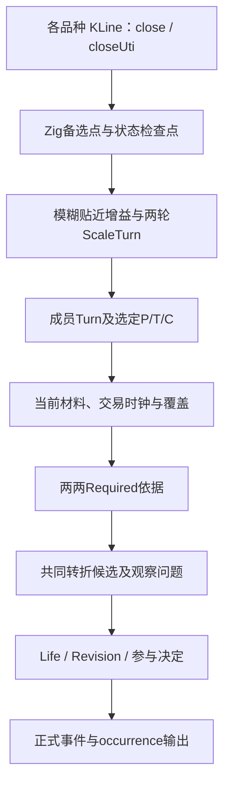

# F特征：统计线闭环

- 来源 chat：`01a1f8a7-09f2-7900-8511-5cea5e0de179`
- 归档日期：2026-11-21（北京时间）。
- 记录范围：2026-11-20 19:11:41 至 2026-11-21 19:44:01。
- 共 18 轮；用户消息 18 条，Codex 消息 77 条。
- 正文按 chat 返回的消息顺序保留；轮次标题时间为该轮开始时间（北京时间），并非每条消息的发送时间。
- 归档口径与附件说明见 [README](README.md)。

## 第 1 轮 · 2026-11-20 19:11:41

### 用户

<!-- message:01a1f8a7-c00c-72a3-a685-9883b70554ae -->
[https://github.com/daowei2026/observe-iterate/tree/feat/reasonableness-analysis-v0.2-20261120/task-inputs/eaw-p1-integrated ](https://github.com/daowei2026/observe-iterate/tree/feat/reasonableness-analysis-v0.2-20261120/task-inputs/u2-fqv-observation)获取这里面的F特征的特征实例运行结果，品种用钢铁板块，时间用2021初至2023年底，工作区用 /dwdhome/fy/BASE_E6_2_copy

<!-- /message:01a1f8a7-c00c-72a3-a685-9883b70554ae -->

### Codex（进展）

<!-- message:msg_0d1a4d44357a3d76016b002af2f41887d0a9e28d3751e68b1a -->
我先核对链接里的任务说明、F 特征定义和目标工作区，再按钢铁板块、2021 年初至 2023 年底运行并整理实例结果。链接显示文字与实际跳转目录不同，我会先检查两处内容以确认范围。

<!-- /message:msg_0d1a4d44357a3d76016b002af2f41887d0a9e28d3751e68b1a -->

### Codex（进展）

<!-- message:msg_0d1a4d44357a3d76016b002b057fa487d0acb7fe003e358f26 -->
我会使用 `long-task-status` 技能记录任务定义核对、实际运行和结果验收，便于追溯本次数据范围与运行证据。

<!-- /message:msg_0d1a4d44357a3d76016b002b057fa487d0acb7fe003e358f26 -->

### Codex（进展）

<!-- message:msg_0d1a4d44357a3d76016b002b1faa9087d080039c641eb19591 -->
已确认目标是 F「共同价格转折候选组」，钢铁板块对应 `rb / hc / i`。我会沿用链接中的特征参数，将实例区间设为 2021-01-01 至 2023-12-31，并通过正式读取接口导出主表和明细；接下来核对该区间的实例与保存结果。

<!-- /message:msg_0d1a4d44357a3d76016b002b1faa9087d080039c641eb19591 -->

### Codex（进展）

<!-- message:msg_0d1a4d44357a3d76016b002b8816c487d09720c2dfa9d3a9c8 -->
工作区已有可用的 F 运行环境和历史产品。本次任务已登记为 `f-steel-2021-2023-20261120`，状态记录在[本地账本](/dwdhome/fy/BASE_E6_2_copy/.runtime/task-status/tasks/f-steel-2021-2023-20261120/snapshot.json)。我正在确认日期参数确实进入 F 实例，避免把全历史结果截取后误称为区间运行。

<!-- /message:msg_0d1a4d44357a3d76016b002b8816c487d09720c2dfa9d3a9c8 -->

### Codex（进展）

<!-- message:msg_0d1a4d44357a3d76016b002bb5740c87d0a3e34b8c8bd72a1e -->
日期参数已进入实例：`startDay=2021-01-01`、`endDay=2023-12-31`，且没有设置全历史回退。该区间没有既存正式结果，我已启动仅 F 的区间生产；完成后会另起进程只读核验。

<!-- /message:msg_0d1a4d44357a3d76016b002bb5740c87d0a3e34b8c8bd72a1e -->

### Codex（进展）

<!-- message:msg_0d1a4d44357a3d76016b002c0ee33087d0a513477e24eb63d0 -->
F 引擎已确认实际处理了三个品种各 49,683 根 5 分钟 K 线，结果正在写入该区间的正式目录。写入结束后，我会核对候选记录数、成员明细和独立进程读回的一致性。

<!-- /message:msg_0d1a4d44357a3d76016b002c0ee33087d0a513477e24eb63d0 -->

### Codex（进展）

<!-- message:msg_0d1a4d44357a3d76016b002c969a2887d0a84093696784def6 -->
F 已运行完成并导出 32 条主表记录、71 条成员明细，共 31 张公开表。记录均落在 2021 年，2022、2023 年没有新发行记录；我正在用独立进程核对保存轴确实覆盖到 2023 年底，并逐表比对结果。

<!-- /message:msg_0d1a4d44357a3d76016b002c969a2887d0a84093696784def6 -->

### Codex（进展）

<!-- message:msg_0d1a4d44357a3d76016b002d17842887d0953879f6432bf778 -->
32 条记录对应 11 个候选 Life、32 个 revision；成员分布为 `rb 26 / hc 26 / i 19`。独立读取目前在等待共享存储 I/O，生产已结束。核验完成后会交付完整 CSV、便于浏览的实例摘要、运行证据和压缩包。

<!-- /message:msg_0d1a4d44357a3d76016b002d17842887d0953879f6432bf778 -->

### Codex（进展）

<!-- message:msg_0d1a4d44357a3d76016b002d81e6a087d0a0020b9b81ba9a82 -->
共享存储的读取比计算更慢，独立读回这一验收项尚未完成；已生成的生产 CSV 和运行记录均已保留。交付脚本已准备好，读回完成后即可比对、打包。

<!-- /message:msg_0d1a4d44357a3d76016b002d81e6a087d0a0020b9b81ba9a82 -->

### Codex（进展）

<!-- message:msg_0d1a4d44357a3d76016b002de6588c87d08e114b3f787a84b5 -->
独立进程读回成功，31 张表与生产导出的文件逐字一致。核验也确认 F 使用稀疏事件轴，因此我补做同一日期范围的原生 K 线只读检查，用输入行情确认完整覆盖到 2023 年底。

<!-- /message:msg_0d1a4d44357a3d76016b002de6588c87d08e114b3f787a84b5 -->

### Codex（进展）

<!-- message:msg_0d1a4d44357a3d76016b002e42e7a487d0bdc22da9a4a73f7b -->
全表一致性检查已通过。目前只剩输入行情日期覆盖的最后核对，随后即可生成结果压缩包；共享存储仍在慢速加载运行依赖。

<!-- /message:msg_0d1a4d44357a3d76016b002e42e7a487d0bdc22da9a4a73f7b -->

### Codex（进展）

<!-- message:msg_0d1a4d44357a3d76016b002ea2170487d09520451147f8dcf7 -->
输入覆盖已核实：`rb / hc / i` 各 49,683 根 K 线，实际范围为 2021-01-04 至 2023-12-29，与生产日志一致。结果包已生成，正在做最后的文件校验。

<!-- /message:msg_0d1a4d44357a3d76016b002ea2170487d09520451147f8dcf7 -->

### Codex（回复）

<!-- message:msg_0d1a4d44357a3d76016b002ed44a2487d089347bcea99f4f30 -->
已完成钢铁板块 `rb / hc / i`、2021—2023 年的 F 实例运行，独立进程读回验证通过。

结果：**11 个候选、32 条版本记录、71 条成员明细，共 31 张表**。2022、2023 年无新发行记录。

- [完整结果包](/dwdhome/fy/BASE_E6_2_copy/results/f-steel-2021-2023-20261120.zip)
- [实例摘要 CSV](/dwdhome/fy/BASE_E6_2_copy/results/f-steel-2021-2023-20261120/F_实例摘要.csv)
- [结果说明与运行证据](/dwdhome/fy/BASE_E6_2_copy/results/f-steel-2021-2023-20261120/README.md)
<!-- /message:msg_0d1a4d44357a3d76016b002ed44a2487d089347bcea99f4f30 -->

## 第 2 轮 · 2026-11-20 19:29:09

### 用户

<!-- message:01a1f8b7-b070-7bd0-9a4c-91f1fe76a7b6 -->
给我完整结果包的下载链接。我要下载那个ZIP文件。

<!-- /message:01a1f8b7-b070-7bd0-9a4c-91f1fe76a7b6 -->

### Codex（进展）

<!-- message:msg_0d1a4d44357a3d76016b002f07e1c487d0a1333764e9416bb9 -->
我先确认 ZIP 文件的位置，再尝试生成可下载的附件链接。

<!-- /message:msg_0d1a4d44357a3d76016b002f07e1c487d0a1333764e9416bb9 -->

### Codex（回复）

<!-- message:msg_0d1a4d44357a3d76016b002f76d61087d0aef0a595a087c9a3 -->
[点击下载完整结果包 ZIP（约 70 KB）](http://192.168.11.40:8768/f-steel-2021-2023-20261120-4d31a2cd.zip)

需连接工作区所在内网。
<!-- /message:msg_0d1a4d44357a3d76016b002f76d61087d0aef0a595a087c9a3 -->

## 第 3 轮 · 2026-11-21 12:00:47

### 用户

<!-- message:01a1fc43-8cef-7043-8194-c18581490b0d -->
对F特征获取这些内容 : 1.输入到输出有哪些关键的业务对象(广义的业务对象，因为可能有些属于是业务概念)？每个对象包含了哪些参数？从上游对象到它的业务处理逻辑(不仅要讲数据处理关系，还要包括时序逻辑)？它对应特征输出中的哪些字段(要落到特征、事件、occurence)？    

<!-- /message:01a1fc43-8cef-7043-8194-c18581490b0d -->

### Codex（进展）

<!-- message:msg_0d1a4d44357a3d76016b0117737d2887d09328dee23f6715a5 -->
我会沿用这次运行的 F 代码版本和实例，梳理关键业务对象、参数、处理与时序逻辑，再逐项对应到正式输出的特征、事件和 occurrence 字段。

<!-- /message:msg_0d1a4d44357a3d76016b0117737d2887d09328dee23f6715a5 -->

### Codex（进展）

<!-- message:msg_0d1a4d44357a3d76016b0117c2d54087d0ae9086aaa9d68771 -->
已确认，F 的核心结果是带生命周期和版本的候选组。形成过程中，它分别维护转折材料、两两相容依据和候选组状态。我会重点解释实际、确认、可知时间的区别，以及观察关闭和后续修订的时限。

<!-- /message:msg_0d1a4d44357a3d76016b0117c2d54087d0ae9086aaa9d68771 -->

### Codex（进展）

<!-- message:msg_0d1a4d44357a3d76016b01187e739887d0ac3a8799337ecf02 -->
字段核对已覆盖 31 张表、471 个列条目。另有两个需要明确的口径：脚本里的 `direction` 和 `source_core_multiples` 只传给 Q，F 同时处理向上、向下转折；在本次配置中，Δ 是 5 个交易分钟，两两实际转折的距离上限是 2Δ，即 10 个交易分钟。

<!-- /message:msg_0d1a4d44357a3d76016b01187e739887d0ac3a8799337ecf02 -->

### Codex（进展）

<!-- message:msg_0d1a4d44357a3d76016b0119dbcd3487d0b86f172caf4bf205 -->
真实结果中有一个清楚的例子：同一候选在 09:15 为 `Open`，09:30 变为 `ClosedSupported`，10:00 又发行一个版本。最后一次的观察状态虽然没变，修订责任已关闭。我会用这组三版本说明各个时间字段和状态字段的区别。

<!-- /message:msg_0d1a4d44357a3d76016b0119dbcd3487d0b86f172caf4bf205 -->

### Codex（进展）

<!-- message:msg_0d1a4d44357a3d76016b011b11dbb887d0bfcf1cfb70055290 -->
说明已整理成 14 类业务对象，每类都列出参数或属性、上游处理、时序规则和输出位置。逐字段字典覆盖全部 31 张表，并标明哪些是原始业务字段、物理索引、枚举显示列，以及哪些内部概念没有独立输出表。

<!-- /message:msg_0d1a4d44357a3d76016b011b11dbb887d0bfcf1cfb70055290 -->

### Codex（回复）

<!-- message:msg_0d1a4d44357a3d76016b011b9b153887d0a4cebce3cb645c61 -->
已按这次实际运行的 F 版本整理完成，包括 **14 类业务对象、参数/属性、业务处理、时序逻辑，以及到正式输出字段的对应**。

- [完整说明：可直接阅读的 HTML](http://192.168.11.40:8768/f-business-objects-20261121.html)
- [逐字段字典 CSV：31 张表、471 个列条目](http://192.168.11.40:8768/f-business-fields-20261121.csv)
- [完整材料包 ZIP：说明、字段字典、源码与真实实例](http://192.168.11.40:8768/f-business-objects-20261121.zip)

以上为工作区内网链接。下面给出主要内容。

F 回答的业务问题是：**同一对象域、尺度、日历和方法下，哪些不同品种的已选实际转折，可以组成两两相容的共同转折候选？**

这里的“参数”需要分成配置参数与运行属性。例如 `delta` 是配置参数，`memberActual`、候选 `Revision` 是运行中形成的业务属性。



具体可以按下面 14 类对象理解。完整属性清单、公式与源码位置在 HTML 中逐项展开。

| 业务对象 | 关键参数或属性 | 从上游形成它的业务处理与时序 | 对应 F 输出 |
|---|---|---|---|
| **B01 实例范围、对象域与形成方法** | SOF、起止日、对象集、Calendar、尺度、方法引用、Δ、方向/类型相容矩阵 | 构造时固定实例范围，校验来源对象与声明域一致；固定定义在首次正常发行时保存 | `definitions` 及对象集、方向矩阵、类型矩阵子表 |
| **B02 行情与交易时钟** | `symbol`、`freq`、`close`、`closeUti`、单位换算、Clock 的值与可知时间 | 同一收盘事件的价格与 UTI 齐备后进入处理；时间距离按交易时钟计算 | 成员价格、实际/确认/可知时间，以及 `memberClock`、各点 `pointClock` |
| **B03 Zig 备选转折与状态点** | `featIn`、`retracePct`；最近确认 Zig 和当前状态点的价格、方向、UTI | 更新高低点，达到反转阈值后确认此前实际转折；已确认 Zig 提供备选点，最新状态提供检查点 | 完整 Zig 过程属于上游；被选结果投影到成员实际点、方向和类型 |
| **B04 贴近增益与模糊尺度判别** | 距离放大倍数、时间缩放、模糊隶属函数、规则、`specTerm=M`、隶属度阈值 | 检查点到达后，计算加入备选转折带来的几何贴近增益；判断增益在 **M 尺度上的隶属度**是否超过阈值 | 完整配置与推理过程主要在上游；F 保留最终选中的 P/T/C，不复制全部推理过程 |
| **B05 两轮尺度转折** | `falter`、`fcheck`、增益控制器、阈值、第二轮选择方法；`actual/confirm/processInfo` | 先选第一轮合格点，再从其后的备选点选择第二轮；实际点早于确认它的检查点，同拍可以出现两轮结果 | 上游 `ScaleTurnCalendar.value1/value2`；F 中对应 `memberActual`、`memberConfirmation`、`memberRound` 等 |
| **B06 成员 Turn 与 P/T/C 几何** | 准确 Turn/Source 引用、对象、实际价与时间、确认时间、可知时间、方向、类型、轮次、P/T/C、Clock | 将已发行 ScaleTurn 包装为成员。P 是上一个已选转折，T 是本次实际转折，C 是确认检查点；同拍第二轮的 P 使用刚选出的第一轮 T | `occurrences_groupMembers`，以及 P、Clock 等成员子表 |
| **B07 当前形成材料与逐对象覆盖** | `progress`、`known`、当前 Turn、可枚举域、变化集、覆盖区间、覆盖不完整标志 | 先接纳本拍材料，再向下游计算；近期 Turn 参与新枚举，已有候选引用的端点另行保留以供修订；覆盖按对象分别判断 | 主要投影到 `groupCoverageIncomplete`、成员小值及候选新版本；内部材料集合没有独立 F 表 |
| **B08 两两 Required 依据** | 左右准确引用、实际时间距离，以及时间/方向/类型/弯折四项判断 | 只使用当时已知事实；四项全支持才是肯定 pair，任一明确否决即为否决，其余为未决 | `occurrences_groupRequired`、`pairDistance` 子表；各坐标的 `requiredVerdict/Gap/Veto` |
| **B09 原观察问题与时间责任** | 原 `anchor/deadline/revisionEnd`，当前三值及后续承接边界 | 以最早成员实际 Clock 绑定原问题；晚到确认不能重启窗口，当前期限只能收紧 | `groupOriginal*`、`groupAnchor/Deadline/RevisionEnd`、`groupClosed`；参与事实中的责任边界 |
| **B10 候选组合、Life、Revision 与状态** | 成员组合、pair、局部依据、观察状态、备选状态、准确引用、前版引用 | 在有限材料内形成两两相容或尚未否决的极大候选；同一候选观点改变时沿原 Life 发新 Revision | 主表 `occurrences`、`groupPrevious`、成员 `memberStatus` |
| **B11 重叠、被覆盖与关系桥** | `overlaps`、`coveredBy`；准确左右引用、共享成员桥、关系可知时间 | 共享成员可构成重叠；被同问题下更大的支持组合包含时，小组可成为 `Subsumed`，仍保留原 Life 与历史 | `groupOverlaps`、`groupCoveredBy`、`participationAlternatives` 及 `alternativeBridge` |
| **B12 原 F 参与与决定事实** | 首次准入引用、当前候选引用、冻结成员、决定方法/范围、责任边界、`dutyClosed` | 首次准入事实固定；后续观点更新当前引用及决定时间，责任只收紧；观察关闭与修订责任关闭分别表达 | `groupFormationParticipation`、`participationMembers` 等子表 |
| **B13 正式反证、修正链与操作数** | 反证坐标、原因、状态、首次反证引用、最近修正引用、前驱和操作数 | 出现明确反证时记录；后续支持恢复、材料失知或主体无效分别保留修正状态与历史，而不是简单删除反证 | `participationSupports` 及操作数/点/Clock 子表；原 F 的期外通知列表要求为空 |
| **B14 正式事件与 occurrence 包装** | Feature 实例、事件布局、定义列表、候选发生列表、物理坐标 | 首次保存定义；之后业务观点有变化才发行。同一事件可以携带多个候选发生 | `common_price_turn_groups.core.v2` 展开的全部 31 张表 |

有几处处理逻辑尤其影响理解输出。

**第一，组必须满足两两关系，不能只靠链式相连。**  
假设 A–B、B–C 支持，但 A–C 否决，就不能把 A/B/C 当作完整支持组。一个 n 成员候选要保存 `n(n−1)/2` 条 pair；每条 pair 又分别保存：

- 时间：两个**实际转折 Clock**的距离不超过 `2Δ`。
- 方向：按显式方向矩阵判断。
- 类型：按峰/谷类型矩阵判断。
- 弯折：比较各成员自身 P/T/C 的弯折类别，不跨品种直接相减价格。

**第二，实际、确认、可知和发行时间必须分别保留。**

| 时间概念 | 含义 | 字段 |
|---|---|---|
| actual | 被选转折实际发生的位置 | `memberActual` |
| confirmation | 上游确认该转折的检查点位置 | `memberConfirmation` |
| known | 本次处理何时才知道并使用该事实 | `memberKnownFrom`、`groupKnownFrom` |
| publication | 原保存事件发生时间 | `timestamp` |

P、T、C 及其 Clock 也分别有自己的可知时间。事后确认的转折不能提前放到实际发生时就视为已知。

**第三，观察关闭与修订责任关闭是两回事。**

本实例 `Δ=600 tick=5个交易分钟`：

- 两两实际转折距离上限：`2Δ=10分钟`。
- 原观察关闭边界：`a+6Δ=30分钟`。
- 原修订责任终点：`a+12Δ=60分钟`。
- 下游有限承接边界：最多 `a+30Δ=150分钟`，它不延长 F 自身的修订责任。

到观察期限后，`groupClosed=1`，但在修订终点前仍可因合法新事实发行新版本。到修订终点的同拍，先处理材料，再形成最终观点并退出活跃修订状态。

这在本次真实结果中可以直接看到。候选 Life 为：

`133e57f2-6969-42e1-b2b5-18bc2212b2f9`

它的成员是 hc/rb：

| 事件时间 | 观察状态 | `groupClosed` | `participationDutyClosed` |
|---|---|---:|---:|
| 2021-04-12 09:15 | Open | 0 | 0 |
| 2021-04-12 09:30 | ClosedSupported | 1 | 0 |
| 2021-04-12 10:00 | ClosedSupported | 1 | 1 |

第三次虽然观察标签没变，**原 F 修订决定责任已经关闭**，因此仍产生了新 Revision。

最后，落到 Feature、event、occurrence 的准确层次是：

```text
CommonPriceTurnGroupCandidatesFrp：准确参数与SOF实例
└─ event/layout：common_price_turn_groups.core.v2
   └─ 原事件：timestamp + occurrence序号
      └─ mul[record_id]
         ├─ groupDefinitions[]
         └─ groupOccurrences[child_id_2]：候选准确版本发生
            ├─ groupReference、状态、期限
            ├─ groupPrevious[]
            ├─ groupMembers[]
            ├─ groupRequired[]
            └─ groupFormationParticipation[]
```

因此，公开主表的一行是一条候选版本发生；索引列 `occurrence` 是原事件物理序号。**候选业务身份需要使用 `groupReference` 的 Life/Revision**，成员明细则通过完整父坐标与主表连接。
<!-- /message:msg_0d1a4d44357a3d76016b011b9b153887d0a4cebce3cb645c61 -->

## 第 4 轮 · 2026-11-21 12:31:50

### 用户

<!-- message:01a1fc5f-f83b-7340-a61a-26dc2f26e805 -->
这是我对在另外一个Chat，回答另一个特征的同样问题的处理给出的反馈“”“你好像没有理解什么叫做业务对象哎。比如说O1，这个不算是业务对象。业务对象是指O呀，然后八卦单啊，然后强庄啊。它至少，它对应的是数据行情上某种现象\某种位置吧。业务处理逻辑这部分很有可能会涉及和这个业务对象相关的多种属性。它可能是根据多种属性来判断。比如说这个wall的生命周期，它就是根据就是围绕wall相关的一些属性来判断的。这些属性也需要列清楚。”“”。你也看看，是不是要对应去调一下。

<!-- /message:01a1fc5f-f83b-7340-a61a-26dc2f26e805 -->

### Codex（进展）

<!-- message:msg_0d1a4d44357a3d76016b011eb833f487d090e7972a5eac8212 -->
是，需要调整。我上一版把配置、时钟、内部材料和输出包装也列成了“业务对象”，混淆了业务现象与实现载体。按你的口径，应该先找 F 在行情上识别的转折位置、共同转折候选组等对象，再列清它们的属性，以及这些属性如何共同决定归组、状态变化和生命周期。我会据此重整现有说明，并保留属性到正式输出字段的对应。

<!-- /message:msg_0d1a4d44357a3d76016b011eb833f487d090e7972a5eac8212 -->

### Codex（进展）

<!-- message:msg_0d1a4d44357a3d76016b011fdcfff487d0829f7a3404395e73 -->
我把主线收敛为三类：原始价格转折、指定尺度贴近转折、共同价格转折候选组，最后一类是 F 的目标对象。组内成员资格、两两相容性、重叠/被覆盖关系、观察状态和修订责任，都放回候选组的属性与关系中；生命周期规则也会逐条写明使用哪些属性、满足什么条件、如何改变状态。

<!-- /message:msg_0d1a4d44357a3d76016b011fdcfff487d0829f7a3404395e73 -->

### Codex（进展）

<!-- message:msg_0d1a4d44357a3d76016b01203e173487d0bff2ffe135bce04f -->
重整时有个关键点需要保留：`Withdrawn`、`Subsumed` 都不能单独解释为“候选生命周期已结束”。它们是候选的观察结果；是否退出活跃修订，还要检查当前进展、修订责任终点及显式范围结束事实。我会把这些属性、判断条件和输出变化放在同一张规则表里。

<!-- /message:msg_0d1a4d44357a3d76016b01203e173487d0bff2ffe135bce04f -->

### Codex（进展）

<!-- message:msg_0d1a4d44357a3d76016b01217555f087d0a09a2b9a04676d58 -->
新版已按“行情对象 → 属性 → 判断条件与时序 → 输出字段”重整，列出 36 组属性和 14 条规则。原有 31 张结果表的 471 个字段条目也已重新归类，字段路径保持一致。现在核验并打包，ZIP 中会包含修订说明和原始运行结果。

<!-- /message:msg_0d1a4d44357a3d76016b01217555f087d0a09a2b9a04676d58 -->

### Codex（回复）

<!-- message:msg_0d1a4d44357a3d76016b0121b602c487d0ac253f5660656e50 -->
是，需要调整。上一版把工程结构与业务对象混在了一起。我已按你说的“行情现象／位置”口径重整，主线是：

- **原始价格转折**：峰谷位置、价格、方向及确认过程。
- **指定尺度贴近转折**：P/T/C位置、价格、可知时间、贴近增益和尺度资格。
- **共同价格转折候选组**：具体成员、成员间相容性、覆盖关系、观察状态及修订责任。

新版列出了 **36组属性、14条判断规则**，逐条说明“使用哪些属性、满足什么条件、何时处理、改变哪些输出”。例如，`Withdrawn`、`Subsumed` 本身不足以判定生命周期结束，还须检查修订期限和范围结束事实。

已完成字段对应核验，完整包包含修订说明、属性清单、字段映射、源码依据及原始运行结果。

**[下载修订版完整 ZIP](http://192.168.11.40:8768/f-business-objects-v2-20261121.zip)** · [在线阅读说明](http://192.168.11.40:8768/f-business-objects-v2-20261121.html)

链接通过现有内网服务提供，需要能访问 `192.168.11.40`。
<!-- /message:msg_0d1a4d44357a3d76016b0121b602c487d0ac253f5660656e50 -->

## 第 5 轮 · 2026-11-21 12:54:34

### 用户

<!-- message:01a1fc74-ca12-7591-994d-b050b2fbad35 -->
把HTML文件改成和这个文件一样的：/dwdhome/fy/BASE_E6_2/.runtime/wall-business-model-20261121/Wall业务对象与属性判断逻辑-修订版.html  背景和字体颜色

<!-- /message:01a1fc74-ca12-7591-994d-b050b2fbad35 -->

### Codex（进展）

<!-- message:msg_0d1a4d44357a3d76016b01240fd58087d08d55930d9e1a82b1 -->
我会参照这个 Wall 文件，调整 F 说明 HTML 的背景和字体颜色，并同步更新下载包。

<!-- /message:msg_0d1a4d44357a3d76016b01240fd58087d08d55930d9e1a82b1 -->

### Codex（回复）

<!-- message:msg_0d1a4d44357a3d76016b01245a1d5087d0a7193cfa34d44abe -->
已改成 Wall 文件相同的背景和字体配色，包含浅色／深色模式，并同步更新 ZIP。

[查看 HTML](http://192.168.11.40:8768/f-business-objects-v2-20261121.html?v=ed381e1d) · [下载更新后的 ZIP](http://192.168.11.40:8768/f-business-objects-v2-20261121.zip?v=c66ae5fe)
<!-- /message:msg_0d1a4d44357a3d76016b01245a1d5087d0a7193cfa34d44abe -->

## 第 6 轮 · 2026-11-21 14:03:03

### 用户

<!-- message:01a1fcb3-7a3d-77d2-ab95-6643eb314275 -->
目前我觉得这个对象属性还不是特别清晰。就是现在是直接就根据指定尺度贴近转折的情况去得到共同价格转折候选组的情况嘛。但是我看共同价格转折候选组里面属性非常非常多，这些属性是不是还是有层次划分的呀。 但是这个层次划分，我拿不准是怎么组织比较合适哈。就是这个共同价格转折候选主，它有不同的，就是是围绕对它要进行什么处理，然后来整理这个属性吗。

<!-- /message:01a1fcb3-7a3d-77d2-ab95-6643eb314275 -->

### Codex（进展）

<!-- message:msg_0d1a4d44357a3d76016b01341a496487d09eeb9c713afad586 -->
我会先把现有属性按它们回答的业务问题重新梳理，看看哪些描述候选组本身，哪些服务于相容性判断、观察过程和修订责任，再给你一个更清楚的组织方式。

<!-- /message:msg_0d1a4d44357a3d76016b01341a496487d09eeb9c713afad586 -->

### Codex（回复）

<!-- message:msg_0d1a4d44357a3d76016b013452140487d08105583115237665 -->
**是，可以围绕“对候选组要做哪些业务处理”来组织说明；同时，还需要把属性按所属层次归位。** 上一版虽然区分了业务对象，但候选组下面仍平铺了成员事实、关系判断、组级结论和维护记录，这一层确实还不够清楚。

从指定尺度贴近转折到共同候选组，中间还有一个重要环节：

**各品种的选中转折 → 转折之间的两两相容关系 → 候选组合 → 对组合的判断与持续维护。**

我建议围绕候选组，分成下面五个部分：

| 部分 | 包含哪些属性 | 围绕这些属性进行什么处理 |
|---|---|---|
| **1. 成员组成** | 哪些品种的哪一次转折；各转折的位置、价格、峰谷类型、方向、P/T/C背景 | 确定这组具体由什么组成，以及是否仍是原来的候选组 |
| **2. 成员之间的关系** | 两两时间距离、方向相容、类型相容、弯折相容；每项的支持、未决或反证 | 判断每两个转折能否共同参与一项共同转折解释 |
| **3. 整组的当前判断** | 整组形成依据、成员在组内的资格、观察域是否完整 | 汇总成员及关系，判断本组目前得到多少支持；观察完整性单独保留 |
| **4. 与其他候选组的关系** | 共享哪些具体转折、是否被更大支持组合包含 | 判断重叠、覆盖，以及本组是否应标为被覆盖 |
| **5. 随时间的观察与修订** | 原始及当前锚点、观察期限、修订期限、可知时间、观察是否关闭、修订责任是否关闭 | 随新材料更新判断，处理观察关闭、观点修订和责任结束 |

Life、Revision、首次准入快照、前版引用和反证更正历史，可以另设“**判断依据与沿革**”部分，供追查每次判断为何变化。

这里有两个组织上的关键点。

**第一，属性按归属定义，业务处理跨层读取。**  
例如，“某成员的实际转折时间”属于成员的位置属性，但它会同时用于计算两两时间距离、确定组的形成锚点、计算观察期限。这个属性只定义一次，各项处理引用它，就不会出现多套重复解释。

**第二，同一个生命周期处理，往往需要组合多个层次的属性。**  
以“观察关闭”为例：

- 判断是否关闭，要读取当前进展、观察期限和原关闭状态。
- 关闭后的观察结果，还要读取整组形成依据，才能区分“关闭且支持”与“关闭但依据不足”。
- 判断是否停止修订，则继续读取修订期限和范围结束事实。

因此，“观察结果”“观察关闭”“修订责任关闭”需要分别解释，再说明它们如何共同演化。

落实到文档，我建议采用这样的写法：**以业务处理作为阅读主线，在每项处理下说明读取哪些层次的属性、判断条件、更新哪些属性、何时更新，以及对应的输出字段。** 同时保留一份按归属整理的属性字典。这样既能看清候选组的结构，也能顺着处理过程理解它为什么形成、变化和结束。
<!-- /message:msg_0d1a4d44357a3d76016b013452140487d08105583115237665 -->

## 第 7 轮 · 2026-11-21 14:14:00

### 用户

<!-- message:01a1fcbd-82ae-75e0-8f71-b9f271c66603 -->

# Response annotations:
Each item contains text selected from an earlier Codex response and may include a user comment. Treat items as Annotation 1, Annotation 2, and so on in array order. Use every selection as context and address every comment. For every annotation you address, include its inline directive `:codex-annotation{index="N"}`, where N is its one-based array position (for example, `:codex-annotation{index="1"}`). Do not use unstructured annotation labels.
<response-annotations>
[{"text":"各品种的选中转折 → 转折之间的两两相容关系 → 候选组合 → 对组合的判断与持续维护。","source":{"messageId":"msg_0d1a4d44357a3d76016b013452140487d08105583115237665","startOffset":125,"endOffset":169}}]
</response-annotations>

## My request:
按照这个依赖关系，意思是在有了转折之间的两两相容关系之后，才提出了候选组合这个概念吗？就这个概念是在什么时候去定义出来的？就是首先是只是把多个品种的某一次转折线放到一起，然后就是去进行了一些属性的计算。然后呢，再是去定义出了这个候选组嘛。然后又进行了多个候选组关系的属性的计算。然后再对这个候选组的属性进行更新。

<!-- /message:01a1fcbd-82ae-75e0-8f71-b9f271c66603 -->

### Codex（进展）

<!-- message:msg_0d1a4d44357a3d76016b0136aa81c887d09f6225e220206895 -->
我会核对候选组首次建立和后续更新的代码顺序，分清“概念怎样定义”和“某个具体候选何时产生”。上一条箭头容易把这两件事混在一起。

<!-- /message:msg_0d1a4d44357a3d76016b0136aa81c887d09f6225e220206895 -->

### Codex（回复）

<!-- message:msg_0d1a4d44357a3d76016b0136ce6d8c87d08cca340f1dd921d7 -->
**对，如果你说的是“某个具体候选组何时被建立”，大体就是你理解的这个顺序。** 我上一条箭头需要补清楚：**候选组的概念和形成规则事先定义；运行时先判断转折之间的关系，再识别出具体的候选组实例。** :codex-annotation{index="1"}

这里可以分成以下几个环节：

| 环节 | 当时处理的是什么 | 做什么、得到什么 |
|---|---|---|
| **1. 收集选中转折** | 不同品种的具体转折位置，以及各自的价格、方向、P/T/C背景 | 得到当前允许参与判断的转折材料。此时还没有确定哪些转折属于同一组 |
| **2. 判断两两关系** | 两个不同品种的具体转折 | 计算时间接近、方向相容、类型相容、弯折相容，得到支持、未决或否决 |
| **3. 识别候选组合** | 转折材料及它们之间的关系 | 按预先定义的组合规则，选出哪些具体转折可以共同组成一个候选组 |
| **4. 计算组内结论** | 已确定成员组合的候选组 | 得到整组形成依据、成员资格、观察期限、当前观察结果等 |
| **5. 判断组间关系** | 同时存在的多个候选组 | 计算重叠、被更大支持组合覆盖等关系；这些关系还可能改变组的观察结果 |
| **6. 持续维护** | 已存在的候选组，以及新材料和时间进展 | 更新关系、组级判断和责任状态，必要时形成新的观点记录 |

有一点需要特别明确：**第2步计算的“两两关系”，属于两次转折之间的关系，可以先于具体候选组存在，也可以被多个候选组共同使用。**

例如，现在有三个具体转折：

- rb的转折A与hc的转折B：支持。
- hc的转折B与i的转折C：支持。
- rb的转折A与i的转折C：否决。

按照当前规则，可以形成 `{A,B}` 和 `{B,C}` 两个候选组。随后才发现：这两个组共享同一个转折B，因此存在组间重叠关系。不能仅凭前两对支持就把 `{A,B,C}` 当作一个共同候选组。

所以，你说的“先放到一起”更准确地理解为：**先把它们纳入同一个待判断的材料范围，再依据两两关系确定成员组合。** 在成员组合确定时，具体候选组实例就被建立了。候选组允许包含尚未判清的关系，因此它出现时也可能仍是“依据不完整”的候选。

这也说明，属性可以沿着三个层次组织：

1. **转折自身的属性**：位置、价格、方向、P/T/C等。
2. **转折之间的关系属性**：时间距离、各项相容性及其判断依据。
3. **候选组的属性**：成员组成、整组结论、组间关系、观察和修订状态。

其中，“候选组的成员组成”来自前两层共同参与的识别过程；组间关系又要等具体组存在后才能判断。

最后，持续维护是一个循环过程。新材料到来时，会重新检查受影响的两两关系，再更新有关候选；即使没有新转折，时间到达观察期限或修订期限，也可能使已有候选产生新的状态。**同一候选的观点更新，与识别出一个新的成员组合，是两种不同的变化。**
<!-- /message:msg_0d1a4d44357a3d76016b0136ce6d8c87d08cca340f1dd921d7 -->

## 第 8 轮 · 2026-11-21 14:22:38

### 用户

<!-- message:01a1fcc5-688c-73e2-934c-d40c66ac485a -->
统计每个业务对象的发生次数，比较它与上游对象的发生次数和发生位置看有没有异常？以及我的目的是要去发现特征结果的合理性问题(也就是看有没有不符合预期的点)，你看看是否还有其它该统计的，如果有，也一并给出统计和合理性分析结果。

<!-- /message:01a1fcc5-688c-73e2-934c-d40c66ac485a -->

### Codex（进展）

<!-- message:msg_0d1a4d44357a3d76016b0138afd9a087d0be9b29f762175bb2 -->
我会按“原始转折 → 指定尺度转折 → 共同候选组”统计发生次数和位置，同时区分候选组个数与同一组的多次修订。除了上下游对照，我也会检查时间集中、长期无输出、相容性与状态、期限边界，以及重复或遗漏；发现可疑点后再追查对应的真实记录和规则。

<!-- /message:msg_0d1a4d44357a3d76016b0138afd9a087d0be9b29f762175bb2 -->

### Codex（进展）

<!-- message:msg_0d1a4d44357a3d76016b0138bc9d5487d0ab2240689c832aca -->
我会用现有的 long-task-status 技能记录这次统计、异常追查和验收。原结果包没有保存全部原始转折及尺度转折发生，因此需要从同一锁定运行环境补取上游记录，才能比较转换率、发生位置和无输出区间。

<!-- /message:msg_0d1a4d44357a3d76016b0138bc9d5487d0ab2240689c832aca -->

### Codex（进展）

<!-- message:msg_0d1a4d44357a3d76016b01393acc8087d0bc96e68fd2802329 -->
已有结果中，11 个候选组全部出现在 2021 年，2022、2023 年没有新候选。这是本次优先追查的现象：需要确认后两年是否仍有原始转折和尺度转折，再判断输出中断发生在哪一层。任务编号是 `f-reasonableness-20261121`。

<!-- /message:msg_0d1a4d44357a3d76016b01393acc8087d0bc96e68fd2802329 -->

### Codex（进展）

<!-- message:msg_0d1a4d44357a3d76016b0139a528d087d08e7ed490a3af6aca -->
上游记录已补齐：三年内共有 10,073 个原始转折、1,859 个尺度转折，但只有 91 个尺度转折在实际位置后 30 个交易分钟内被识别；其余 1,768 个超过了 F 的新候选准入窗口。rb、hc 在 2022、2023 年都没有及时进入窗口的尺度转折。这已能解释后两年无共同候选的主要原因，我会继续核验是否还有漏组，以及这种筛选是否造成明显偏向。

<!-- /message:msg_0d1a4d44357a3d76016b0139a528d087d08e7ed490a3af6aca -->

### Codex（进展）

<!-- message:msg_0d1a4d44357a3d76016b013af6c01c87d0b1efc9b3846bda76 -->
独立按当前规则枚举得到的 11 个成员组合，与正式结果的成员和首次发生时刻完全一致，目前没有发现按规则应生成却漏掉的组。回看全部尺度转折，有 624 对在实际位置、方向、类型和弯折上相容，但其中 608 对在双方都可知时已超过准入期限。这支持把主要问题定位为“上游识别延迟与下游准入窗口不匹配”，而不是候选枚举遗漏。

<!-- /message:msg_0d1a4d44357a3d76016b013af6c01c87d0b1efc9b3846bda76 -->

### Codex（进展）

<!-- message:msg_0d1a4d44357a3d76016b013beeae6c87d098600e47d5cc74ab -->
统计和追查已完成。当前最值得审视的是：尺度转折从实际发生到被识别的延迟中位数为 165 个交易分钟，而 F 的新候选准入期只有 30 分钟，最终只有 23 个不同尺度转折参与了候选组。报告也单列了输入空值、计数重复、状态和期限检查，避免把“符合现行代码”直接当作“符合业务预期”。

<!-- /message:msg_0d1a4d44357a3d76016b013beeae6c87d098600e47d5cc74ab -->

### Codex（回复）

<!-- message:msg_0d1a4d44357a3d76016b013c7bfc2887d0a5e2c7fbfc44595a -->
已完成统计。**最明显的合理性疑点是：尺度转折的识别延迟，与 F 的新候选准入期限不匹配，导致大量共同转折位置被排除。**

[查看完整分析 HTML](http://192.168.11.40:8768/f-reasonableness-20261121.html) · **[下载完整 ZIP（约7 MB）](http://192.168.11.40:8768/f-reasonableness-20261121.zip)**（内网链接）

按首次可知年份统计：

| 年份 | 原始转折位置 | 指定尺度转折 | 30交易分钟内识别的尺度转折 | 新候选组 | 候选观点记录 |
|---|---:|---:|---:|---:|---:|
| 2021 | 4,543 | 929 | 58 | 11 | 32 |
| 2022 | 3,450 | 642 | 32 | 0 | 0 |
| 2023 | 2,080 | 288 | 1 | 0 | 0 |
| **合计** | **10,073** | **1,859** | **91** | **11** | **32** |

原始及尺度转折计数各含3个初始化锚点。11个候选组产生了32次观点，不能算成32个组。

主要分析结果：

- **95.10%的尺度转折超期。** 从实际位置到尺度选中的延迟中位数为 **165个交易分钟**，F却要求在实际位置后 **30个交易分钟**内建立新候选。2022、2023年只有 i 存在及时转折，rb、hc均为零，无法凑成跨品种候选。
- **上游存在位置接近的共同现象。** 回看有624对尺度转折在时间、方向、类型和弯折上相容，其中608对在双方都可知时已经超期。这些是覆盖损失的证据，不能直接称为608个漏组。
- **未发现现行规则下的漏组。** 独立枚举得到的11个组合及首次时刻与正式结果一致；位置、价格、关系、期限和修订链等29项检查均无不一致。因此，当前更值得审视的是业务规则的配合，而非枚举计算错误。
- **还有输入质量和验证覆盖问题。** 每品种有69条收盘价空值，均在2023年，无法解释2022年无输出；本批全部候选均为Supported，尚未覆盖反证、缺件等分支的合理性验证。

完整包包含逐品种、逐月统计，实际位置与可知位置对照、延迟分布、真实排除案例、生命周期检查、上游原始记录及原F结果。
<!-- /message:msg_0d1a4d44357a3d76016b013c7bfc2887d0a5e2c7fbfc44595a -->

## 第 9 轮 · 2026-11-21 14:45:45

### 用户

<!-- message:01a1fcda-94c4-7cf0-b2df-a51a6815dc8a -->
我想要知道，比如每个品种它原来有多少次的贴近转折，然后最后形成了多少个候选组，多少次候选组。这就在你上面给的那个表格中是指定尺度转折和新候选组这两列吗？但是指定尺度转折肯定要多个品种分开看的。就你给的那几行有什么差别，我都看不明白。

<!-- /message:01a1fcda-94c4-7cf0-b2df-a51a6815dc8a -->

### Codex（进展）

<!-- message:msg_0d1a4d44357a3d76016b013e1b6c3087d09c0c7c91a6784b75 -->
对，刚才那张表把三个品种合计了，没有直接回答你要看的逐品种对照。我会把每个品种的贴近转折数、参与了多少个候选组，以及这些组产生了多少次观点记录放在一起，并说明组数跨品种重复计数的地方。

<!-- /message:msg_0d1a4d44357a3d76016b013e1b6c3087d09c0c7c91a6784b75 -->

### Codex（回复）

<!-- message:msg_0d1a4d44357a3d76016b013e3e584c87d0b4c44b1381c0d8a0 -->
对，你要比较的就是“贴近转折 → 候选组”。上一张表每行是一个年份，三个品种合在一起统计，所以看不出每个品种的转化情况。

**按2021—2023整个区间，应该先看下面这张表：**

| 品种 | 原有贴近转折次数 | 其中参与过候选组的转折次数 | 包含该品种的候选组个数 | 这些组产生的观点记录次数 |
|---|---:|---:|---:|---:|
| rb（螺纹钢） | 425 | 8 | 9 | 26 |
| hc（热卷） | 430 | 8 | 9 | 26 |
| i（铁矿石） | 1,004 | 7 | 7 | 19 |

**以 rb 为例：原来有425次贴近转折，最终只有8次参与了共同候选组；这8次转折参与形成了9个组，这9个组共输出26次观点记录。**

这里有两个计数区别：

- **8次转折可以参与9个组**：同一次转折可以同时参与一个两品种组和一个三品种组。
- **9个组可以有26次记录**：同一个组首次出现后，还会因观察关闭、修订责任关闭等再次输出记录。这些更新仍属于原来的组。

各品种的组数也不能直接相加：一个包含 rb、hc 的组，会同时计入这两个品种。**三个品种合起来去重后，实际是11个候选组、32次观点记录。**

以上贴近转折数每品种各含1个初始化锚点；若排除，分别为424、429、1,003次。
<!-- /message:msg_0d1a4d44357a3d76016b013e3e584c87d0b4c44b1381c0d8a0 -->

## 第 10 轮 · 2026-11-21 15:18:53

### 用户

<!-- message:01a1fcf8-e97b-75d0-b6bc-839f679a9fba -->

# Response annotations:
Each item contains text selected from an earlier Codex response and may include a user comment. Treat items as Annotation 1, Annotation 2, and so on in array order. Use every selection as context and address every comment. For every annotation you address, include its inline directive `:codex-annotation{index="N"}`, where N is its one-based array position (for example, `:codex-annotation{index="1"}`). Do not use unstructured annotation labels.
<response-annotations>
[{"text":"最明显的合理性疑点是：尺度转折的识别延迟，与 F 的新候选准入期限不匹配，导致大量共同转折位置被排除。","source":{"messageId":"msg_0d1a4d44357a3d76016b013c7bfc2887d0a5e2c7fbfc44595a","startOffset":6,"endOffset":57}}]
</response-annotations>

## My request:
看了上一个回复的内容之后。我觉得确实是我引用的这个消息中说出的问题，是现在最明显的问题。那你需要再给我解释一下你现在对这个问题，就是说是怎么看的。你说的与F的薪候选准入期限不匹配是什么意思。

<!-- /message:01a1fcf8-e97b-75d0-b6bc-839f679a9fba -->

### Codex（回复）

<!-- message:msg_0d1a4d44357a3d76016b0146085ae887d0bbdb951f5a02061b -->
**“不匹配”的意思是：F允许建立新候选组的时间窗口，经常在上游贴近转折被识别出来之前，就已经结束了。** :codex-annotation{index="1"}

关键是区分两个时间：

- **实际转折时间**：回头看，峰或谷出现在行情的哪个位置。
- **识别时间**：后续行情发展到什么时候，算法才有足够依据，把那个历史位置选为指定尺度贴近转折。

这两个时间通常不同。一个位置先发生，后来才被确认、选中。这里的“延迟”指需要等待后续行情，**不是程序计算花了那么长时间**。

F当前的规则是：**从组内最早的实际转折位置起算，30个交易分钟内，必须第一次建立候选组。** 这个计时起点用的是实际位置。

看一条真实案例：

| 事项 | 时间 |
|---|---|
| rb、hc的实际转折位置 | 都在2022-01-11 09:10 |
| F允许首次建立候选组的截止时间 | 2022-01-11 09:40 |
| rb的这个位置被选为尺度转折 | 2022-01-12 21:40 |
| hc的这个位置被选为尺度转折 | 2022-01-12 21:50 |

这两个转折的实际位置相同，四项相容关系也都支持。但等到两个位置都被尺度方法选中，可以交给F判断时，首次建组期限早已过去，因此它们被排除了。

**我认为当前最值得审视的就是这一点：上游的“M尺度贴近转折”没有保证会在实际发生后30分钟内被识别，而下游却要求它必须在这段时间内到达。** 本批识别延迟的中位数为165个交易分钟，95.10%的尺度转折超过30分钟，所以这种排除影响了绝大多数输入。

这也改变了F实际识别的对象范围：它目前识别的是“实际位置接近，而且能够很快被尺度方法识别出来的共同转折”。那些实际位置同样接近、但需要较长后续行情才能识别的共同转折，会被系统性排除。

因此，我现在的判断是：**现有代码执行了它规定的期限，但这个期限与上游尺度方法的识别节奏是否相容，存在明显问题。** 后续需要分别审视两项要求：

1. **转折之间多接近，才算共同转折**——比较实际位置。
2. **这些转折被识别出来后，是否仍允许建立候选组**——处理知识到达和迟到事实。

当前规则对第二项的限制，使大量已经满足第一项的转折无法进入候选组。这就是我所说的“不匹配”。
<!-- /message:msg_0d1a4d44357a3d76016b0146085ae887d0bbdb951f5a02061b -->

## 第 11 轮 · 2026-11-21 15:23:25

### 用户

<!-- message:01a1fcfd-0e56-7e92-bce0-1eddbfd1d3f9 -->
[https://github.com/daowei2026/observe-iterate/blob/feat/reasonableness-analysis-v0.2-20261120/skills/reasonableness-analysis/business-discrepancy-diagnosis/SKILL.md](https://github.com/daowei2026/observe-iterate/blob/feat/reasonableness-analysis-v0.2-20261120/skills/reasonableness-analysis/business-discrepancy-diagnosis/SKILL.md) 对上述这个不合理点，根据这个 skill来进行诊断。  

<!-- /message:01a1fcfd-0e56-7e92-bce0-1eddbfd1d3f9 -->

### Codex（进展）

<!-- message:msg_0d1a4d44357a3d76016b0146ef824c87d09f5ada9bc539a00a -->
我会按你指定的 business-discrepancy-diagnosis skill，诊断“尺度转折识别延迟与 F 新候选准入期限不匹配”这一点。先读取 skill 的诊断要求，再用现有运行证据核对原因和结论。

<!-- /message:msg_0d1a4d44357a3d76016b0146ef824c87d09f5ada9bc539a00a -->

### Codex（进展）

<!-- message:msg_0d1a4d44357a3d76016b01477d24b087d08b7bd130a84e453a -->
按 skill 的要求，需要把“已定位的技术原因”和“尚未确定的业务取舍”分开。目前查到，多数迟到转折在进入两两相容判断之前，就被材料层的时限过滤了；候选生成处还有一道同样从实际位置起算的时限。我会用真实正反案例核对这两道限制，并检查现有参数能否在保持“实际位置相距不超过10分钟”的同时解决迟到问题。

<!-- /message:msg_0d1a4d44357a3d76016b01477d24b087d08b7bd130a84e453a -->

### Codex（进展）

<!-- message:msg_0d1a4d44357a3d76016b0148e7e7a887d092f46b46bf26a20a -->
参数初筛得到了一个有范围限制的结论：如果固定本批 M 尺度转折，并保持实际位置相距不超过10个交易分钟，仅修改当前单一 Δ 无法接纳案例中的610分钟迟到——前者要求 Δ≤5分钟，后者要求 Δ≥101.67分钟。另外，658个位置连原始转折首次被识别时就已超过30分钟，所以仅加快后续尺度选择也不能保留全部原位置。我会把这部分证明与仍需取舍的业务目标分开写入诊断包。

<!-- /message:msg_0d1a4d44357a3d76016b0148e7e7a887d092f46b46bf26a20a -->

### Codex（进展）

<!-- message:msg_0d1a4d44357a3d76016b014a43430487d0ad20ccd26dc3008c -->
诊断报告和决策材料已完成，正在核验下载包。结论分成两层：现有代码与锁定规则一致；若要求保留原 M 尺度输入和10分钟实际共同性，单靠当前 Δ 参数无法接纳迟到案例，需要重新定义准入与责任规则。若允许改变尺度或共同性的时间范围，则还需参数标定，不能直接推荐一个放大的 Δ 值。

<!-- /message:msg_0d1a4d44357a3d76016b014a43430487d0ad20ccd26dc3008c -->

### Codex（回复）

<!-- message:msg_0d1a4d44357a3d76016b014a58684487d0ae6207cefea4fb51 -->
已按指定的 [business-discrepancy-diagnosis skill](https://github.com/daowei2026/observe-iterate/blob/3c1508d24a5c08094edffb69be875f929ff0b747/skills/reasonableness-analysis/business-discrepancy-diagnosis/SKILL.md) 完成诊断。

**[查看诊断报告](http://192.168.11.40:8768/f-business-diagnosis-20261121.html)** · **[下载完整 ZIP](http://192.168.11.40:8768/f-business-diagnosis-20261121.zip)**（内网）

核心结论比之前进一步明确了：

1. **最早阻断发生在材料准入阶段。**  
   迟到转折通常还没进入两两相容判断，就因“实际位置＋30分钟已过”而被排除。候选组合生成处还有第二道同样的期限限制。真实案例对照证明：只放宽其中一道，仍无法建组。

2. **问题不只来自尺度选择等待。**  
   1,768个超期位置中，658个连原始转折首次被识别时就已经超期；另外1,110个是在等待尺度选择期间超期。因此，仅加快后续尺度选择，无法保留全部原位置。

3. **保持原M尺度输入和10分钟实际接近含义时，仅调当前Δ无解。**  
   当前规则同时规定：
   - 实际接近上限＝2Δ；
   - 首次准入期限＝6Δ。

   保持接近上限10分钟，要求 **Δ≤5分钟**；接纳真实案例的610分钟迟到，要求 **Δ≥101.67分钟**。两者没有交集。这个结论只针对上述固定条件，不代表所有上游参数都不可调整。

4. **未发现代码违背锁定规则；需要审视的是规则与输入用途的配合。**  
   如果坚持原M尺度和10分钟共同性，应进入需求／叙事迭代，重新定义迟到准入与观察、修订责任；如果允许改变上游尺度或共同性的时间范围，再进入参数标定。

完整包包含诊断主合同、真实正反案例、20条局部门槛对照、受限不可调证明及 Owner 决策材料。本轮完成的是诊断，尚未修改算法或解决原偏差。
<!-- /message:msg_0d1a4d44357a3d76016b014a58684487d0ae6207cefea4fb51 -->

## 第 12 轮 · 2026-11-21 16:13:29

### 用户

<!-- message:01a1fd2a-e64a-7713-9d36-592d09f87409 -->
上述分析的结论是要进入调参数的skill吗？最终结论是什么呢。

<!-- /message:01a1fd2a-e64a-7713-9d36-592d09f87409 -->

### Codex（回复）

<!-- message:msg_0d1a4d44357a3d76016b0152c8b5d887d09ae59f6f8e8d7cc9 -->
**不是直接进入调参数 skill。最终结论是：如果保留原来的 M 尺度转折，并保持“实际位置相距不超过10分钟”的共同性定义，单靠现有参数无法解决迟到准入问题，应先进入需求／叙事迭代。**

原因是当前同一个 Δ 同时控制：

- 转折之间允许相距多远；
- 转折晚到多久，还允许首次建组。

我们希望延长后者，却保留前者，当前参数结构无法分别表达。

因此，两条路线要分清：

| 要保留的业务含义 | 下一步 |
|---|---|
| 保留原M尺度、10分钟共同性，同时接纳迟到位置 | **需求／叙事迭代**：分别定义实际接近、迟到准入及观察修订责任 |
| 允许改变转折尺度或共同性的时间范围 | **feature-instance-calibration**：评估改参数能否满足新的目标 |

此前报告中的“整体耦合未决”，指的是第二条开放分支，**不表示已经判定调参就能修复**。

针对当前指出的问题，若希望保持原来识别对象的含义，我建议先走需求迭代，而不是先试参数。
<!-- /message:msg_0d1a4d44357a3d76016b0152c8b5d887d09ae59f6f8e8d7cc9 -->

## 第 13 轮 · 2026-11-21 16:27:55

### 用户

<!-- message:01a1fd38-1d80-7820-a3b4-944fe1805b33 -->
意思是现在这两个距离，都是由同一个 Delta 的不同倍数控制吗？这样的话，我把这个晚到多久的几倍这个 Delta，把这个倍数调大不可以吗？ 如果是这样那就可以进入参数标定skll看看情况吧？这种情况好像就已经可以进入参数标定部分了呀。

<!-- /message:01a1fd38-1d80-7820-a3b4-944fe1805b33 -->

### Codex（进展）

<!-- message:msg_0d1a4d44357a3d76016b01560f368087d08526313262426794 -->
对，如果把准入期限的倍数作为可独立调整的量，确实可以进入标定评估。我会再核对它当前是否作为参数暴露，以及它与观察关闭、修订期限的关系；之前“仅调 Δ 无解”的结论不能扩大成“倍数也不能调整”。

<!-- /message:msg_0d1a4d44357a3d76016b01560f368087d08526313262426794 -->

### Codex（回复）

<!-- message:msg_0d1a4d44357a3d76016b015656a70487d0a1faf5c8654f9cbc -->
**你说得对，可以先进入参数标定 skill 的可行性分析。** 我前面把“仅修改当前 Δ 无解”扩大成了“应先进入需求迭代”，结论过早了。

你的思路是：

| 判断 | 表达式 | 调整方式 |
|---|---|---|
| 两个转折的实际位置相距多远 | `2 × Δ` | 保持不变，仍为10分钟 |
| 允许晚到多久再建立候选组 | `K × Δ` | 将目前的 `K=6` 调大 |

**这样就能延长准入期限，同时保持实际接近标准。** 之前的不可调证明针对“倍数固定，只改 Δ”，不适用于你提出的这个调整范围。

核对代码后，有两点需要在标定中处理：

- **目前的6是写在代码里的常量，尚未暴露为实例参数**，需要做相应的参数化接线。
- 它还关联材料准入、候选生成和观察关闭；修订终点目前是 `12 × Δ`。必须检查这些期限的联合约束，避免准入期限延长后，修订责任反而已经结束。

因此，修正后的路线是：**进入 [feature-instance-calibration](https://github.com/daowei2026/observe-iterate/blob/3c1508d24a5c08094edffb69be875f929ff0b747/skills/reasonableness-analysis/feature-instance-calibration/SKILL.md)，先分析倍数及相关期限的可行域，明确所需的最小参数化，再试验少量候选并验证完整实例。** 不应因为当前倍数尚未配置化，就提前判定必须重新定义整个业务对象。
<!-- /message:msg_0d1a4d44357a3d76016b015656a70487d0a1faf5c8654f9cbc -->

## 第 14 轮 · 2026-11-21 16:33:09

### 用户

<!-- message:01a1fd3c-f25f-7ea1-8d26-1cceb5d6d9cd -->

# Response annotations:
Each item contains text selected from an earlier Codex response and may include a user comment. Treat items as Annotation 1, Annotation 2, and so on in array order. Use every selection as context and address every comment. For every annotation you address, include its inline directive `:codex-annotation{index="N"}`, where N is its one-based array position (for example, `:codex-annotation{index="1"}`). Do not use unstructured annotation labels.
<response-annotations>
[{"text":"目前的6是写在代码里的常量，尚未暴露为实例参数，需要做相应的参数化接线。","source":{"messageId":"msg_0d1a4d44357a3d76016b015656a70487d0a1faf5c8654f9cbc","startOffset":218,"endOffset":254}}]
</response-annotations>
## My request:
那这就不太符合预期了吧。看看这是什么情况，是这个参数的特殊情况，还是说很多参数都是这样。我要看看怎么处理。就之前是为什么这么设计？就是意思是倍数固定，只把这个 delta 提成参数了吗？如果是这样的话，看看之前为什么这么设计。而且这个这些倍数就是随便给的吗，还是说有一定的分析啊。

<!-- /message:01a1fd3c-f25f-7ea1-8d26-1cceb5d6d9cd -->

### Codex（进展）

<!-- message:msg_0d1a4d44357a3d76016b01574b51f087d08269450e2e96502a -->
我会追查两件事：当前哪些数值是独立参数、哪些是派生值或固定常量；以及这些倍数最初从哪份需求、设计讨论或代码改动进入实现。这样才能判断这是有依据的固定比例，还是缺少参数化和分析依据，再决定怎么处理。

<!-- /message:msg_0d1a4d44357a3d76016b01574b51f087d08269450e2e96502a -->

### Codex（进展）

<!-- message:msg_0d1a4d44357a3d76016b0157ef899087d0835b2a625545e5f0 -->
目前已经确认，这不是“6”一个数字的特殊情况：F 的方法中有一组固定倍数，Q 的相邻方法中也有类似设计；同时，回撤比例、成员比例等确实可以配置。

历史材料能解释为什么需要“有限观察窗口”和“修订窗口”，但这还不等于证明 6、12、30 这些具体数值经过了标定。我会继续核对它们最初进入设计和代码的位置，区分业务依据与取值依据。
<!-- /message:msg_0d1a4d44357a3d76016b0157ef899087d0835b2a625545e5f0 -->

### Codex（进展）

<!-- message:msg_0d1a4d44357a3d76016b01583d03c087d0887517c2fffa6921 -->
还找到了一条相关的历史判断：当时为了先实现一个可运行的首版，确实固定过一批方法值；讨论中也已经指出，部分方法虽然有参数入口，相关阈值和容量却散落在多处实现中，后续改值仍容易遗漏。

所以要分开看：固定一个首版方法有其开发背景，但它是否适合当前样本、这些值是否该允许独立调整，仍需要另行验证。
<!-- /message:msg_0d1a4d44357a3d76016b01583d03c087d0887517c2fffa6921 -->

### Codex（进展）

<!-- message:msg_0d1a4d44357a3d76016b0158be72dc87d0a453392d0e715bbe -->
找到了更直接的来源。首版参数文件明确写着：这些值由专业 Agent 在允许调整的范围内提出，且“未经实证标定”。它给出的理由是：2Δ 表示两个名义观察跨度的贴近范围，6Δ 给候选观察范围设为三个贴近范围的宽度。

这里有一个关键差别：这能解释原来为什么给观察范围设 6Δ，却不能证明后来的“转折必须在实际发生后 6Δ 内到达，才允许新建候选”适合 ScaleTurn 的识别延迟。后者正是当前问题所在。
<!-- /message:msg_0d1a4d44357a3d76016b0158be72dc87d0a453392d0e715bbe -->

### Codex（进展）

<!-- message:msg_0d1a4d44357a3d76016b01592f987c87d099242a4dfb4f7a8d -->
来源链已经比较清楚了：这些倍数属于“专业 Agent 提出、管理采用、留待真实数据验证的可修改首版”，不能说毫无理由，也不能说已经标定过。

另外，F 新建候选的 6Δ、关闭后修订的 6Δ，以及 Q 的观察期限，分别承担不同业务责任。处理时应先把这些责任和参数依赖拆清，尤其不能只把代码里所有的 6 一起调大。我会把已确认的依据、尚未找到依据的值，以及建议怎么改，整理进报告和 ZIP。
<!-- /message:msg_0d1a4d44357a3d76016b01592f987c87d099242a4dfb4f7a8d -->

### Codex（进展）

<!-- message:msg_0d1a4d44357a3d76016b015a0cdd7c87d0a4b035ced0a7a12e -->
报告已整理好，附有 32 项参数/常量用途清单和原文依据。结论是：可以研究把晚到期限独立出来，但要同时处理材料准入、候选新建和形成截止等相关位置；初始修订终点这类派生值则应统一计算。

报告也保留了证据缺口：30Δ 已追到代码引入位置，本次尚未证实其精确取值的推导或标定依据。现在核验 ZIP 和下载链接。
<!-- /message:msg_0d1a4d44357a3d76016b015a0cdd7c87d0a4b035ced0a7a12e -->

### Codex（回复）

<!-- message:msg_0d1a4d44357a3d76016b015a4590cc87d09d89ba2b7508612c -->
**查清楚了：这不是“6”一个数字的特殊情况。当前实现确实存在“Δ可配置、多个倍数固定”的设计，不能直接满足你现在要求的独立调参。** :codex-annotation{index="1"}

| 业务用途 | 当前公式 | 配置情况 |
|---|---|---|
| F：实际转折位置贴近 | ≤2Δ | Δ可配，2固定 |
| F：首次发现、新建候选期限 | 6Δ | 6固定 |
| F：关闭后的修订期 | 再加6Δ | 6固定，初始总期限12Δ |
| Q：观察、修订、working成熟 | 12Δ、6Δ、2Δ | 倍数也固定 |

但并非所有参数如此：上游回撤比例、尺度隶属度门槛、距离倍率等已经可以配置。

**这些倍数有首版设计理由，但没有完成实证标定。**

原始材料明确说，这是专业 Agent 提出的可修改首版，具体数值不声称来自 Owner，并标记为“未经实证标定”。其中：

- **2Δ**：允许两个名义观察跨度内的实际转折共同提出候选。
- **6Δ**：原来用于给观察范围设置“三个贴近范围宽度”的有限上界。
- **关闭后再留6Δ**：多保留一个短观察周期供合法修订，同时限制长期保留材料的责任。

这些说明了取舍思路，却没有证明“6比4或8更合适”。原设计也允许通过更换方法配置调整倍数；当前代码没有把这层调整能力完整接到实例参数上。[原始首版说明](https://github.com/daowei2026/feature-refinement-implementation-agent-evolution/blob/82ecc9e46ec1ed0298ae2a382caf4084e4aea164/agent_evolution/pilot_cases/network-dynamic-ceps-factory-u2-u3/runs/u2-retrofit-20260907/artifacts/mission_a_r28_role_domain_20260917/UPSTREAM_FIRST_EDITION_PROFILE.md#L39-L52)

**当前最需要纠正的是：用“观察范围取三个贴近宽度”的理由，不能证明 ScaleTurn 能在实际发生后6Δ内识别出来。** 目前大量尺度转折超过这个期限才可知，正好暴露了这组固定比例的适用性问题。

我的处理建议是：先把**实际贴近宽度、首次发现期限、关闭后修订跨度**按业务含义拆清，补齐最小参数化，再进入参数标定。材料准入、候选新建、截止和保留范围须一致；12Δ这类总期限应统一派生计算，避免继续散落写死。本次尚未修改业务代码或重跑参数。

已整理32项参数/常量用途、历史依据和处理建议：

[下载本次完整审计 ZIP（内网）](http://192.168.11.40:8768/f-parameter-origin-audit-20261121.zip) · [查看 HTML 报告](http://192.168.11.40:8768/f-parameter-origin-audit-20261121.html)
<!-- /message:msg_0d1a4d44357a3d76016b015a4590cc87d09d89ba2b7508612c -->

## 第 15 轮 · 2026-11-21 16:50:20

### 用户

<!-- message:01a1fd4c-a276-7a40-9286-4bf93f89f48a -->
那我还是先假定，反正这个六可以调嘛，只是它现在还没提成参数，但是我想调的时候，它就可以提成参数，它其实该提。我觉得这算是个实现上的 bug吧。那关键就是说，它该怎么改的问题，那还是就是可以先进入参数标定分析一下吧：[https://github.com/daowei2026/observe-iterate/tree/feat/reasonableness-analysis-v0.2-20261120/skills/reasonableness-analysis/feature-instance-calibration](https://github.com/daowei2026/observe-iterate/tree/feat/reasonableness-analysis-v0.2-20261120/skills/reasonableness-analysis/feature-instance-calibration)

<!-- /message:01a1fd4c-a276-7a40-9286-4bf93f89f48a -->

### Codex（进展）

<!-- message:msg_0d1a4d44357a3d76016b015b4e063087d0be99a560c19b1566 -->
我会按你指定的参数标定 skill 继续，把“准入倍数6应可独立调整、当前缺少参数接线”作为本轮前提。先分析它的取值范围和相关依赖，再判断需要怎样改代码、做哪些对照才能选值。
<!-- /message:msg_0d1a4d44357a3d76016b015b4e063087d0be99a560c19b1566 -->

### Codex（进展）

<!-- message:msg_0d1a4d44357a3d76016b015b8ff79c87d08fa9a514d8145105 -->
已读取并锁定这个 skill，任务记录为 `f-instance-calibration-20261121`。本轮会固定上游 M 尺度转折、Δ=5交易分钟和实际贴近上限10分钟，单独研究准入倍率 K。

这样可以检验：放宽晚到期限能找回哪些共同位置，原来的方向、类型和弯折反例是否仍被排除，以及更晚发现的组还剩多少后续观察时间。
<!-- /message:msg_0d1a4d44357a3d76016b015b8ff79c87d08fa9a514d8145105 -->

### Codex（进展）

<!-- message:msg_0d1a4d44357a3d76016b015c20c26087d0b0b09468b21f5d86 -->
先反求出一个明确边界：在 Δ=5分钟、实际贴近仍为10分钟时，之前那个晚到610交易分钟的案例要求 **K≥122**，所以独立调 K 确实有解。

但 K=122 会让它在候选截止的那一刻才首次出现。如果还希望发现后留30交易分钟继续观察，就需要 K≥128。我会把“刚好能接纳”和“接纳后还有观察时间”分别做对照，不预先把其中一个定成最终值。
<!-- /message:msg_0d1a4d44357a3d76016b015c20c26087d0b0b09468b21f5d86 -->

### Codex（进展）

<!-- message:msg_0d1a4d44357a3d76016b015cd1c63087d0a0373c8ae8e34c97 -->
少量候选的离线对照已经跑出结果：原 K=6 复现了既有11个组的成员和首次出现时刻；K=128 得到413个候选成员组合，其中412个四项依据全支持、1个仍缺依据。原来的方向/弯折反例和100分钟远位置反例都没有被放进来。

同时发现一个需要连带处理的边界：这些组合中有346个首次可见时，已经超过当前 Q 的90分钟修订期限。这个结果支持“F的晚到准入可以改善”，但还不能据此认定现有 F/Q 整体已适配。
<!-- /message:msg_0d1a4d44357a3d76016b015cd1c63087d0a0373c8ae8e34c97 -->

### Codex（进展）

<!-- message:msg_0d1a4d44357a3d76016b015e0f56a087d0ace8a8e49a1b97f7 -->
本轮分析已支持把 K 提成参数，并以 **122和128作为下一次正式 F 对照的候选**；还不能把它们定成通用默认值。报告已列出各品种、各年份的变化，具体接线位置，以及 Q 和参与交接期限的约束。

我正在核验完整 ZIP 和其中脚本的独立复算能力。新 K 的结果会明确标为离线组合分析，完整生产事件和存读验收仍待参数接线后的正式运行。
<!-- /message:msg_0d1a4d44357a3d76016b015e0f56a087d0ace8a8e49a1b97f7 -->

### Codex（回复）

<!-- message:msg_0d1a4d44357a3d76016b015e6a343087d0aebdf1bdbe4cee4e -->
已按指定 skill 完成首轮标定分析。**将6独立为倍率 K 后，F 的晚到准入问题确实有可调空间。**

固定上游 M 尺度转折、Δ=5交易分钟、实际贴近上限10分钟，核心晚到案例的结果是：

| K | 准入期限 | 晚到610分钟的案例 |
|---|---:|---|
| 6 | 30分钟 | 被排除 |
| 122 | 610分钟 | 刚好接纳，但同拍到形成截止 |
| 128 | 640分钟 | 接纳后还剩30分钟普通形成观察 |

这里的30分钟是分析情景，尚未作为最终验收要求。

离线因果复算中，K=6准确复现原11组的成员和首次出现时刻；K=128得到**413个候选成员组合：412个四项支持，1个缺依据**。原来的方向、弯折反例和100分钟远位置反例仍被排除。

**下一次正式 F 对照建议选122和128，暂不直接确定默认值。** 实现时须统一接通材料准入、新候选准入和形成截止，并由截止派生修订终点，不能只替换一处6。

另一个连带约束是：K128的413个组合中，346个首次可见时已超过当前 Q 的90分钟修订期限。因此，F局部改善与F/Q整体适配要分别验证。

本轮完成的是离线标定分析，尚未修改生产代码或验收新参数的完整实例。

[下载完整分析 ZIP（内网）](http://192.168.11.40:8768/f-instance-calibration-20261121.zip) · [查看 HTML 报告](http://192.168.11.40:8768/f-instance-calibration-20261121.html)

ZIP包含逐品种、逐年份结果、可行域、具体改法、原始输入和可复算脚本。
<!-- /message:msg_0d1a4d44357a3d76016b015e6a343087d0aebdf1bdbe4cee4e -->

## 第 16 轮 · 2026-11-21 18:27:54

### 用户

<!-- message:01a1fda6-0196-7a60-90e5-c5026c65839c -->
这个离特征标定分析显然还离预期差得比较远。这个值它本质上是一个约束的设置嘛，到底是要起到什么作用？因为你这个约束，你就是想说，某些情况下你要用进来，某些情况下你不用进来，这是怎么想的？就是想随便给一个约束吗？还是说多久之外算是认为不该放进来？就这个东西没有去考虑清楚。而且就是因为前面说的那个位置不是一定该放进来或者不该放进来，其实本质上是前面的分析发现大部分都没放进来，然后就找了一个位置看，然后就发现它是这么个距离，但是并不代表这个位置一定该放进来。 这里本质上还是得回到需求设计本身，看当时是怎么考虑的吧？就是不是看当时为什么给这个值，因为都说了是首版，给的比较随意，但是相当于我要给一个新的值，那本质上是我要考虑怎么给合适的问题了？也就是说，具体不合理的点不是那个位置，而是现在这种比例，就是出现候选组的比例不合理的点是。
<!-- /message:01a1fda6-0196-7a60-90e5-c5026c65839c -->

### Codex（进展）

<!-- message:msg_0d1a4d44357a3d76016b01722f9e0c87d0a58843d3b34c383f -->
你指出的是我上一轮的关键错误：我把“用来追查排除机制的位置”当成了“应当恢复的正例”，于是122和128只是在围绕它倒推数值，并没有回答这个约束该筛掉什么。

我会回到需求中的覆盖目标和排除理由，重新分析候选组比例。先分清哪些上游转折本来有共同成组条件、哪些被什么约束排除，再判断当前比例是否偏离预期；不再以恢复那个位置作为选值目标。
<!-- /message:msg_0d1a4d44357a3d76016b01722f9e0c87d0a58843d3b34c383f -->

### Codex（进展）

<!-- message:msg_0d1a4d44357a3d76016b0172b1b66087d0b720cdf2099f3101 -->
原始需求里有一个重要区别：F回答的是“哪些实际转折具有共同形成依据”；确认较晚，只决定系统何时知道它，并不自动说明这个共同现象不该表达。后来的有限窗口又承担了控制观察、修订和保留范围的责任。

所以，现在要查的是：这个期限究竟在筛“已不属于目标范围的现象”，还是把正常需要较久确认的 M 尺度现象大量筛掉了。122、128目前只能证明接口放宽会怎样生效，不能继续作为有业务依据的推荐值。
<!-- /message:msg_0d1a4d44357a3d76016b0172b1b66087d0b720cdf2099f3101 -->

### Codex（进展）

<!-- message:msg_0d1a4d44357a3d76016b0173911b2487d0ae2d86f5b0fcf0cb -->
把分母校正后，整体疑点更清楚了：按当前四项规则作诊断参照，624对结构相容的近时位置关系中，原期限只允许16对进入；2022和2023分别有221、81对这样的关系，却全部被期限挡住。这些不是“都应该输出”的真值，而是需要解释的系统性覆盖损失。

我已据此撤回122/128的推荐。修订后的分析重点是：先说明F打算覆盖什么、迟知到什么程度及因为什么业务理由可以排除，再看期限能否保留目标现象、排掉范围外现象；不以提高组数或恢复某一例作为成功条件。
<!-- /message:msg_0d1a4d44357a3d76016b0173911b2487d0ae2d86f5b0fcf0cb -->

### Codex（回复）

<!-- message:msg_0d1a4d44357a3d76016b0173be78a087d0a37949045af55a55 -->
**上一轮我做成了“让一个诊断位置通过”的敏感性实验，没有完成你要的标定。我撤回122、128的推荐。** 那个位置只能解释过滤机制，不能证明它应该被纳入。

你关注的合理性单位应当是：**F在这个尺度、品种和时期中，对目标共同转折现象的整体覆盖和筛选结构是否合理。** 不是恢复某个位置，也不是单纯把组数调多。

重新看原需求，当前期限承担了几个不同作用：

| 作用 | 应回答的问题 |
|---|---|
| 共同性判断 | 这些actual转折是否属于同一轮、方向和几何是否相容？ |
| 发现时效限制 | 多晚才知道时，已经不属于本次任务希望接收的发现？ |
| 有限维护责任 | 观察、修订和材料保留到什么时候结束？ |

原合同解释了“给确认留时间、有限收口和修订”的作用，也明确**确认延迟不改变实际邻近，到期不能当作共同性反证**。

但它没有充分论证最关键的一步：**为什么按这个年龄结束发现责任，就恰好排除了业务上不该纳入的现象？因此损失哪些共同转折，是可以接受的？** “需要有限范围”只能说明需要边界，不能证明当前边界划得合适。

当前数据暴露的正是这个缺口：以现有四项规则作诊断参照，624对结构相容的近时位置关系只有16对通过原期限；2022、2023仍分别有221、81对，却全部被挡住。**这不证明624对都应输出，而是提示：当前配置可能把F实质缩成了“极少数快速确认的共同转折”，这种选择尚缺充分的需求依据。**

因此，正确的标定顺序应当是：

1. 从原需求明确F希望覆盖什么现象，以及什么发现已经不属于本次用途。
2. 对被排除群体分层判断：哪些是目标损失，哪些有合理排除理由，哪些仍未决。
3. 比较参数对这些类别的区分效果，再结合发现时效和有限计算责任求取值范围。不能直接用延迟分位数或组数增长代替业务判断。

我的当前判断是：**正常尺度识别所需的等待，不应默认成为排除理由。** 若要用年龄上限筛选，就需要说明其独立的业务时效用途。参数应该暴露是工程问题；如何给它合适的值，仍要完成这一层需求论证。

已修订报告，并给旧在线报告加上推荐撤回提示：

[查看修订报告](http://192.168.11.40:8768/f-constraint-purpose-review-20261121.html) · [下载修订说明 ZIP（内网）](http://192.168.11.40:8768/f-constraint-purpose-review-20261121.zip)
<!-- /message:msg_0d1a4d44357a3d76016b0173be78a087d0a37949045af55a55 -->

## 第 17 轮 · 2026-11-21 19:12:06

### 用户

<!-- message:01a1fdce-7b6a-7d80-bbb6-7889349712e3 -->
你先不用管标定的问题。然后我们就是，你从设计立场上，然后对于这个候选转折组，它现在这个发生次数的预期，肯定就觉得是不太合理嘛。然后你就发现，主要是因为这个，主要是因为它这个期限的确认期限的限制。然后呢，所以你就是从设计上去看啊，他当时给这个期限限制，他的预期是有没有说，就是为什么要给这个限制，大概想限制到什么程度，找一下有没有这些分析。因为我好像也不能直接判断，它究竟是想要限制到什么程度。嗯，还有就是，就是你得还原到他最本来的想法是什么嘛。就是突然就想到这要加个限制吗？还是说他觉得可能会有很远才确认的，不应该放进来，还是说，还是说是什么情况？就是他当时这个具体想法是什么。 或者是当时对于这种，多久之后再确认，预期太乐观了吗？他预期很快就能确认吗，还是什么的。还是说预期，他就是要想找那种很快，相对快就能确认的。就你看从设计中找不找得到他原来的想法。
<!-- /message:01a1fdce-7b6a-7d80-bbb6-7889349712e3 -->

### Codex（进展）

<!-- message:msg_0d1a4d44357a3d76016b017c8c90ec87d0b050c941eb284baa -->
我先只追查这条期限的设计意图，不继续标定或选值。重点看：它最初为解决什么问题而加入，是否明确想筛选快速确认的转折，以及设计时对尺度转折的正常确认耗时有没有判断。会把原文明确说过的、能推断的和没有证据的部分分开。
<!-- /message:msg_0d1a4d44357a3d76016b017c8c90ec87d0b050c941eb284baa -->

### Codex（进展）

<!-- message:msg_0d1a4d44357a3d76016b017d2277b487d0a9fdbce04ddb0b21 -->
找到了一条关键的设计变化：早期规则要求“越过观察范围，而且上游覆盖完整”才关闭；后来的有限 F 设计改成“到期即关闭，覆盖不足也要收口”。后者明确是为了解决旧问题长期开放、持续处理历史材料的问题。我会继续核对：它是否还给过业务理由，说明为什么较晚确认的共同转折不值得纳入。

<!-- /message:msg_0d1a4d44357a3d76016b017d2277b487d0a9fdbce04ddb0b21 -->

### Codex（进展）

<!-- message:msg_0d1a4d44357a3d76016b017d6d33f487d095e321c614f2e452 -->
目前找到的材料能说明“为什么要结束观察”，但没有说明“为什么正常的共同转折只值得等这么久”。其中，6Δ 最早的理由是让观察范围跨三个 2Δ 邻域；后来的合同才明确用它等待确认材料，并规定首次迟确认不能重开旧问题。尚未找到“专门筛选快速确认组”的目标，也没有找到设计时对正常确认耗时的估计。

<!-- /message:msg_0d1a4d44357a3d76016b017d6d33f487d095e321c614f2e452 -->

### Codex（进展）

<!-- message:msg_0d1a4d44357a3d76016b017e04b9c087d0b38308aff3d8c18c -->
还有一处直接证据：有限 F 合同专门举过“转折首次确认时，旧组已经关闭，因此不能重开”的例子。所以，排除迟确认是明确的设计取舍；缺少的是对排除程度的说明——这种情况预计有多少、会漏掉多少有用的共同转折。相关原文和版本变化已整理好，正在核对下载包。

<!-- /message:msg_0d1a4d44357a3d76016b017e04b9c087d0b38308aff3d8c18c -->

### Codex（回复）

<!-- message:msg_0d1a4d44357a3d76016b017e15a34c87d0a509f4f84603b8d2 -->
**查到的主要动机是：让共同转折的在线观察有明确终点，避免一直等待、一直处理历史材料。但没有找到“专门筛选快速确认的转折组”这一明确目标，也没有找到预期要排除多大比例。**

沿已核对的原始叙事、早期合同、首版参数和后续回修，可以还原出这条变化：

**1. 最本来的业务想法，是识别实际位置接近的共同转折。**

原始定义关注同尺度、实际转折时间邻近、类型和方向相容。确认时间决定系统什么时候知道这个事实。原始设计还专门举过“最早实际转折，但最晚确认”的情况，要求把两种先后分开。因此，确认较慢本身没有被定义为不符合共同转折。[原始业务定义与反例](https://github.com/daowei2026/complex-systems-vocabulary/blob/48f55f53e25d04e5b4b59fae1e652dd4b679c9d3/docs/network-dynamic-ceps-factory/U2_HUMAN_VOCABULARY_GATE_V0.1.0.md#L146-L167)

**2. 早期设置观察范围，是为了让候选形成过程能够结束；当时的 6Δ，主要是在解释范围有多宽。**

早期首版的理由是：两两转折邻近范围为 2Δ，给整个观察范围一个“三个邻域宽度”的上界，即 6Δ。而且，当时仍要求“越过实际时间上界，并且上游覆盖完整”才关闭。

所以，**这一阶段并没有用上游正常确认耗时来论证：等 6Δ 就足够了。**[早期首版的赋值理由](https://github.com/daowei2026/feature-refinement-implementation-agent-evolution/blob/82ecc9e46ec1ed0298ae2a382caf4084e4aea164/agent_evolution/pilot_cases/network-dynamic-ceps-factory-u2-u3/runs/u2-retrofit-20260907/artifacts/mission_a_r28_role_domain_20260917/UPSTREAM_FIRST_EDITION_PROFILE.md#L39-L53)

**3. 后来，为解决长期不关闭的问题，规则发生了实质变化。**

10 月 22 日的回修明确指出：旧观察可能因覆盖迟迟不完整而一直开放，关闭后的旧对象还在持续处理。因此，新设计改为从实际转折起算，到 6Δ 就结束观察，覆盖不足也要收口；普通首次迟确认不能重开旧问题。

这里能找到的直接目的，是**限定当前观察与后续更正的责任、控制历史处理的持续增长**。[当时的业务决定及理由](https://github.com/daowei2026/feature-refinement-implementation-agent-evolution/blob/4c75cb85f20118cc97de99d9857914c777314540/agent_evolution/pilot_cases/network-dynamic-ceps-factory-u2-u3/runs/feature-rolling-20261022/BUSINESS_FIRST_FEATURE/FULL_RESPONSE.md#L33-L73)

**4. 设计确实预见过迟确认，但没有说明这种排除应该多常见。**

合同自己举例：C 的实际转折位置是 110，首次确认到 170 才可知，而旧组已经在 160 关闭，所以 C 不能重开旧组。这证明排除迟确认是明确规定过的后果。[合同中的迟确认例子](https://github.com/daowei2026/feature-refinement-implementation-agent-evolution/blob/4c75cb85f20118cc97de99d9857914c777314540/agent_evolution/pilot_cases/network-dynamic-ceps-factory-u2-u3/runs/u2-retrofit-20260907/artifacts/material_catchup/current_inputs/relation_to_cluster/U2_RELATION_FORMATION_QUALIFICATION_PHYSICALIZATION_LOCAL_CONTRACT_RETROFIT_0.1.0-candidate.1.md#L182-L193)

但我没有找到：

- 正常转折预计多久确认、大部分是否能在 6Δ 内确认；
- 超过多久，已经确认的共同转折就失去业务使用价值；
- 可以接受漏掉多少共同转折、候选组发生比例应达到多少。

因此，**不能确定当时是对确认速度过于乐观；也没有依据说，当前这么低的发生比例就是原本想要的筛选效果。**

我的判断是：**原来有明确的“有限观察”意图；后来把观察范围进一步变成了确认材料的准入截止，但没有把这个截止与正常确认过程之间的业务论证接完整。**目前能还原到这里，不能再替原设计补写一个“只要快速确认组”的动机。

[查看完整 HTML 分析](http://192.168.11.40:8768/f-deadline-design-intent-20261121.html) · [下载完整 ZIP（含 10 份固定版本原文证据）](http://192.168.11.40:8768/f-deadline-design-intent-20261121.zip)
<!-- /message:msg_0d1a4d44357a3d76016b017e15a34c87d0a509f4f84603b8d2 -->

## 第 18 轮 · 2026-11-21 19:36:46

### 用户

<!-- message:01a1fde5-0559-78c0-8cad-ef9ddba62350 -->
那我想大概了解一下输入贴近转折，比如说他每两个实际确认转折间，大概是经过多长的时间。然后每个实际转折，它到确认点又经历多长时间。我想看一下这两个时间的比例关系，大致，只是大致感受一下也。 因为业务上的话，你肯定是确认了，然后你还可以，你还有一段时间可以真实去用它嘛，直到下一个确认转折点来。所以我想看看这个比例关系。 这个Delta是指什么东西？然后为什么这个时间范围要根据Delta的倍数来给，我还没有理解。 就是他为什么根据delta来给是合理的，我还没有理解。

<!-- /message:01a1fde5-0559-78c0-8cad-ef9ddba62350 -->

### Codex（进展）

<!-- message:msg_0d1a4d44357a3d76016b018251aeb487d0871c3e7bf6aa5c4e -->
我先按 rb、hc、i 分别统计三个量：相邻实际转折的间隔、实际转折到确认的延迟，以及确认后到下一次确认的间隔，再看它们的比例分布。同时核对 Δ 在设计中的定义和本次实例的取值，解释用它作时间基准的依据。

<!-- /message:msg_0d1a4d44357a3d76016b018251aeb487d0871c3e7bf6aa5c4e -->

### Codex（进展）

<!-- message:msg_0d1a4d44357a3d76016b01829e3dec87d08191fc18cd38cf09 -->
这里有个需要区分的情况：一次确认事件可能同时带出两个实际转折。本批约 15% 的相邻转折是同时确认的，它们之间的确认间隔为零。我会同时给出逐转折和逐次确认事件的间隔，避免只看平均值误以为每个转折确认后都有一段独立使用期；这段间隔本身也只表示信息更新前的时间。

<!-- /message:msg_0d1a4d44357a3d76016b01829e3dec87d08191fc18cd38cf09 -->

### Codex（进展）

<!-- message:msg_0d1a4d44357a3d76016b01830358d087d0ac2a5d806899866d -->
按品种算出来，确认延迟和实际转折间隔确实是同一个量级：rb、hc 到首次收到确认的中位时间分别是 280、270 个交易分钟，i 是 110 分钟；相邻实际转折间隔的中位数分别是 400、382.5、160 分钟。本例 Δ 则被显式设为 5 个交易分钟，尚未看到它是根据这些转折间隔推导出来的。

<!-- /message:msg_0d1a4d44357a3d76016b01830358d087d0ac2a5d806899866d -->

### Codex（进展）

<!-- message:msg_0d1a4d44357a3d76016b0183866fc887d095060beff001aaee -->
比例已经按每对相邻转折分别计算：rb、hc、i 的“确认等待÷实际转折间隔”中位比例约为 72%、73%、79%。另一方面，确认后到下一次确认的中位间隔仍分别有 425、360、155 个交易分钟。我也保留了同时确认的零间隔记录，正在把口径说明和明细放进结果包。

<!-- /message:msg_0d1a4d44357a3d76016b0183866fc887d095060beff001aaee -->

### Codex（回复）

<!-- message:msg_0d1a4d44357a3d76016b0183f6049487d0aa6a99b0c4e06eff -->
**这两个时间确实处于同一个量级：确认等待通常已经相当于实际转折间隔的七八成；但确认后，到下一次确认之间，通常也还有明显的一段时间。**

我按 F 直接输入的 **M 尺度选中转折**统计，同品种内相邻配对。剔除3个初始化锚点，共1856个转折。以下都是**交易开放分钟的中位数**，不计休市时间。

| 品种 | 相邻实际转折间隔 | 实际转折→首次收到确认 | 本次确认→下次确认 | 等待确认÷实际间隔 |
|---|---:|---:|---:|---:|
| 螺纹钢 rb | 400 | 280 | 425 | 72% |
| 热卷 hc | 382.5 | 270 | 360 | 73% |
| 铁矿石 i | 160 | 110 | 155 | 79% |

最后一列是**每对转折分别算比例，再取中位数**，所以不是直接拿表内两个中位数相除。

这里还区分了两个时刻：输出中的“几何确认点”，以及“系统首次收到确认事件”。本批后者统一晚5分钟。因此，到几何确认点的等待中位数分别是 **275、265、105分钟**；判断何时真正可以开始使用，应该看表中的首次收到确认。

你说的“确认后还能用到下一次确认”，从信息更新节奏看，确实存在这段时间。不过有两个现象需要一起看：

- **15.4%的相邻转折同时确认**，它们之间的确认间隔为零。
- **35.5%的记录在本次确认时，下一实际转折已经发生**，只是下一次确认尚未到来。因此，确认之间的间隔与实际方向维持时间不能直接等同。

**Δ 是什么？**

设计中的 Δ 是调用者声明的一个**名义业务观察时长**，可以理解为时间尺子上的“一格”。

本例[构造代码](/dwdhome/fy/BASE_E6_2_copy/.runtime/fqv-rb-hc-i-20261117/runtime/mquant/tis/frp/fqv_kline_example.py:20)显式给了：

> Δ＝600个 Calendar UTI 单位＝5个交易分钟。

它与本例5m行情的采样间隔相同，但**不是根据转折间隔或确认延迟统计出来的，也不是 M 尺度本身**。上游转折选择算法并没有使用这个 Δ。

**为什么按 Δ 的倍数给范围？**

这种写法的作用，是用同一把尺子表达不同时间规则，例如：

- 2Δ＝10分钟：实际位置相隔多远还算接近；
- 6Δ＝30分钟：等待确认材料到达多久。

但统一了尺子，**还不能证明这些范围在业务上合理**。还需要解释：为什么这把尺子能代表所选转折过程，以及为什么两个不同目的要采用这些倍数。

已找到的早期理由是“6Δ覆盖三个2Δ邻域宽度”，它解释了观察范围的结构，**没有根据正常确认耗时证明6Δ足够**。本批确认等待的中位数实际达到 **22—56Δ**。

所以，目前可以说明“为什么采用倍数形式”，但还不能说明“为什么本例取5分钟、再用6倍，就是合适的等待期限”。

[查看 HTML 图表与解释](http://192.168.11.40:8768/f-turn-timing-20261121.html) · [下载完整 ZIP（含逐点、相邻对明细和脚本）](http://192.168.11.40:8768/f-turn-timing-20261121.zip)
<!-- /message:msg_0d1a4d44357a3d76016b0183f6049487d0aa6a99b0c4e06eff -->

