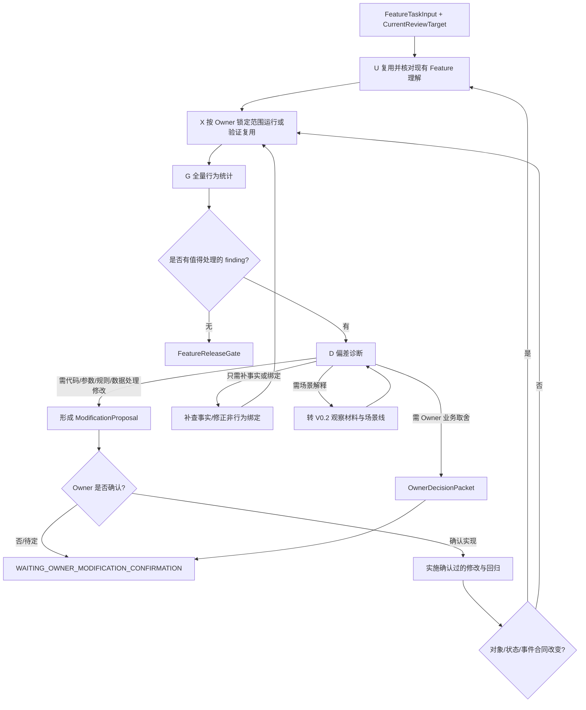

# L0｜统计驱动的单 Feature 闭环

## 1. 主流程



本流程中的 Owner 确认只针对正式行为改变，不把正常分析工作变成逐步审批。

## 2. U｜复用并核对现有 Feature 理解

U 不要求 Owner 在运行前重新整理上一轮材料，也不要求执行者为了形式完整重查全部代码。

优先级：

1. 复用同一用例已有的 `FeatureUnderstandingPackage`；
2. 复用归档 Chat、旧运行产物和需求／实现索引；
3. 对当前锁定代码、参数和输出只做受影响部分的核对；
4. 仅补当前统计真正需要、旧材料又缺少的最小事实。

通常只在以下事实变化时记录 delta 或更新受影响部分：

- 业务对象、身份或生命周期；
- occurrence、状态或正式输出合同；
- 参数定义或消费关系；
- 统计所需结果字段；
- actual、observed、confirm 等时间语义。

对象判别采用 `BUSINESS_OBJECT_QUALIFICATION_GUIDE.md`。运行配置、模块、算法步骤和参考量不因重要就自动成为业务对象。

没有正式旧 Package 时，可以由执行 AI 从已归档材料和当前代码形成“足以支持本轮 X/G/D”的最小当前理解；不把完整 Package 重写设成阻断。

## 3. X｜按 Owner 锁定范围运行或验证复用

X 不是新 Skill。执行者按任务输入和 Owner 授权取得 `FeatureRunResultBinding`。

正式任务输入已经明确的以下内容属于硬输入：

```text
用例
目标 Feature
品种／对象范围
正式时间范围
尺度／采样
正式工作区
代码与参数版本（已提供时）
```

AI 不得自行改变这些内容。若无法按正式范围执行，报告实际阻断和可选方案，等待 Owner 决定。

允许在锁定范围内使用少量位置、短窗口或隔离环境做诊断，但必须标记为 `DIAGNOSTIC_ONLY`；不能以局部结果替代正式运行，也不能把局部范围登记为新的正式输入。

### 3.1 新运行

至少锁定：

```yaml
feature_code_ref:
constructor_ref:
parameter_instance_ref:
data_scope:
calendar:
execution_entry:
artifact_refs:
readback_validation:
```

### 3.2 验证复用

只有代码、参数、数据范围、输入处理、结果包身份和读取校验全部与本轮相同时，旧结果才可正式复用。目录中“已有文件”不等于当前 Run 已有合法结果。

## 4. G｜全量行为统计

执行现有 `feature-global-behavior-profiling`，并采用 `STATISTICS_DRIVEN_PRACTICE.md`。

统计首先服务于 Owner 在具体任务输入中提出的问题。通用方法只提示从以下事实推导必要统计：

```text
业务对象链
对象身份与生命周期
状态和 occurrence
关键中间判断
实际／确认时间
当前 ReviewTarget
已有 finding 的回归条件
```

核心回答：

1. 上游对象、主对象和正式输出分别发生多少；
2. 从上游到下游在哪里发生转化或阻断；
3. 对象发生在什么位置和时间基础上；
4. 是否存在身份、顺序、状态或正式输出不一致；
5. 与当前业务问题有关的分层中是否出现系统性差异；
6. 已知问题在最新版本中是否仍可复现。

不要求所有 Feature 都有方向、actual/confirm、生命周期或潜在漏报筛查；也不要求机械穷尽统一指标表。执行者可以增加真正有助于回答当前问题的统计，但要说明用途，不能把它自动升级为 Owner 新验收条件。

## 5. Finding 的独立闭环

每个 finding 单独登记：

```yaml
finding_id:
observation:
business_conflict:
direct_responsibility_stage:
confirmed_facts:
competing_explanations:
resolution_route:
resolution_status:
cross_effects_to_check:
```

多个 finding 共用参数或状态，只意味着后续需要交叉检查；不意味着诊断时必须打包成一个联合问题。

## 6. D｜偏差诊断

执行现有 `business-discrepancy-diagnosis`，并遵守实践补充：

- 正式输出自身不一致，本身就是问题，不以某个下游是否使用为前提；
- “代码按当前规则执行”与“规则符合业务预期”分开报告；
- 除实例参数外，也检查参与判断的硬编码业务常量和派生倍数；
- 少量反事实干预只用于区分原因，不等于完成参数标定；
- 先形成证据充分的定位和修改选项，不把诊断直接等同于修改授权。

## 7. 修改确认：分析不中断，正式改变要确认

### 7.1 无需逐项请示的工作

执行 AI 可以自主：

- 查代码、配置、需求、历史材料和运行结果；
- 按锁定范围运行、导出、统计和分析；
- 编写分析脚本、报告和可复现检查；
- 做不改变正式版本的局部诊断；
- 在隔离环境准备候选 patch、候选参数和新旧对照；
- 形成 `ModificationProposal`、拟修改 diff、影响范围和验证计划。

### 7.2 必须经 Owner 确认后才能采用的改变

- 正式 Feature 代码、业务规则和输出合同；
- 正式参数实例、硬编码业务常量和配置；
- 正式输入数据处理；
- 正式用例、品种、时间范围、尺度和工作区；
- 把候选 patch／候选参数提交、推送或登记为本 Run 当前版本；
- 下游依赖和释放范围。

`ModificationProposal` 至少说明：

```yaml
finding_ref:
current_behavior:
proposed_change:
why_this_stage:
alternatives:
expected_effect:
possible_side_effects:
validation_plan:
files_or_parameters_to_change:
```

Owner 可以确认、修改、暂缓或拒绝。未确认时，Run 可以继续其他不冲突的分析，但不得采用该改变。

已由 Owner 确认并锁入任务输入的现有提交或参数实例，属于输入，不重复确认。

## 8. 参数处理深度

若 Owner 已提供本轮采用的新参数实例，直接把它作为 X 的正式输入，不强制重新执行一次 Skill 4。

只有本轮目标包括“证明参数为何合理、求共同可行域或形成正式标定结果”时，才执行 `feature-instance-calibration`。一个样本通过、输出数量增加或恢复某个诊断位置，都不能单独证明参数合理。

诊断若提出进一步参数改变，先形成 `ModificationProposal`；未经 Owner 确认，敏感性试验只能作为诊断材料，不能成为正式实例。

## 9. 行为变化后的回环

只有已经确认并采用的以下变化，才触发正式失效传播：

- 参数实例改变；
- 对象、身份、状态、事件或生命周期规则改变；
- 正式输出载荷或发布规则改变；
- 数据、日历或时间对齐改变；
- 会改变运行结果的实现修正。

若结构合同改变，U 只更新受影响部分；否则直接回 X。旧结果保留为历史对照，不继续充当当前 Gate 证据。

## 10. 转场景线的条件

统计只能说明结构、分布或转化异常，不能判断真实市场过程是否属于目标现象时，形成具体 `ScenarioQuestion`，再进入 V0.2：

```text
观察材料准备
→ 从图中选真实场景并冻结预期
→ 逐场景过程对照
→ 新疑点回 D
```

不为了“完整流程”而机械画图。
