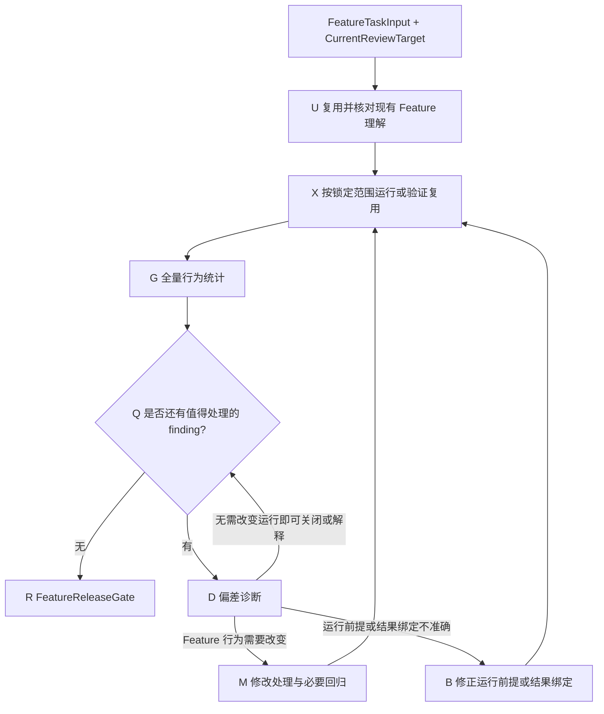

# L0｜统计驱动的单 Feature 闭环

## 1. Workflow 总图



`U、X、G、Q、D、R` 是本 Workflow 的主干节点。`M、B` 不是所有 Run 都必须经过的新阶段，而是 D 诊断完成后的两种后续处理：

- `M` 改变 Feature 本身的正式行为；
- `B` 不改变预期业务行为，只纠正本次运行或结果绑定。

当前 Workflow 不包含场景观察线、OwnerDecisionPacket 或通用审批节点，也不在本文件中定义一套 AI／Owner 权限边界。具体任务另有明确输入时，按该任务输入执行。

## 2. 主干节点

### 2.1 U｜复用并核对现有 Feature 理解

U 不要求 Owner 在运行前重新整理上一轮材料，也不要求执行者为了形式完整重查全部代码。

优先级：

1. 复用同一用例已有的 `FeatureUnderstandingPackage`；
2. 复用归档 Chat、旧运行产物和需求／实现索引；
3. 对当前锁定代码、参数和输出只核对受影响部分；
4. 仅补当前 X、G、D 真正需要而旧材料又缺少的最小事实。

通常只在以下事实变化时记录 delta 或更新受影响部分：

- 业务对象、身份或生命周期；
- occurrence、状态或正式输出合同；
- 参数定义或消费关系；
- 统计所需结果字段；
- actual、observed、confirm 等时间语义。

对象判别采用 `BUSINESS_OBJECT_QUALIFICATION_GUIDE.md`。运行配置、模块、算法步骤和参考量不因重要就自动成为业务对象。

没有正式旧 Package 时，可以从归档材料和当前代码形成“足以支持本轮 X/G/D”的最小当前理解；不把完整 Package 重写设成阻断。

### 2.2 X｜按锁定范围运行或验证复用

X 不是新 Skill。执行者按任务输入取得并核验 `FeatureRunResultBinding`。

正式任务输入已经明确的以下内容属于硬输入：

```text
用例
目标 Feature
品种／对象范围
正式时间范围
尺度／采样
正式工作区
代码与参数版本（已提供时）
```

执行者不得自行改变这些内容。若无法按正式范围执行，应报告准确阻断和可选方案。

允许在锁定范围内使用少量位置、短窗口或隔离环境做诊断，但必须标记为 `DIAGNOSTIC_ONLY`；不能以局部结果替代正式运行，也不能把局部范围登记为新的正式输入。

#### 新运行至少锁定

```yaml
feature_code_ref:
constructor_ref:
parameter_instance_ref:
data_scope:
calendar:
execution_entry:
artifact_refs:
readback_validation:
```

#### 验证复用

只有代码、参数、数据范围、输入处理、结果包身份和读取校验全部与本轮相同时，旧结果才可正式复用。目录中“已有文件”不等于当前 Run 已有合法结果。

### 2.3 G｜全量行为统计

执行现有 `feature-global-behavior-profiling`，并采用 `STATISTICS_DRIVEN_PRACTICE.md`。

统计首先服务于具体任务输入中提出的问题。通用方法只提示从以下事实推导必要统计：

```text
业务对象链
对象身份与生命周期
状态和 occurrence
关键中间判断
实际／确认时间
当前 ReviewTarget
已有 finding 的回归条件
```

核心回答：

1. 上游对象、主对象和正式输出分别发生多少；
2. 从上游到下游在哪里发生转化或阻断；
3. 对象发生在什么位置和时间基础上；
4. 是否存在身份、顺序、状态或正式输出不一致；
5. 与当前业务问题有关的分层中是否出现系统性差异；
6. 已知问题在最新版本中是否仍可复现。

不要求所有 Feature 都有方向、actual/confirm、生命周期或潜在漏报筛查，也不要求机械穷尽统一指标表。执行者可以增加真正有助于回答当前问题的统计，但要说明用途，不能把它自动升级为新的任务验收条件。

### 2.4 Q｜是否还有值得处理的 finding

Q 是对当前 finding 队列的判断，不是一项独立分析工作。

- 没有待处理 finding：进入 R；
- 仍有待处理 finding：一次取一个进入 D；
- 某个 finding 在 D 中被关闭、解释或处理后，重新判断队列，而不是把所有问题强行合并。

### 2.5 D｜偏差诊断

执行现有 `business-discrepancy-diagnosis`，并遵守实践补充：

- 正式输出自身不一致，本身就是问题，不以某个下游是否使用为前提；
- “代码按当前规则执行”与“规则符合业务预期”分开报告；
- 除实例参数外，也检查参与判断的硬编码业务常量和派生倍数；
- 少量反事实干预只用于区分原因，不等于完成参数标定；
- 诊断应说明直接责任阶段、确认事实、竞争解释、影响范围和后续处理类型。

#### 责任逻辑定位

每个 finding 进入 D 后，先定位产生该不合理表现的相关逻辑，再判断这段逻辑哪里不合理、是否需要改变以及怎样处理。诊断顺序是：

1. 复现并固定不合理表现，明确它发生在哪个对象、时点、状态和正式输出上；
2. 沿业务处理链向前回溯相关输入、中间对象、状态、判断条件和输出；
3. 定位最早使该表现产生的责任逻辑，而不是只记录最后出现异常的输出位置；
4. 解释当前责任逻辑实际做了什么，以及它怎样导致当前表现；
5. 对照业务预期，判断具体哪里不合理，并区分已确认事实与仍待排除的解释；
6. 在此基础上决定进入 M、B，或无需改变运行即可关闭、解释或保留该 finding。

责任逻辑不只指源码行，也可以是业务规则、条件分支、状态转换、Event 发布顺序、参数或硬编码倍数的消费、数据／时间绑定、结果身份规则。最小记录为：

```yaml
logic_localization:
  finding_id:
  observed_anomaly:
  business_processing_chain:
  responsible_logic:
  source_refs:
  why_this_is_the_responsible_logic:
```

确有必要时再补 `excluded_explanations` 或 `open_questions`，不为了填模板制造空字段。当前证据只能定位到处理阶段、尚不能定位到具体函数或规则时，应如实记录最窄已定位范围和未决点，不用猜测代替定位。

未形成责任逻辑定位，不进入 M 讨论正式修改。

D 的结果有三种：

1. Feature 行为需要改变，进入 M；
2. 运行前提或结果绑定不准确，进入 B；
3. 无需改变运行即可关闭、解释或保留该 finding，更新状态后回 Q。

### 2.6 R｜本 Feature 释放判断

R 使用最新 U、X、G、finding 状态和已知限制形成 `FeatureReleaseGate` 与 `UpstreamReleasePackage`。具体状态与下游规则见 `02_L1_本特征释放与下游依赖.md`。

## 3. D 的后续处理

### 3.1 M｜Feature 行为修改

当诊断确认问题来自 Feature 本身的正式行为时进入 M，例如：

- 代码逻辑；
- 正式参数或参与判断的业务常量；
- 状态转换、Event 发布或生命周期规则；
- 正式输出合同；
- 会改变 Feature 结果的数据处理规则。

处理顺序：

```text
D 形成责任逻辑定位，并确认问题和责任位置
→ 修改处理
→ 做必要的反例复现、回归和新旧比较
→ X 运行修改后的正式实例
→ G 重新做全量统计
```

M 是实际工程处理，不是新 Skill。局部案例通过只能说明修改作用于预期位置，不能替代正式范围重跑和全量统计。

### 3.2 B｜运行前提或结果绑定修正

当 Feature 本身未必需要改变，而是本次运行没有准确绑定到预期实例时进入 B，例如：

- 实际加载了错误代码版本；
- 正式参数未真正生效；
- 品种、时间范围、尺度、Calendar 或输入处理绑定错误；
- 运行入口指向旧实例；
- 结果目录、配置、哈希或读回身份不一致；
- 多张结果表来自不同运行实例。

处理顺序：

```text
D 识别绑定问题
→ 修正版本、参数装配、范围、入口或结果身份
→ X 重新运行或重新完成合法复用核验
→ G 重新统计
```

B 的目标是准确运行原本已经指定的 Feature，不以改变 Feature 业务语义为目的。

## 4. 全流程通用规则

### 4.1 每个 finding 独立登记

```yaml
finding_id:
observation:
business_conflict:
direct_responsibility_stage:
logic_localization_ref:
confirmed_facts:
competing_explanations:
resolution_route:
resolution_status:
cross_effects_to_check:
```

多个 finding 共用参数或状态，只意味着后续需要交叉检查；不意味着诊断时必须打包成一个联合问题。

### 4.2 正式输入不由执行者自行调整

具体任务已经锁定的用例、品种、时间范围、尺度、工作区、代码和参数仍是正式输入。诊断性短窗口或隔离实验不改变这些输入。

### 4.3 行为或绑定变化后旧证据失效

以下变化完成后，旧运行结果和旧统计不能继续充当当前 Gate 证据：

- 参数实例改变；
- 对象、身份、状态、事件或生命周期规则改变；
- 正式输出载荷或发布规则改变；
- 数据、日历、时间对齐、代码加载或运行入口改变；
- 结果身份被证明不准确。

旧结果保留为历史对照，不无痕覆盖。

### 4.4 参数问题不单列固定阶段

Owner 已提供的新参数实例直接作为 X 的输入。统计后若又发现参数相关问题，在 D 中判断：

- 需要改变正式行为时进入 M；
- 只是参数未正确装配或读回时进入 B。

只有具体任务明确要求“证明参数为何合理、求共同可行域或形成正式标定结果”时，才调用 `feature-instance-calibration`。

### 4.5 局部诊断不能替代正式范围

短窗口、少量案例、敏感性试验和候选 patch 都可以帮助定位问题，但不能替代正式范围的 X 和 G。

### 4.6 当前不自动转入其他 Workflow

统计和现有证据仍不足以判断时，记录未决问题、缺少的事实和当前可确认边界。当前 V0.3 不自动进入 V0.2 场景观察线；以后若要接入，应另行明确流程和输入输出。
