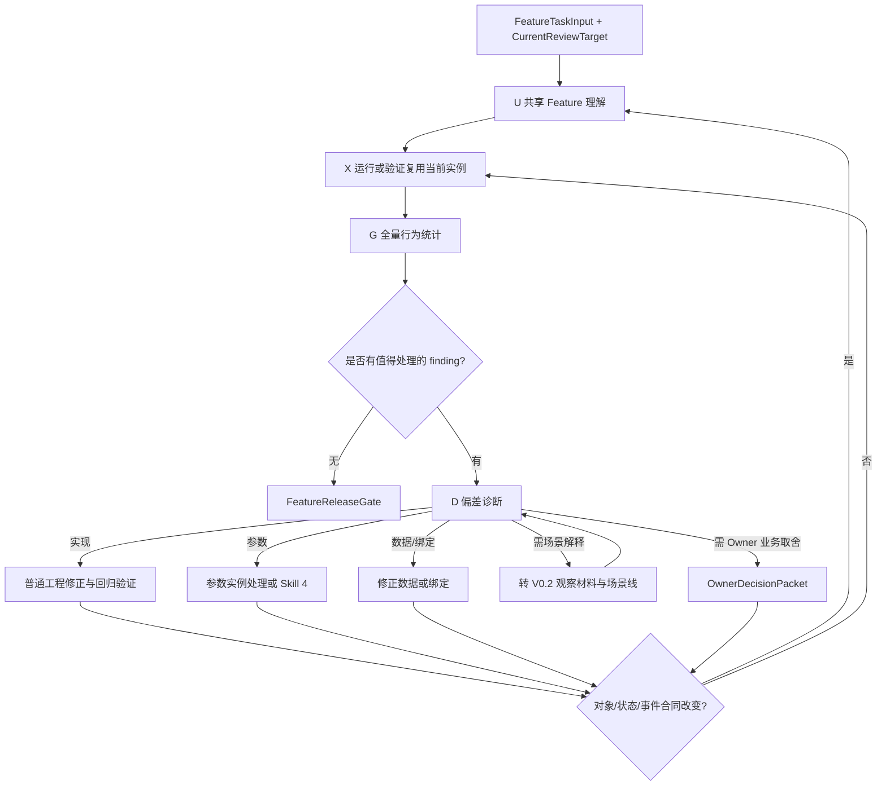

# L0｜统计驱动的单 Feature 闭环

## 1. 主流程



## 2. U｜共享 Feature 理解

优先复用同代码版本、同实例结构下已经有效的 `FeatureUnderstandingPackage`；不得为了形式完整重复查一遍全部代码。

只有以下事实发生变化时，更新受影响部分：

- 业务对象、身份或生命周期；
- occurrence、状态或正式输出合同；
- 参数定义或消费关系；
- 统计所需结果字段；
- actual、observed、confirm 等时间语义。

对象判别采用 `BUSINESS_OBJECT_QUALIFICATION_GUIDE.md`。运行配置、模块、算法步骤和参考量不因重要就自动成为业务对象。

## 3. X｜运行或验证复用当前实例

X 不是新 Skill。执行者按任务输入和 Owner 授权取得 `FeatureRunResultBinding`。

### 3.1 新运行

至少锁定：

```yaml
feature_code_ref:
constructor_ref:
parameter_instance_ref:
data_scope:
calendar:
execution_entry:
artifact_refs:
readback_validation:
```

### 3.2 验证复用

只有代码、参数、数据范围、输入处理、结果包身份和读取校验全部与本轮相同时，旧结果才可正式复用。目录中“已有文件”不等于当前 Run 已有合法结果。

## 4. G｜全量行为统计

执行现有 `feature-global-behavior-profiling`，并采用 `STATISTICS_DRIVEN_PRACTICE.md`。

统计项从以下内容推导，不从用例清单机械复制：

```text
业务对象链
对象身份与生命周期
状态和 occurrence
关键中间判断
实际／确认时间
当前 ReviewTarget
已有 finding 的回归条件
```

最少回答：

1. 上游对象、主对象和正式输出分别发生多少；
2. 从上游到下游在哪里发生转化或阻断；
3. 对象发生在什么位置和时间基础上；
4. 是否存在身份、顺序、状态或正式输出不一致；
5. 关键分层中是否出现系统性差异；
6. 已知问题在最新版本中是否仍可复现。

不要求所有 Feature 都有方向、actual/confirm、生命周期或潜在漏报筛查；只有共享理解证明该维度存在且与当前问题有关时才统计。

## 5. Finding 的独立闭环

每个 finding 单独登记：

```yaml
finding_id:
observation:
business_conflict:
direct_responsibility_stage:
confirmed_facts:
competing_explanations:
resolution_route:
resolution_status:
cross_effects_to_check:
```

多个 finding 共用参数或状态，只意味着修改后需要交叉检查；不意味着诊断时必须打包成一个联合问题。

## 6. D｜偏差诊断

执行现有 `business-discrepancy-diagnosis`，并遵守实践补充：

- 正式输出自身不一致，本身就是问题，不以某个下游是否使用为前提；
- “代码按当前规则执行”与“规则符合业务预期”分开报告；
- 除实例参数外，也检查参与判断的硬编码业务常量和派生倍数；
- 少量反事实干预只用于区分原因，不等于完成参数标定。

## 7. 实现修正：不用新增 Skill

诊断已定位为实现问题后，按以下最小工程检查执行：

```text
旧代码可复现真实反例
→ 新测试在旧代码上失败
→ 修改限制在最小责任阶段
→ 定向反例通过
→ 原回归通过
→ 在同一输入上比较新旧完整结果
→ 明确允许变化和禁止变化
→ 独立读回
→ 形成新代码 commit
→ 回 X → G
```

实现修正局部验证通过，不能替代最新完整实例的重跑和全量统计。

## 8. 参数处理：按任务目标选择深度

若 Owner 已提供本轮采用的新参数实例，可直接把它作为新的 X 输入，不强制重新执行一次 Skill 4。

只有本轮目标包括“证明参数为何合理、求共同可行域或形成正式标定结果”时，才执行 `feature-instance-calibration`。一个样本通过、输出数量增加或恢复某个诊断位置，都不能单独证明参数合理。

## 9. 行为变化后的强制回环

以下变化至少使 X、G 失效：

- 参数实例改变；
- 对象、身份、状态、事件或生命周期规则改变；
- 正式输出载荷或发布规则改变；
- 数据、日历或时间对齐改变；
- 会改变运行结果的实现修正。

若结构合同改变，先更新 U；否则直接回 X。旧结果保留为历史对照，不继续充当当前 Gate 证据。

## 10. 转场景线的条件

统计只能说明结构、分布或转化异常，不能判断真实市场过程是否属于目标现象时，形成具体 `ScenarioQuestion`，再进入 V0.2：

```text
观察材料准备
→ 从图中选真实场景并冻结预期
→ 逐场景过程对照
→ 新疑点回 D
```

不为了“完整流程”而机械画图。
