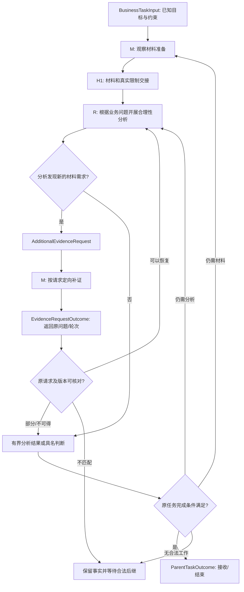

# L0｜完整业务任务：材料准备 ↔ 合理性分析 ↔ 本轮收束

> 来源：【S-M】材料准备目标与交接；【S-R】合理性分析 README 的渐进式预期—证据循环与事实/判断双轨；【P】父子任务和补证设计。【N】以下具体控制节点、输入输出约束与 Gate 为本轮待确认设计。

## 1. 先定义这个大的业务任务做什么

本轮任务的目标不是让一套固定工具逐项跑完，而是：**围绕一个事先明确范围的业务观察/合理性问题，准备可追溯的真实观察材料；在已有材料上进行合理性分析；因分析产生新证据需求时回到材料准备，补足并返回原分析问题；最后把本轮已回答和未能回答的内容、证据与后继分清楚。**

这包含两块业务工作：

- **M｜观察材料准备**：识别数据与图来源、选择必要输入/中间/输出材料、实际取得、核对并标明可用范围；交付的是材料，不是合理性结论。【S-M】
- **R｜合理性分析**：建立或修订最小业务预期、探索、冻结用于正式对照的预期、比较证据、必要时诊断、受限标定和复验，交付支持/反证/未决、适用范围及后继。【S-R】

两个业务部分具有阶段身份，但**不强制严格互斥、全部先后完成**。M 负责交付真实材料、质量核对和限制，不预先选择 R 的“探索/正式对照”流程；R 按内部工作需要，在探索节点或正式证据准备节点核对输入。正式对照需要冻结预期和合格证据。【S-R】【N】

## 2. L0 的总输入 / 总输出

| 对象 | 本轮最低需要什么 | 来源属性 |
|---|---|---|
| 总输入 `BusinessTaskInput`（一份任务输入） | 业务观察/合理性问题、对象、已有明确要求和约束；已有材料与入口线索可以提供但不强制齐全；尚不明确的分析深度及完成条件标记待明确 | 【S-M】【S-R】业务目的和对象；【N】统一任务封面 |
| 总输出 `ParentTaskOutcome` | 本轮各问题的实际结果及适用范围、材料与分析的可核查引用、未决或阻断、后继建议及结束/停止原因 | 【S-M】【S-R】专业交付；【N】父任务汇总 |

**本轮完成范围**（必答问题、分析深度、允许的未决、权限与预算）是需要随任务事实逐步明确并管理的约束，**不是第二份必须预先提供的总输入**。已有明确约束必须遵守；未知的细节允许先有界调查，但不能未经决定扩大任务、执行超范围操作或宣布任务已完成。

真实版本、取得的材料、预期及前轮补证，是**各节点产生的输出和下一节点的输入**，由 L1/L2 精确描述；不与总任务输入并列另称“过程输入”。

**缺环 L0-D01（已发现；候选处理方式待确认；尚未验证闭环）**：Skill 不替完整任务确定“本轮究竟做到哪”。候选解决方式是有界调查后明确必答问题及可接受结束范围，新问题单独登记，扩范围/正式结束时要求有效判断；当前仍缺针对具体任务的最终判定条件和验证。

## 3. L0 流程图：保留合法往返，不强制瀑布式



图中 M→R 只有一个材料交接入口，不能将“探索/正式对照”解释成材料准备的两个出口。R 内部的 R03/R05 各自检查样本或正式证据需求；补证只恢复原请求范围，不重跑整套 M，也不绕过冻结预期与版本检查。

## 4. L0 四个控制接口（不是重新定义专业 Skill 输出）

| L0 接口 / 提议 Gate | 生产内容 | 消费时必须核对 | 成功后继 | 不成功/分歧后继 |
|---|---|---|---|---|
| **L0-START：任务接管** | `BusinessTaskInput + question_id`（含已知约束、待明确事项） | 本轮目标和对象是否足以启动调查；已有约束是否保留，未知完成边界是否被记录 | M 开始调查与准备；已存在可复用材料可直接检查进入 R 的资格 | 形成具体缺失的任务边界判断，不猜范围；未查清的源码数据允许留给 M 调查 |
| **L0-M→R：材料与限制交接** | `MaterialPackage`（包括 `PLAN_READY/DATA_READY/PARTIAL_WITH_LIMITS/BLOCKED` 的真实来源和证据） | 来源、对象/窗口、数据阶段、时间、代码/参数/版本、实际完整性、已核验范围和限制 | 材料和限制交给 R；R03/R05 按各自当前工作输入检查可用性 | 仅规划/预览不能冒充实际材料；需要某项缺失证据时具体补证，不因此要求全部材料重做 |
| **L0-R→M：补证请求** | `AdditionalEvidenceRequest`：问题、原轮次、缺证要区分的解释、对象/窗口、现有依据、所需交付和约束 | 同一证据是否已存在、是否可在当前工作内局部查证、是否超出既有任务范围 | 必要时建立定向材料工作；回给原 `request_id + question_id + origin_context`（若已有冻结预期则再绑定 expectation_version；冻结前的事实探索请求明确标注 `unfrozen`） | 明确不可得、部分、取消、过期都形成关闭/续作决定；不得永远等待 |
| **L0-CLOSE：父任务收束 Gate** | `QuestionCompletionRecord[] + ParentTaskOutcome` | 每个必需问题是否达到原完成定义；必要检查、范围、授权深度、保留问题与后继引用 | 全部必需问题可合法交付时结束；业务反证亦可交付 | 未满足者明确剩余工作或无法完成原因；新增问题转 `FutureQuestionProposal` 而非自动扩大任务 |

**Gate 类型严格区分**：材料/分析*工作质量*是否合格，与*业务现象是否符合预期*是两回事。`COUNTERS`、有据 `PROVEN_NOT_ADJUSTABLE` 可以是合格专业成果；`UNKNOWN` 的必需验证不能当 PASS。【S-R】【P】

## 5. 材料交接的关键 I/O 对齐

M→R 的交接直接引用原材料包和 Manifest，只记录**有什么实际材料、在哪里、有哪些限制**，不代替 R 选择探索或正式对照。建议最低交接信息为：

```yaml
material_package_ref: <固定 GitHub 原件>
question_id: <关联的本轮业务问题>
artifact_refs: [<数据文件、摘要、数据阶段>]
object_parameter_scope: <对象/品种/参数>
time_basis: <时间与日历口径>
loaded_range: <实际加载范围>
visible_range: <如需视窗值则填写>
quality_checks_and_limitations: [<核验范围、缺项及风险>]
original_request_ref: <若为补证则指向原请求>
```

**M 的交付检查**确认数据实际存在、来源/阶段/时间/范围真实可解释；**R 的消费检查**再按当前节点作出判断：R03 的少量样本能否用于探索，R05 的材料能否与冻结预期和正式对照口径绑定。保留两种用法的专业约束，不把它们画成 L0 的两条独立交付路径，也不为同一材料默认设置两次相同的 Gate。

## 6. 补证闭环：必须覆盖所有合法结果

| `EvidenceRequestOutcome`【P】 | 请求侧可以如何继续 | 禁止发生什么 |
|---|---|---|
| `OBTAINED` | 检查原问题/轮次/预期和版本后绑定真实材料，恢复被阻断的对照/诊断 | 不因补到数据而无条件宣布业务预期成立 |
| `PARTIAL` | 对可以继续的问题解锁，其余仍未决；若本轮允许，形成有界结果 | 不假装所有必需数据齐全 |
| `PROVEN_UNAVAILABLE` | 接收“无法可靠取得”的事实，判断是否可替代/限制/停止 | 不无证据重新请求同一缺项，不伪称已取得 |
| `NOT_APPLICABLE` | 说明原因，修订需求或结束该请求 | 不对不适用场景反复取数 |
| `CANCELLED` | 依据有效撤销关闭原等待 | 不删除历史事实 |
| `SUPERSEDED` | 旧轮次的返回作为历史，后继轮次另验复用资格 | 不把迟到证据自动并到新的冻结预期 |

需要强调：**不是什么查字段、读一行数据都要生成跨 Workflow 请求**。能在既有工作和授权内完成的局部事实查证，保留原工作内执行；真正跨专业准备、独立交付或资源基线变化才走正式补证路径。【S-R】【P】

## 7. L0 的闭环成立判据

L0 不能只拥有正常箭头：每个前进箭头都必须满足 `上游可核实输出 → 下游最小必要输入 → 明确使用资格 → 实际可触发后继`，每个返回箭头都满足 `具体缺口 → 唯一请求 → 回交对象 → 各种结果下解除或延续原等待`。

冻结前的事实准备/探索也可能提出补证：这时不得伪造 `FrozenExpectationSet`。应通过 `question_id + request_id + origin_call_id + exploratory_context_version` 记录返回点，`expectation_version` 明确记为 `not_frozen`；在正式对照前再建立冻结版本和用途映射。【N】

如果本轮必须明确的完成条件仍未确定、材料只有 `PLAN_READY`、正式预期未冻结、补证永远没有结案、或发现新问题被无条件加进本轮，整个父任务都**不能据此声称已闭环**。具体缺口见 `../review/06_接口对齐与缺环审查.md`。

## 8. L0 必须持续维护业务任务完成全景（【N】待确认）

L0 不只是定义总输入 `BusinessTaskInput` 和最终 `ParentTaskOutcome`：任务从启动到退出，应能随时查询本轮各必答问题、M/R 两条线、其阶段和工作节点的**当前完成情况**。见 [跨层业务完成全景与更新协议](06_业务完成全景与更新协议.md)。

- **节点成果被核实或被拒绝时**：更新其受影响的 S/R 阶段实例，以及该问题的已完成/待做/受阻范围；不要求等到阶段结束才更新。
- **阶段 Gate 通过、未过或合法跳过时**：更新 M/R 工作流及父任务全景；不能把 Gate PASS 等同于父任务结束。
- **M→R 交接、R→M 补证及返回时**：M/R 同时展示已交材料、当前分析进度、挂起请求及原轮次返回位置；历史已交付成果仍保留。
- **证据版本失效或中断恢复时**：全景显示“历史曾接受、当前需重验”，或明确实际效果未知的动作及核对条件；不靠聊天最新说法覆盖已有证据。
- **H3 收束时**：依据问题级完成合同判定 `ParentTaskOutcome`。仍有必需问题未满足时，只能有据停止/受阻，不能因为各项已知工作都执行过就标记完成。

**身份与事实来源**：从已经核实的工作项、专业原生产物、Gate/决定/回执派生同一份任务全景；全景不是可任意自填的第二份权威状态。具体字段、版本锁和更新规则在 `06` 中提出，尚未实际实现。
