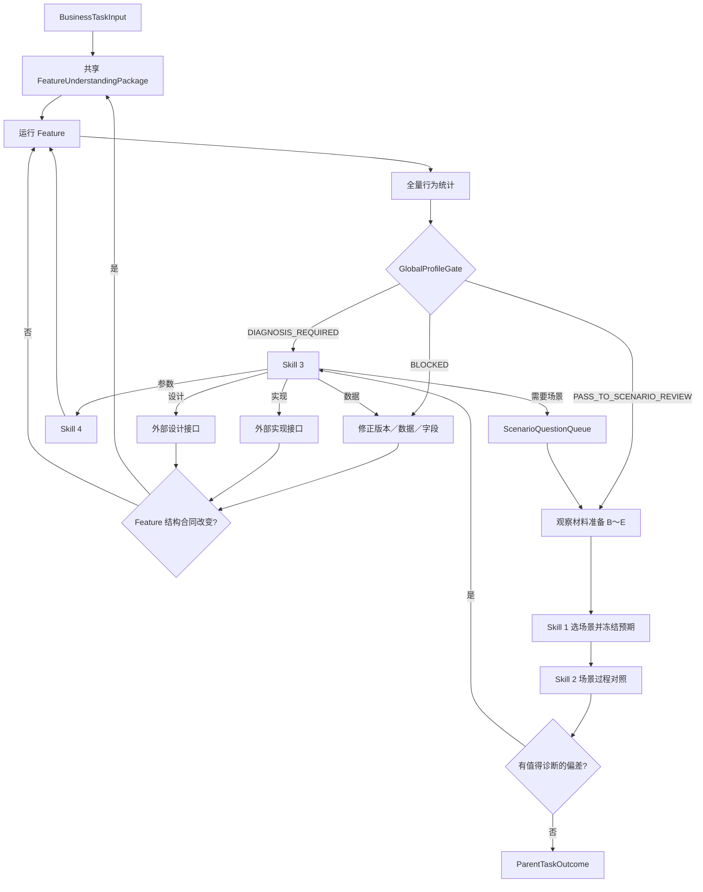

# L0｜完整业务任务：共享理解 → 全量统计闭环 → 观察材料 → 场景合理性

> **V0.2 目标**：先让 EAW 与 FQA 的合理性任务按一条可运行、可回环的串行路径工作。共享 Feature 理解是全量统计与观察材料的共同前置；全量行为统计及已确认问题先闭环，随后才为最新实例准备图并做真实场景分析。

## 1. 完整业务任务做什么

围绕一个明确 Feature 版本、实例和数据范围，本轮任务依次完成：

```text
1. 还原当前 Feature 的对象、状态、事件、中间判断、参数和结果字段；
2. 运行 Feature；
3. 对完整运行结果做全量／分层行为统计；
4. 对统计发现的结构疑点查根因，并闭环参数、实现、设计或数据问题；
5. 重新运行和统计，直到允许进入场景观察；
6. 为最新实例准备宽范围 CAEGraph 和同版本图数据；
7. 从图中选择真实正例、负例、误报／漏报候选、参数边界和覆盖外场景；
8. 对照原始市场过程、预期 Feature 过程和实际 Feature 过程；
9. 对新偏差继续诊断；任何行为修改再次回到 Feature 运行与全量统计；
10. 形成当前版本的支持范围、反例、覆盖外、未决和后继。
```

本轮不把“全量统计通过”当作 Feature 已合理，也不把“发现问题”当作合理性分析完成。

## 2. 业务工作块

### U｜共享 Feature 理解

入口：[`skills/feature-understanding/`](../skills/feature-understanding/SKILL.md)

交付：`FeatureUnderstandingPackage`，供全量统计、观察材料和合理性分析共同使用。

### X｜Feature 执行

交付：绑定代码版本、参数实例、数据范围和 artifacts 的 `FeatureRunResultBinding`。

### G｜全量行为统计

入口：[`feature-global-behavior-profiling`](../skills/reasonableness-analysis/feature-global-behavior-profiling/SKILL.md)

交付：`GlobalBehaviorProfile`、结构疑点、场景解释问题、诊断适配包和 `GlobalProfileGate`。

### M｜观察材料准备

入口：[`control/02`](02_L1_观察材料准备流程.md)

只在最新运行结果达到 `PASS_TO_SCENARIO_REVIEW` 后执行。交付宽范围图、图数据和版本限制，不挑选合理性案例。

### R｜场景合理性与偏差处理

入口：[`control/03`](03_L1_合理性分析流程.md)

- Skill 1：从已画好的图和数据中挑真实案例、冻结场景预期；
- Skill 2：逐案例对照三条过程链；
- Skill 3：查根因并路由；
- Skill 4：承接参数可调问题；
- 实现与设计问题通过外部接口处理。

## 3. 总输入与总输出

### 3.1 `BusinessTaskInput`

```yaml
question_id:
feature_name:
feature_code_version:
feature_instance_ref:
feature_execution_entry:
data_scope:
current_review_target:
  current_goal:
  intended_coverage:
  explicit_non_goals:
  owner_constraints:
resource_and_permission_limits: []
existing_artifact_refs: []
```

不要求任务输入重复填写可由代码、实例或共享 Skill 获得的专业知识。

### 3.2 `ParentTaskOutcome`

```yaml
question_id:
analysis_round_id:
feature_ref:
feature_understanding_ref:
latest_run_ref:
global_profile_ref:
global_gate:
observation_material_ref:
case_review_set_ref:
scenario_casebook_ref:
diagnosis_refs: []
calibration_refs: []
external_resolution_refs: []
current_supported_scope: []
current_counterexamples: []
outside_current_coverage: []
unresolved_or_missing: []
completion_evaluation:
next_actions: []
```

## 4. L0 总图



## 5. 关键 Gate

### 5.1 共享理解 Gate

- 当前实例对应源码已定位；
- 核心业务对象、状态、事件、身份和处理关系已说明；
- 参数与运行结果字段可映射；
- 影响下游的未确认项已具名。

### 5.2 全量行为统计 Gate

见 [`control/03`](03_L1_合理性分析流程.md)：

- `BLOCKED`；
- `DIAGNOSIS_REQUIRED`；
- `RERUN_REQUIRED`；
- `PASS_TO_SCENARIO_REVIEW`。

只有最后一项允许正式进入 M 和场景线。

### 5.3 观察材料 Gate

`ObservationMaterialPackage` 必须达到 `DATA_READY`，或以明确限制达到可供指定案例使用的 `PARTIAL_WITH_LIMITS`；图、导出数据、代码版本和参数实例必须一致。

### 5.4 场景冻结 Gate

正式对照前必须冻结：

- `CaseReviewSet`；
- `ScenarioExpectationSet`；
- 与 Skill 2／3 兼容的 `FrozenExpectationSet`。

### 5.5 父任务收束 Gate

必须说明：

- 当前支持范围；
- 当前反例；
- 现有参数／实现／设计问题是否已处理；
- 当前覆盖外；
- 证据不足和未决；
- 是否达到本轮原完成条件。

有据反证、不可调或覆盖有限可以是合格结果；未完成必需验证不能冒充完成。

## 6. 行为改变后的强制回环

以下变化发生后，旧全量统计和旧图均失效：

- 参数实例变化；
- Feature 业务逻辑变化；
- 对象、状态、事件、身份或切段规则变化；
- 原始数据或时间对齐变化；
- 会改变运行输出的实现修正。

后继必须是：

```text
必要时更新 FeatureUnderstandingPackage
→ 重新运行 Feature
→ 重新做全量行为统计
→ 通过 Gate 后重新准备观察材料
→ 重新选择／复验场景
```

仅修改 CAEGraph 展示、不改变 Feature 行为时，不重跑 Feature 或全量统计，只返回 M 的相应阶段。

## 7. 补证与材料回流

场景分析或诊断发现图层、字段、时间范围不足时，形成：

```yaml
AdditionalEvidenceRequest:
  request_id:
  question_id:
  origin_stage:
  case_or_finding_ref:
  missing_field_or_view:
  required_scope:
  why_needed:
  expected_return:
```

后继：

- 只缺显示／导出 → M 的 C～E；
- 缺运行结果字段但不改行为 → 更新共享字段映射并重新导出／统计相关部分；
- 缺 Feature 内部事实 → U；
- 需改变 Feature 行为才能取得 → 按实现／设计问题处理，再回 X → G。

补证可能返回 `OBTAINED / PARTIAL / PROVEN_UNAVAILABLE / NOT_APPLICABLE / CANCELLED / SUPERSEDED`，不得无限等待或伪装已取得。

## 8. 外部接口

### 实现修正

Skill 3 形成 `ImplementationFixRequest`；外部返回代码提交、修改行为、测试和新 Feature 版本。之后按是否改变 Feature 结构合同返回 U 或 X。

### 设计决策

Skill 3 形成 `DesignIssuePacket`；Owner 返回业务定义、实现要求和验收条件。完成实现后返回 U → X → G。

外部接口不改变本系统的重跑规则。

## 9. 当前不做的复杂控制

V0.2 暂不建设：

- 跨问题影响分级 Skill；
- 多问题并行优先级；
- 局部跳过全量统计；
- 局部图复验替代完整重跑；
- 场景分析反向驱动画图的复杂自动循环。

首轮先用 EAW Wall 走通全链，再以 FQA 中一个不同结构 Feature 验证迁移性。
