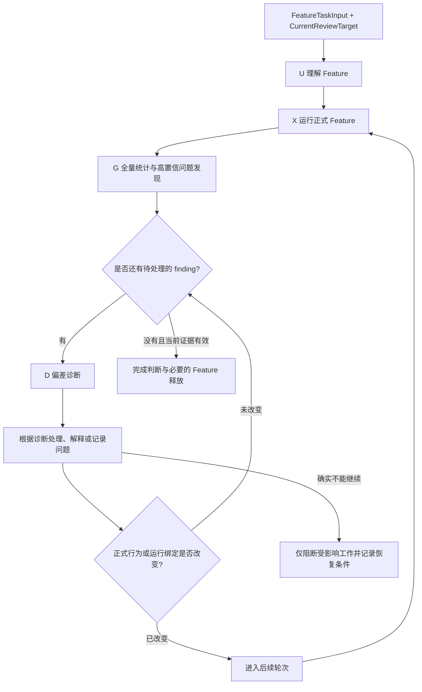

# L0｜统计驱动的单 Feature 闭环

## 1. 定位与职责

本 Workflow 描述**一个 Feature 首轮需要完成什么，以及问题处理后如何进入后续轮次**。专业方法和完成条件由被调用的 Skill 规定；实例范围、数据、版本及授权由当前 Run 的初始任务输入／GO 规定；物理派发、状态与恢复由 `longrun/` 负责。

`CurrentReviewTarget` 确定本轮要检查的业务范围与完成深度。当前目标可以只是发现并关闭高置信的明显不合理问题，不等于证明 Feature 在所有场景中完全合理。运行中不增设 Owner 确认节点；执行者在初始授权范围内自主诊断、修正与验证，超出范围的动作只作有据局部阻断。

## 2. 首轮 Workflow



图中的两个菱形只是**流程判断条件**（原 Q 判断已并入分支），不是独立工作节点；不签发 Skill 委派，也不建立额外 Gate。修正处理和完成释放同样不要求新建专用 Skill。

### U｜理解 Feature

对当前指定代码、实例和业务来源执行 [feature-understanding](../skills/feature-understanding/SKILL.md) Skill，并采用 [业务对象判别补充](../skills/feature-understanding/BUSINESS_OBJECT_QUALIFICATION_GUIDE.md)。

- **输入**：目标 Feature、代码与实例版本、当前可查的真实实现和业务来源。
- **主要产出**：`FeatureUnderstandingPackage`（业务对象、身份、状态、事件、处理关系、参数、结果字段及未确认项）。
- **后继**：为正式运行及统计提供可追溯的实现事实，不在 U 中判断业务设计是否合理。

内部分析步骤、IO 和专业完成条件依原 Skill。

### X｜运行正式 Feature

这是实际工程操作，**不是独立 Skill**。

- **输入**：初始 GO 与任务输入锁定的对象、正式时间范围、日历、工作区，以及本次实际采用的代码、构造入口、参数实例。
- **主要产出**：`FeatureRunResultBinding`，可明确对应代码、参数、数据范围、结果包和实际读取校验。
- **后继**：只有已确认与当前实例绑定的完整正式结果，才进入 G。局部调试结果必须标为 `DIAGNOSTIC_ONLY`，不能替代正式范围。

### G｜全量统计与高置信不合理现象发现

执行 [feature-global-behavior-profiling](../skills/reasonableness-analysis/feature-global-behavior-profiling/SKILL.md) Skill，使用 [统计驱动实践补充](../skills/reasonableness-analysis/STATISTICS_DRIVEN_PRACTICE.md)。

- **输入**：当前有效的 `FeatureUnderstandingPackage`、`FeatureRunResultBinding` 和 `CurrentReviewTarget`。
- **主要产出**：`GlobalBehaviorProfile`、`FindingDiscoverySummary`、与当前正式结果绑定的高置信候选队列、未升级观察、诊断输入适配包及 `GlobalProfileGate`。
- **后继**：按发现结果判断是否需要 D。发现一个问题不等于 G 已完成；适用业务面的高置信发现应当形成当前结果的可追溯快照。

统计范围、候选判别、抽样与 Gate 规则依 G Skill 和实践补充，不在 L0 重写。

### D｜偏差诊断（有待处理 finding 时）

对当前有据的 finding 执行 [business-discrepancy-diagnosis](../skills/reasonableness-analysis/business-discrepancy-diagnosis/SKILL.md)。

- **输入**：G 的候选及诊断适配材料、当前业务目标、相关业务处理链和可核对的真实证据。
- **主要产出**：`DiagnosisReport` 与责任逻辑定位，说明已确认事实、竞争解释、当前问题责任和可行处理路线。
- **后继**：由执行者在初始授权内处理需要修改的业务行为、参数或运行绑定；无需修改的可有据解释或关闭；确实无法继续的记录局部阻断。只有具体任务有正式参数标定目标时，才按诊断结论调用 `feature-instance-calibration`。

多个 finding 可以分别诊断、统筹修正与必要回归；**不要求每诊断一个问题就进行一次昂贵的正式全量重跑**。D 的内部方法和完成条件依诊断 Skill。

## 3. 后续轮次

首轮形成的理解、正式运行、统计、诊断与处理结果是后续工作的基础。若出现代码、参数、数据或运行绑定变化，进入第二轮、第三轮……；**由执行 AI 按实际影响自行判断哪些成果继续有效、需要更新或重新执行**，不在每个节点单独写一套“如何更新”。

但改变正式行为或运行绑定后，不能再用旧实例的运行结果和旧统计证明新实例通过；必须取得当前正式实例的有效运行及全量统计。历史结果和旧 finding 保留用于对照，不无痕覆盖。每轮最新有效业务成果及变化记入 `BUSINESS_PROGRESS.md`，准确版本、状态和恢复入口记入 `TASK_PROGRESS.md`。

## 4. 本轮完成与 Feature 释放

完成判断使用最新的正式实例、全量统计和 finding 处理证据；这是 Workflow 的完成条件，**不是独立的专业 Skill 或必须新派发的执行节点**。

- 当前正式结果与理解、参数、数据范围一致，已完成 G 的高置信发现 pass；
- 初始任务明确提出的候选均得到评估；本轮需要处理的高置信 finding 均已关闭或有据排除；
- 若正式行为／绑定改变，已取得对应新版本的完整 X/G；`FIXED_PENDING_RERUN` 不是已关闭；
- 剩余未决、初始范围外限制及对下游的影响如实记录，不把未完成工作说成已完成。

`GlobalProfileGate` 是 **G Skill 的专业输出**，不自动等于本轮 `FeatureReleaseGate`。后者在当前 `CurrentReviewTarget` 下采用：

| 结果 | 含义 |
|---|---|
| `BLOCKED` | 正式版本、输入、结果或必要证据不可靠 |
| `OPEN_CONFIRMED_DEFECT` | 本轮要求处理的已确认问题尚未关闭 |
| `RERUN_REQUIRED` | 正式行为／绑定已变，但当前完整运行和统计尚未完成 |
| `PASS_WITH_ACCEPTED_LIMITATIONS` | 当前目标已完成，仅有**初始 ReviewTarget 明确允许不阻断**的限制，且已记录影响与返回条件 |
| `PASS` | 当前目标已完成，没有需要传给下游的限制 |

`PASS` 不代表 Feature 在所有场景中全面合理；不允许执行者为了释放而自行将本轮未关闭的高置信问题改写为“已接受限制”。

下游需要使用时，形成具名的 `UpstreamReleasePackage`，至少包含：

```yaml
release_id:
feature_name:
code_ref:
constructor_ref:
parameter_instance_ref:
data_scope:
feature_understanding_ref:
latest_run_ref:
global_profile_ref:
feature_release_gate:
known_output_contract:
accepted_limitations: []
invalidation_conditions: []
```

限制需能追溯来源、适用范围、业务及下游影响、不阻断依据和返回条件；不得把“暂时不改”“样本少”写成“不存在问题”。

## 5. 下游衔接与范围边界

- 下游应依据**具体任务输入的真实构造／依赖关系**，绑定可用的精确上游 ReleasePackage、输出合同和已知限制；不得仅消费浮动分支 HEAD 或一句“已修好”。
- 上游版本、参数、数据范围、绑定或输出合同变化时，标记受影响的 Release／下游结果失效；执行 AI 根据实际影响更新相关成果，不无条件推倒全部工作。历史产物保留。
- 不同 Run 的并行、联合 Barrier、工作区隔离与机械汇合按 `longrun/` 及各任务输入执行；manager 不替 Skill 作专业判断，主控不成为新的专业上级。
- 当前统计闭环不自动进入旧 V0.2 的 CAEGraph、场景观察线。统计证据仍不足的事项记录为未决和局部阻断；另一个 Workflow 只有在初始任务明确采用时才启动。
