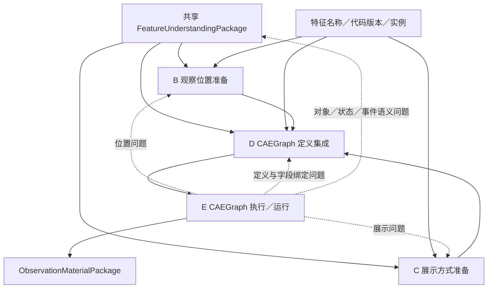

# L1-M｜观察材料准备外层 Workflow：B～E 的输入、输出与回流

> **成熟度**：候选、可试用。本文只规定观察材料准备 B～E 的阶段、输入输出和回流关系。共享特征理解已移到 `skills/feature-understanding/`，不再属于本大项内部阶段。
>
> **目标**：围绕一个已给定、且已有共享理解包的特征实例，形成经过实际运行和核对的 CAEGraph 图、图中数据及可追溯执行结果，供后续合理性分析使用；本 Workflow 不判断 Feature 合理或不合理，也不负责从图中挑选正反例。

## 1. 共享前置与外层输入

### 1.1 共享前置

执行 B～E 前必须取得：

- [`FeatureUnderstandingPackage`](../skills/feature-understanding/SKILL.md)；
- 与其一致的特征名称、代码版本和实例引用。

该 Package 提供对象、状态、事件级 occurrence、业务主输出／中间结果、关键中间判断、处理关系、参数和运行结果字段映射。

### 1.2 外层输入

| 字段 | 含义 |
|---|---|
| **特征名称** | 本次要准备观察材料的特征名称 |
| **特征代码版本** | 能唯一定位本次实现的代码版本 |
| **特征实例** | 本次实际被观察、可由 B～E 引用的实例；其 SOF 已确定 |
| **FeatureUnderstandingPackage** | 与本次代码版本和实例一致的共享理解包 |
| **任务明确位置** | 可选；任务已给品种和时间时使用 |

若 Package 与实例版本不一致，必须返回共享特征理解；不得在 B～E 内重新查代码并形成第二份 Feature 语义。

## 2. 用例信息与专业知识分开

- 外层输入及阶段产物描述本次用例事实，例如实例、位置、完整定义和运行结果；
- 位置默认、多尺度层级、展示规则、CAEGraph 仓库理解和 E 直接执行的工程修复授权边界属于对应 Skill／Reference；
- 不要求每次任务重复填写专业知识，也不能把本次具体品种和时间写进通用 Skill。

## 3. 外层阶段关系



B 与 C 可以在具备各自输入后并行：B 解决“看哪里”，C 解决“怎样展示”，二者在 D 汇合。共享理解包是 B、C、D 的共同前置，但不是本 Workflow 的内部阶段。

## 4. 阶段级合同

| 阶段 | 核心问题 | 主要输入 | 主要输出 | 专业正文 |
|---|---|---|---|---|
| **B 观察位置准备** | 普通 Feature 使用什么经验性默认品种和时间；高频 Feature 怎样沿 1d→30m→1m→5s→tick 组织位置 | FeatureUnderstandingPackage、特征实例、任务明确位置（如有） | 普通位置或高频多尺度位置路径 | [B Skill](../skills/observation-material-preparation/observation-position-preparation/SKILL.md) |
| **C 展示方式准备** | C1 要展示什么；C2 怎样形成并循环更新展示预期与 HTML；C3 怎样整理成位置、实例和字段可注入代码 | FeatureUnderstandingPackage、只读外层实例、锁定 CAEGraph 手册及必要源码 | C1 清单、C2 当前展示预期与唯一预期 HTML、复杂点记录、C3 可注入代码和注入合同 | [C Skill](../skills/observation-material-preparation/caegraph-display-preparation/SKILL.md) |
| **D CAEGraph 定义集成** | 怎样把真实实例、共享理解包、B 位置和 C 展示一次性集成为完整定义 | 外层输入、FeatureUnderstandingPackage、B／C 产物、锁定 CAEGraph 仓库 | 可直接交 E 尝试运行的完整 Python 定义／脚本初稿、仓库理解、上游纠正和定义级检查 | [D Skill](../skills/observation-material-preparation/caegraph-definition-integration/SKILL.md) |
| **E CAEGraph 执行／运行** | 怎样形成真实运行反馈、专业核图、正式取数和一致性核对 | D 产物、C2 预期／HTML、实例、环境和授权 | 最终脚本、最终 HTML、真实运行与修复日志/差异、正式图数据、核图和一致性结果 | [E Skill](../skills/observation-material-preparation/caegraph-execution/SKILL.md) |

## 5. 各阶段文件组织

具有内部步骤的阶段通常采用：

```text
SKILL.md
WORKFLOW.md
IO_SPEC.md
```

当前例外：

- B 的 WORKFLOW 只记录普通默认和既有高频多尺度用法，不冒充成熟的通用位置选择理论；
- D 只有一个集成动作，不设 WORKFLOW；
- E 的 E1～E6 在独立 Codex executor 中直接连续执行，旧 Worker 派单合同仅供历史版本引用。

## 6. 关键边界

### 6.1 共享理解中的事件位置与 B 的观察位置不同

- 共享理解说明 Event 自身发生在哪里，以及 occurrence 携带哪些位置；
- B 给最终 CAEGraph 提供品种和时间范围。

不得因名称都叫“位置”而混同。

### 6.2 B 当前仍是经验性用法

普通场景在任务未指定时沿用实例 SOF，默认使用钢铁板块和 `2021-01-01` 至 `2022-12-31`；高频场景按既有多尺度参考使用 1d→30m→1m→5s→tick。

B 不负责从图中挑选合理性正例、负例、误报、漏报或参数边界；这些在图和图数据交付后由合理性 Skill 1 完成。

### 6.3 C 固定为 C1／C2／C3

```text
C1：根据 FeatureUnderstandingPackage 列出待展示信息
C2：形成并迭代展示预期
    C2A：阅读锁定 CAEGraph 使用手册
    C2B：形成第一版展示预期和 HTML
    C2C：从当前 HTML 识别复杂点
    C2D：循环核实现有能力并同步更新预期和 HTML
C3：整理位置、实例和字段可注入代码
```

C2 循环结束时的当前 HTML 是唯一预期 HTML。C3 若必须改变展示语义，返回 C2D。

### 6.4 D 的直接纠正边界

D 可以直接纠正 B／C 的确定性缺项，前提是：

- 只有一个合理修法；
- 不重新选位置；
- 不改变 C2 展示语义；
- 不引入新业务判断；
- 完整记录修正前后与依据。

以下情况必须返回：

- 换品种、时间或多尺度路径 → B；
- 改面板、图元、转换或业务阅读方式 → C；
- 对象、状态、事件、字段或处理关系事实不清 → 共享特征理解；
- 只是实例／字段机械绑定问题 → D 内纠正并留痕。

### 6.5 E 由 Codex executor 连续执行；先核图，再正式取图数据

E Skill 的 E1～E6 在本 Run 独立 Codex executor 线程中直接完成，不强制另派 W1/W2：

~~~text
E1 建立 D/C2/FeatureUnderstandingPackage、实例、位置与运行入口基准
→ Codex 直接运行 D，并在有权范围内连续诊断、修复与重试
→ E2 对实际结果分类；需要变更语义、位置或展示时回共享理解／B／C／D
→ E3 核对最终脚本与真实图是否符合 D 和 C2
→ 图被接受后 E4 确定正式取数范围
→ Codex 从被接受运行直接导出本次正式数据
→ E5 完成图与数据一致性核对
→ E6 形成 ObservationMaterialPackage
~~~

只有 E3 同时通过与 D 完整定义、C2 当前展示预期/HTML 的核对，才能进入 E4 正式取数。实际渲染与图层证据、脚本、HTML、正式数据须绑定同一 Feature 版本、参数实例及有效运行；仅有 HTML 或调试数据不算 DATA_READY。直接执行前仍按 Owner/D 授权、独立工作区与单写者门禁核验。

## 7. E 的回流边界

| 问题性质 | 返回目标 |
|---|---|
| 品种、时间或多尺度位置需要重选 | B |
| 布局、图元或业务表达需改变 | C |
| 字段、实例、位置与 C3 的集成／绑定错误 | D |
| 对象、状态、事件、位置语义或处理关系不清 | 共享特征理解 |
| 明确 API、导入或路径问题且不改变业务语义 | 同一 Codex E 线程内连续诊断、合法修复与重试 |

E 只返回受影响部分，不要求无关阶段全部重做。

## 8. 外层最终交付 `ObservationMaterialPackage`

至少包括：

```yaml
feature_understanding_package_ref:
feature_ref:
parameter_version:
position_definition_ref:
display_expectation_ref:
complete_definition_ref:
final_script_ref:
final_html_ref:
exported_graph_data_ref:
run_and_worker_records: []  # 兼容旧字段；新版记录真实运行/修复，历史模式可附 W 回执
graph_data_consistency_check:
known_limits: []
status: PLAN_READY | DATA_READY | PARTIAL_WITH_LIMITS | BLOCKED
```

### 状态

- `PLAN_READY`：B～D 已形成可执行方案，但 E 尚未完成真实运行与取数；
- `DATA_READY`：最终图通过核对，正式图数据已取得并通过 E5 一致性检查；
- `PARTIAL_WITH_LIMITS`：只完成部分位置、图层或数据，限制已明确；
- `BLOCKED`：核心图或数据无法取得，原因和解除条件已记录。

不得用静态定义、语法检查、少量预览或未核对 HTML 冒充 `DATA_READY`。

## 9. 与合理性分析的边界

材料准备只交付宽范围图、图数据、字段、来源和限制。它不：

- 从图中挑选正例／反例；
- 判断输出是误报或漏报；
- 冻结场景预期；
- 宣布 Feature 合理或不合理。

这些工作由 `skills/reasonableness-analysis/business-expectation-derivation/` 和 `business-evidence-comparison/` 在 `DATA_READY` 后完成。
