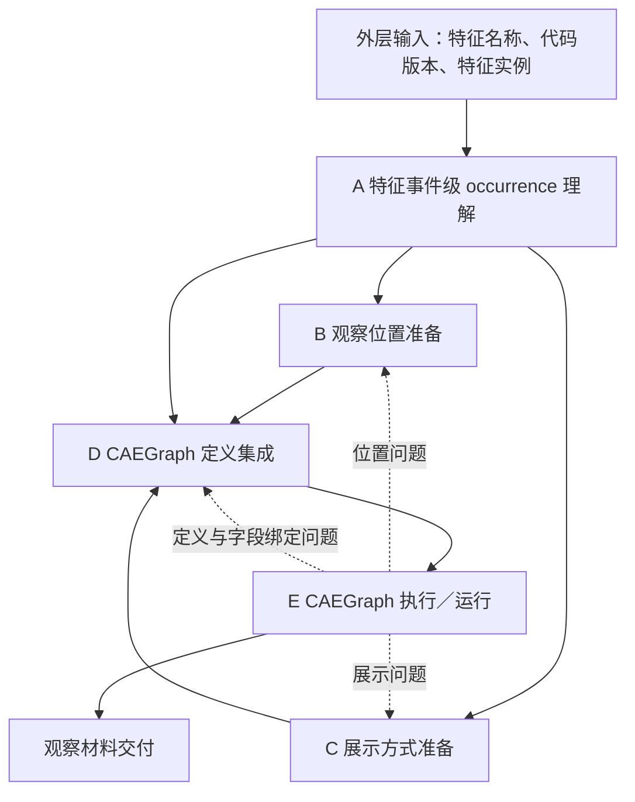

# L1-M｜观察材料准备外层 Workflow：A～E 的输入、输出与回流

> **成熟度**：候选、可试用。本文只规定观察材料准备的外层阶段、阶段输入输出和回流关系；A～E 各阶段的专业方法与内部 Workflow 由对应 Skill 负责。
>
> **目标**：围绕一个已经给定的特征实例，形成经过实际运行和核对的 CAEGraph 图、图中数据及可追溯执行结果，供后续合理性分析使用；本 Workflow 不直接判断特征合理或不合理。

## 1. 外层输入怎样形成

外层输入不是在 Agent 执行过程中逐步追加的。设计本 Workflow 和 A～E 各 Skill 时，应先细化各内部节点，再反推真正需要由任务提供的输入；正式执行前，外层输入应已经填好。

当前确定的外层输入为：

| 字段 | 含义 |
|---|---|
| **特征名称** | 本次要准备观察材料的特征名称 |
| **特征代码版本** | 能唯一定位本次实现的代码版本；具体仓库、提交、路径如何表达，由后续字段设计统一确定 |
| **特征实例** | 本次实际被观察、可由 A～E 直接引用的特征实例或实例引用；其 SOF 已经确定 |

以后若某项内部工作确实需要、且不能从特征代码、特征实例、上游阶段产物或 Skill 自带专业知识中取得，再增加外层输入字段；不得为“以后也许有用”预先堆积字段。

## 2. 用例信息与专业知识严格分开

- **外层输入及具体阶段产物**描述本次用例事实，例如特征实例、所选品种、时间、完整 CAEGraph 定义、运行结果。
- **专业知识**写在 A～E 各 Skill 及其 Reference 中，例如怎样识别 occurrence、当前怎样使用默认观察位置、高频多尺度位置怎样组织、怎样形成展示预期、怎样核对 Worker 改动。
- 不要求每次运行时再填写一份“专业知识输入”；也不能把本次具体品种和时间写进通用 Skill。

## 3. 外层阶段关系



A 是 B、C、D 的共同前置。B 与 C 可以在具备各自输入后并行开展：B 解决“实际看哪里”，C 解决“应该怎样展示”，二者在 D 汇合。

## 4. 阶段级合同

| 阶段 | 核心问题 | 主要输入 | 主要输出 | 专业正文 |
|---|---|---|---|---|
| **A 特征事件级 occurrence 理解** | 这个特征消费和产生哪些事件级 occurrence；各类事件在什么位置发生；业务主输出如何由中间处理形成 | 外层输入及可核实代码、类型和实例信息 | `特征事件级 occurrence 与发生位置说明`、`特征处理关系说明` | [A Skill](../skills/observation-material-preparation/feature-occurrence-understanding/SKILL.md) |
| **B 观察位置准备** | 普通特征使用什么经验性默认品种和时间；高频特征怎样沿 1d→30m→1m→5s→tick 组织位置 | A 产物、外层特征实例、任务明确位置（如有） | 普通位置或高频多尺度位置路径 | [B Skill](../skills/observation-material-preparation/observation-position-preparation/SKILL.md) |
| **C 展示方式准备** | 在理解 CAEGraph 现有能力后，怎样从待展示信息形成展示预期；复杂点怎样循环处理；怎样实现位置独立代码与预期 HTML | A 产物、需要时引用外层特征实例、CAEGraph 能力资料和展示知识 | 待展示信息清单、展示预期、复杂点处理记录、位置独立展示代码、预期展示 HTML | [C Skill](../skills/observation-material-preparation/caegraph-display-preparation/SKILL.md) |
| **D CAEGraph 定义集成** | 怎样把真实位置、真实实例和真实字段绑定进 C 的位置独立展示代码 | A、B、C 产物及外层特征实例 | `完整 CAEGraph 定义`，必须达到可直接交 E 尝试运行的 Python 定义／脚本初稿 | [D Skill](../skills/observation-material-preparation/caegraph-definition-integration/SKILL.md) |
| **E CAEGraph 执行／运行** | 怎样派 Worker、运行、有限修复、回流、核对图，随后正式取得图的数据并交付 | D 产物、外层特征实例及实际运行条件 | 最终脚本、最终 HTML、CAEGraph 图数据、运行与核对结果 | [E Skill](../skills/observation-material-preparation/caegraph-execution/SKILL.md) |

## 5. 各阶段 Skill 的文件组织

每个阶段目录采用：

```text
SKILL.md
    本阶段定位与边界、阶段输入和最终输出概览、异常入口、完成条件、不允许做的事

WORKFLOW.md
    内部步骤、步骤目标和步骤中的专业判断方法

IO_SPEC.md
    每个内部步骤的字段级输入和字段级输出
```

其中 B 当前没有足够方法沉淀，`WORKFLOW.md` 只记录普通默认和高频多尺度两种当前用法，不伪装成成熟通用流程。

“专业判断方法”不是独立于 Workflow 的另一套流程。它是某个内部步骤在遇到分支或判断点时采用的依据。若一个方法跨多个步骤且篇幅很大，再放入 `references/`，由相应步骤精确引用。

## 6. 关键边界

### 6.1 A 的事件位置与 B 的观察位置不同

- A 说明某类 Event 自己在实际点、确认点、已知点或更新点中的哪个位置发生，以及 occurrence 内还携带哪些位置。
- B 给最终 CAEGraph 提供品种和时间：普通场景使用任务明确位置或当前默认；高频场景使用多尺度位置路径。

不得因名称都叫“位置”而混同。

### 6.2 B 当前只是经验性用法

普通场景在任务没有另行指定时，沿用特征实例的 SOF，默认使用钢铁板块和 `2021-01-01` 至 `2022-12-31`。高频场景按专门参考复用 1d→30m→1m→5s→tick 位置层级。

这些是当前可用约定，不宣称已经形成通用的位置选择理论。尤其不能把高频参考脚本中的图层、样式和展示辅助逻辑误当成 B 的位置方法。

### 6.3 C 先形成展示预期，再实现代码

C 的内部顺序是：

```text
C1 待展示信息
→ 理解 CAEGraph
→ 理解展示知识
→ 形成初步展示预期
→ 列出复杂点
→ “提出表达—核实现有能力—修正预期”循环
→ 固化展示预期
→ 实现位置独立 CAEGraph 代码
→ 生成预期展示 HTML
```

C 不关心 B 最终选择多少真实位置。其样例位置只服务于展示设计和 HTML，不替代 B。

### 6.4 D 不派 Worker

D 以 C 的位置独立展示代码为集成起点，绑定 B 的真实位置、外层特征实例和 A 的真实字段。D 不重新设计展示预期，只交付完整 CAEGraph 定义。派单和运行均属于 E。

### 6.5 E 先核对图，再正式取图的数据

调试时可以临时查看数据，但只有最终图同时通过：

1. 与 D 完整定义的核对；
2. 与 C 预期展示 HTML 的结构和业务语义核对；

才可正式导出进入观察材料的 CAEGraph 图数据。最终 HTML、最终数据和最终脚本必须绑定同一版本和同一次有效运行。

## 7. E 的回流边界

E 运行发现问题时按问题性质返回：

| 问题性质 | 返回阶段 |
|---|---|
| 所选品种、时间或多尺度位置无数据／不成立 | B |
| 图的布局、图元或业务表达与展示预期不符 | C |
| 字段、实例、位置与展示定义代码的集成或绑定错误 | D |
| 导入、路径、明确 API 差异等不改变业务语义的确定性问题 | E 内由 Worker 在授权范围内修复 |

E 只返回受影响的阶段，不要求无关阶段全部重做。

## 8. 外层最终交付

观察材料准备最终至少交付：

- A～D 的当前有效阶段产物引用；
- 实际可运行的最终 CAEGraph 脚本；
- 最终 CAEGraph HTML；
- 最终 CAEGraph 图的数据及元信息；
- Worker 修改记录和运行日志；
- 与 D 定义、与 C 预期 HTML、以及图与数据三类核对结果；
- 已知限制、未解决问题及其影响范围。

实际状态按事实记录为：

- `PLAN_READY`：A～D 已形成可执行方案，但 E 尚未完成真实运行和取数；
- `DATA_READY`：最终图通过核对，图数据已正式取得并通过一致性检查；
- `PARTIAL_WITH_LIMITS`：只完成部分位置、图层或数据，限制已明确；
- `BLOCKED`：核心图或核心数据无法取得，原因和解除条件已记录。

不得用静态定义、语法检查、少量预览或未核对 HTML 冒充 `DATA_READY`。
