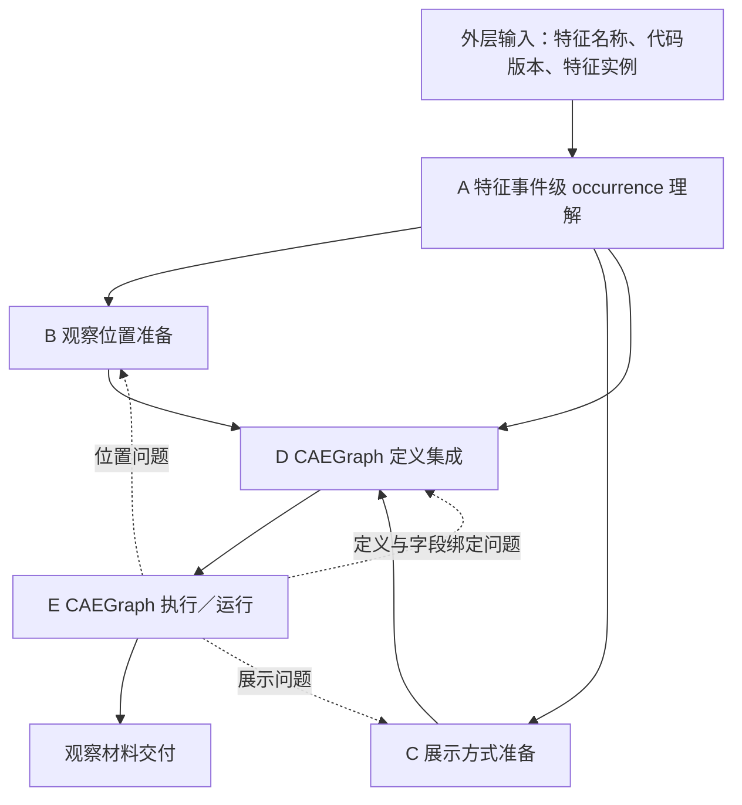

# L1-M｜观察材料准备外层 Workflow：A～E 的输入、输出与回流

> **成熟度**：候选、可试用。本文只规定观察材料准备的外层阶段、阶段输入输出和回流关系；A、B、C、E 的内部专业工作由对应 Skill 负责。D 当前是一个单一集成动作，不另设内部 Workflow。
>
> **目标**：围绕一个已经给定的特征实例，形成经过实际运行和核对的 CAEGraph 图、图中数据及可追溯执行结果，供后续合理性分析使用；本 Workflow 不直接判断特征合理或不合理。

## 1. 外层输入怎样形成

外层输入不是在 Agent 执行过程中逐步追加的。设计本 Workflow 和 A～E 各 Skill 时，应先细化真实工作，再反推真正需要由任务提供的输入；正式执行前，外层输入应已经填好。

当前确定的外层输入为：

| 字段 | 含义 |
|---|---|
| **特征名称** | 本次要准备观察材料的特征名称 |
| **特征代码版本** | 能唯一定位本次实现的代码版本 |
| **特征实例** | 本次实际被观察、可由 A～E 直接引用的特征实例或实例引用；其 SOF 已经确定 |

以后若某项工作确实需要、且不能从特征代码、特征实例、上游阶段产物或 Skill 自带专业知识中取得，再增加外层输入字段；不得为“以后也许有用”预先堆积字段。

## 2. 用例信息与专业知识严格分开

- **外层输入及阶段产物**描述本次用例事实，例如特征实例、所选品种、时间、完整 CAEGraph 定义和运行结果。
- **专业知识**写在 A～E 各 Skill 及其 Reference 中，例如怎样识别 occurrence、当前怎样使用默认观察位置、怎样形成展示预期、怎样理解 CAEGraph 仓库、怎样核对 Worker 改动。
- 不要求每次运行时再填写一份“专业知识输入”；也不能把本次具体品种和时间写进通用 Skill。

## 3. 外层阶段关系



A 是 B、C、D 的共同前置。B 与 C 可以在具备各自输入后并行开展：B 解决“实际看哪里”，C 解决“应该怎样展示”，二者在 D 汇合。

## 4. 阶段级合同

| 阶段 | 核心问题 | 主要输入 | 主要输出 | 专业正文 |
|---|---|---|---|---|
| **A 特征事件级 occurrence 理解** | 这个特征消费和产生哪些事件级 occurrence；各类事件在什么位置发生；业务主输出如何由中间处理形成 | 外层输入及可核实代码、类型和实例信息 | `特征事件级 occurrence 与发生位置说明`、`特征处理关系说明` | [A Skill](../skills/observation-material-preparation/feature-occurrence-understanding/SKILL.md) |
| **B 观察位置准备** | 普通特征使用什么经验性默认品种和时间；高频特征怎样沿 1d→30m→1m→5s→tick 组织位置 | A 产物、外层特征实例、任务明确位置（如有） | 普通位置或高频多尺度位置路径 | [B Skill](../skills/observation-material-preparation/observation-position-preparation/SKILL.md) |
| **C 展示方式准备** | C1 要展示什么；C2 怎样直接形成并循环更新展示预期和 HTML；C3 怎样整理成位置、实例和字段可注入代码 | A 产物、只读按需使用外层特征实例、锁定版本 CAEGraph 使用手册和必要源码 | C1 清单、C2 当前展示预期与唯一预期 HTML、复杂点记录、C3 可注入代码和注入合同 | [C Skill](../skills/observation-material-preparation/caegraph-display-preparation/SKILL.md) |
| **D CAEGraph 定义集成** | 在理解锁定版本 CAEGraph 仓库的前提下，怎样把外层输入和 A／B／C 产物一次性集成为完整定义 | 外层输入、A／B／C 产物、锁定 CAEGraph 仓库 | 可直接交 E 尝试运行的完整 Python 定义／脚本初稿、仓库理解、上游纠正和定义级检查 | [D Skill](../skills/observation-material-preparation/caegraph-definition-integration/SKILL.md) |
| **E CAEGraph 执行／运行** | 由同一 Codex E executor 连续完成运行、工程诊断、核图与图接受后的正式取数 | D 产物、C2 展示预期／HTML、外层实例、环境和授权 | 最终脚本、最终 HTML、CAEGraph 图数据、实际运行/diff、核图及一致性结果 | [E Skill](../skills/observation-material-preparation/caegraph-execution/SKILL.md) |

## 5. 各阶段 Skill 的文件组织

A、C、E 等具有内部步骤的阶段通常采用：

```text
SKILL.md
    阶段定位与边界、阶段输入和最终输出概览、完成条件、不允许做的事

WORKFLOW.md
    内部步骤、步骤目标和步骤中的专业判断方法

IO_SPEC.md
    字段级输入输出
```

当前例外：

- **B**：方法沉淀还不足，`WORKFLOW.md` 只记录普通默认和高频多尺度两种当前用法，不冒充成熟通用流程；
- **D**：只有一个集成动作，不设 `WORKFLOW.md`，由 `SKILL.md + IO_SPEC.md` 直接规定动作和字段；
- **E**：`WORKFLOW.md` 规定同一 Codex executor 的 E1～E6 完整专业工作与直接运行；旧 W1/W2 工单仅供历史 Run 追溯。

## 6. 关键边界

### 6.1 A 的事件位置与 B 的观察位置不同

- A 说明某类 Event 自己在哪个位置发生，以及 occurrence 内还携带哪些位置。
- B 给最终 CAEGraph 提供品种和时间：普通场景使用任务明确位置或当前默认；高频场景使用多尺度位置路径。

不得因名称都叫“位置”而混同。

### 6.2 B 当前只是经验性用法

普通场景在任务没有另行指定时，沿用特征实例的 SOF，默认使用钢铁板块和 `2021-01-01` 至 `2022-12-31`。高频场景按专门参考复用 1d→30m→1m→5s→tick 位置层级。

这些是当前可用约定，不宣称已经形成通用的位置选择理论。尤其不能把高频参考脚本中的图层、样式和展示辅助逻辑误当成 B 的位置方法。

### 6.3 C 固定为 C1／C2／C3

```text
C1：列出待展示信息
C2：形成并迭代展示预期
    C2A：直接阅读锁定版本 CAEGraph 使用手册
    C2B：形成第一版展示预期和第一版 HTML
    C2C：从当前 HTML 列出复杂展示点
    C2D：循环核实现有能力，并同步更新预期和 HTML
C3：整理可注入展示代码
    C3A：把 C2 当前原型整理成位置、实例和字段可注入代码
    C3B：核对 C3 代码与 C2 当前展示预期
```

C2 循环结束时的当前 HTML 就是唯一预期 HTML；没有单独的“固化展示预期”或“再次生成 HTML”步骤。C3 若需要改变展示预期，返回 C2D 同步更新预期和 HTML。

C 不维护本仓二手 CAEGraph 展示速查，直接阅读锁定版本原使用手册。外层特征实例在 C 中只读或临时预览；最终实例绑定由 D 完成。

### 6.4 D 是一个单一集成动作，并允许有边界的直接纠正

D 必须：

- 按锁定版本理解 CAEGraph 仓库中本次实际使用的导出、配置、布局、绘图、`PlotCtx`、CDS、数据树和动态／前端路径；
- 根据外层输入和 A／B／C 产物形成完整定义；
- 把真实特征实例、真实位置和真实字段注入 C3 代码；
- 保持 C2 当前展示预期，不另写一套业务语义不同的图。

D 发现 B／C 缺项或错误时：

- 依据现有规则只有一个修法、不引入新业务选择、也不改变 B 位置或 C2 展示语义时，可以直接纠正并完整记录修改前后和依据；
- 需要重新选择位置、改变展示预期、存在多个合理方案或拿不准时，必须返回 B／C；
- A 的事件、字段或关系事实不清时返回 A。

D 不派 Worker。

### 6.5 E 由 Codex executor 连续执行

默认由本 Run 正式绑定的 Codex E executor 完整运行 E1～E6，不再把 W1/W2 作为必经的独立跨 Chat 委派。具体专业方法仍以 [E Skill](../skills/observation-material-preparation/caegraph-execution/SKILL.md) 为准：

~~~text
E1 最小运行与核图基准
→ Codex 直接运行 D、连续诊断与权限内修复
→ E2 分类实际结果、必要时返回 B/C/D
→ E3 对 D/C2 核图并接受最终图
→ E4 冻结正式取数范围和准入
→ Codex 直接导出被接受图的正式数据
→ E5 图与数据一致性核对
→ E6 交付
~~~

普通工程调试和取数不额外创建 W；仍须在直接执行前核 Owner/D 许可、真实工作区和资源独占，E3 接受图后才能正式取数。

### 6.6 E 先核对图，再正式取图的数据

只有最终图同时通过：

1. 与 D 完整定义的核对；
2. 与 C2 当前展示预期／当前预期 HTML 的结构和业务语义核对；

才可形成正式取数准入并由 Codex E executor 直接导出正式数据。最终 HTML、最终数据和最终脚本必须绑定同一版本和同一次有效运行。

## 7. E 的回流边界

E 运行发现问题时按问题性质返回：

| 问题性质 | 返回阶段 |
|---|---|
| 所选品种、时间或多尺度位置需要重新选择 | B |
| 图的布局、图元或业务表达需要改变 C2 展示预期 | C |
| 字段、实例、位置与 C3 代码的集成或绑定错误 | D |
| 导入、路径、明确 API 差异等不改变业务语义的确定性问题 | 在同一 Codex E executor 中连续诊断、合法修复和重试 |

E 只返回受影响阶段，不要求无关阶段全部重做。

## 8. 外层最终交付

观察材料准备最终至少交付：

- A～D 的当前有效阶段产物引用；
- 实际可运行且被接受的最终 CAEGraph 脚本；
- 被接受的最终 CAEGraph HTML；
- 真实运行、修复 diff 和日志；
- 与 D 定义、与 C2 展示预期／HTML 的核对结果；
- 正式取数准入记录；
- 已接受图对应的正式 CAEGraph 图数据与元信息；
- 图与数据一致性核对；
- 已知限制、未解决问题及其影响范围。

实际状态按事实记录为：

- `PLAN_READY`：A～D 已形成可执行方案，但 E 尚未完成真实运行和取数；
- `DATA_READY`：最终图通过核对，正式图数据已取得并通过 E5 一致性检查；
- `PARTIAL_WITH_LIMITS`：只完成部分位置、图层或数据，限制已明确；
- `BLOCKED`：核心图或核心数据无法取得，原因和解除条件已记录。

不得用静态定义、语法检查、少量预览或未核对 HTML 冒充 `DATA_READY`。
