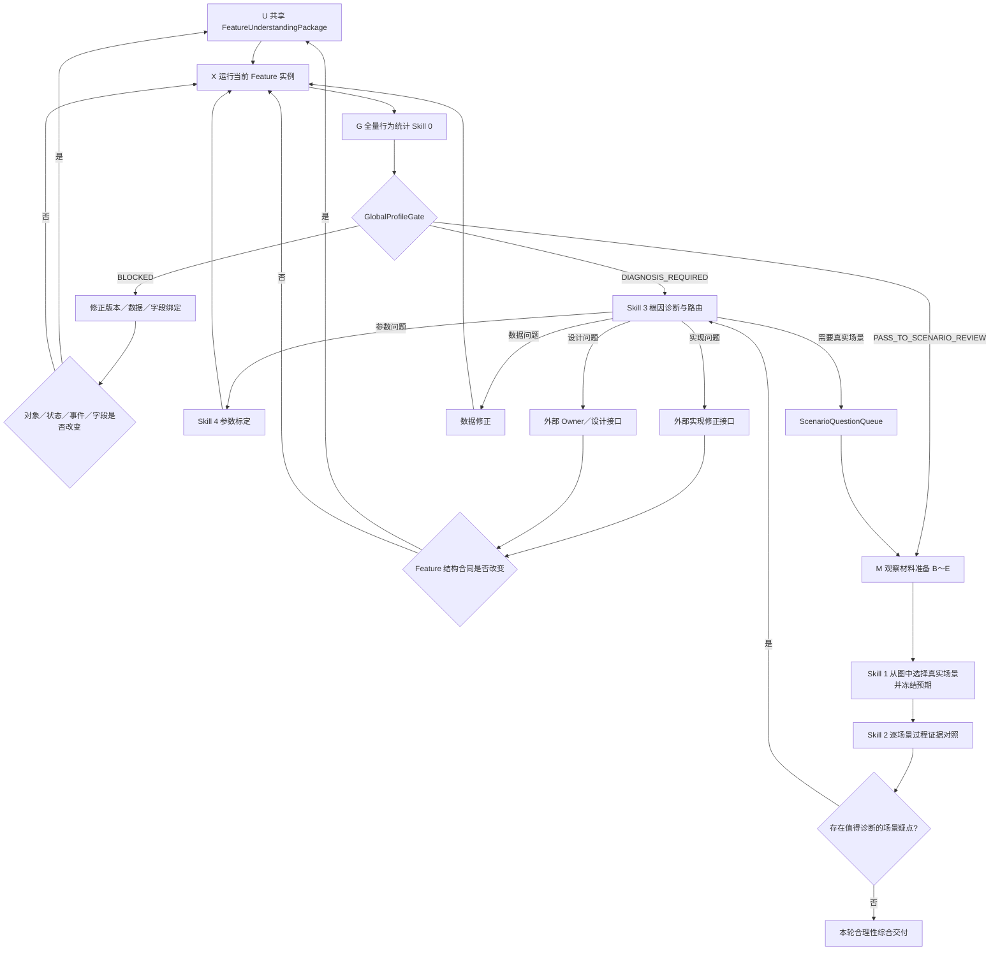

# L1-R｜合理性分析 V0.2 严格串行 Workflow

> **成熟度**：候选、用于 EAW Wall 与 FQA 首轮真实运行验证。  
> **专业来源**：[`skills/reasonableness-analysis/README.md`](../skills/reasonableness-analysis/README.md)及各 Skill。  
> **本轮边界**：新增全量行为统计；重构 Skill 1／2；Skill 3／4 内部实现保持不变。外层控制负责把现有 Skill 3／4 接入闭环。

## 1. 目标

本 Workflow 不把“合理性分析”压成一次看图或一份问题清单。V0.2 先形成一条可以运行的严格串行闭环：

```text
共享 Feature 理解
→ 运行 Feature
→ 全量行为统计
→ 已确认问题闭环
→ 全量 Gate
→ 准备最新实例的宽范围图与图数据
→ 从图中选真实场景并冻结场景预期
→ 逐场景比较原始过程、预期过程和实际过程
→ 对偏差查根因并处理
→ 行为一旦改变，重新从 Feature 运行与全量统计开始
```

本版优先保证闭环清楚，不建设跨问题影响分级、局部跳过或复杂并行调度。

## 2. 业务入口与出口

### 2.1 入口

至少需要：

```yaml
feature_name:
feature_code_version:
feature_instance_ref:
feature_run_or_execution_entry:
data_scope:
current_review_target:
  current_goal:
  intended_coverage:
  explicit_non_goals:
  owner_constraints:
```

若尚无 `FeatureUnderstandingPackage`，先执行共享 Skill：

- [`skills/feature-understanding/`](../skills/feature-understanding/SKILL.md)

### 2.2 出口

本轮最终交付至少包含：

- 当前有效 `FeatureUnderstandingPackage`；
- 最新 Feature 运行结果引用；
- `GlobalBehaviorProfile` 与 `GlobalProfileGate`；
- 全量统计发现及其 `DiagnosisReport`／`CalibrationResult`／外部处理返回；
- `ObservationMaterialPackage`；
- `CaseReviewSet` 与 `FrozenExpectationSet`；
- `ScenarioProcessCasebook`、`EvidenceComparisonPackage` 和 `DiscrepancyQueue`；
- 已处理、未决、覆盖外和证据不足的清单；
- 当前是否允许进入下游 Feature 或下一轮迭代的结论。

## 3. 阶段总图



## 4. 阶段契约

| 阶段 | 核心问题 | 必需输入 | 主要输出 | 正常后继 |
|---|---|---|---|---|
| **U 共享 Feature 理解** | 当前 Feature 实际维护什么对象、状态、事件、中间判断、参数和结果字段 | 名称、代码版本、实例、真实源码与接口 | `FeatureUnderstandingPackage` | X |
| **X Feature 执行** | 在明确版本、参数和数据范围上取得可复用运行结果 | 实例、执行入口、数据范围 | `FeatureRunResultBinding` 与 artifacts | G |
| **G 全量行为统计** | 对对象、事件、状态、生命周期和分层分布做全量剖面，发现结构疑点 | 理解包、运行结果、分层计划 | `GlobalBehaviorProfile`、疑点队列、场景问题队列、Gate | GG |
| **D 偏差诊断** | 疑点最早在哪一层产生，根因是什么，参数是否可修 | Skill 0 适配包或 Skill 2 对照包、共享处理链 | 现有 Skill 3 原生输出 | P／外部接口／补证／SQ |
| **P 参数标定** | 当前参数配置能否满足多位置共同要求，候选实例是否完整可用 | Skill 3 可调结论、预期、案例、参数与运行入口 | 现有 Skill 4 `CalibrationResult` | X |
| **M 观察材料准备** | 为通过全量 Gate 的最新实例形成宽范围图与同版本图数据 | 理解包、最新实例、位置和环境 | `ObservationMaterialPackage` | S1 |
| **S1 场景选择与预期** | 从已画好的图中挑哪些真实位置，本轮分别预期什么过程 | 理解包、ReviewTarget、ObservationMaterialPackage、ScenarioQuestionQueue | `CaseReviewSet`、`ScenarioExpectationSet`、`FrozenExpectationSet` | S2 |
| **S2 场景过程对照** | 原始市场过程、预期 Feature 过程、实际 Feature 过程在哪里首次分歧 | 冻结案例、冻结预期、观察材料、理解包 | `ScenarioProcessCasebook`、`EvidenceComparisonPackage`、`DiscrepancyQueue` | D 或 R |
| **R 综合交付** | 当前版本在哪些范围成立、失败、未决或覆盖外，下一步是什么 | 本轮已接受的全量／场景／诊断／标定结果 | `AnalysisDelivery` | L0 收束或下一轮 |

## 5. 全量行为统计 Gate

### 5.1 `BLOCKED`

以下任一情况成立：

- 理解包与运行结果代码／实例版本不一致；
- 对象键、时间键或核心事件字段不可靠；
- 运行结果不足以形成主要剖面；
- 数据范围或参数实例无法确认。

后继：修正绑定、数据或字段；Feature 行为或结构变化时按总图回到 U 或 X。

### 5.2 `DIAGNOSIS_REQUIRED`

存在可由明确结构不变量支持、且值得查因的疑点，例如：

- 有终点无起点；
- 终结后继续更新；
- 非法状态转换；
- 中间状态系统性零时长；
- 同拍顺序系统性违反生命周期；
- 对象引用大量悬空；
- 稀疏业务输出近似逐 Tick 发生。

后继：使用 Skill 0 的 `DiagnosisInputAdapter` 进入现有 Skill 3。

### 5.3 `RERUN_REQUIRED`

参数、实现、设计或数据修正已经改变 Feature 行为。旧运行结果、旧剖面和旧 Gate 失效。

后继：X → G。

### 5.4 `PASS_TO_SCENARIO_REVIEW`

同时满足：

- 当前统计绑定最新运行结果；
- Skill 3 已确认的参数问题已完成 Skill 4 并重跑／复验；
- 已确认实现问题已由外部接口修正并重跑／复验；
- 已确认设计问题已形成新设计、完成实现并重跑／复验；
- 剩余条目只是描述性分布，或只能通过真实场景判断。

此 Gate 只允许进入 M／S1／S2，不等于 Feature 已经合理。

## 6. 两种问题发现方式

### 6.1 全量行为统计

擅长发现：

- 生命周期结构塌缩；
- 不可达或非法状态；
- 系统性顺序异常；
- orphan lifecycle；
- 对象／事件／活跃覆盖密度风险；
- 跨品种、时期、Session 的明显失稳模式。

它不依赖图，不直接判断一个真实市场过程“像不像”。

### 6.2 场景过程观察

在图与图数据完成后，由 Skill 1 选择：

```text
CLEAR_POSITIVE
CLEAR_NEGATIVE
OUTPUT_FALSE_POSITIVE_CANDIDATE
POTENTIAL_FALSE_NEGATIVE
PARAMETER_BOUNDARY
OUTSIDE_CURRENT_COVERAGE
```

Skill 2 对每个案例比较：

```text
RawMarketProcess
ExpectedFeatureProcess
ObservedFeatureProcess
```

并定位 `EarliestBusinessDivergence`。

## 7. Skill 3／4 的使用边界

本分支不修改 Skill 3／4 内部文件。

### 7.1 Skill 3

当前负责：

- 复述偏差；
- 建立处理链；
- 区分事实与解释；
- 构造诊断树；
- 设计最小区分性检查；
- 定位最小责任阶段；
- 初筛参数可修复性；
- 路由到参数、实现、设计、数据、预期或补证。

它当前不承担跨问题影响分级或调度。

### 7.2 Skill 4

只有 Skill 3 给出：

```text
POSSIBLY_ADJUSTABLE
或
COUPLED_UNRESOLVED
```

时才进入。任何候选实例若改变 Feature 行为，都必须回到 X → G，而不是只看原图。

## 8. 外部接口

### 8.1 实现修正

系统输出至少包括：

```yaml
ImplementationFixRequest:
  diagnosis_ref:
  expected_behavior:
  observed_behavior:
  localized_code_stage:
  evidence_refs: []
  acceptance_condition:
```

外部返回至少包括：

```yaml
ImplementationFixReturn:
  diagnosis_ref:
  code_commit:
  changed_files: []
  changed_behavior:
  tests: []
  new_feature_version:
  ready_for_feature_rerun: true
```

### 8.2 Owner／设计决策

系统输出：

```yaml
DesignIssuePacket:
  diagnosis_ref:
  business_question:
  current_method:
  failure_cases: []
  why_parameters_cannot_solve:
  candidate_options: []
  implementation_implications:
```

外部返回：

```yaml
DesignDecisionReturn:
  diagnosis_ref:
  selected_rule:
  updated_business_definition:
  implementation_requirement:
  acceptance_condition:
  decision_version:
```

设计返回后必须先实现，再更新 U（若结构合同变化）、运行 X、重做 G。

## 9. 观察材料与场景线

### 9.1 M 的职责

观察材料准备只交付最新实例的宽范围图、图数据、脚本、字段、版本和限制，不选正例／反例，不宣布合理性。

### 9.2 S1 的职责

Skill 1 名称暂保留 `business-expectation-derivation`，但 V0.2 实际负责：

- 从已画好的图和图数据选择真实案例；
- 不只从已有输出反选案例，必须找潜在漏报；
- 为每个案例冻结过程预期；
- 材料不足时返回 M。

### 9.3 S2 的职责

Skill 2 名称暂保留 `business-evidence-comparison`，但 V0.2 实际负责逐案例过程对照，不重新选场景、不做全量统计、不查根因。

## 10. 行为修改后的失效与重跑

| 修改 | 更新共享理解 | 重跑 Feature | 重做全量统计 | 重做观察材料／场景分析 |
|---|---:|---:|---:|---:|
| 参数值或参数实例变化 | 仅更新实例绑定 | 是 | 是 | 是 |
| 对象／状态／事件／处理中间结构改变 | 是 | 是 | 是 | 是 |
| 业务实现规则改变但外部结构不变 | 核对／必要时更新 | 是 | 是 | 是 |
| 原始数据或时间对齐修正 | 否／核对 | 是 | 是 | 是 |
| 只补运行结果字段、不改变行为 | 更新字段映射 | 视导出方式 | 相关统计重做 | 相关材料重做 |
| 只改 CAEGraph 展示 | 否 | 否 | 否 | M 的 C～E 与后续案例重做 |
| 只改案例选择或预期 | 否 | 否 | 否 | S1／S2 |

## 11. 本轮综合交付

`AnalysisDelivery` 作为封面引用原生结果：

```yaml
question_id:
analysis_round_id:
feature_ref:
parameter_version:
feature_understanding_ref:
global_profile_ref:
global_gate:
observation_material_ref:
case_review_set_ref:
scenario_casebook_ref:
diagnosis_refs: []
calibration_refs: []
external_resolution_refs: []
current_supported_scope: []
current_counterexamples: []
outside_current_coverage: []
missing_or_limited: []
completion_evaluation:
next_actions: []
```

不得把：

- 全量 Gate 通过写成 Feature 已合理；
- 有据反证写成工作失败；
- 场景覆盖外写成当前版本设计错误；
- 旧实例图和旧实例统计并入新实例结论。

## 12. V0.2 首轮验证

先完整运行 EAW Wall：

```text
U → X → G → D／P／外部接口闭环 → Gate
→ M → S1 → S2 → D → 行为修改后回 X → G
```

Wall 跑通后，再以 FQA 中处理结构不同的一个 Feature 验证迁移性；根据真实摩擦决定下一轮是否增加问题影响分级、局部重跑或场景反向驱动画图。
