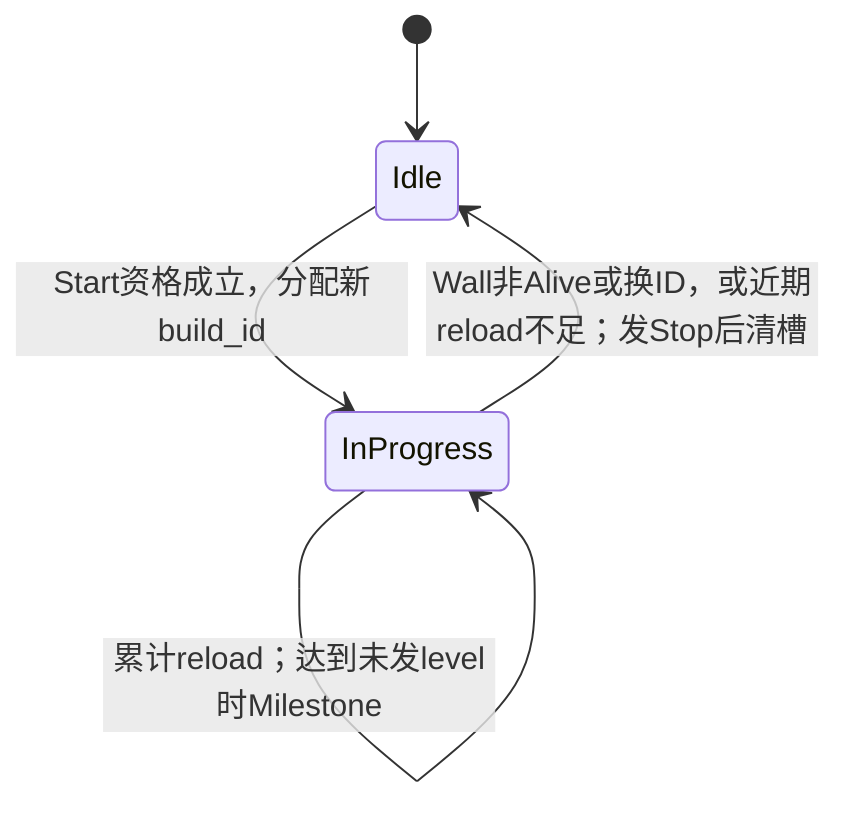

# FeatureUnderstandingPackage｜EAW P1 Build｜D001 U1

本包完成 **D001 的 U 理解工作**：当前实现、默认实例、业务对象、状态、事件、关键判断、处理关系、参数与公开结果字段已定位，`completion_status=COMPLETE`。它不表示 Build 正式运行、统计、合理性验收或父 Run 完成。未确认的市场/结果绑定已逐项注明，后继仍是原 L0 的 X。

机器原件见 [FeatureUnderstandingPackage.json](FeatureUnderstandingPackage.json)。该 JSON 含 IO_SPEC 原生各模型、payload 类型/缺失含义、逐项代码行、完整默认 ppdict 和具名缺口；本文件为可读视图。

**采用与实证范围**

- Run：`OI-EAW-P1-BUILD-STAT-20261124-01`；C0002／D001；executor:E1；`workers=[]`。
- 专业控制：`391adcd18bd2da82c13c01710980f41e01c7de25`。亲自读取其 [Skill](https://github.com/daowei2026/observe-iterate/blob/391adcd18bd2da82c13c01710980f41e01c7de25/skills/feature-understanding/SKILL.md)、[Workflow](https://github.com/daowei2026/observe-iterate/blob/391adcd18bd2da82c13c01710980f41e01c7de25/skills/feature-understanding/WORKFLOW.md)、[IO_SPEC](https://github.com/daowei2026/observe-iterate/blob/391adcd18bd2da82c13c01710980f41e01c7de25/skills/feature-understanding/IO_SPEC.md)、[业务对象补充](https://github.com/daowei2026/observe-iterate/blob/391adcd18bd2da82c13c01710980f41e01c7de25/skills/feature-understanding/BUSINESS_OBJECT_QUALIFICATION_GUIDE.md)、L0、V2、原生执行 Profile、executor 指南及本 D 输入/授权原件。
- 唯一业务输入：[BUILD_RUN_INPUT.md](https://github.com/daowei2026/observe-iterate/blob/391adcd18bd2da82c13c01710980f41e01c7de25/task-inputs/eaw-p1-build-stat-20261124/BUILD_RUN_INPUT.md)。SOF `TA_updto20240229_DBA`，rb/m，2021-01-01 至 2021-12-31，`night_end_at_2300`；这些是请求范围，尚非实际数据覆盖事实。
- 实际工作区 `/dwdhome/fy/BASE_E6_2`；TIS 根 `mquant/tis`；HEAD 与指定 `179016111ed0394f92025313e46bd13534932a74` 一致。Build、core、Wall、相关导出/receipt/flow/typed Python 接线均逐文件与该 commit 核同；已跟踪未提交修改只有保留的 STCalendar。
- 通过既有 `./run-python.sh -B` 导入和构造默认实例，取得真实 ppdict/ppid/源文件与实现指纹；脚本禁止 `AbsFao._run_with`。系统 python 初次缺 pandas 的失败保留在本地证据，改用既有平台入口后成功。没有运行任何 Feature、Numba replay 或市场统计，没有改代码或 TIS 分支。
- [INSTANCE_INSPECTION.json](INSTANCE_INSPECTION.json)、[STCALENDAR_ASSESSMENT.json](STCALENDAR_ASSESSMENT.json)、[SOURCE_MANIFEST.json](SOURCE_MANIFEST.json) 提供相应证据。构造检查不是 X；未生成或复用正式结果。

**实现与业务职责**

| 来源 | 当前职责 |
|---|---|
| [build_assembler.py](https://github.com/daowei2026/tis/blob/179016111ed0394f92025313e46bd13534932a74/hf/prel0/build_assembler.py#L87) | 取市场数据、消费默认 exact Wall 结果/receipt、块内计算 transient flow、按 side replay、输出 packed 稀疏流与 receipt |
| [build_assembler_core.py](https://github.com/daowei2026/tis/blob/179016111ed0394f92025313e46bd13534932a74/hf/prel0/build_assembler_core.py#L403) | F10 打墙判断、F11 补墙代理、rolling 窗口及 Build 状态机；ID 是 producer-local |
| [p1_dba_export.py](https://github.com/daowei2026/tis/blob/179016111ed0394f92025313e46bd13534932a74/hf/prel0/p1_dba_export.py#L256) | 同 timestamp 的物理 lane 分流、dtype、空哨兵及 DBA dump |
| [p1_product_receipt.py](https://github.com/daowei2026/tis/blob/179016111ed0394f92025313e46bd13534932a74/hf/prel0/p1_product_receipt.py#L230) | 参数/来源/代码及直接上游的薄 receipt；不是业务事件或完整数据一致性证明 |
| [BuildActivity.hs](https://github.com/daowei2026/frp/blob/cac6c912dd65a14acbd591ca57e0afd8ddb4ef13/src/Frp/Instance/ISL/Eaw/P1/BuildActivity.hs#L47) | FRP 接纳已形成 occurrence、维护 active current 和 publication/diagnostics；本 Run 未执行 |
| [FaoIngress.hs](https://github.com/daowei2026/frp/blob/cac6c912dd65a14acbd591ca57e0afd8ddb4ef13/src/Frp/Instance/ISL/Eaw/P1/FaoIngress.hs#L637) | raw 数值行转 typed Build，冻结 exact receipt 上下文并处理 availability |

原始业务来源已直接读取，准确引用见 JSON 的 `original_business_sources`：P1 架构、Build DSU、生命周期合同、原始组装器方法与指定 FRP 合同。文档说明与当前实现分别登记，没有以实现替代业务预期，也没有由差异作合理性裁决。

**对象、身份与计数粒度**

Build 是一次有 Start、更新和 Stop 的持续加固活动，激活时绑定一堵 Wall；Wall 是被引用的上游业务对象。参数实例、Calendar、receipt、chunk、stream、ring 与 F10/F11 数组均不另列为业务对象。

- producer 对每 side 维护一个 active 槽。两个 side 共用递增 `next_build_id`；每 chunk 完整执行 bid 后执行 ask，所以 ID 不是全局时间排名。
- wrapper 跨交易日传递完整 carry（包括 ring、last best）和 counter。当前实现没有在交易日块边界自动 reset，也没有在数据尾自动 Stop。
- 分组应使用 source/symbol 作用域加 `build_id`；Wall 引用需加 exact Wall receipt 作用域。裸 ID 不能跨品种、参数或 artifact 合并。
- typed `BuildActivityIdentity` / `WallIdentity` 的结构只保存 localNo，`build:<n>` / `wall:<n>` 仍是运行内引用；FeatureRunIdentity/receipt 在外层界定命名空间。
- Build 对象数、raw occurrence 行数、milestone 次数、current 更新数和物理 stream 数是不同单位；typed/raw 是同一业务变化的不同表示，不能重复计数。

[对象及 carry 证据](https://github.com/daowei2026/tis/blob/179016111ed0394f92025313e46bd13534932a74/hf/prel0/build_assembler.py#L109)、[ID 创建与状态证据](https://github.com/daowei2026/tis/blob/179016111ed0394f92025313e46bd13534932a74/hf/prel0/build_assembler_core.py#L527)、[typed 身份证据](https://github.com/daowei2026/frp/blob/cac6c912dd65a14acbd591ca57e0afd8ddb4ef13/src/Frp/Instance/ISL/Eaw/P1/Products.hs#L443)。

**状态与 occurrence**

Idle 是处理器的“没有进行中活动”，不是永久保留的 Stopped 对象。Stop 后清空 active/wall/start/baseline/cum/mask/ring，但保留最后 build_id；不能因此把 inactive 快照误计为新活动。

| 主输出 | 实际触发与位置 | payload/缺失含义 |
|---|---|---|
| Start，公开码 8 | 本拍 inactive、Wall Alive 且 ID>0、attack!=0、当拍 reload>0、start rolling 比例达到门槛 | 分配 build_id；冻结当拍 best_vol 为 baseline；cum 只初始化当拍 reload，未取整个 start sum；本拍不再发 Milestone/Stop |
| Milestone，公开码 9 | 后续 active 分支，在 Stop 判断之前计算累计 ratio，逐个发布尚未命中的 level | `level` 与实际 `ratio`；同拍可发多个 level；mask 防止同活动同级重复 |
| Stop，公开码 10 | Wall 非 Alive（含 Dormant/Empty/Ended）或 ID 变化，或后续拍近期 reload/baseline 严格低于 stop 门槛 | 仍引用原 active Wall；未输出具体原因码；先记录 event/checkpoint 再重置，所以 Stop checkpoint 的 active 仍是 1 |

事件本身在输入 tick 的 `uti[i]` / `ts[i]` 发生，未实现另一套 confirm/publish 延迟字段。UTI 来源为 `linear_ts // 500 - 1`，不把 calendar 线性 tick 差直接当实际墙钟秒数。core checkpoint 中的 `start_uti` 不进入 formal sparse payload。[事件证据](https://github.com/daowei2026/tis/blob/179016111ed0394f92025313e46bd13534932a74/hf/prel0/build_assembler_core.py#L510)、[序列化证据](https://github.com/daowei2026/tis/blob/179016111ed0394f92025313e46bd13534932a74/hf/prel0/build_assembler_core.py#L906)、[时间证据](https://github.com/daowei2026/tis/blob/179016111ed0394f92025313e46bd13534932a74/hf/prel0/tick_quote_context.py#L97)。

**关键中间判断**

| 判断 | 当前实现事实 | 公开情况 |
|---|---|---|
| transient active flow | 方向 hit 量先取绝对值；pressure 为成交量乘对应方向份额；当前 wrapper 计算 F3、关闭 F4；不产出独立 F3 artifact | 不随 Build 正式返回 |
| F10 attack | Wall Alive、side 有效，best/last 到 band 至少一个在 near 范围内，pressure>0；samebest flag 不是门 | core `f10_out`，未公开 |
| F11 reload | stable 为前后 side 相同且 best 价相同；通过稳定门时，`max(visible_delta,0)+attack_pressure_proxy` | core `f11_out`，未公开 |
| start rolling | 每拍先写 start ring；当前 best_vol 作候选分母；Start 时才冻结 baseline | rolling 值未公开 |
| 累计/milestone | 活动后续拍累计 cum，ratio 与所有未置位 level 比较；一拍可跨多级 | event cum、level、ratio 部分公开 |
| stop rolling | 活动分支更新 stop ring；先可能发 Milestone，再决定 Stop | reason、post-reset state 未公开 |
| exact axis | chunk plan 必须覆盖全部输入，Wall trace 必须完整对齐当前 tick axis | 不通过则抛异常，不伪造 Stop |

详细输入、规则、消费位置和证据逐项见 JSON 的 `intermediate_decisions`；这些是计算事实，未在本 U 评价设计或选定参数值。

**当前参数实例**

真实 `ppid`：`BuildAssembler_954318e844386b1a4967d626990a21e0be640bfd`。完整 Build 及嵌套 Wall 的 ppdict 已随机器原件记录；`build-default` 只是参数集名，不能替代完整参数身份。

| 参数/规则 | 实际默认或派生值 | 作用 |
|---|---|---|
| t_build_ticks | 6 | 派生两个窗口 |
| reload_start_ratio / reload_stop_ratio | 0.5 / 0.2 | Start 的 >= 门及 Stop 的 < 门 |
| build_start_window_ticks / build_stop_window_ticks | 原始 None / None，实际 3 / 3 | `max(1,t//2)`；不是 6 tick 的持续时间条件 |
| milestone_levels | (0.5,1.0) | preset；代码允许覆写，按原顺序逐级检查 |
| require_best_price_stable | True | F11 累计门 |
| attack_near_band_ticks | 1 | best/last 到 band 距离门 |
| active_flow_same_best_tol_ticks | 0 | same-best hit 计算 |
| baseline | best_vol_at_start，隐含实现规则 | 没有独立 baseline_mode 参数键 |
| DEFAULT_EPS / active_flow_eps_vol | 1e-12 / 1e-12 | Build 比例分母及 flow 工程保护；后者进 private receipt 参数 |
| tick_size / trading_unit | 实际上下文值未读 | tick_size 每 chunk 派生；trading_unit 被传入，但当前 F4=False 的 F3 计算不消费它 |

[默认与派生证据](https://github.com/daowei2026/tis/blob/179016111ed0394f92025313e46bd13534932a74/hf/prel0/build_assembler.py#L210)、[core 参数证据](https://github.com/daowei2026/tis/blob/179016111ed0394f92025313e46bd13534932a74/hf/prel0/build_assembler_core.py#L179)。receipt 的窗口会写有效派生值，而 ppdict 保留原始 None；两者不能无说明互换。

**公开结果读取与字段边界**

当前正式 `_impl` 只返回 `packed_occurrence_streams`；`_frames` 的其它表不会返回到 `.F`。X 必须在准确实例完成后枚举其 `.F` 的全部 `build__*` keys，并按真实 receipt 读回。单独调用内部 replay 取得的额外字段不是当前公开持久化证据。

| 载体/字段 | 本次可用状态 | 下游含义 |
|---|---|---|
| `build__stream`、`build__stream__occNNNN`：build_id、wall_local_no、uti、ts/index、event_type_code、baseline_vol、cum_reload_proxy、side slot、continuity/availability code | 源码明确公开；正式结果 `UNCONFIRMED` | 一行一 raw occurrence；全部 lane 都需读取 |
| `level/ratio` | 条件列，正式结果 `UNCONFIRMED` | 只有 Milestone 有值；Start/Stop 可 NaN；没有任何 Milestone 时整列可能不存在 |
| `occurrence_ordinal` | 条件列，正式结果 `UNCONFIRMED` | 同 timestamp 分流的物理序号；不保证每次运行都有该列 |
| `p1_receipts/build_activity.json` | `UNCONFIRMED` | 成功 dump 后写入；含参数、source_scope、代码、artifact 与直接 Wall 引用 |
| `build_assembler_sparse_events` | `NOT_EXPOSED` | 内部中间表名，不能据此读取当前 `.F` |
| carry、chunk state/checkpoint/summary、start_uti、active、mask、ring | `NOT_EXPOSED` | core 内存/内部表存在；不能冒充已落盘的完整状态轨迹 |
| F10/F11/flow validity/逐 tick rolling ratio | `NOT_EXPOSED` | 从稀疏 cum 差分不能恢复完整 dense 过程 |
| 每 row `source_run_ref` | `PARTIAL` | 当前没有该列；运行身份在流级 receipt/上下文 |
| 具体 Stop 原因 | `PARTIAL` | producer 未公开分支，typed 固定字串 `producer-stop`，不能据此推断具体原因 |
| `p1_transport_empty` | 正式读回待 X | 零行工程哨兵；不是业务发生，也不单独证明数据范围完整 |

同刻分流保留 timestamp。raw 的物理追溯键可用 artifact/result_key/timestamp；按业务判断还需 build_id、event_code 和 milestone level。不能按 UTI 去重，也不能把 lane 数当 Build 数。[导出证据](https://github.com/daowei2026/tis/blob/179016111ed0394f92025313e46bd13534932a74/hf/prel0/p1_dba_export.py#L256)、[正式返回证据](https://github.com/daowei2026/tis/blob/179016111ed0394f92025313e46bd13534932a74/hf/prel0/build_assembler.py#L248)。

**FRP 合同表示与信息变化**

本次只读合同与实际 decoder，没有执行 FRP，也没有新增独立 FRP 或 P2 Run。

- typed decoder 用 `level` 形成 milestone label/单位区间值，并不消费 producer 的 `ratio` 或 `baseline_vol`；cum 作为非负 Quantity。continuity_code=1 映成 Measured 1；不可用 calculation 进入 diagnostic。
- typed occurrence ref 是 `build:<localNo>:<uti>:<eventCode>`，未纳入 level 或物理 ordinal。raw 同拍多 level 与该映射的关系已具名记录；本 U 不宣称实际正式样本已经发生冲突或业务缺陷。
- exact upstream 先核 receipt 的 Feature/参数/artifact/schema/code/source scope。当前 packed 路径建立经过验证的 Wall namespace并接受正 localNo，并不逐条枚举本段 Wall 身份存在性。
- DSU 每 firing 重建重复/冲突 ledger；输入顺序 fold，失败保留原状态。成功 currentUpdates 对同一 identity只保留本 firing 最后 view，occurrence publication保留接纳列表。
- Stop 产生终止 current update 后从 active Map 删除；不能把 `BuildStoppedState` 声明解释为长期留存的 stopped current 历史。
- Python `EawP1BuildActivityFrp` 是 typed 输入配置，其 `to_df` 明确拒绝；它不是直接可读取上述 current 的普通 DataFrame 包装。

[decoder](https://github.com/daowei2026/frp/blob/cac6c912dd65a14acbd591ca57e0afd8ddb4ef13/src/Frp/Instance/ISL/Eaw/P1/FaoIngress.hs#L637)、[ref 构造](https://github.com/daowei2026/frp/blob/cac6c912dd65a14acbd591ca57e0afd8ddb4ef13/src/Frp/Instance/ISL/Eaw/P1/FaoIngress.hs#L550)、[exact 引用](https://github.com/daowei2026/frp/blob/cac6c912dd65a14acbd591ca57e0afd8ddb4ef13/src/Frp/Instance/ISL/Eaw/P1/Internal/UpstreamReference.hs#L21)、[DSU](https://github.com/daowei2026/frp/blob/cac6c912dd65a14acbd591ca57e0afd8ddb4ef13/src/Frp/Instance/ISL/Eaw/P1/BuildActivity.hs#L47)、[Python 接线](https://github.com/daowei2026/tis/blob/179016111ed0394f92025313e46bd13534932a74/frp/EawBattleP.py#L41)。

**STCalendar 既有修改**

已保留 `frpExample/STCalendar.py`。工作 blob 为 `fa8edcda48b9ac4a9366154cd8568fcfd44da21e`，基线 blob 为 `bb67cfb1c2382ec1c0b4c23e8918ea01268f173c`；SHA-256 为 `3001e49a3b812b5281ddca12795e5aa279d5ca09fd510ba0a4cfc330b42c6980`。

修改增加空 occurrence 时的 typed 空表返回，非空仍读 actual2D/confirm2D。它随 `mquant.tis` 包导入加载；已读 Build/core/Wall/flow 路径未引用该 helper 或 ScaleTurn 对象，且该文件不是 `night_end_at_2300` 交易日历定义。构造导入成功仅证明这个有界过程成功，不能证明完整 X 全链零影响。mtime/最后 tracked commit 不能归因未提交修改作者或来源 Run，来源仍为 `UNCONFIRMED`。本 D 没有覆写、回退或将其提交为 Build 修复。

**具名未知项与既定后继**

| 项 | 当前事实与影响 | 所需新增证据 |
|---|---|---|
| UQ-X-SCOPE | 实际全年市场范围未读取 | X 实际数据/参数/Calendar/输入范围和完整结果绑定 |
| UQ-WALL | exact Wall artifact/receipt/trace未核 | X 准确复用核验或原授权范围技术物化；不改上游 |
| UQ-AXIS | Wall可能排除特定全空开盘占位并改变source cut，Build走普通输入读取且要求exact轴；正式实例是否触发未知 | X 实际核两条输入轴/source scope；失败据实局部阻断，保留原错误与恢复条件 |
| UQ-PUBLIC-READ | 公开流字段、dtype、条件列、receipt均未正式读回 | X 读回所有 lane、当前 receipt及其准确上游 |
| UQ-DENSE / UQ-REASON | dense/rolling/state与具体Stop原因未公开 | 需要这些证据的后续工作明确缺口，不能补造；不在U提出修正 |
| UQ-TYPED | typed backend未执行，多个表示间有信息变化 | 后继确需时核真实消费，不把 raw 当成FRP已接纳 |
| UQ-STCAL | 既有修改内容已核、来源未知、完整执行影响未证 | 保留现状和版本证据，X记录实际加载/影响 |

默认参数、实现及核心模型已足以交给原 L0 的 X；正式 G 必须等当前实例有效 X 结果。manager 消费本回交后决定既定后继，本 executor 不签发新 D/W，不改 manager 的父任务完成状态。本包没有提出调参、实现修复、设计变更或 FeatureRelease。

**U 完成条件自检**

当前实例已定位；对象/身份/状态与 occurrence 已区分；主输出/中间结果已按业务角色分类；形成/更新/结束/引用链有源码证据；参数定义与消费已映射；公开与未暴露字段已具名；未知项未写为确定事实。相应机器记录和真实构造证据一并发布。D001 无尚未完成的 Skill 内部工作，父 Run 的 X/G/必要诊断与完成判断仍未进行。
