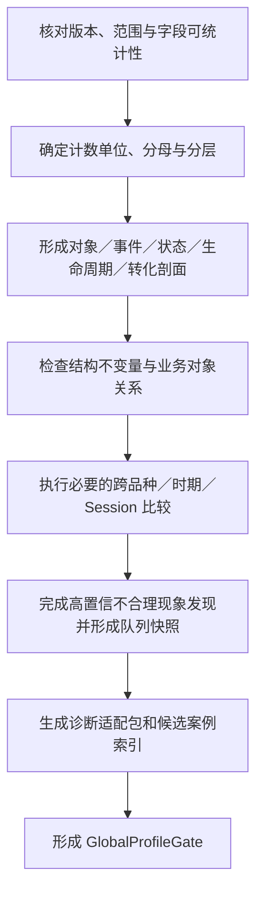

# 特征全量行为统计与高置信不合理现象发现｜内部 Workflow

## 总图



## G1｜核对版本、范围与字段可统计性

**目标**：保证统计对象来自同一 Feature 代码版本、参数实例和运行范围。

**检查**：

- `FeatureUnderstandingPackage` 与运行结果代码版本一致；
- 参数实例／版本一致；
- 对象范围、时间范围、交易日历和 Session 可确认；
- 运行结果文件完整、无明显重复或乱序；
- 对象键、时间键和事件类型字段可读取；
- 每个拟统计中间判断在结果中是 `AVAILABLE`、`PARTIAL` 还是 `NOT_EXPOSED`。

**输出**：`StatisticsInputReadiness`。

若核心对象或事件无法可靠分组，Gate 直接为 `BLOCKED`。

## G2｜确定计数单位、分母与分层

**目标**：在统计前明确“数的是什么”。

每项统计至少说明：

```text
count_unit
object_group_key
time_basis
denominator
deduplication_rule
same_tick_rule
strata
```

示例：

- Start 按 occurrence 数，亦按新建对象数核对；
- Revision occurrence 与唯一 Life 分开；
- 当前 active／责任内对象与历史累计对象分开；
- 状态占用按可支持的状态轨迹统计；
- 生命周期长度按对象的 Start 到 End 统计；
- 同一对象同一 UTI 的多 occurrence 按 ordinal／业务阶段区分。

不得将表行数直接当作业务 occurrence 数，也不得把历史累计对象直接当作当前有效对象。

## G3｜形成行为剖面

按运行结果实际可用字段形成：

### 3.1 候选与中间判断剖面

- 命中数与命中比例；
- 候选进入下一层的转化比例；
- 首次阻断及其分母；
- 中间判断在不同分层中的分布。

仅统计 `AVAILABLE` 字段。

### 3.2 对象剖面

- 对象创建数；
- 当前／责任内／历史对象数及各自口径；
- 同时活跃或责任内对象数；
- 对象身份连续性；
- 父子或引用完整性；
- 创建、修订、结束与当前对象的对账。

### 3.3 事件剖面

- 各事件类型数量；
- 每对象事件数；
- 每单位时间事件密度；
- 同刻多事件组合与顺序。

### 3.4 状态与转换剖面

- 各状态占用时间；
- 各转换次数；
- 状态持续时间分布；
- 非法或未声明转换。

### 3.5 生命周期剖面

- 完整／不完整生命周期；
- 生命周期长度；
- 单步、零时长或极短生命周期；
- 起点缺失、终点缺失、终结后更新；
- 长期不结束或当前对象异常积累。

### 3.6 reason 与分支剖面

- 各 reason 数量和比例；
- 分支是否可达；
- 多种 reason 的优先级是否造成系统性遮蔽的候选现象。

**输出**：`GlobalBehaviorProfile` 初稿。

## G4｜检查结构不变量与业务对象关系

**目标**：从共享理解包中的对象模型、状态模型、处理关系、明确规则和可支持的业务数量关系中，检查值得进入诊断的异常。

可参考但不限于：

- 有终点无起点；
- 更新发生在对象创建前或终结后；
- 终止状态仍继续接收业务更新；
- 状态转换不在合法关系中；
- 中间状态全部零时长或与终点同刻；
- 声明分支在适用输入出现时仍不可达；
- 同拍 occurrence 顺序违背既定生命周期；
- 引用对象不存在或身份不闭合；
- 稀疏主输出接近逐 Tick 发生；
- 上下游对象数量或当前对象并发量与明确业务语义发生强冲突。

这些只是参考视角，不是自动判错清单。执行者应结合当前 Feature 的对象含义、分母、时间语义和完整结果作专业判断。

**输出**：待进入 G6 评估的候选观察。

## G5｜执行必要的分层比较

按输入可支持且可能改变业务解释的维度比较，例如：

- 品种；
- 时间段／年份；
- 日盘／夜盘／开盘附近等 Session；
- 活跃度或其他已定义环境分层；
- 参数实例（若本次明确比较多个实例）。

比较内容按当前 Feature 选择，包括：

- 候选、对象和事件密度；
- 当前对象并发与生命周期长度；
- 状态占用；
- 分支和 reason 比例；
- 上下游转化；
- 候选异常发生率。

分层差异不能自动解释成问题，但可以增强或削弱某个候选的置信度。

## G6｜完成高置信不合理现象发现并形成队列快照

### 6.1 发现原则

本步骤同时要求覆盖面和置信度：

- 不因发现第一个候选就停止其他适用业务面的检查；
- 不追求穷尽所有可能问题；
- 不把普通波动、孤立案例或无业务基准的极值机械升级；
- 执行者可以基于当前 Feature 的业务理解提出参考清单外候选；
- Owner 明确提出的候选必须完成判断，但不预设最终结论。

每个升级候选至少说明：

```text
现象是什么
与什么业务语义、对象合同或数量关系冲突
为什么当前证据足以进入诊断
影响范围和代表位置
仍未排除什么解释
```

### 6.2 `FindingDiscoverySummary`

形成简短、可追溯的发现说明：

```yaml
finding_discovery_summary:
  business_surfaces_reviewed: []
  high_confidence_candidate_refs: []
  observations_not_promoted: []
  owner_raised_candidates: []
  remaining_unreviewed_surfaces: []
  why_current_discovery_pass_is_sufficient:
```

这里不要求一张固定指标大全；`business_surfaces_reviewed` 从当前 Feature 理解和 ReviewTarget 推导。

### 6.3 队列快照

将本轮高置信候选形成与当前 `FeatureRunResultBinding` 绑定的队列快照。快照用于防止“发现一个就立即深挖而漏掉其余明显问题”，不表示后续禁止新增候选。

**输出**：`FindingDiscoverySummary`、`GlobalFindingCandidates`、`ObservationsNotPromoted`。

## G7｜生成诊断适配包和候选案例索引

### 7.1 `DiagnosisInputAdapter`

对每个高置信候选生成：

- 对象合同、结构不变量或当前业务预期引用；
- 统计证据与代表位置；
- 数据范围、时间基础和参数版本；
- 共享处理链引用；
- 相关代码／需求引用；
- 兼容现有偏差诊断 Skill 的证据包。

不得在适配包中提前写根因。

### 7.2 `CandidateCaseIndex`

为后续诊断提供：

```text
symbol
start/end time
finding id
为什么值得看
相关对象／状态／事件
```

该索引用于复现和责任逻辑定位，不自动启动场景观察 Workflow。

## G8｜形成 GlobalProfileGate

根据事实给出：

### `BLOCKED`

核心版本、对象键、事件字段或数据范围不可靠。

### `DIAGNOSIS_REQUIRED`

存在尚未诊断的高置信候选，或 Owner 指定候选尚未完成判断。

### `RERUN_REQUIRED`

问题处理已经改变 Feature 行为，当前统计结果失效，必须使用新运行结果重做 G1～G8。

### `PASS_TO_SCENARIO_REVIEW`

当前正式结果上的高置信发现工作已完成；已确认问题已经闭环或本轮不存在；剩余观察不足以升级或超出当前 ReviewTarget。

**输出**：最终 `GlobalBehaviorProfile`、`FindingDiscoverySummary`、各队列、适配包与 Gate。
