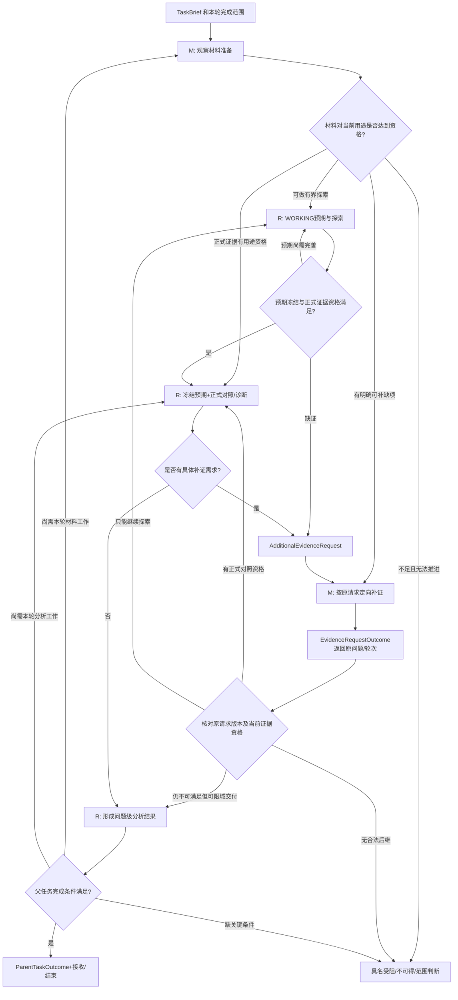

# 观察—分析业务控制面三层 Workflow｜合订版（候选 V0.1）
> 本文是分文件审查稿的合订副本。请优先使用压缩包中的独立文件进行逐项讨论；本轮未修改原 Skill 或控制面计划。

---

## 文件：00_README_范围来源与阅读顺序.md

# 观察—分析业务控制面：三层 Workflow、输入输出与闭环审查（候选 V0.1）

**日期**：2026-11-14。**性质**：可供后续讨论、确认和实施的控制逻辑设计稿；不是已获批准的执行合同，不代表代码或真实运行已经完成。**本包只梳理控制面的业务流程、节点、I/O、Gate、异常和缺环，不分配管理 Pro／程序／专业 Skill／Owner 的具体执行职责，也不实现代码或修改现有 Skill。**

## 1. 首先确定三层，不从执行者开始设计

| 层次 | 管理对象 | 最重要的问题 | 文档 |
|---|---|---|---|
| L0 完整业务任务 | 观察材料准备 ↔ 合理性分析，以及整体目标、任务完成 | 上游怎样交给下游？下游缺证怎样回上游？什么算整体交付？ | `01_L0_完整业务任务与双向衔接.md` |
| L1 两条内部 Workflow | 材料准备 S0～S5；合理性分析 R0～R5（均为管理视图） | 各阶段真正消费和产出什么？各阶段在什么条件下推进／返修？ | `02_L1_观察材料准备流程.md`、`03_L1_合理性分析流程.md` |
| L2 阶段内部工作节点 | 可命名的调查、规划、取数、核验、预期、对照、诊断、标定等工作 | 工作节点的前置条件、业务产物、局部门禁和失效后继是什么？ | `04_L2_节点输入输出登记表.md` |

横贯三层的验收和闭环审查：`05_三级Gate及后继路由.md`、`06_接口对齐与缺环审查.md`、`07_待确认的控制判断与运行路径.md`。

**阶段不是一次模型调用的单位，材料项也不等于执行工作项。** 例如一次完整 CAEGraph 运行可能同时覆盖多个材料项；R4 标定中的完整实例复验可以使用 R2 对照能力，不必为 R4、R2 复制两轮相同计算。本文的 L2 是需要管理其输入输出的逻辑工作节点，不强制每个节点独立派发 Prompt 或新增 Gate。

## 2. 来源及非来源；准确划线

- 【S-M】[观察材料规划与准备 Skill 候选 V0.1](https://github.com/daowei2026/observe-iterate/blob/main/discuss-materials/观察材料规划与准备Skill_候选V0.1_20261113/SKILL.md)，以及[观察材料准备任务单](https://github.com/daowei2026/observe-iterate/blob/main/discuss-materials/观察材料规划与准备Skill_候选V0.1_20261113/templates/观察材料准备任务单.md)。读取时源码 blob SHA 分别为 `bd8698014ddf0feda273804ace336494ecba04b9`、`b571063fdd91e8b0818d64d25a403db037995580`。源定义专业方法、必需/条件/建议材料、数据阶段和交付标签。
- 【S-R】[合理性分析 Skills V0.1 README](https://github.com/daowei2026/observe-iterate/blob/main/discuss-materials/reasonableness-analysis-skills-v0.1/README.md)，含四个 Skill：`business-expectation-derivation`、`business-evidence-comparison`、`business-discrepancy-diagnosis`、`feature-instance-calibration`。README blob SHA `8bd8c861317f4a66d3002b56eb0e9eee6f17b243`。其来源、冻结、六种证据状态、参数路由及多轮循环应原样保留；具体见上述四个各自的 `SKILL.md`。
- 【P】[当前控制面落地计划（路径沿用 V0.1，内容标题为修订候选 V0.2）](https://github.com/daowei2026/observe-iterate/blob/main/discuss-materials/observe_iterate_control_plane_implementation_plan_v0.1_20261113.md)。读取时 blob SHA `99186485e78d8ba1dc9289d6e4deb5cda2b3ddce`。它提出的 S0～S5/R0～R5、三级就绪、交接与补证、真实回执等是**候选控制设计**，不是专业 Skill 的已有状态。
- 【N】本包新增的 L0/L1/L2 边、控制判断点、I/O 适配封面、Gate 结果路径、退出条件和缺环审查。这些是**待确认控制面设计**，不能倒写成源 Skill 已经规定。

**刻意不做**：不检查或采用 `observe-iterate` 的旧 `professional/`、`runtime/`、`runs/` 作为现行系统；不改外部长程 Codex 主控；不分析管理 Pro、控制程序、专业执行者、Owner 的职责分配；不展开 CAEGraph 实际算法和合理性分析的专业判断方法；不代替业务方决定真实项目的观察问题与完成范围。

## 3. 控制层必须统一的基本语义（【N】）

- **业务任务** `ParentTask`：本轮要回答的一组具名问题，明确 `required_questions / allowed_depth / accepted_unresolved / future_questions_boundary`。不应因为遇到新问题而无上限扩充任务。
- **阶段视图** `StageView`：S0～S5 或 R0～R5，用于进展表达；一个专业调用可跨多个相邻步骤、一个阶段可有若干调用。
- **节点** `ControlNode`：具有触发、输入、产出及后继的工作边界；不是技术函数分解。
- **材料要求** `MaterialRequirement`：本轮需要哪些可观察数据；**工作项** `WorkItem`：怎样组织一次具体调查/加工/对照工作；**执行动作** `ExecutionAction`：某次实际运行或调用。三者非一一对应。
- **候选结果与正式接受**：Skill 的 `PLAN_READY/DATA_READY/PARTIAL_WITH_LIMITS/BLOCKED` 是其交付标签；不是控制面 Gate 的正式决定。证据 `SUPPORTS/COUNTERS/MISSING/AMBIGUOUS/NOT_APPLICABLE/PENDING` 是领域结果，不是 Gate PASS/FAIL。
- **Gate**：对某个明确对象的进入/接受资格进行判定；如果规则不足，则产出具名待判决问题，而不是默默选择下一步。并非所有节点都需要单独 Gate。
- **闭环**：每个节点/阶段在成功、部分、失败、不可得、超范围、等待等情况下，必须有明确的结果对象、目标接收方、下一步资格、重新启动条件和结束路径；允许如实阻断，但不能无解释地悬空等待。

## 4. 本包与后续实施的关系

本包是**上游业务控制逻辑**，应该先检查每条边和 Gate 是否完备。确认后，才将其中可确定的规则转为 Workflow/状态/验证配置，将确实需要非确定性管理判断的点转为专门的管理任务。**本轮不做这一步划分。**

建议后续审核顺序：先读 L0，确认两个业务部分之间的可达路径；再逐一核对 L1 阶段是否有输入来源和输出消费者；然后对 L2 的每个节点按 `输入是否可得 → 输出是否有定义 → 下一步是否有人消费 → 失败是否能收束` 检查；最后审查 Gate 与缺环表。对每个尚待确认的关键判断，见 `07_待确认的控制判断与运行路径.md`。


---

## 文件：01_L0_完整业务任务与双向衔接.md

# L0｜完整业务任务：材料准备 ↔ 合理性分析 ↔ 本轮收束

> 来源：【S-M】材料准备目标与交接；【S-R】合理性分析 README 的渐进式预期—证据循环与事实/判断双轨；【P】父子任务和补证设计。【N】以下具体控制节点、输入输出约束与 Gate 为本轮待确认设计。

## 1. 先定义这个大的业务任务做什么

本轮任务的目标不是让一套固定工具逐项跑完，而是：**围绕一个事先明确范围的业务观察/合理性问题，准备可追溯的真实观察材料；在已有材料上进行合理性分析；因分析产生新证据需求时回到材料准备，补足并返回原分析问题；最后把本轮已回答和未能回答的内容、证据与后继分清楚。**

这包含两块业务工作：

- **M｜观察材料准备**：识别数据与图来源、选择必要输入/中间/输出材料、实际取得、核对并标明可用范围；交付的是材料，不是合理性结论。【S-M】
- **R｜合理性分析**：建立或修订最小业务预期、探索、冻结用于正式对照的预期、比较证据、必要时诊断、受限标定和复验，交付支持/反证/未决、适用范围及后继。【S-R】

两个业务部分具有阶段身份，但**不强制严格互斥、全部先后完成**。在 M 提供真实且标明限制的探索性样本后，R 可开展预期探索；正式对照还需要相应预期冻结与证据资格。【S-R】【N】

## 2. L0 的总输入 / 总输出

| 对象 | 本轮最低需要什么 | 来源属性 |
|---|---|---|
| 总输入 `TaskBrief` | 观察/判断目的、特征或处理对象、需要回答的问题、目标范围和历史约束、目前已有材料/入口线索 | 【S-M】【S-R】业务目的/对象要求；【N】统一封面 |
| 总输入 `TaskBoundary` | 哪些问题本轮必答、允许做到哪一步（观察/诊断/标定）、什么未决可如实交付、哪些新问题只记建议、成本/操作边界 | 【N】建议前置，现行 Skill 没有唯一的父任务完成合同 |
| 过程输入 | 现有已核实材料、既有预期与证据、代码/数据/参数/时间绑定、来自前轮的结果 | 【S-M】【S-R】
| 总输出 `ParentTaskOutcome` | 每个本轮问题的结论类型及事实证据、适用/不适用范围、缺口、已接受材料/分析引用、已留待后续的问题、任务结束或停止原因 | 【S-M】【S-R】分别定义交付；【N】统一父任务包 |

**缺口标识 L0-D01**：源 Skill 不会替父任务决定“本次到底要诊断到哪里”。任务若缺 `required_questions / authorized_depth / acceptable_unresolved`，一项分析可能不断产生新问题而永不结束。此处须形成明确管理判断或外部已给约束；不能由控制面默默把新发现加入本轮必做。

## 3. L0 流程图：保留合法往返，不强制瀑布式



图中 `B→H` 代表补证的返回渠道，不要求每次补证都重新打开全套 M 阶段；`H→E` 也不允许绕过已冻结预期或旧数据版本检查。

## 4. L0 四个控制接口（不是重新定义专业 Skill 输出）

| L0 接口 / 提议 Gate | 生产内容 | 消费时必须核对 | 成功后继 | 不成功/分歧后继 |
|---|---|---|---|---|
| **L0-START：任务接管** | `TaskBrief + TaskBoundary + question_id` | 本轮目标、判断对象、深度、至少一条明确完成路径是否可理解 | M 开始调查与准备；已存在可复用材料可直接检查进入 R 的资格 | 形成具体缺失的任务边界判断，不猜范围；未查清的源码数据允许留给 M 调查 |
| **L0-M→R：材料可用性交接** | `MaterialPackage`（包括 `PLAN_READY/DATA_READY/PARTIAL_WITH_LIMITS/BLOCKED` 的真实来源和证据） | 当前消费用途 `exploration/formal`、所需材料项、对象/窗口、数据阶段、时间、代码/参数/版本、完整性/限制 | 合格探索材料可进入 R 的 `WORKING` 探索；合格正式证据可参与冻结预期后的正式对照 | 仅规划/预览不能冒充正式数据；缺某项时限定使用或产生补证；不强制整个 M 结束后才能探索 |
| **L0-R→M：补证请求** | `AdditionalEvidenceRequest`：问题、原轮次、缺证要区分的解释、对象/窗口、现有依据、所需交付和约束 | 同一证据是否已存在、是否可在当前工作内局部查证、是否超出既有任务范围 | 必要时建立定向材料工作；回给原 `request_id + question_id + origin_context`（若已有冻结预期则再绑定 expectation_version；冻结前的事实探索请求明确标注 `unfrozen`） | 明确不可得、部分、取消、过期都形成关闭/续作决定；不得永远等待 |
| **L0-CLOSE：父任务收束 Gate** | `QuestionCompletionRecord[] + ParentTaskOutcome` | 每个必需问题是否达到原完成定义；必要检查、范围、授权深度、保留问题与后继引用 | 全部必需问题可合法交付时结束；业务反证亦可交付 | 未满足者明确剩余工作或无法完成原因；新增问题转 `FutureQuestionProposal` 而非自动扩大任务 |

**Gate 类型严格区分**：材料/分析*工作质量*是否合格，与*业务现象是否符合预期*是两回事。`COUNTERS`、有据 `PROVEN_NOT_ADJUSTABLE` 可以是合格专业成果；`UNKNOWN` 的必需验证不能当 PASS。【S-R】【P】

## 5. 材料交接的关键 I/O 对齐

建议使用统一 `MaterialUseRecord`（【N】待确认封面，不替代现有 manifest），描述：

```yaml
material_package_ref: <固定 GitHub 原件>
material_plan_ref: <固定材料计划>
question_id: <消费的问题>
analysis_round_id: <消费轮次/探索时可未建立>
use_kind: exploration | formal_comparison
required_material_ids: [<材料要求>]
accepted_material_refs: [<真实产物+版本+数据阶段>]
object_scope: <对象/品种/参数>
time_basis: <时点/确认/日历等>
loaded_range: <已加载范围>
visible_range: <若涉及视窗则填写>
limitations: [<缺项与风险>]
qualification_ref: <对该用途作出的检查或正式接收>
```

**重要**：已经取得某些材料，既不保证可以检验任何新预期，也不代表 M 父阶段已全部完成。特定问题需要的材料与该材料真实范围相符，才可具名放行；否则精确指出差的是哪个证据条件。

## 6. 补证闭环：必须覆盖所有合法结果

| `EvidenceRequestOutcome`【P】 | 请求侧可以如何继续 | 禁止发生什么 |
|---|---|---|
| `OBTAINED` | 检查原问题/轮次/预期和版本后绑定真实材料，恢复被阻断的对照/诊断 | 不因补到数据而无条件宣布业务预期成立 |
| `PARTIAL` | 对可以继续的问题解锁，其余仍未决；若本轮允许，形成有界结果 | 不假装所有必需数据齐全 |
| `PROVEN_UNAVAILABLE` | 接收“无法可靠取得”的事实，判断是否可替代/限制/停止 | 不无证据重新请求同一缺项，不伪称已取得 |
| `NOT_APPLICABLE` | 说明原因，修订需求或结束该请求 | 不对不适用场景反复取数 |
| `CANCELLED` | 依据有效撤销关闭原等待 | 不删除历史事实 |
| `SUPERSEDED` | 旧轮次的返回作为历史，后继轮次另验复用资格 | 不把迟到证据自动并到新的冻结预期 |

需要强调：**不是什么查字段、读一行数据都要生成跨 Workflow 请求**。能在既有工作和授权内完成的局部事实查证，保留原工作内执行；真正跨专业准备、独立交付或资源基线变化才走正式补证路径。【S-R】【P】

## 7. L0 的闭环成立判据

L0 不能只拥有正常箭头：每个前进箭头都必须满足 `上游可核实输出 → 下游最小必要输入 → 明确使用资格 → 实际可触发后继`，每个返回箭头都满足 `具体缺口 → 唯一请求 → 回交对象 → 各种结果下解除或延续原等待`。

冻结前的事实准备/探索也可能提出补证：这时不得伪造 `FrozenExpectationSet`。应通过 `question_id + request_id + origin_call_id + exploratory_context_version` 记录返回点，`expectation_version` 明确记为 `not_frozen`；在正式对照前再建立冻结版本和用途映射。【N】

如果 `TaskBoundary` 未明确、材料只有 `PLAN_READY`、正式预期未冻结、补证永远没有结案、或发现新问题被无条件加进本轮，整个父任务都**不能据此声称已闭环**。具体缺口见 `06_接口对齐与缺环审查.md`。


---

## 文件：02_L1_观察材料准备流程.md

# L1-M｜观察材料准备内部 Workflow：S0～S5 的输入、输出与 Gate

> 【S-M】观察材料 Skill 0～7、任务单 A～F；【P】既有 S0～S5 候选阶段、G-PLAN/G-RUN/G-MATERIAL、分层就绪；【N】本文件的 I/O 闭环、条件/异常后继。**S0～S5 是管理视图，不强制六次独立调用或逐节点 Gate。**

## 1. 阶段级入口和出口

**业务入口**：`TaskBrief/TaskBoundary`，至少包含欲观察的问题和对象；关于代码、数据、原 Notebook、参数与日历的未知内容可以通过 S0 实际调查取得，不可为了启动而编造。【S-M】

**业务出口**：`MaterialPlan`、真实数据/图及源到图层的映射、限定范围和质量核对、缺口分类、`PLAN_READY / DATA_READY / PARTIAL_WITH_LIMITS / BLOCKED` 的真实交付标签，及用于后继分析的明确问题与使用范围。【S-M】该标签不等于正式 Gate 通过。【N】

## 2. 阶段级契约表

| 阶段（管理视图） | 接收的最小输入 | 主要输出 | 推进条件 / Gate | 异常与其他合法后继 |
|---|---|---|---|---|
| **S0 接管与现有资产调查** | `TaskBrief`、已有仓库/图/数据线索；可有未知版本 | `AssetAndBindingAssessment`：实际入口、现成图/纯数据/混合页、真实可查版本或具名缺口；任务单 A 的当前事实 | 有足够事实可对关键业务处理链建模→S1；不要求所有待查数据已存在 | 继续有界查证；找不到原来源则输出 `SourceGap`，判断是有替代路径还是本轮被阻断；不猜缺失字段 |
| **S1 还原处理链与规划材料** | S0 的事实、业务观察目标、当前业务/实现输入和输出线索 | `MaterialPlan`（任务单 B/C）：实质阶段、材料必要性、用途、候选来源/变换、缺口与低成本方案 | **G-PLAN**：覆盖本轮重要输入/实质中间过程/输出，有可追查或明确缺口的实际执行路径；允许小范围事实/接口核查 | 计划不充分→针对性补某阶段/来源；发现业务目的歧义→具名边界问题；不能因 G-PLAN 未过而无依据全部重来 |
| **S2 运行前准备及动作授权** | 已接受计划中要执行的工作、代码/数据/参数/时间绑定、调用入口、预算 | `ExecutionPlan/ActionPreflight`：复用或运行、影响范围、估计成本、动作许可与不可运行原因 | **G-RUN**：对具体触发昂贵计算/重放/大型载入/副作用的动作作授权检查；并非所有调查都要等这一 Gate | 条件不满足→补环境事实/寻找已有成果；超范围→不能执行，只形成明确变更需求；独立低成本工作可继续 |
| **S3 真正取得材料** | S1 规划、S2 对相应动作的合法放行、已核实的运行上下文 | `MaterialItemResults + EvidenceRefs`：真实源数据/后处理/构图/指定视窗数据、图层映射、日志和数据量；失败/有效空也如实记 | 每项工作达到后继加工所需的 `CHECKED_FOR_PROCESSING`，可给依赖工作继续；整体是否满足计划→S4 | 图未生成、数据未加载、真实视窗回调未完成时明确部分/失败；复用已得到的其他材料，不重复整张图；必要时向 S1/S2 定向返修 |
| **S4 材料核查** | S3 真实产物和原始计划，身份、时间、版本、数据阶段 | `MaterialReview`：按本轮各材料要求核验实际/确认时间、来源、阶段、范围、图层、原值/显示值及缺口影响 | **G-MATERIAL**：对约定用途验证真实性和可用范围；合格完整或有界可用材料进入交付 | 证据不符/缺项→准确返回 S3/S2/S1 的受影响工作；真实不可得、有效空、Pending 不合并成“业务失败”；可以保留局部合格材料 |
| **S5 交接与结果收束** | S1 计划、S3 数据与引用、S4 核验和 Gate 的适用范围 | `AcceptedObservationMaterialPackage`（【N】正式交接封面）、原 Skill 四类交付标签、可/不可回答的问题和后续缺口 | 对具体消费目的达成材料资格→L0-M→R；全部约定材料准备目标满足则 M 本轮完成 | 部分可用可先供限定用途；核心必需未满足则 M 整体不冒充完成。形成 `BLOCKED` 交付时须给出本轮继续/停止/改范围条件 |

**没有“默认全部阶段顺序循环一遍”**：已有完整图可从 S0 调查后利用 S1/S2 的已认可计划直接复用；只需纯数据可不建 CAEGraph 图；混合页必须单独追踪非 CAEGraph 来源。【S-M】

## 3. S0→S1→S2 的主要输入输出对齐

- `S0.AssetAndBindingAssessment → S1`：必须能定位业务/实现处理链的调查依据，以及哪些还只是候选；如果材料计划需要某个未核实源码事实，不能偷偷写成“已知”。
- `S1.MaterialPlan → S2`：必须将每项 `MaterialRequirement` 关联到实际工作/来源（复用、取数或具体缺口）。**计划中的四项材料并不要求创建四个 WorkItem**。
- `S2.ActionPreflight → S3`：对特定要执行的动作生效，不代表对所有未来重跑一律授权；版本或成本前提改变需重查受影响动作。
- `S3.MaterialItemResult → S4`：真实数据及其元信息，不得只有脚本代码、五行预览、截图或静态图定义。支持 `source / postprocessed / construction_snapshot / viewport_final`；仅后两者有区别并不使前两者自动可得。
- `S4.MaterialReview → S5`：核验状态、范围、限制和每个需求的对应关系必须可查；能不能被合理性分析使用要在跨流程交接时对具体用途再检查。

## 4. S3 内部必须保留的成熟度/就绪区分（【P】）

| 可用程度 | 能否用于本阶段后续工作 | 能否作为后续分析正式证据 |
|---|---|---|
| `PRODUCED` | 仅支持下一步基本核查 | 不能 |
| `CHECKED_FOR_PROCESSING` | 可按版本/范围做图/转换/局部核验，不等整包验收 | 还不能自动认定 |
| `EXPLORABLE` | 可作已标限制的小样本探索 | 不能直接做正式支持/反证 |
| `ACCEPTED_FOR_SCOPE` | 在明确问题、时间、版本及用途范围内有效 | 仍需与实际冻结预期和用途匹配，才能正式使用 |

这些是建议的**使用资格**，不是强制所有数据必须完整经过四个状态的流水线。消费者声明最低资格即可。使用范围不匹配时不能强行提升等级。

## 5. 具体条件分支和异常路由

| 发现的事实 | 不应该怎么做 | 应该形成的后继 |
|---|---|---|
| 已有完整图覆盖多项材料 | 每个材料都重复运行一次完整 CAEGraph | 一个或必要少数工作项复用实际图和真实数据；映射多项材料要求 |
| 存在构图 `cds.data`，但本轮需要浏览器动态视窗最终值 | 直接标 `viewport_final` | 留在 S3 补指定视窗状态，不能取得则 S4 标注限制并按用途 Gate 判断 |
| 只拿到图层/图例，缺少原业务强度或 trace | 从像素或显示值倒推原值 | 从真实源特征/中间结果补取，或形成明确无法取得事实 |
| 无数据事件、历史不足、待确认、数据源缺失 | 一律写 `0` 或反证 | 原样记录状态与判断影响；由 S4 对适用范围验收 |
| 某项部分失败而其他材料可复用 | 全盘重新运行 | 留存已验证材料，只返修受影响工作/版本依赖 |
| S4 发现最初没有规划关键实质中间阶段 | 默认修图或给材料降级 | 在 S1 提交局部计划修订，影响范围可追踪 |
| S5 收到分析端新的具体补证请求 | 整套 S0～S5 重开并重算 | 优先核对已存证据；必要时仅建立对应补充工作，独立交付结果并按原请求回交 |

## 6. 本 Workflow 自己何时可以结束？

- **完备交付**：对本轮被定义为必需的材料已经实际取得并核查，能按声明的范围交付。
- **限定交付**：一部分材料有实际证据和明确限制，适合某些当前问题；局部可接受**不等于**自动修改“必需材料”范围。
- **阻断/不可得说明**：形成可复核的事实缺口和尝试记录，说明影响；如果原完成要求仍未满足，不能把 M 任务标为已完成。

**控制设计缺口**：本轮必需材料和实际业务问题之间的映射如何在部分交付时被消费，必须在 L0 的 `MaterialUseRecord` 中显式绑定，否则 S4/S5 可能声称“数据都准备好”，而合理性分析仍不知道这包东西能回答什么。


---

## 文件：03_L1_合理性分析流程.md

# L1-R｜合理性分析内部 Workflow：R0～R5 的输入、输出与 Gate

> 【S-R】合理性分析 README 和四个 Skill；【P】现有落地计划 R0～R5 及调用模式；【N】本文件的管理阶段、I/O 对齐、Gate 后继及异常收束。**R0～R5 是视图，不是必须依序执行或各自独立调用一次 Pro。**

## 1. 阶段级入口和出口

**业务入口**：L0 的业务问题、已有事实/材料或明确数据缺口、需求/实现及版本线索、已有预期（若有）、允许分析深度。首次进入不要求完整预期或已经准备好全部材料；探索性观察与正式对照资格不同。【S-R】

**业务出口**：按具体预期和场景组织的 `ExpectationRegister/FrozenExpectationSet`、`EvidenceComparisonPackage`、条件化效果表、`DiagnosisReport`、必要时 `CalibrationResult`、有依据的新预期和外部问题移交，最后形成**本轮问题级的分析交付**。可以支持、反证、局部适用、未决或不可调；不把“修到合理”当作所有任务的退出条件。【S-R】【P】

## 2. 阶段级契约表

| 业务阶段 | 必需输入（不必全部提前拥有） | 专业成果（直接取现有 Skill） | Gate / 正常后继 | 需要返回、补证或提前收束的条件 |
|---|---|---|---|---|
| **R0 接管与事实准备** | 本轮问题/判断对象、现有代码/字段、材料可用范围、来源版本 | 事实准备成果、`BusinessIntent/JudgmentTarget` 的当前理解、具名未知项 | 有最小可检验问题→R1；若已有同版本且合格的冻结预期及材料可直接进入 R2；缺事实先局部查证 | 缺必要材料→L0 请求 M；输入不适用须写适用限制，不用 R0 无限拖延 |
| **R1 业务预期与场景** | 业务目的、已有预期、相关代码事实、小样本探索结果（若有） | `ExpectationRegister`、`InputSuitabilityAssessment`、`ScenarioExpectationSet`、`OpenQuestions`；`SEED/WORKING` 或拟冻结版本 | **G-EXPECTATION-FREEZE**：正式对照前形成 `FrozenExpectationSet`；探索不需提前冻结全部预期 | 数据诱发新想法只能新建候选版本；旧冻结版仍保留；真实目的冲突或缺事实需具名处理 |
| **R2 证据对照** | 对正式对照：`FrozenExpectationSet`、`DataBinding`、`TimeBasis`、参数/代码版本、真实材料、证据映射；探索可使用 `WORKING` 及有限合格样本 | `EvidenceComparisonPackage`、`InputAssessment`、`ScenarioEffectTable`、`EvidenceInducedCandidates`、`DiscrepancyQueue` | **G-COMPARISON**：验证绑定和完整性，区分 `SUPPORTS/COUNTERS/MISSING/AMBIGUOUS/NOT_APPLICABLE/PENDING`；值得诊断→R3，否则可能直接 R5 | 新预期→R1 开新版本；缺事实→本轮局部查证或 L0 补证；证据足以说明“反证”并非 Gate 失败 |
| **R3 偏差诊断** | 被选中的问题、冻结预期版本、对照包、处理链、数据/时间基础 | `DiagnosisReport`、`MinimalDiscriminatingExperiment`、`RequirementOrImplementationIssue`、必要 `OwnerDecisionPacket` | **G-DIAGNOSIS**：沿证据查因、竞争解释和最小责任阶段；有据后继→R4/回 R1/R2/外部候选移交/R5 | 事实不足→局部核查或补证；已证明不可调是可以交付的结果；真实业务取舍形成材料，不在这里自动修改目标 |
| **R4 参数标定（条件分支）** | 已诊断为 `POSSIBLY_ADJUSTABLE / COUPLED_UNRESOLVED` 或首次实例化资格；冻结预期、原始业务窗口、参数/版本、适用案例 | `ParameterEffectMap`、`CalibrationEvidence`、`InstanceComparison`、`InstanceReasonablenessVerdict`、`EscalationPacket`（包含在 `CalibrationResult`） | **G-CALIBRATION**：区分试验授权与最终实例质量；完整新旧对照复用 R2 的 `INSTANCE_REVALIDATION` 同一工作结果 | 原定位错→R3；不可调/无联合可行域→有据结果和适用范围；需重跑时单独判断成本资格；不强行产生候选实例 |
| **R5 分析结果交接** | 本轮 `question_id`、预期/证据/诊断/标定中实际适用的已接受结果、未决项与边界 | `AnalysisDelivery`【N】封面引用现有 Skill 原生输出；逐问题 `QuestionCompletionRecord` | **G-ANALYSIS-DELIVERY**：成果质量、回答范围和完成条件满足→回 L0 收束 | 若本轮必要问题还未回答→准确返回 R1/R2/R3 或补证；若新问题超出本轮边界→后继建议，不新增本轮必做 |

`R4` 并非每个分析都必经：既有明确预期和干净数据时，可直达 R2；不需要诊断的局部问题可 R2→R5；首次实例化时 R4 也可作为合法入口。【S-R】

## 3. 两条轨道及正式冻结的关键边界

【S-R】事实准备可与最小预期形成并行：查字段、代码、时点、样本是事实工作；正式支持/反证判断需要最小可检验预期与对应证据绑定。R1 的 `WORKING` 版本可引导探索，不能被后来事实无痕改写成“原本就预测到了”。

**I/O 对齐条件**：

- `R1.WorkingExpectation → R2.Explore`：允许小样本探索，记录已看证据；探索结果不能直接归类为正式 `SUPPORTS/COUNTERS`。
- `R1.FrozenExpectationSet → R2.FormalCompare`：必须包含业务意图、判断对象、来源 (`OWNER_EXPLICIT / BUSINESS_INFERRED / IMPLEMENTATION_DERIVED`)、适用/反例、预期版本，并能追溯已看材料与冻结截止；正式对照锁版本。【S-R】
- `L0.MaterialPackage → R2`：证据仍需在 R2 进行有效性、业务含义、目的适用性三层评估，不能因 M 的材料 Gate 通过就默认所有预期可用。【S-R】

## 4. 主要循环怎样闭环

### 4.1 R2 → R1：证据诱发新预期

**触发**：发现原预期未覆盖的新条件或场景。**输入**：`EvidenceInducedCandidate`（源证据引用、诱发理由、适用条件、原冻结版本）。**输出**：新 `ExpectationRegister` 候选及对应新 `analysis_round_id` / `expectation_version`（版本或轮次建立规则待确认）。**Gate**：旧正式对照不被改写；新一轮正式对照必须重新冻结。**非正常后继**：只是解释不了并不强制开无限轮次；本轮不需要的新问题登记未来建议。

### 4.2 R3 → R2 或 M：事实缺口

**触发**：缺少能区分具体竞争解释的原值、中间状态、时间或样本。**输入**：诊断中的 `MinimalDiscriminatingExperiment`、原轮次、已有材料。**后继**：若能在本轮已授权小范围查证，直接留在 R3 或 R2；否则创建 `AdditionalEvidenceRequest`，经 L0 返回 M。**回归**：请求有结果（包括部分、不可得）后先对应原问题/原轮次；若是冻结前事实查证，使用原探索上下文而不得伪造 expectation_version，判断重跑哪项对照，而不是重新启动整个 R0。

### 4.3 R3 → R4 → R2（完整实例复验）→ R4 / R5

**触发**：诊断证据支持 `POSSIBLY_ADJUSTABLE` / `COUPLED_UNRESOLVED`，或满足首次实例化的业务入口。【S-R】

- R4 求出合法自由参数、可行域与跨位置共同范围，做经授权的少量候选试验。
- 需要完整实例效果对照时，提出唯一的 `INSTANCE_REVALIDATION` 工作，输出应与 R2 的 `EvidenceComparisonPackage/InstanceComparison` 要求相容；**这一工作只实际执行一次**，R4 与 R2 逻辑上共用结果。【P】
- 复验完成后把结果回到原 R4 标定工作，检查整体实例的预期物理意义，而不是由 R2 再独立触发一轮相同的复验。
- 若未达到业务目的，按证据返回 R3 诊断或形成有界不可调结论；若达到本轮交付条件，进入 R5。**不能把局部中间复算成功视为完整实例合格。**【S-R】

### 4.4 R3/R4 → R5：不可调或外部改动问题

`PROVEN_NOT_ADJUSTABLE`、实现与既有规则不符、业务叙事不足等可以形成有据的问题类型及后继建议；它们是**分析结果**而非本控制面自动完成实现/叙事修改的指令。是否满足本轮 R5 完成条件，只看 TaskBoundary 的任务目标，不能默认“必须修好”。

## 5. R5 的关键 I/O 漏洞

专业 Skill 各自定义 `ExpectationRegister`、`EvidenceComparisonPackage`、`DiagnosisReport`、`CalibrationResult`，但**并没有一个单独现成的父任务结果包**。因此【N】建议 `AnalysisDelivery` 只作统一封面，引用原生结果：

```yaml
question_id: <本轮问题>
analysis_round_id: <本轮次>
expected_outcome: <本轮原完成定义>
actual_finding: <SUPPORT/COUNTER/LOCALIZED/UNRESOLVED/...>
covered_expectation_refs: [<版本与摘要>]
used_material_refs: [<材料版本与使用范围>]
evidence_and_result_refs: [<现有Skill产物>]
missing_or_limited: [<剩余未决>]
completion_evaluation: <是否满足原定义及理由>
future_question_proposals: [<新问题但非本轮必做>]
```

必须有 `question_id`、`analysis_round_id` 和具体 `expectation_version`，否则同一特征的多轮分析会被误合并；后续材料包补充也无法准确回到原问题。具体衔接测试见 `06_接口对齐与缺环审查.md`。


---

## 文件：04_L2_节点输入输出登记表.md

# L2｜工作节点输入输出登记表：细到可以发现缺环，但不把 Skill 拆成固定调用

> 【S-M】【S-R】专业方法与原生输出；【P】S/R 阶段管理视图；【N】本表节点编号、输入输出关系及后继管理条件。`Mxx/Rxx` **不是 Skill 名、Pro 轮次或 Worker 工单号**。同一次实际专业调用可产生多个节点成果；反之一个节点可分批完成。每一行只定义控制面需要看见的 I/O，而不是规定如何专业分析。

## 1. 一次节点工作需要的最小交接封面（【N】）

```yaml
node_id: <如 M06 / R07>
question_id: <当前业务问题>
stage_view: <S3 或 R3 等，仅管理视图>
work_item_id: <具名工作>
input_refs: [<已取得且可复查的上游材料>]
input_versions: {code: ..., data: ..., parameter: ..., expectation: ...}
required_input_scope: <对象、时间、用途、就绪等级>
expected_outputs: [<原生 Skill 产物或最小可核查结果>]
completion_condition: <本节点何时可以被消费>
possible_outcomes: [<成功、限定、缺证、不可得、返修等>]
continuation_target: <各结果的具体后继节点/条件>
```

这不是强制每项业务材料填写一份新表。一个完整 `MaterialPlan`、`EvidenceComparisonPackage` 等原生结果可以承担多数内容；封面只补精确身份、依赖和接续信息。

## 2. 观察材料准备：节点级 I/O

| ID / S 视图 | 节点目的（专业源） | 最小输入 | 最小可核查输出 | 下一节点及可消费条件 | 缺口/失败处理 |
|---|---|---|---|---|---|
| **M01 / S0** 入口与资产核对 | 【S-M】第 0 步，已有完整图/新图/纯数据/混合页 | `TaskBrief`、仓库/数据/图入口线索 | `AssetAndBindingAssessment`：现有入口、实际源码/数据版本或明确未知项、候选复用对象 | M02 可依已调查事实还原处理链；已有高质量材料可跳到与 M03/M08 对应的复用检查 | 入口没找到→有界继续找、记录真实缺口；不拿截图当源码 |
| **M02 / S1** 处理链还原 | 【S-M】第 1 步 | M01、业务叙事/源码/已有事实 | `ProcessingSkeleton`：业务输入、实质中间阶段、预期输出 vs 实际输出/状态及差异 | M03 消费完整骨架决定看什么 | 无法确认关键阶段→M01 局部补事实；不能仅按函数数量画层 |
| **M03 / S1** 材料取舍 | 【S-M】第 2 步、任务单 B | M02、当前具体观察问题 | `MaterialRequirementSet`：每项要回答的问题、必需/条件/建议/不准备、现有/缺失及理由 | M04 能为必需/激活条件项指定方式；其他项不无故启动 | 缺必要中间状态→写缺口影响并优先考虑低成本来源，不自动增加正式输出 |
| **M04 / S1** 方法与落地设计 | 【S-M】第 3～4 步、任务单 C | M03、现有完整图、数据接口和可复用处理 | `MaterialPlan`：材料↔来源、预期数据阶段、处理方式、损失、工作候选、实际提取路径 | **G-PLAN** 合格→M05；已满足的材料可走 M08 复验 | 方案无真实接口→M01/M03 局部调查或修计划；不把新配方宣称通用 Skill |
| **M05 / S2** 动作前置检查 | 【S-M】第 5 步运行前置说明 | 已认可 M04 计划、实际运行版本、数据范围、成本/授权 | `ActionPreflight`：需要执行/可复用/禁止/成本与缺陷、精确动作边界 | 对需要的昂贵具体动作进行 **G-RUN**；合法进入 M06/M07；已有产物不必重算 | 环境缺失→查先决条件；超范围→具名授权缺口；未能确定成本时不盲跑 |
| **M06 / S3** 原业务/构图材料实际取得 | 【S-M】第 5 步、任务单 D | M05 有权动作、确定数据上下文、原特征/完整图、已存在材料 | `MaterialItemResult`：源/后处理/构图 CDS（按需）、数据量/范围、身份、来源、图层映射、执行证据；一个运行可产生多项 | 若需窗口/源 trace→M07；其余已达到加工前置检查可在同链继续；全部适用项目→M08 | 运行失败、有效空、加载范围不足要分开记；不将 preview 等同真实全量；保留其他有效项 |
| **M07 / S3** 条件性视窗/原值补证 | 【S-M】第 5 步第 3～4 项；CAEGraph 参考 | M06 结果、需要的 `visible_range`/回调/源 ADT/中间状态 | `ViewportOrTraceEvidence`：真实窗口最终数据或源中间结果及验证；明确不可取得的证据说明 | 对应材料要求已满足→M08；**若当前用途不需要此项，可明确不激活 M07** | 构图 CDS ≠ 前端最终值；原业务值不能从像素反推；需新增工作时返回 M03/M05 |
| **M08 / S4** 材料核查 | 【S-M】第 6 步、任务单 D/E | M03/M04 已认可计划、M06/M07 或复用数据的真实引用 | `MaterialReview`：每个 requirement 的来源、身份、时间、阶段、范围、缺陷、影响和用途范围 | **G-MATERIAL**：完整或限定范围接受→M09；关联问题不符→具体返修节点 | 不合法的版本→M05/M06；缺关键中间状态→M03/M07；无法取得→记录事实供 M09/父任务处理 |
| **M09 / S5** 材料交付 | 【S-M】第 7 步、任务单 F | G-MATERIAL 结果、计划、材料引用和真实限制 | 原生 Skill `PLAN_READY/DATA_READY/PARTIAL_WITH_LIMITS/BLOCKED` 及 `AcceptedObservationMaterialPackage`【N】的适用范围封面 | L0-M→R 对**具体问题+用途**检查可用资格；补证则回原 Request | 只能交计划、部分、阻塞就如实交；不能以 `PLAN_READY` 让正式分析使用缺失数据 |

**字段关系说明**：`MaterialRequirement` 是交付目标；`WorkItem` 是工作组织；`ExecutionAction` 是真实调用。一个 M06 工作项可能一次得到三项要求，一个材料要求也可能涉及 M06+M07 多次调用。必须在产物登记里保留 `produces/consumes`，不能以行数算调用次数。【P】

## 3. 合理性分析：节点级 I/O

| ID / R 视图 | 节点目的（专业源） | 最小输入 | 原生或最小可核查输出 | 下一节点及可消费条件 | 缺口/失败处理 |
|---|---|---|---|---|---|
| **R01 / R0** 分析接管/事实准备 | 【S-R】README 双轨；预期推导输入三层 | 业务问题、已有材料/版本、已有预期（若有） | `AnalysisInputAssessment`【N】封面：哪些事实已确认、缺口和可开展范围 | 未具备预期→R02；已有清晰最小预期→R04；仅有部分数据→R03 有界探索 | 事实问题可局部查；需要独立新材料时走 L0 补证；尚未冻结预期的请求须标注探索上下文，不虚构 FrozenExpectation 或 DataBinding |
| **R02 / R1** 推导最小预期与场景 | 【S-R】`business-expectation-derivation` 步骤 1～8 | BusinessIntent、JudgmentTarget、来源/事实、候选样本 | `ExpectationRegister`（SEED/WORKING）、`InputSuitabilityAssessment`、`ScenarioExpectationSet`、`OpenQuestions` | R03 可探索；具备可检验命题→R04 请求冻结 | 分歧事实未确定→R01/局部查证；真实目标取舍只形成问题；不从实现自动证明业务合理 |
| **R03 / R1/R2** 小样本探索 | 【S-R】README + 对照 Skill 探索路径 | WORKING 预期、`EXPLORABLE` 材料及明确限制 | `ExploratoryFindings`【N】封面：已看的样本/问题、诱发的新预期、仍未知字段 | 返回 R02 完善预期，或将本轮用于对照的候选送 R04 | 不得作为正式 `SUPPORTS/COUNTERS`；样本不足→补小样本或注明无法探索 |
| **R04 / R1** 冻结对照预期 | 【S-R】预期推导第 9 步、README 冻结协议 | R02 候选、已看探索证据、来源/适用/反例、当前轮次 | `FrozenExpectationSet` 及固定版本/引用 | **G-EXPECTATION-FREEZE** 合格→R05；同一轮不得偷偷编辑 | 不可检验/来源不明→R02；证据诱发新命题→新版本，旧冻结版不覆盖 |
| **R05 / R2** 正式对照资格与证据映射 | 【S-R】`business-evidence-comparison` 步骤 1～2 | R04 冻结版、真实材料/字段、DataBinding、TimeBasis、参数/代码版本 | `EvidencePreflight`、证据映射、必需证据缺口和质量问题 | 对当前问题证据资格满足→R06；不满足需具名精确缺口 | 可局部修正源事实时就地核查；跨边界→L0 补证；材料完整不自动意味着目的适用 |
| **R06 / R2** 场景与正式证据对照 | 【S-R】对照步骤 3～8 | R05、冻结预期、样本/场景/时间与版本 | `EvidenceComparisonPackage`、`ScenarioEffectTable`、`EvidenceInducedCandidates`、`DiscrepancyQueue` | **G-COMPARISON** 合格且有值得诊断的问题→R07；已达到本轮要求→R13；新预期→R02 开新版本 | `MISSING/AMBIGUOUS/PENDING` 是领域现象；需要实证则 R05/补证；有反证不叫工作失败 |
| **R07 / R3** 建立诊断与竞争解释 | 【S-R】诊断步骤 1～4 | R06 的被选偏差、冻结预期、处理链和证据 | `DiagnosisReport` 候选：ConfirmedFacts、CompetingExplanations、最早分歧候选 | 现有证据足够→R09；需要最小区分性检查→R08 | 没有具体偏差/作用范围不应强制诊断；回 R06 定义需要诊断的问题 |
| **R08 / R3** 低成本区分性事实检查 | 【S-R】诊断步骤 4～5 | R07 竞争解释、最小新证据、已获授权的查证范围 | `MinimalDiscriminatingExperiment` 与核对结果；或具体 `AdditionalEvidenceRequest` | 查证返回 R07/R09，更新排除的解释；跨任务请求完成后回原轮次/原探索上下文 | 仅需查字段不能强制新开材料 Workflow；证据不可得时返回有界未决，不重复无进展 |
| **R09 / R3** 定位、可修复性初筛与路由 | 【S-R】诊断步骤 6～8 | R07/R08 证据与解释、原业务目的、参数依赖 | `DiagnosisReport` 完整结果及 `POSSIBLY_ADJUSTABLE/COUPLED_UNRESOLVED/PROVEN_NOT_ADJUSTABLE/EVIDENCE_INSUFFICIENT` | **G-DIAGNOSIS**；可调→R10；原预期问题→R02；能结案→R13；缺证→R08 | 已证明不可调不得盲试；实现/叙事问题形成外部候选移交，不在本控制面内执行修改 |
| **R10 / R4** 反求参数联合可行域 | 【S-R】标定步骤 1～2 | R09 有据可调/耦合定位，或首次实例化入口；冻结预期、固定原始业务窗口、参数/公式 | `ParameterEffectMap`、按位置/联合参数可行域与冲突原因 | 可行且有试验资格→R11；无交集/不可调→R09/R13 有据收束 | 不假设参数独立；无法在现有能力实现目标时不枚举试值 |
| **R11 / R4** 少量有界候选试验 | 【S-R】标定步骤 3 | R10、预算/动作资格、真实数据/窗口与当前实例 | `CalibrationEvidence`：候选及其依据、局部/完整重跑实际效果与副作用 | 具有必要候选→R12；不可行/成本不许可→R09/R13 记录具体原因 | 低成本复算不等于完整实例；参数改变上游对象须用原始窗口对齐 |
| **R12 / R4↔R2** 完整实例新旧复验 | 【S-R】标定步骤 4 明确调用证据对照 Skill | R11 候选、R04 冻结版、原始窗口、新旧实例版本、对照口径 | **同一个** `INSTANCE_REVALIDATION` 工作的 `InstanceComparison/EvidenceComparisonPackage`，供 R4 的 `CalibrationResult` 使用 | **G-CALIBRATION**：复验完整实例含义；达到原目标→R13；仍有偏差→R07/R09 | 不让 R4 等 R2、R2 又等 R4；无资格重算不强行推进；旧对象 ID 变化不可直接一一对比 |
| **R13 / R5** 问题级分析交付 | 【S-R】各 Skill 的结果与 README 协作关系 | R04/R06/R09/R12 中**本次实际适用的**结果及限制、原任务完成条件 | `AnalysisDelivery`【N】封面 + 原生 `EvidenceComparisonPackage/DiagnosisReport/CalibrationResult` + `QuestionCompletionRecord` | **G-ANALYSIS-DELIVERY** 合格→L0 父任务收束；未满足→返回具体 R 节点或补证 | 不要求所有问题都经过诊断或标定；可信反证、局部结果、不可调或有界未决是否可结束由原完成定义决定 |

## 4. 不把“输出存在”误认为“输入就绪”

| 典型错误 | 准确的消费资格 |
|---|---|
| M06 已导出 CDS → R06 直接正式对照 | CDS 数据阶段、对象/时间/参数、目的适用、FrozenExpectation 均满足才行 |
| R02 有 `WORKING` 预期 → R06 直接给正式结论 | 先 R04 冻结版本；R03 可以继续探索 |
| R06 发现 `COUNTERS` → 立即启动 R10 调参 | 只有 R09 已查因并有可修复性依据，才可走 R10（首次实例化除外） |
| R11 局部复算变好 → 宣布完整特征实例合理 | 需要 R12 复验整实例，包括上游身份改变/其他样本副作用 |
| R09 `PROVEN_NOT_ADJUSTABLE` → Gate 失败重新诊断 | 如果定位与证据达标，可合法交付不可调结论，不强制试验 |
| R06 生成新候选预期 → 修改已冻结 R04 | 保留旧冻结版本，新预期进入新版本/新轮次 |

## 5. 后续管理使用本表的方式

每个节点被执行一次或复用一次已有结果时，至少检查五项：`输入是否真实可得 / 版本与用途是否一致 / 产出是否达到消费者需求 / 异常有没有合法后继 / 是否还有可推进但被误挡的并行工作`。一项工作可能由多个节点组合产生；控制面应在已有产物可复用的情况下跳过不必要执行，但仍需保留消费资格证明。


---

## 文件：05_三级Gate及后继路由.md

# 三层 Gate：验收对象、输入、输出与失败后继

> 目的：不是为了增加 Gate 数量，而是防止**没有合格上游输入却自动跨过业务边界**。Gate 可设在 L0 跨 Workflow 交接、L1 阶段转移、L2 特定昂贵/不可逆/正式证据节点；没有真实风险与消费者的步骤不强制增加独立 Gate。来源【S-M】【S-R】专业验收要求；【P】候选门禁及事实/领域结论分离；【N】明确级别、触发和后继。

## 1. Gate 首先判断什么，不判断什么

| 判定对象 | 示例 | 容易犯的错误 |
|---|---|---|
| `WorkQuality`：某份工作是否符合原合同 | 真实取数能核对；冻结预期有可证伪条件；诊断有竞争解释与证据 | `COUNTERS`（实际反证）被判为工作失败 |
| `UseEligibility`：能否被特定下游按特定范围消费 | 材料用于探索可以；正式支持/反证是否有冻结预期和合格证据 | 某一图层存在便默认所有用途可用 |
| `ActionEligibility`：某个新动作能否被启动 | 计算成本/权限/版本检查，能否启动完整重放 | 把上一轮试验获准当作以后所有动作均获准 |
| `TaskCompletion`：本轮业务问题是否达到约定交付 | 合格的反证、已定位不可调、真实且允许的未决状态 | 强制“全部问题修到合理”才通过 |

**硬检查**可如 `PASS/FAIL/UNKNOWN/NOT_RUN` 记录，必须硬检查未知/未运行不能算 PASS。【P】**专业领域状态**继续沿用既有 Skill 的 `SUPPORTS/COUNTERS/MISSING/AMBIGUOUS/NOT_APPLICABLE/PENDING` 或参数可修复性状态，不能改写成 Gate PASS/FAIL。Gate 的结果可表达为：资格满足（可带限域）、需补工作、需专门判断、不可执行/阻断；具体正式决定枚举和授权仍待确认。【N】

## 2. L0｜完整业务任务 Gate

| Gate / 触发 | 输入与验收对象 | 通过后继 | 未通过/缺信息后继 | 判断尚待明确处 |
|---|---|---|---|---|
| **H0 TASK-ENTRY**：新任务接管 | `TaskBrief`、业务问题、允许深度、结束定义；只检查业务任务是否可被组织，而非要求所有数据现成 | M 的 S0 调查；若存在同版本材料，则核对复用资格 | 仅把缺失的范围/目的定义列为具名待判；允许事实缺项进入 S0，不能以无法立即定位数据阻塞任务启动 | 必答问题、允许的有界未决、整体任务是否可拆成几个问题 |
| **H1 MATERIAL-USE**：M 向 R 交付，或 R 请求复用既有材料 | `MaterialPackage/Manifest`、`use_kind`、要求的数据阶段、问题、版本、时间、场景和证据质量 | `EXPLORATION`：仅有界探索；`FORMAL_COMPARISON`：还须冻结预期并通过 R05 证据准备检查 | 可先探索不能正式对照；明确缺项并按需求返回 M 或产生限制；只有 `PLAN_READY` 不认定真实证据可用 | 哪些材料对具体问题是“必需”，限定用途由哪些证据判定 |
| **H2 EVIDENCE-RETURN**：补证工作有结论 | `request_id + question_id + origin_context`（已有冻结预期时加版本；冻结前标注 `not_frozen`）、新增材料或不可得等结果 | `OBTAINED/PARTIAL/...` 均更新原请求并返回原问题，按结果资格重开准确受影响节点 | 无来源/版本不符不解锁；旧轮次被替代时先隔离迟到回交，不自动混到新轮次；冻结前的补证结果只恢复原事实探索而不自动成为正式证据 | 部分/不可得是否仍足以完成本轮，或应申请新范围 |
| **H3 PARENT-CLOSE**：R5 形成结果或所有合法工作耗尽 | `QuestionCompletionRecord[]`、原 `TaskBoundary`、材料与分析的接受引用及未决项 | 每项必答问题的交付要求满足→正式结束；新增问题留 `FutureQuestionProposal` | 具体未完问题仍有可执行后继→回相应节点；不可解阻→形成具名阻断/停止，不能虚称成功 | 什么结果类型允许收束，是观察/定位/标定哪种深度；未决是否许可 |

## 3. L1-M｜材料准备阶段的关键 Gate

| Gate / 触发 | 必要输入 | 应核对什么 | 通过后继 | 失败后继及返回节点 |
|---|---|---|---|---|
| **G-PLAN**：S1 已形成可运行规划 | `ProcessingSkeleton`、`MaterialRequirementSet`、`MaterialPlan` | 是否覆盖本轮关键业务输入、实质中间阶段和输出；每项必要性有理由；有来源、实施路径或具名缺口；现成完整图优先评估复用【S-M】 | M05：针对有必要实际运行的动作检查前置；已有材料可跳 M08 复验 | 缺处理链事实→M01/M02；取舍不充分→M03；路径不可实施→M04；不要求整轮重开 |
| **G-RUN**：具体高成本或有副作用动作将启动 | `ActionPreflight`、已核实实际版本/参数、数据范围、成本与可执行边界 | 本动作是否合法、是否已存在可复用结果、执行入口是否真正存在；不能把“Python 构图”误以为不会触发上游计算【S-M】 | 对指定动作执行 M06/M07；不阻断独立低成本调查 | 环境不具备→M05 补前置；预算/权限不符→形成受限动作或待判；不直接启动昂贵运算 |
| **G-MATERIAL**：S4 完成对拟交付材料核查 | 已认可计划、实际数据与日志、图层/来源映射、时间和数据阶段 | 必需材料真实存在且对应需求；`source/postprocessed/construction_snapshot/viewport_final` 不混；有效空、无数据、Pending 等清楚；数据量和作用范围可核【S-M】 | M09 可打包完整/限域材料并经 H1 对具体用途交付 | 数据错误/版本失效→M05/M06；缺视窗→M07；计划漏必要阶段→M03；不可得→如实有限交付/阻断，不假装成功 |

S0 的调查、S5 的文件登记不必默认再建立独立专业 Gate；实际若涉及权威身份/版本写入，属于受保护提交动作，应满足相应合法性核验，而非新增一轮同义审批。【N】

## 4. L1-R｜合理性分析关键 Gate

| Gate / 触发 | 必要输入 | 应核对什么 | 通过后继 | 不通过/条件不同的后继 |
|---|---|---|---|---|
| **G-EXPECTATION-FREEZE**：R1 用于正式判断之前 | 来源明确的最小 `ExpectationRegister`，适用/反例和当前轮次、已看探索证据 | 命题可在现实证据中支持或反驳、来源不混淆、版本绑定明确；不能无痕回写已冻结预期【S-R】 | R04 冻结固定版本→R05 | 命题含糊→R02；来源缺事实→R01；新证据产生新候选，不能覆盖旧版 |
| **G-COMPARISON**：R2 正式对照完成 | 冻结预期、EvidencePreflight、DataBinding、时间/版本、真实场景、对照包 | 数据/业务含义/目的适用性三层分开；证据状态与场景对应，反证、缺失和歧义不能混；同源证据不重复计票【S-R】 | 已足够回答可去 R13；值得诊断的偏差→R07 | 缺证→R05/补证；新预期→R02 新版本；`COUNTERS` 不造成 Gate FAIL；确实不足可提交有界未决 |
| **G-DIAGNOSIS**：R3 形成诊断路线 | 冻结预期、实际偏差、DiagnosisReport、竞争解释/排除证据 | 是否找到最早可追踪分歧或有据说明无法定位；是否区分参数修复、实现、输入不适用、业务取舍；不能在根因未查时盲试【S-R】 | 可调/耦合→R10；已定位/不可调或有界未决→R13；预期不足→R02 | 有最小区分试验→R08；缺材料→H2→M；专业后继无证据→R07 补判据 |
| **G-CALIBRATION**：R4 进入试验、完整复验及最终判断处 | 初筛/首次实例化入口；参数自由度与约束、候选成本、原业务窗口、新旧参数/数据、单次完整实例比较 | 分开检查：**是否有资格试验**、**实验是否真实/同基线**、**完整实例是否符合原预期业务含义**；单独局部改善不等于实例合格【S-R】 | 经可行性和成本放行可做 R11；完整复验后可 R13 或按证据返回 R07/R09 | 无预算→停止该动作；无交集/不可调→合格的不可调结论；旧定位不实→R07；不能重复同一次 R12 比较 |
| **G-ANALYSIS-DELIVERY**：R5 拟交付本轮分析 | 本轮任务问题、实际经过的专业成果、证据/版本及限制 | 本轮需要回答的具体问题是否完成到约定深度；支持/反证/不适用/未决真实；独立核对结论质量与事实绑定 | `QuestionCompletionRecord`→H3 | 未完成但可补查→指定 R 节点；实际不可得/超范围→具名未决或阻断；不自动加入无限新问题 |

## 5. L2｜哪些局部工作需要检查，哪些不需要新增 Gate

| 检查点 | 最低检查 | 是否必须新增独立 Gate |
|---|---|---|
| M01～M04 的常规事实调查、材料取舍 | 产物引用和来源正确，不能编造真实情况 | 一般不需要；汇入 G-PLAN 或具名问题 |
| M05/M06 昂贵动作边界 | 执行资格、真实版本、前置依赖、预算 | 需要 **G-RUN** 的动作级放行；不意味着单独新 Pro 轮次 |
| M06/M07→M08 的加工依赖 | 是否达到 `CHECKED_FOR_PROCESSING`，可消费范围对应 | 可在同一受控工作链内继续，不应等待最终整包 G-MATERIAL 导致死锁 |
| R03 探索与 R04 冻结边界 | 已看样本与候选预期有版本；正式对照前冻结 | 正式冻结属于必需 Gate；探索本身不强制冻结 |
| R05→R06 | 冻结版、DataBinding、时间/参数及材料可用资格 | 必须做正式输入检查；不一定增加一次独立 Gate 会议或调用 |
| R07→R08 局部查事实 | 查证范围、待区别的解释和结果引用 | 小范围合法查证不必升级跨 Workflow Gate |
| R10→R11 大成本参数试验 | 本动作约束和成本、版本/输入 | 在 G-CALIBRATION 的试验准入内检查，不把整轮标定一个 PASS 混用 |
| R12 复验 → R4 判断 | 原始窗口、新旧实例、同次对照结果来源、完整业务意义 | 完整对照必须真实验证，避免 R4 和 R2 各自派一次相同工作 |

## 6. Gate 未通过的通用结果分流（【N】）

1. **确定的输入缺失/格式错**：直接返回对应上游节点补缺项；不默认启动完整新业务阶段。
2. **执行事实不成立**：返回有真实证据的缺项或失败；若执行效果未知，先核对，再决定能否重试。
3. **专业充分性尚不明确**：产出**具名判断请求**，至少写 `当前事实/缺什么判断/合法选项/各项后继/如何结束等待`，不能只写“请继续分析”。
4. **发现与计划不一致的新事实**：先判断影响哪些既有产物；修订必要的具体工作/预期版本，保留未受影响结果。
5. **超本轮范围或没有执行资格**：阻断对应动作，形成缺少什么条件的清晰结果，不授权继续执行。
6. **合法限定结果**：保留可用子集，明确用途、未决和任务级仍需什么；不能为了通过 Gate 直接降低原必需目标。

Gate 的失败不一定意味着整个任务中断：只有依赖该结果的工作分支应被阻断，其他具备合法前置条件的工作可以继续。没有新事实时不能不断重复同一个专业复核、机械验证或补证请求。


---

## 文件：06_接口对齐与缺环审查.md

# 三层 Workflow 的接口对齐与缺环审查

> 这是本包的**审查主表**，不是“画出流程箭头就认为闭环”。【S-M】【S-R】提供专业产物语义；【P】提供既有部分桥接设想；【N】以下明确消费者资格、异常回边和未决。结论分 `SOURCE_SUPPORTED`（已有 Skill 直接支持专业含义）、`CONTROL_PROPOSED`（控制机制可设计但尚未确认）、`OPEN_BLOCKER`（缺少实际确定的必要决定）；它们均不代表已实测运行。

## 1. 什么条件下才算一条边闭环？

对每一条 `上游节点 → 下游节点`，逐一检查：

1. **输出存在**：成功、部分、有效空、不可得、失败等都能形成准确结果，而非仅正常成功才有输出。
2. **身份可对齐**：`parent_task/question/analysis_round/expectation/material/work_item` 及代码/数据/参数/时间绑定不串用。
3. **消费者接得住**：上游结果满足下游所需的数据字段、对象范围、证据性质和版本，或下游有明确拒绝/补证逻辑。
4. **使用资格明确**：是否可加工、可探索、可正式对照、可作为最终交付，分别说明。
5. **Gate 和后继可达**：通过后能启动具体下一步，失败/部分/不可得/超成本时有具名返回点；无合法工作时能按约定停止/请求判断，不陷入无进展循环。
6. **终止与恢复成立**：已有进展不会被无理由重做；新事实或改变导致哪些节点需复验有边界。

缺任何一项，都只能说“正常路径有箭头”，不能说已形成完整控制闭环。

## 2. 按生产者→消费者逐边对齐

| 边 | 生产者输出 | 消费者最低需要 | 放行/核查点 | 不对齐时返回什么 | 审查结论 |
|---|---|---|---|---|---|
| **E01** L0 任务→M01 | TaskBrief + 业务对象/观察意图 | 可以定位调查方向 | H0：至少问题和对象清楚；未知源码可在 M01 查 | 缺目标→具名边界判断；缺源码→M01 调查 | CONTROL_PROPOSED |
| **E02** M01→M02 | 原图、源特征/实例与来源事实 | 实质处理链的可信入口 | 来源可查或未知显式 | M01 补具体来源；不猜业务字段 | SOURCE_SUPPORTED |
| **E03** M02→M03 | 业务输入/实质阶段/输出与实际实现差异 | 能判定各阶段是否值得观察 | 源与实现双向核对 | 回 M02 补最关键的缺失阶段 | SOURCE_SUPPORTED |
| **E04** M03→M04 | 必需/条件/建议/不准备的材料和目的 | 每项材料可绑定数据来源与处理 | 条件激活、有明确取舍理由 | M03 修订必要性；M01 核对来源 | SOURCE_SUPPORTED |
| **E05** M04→M05 | MaterialPlan、材料—来源—方法关系 | 可以决定具体哪些执行工作需要准备 | **G-PLAN** | M02/M03/M04 指定返修；未批准不得整批运行 | CONTROL_PROPOSED |
| **E06** M05→M06/M07 | ActionPreflight、已核实版本及成本/权限 | 某项具体动作的合法执行边界 | **G-RUN** 针对实际动作 | 缺前置事实→M05；需新权限→阻断该动作 | CONTROL_PROPOSED |
| **E07** M06→M07/M08 | source/postprocessed/construction_snapshot 数据、图层映射 | M07 所需可见窗口/源 trace，或 M08 可核验数据 | `required_readiness` 与真实数据阶段 | 需视窗值→M07；缺原值→补源 trace；当前用途不需→跳 M07 | CONTROL_PROPOSED |
| **E08** M07→M08 | 真实视窗/源中间证据或其不可得事实 | 按原材料计划核验具体需求 | 回调完成/对象/时间/处理口径检查 | M07 局部修复；不可得进入限制说明 | SOURCE_SUPPORTED+CONTROL_PROPOSED |
| **E09** M08→M09 | MaterialReview、按 requirement 对应的真实证据与缺口 | 能生成被使用的材料包，明确可/不可回答问题 | **G-MATERIAL** | M05/M06/M07 定向返修；必要时修 M03 | CONTROL_PROPOSED |
| **E10** M09→L0 H1→R01/R03/R05 | AcceptedMaterialPackage + 用途限制 | R 用途、对象/时间/来源/数据阶段和质量资格 | H1 按 `exploration/formal` 与问题核对 | 不适配→限定探索或产生具体补证；不能单凭 DATA_READY 正式对照 | **OPEN_BLOCKER**：完整的跨用途准入判法待确认 |
| **E11** R01→R02/R04/R03 | 事实、已有预期、未知项、可用材料范围 | 最小可检验问题/具名来源 | 事实准备与业务判断轨道区分 | 缺事实→局部查或 E19；已有冻结版可跳 R02 | SOURCE_SUPPORTED |
| **E12** R02→R03/R04 | ExpectationRegister / WORKING、场景、未知项 | 探索/冻结所需的最小预期 | 有来源、有反例/适用条件 | 回 R02 补预期，不强制所有预期一次写完 | SOURCE_SUPPORTED |
| **E13** R03→R02/R04 | 小样本探索发现、已看证据、诱发新预期 | R02 接受新候选；R04 知道预期版本和证据截止 | 不伪装为事前预测 | 新候选保留版本/证据，不写回旧冻结 | SOURCE_SUPPORTED+CONTROL_PROPOSED |
| **E14** R04→R05 | FrozenExpectationSet + 预期版本/用途 | 正式对照绑定事实 | **G-EXPECTATION-FREEZE** | 不可检验→R02；变更→新冻结版本 | SOURCE_SUPPORTED+CONTROL_PROPOSED |
| **E15** R05→R06 | EvidencePreflight、证据映射、数据时间/参数版本 | 每条预期在真实场景上有合格证据和局部限制 | 正式输入适用检查 | 具体缺证→R05 局部或 E19；质量不符→隔离问题样本 | SOURCE_SUPPORTED+CONTROL_PROPOSED |
| **E16** R06→R07/R13/R02 | EvidenceComparisonPackage、DiscrepancyQueue、EvidenceInducedCandidate | R07 需要具名值得诊断的偏差；R13 需要本轮足够成果 | **G-COMPARISON** 区分工作质量/领域反证 | 无值得诊断问题可 R13；新预期 R02 新版；缺证 E19 | SOURCE_SUPPORTED+CONTROL_PROPOSED |
| **E17** R07→R08/R09 | 竞争解释、最早分歧候选、已确认事实 | 有足够差别的检查或定位依据 | 事实 vs 解释分开 | 证据不足 R08；不能凭猜测 R09 宣告已定位 | SOURCE_SUPPORTED |
| **E18** R08→R07/R09 | 最小区分实验结果、或可核查的缺证需求 | 原竞争解释的增减与诊断继续资格 | 新证据、排除项或不可得事实 | 有界未决进入 R09/R13；独立材料需 E19 | SOURCE_SUPPORTED+CONTROL_PROPOSED |
| **E19** R08/R05→L0 补证→M→原 R | AdditionalEvidenceRequest 与 EvidenceRequestOutcome | **原** request/question/round 或冻结前探索上下文的消费者，知道能继续哪些节点；未冻结时 expectation_version 必须标注缺省原因 | H2：OBTAINED/PARTIAL/PROVEN_UNAVAILABLE/NOT_APPLICABLE/CANCELLED/SUPERSEDED 全部结案 | 不匹配原轮次→隔离；不可得→有界收束或新判断，不能无限 WAIT | **OPEN_BLOCKER**：退出和原轮恢复的完整决定未获实际批准 |
| **E20** R09→R10/R02/R13/R08 | DiagnosisReport + 可修复性四种状态 | R10 需有据可能可调或首次实例化资格；R13 需结论可交付 | **G-DIAGNOSIS** | 预期问题 R02；缺证 R08；已不可调可 R13/形成外部候选移交 | SOURCE_SUPPORTED+CONTROL_PROPOSED |
| **E21** R10→R11/R09/R13 | 参数影响图、联合可行域、跨位置冲突 | 少量有理据候选、明确合法自由度 | R11 动作资格及成本 | 无交集/不可调→R09/R13；不无限枚举 | SOURCE_SUPPORTED+CONTROL_PROPOSED |
| **E22** R11→R12/R09 | 候选试验及实际影响、原始窗口、新旧参数 | 完整实例新旧比较具备统一对齐基线 | 按授权和版本检查试验真实性 | 无候选或计算无法放行→R09/R13，而非虚假运行 | SOURCE_SUPPORTED+CONTROL_PROPOSED |
| **E23** R12→R4 判断→R13/R07 | 唯一 INSTANCE_REVALIDATION 比较结果和原始窗口 | R4 校准结论消费同一 R2 对照结果，验证预期物理意义 | **G-CALIBRATION** | 不充分/仍有偏差→R07/R09；**不得重复触发同一对照** | **OPEN_BLOCKER**：唯一工作身份/轮次完成路由细节待确认 |
| **E24** R13→L0 H3 | AnalysisDelivery + QuestionCompletionRecord | 父任务能逐问题检查是否按约定深度完成 | **G-ANALYSIS-DELIVERY / H3** | 未完返回具体 R 节点或 E19；新问题记 future，不直接扩范围 | **OPEN_BLOCKER**：父任务完成合同仍需实例确定 |
| **E25** H3→完成/停止/有界继续 | 已接收材料和分析、本轮所有必答问题的状态 | 能解释为什么结束或为何无法继续 | H3 的明确 `done/blocked/needs_decision` 条件 | 无新事实、无合法工作、或当前动作未知效果时不得无限自转 | CONTROL_PROPOSED，需真实试跑证实 |

> 表中的 `SOURCE_SUPPORTED` 仅说明相应的专业产物及行为约束可在 Skill 文档中找到依据；**“控制面有自动接续机制”仍全部需要实现并验证**，不得据来源支持直接宣布运行已闭环。

## 3. 当前查出的实质缺环：按严重性分级

| 缺环 ID / 类别 | 当前缺口 | 如果直接运行的故障 | 候选闭合条件【N】 | 待决定程度 |
|---|---|---|---|---|
| **C01 / 父任务** | 必答问题/深度/未决允许范围不完整 | R 分析不断发现新问题、无法正式结束 | `TaskBoundary + QuestionCompletionRecord`，新问题转 future | **关键待确认**：真实任务范围 |
| **C02 / 材料→分析** | 材料包的 `DATA_READY` 与某个分析预期的证据需求不一一对应 | R 要么误用材料、要么要求 M 全部重做 | `MaterialUseRecord` 按问题/用途/时间/数据阶段验收 | **关键待确认**：用途判法 |
| **C03 / S3 内部依赖** | 取数完成与整包验收若只用一个 ACCEPTED | 后处理等待整包，整包又等后处理，死锁 | 加工就绪/探索就绪/正式接受区分；只按消费者最低资格开放 | 建议设计成立，待具体门槛确认 |
| **C04 / 材料与工作** | MaterialRequirement 被当作 WorkItem | 完整 CAEGraph 多次重复生成，成本失控 | requirement/work/action 多对多与复用引用 | 已有设计思路，待工作项生成规则确认 |
| **C05 / 异常** | “Gate 未过→返修”没有具体返修点 | 每轮从 S0/R0 重来，重复成本和证据 | 门禁返回 `failed_requirement + repair_node + retained_outputs + recheck_scope` | 建议可明确，待真实测试 |
| **C06 / 补证** | 请求只定义成功返还，不定义部分/不可得/取消 | 永远 `WAITING_EVIDENCE`，分析无法结束 | 六类 EvidenceRequestOutcome 并逐类消解原等待 | **关键待确认**：不可得后的业务结束条件 |
| **C07 / 版本** | 补证不绑分析问题/轮次/冻结预期 | 旧轮迟到结果污染新轮正式对照 | 回原 `request + question + round + expectation_version`，新轮复用另验 | 设计方向已有，需测试 |
| **C08 / 预期** | 探索发现新想法后覆盖原预期 | 事后解释看似符合预期 | 版本冻结、事实所见时间、修订取新版本 | 现有 Skill 有直接依据，需正式版本机制 |
| **C09 / Gate 语义** | 工作合格与业务支持/反证混淆 | 正确发现反证或不可调反而不断重试 | `WorkQuality / BusinessFinding / NextActionEligibility` 分别记录 | 可以按源语义设计，需验收规则 |
| **C10 / 标定复验** | R4 需调用 R2，又把 R2 当必须单独后继阶段 | 双方互等或重复完整重跑 | 唯一 `INSTANCE_REVALIDATION` 工作，R4 消费其返回，R2 不强制再派一次 | **关键待确认**：唯一身份和结果消费 |
| **C11 / 结果收束** | 各 Skill 有自己的产物，但没有全任务分析包 | 结果分散，无法明确“本轮回答了什么” | `AnalysisDelivery` 只封装现有原生结果 + 问题状态，不改 Skill | 待明确父任务交付内容 |
| **C12 / 无进展** | “继续分析/继续查证”无事实变化条件 | 同一失败点重复调用，浪费长程轮次 | 记录新证据/排除解释/已验证不可得/状态进展；无变化则稳定等待/阻断 | 需明确重试/成本约束 |
| **C13 / 范围增长** | 新观察场景被默认纳入原任务 | 任务永无终点或超预算 | 本轮必须问题与 FutureQuestionProposal 分离 | **关键待确认**：扩范围权限边界 |
| **C14 / 高成本** | M 小试探和完整重算、R 诊断干预和正式标定混同 | 未经资格的大规模计算 | G-RUN 与 G-CALIBRATION 只对实际成本动作放行 | 需要真实操作分级 |
| **C15 / 状态恢复** | GitHub 有文件但没有权威消费版本/接受记录 | 改了状态文件、复用了未经核查旧结果 | GitHub 精确版本/实际回执、正式接受/候选分开，未知效果先核查 | 后续工程能力，当前只定义业务需求 |
| **C16 / 跳过阶段** | R2 可直达 R5、R4 首次实例化可直达，但没有跳过记录 | 错误地判缺失阶段“未执行”或强制补无意义步骤 | 按“是否适用/何种业务入口/由谁提供等价输入”记录跳过依据 | 建议设计，待 Gate 确认 |
| **C17 / 合法阻断** | 必需数据真实不可得时“没办法继续”缺结束类型 | 假完成或无限等待 | 阻断能留下可复核原因、具体未完、恢复条件；但未满足原任务就不称已完成 | 业务结束定义待确认 |
| **C19 / 冻结前补证** | R0/R1 探索阶段可以先查事实，但请求 envelope 误要求必有冻结版本 | 为了提交补证而伪造预期/无法回到探索 | 允许 `expectation_version=not_frozen` 并记录原 call/exploration 上下文；正式对照时另做冻结及用途资格 | **关键待确认**：请求上下文标识与复用规则 |
| **C18 / 时间与对象** | 图的构图/视窗、actual/confirm、参数/对象重分段缺细节绑定 | 对齐错误而业务结论可能似乎可信 | 版本+time_basis+原始窗口+data_stage+对象身份作为跨节点消费输入 | 源 Skill 明确区分，需真实数据验证 |

**结论**：流程的专业节点来源大体充分；当前最影响真正闭环的不是缺一套新 Skill，而是 **C01/C02/C06/C10/C11/C13/C17/C19** 这些与“把结果交给谁、什么结果允许下一步、任务怎样结束”直接有关的控制规则。它们尚不能凭流程图自行宣布已经闭合。

## 4. 为什么必须先审节点 I/O，再讨论管理方式

举两个具体反例：

**反例 1：S3 取数“成功”，S4 仍无法核验。** 若产物只有 T056 的构图 CDS，但任务要求在某个放大窗口使用前端动态归一化后的数据，则“构图成功”不是 `viewport_final` 的合法输入。先要决定能否补真视窗数据，补不到如何限定使用；这不是谁来执行 Gate 的问题，而是上下游需求不匹配。

**反例 2：R3 查出参数耦合，R4 看似可以继续。** 如果 R4 在旧对象 ID 上做局部试值并返回“改善”，但是参数改变上游切分，R12 的完整实例比较就没有统一基线。正确输入应该绑定同一原始业务窗口和旧/新实例，缺这个对齐约定，R4 的结果无法被 R5 可信消费。

## 5. 本轮可用于评审的“闭环检查卡”

对每个工作节点和 Gate，一律回答：

```text
节点/边 ID：
当前目标与允许范围：
上游具体产物/精确版本：
本节点要求的必要字段、时间/对象与就绪资格：
正常交付是什么：
部分、有效空、缺证、失败和不可得分别交付什么：
谁消费这个输出（指下一工作节点，而不是执行角色）：
什么具体条件打开下一步：
不能继续时返回哪个准确节点/请求：
已有材料是否应保留或需要重验：
所有合法后继耗尽时如何有据停止：
待确认的判断是什么、可能选项有哪些：
```

完成这张检查卡并不自动证明已运行成功；还需用具体业务例子的真实输入、输出和异常路径验证。下一文档将把值得先确认的判断与可用于模拟走查的路径列出来。


---

## 文件：07_待确认的控制判断与运行路径.md

# 待确认控制判断与可运行路径走查

> 这份文件回答“若三层 I/O 和 Gate 已经列出来，还有哪些**真实判断**没有定义，就会跑不下去”。本轮只界定判断点、必要输入、可选结果和对应后继；**不确定由管理 Pro 还是程序处理，不把专业 Skill 的业务分析算法纳入控制面。**

## 1. 先分清两种“尚不明确”

- **事实尚未取得**：如某实际字段、数据版本、运行耗时、视窗最终数据。这不一定需要管理上的新判断，通常首先形成可追查的事实任务；不能将其误写成“需要决定业务规则”。
- **控制规则不足以唯一决定合法后继**：如资料部分完整，能否进入正式对照；补证不可得能否限域结束；反证已经明确是否仍必须进入标定；一项未完成是否阻断其他问题。这些才需要明确管理控制规则或作专门判断。

**值得后续考虑由非机械管理判断处理的，是第二类中无法在本轮已确认规则里确定的具体分叉。** 它不是“Gate 不过就叫人再想想”，而是对一个有事实、有选项、有完成标准的问题做出决定。

## 2. 待确认判断点清单

| ID | 触发及事实输入 | 必须得到的判断输出 | 几种有意义的结果与后继 | 是否阻碍第一轮运行 |
|---|---|---|---|---|
| **D01 本轮目标与完成界线** | TaskBrief 只有“大致观察/合理性分析”，未说明要分析到诊断还是标定 | `required_questions, authorized_depth, acceptable_unresolved, future_work_boundary` | 只要求对照→R2/R5 可终止；要求定位→符合条件才继续 R3；要求实例→R4 作为授权范围 | **关键**：不清楚就不能证明最终完成 |
| **D02 阶段是否需要实际再执行** | 已有一批历史图和数据，S0/S1 成果似乎可复用 | “复用/补核/新运行”的确切范围与验收依据 | 现成材料版本/用途仍合格→M08；缺关键上下文→M01/M05；无对应产物→M06 | 不能默认重跑，也不能无核验跳过 |
| **D03 G-PLAN 专业充分性** | 计划字段齐全，但某实质阶段是否应纳入观察存在争议 | 增删具体 `MaterialRequirement` 及原因、对消费者影响 | 覆盖充分→M05；漏必要处理阶段→M02/M03 返修；与本轮目的无关→不新增 | 需要明确的专业 Gate 判据，不单靠格式 |
| **D04 材料交接范围资格** | 某材料包有构图数据，后续要检验具体预期的原值或动态视窗结果 | 针对 `question + use_kind + required_data_stage` 的 `accepted_scope` 或明确缺口 | 可探索→R03；可正式对照→R05；缺源值/窗值→M07；无法补→限定结论/阻断 | **关键**：当前跨用途资格不足 |
| **D05 部分材料与仍有必需缺项** | BP-07 合格，BP-09 缺失，二者支持不同问题 | 哪些问题可独立继续、哪些必须等待、整个 M 是否仍未完 | 独立问题合法推进；关联缺项保持阻断；不得因此默认缩小整个必需范围 | **关键**：否则全局等候或假完成 |
| **D06 Gate 未过的返修位置** | G-MATERIAL 检查出来源错、视窗未到位、材料计划遗漏等不同失败 | `failed_condition + repair_node + retained_outputs + recheck_scope` | 来源版本→M05/M06；显示阶段→M07；计划遗漏→M03；必要事实不可得→有据停止/限定 | 需要落地明确路由，不能统一“重跑 S0” |
| **D07 新模式诱发新预期** | R06 发现原冻结预期未覆盖的新现象 | 该发现是本轮必需新版本还是 future、新版本如何建立 | 本轮必需→R02 新候选、再冻结；非必需→FutureQuestionProposal；旧对照保留 | **关键**：防事后解释和无限扩范围 |
| **D08 R2 对照后是否进入诊断** | EvidenceComparisonPackage 有支持、反证或未决 | 是否达到任务要求，哪些偏差值得诊断 | 已达到约定深度→R13；值得且需诊断→R07；缺证→R05/补证；新预期→R02 | 依赖 TaskBoundary 和 Skill 对偏差价值的要求 |
| **D09 局部事实查证还是跨 Workflow 补证** | 缺一项字段/中间 trace | 可在当前工作内核查，还是要独立材料交付及实际成本变化 | 小范围可核查→R08 内续作；需材料准备→AdditionalEvidenceRequest；超资格→暂停对应动作 | **关键**：避免频繁跨流程和越权重算 |
| **D10 补证非成功结案** | 请求返回 PARTIAL/PROVEN_UNAVAILABLE/NOT_APPLICABLE | 当前哪些问题解锁、哪些未决、是否仍需补证/退出 | 有用部分→原轮次继续；无可得证据→按原完成定义有界交付或阻断；已过期→关闭原请求 | **关键**：否则永远 WAITING_EVIDENCE |
| **D11 诊断终点与标定资格** | 已定位问题，状态为 POSSIBLY_ADJUSTABLE/COUPLED_UNRESOLVED/PROVEN_NOT_ADJUSTABLE/EVIDENCE_INSUFFICIENT | 本轮是否要求标定，是否仍具合法成本资格 | 可调且需标定→R10；不可调→合格交付/外部候选；证据不足→R08；定位有误→R07 | 不能强制每个反证都调参 |
| **D12 R4 / R2 实例复验关系** | 标定 Skill 要调用对照 Skill，比对新旧实例 | 唯一 comparison 工作身份、原始窗口/实例绑定、何种版本等价可复用 | 一次 R12 返回到 R4，再决定 R13/R07；现成同口径结果可复用 | **关键**：未定义可能互相等待、双重计算 |
| **D13 本轮怎样结束或停止** | R13 汇总有支持/反证/不可调/部分未决，另有新问题 | 每个必答问题是否达到 `completion_evidence`，未决能否接受 | 达标→父任务交付；未达标且可补→准确回节点；不可继续→具名阻断而非假完成 | **关键**：必须以真实任务定义验证 |
| **D14 中断后的合法恢复** | 已产生数据/工单但没有最终回执，或控制状态可能不一致 | 哪些执行事实已核实、是否存在未知副作用、哪些成果仍有效 | 可核实成功→继续后继；明确失败→局部修复；未知效果→先对账，不盲重复；不受影响分支可继续 | 后续可以先按明确核验流程人工处理，但控制规则要完整 |
| **D15 无进展或新发现扩范围** | 反复得到“需继续调查”却无新证据，或不断发现本轮之外问题 | 当前继续的必要性、新证据目标与限度、合法停止条件 | 有新可检验工作→继续；无新事实→等待/阻断/限制交付；新议题→FutureQuestionProposal | **关键**：防循环工作无终点 |

**注意**：这些 D 项不表示需要十五次独立审批。很多判断一旦规则确定且上下游证据充足，实际运行时即可自然路由；只有新事实导致多个合法后继无法按既定约束唯一判定时，才产生新的决策问题。

## 3. 示例运行路径：用来检查闭环而不是假定真实用例通过

以下均为**控制逻辑走查示例**，并非已进行真实行情运行。检查格式统一为 `输入 → 节点 → Gate → 结果 → 后继/结束`。

### T01 正常的高频标准化材料准备→合理性分析

```text
TaskBrief: 判断高频标准化对重要拐头表达的效果，本轮要求最小正式证据对照
→ M01/M02：发现真实处理链与已有图
→ M03/M04：按业务输入、select、apply、CloseGroup、merged 需要情况形成材料计划
→ G-PLAN：计划足以支撑当前判断
→ M05 G-RUN：对需执行的实际动作检查资格
→ M06/M07：取得符合计划的数据/图并保存时间/身份/版本
→ M08 G-MATERIAL：接受用于该目的的材料
→ H1：材料与当前问题的探索/正式用途匹配
→ R01/R02：形成最小可检验预期；R03 可看小样本
→ R04 冻结
→ R05/R06：正式对照
→ G-COMPARISON：证据质量合格，形成 SUPPORTS/COUNTERS/未决
→ R13：本轮任务要求若只需正式对照，则无需强制诊断和标定
→ H3：逐问题检查原完成定义后交付
```

**闭环检查**：如果 `TaskBoundary` 实际要求定位偏差，就不能在 R06 之后无理由直接结束；若 `MaterialPlan` 要求的中间结果没有实际取得，M08 不能靠截图通过。

### T02 部分材料可先支撑一个问题，但另一问题阻断

```text
M06: BP-07 材料有真实证据，BP-09 必需材料当前未取得
→ M08/M09: 接受 BP-07 的限定范围，BP-09 缺项单独记录
→ H1: 检查 BP-07 是否满足某个独立 question 的使用需求
→ 满足：该 question 的 R03 探索或合格正式路径继续
→ 不满足：不能因为 BP-07 已接受而对 BP-09 结论放行
→ M 整体：若 BP-09 属原必需交付，仍未满足完整完成条件
```

**要确认**：不同问题独立性如何表达；限定交付是否被原任务完成合同接受。

### T03 只有构图 CDS，真正需要视窗最终值

```text
M06: construction_snapshot 数据存在
→ 下游要求: 固定 visible_range 下 dynstd/回调完成后的 viewport_final
→ E07/H1: 使用资格不一致，不能正式对照
→ M07: 尝试真实视窗数据与浏览器对账
→ 可得：M08 重新核验；不可得：交付 LIMITATION 或阻断该问题
```

**要确认**：本轮判断究竟是否需要视窗最终值，而不是因为“高级”就一律强制生成。

### T04 诊断发现缺少应用选择后的中间事件

```text
R06: 原始候选和 merged 存在实际差异
→ R07: 无法区分 select、apply、CloseGroup 哪一段造成
→ R08: 先检查已有可读中间结果
→ 无法本地满足：AdditionalEvidenceRequest（定位原 question/round/预期版本）
→ M: 优先复用，必要时定向补事件流/trace，不重新跑全套材料
→ Outcome OBTAINED：H2 回到原 R07/R08，继续排除解释
→ Outcome PARTIAL：仅解锁能判断的分支；不能判定的保留
→ Outcome PROVEN_UNAVAILABLE：在充分查证后返回有据不可得，分析按本轮完成条件受限交付或阻断；单次工具失败不能直接宣称 PROVEN_UNAVAILABLE
```

**要确认**：何种取数是当前局部检查，何种是真正跨 Workflow；不可得的证明程度。

### T05 对照发现新场景，不改写旧预期

```text
R04: E1 v1 已冻结
→ R06: 某场景诱发 E2（以前没有这个预期）
→ R02: 新候选带 evidence_trigger 和 supersedes/new_version
→ 若本轮必需：新轮冻结 E2，再作正式对照
→ 若不属于本轮：FutureQuestionProposal，E1 v1 结果仍保留
```

**要确认**：新增场景对本轮完成范围的影响，不能仅凭“有意思”无限延长任务。

### T06 反证成立，但当前任务不要求标定

```text
R06: 在有效适用场景下形成有充分证据的 COUNTERS
→ G-COMPARISON: 工作质量合格
→ TaskBoundary: 本轮仅需判断是否符合预期
→ R13/H3: 可以把可靠反证作为成果交付，不强制 R07（诊断）或 R10～R12（标定）
```

**本例仅适用于原任务确实只要求对照结论的情况**；若原任务要求定位偏差，不能省略 R07。

### T07 诊断到参数耦合，标定后只做一次完整实例复验

```text
R09: COUPLED_UNRESOLVED，已有冻结预期、真实反例及参数影响
→ G-CALIBRATION：允许进入有界可行域求解
→ R10: 联合自由度/各位置可行范围求交
→ R11: 依据可行域少量试验，必要时完整重算
→ R12: 唯一 comparison_work_item_id，固定原始业务窗口、新旧实例版本
→ 同一结果返回 R4 标定判断，给出 CalibrationResult
→ 仍有偏差→R07；达到原预期交付条件→R13
```

**要确认**：相同工作结果可复用的精确键与目的范围；上游对象分段变化不能只比旧 ID。

### T08 Gate 失败、部分工作保留、恢复从受影响节点继续

```text
M06: 一次完整 CAEGraph 成功导出 source/构图数据，多项 requirement 已具备
→ M07: 视窗回调失败
→ M08: 将 viewport_final 对应 requirement 标记缺失或未核验
→ 其他不依赖该值的加工及探索继续，保留已核实成果
→ 下一次恢复：先查原动作是否真实已完成/副作用未知
→ 只修 M07，必要时复验影响范围；不能因失败从 M01 整体重来
```

### T09 迟到补证与新版预期

```text
R06 依据 E1 v1 的 R-A 轮提出请求 REQ-1
→ 后来依据新场景冻结 E1 v2，开展 R-B
→ REQ-1 返回
→ H2 先关闭 REQ-1 原请求，结果只绑定 R-A/E1 v1
→ R-B 若需要该证据，另核对象、窗口、代码/数据/版本的适用资格
```

### T10 多个工作均无合法后继，但仍有未答必需问题

```text
本轮问题 Q1 必需正式结论，必要材料 PROVEN_UNAVAILABLE，替代源亦查明不可用
→ 不重复同一取数或“请继续分析”
→ 形成可核查阻断/未决、已尝试内容和剩余前置条件
→ 若原完成定义允许此种有界未决，可按真实条件交付；否则保持未完成但有明确停止原因
```

**停止**并不等于**业务目标已达成**；这是防止系统无意义执行的正确结局之一。

## 4. 首轮走查至少要满足的验收条件

| 检查主题 | 核查条件 |
|---|---|
| L0 跨阶段 | H1 对 `exploration/formal` 做用途检查，补证结果返回原轮；H3 按每个必答问题收束 |
| L1 材料准备 | S1 规划→S3 取数→S4 真实核验→S5 交付；失败能返回精确来源/动作/数据阶段 |
| L1 合理性分析 | 最小预期→探索/冻结→正式对照→必要诊断/标定→交付；快速路径、循环路径都可达 |
| L2 I/O | 不能仅凭文件存在放行；身份、时间、版本、数据阶段、用途与下游必需输入要对齐 |
| 多分支 | 一个局部阻断不阻止其余具备资格的独立工作；同样工作和对照不重复派发 |
| 结果真实性 | `COUNTERS`、`PROVEN_NOT_ADJUSTABLE`、`MISSING` 不被机械当成“专业工作失败”；缺失的必需硬验收仍不得 PASS |
| 有界退出 | 补证不可得、无新进展、超范围、未知效果和迟到结果均有记录、可复核的停止或返回路径 |

这些是**后续实施和真实验证必须完成的测试目标**，本轮只是文档走查。当前仍缺少真实用例的具体 `TaskBoundary`、跨用途资格政策、限定/不可得收束规则以及受保护状态实现，不能声称完全闭环或自动运行已可用。

## 5. 建议后续审议优先顺序

先确认 D01（父任务完成定义）、D04/D05（材料适用/部分接受）、D10（补证非成功后的结案）、D12（唯一实例复验）、D13/D15（分析收束与无进展退出）。这些是对三层 Workflow 结构有实质影响的判断。其余内容在保留原专业 Skill 语义的前提下，可以据真实样本继续细化。**未确认的地方在文档中保留为问题，不自行补出“自动通过”规则。**

