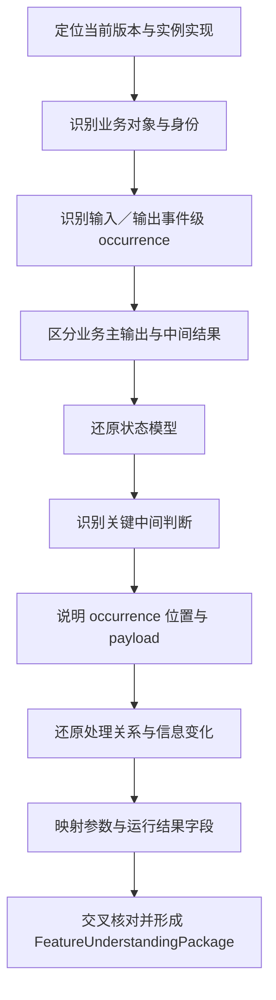

# 特征结构、对象与行为理解｜内部 Workflow

## 总图

专业判断写在真正使用它的步骤内。本 Workflow 只还原当前实现事实与可确认语义，不评价其合理性。

## U1｜定位当前版本与实例实现

**目标**：确定本次特征实例真实对应的源码、类型、构造入口、参数入口和公开读取接口。

**判断方法**：

- 优先沿特征实例反查当前代码；
- 同名旧实现、其他分支、需求文档和样例只作为线索；
- 跨仓库实现分别记录职责，例如 Python producer、FRP 状态机、绑定、公开读取与实例构造；
- 当前实现与需求不一致时并列记录，不作合理性裁决。

**输出**：当前实现来源清单、版本绑定和未定位项。

## U2｜识别业务对象与身份

**目标**：找出特征实际形成、维护或引用的持续业务对象，以及对象身份怎样保持。

**判断方法**：

- 区分业务对象、一次 occurrence、当前状态、成员记录和纯显示派生值；
- 记录对象创建、更新、结束、替代和跨运行作用域；
- 本地编号不自动等于跨运行稳定身份；
- 多对象、组或嵌套成员按真实身份边界拆解。

**输出**：`BusinessObjectModel`。

## U3｜识别输入与输出事件级 occurrence

**目标**：找出特征实际消费和产生的离散事件级 occurrence。

**判断方法**：

- 只有真正按离散发生参与处理的值才列为 occurrence；
- 区分直接输入事件与由子处理器形成后再被消费的事件；
- 区分创建、更新、确认／结束、修订／替代和过程发布；
- 没有新 occurrence 不自动表示失败、无效或状态结束。

**输出**：输入和输出 occurrence 记录。

## U4｜区分业务主输出与中间结果

**目标**：按当前 Feature 自身定义，区分最终要表达的业务结果与形成、更新、解释或结束它所需的中间处理结果。

**判断方法**：

- 是否保存、是否公开、是否在主表中，不决定业务角色；
- 公开成员明细、形成依据、previous、overlap 和 checkpoint 仍可能是中间结果；
- 中间结果对观察或统计很重要，也不改变其业务角色；
- 需求声称的主输出与实现实际公开内容不一致时分别记录。

**输出**：业务角色分类及依据。

## U5｜还原状态模型

**目标**：说明持续对象或处理器实际维护哪些状态、怎样转换、何时终止。

**判断方法**：

- 记录初始状态、活跃状态、中间状态、终止状态；
- 每条转换必须能追溯到代码条件或事件；
- 区分对象状态与处理器内部工作状态；
- 记录状态持续时间和重置的真实含义；
- 不因为代码声明了一个状态，就假定它在当前实例中可达。

**输出**：`StateModel` 与未确认转换。

## U6｜识别关键中间判断

**目标**：识别真正参与主输出形成、更新、结束或解释的候选、分类、门、距离、计数器和派生量。

**判断方法**：

- 只保留对下游业务结果有真实消费关系的中间判断；
- 对每项记录输入、规则、输出、消费位置和是否持久化；
- 一个函数内部多个数值不自动变成多个业务判断；
- 代码中存在但运行结果未暴露的量要明确标记。

**输出**：`IntermediateDecisionModel`。

## U7｜说明 occurrence 位置与 payload

**目标**：明确每类 occurrence 自身发生在哪里，以及 payload 还携带哪些位置、对象和状态。

**判断方法**：

- 先确定事件自身发生位置，例如实际点、确认点、发表点、更新点或结束点；
- 再列 payload 中携带的其他位置；
- 同一对象的多个时间位置必须保留共同身份；
- 字段名不足以证明时间语义，无法确认时记录缺口。

**输出**：事件位置与 payload 字段说明。

## U8｜还原处理关系与信息变化

**目标**：说明输入、中间判断、状态和 occurrence 怎样形成、更新、确认、结束、引用或替代业务主输出。

**判断方法**：

- 关系必须有代码依据；时间接近不等于正式引用；
- 记录每一步可能的过滤、压缩、延迟、重排、覆盖和身份变化；
- 若 occurrence 包含多个成员或实际点，说明它们怎样参与后续处理；
- 将当前实现事实与业务需求中的预期关系分开。

**输出**：`ProcessingRelationMap`。

## U9｜映射参数与运行结果字段

**目标**：形成下游可直接使用的参数事实和运行结果字段映射。

**判断方法**：

### 参数

- 区分自由参数、派生参数、固定 preset、工程安全常量和参数实例身份；
- 记录默认值、派生关系、定义位置和消费位置；
- 不在此判断参数是否合理。

### 运行结果字段

- 记录主输出、中间结果、状态轨迹和诊断字段分别在哪张表／哪个结构；
- 给出对象分组键、去重键、时间键和缺失含义；
- 标记 `AVAILABLE`、`PARTIAL`、`NOT_EXPOSED`、`UNCONFIRMED`；
- 不能从代码内变量推定运行结果一定存在。

**输出**：`ParameterMap` 与 `RunResultFieldMap`。

## U10｜交叉核对并形成包

**目标**：核对对象、事件、状态、中间判断、处理关系、参数和运行结果字段是否一致。

**判断方法**：

- 从业务主输出向上追溯，能找到必要输入和中间判断；
- 从输入和中间判断向下追踪，能说明可能形成、更新或不形成什么；
- 对象身份贯穿状态和 occurrence；
- occurrence 位置与触发代码不矛盾；
- 参数消费位置与处理规则一致；
- 运行结果字段足以支持哪些下游工作、缺什么均已明确；
- 未确认项没有被写成确定事实。

**输出**：`FeatureUnderstandingPackage` 及完成状态。
