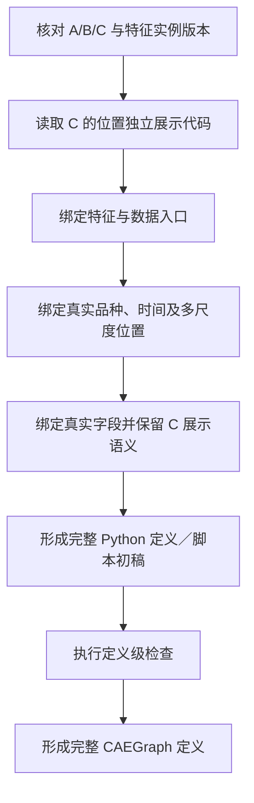

# D｜内部 Workflow

## 总图

## D1｜核对上游产物和版本

**目标**：确认 A、B、C 及特征实例属于同一当前任务和可兼容版本。

若 A 的字段来自另一代码版本、B 的位置不属于当前实例、C 使用的事件已被 A 修订，必须返回对应阶段；不能在 D 中静默拼接。

## D2｜读取 C 的位置独立展示代码

**目标**：把 C 已经形成的 Python 展示定义作为集成起点。

D 必须先核对：

- 代码对应哪一版展示预期；
- 哪些品种、时间、实例和字段仍是参数／占位；
- 哪些样例数据只用于 C 的预期 HTML；
- 哪些 CAEGraph 布局和绘图类已经确定；
- 哪些能力缺口仍未解决。

D 不重新设计主附图和图元，也不绕开 C 代码另写一套图。

## D3｜绑定特征与数据入口

**目标**：把外层特征实例映射到实际 Feature、公开读取接口、价格／KLine 和必要中间数据入口。

优先使用正式实例和现有接口；已有结果可以直接读取时不先全期重跑。图需要的某项数据不存在时，记录缺口，不从显示值反推或另算“近似业务值”。

## D4｜绑定真实品种、时间及多尺度位置

**目标**：把 B 的位置写入 C 代码中的对象范围、PlotSet、timespans 或多尺度节点配置。

- 普通场景使用 B 的 SOF 引用、品种集和时间范围；
- 高频场景按 B 的 1d→30m→1m→5s→tick 路径绑定父子节点和各层时间；
- 不把高频位置参考脚本的图内容带入最终定义，除非 C 的展示预期明确采用；
- 不改变 B 的位置来绕过运行困难。

## D5｜绑定真实字段并保留 C 展示语义

**目标**：把 C 的面板与图元映射到 A 的真实事件、位置、身份和数值字段。

- 每个图元追溯到 A 的事件／结果和 C 的展示预期；
- actual、confirm、known 等位置字段不能互换；
- 同一 occurrence 的多图元保持共同身份；
- 面板、顺序和视觉语义按 C；真实字段按 A；
- 显示派生字段保留派生规则，不能覆盖原值语义；
- 若真实字段形状使 C 代码无法直接适配，先判断是 D 的绑定问题还是应返回 C 修订展示实现。

## D6｜形成完整 Python 定义／脚本初稿

**目标**：交付可以由 E 直接尝试运行的完整代码，而非片段和伪码。

代码应包含实际 import、上下文、Feature／数据入口、布局、图元、品种、时间、输出位置及必要注释。允许运行环境中的确定性细节由 E 修复，但不能把核心绑定留作“运行时再决定”。

## D7｜执行定义级检查

至少检查：

- Python 语法；
- C 代码中的占位是否已经全部按需绑定；
- A/B/C 版本及字段引用；
- 普通或多尺度位置配置；
- 面板和图元覆盖；
- C 展示预期是否被无意改变。

若当前环境允许轻量构造检查，可记录为定义级测试；不将其写成最终图已经生成。

## D8｜形成完整 CAEGraph 定义

冻结交给 E 的输入版本，输出最终脚本引用、C→D 集成差异、绑定表、检查结果和待运行确认项。E 后续任何修改都要与本版本对照。
