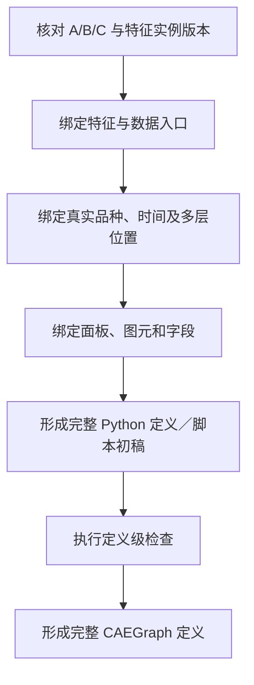

# D｜内部 Workflow

## 总图

## D1｜核对上游产物和版本

**目标**：确认 A、B、C 及特征实例属于同一当前任务和可兼容版本。

**判断方法**：若 A 的字段来自另一代码版本、B 的位置不属于当前实例、C 使用的事件已被 A 修订，必须返回对应阶段；不能在 D 中静默拼接。

## D2｜绑定特征与数据入口

**目标**：把外层特征实例映射到实际 Feature、公开读取接口、价格／KLine 和必要中间数据入口。

**判断方法**：优先使用正式实例和现有接口；已有结果可以直接读取时不先全期重跑。图需要的某项数据不存在时，记录缺口，不从显示值反推或另算“近似业务值”。

## D3｜绑定真实品种、时间及多层位置

**目标**：将 B 的位置定义写入 CAEGraph 上下文、PlotSet、timespans、对象范围或相应配置。

**判断方法**：不得改变 B 的品种和时间以绕过运行困难。多层位置只按 B 已给定义绑定；接口尚待补齐时，D 对受影响范围不能宣称完成。

## D4｜绑定面板、图元和字段

**目标**：把 C 的面板与图元映射到 A 的真实事件、位置、身份和数值字段。

**判断方法**：

- 每个图元都应追溯到 A 的事件／结果和 C 的展示定义；
- actual、confirm、known 等位置字段不能互换；
- 同一 occurrence 的多图元保持共同身份；
- 图例和顺序按 C，真实字段绑定按 A；
- 显示派生字段必须保留派生规则，不能覆盖原值语义。

## D5｜形成完整 Python 定义／脚本初稿

**目标**：交付可以由 E 直接尝试运行的完整代码，而非片段和伪码。

**判断方法**：代码应包含实际 import、上下文、Feature／数据入口、布局、图元、品种、时间、输出位置及必要注释；允许运行环境中的确定性细节由 E 修复，但不能把核心绑定留作“运行时再决定”。

## D6｜执行定义级检查

**目标**：在不冒充真实运行的前提下，尽可能发现定义错误。

**判断方法**：至少检查 Python 语法、引用完整性、配置结构、A/B/C 绑定覆盖和明显字段不一致。若当前环境允许轻量构造检查，可记录为定义级测试；不将其写成最终图已经生成。

## D7｜形成完整 CAEGraph 定义

**目标**：冻结交给 E 的输入版本。

**判断方法**：输出脚本引用、绑定表、检查结果和待运行确认项；E 后续任何修改都要与本版本对照。
