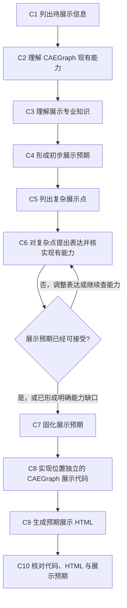

# C｜内部 Workflow

## 总体分段



本 Workflow 分成三部分：

1. `C1`：确定要展示什么；
2. `C2～C7`：形成展示预期，其中 `C5～C6` 可以循环；
3. `C8～C10`：实现该预期并生成 HTML。

---

# 第一部分｜C1：列出待展示信息

## C1｜列出待展示信息

**目标**：根据 A 明确本次展示需要覆盖哪些输入事件、业务主输出和中间处理结果。

**判断依据**：

- 业务主输出默认进入待展示清单；
- 输入事件是否展示，取决于是否需要用它理解业务主输出；
- 中间处理结果只有在能解释形成、更新、失败、结束或业务主输出来源时才进入；
- 先保证输入与业务主输出表达清楚，再增加中间结果；
- 不按代码字段数或公开表数量机械生成图层。

**输出**：待展示信息清单。后续展示预期只处理这份清单，不临时偷偷加入未说明的信息。

---

# 第二部分｜形成展示预期

## C2｜理解 CAEGraph 现有能力

**目标**：在形成具体展示预期前，先理解本次锁定版本的 CAEGraph 能怎样组织和绘制信息。

**必读**：

- [CAEGraph 展示能力与构建速查](../references/CAEGraph展示能力与构建速查.md)；
- 速查所引用的锁定版本原手册相关章节；
- 必要时查对应类、参数、示例和源码。

**至少理解**：

```text
CAEGraph / PlotSet
→ 图表布局类
→ 绘图类
→ 特征雷达、组件和主题
```

以及多品种主图、每品种独立图、主图／附图、K 线、Tick 线、柱、点和线段的现有能力。

此步不是马上写代码，而是建立后续展示预期可使用的能力边界。

## C3｜理解已有展示专业知识

**目标**：理解形成展示预期时采用的业务阅读原则。

**当前知识**：

- 主图通常放价格线或 K 线；
- ZigZag、转折、低频 Boll 等贴近价格理解的内容通常放在主图；
- 不适合叠在价格上的输入、业务主输出和中间结果放在附图；
- 多品种需要共同时间语境，但不等于必须共用同一绝对价格轴；
- 面板顺序和图元设计应支持从左向右沿时间阅读特征判断；
- 同一 occurrence 的实际、确认、已知等位置必须保持共同身份；
- 先把输入和业务主输出画顺，再按需要加入中间处理结果；
- 主附图共享时间轴通常已经提供必要联动，不先追求复杂点击或弹窗。

这些知识是形成预期时使用的原则，不是固定图模板。

## C4｜形成初步展示预期

**目标**：基于 C1 的待展示信息、C2 的 CAEGraph 能力和 C3 的展示知识，先给出一版完整展示预期。

展示预期至少回答：

- 页面从上到下有哪些主图、附图和明细；
- 每项待展示信息放在哪里；
- 观察者应怎样沿时间从输入读到业务主输出；
- 不同事件及其多个位置怎样区分并保持身份；
- 哪些中间结果常显，哪些按需查看；
- 哪些原值保持不变，哪些只是显示派生；
- 使用哪些现有 CAEGraph 布局和图元能力来表达。

此时先表达“预期怎样看”，不要求所有复杂点已经解决，也不直接把代码当作展示预期。

## C5｜列出复杂展示点

**目标**：从初步展示预期中找出不能直接套用常规画法的地方。

常见复杂点包括：

- 一个 occurrence 携带多个实际位置或多个成员；
- 不同事件在同一时点发生但身份不同；
- 同一信息既需要贴近价格，又需要在附图展示量测；
- 多品种绝对价格轴不适合直接重叠；
- 离散发生与持续状态容易混淆；
- 需要表达形成、更新、确认、撤回或前后引用；
- 现有图元或布局似乎无法直接表达。

每个复杂点必须写清楚：要保留的业务信息、当前困难和若处理不当会损失什么。

## C6｜循环处理复杂展示点

对每个复杂点重复以下过程：

```text
提出一种展示表达
→ 查现有 CAEGraph 类、参数、示例或源码
→ 判断属于哪种情况
    1. 现有能力直接支持
    2. 只是使用方式问题，可重新组合现有能力
    3. 换一种表达后可保留业务含义
    4. 真实能力缺口
→ 更新展示预期
→ 仍有困难则继续下一轮
```

**判断边界**：

- 相同数据出现在两个面板，可分别绑定同一来源，不自动构成功能缺口；
- 多品种不适合同轴时，先比较 `AllSymsMainFig`、`PerSymFigs`、`PerSymFigSet` 等现有布局；
- 复杂交互只有在主附图、共享时间轴、图例、hover 和显隐仍不能表达时才考虑；
- 若换一种表达会丢失关键业务含义，不能为了“能画出来”接受；
- 确认是真实能力缺口时，记录最低替代方案、语义损失和所需新能力，不在 C 内自行扩展工具。

循环停止条件：展示预期已经可实现且不丢关键业务含义，或者已经形成清楚、可交接的真实能力缺口。

## C7｜固化展示预期

**目标**：形成独立于代码的最终展示预期，供后续实现和 E 核图使用。

展示预期应明确：

- 页面与面板结构；
- 信息到主图／附图／明细的映射；
- occurrence、时间位置和身份表达；
- 图元及视觉语义；
- 基准、转换和交互；
- 已解决的复杂点；
- 仍存在的能力缺口和替代方式。

---

# 第三部分｜实现展示预期

## C8｜实现位置独立的 CAEGraph 展示代码

**目标**：把 C7 展示预期写成可检查的 CAEGraph Python 定义代码。

**实现边界**：

- 可以使用一个真实样例或示意数据／局部位置；
- 不绑定 B 最终选定的真实品种和时间；
- 品种、时间、特征实例和真实字段绑定应以参数、占位或样例适配形式保留，供 D 集成；
- 代码应具体到 `CAEGraph`、`PlotSet`、布局类、绘图类及必要辅助代码；
- 不允许只交文字、伪码或类名清单。

## C9｜生成预期展示 HTML

**目标**：运行 C8 的展示样例，生成可打开的预期展示 HTML。

HTML 的数据可以是示意或真实样例，但其页面结构、图元、时间表达和业务身份必须与 C7 一致。该 HTML 是 E 核对最终图的可视化合同，不是最终观察材料。

## C10｜核对代码、HTML 与展示预期

至少核对：

- C1 的待展示信息是否都有预期位置或明确不展示理由；
- C8 代码是否实现 C7 的面板、图元和交互；
- C9 HTML 是否真实反映代码；
- 复杂点的处理结果是否按记录实现；
- 位置独立性是否保留，没有偷偷绑定 B 的最终位置；
- 能力缺口是否如实保留，没有用近似图伪装已经解决。
