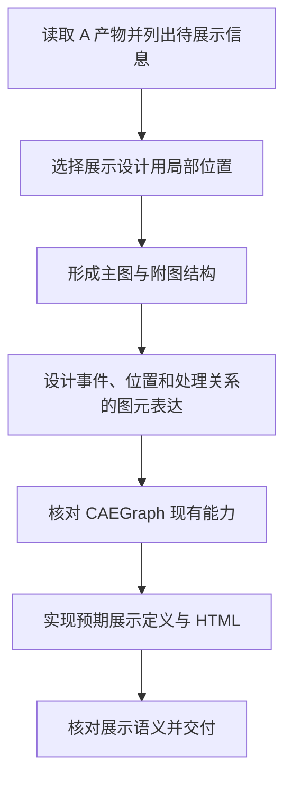

# C｜内部 Workflow

## 总图

## C1｜列出待展示信息

**目标**：根据 A 明确本次展示需要覆盖哪些输入事件、业务主输出和中间处理结果。

**判断方法**：

- 业务主输出默认需要进入展示；
- 输入事件是否展示，取决于是否需要用它理解业务主输出；
- 中间处理结果只有在能解释形成、更新、失败或结束原因时才进入；不按代码字段数量全部铺开；
- 先保证输入与业务主输出表达清楚，再增加中间结果。

## C2｜选择展示设计用局部位置

**目标**：找一个能帮助设计图形结构的局部位置。

**判断方法**：该位置可以是真实样例，也可以是示意数据；只需覆盖所设计的事件和图元。它不属于 B 的最终观察位置，不要求代表实际业务结论。

## C3｜形成主图与附图结构

**目标**：决定哪些信息放主图、哪些放附图以及面板顺序。

**判断方法**：

- 主图通常承担价格线、K 线以及适合贴着价格理解的 ZigZag、转折、低频 Boll 等信息；
- 多品种事件通常需要共同时间语境，但不强制多个品种挤在同一绝对价格轴，可使用多品种主图或同一图集中的独立价格面板；
- 不适合叠在价格上的输入、业务主输出和中间结果放附图，顺序应支持从输入到结果的阅读；
- 首要评价标准是从左向右看时间过程时，能否方便核对特征判断。

## C4｜设计事件、位置和处理关系的图元表达

**目标**：为不同 occurrence、位置和关系选择图元、颜色、线型、轨道、hover 与图例。

**判断方法**：

- 同一 occurrence 的实际、确认、已知等多个位置必须保持同一身份，可用点、连线或不同符号表达；
- 不同事件不能只因时间相同而画成同一对象；
- 状态保持带若由离散 occurrence 派生，必须明确标记为显示派生，不可把无新 occurrence 的空白自动填成某个业务状态；
- 图例用于阅读，不替代稳定业务身份；关键身份保留在数据字段或 hover 中。

## C5｜核对 CAEGraph 现有能力

**目标**：判断展示设计能否用现有布局、绘图类、数据处理和控件实现。

**判断方法**：

- 先区分“不会使用现有能力”和“工具确实不支持”；
- 相同数据要出现在两个面板，通常可分别绑定同一数据，不自动等于需要新增共享配置功能；
- 优先使用主附图、共享时间轴和已有图元；复杂点击、弹窗和跨图联动只有在明显改善观察且现有方式不能表达时才提出；
- 如需新能力，说明现有功能不足的证据、受影响信息、最低替代方案和语义损失。

## C6｜实现预期展示定义与 HTML

**目标**：形成不绑定 B 最终位置的展示定义，并输出可打开的预期展示 HTML。

**判断方法**：HTML 中的数据形状可以是示意或样例，但面板、图元、时间表达和业务身份必须与展示定义一致；不能只写文字草图。

## C7｜核对展示语义并交付

**目标**：确认预期 HTML 能作为 E 最终图的比较基准。

**判断方法**：至少核对面板结构、主附图关系、事件图元、多个时间位置、图例／hover 和必要中间结果；曲线具体形状、点数量和真实坐标范围不要求与最终图一致。
