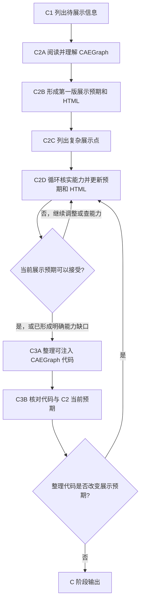

# C｜内部 Workflow

## 总体分段



C 固定分成三部分：

1. `C1`：确定要展示什么；
2. `C2`：形成并迭代展示预期。第一版预期就必须有 HTML，复杂点处理过程中直接更新同一份预期和 HTML；
3. `C3`：把 C2 当前被接受的展示实现整理成位置、实例和字段可注入的 CAEGraph 代码，不再另生成第二份“预期 HTML”。

---

# C1｜列出待展示信息

## C1｜列出待展示信息

**目标**：根据 A 明确本次展示需要覆盖哪些输入事件、业务主输出和中间处理结果。

**判断依据**：

- 业务主输出默认进入待展示清单；
- 输入事件是否展示，取决于是否需要用它理解业务主输出；
- 中间处理结果只有在能解释形成、更新、失败、结束或业务主输出来源时才进入；
- 先保证输入与业务主输出表达清楚，再增加中间结果；
- 不按代码字段数或公开表数量机械生成图层。

**输出**：`C1 待展示信息清单`。C2 只处理这份清单；新增待展示信息时必须先更新 C1，而不是在画图过程中无痕加入。

---

# C2｜形成并迭代展示预期

## C2A｜阅读并理解 CAEGraph

**目标**：在提出展示预期前，直接理解本次锁定版本 CAEGraph 的现有概念、构建链、布局和绘图能力。

**必读原件**：

- [`daowei2026/uplot@e6.2/CAEGraph使用手册.md`](https://github.com/daowei2026/uplot/blob/e6.2/CAEGraph使用手册.md)。

至少阅读与本次任务有关的：

- “文档说明”和“名词定义”；
- `CAEGraph / PlotSet`；
- 图表布局类快速选择指南及候选布局类；
- 绘图类快速选择指南及候选绘图类；
- 类之间的关系；
- 与本次展示相近的使用示例。

手册不足以判断某项真实能力时，再查锁定版本中对应类、参数、示例和源码。C 不要求像 D 一样完整还原整个仓库调用链，但实际采用的类和能力不能只凭记忆猜测。

**输出**：`CAEGraph 阅读与能力核实记录`，写明实际读过的章节、类、示例和仍未核实的能力。

## C2B｜形成第一版展示预期和第一版预期 HTML

**目标**：根据 C1、C2A 和当前已确认的展示经验，直接给出一版可看的展示预期 HTML，而不是先停留在纯文字方案。

当前已确认的经验性起点包括：

- 主图通常画价格线，包括 K 线或 Tick 线；
- 主图通常采用多品种画法；单品种特征也可以使用同类定义但只填一个品种；多品种相关特征通常需要同时展示多个品种；
- 转折、ZigZag、低频 Boll 等直接依据价格得到、贴在价格上更方便理解的内容，通常叠加在主图；
- 附图先考虑特征业务主输出；不适合放在价格线上的输入应放在前部附图；必要中间结果再按观察需要增加；
- 当前阶段优先把输入和业务主输出展示顺，再逐步加入中间处理信息；
- 页面应支持从左向右沿时间查看特征做出的判断；
- 优先使用 CAEGraph 已有主附图、共享时间轴、图元、hover 和显隐能力，不先追求复杂弹窗或跨图交互；
- 同一数据要在两个面板出现时，可以分别绑定同一来源；不能仅因此断言 CAEGraph 缺功能。

这里不再预设两条未经确认的通用规则：

- 不预先规定“多品种一定要使用共同时间语境但不同价格轴”；具体多品种布局由当前特征、C1 信息和 CAEGraph 能力决定；
- 不预先规定所有 occurrence 都有“实际／确认／已知”多个位置。只有 A 已明确这些位置属于同一业务记录时，C 才需要在图中保留可追溯关系。

第一版展示预期至少回答：

- 页面有哪些主图、附图和必要明细；
- C1 每项信息放在哪里；
- 观察者怎样从输入读到业务主输出；
- A 已确认的事件位置、成员或引用关系怎样表达；
- 哪些信息常显，哪些通过 hover、显隐或明细查看；
- 哪些是原值，哪些只是显示派生；
- 使用哪些已核实的 CAEGraph 布局和绘图能力。

**第一版 HTML**：必须使用一个真实样例或示意数据把上述预期直接实现成可打开 HTML。可使用临时原型代码；该 HTML 和原型均不绑定 B 的最终位置。

若临时使用外层特征实例，记录预览实例、样例品种和时间；这只是 C2 的预览绑定，不能成为最终实例绑定。

**输出**：`第一版展示预期 + 第一版预期 HTML + 生成原型引用`。

## C2C｜从当前预期和 HTML 中列出复杂展示点

**目标**：直接观察第一版 HTML，找出常规画法不能充分表达、阅读困难或可能丢失业务信息的地方。

复杂点来自当前用例事实，不预先强制出现。可能包括：

- A 已确认的一个 occurrence 携带多个位置或多个成员；
- 不同事件在同一时点发生但不能混成同一对象；
- 同一信息既适合贴近价格，又有附图量测；
- 当前多品种布局难以阅读；
- 离散发生与显示上的持续状态容易混淆；
- 需要表达形成、更新、确认、撤回或前后引用；
- 当前选用的图元、布局或交互似乎无法表达。

每个复杂点必须写明：要保留的业务信息、当前 HTML 中的具体问题、若处理不当会损失什么。

**输出**：`复杂展示点清单`。

## C2D｜循环核实现有能力，并同步更新展示预期和 HTML

对每个复杂点重复：

```text
提出一种展示表达
→ 查原使用手册；必要时查对应类、参数、示例或源码
→ 判断属于哪种情况
    1. 现有能力直接支持
    2. 只是使用方式问题，可重新组合现有能力
    3. 换一种表达后仍能保留业务含义
    4. 真实能力缺口
→ 修改展示预期
→ 立即更新预期 HTML
→ 重新查看复杂点是否解决
```

**判断边界**：

- 只把 A 已确认的业务身份、位置和关系当作约束，不从字段名自行创造关系；
- 多品种布局问题先比较手册和源码中的现有布局类，不预先指定必须同轴或必须分轴；
- 复杂交互只有在主附图、共享时间轴、图例、hover 和显隐仍不能表达时才考虑；
- 若替代表达会丢失关键业务含义，不能为了“能画出来”而接受；
- 确认是真实能力缺口时，记录最低替代方案、语义损失和所需新能力，不在 C 内自行扩展工具。

**每一轮都必须同时更新**：

- 当前展示预期；
- 当前预期 HTML；
- 复杂点处理记录；
- 当前使用的原型代码；
- 能力缺口记录。

因此没有单独的“固化展示预期”或“再次生成 HTML”步骤。循环停止时的当前版本，就是 C2 的最终展示预期和最终预期 HTML。

循环停止条件：

- 当前展示预期和 HTML 已可接受，且没有丢失 C1 的关键业务信息；或
- 仍有真实能力缺口，但缺口、替代方案和语义损失已经清楚，能够交给后继判断。

**输出**：`C2 当前展示预期 + 当前预期 HTML + 复杂点循环记录 + 能力缺口`。

---

# C3｜整理可注入的 CAEGraph 展示代码

## C3A｜把 C2 当前实现整理成位置与实例可注入代码

**目标**：以 C2 循环结束时实际生成当前 HTML 的原型为起点，整理出可交 D 集成的 CAEGraph Python 定义代码。

**实例处理规则**：

- C 可以只读检查外层特征实例的数据形状、公开接口和字段；
- C2 可以临时使用该实例生成预期 HTML，但必须记录为预览绑定；
- C3 代码必须通过参数、构造器参数、Feature／数据入口映射或等价方式暴露实例注入点；
- 不允许把外层真实实例的对象、SOF、结果路径或运行状态写死成不可替换常量；
- 真正的外层实例绑定由 D 完成。

**位置处理规则**：

- 不绑定 B 最终选定的真实品种和时间；
- 样例品种和时间必须可由 D 替换；
- 高频多尺度位置保留明确注入接口，不把 B 参考脚本的图内容带进来。

**代码要求**：

- 具体到 `CAEGraph`、`PlotSet`、布局类、绘图类及必要辅助代码；
- 明确 D 需要注入的特征实例、Feature／数据入口、真实字段映射、品种、时间和多尺度位置；
- 不允许只交文字、伪码或类名清单。

**输出**：`位置与实例可注入的 CAEGraph 展示代码 + 注入合同`。

## C3B｜核对 C3 代码与 C2 当前展示预期

至少核对：

- C1 的待展示信息都有预期位置或明确不展示理由；
- C3 代码保持 C2 当前 HTML 的页面、面板、图元、视觉语义和交互；
- 复杂点的处理按 C2D 当前结果实现；
- B 的最终位置没有被固化；
- 外层真实特征实例没有被固化；
- 实例、位置和字段注入接口完整；
- 能力缺口如实保留，没有用近似图伪装已经解决。

C3 不另生成一份新的“预期 HTML”。C2 循环结束时的当前 HTML 就是唯一预期 HTML。若整理代码时发现必须改变展示预期，返回 C2D，同步更新预期和 HTML 后再整理代码。

**输出**：`C3 代码与 C2 当前展示预期核对结果`。
