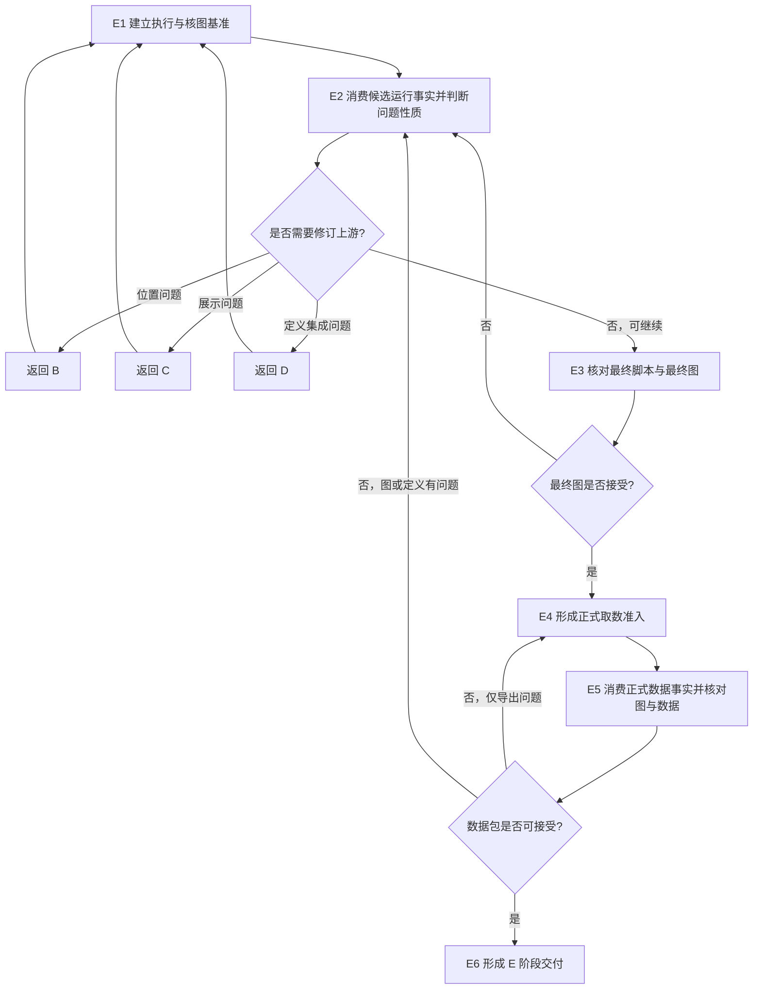

# E｜专业业务 Workflow

> 本文件只描述 E Agent／executor 自己承担的专业判断、回流、接受和交付。真实环境中的运行、机械修复和正式数据导出不作为本 Workflow 的业务节点；它们怎样通过 W1、W2 工单取得，见 [Worker 派单合同](WORKER_DELEGATION.md)。

## 总图

本图只表达专业业务关系：

- `E1 → E2` 之间需要取得候选运行事实；通常由 W1 工单完成；
- `E4 → E5` 之间需要取得正式数据事实；通常由 W2 工单完成；
- W1／W2 的签发、身份、权限、操作和回交字段不在本图展开，统一见 [WORKER_DELEGATION.md](WORKER_DELEGATION.md)。

---

## E1｜建立执行与核图基准

**目标**：在获取任何候选运行事实前，固定 E 将用来判断结果的专业基准。

E 至少确认：

- D 完整 CAEGraph 定义的准确版本；
- C2 当前展示预期和当前预期 HTML 的准确版本；
- C3 代码与 D 集成结果；
- 外层特征实例、B 位置、特征代码和 CAEGraph 仓库版本；
- D 已知的待运行确认项；
- 哪些机械问题允许 Worker 修复，哪些位置／展示／绑定问题必须回 E；
- 候选脚本、候选 HTML、日志和 patch 的交付位置。

**输出**：`执行与核图基准`。

该产物触发哪类 Worker 工单、怎样签发，见 [Worker 派单合同 §3](WORKER_DELEGATION.md#3-w1caegraph-运行与有限修复)。

---

## E2｜消费候选运行事实并判断问题性质

**输入**：通过 W1 或同版本可复用实物取得的候选脚本、候选 HTML、运行日志、patch 和未决问题。

**目标**：由 E 亲自判断候选运行结果，而不是把 Worker 的“成功”直接当成专业通过。

E 检查：

- 是否使用 D 指定的实例、品种、时间、字段和环境；
- patch 是否属于授权的确定性修复；
- 是否出现位置无数据、展示表达不成立或字段／实例绑定错误；
- 运行结果是完整、部分、失败还是效果未知；
- 是否需要先对账而不是立即重跑；
- D 直接纠正的 B／C 缺项是否在实际运行中仍成立。

**问题路由**：

| 问题性质 | 专业后继 |
|---|---|
| 品种、时间或多尺度位置需要重新选择 | 返回 B |
| 面板、图元、时间表达或 C2 展示预期需要改变 | 返回 C |
| 实例、字段、位置与 C3 代码的集成绑定错误 | 返回 D |
| 语法、导入、路径、确定 API 差异等机械问题 | 在 E1 基准不变时申请新的 W1 revision |
| 无法判断 | E 先完成分类，不让 Worker猜测 |

E 返回 B／C／D 后，必须消费修订后的当前有效产物，重新建立 E1 基准；旧运行事实不能自动套用到新版本。

**输出**：`候选运行事实专业评价`。

---

## E3｜核对最终脚本与最终图

**目标**：对候选最终结果形成专业接受判断。

### E3A｜与 D 完整定义核对

逐项核对：

- 特征实例；
- SOF、日历、品种、时间和多尺度位置；
- A 的事件、时间、身份和数值字段；
- C2 的页面、面板、图元、转换和交互；
- D 的上游确定性纠正是否按记录实现；
- Worker 的每一项 patch 是否有授权依据；
- 最终脚本是否引入未经 D 接受的新计算或新数据入口。

### E3B｜与 C2 当前展示预期核对

逐项核对：

- 当前预期 HTML 的页面和面板结构；
- 主图／附图关系；
- 图元业务语义；
- A 已确认的事件位置、成员或引用关系；
- 多品种组织；
- 图例、hover、显隐、基准和必要中间结果；
- C2D 复杂展示点的处理是否在最终图中真实成立。

真实行情形状、点数量和坐标范围允许与 C2 当前预期 HTML 不同；关键展示结构和业务语义不能无痕变化。

**输出**：`最终图核对记录`，结果为：接受／限域接受／返回 B／返回 C／返回 D／阻塞。

---

## E4｜形成正式取数准入

**目标**：只有 E3 已接受最终图，才建立正式数据导出的合法输入。

正式取数准入必须冻结：

- 被接受的最终脚本版本／哈希；
- 被接受的最终 HTML 版本／哈希；
- D 定义版本和 C2 当前展示预期版本；
- 外层特征实例、品种、时间和运行环境；
- 本次需要导出的数据阶段：源数据、后处理、构图 CDS、视窗最终值；
- 图层到数据源映射和完整性要求；
- 明确禁止后续操作修改图定义、脚本业务逻辑或观察位置。

**输出**：`正式取数准入记录`。

该产物触发哪类 Worker 工单、怎样签发，见 [Worker 派单合同 §4](WORKER_DELEGATION.md#4-w2caegraph-正式取图数据)。

---

## E5｜消费正式数据事实并核对图与数据

**输入**：通过 W2 或同一准入下可复用实物取得的数据文件、manifest、图层映射、哈希和日志。

**目标**：专业判断正式数据包是否确实对应已经接受的最终图。

至少核对：

- 数据包绑定的脚本、HTML、定义和运行编号；
- 面板／图元／Renderer／CDS 或源表映射；
- 字段、品种、时间、行数和对象数量；
- source／postprocessed／construction_snapshot／viewport_final 数据阶段；
- 原值、标准化值、裁剪值和显示派生值的关系；
- 有效空、无 occurrence、缺数据、未确认等缺失语义；
- 同一业务记录出现在多个图元时没有重复计数；
- 只保存少量预览的情况没有冒充完整数据。

若只是导出动作错误，可在正式取数准入不变时申请新的 W2 revision；若发现最终图或定义本身有问题，返回 E2，并使旧取数准入失效。

**输出**：`图与数据一致性核对`。

---

## E6｜形成 E 阶段交付

最终交付至少包括：

- 被接受的最终运行脚本；
- 被接受的最终 CAEGraph HTML；
- W1 工单、运行日志、patch 和问题回报；
- 与 D 定义、与 C2 当前展示预期的核对结果；
- 正式取数准入记录；
- W2 工单和正式 CAEGraph 图数据包；
- 图与数据一致性核对；
- 已知限制、未解决问题和可供下游使用的范围。

只有图被接受、正式数据已取得且一致性核对满足本次用途，才能标记 `DATA_READY`。
