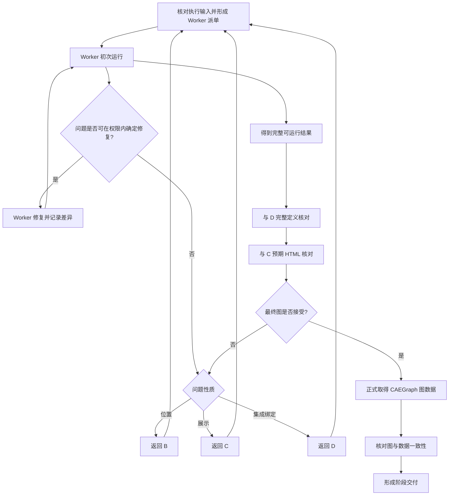

# E｜内部 Workflow

## 总图

## E1｜核对输入并形成 Worker 派单

**目标**：将 D 的完整定义、实际运行条件、修改权限和输出要求交给 Worker。

**判断方法**：派单不得替 Worker 新增业务目标。必须写清：哪些错误可直接修、哪些改动必须返回、最终 HTML 和数据的输出位置、失败和部分结果怎样回报。

## E2｜Worker 初次运行

**目标**：在真实环境执行完整定义，生成初步图、日志和错误记录。

**判断方法**：运行应使用 D 指定的实例、品种、时间和字段；不能为跑通而换成其他样例。若动作可能触发明显高成本重算或不可逆修改，只针对该动作核实权限和成本。

## E3～E5｜修复权限与问题回流

### Worker 可直接处理

- 语法、导入、路径、确定的 API 名称／参数变化；
- 明确类型转换、输出目录和不改变业务含义的机械代码错误；
- 其他在派单中明确授权且不改变 A/B/C/D 语义的修复。

### 必须返回

| 发现的问题 | 返回 |
|---|---|
| 品种、时间或多层位置无数据／不成立 | B |
| 面板、图元、时间表达或业务展示方式需要改变 | C |
| 实例、字段、位置与展示定义的集成／绑定有误 | D |
| 无法判断属于哪类 | 返回本阶段负责人分类，不由 Worker 猜测 |

Worker 每次修复必须记录修改前后、原因、权限依据和可能语义影响。

## E6｜得到完整可运行结果

**目标**：形成能够完整生成 HTML 的候选最终脚本。

**判断方法**：此时只说明运行完成，尚不能正式取数或标记 `DATA_READY`。

## E7｜与 D 完整定义核对

**目标**：确认 Worker 最终脚本没有越权改变集成结果。

**判断方法**：逐项核对特征实例、品种、时间、字段、面板、图元、转换、输出路径和 Worker patch。任何业务语义变化必须回到 B／C／D 接受后才能继续。

## E8｜与 C 预期 HTML 核对

**目标**：确认最终图的展示结构和业务语义符合预期。

**判断方法**：

- 必须核对：面板结构、主附图关系、图元语义、事件位置表达、多品种组织、图例／hover 和必要中间结果；
- 允许随真实数据变化：曲线形状、点数量、坐标范围和局部缩放；
- 不要求无意义的像素级一致；
- 最终图看似美观但业务信息缺失，不能通过。

## E9｜接受最终图

**目标**：形成“该图可以作为正式取数依据”的明确结果。

**判断方法**：D 核对和 C 核对均通过，或存在已明确且被接受的不影响本次材料用途的限制。否则返回受影响阶段。

## E10｜正式取得 CAEGraph 图数据

**目标**：从已接受的最终脚本和运行中导出进入观察材料的数据。

**判断方法**：

- 正式数据必须绑定最终脚本版本、定义版本、HTML、特征实例、品种和时间；
- 区分源业务数据、后处理数据、构图 CDS 和视窗最终显示数据；
- 需要视窗最终值时，必须核实前端回调和实际可见范围；
- 只导出前几行可作为预览，不能称完整数据；
- 图中已压缩或丢弃的信息需要原值时，回源特征读取，不能逆推。

## E11｜核对图与数据一致性

**目标**：确认最终 HTML 和正式导出数据来自同一有效运行并能相互追溯。

**判断方法**：核对图层到数据源、字段、行数、品种、时间、图例、转换阶段和缺失含义；同一 occurrence 出现在多个图元中不能重复计为多个事件。

## E12｜形成阶段交付

**目标**：交付最终脚本、HTML、数据、日志、修改记录、三类核对和限制。

**判断方法**：若只有脚本和 HTML，没有正式数据或一致性核对，只能形成受限结果，不能标记 `DATA_READY`。
