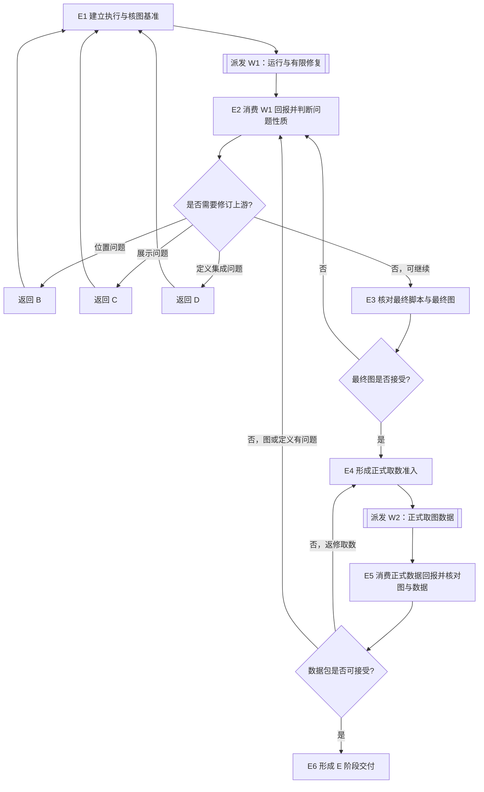

# E｜专业业务 Workflow

> 本文件只描述 E Agent 自己承担的专业判断、回流、接受和交付。真实环境中的命令执行、机械修复和正式数据导出，分别通过 [Worker 派单合同](WORKER_DELEGATION.md) 的 W1、W2 工单完成。

## 总图

工单本身的字段、权限和 Worker 操作不在本文件展开，分别见：

- [W1 运行与有限修复模板](RUN_REPAIR_ORDER_TEMPLATE.md)
- [W2 正式取图数据模板](DATA_EXPORT_ORDER_TEMPLATE.md)

---

## E1｜建立执行与核图基准

**目标**：在任何 Worker 操作前，固定 E 将用来判断结果的专业基准。

E 至少确认：

- D 完整 CAEGraph 定义的准确版本；
- C 展示预期和预期 HTML 的准确版本；
- 外层特征实例、B 位置、代码和 CAEGraph 仓库版本；
- D 已知的待运行确认项；
- W1 可以自主修复的机械问题和必须返回 E 的语义问题；
- 候选脚本、候选 HTML、日志和 patch 的交付位置。

**输出**：`执行与核图基准`。随后按 [Worker 派单合同](WORKER_DELEGATION.md) 签发 W1。

---

## E2｜消费 W1 回报并判断问题性质

**目标**：由 E 亲自判断 Worker 的运行结果、patch 和未决问题，而不是把 Worker 的“成功”直接当成专业通过。

E 检查：

- Worker 是否使用 D 指定的实例、品种、时间、字段和环境；
- patch 是否属于 W1 授权的确定性修复；
- 是否出现位置无数据、展示表达不成立或字段／实例绑定错误；
- 运行结果是完整、部分、失败还是效果未知；
- 是否需要对账而不是立即重跑。

**问题路由**：

| 问题性质 | 专业后继 |
|---|---|
| 品种、时间或多尺度位置不成立／无数据 | 返回 B |
| 面板、图元、时间表达或展示预期需要改变 | 返回 C |
| 实例、字段、位置与 C 代码的集成绑定错误 | 返回 D |
| 语法、导入、路径、确定 API 差异等机械问题 | 在原专业基准不变时重新签发／续发 W1 |
| 无法判断 | E 先完成分类，不让 Worker 猜测 |

E 返回 B／C／D 后，必须消费修订后的当前有效产物，重新建立 E1 基准，再派新的 W1；不得把旧工单自动延伸到新版本。

---

## E3｜核对最终脚本与最终图

**目标**：形成候选最终结果的专业接受判断。

### 3.1 与 D 完整定义核对

逐项核对：

- 特征实例；
- SOF、日历、品种、时间和多尺度位置；
- A 的事件、时间、身份和数值字段；
- C 的面板、图元、转换和交互；
- Worker 的每一项 patch 是否有授权依据；
- 最终脚本是否引入未经 D 接受的新计算或新数据入口。

### 3.2 与 C 展示预期核对

逐项核对：

- 页面和面板结构；
- 主图／附图关系；
- 图元业务语义；
- occurrence 的多个位置和共同身份；
- 多品种组织；
- 图例、hover、显隐、基准和必要中间结果；
- C 复杂展示点的处理是否在最终图中真实成立。

真实行情形状、点数量和坐标范围允许与 C 的预期 HTML 不同；关键展示结构和业务语义不能无痕变化。

**输出**：`最终图核对记录`，结果为：接受／限域接受／返回 B／返回 C／返回 D／阻塞。

---

## E4｜形成正式取数准入

**目标**：只有 E3 已接受最终图，才建立 W2 的合法输入。

正式取数准入必须冻结：

- 被接受的最终脚本版本／哈希；
- 被接受的最终 HTML 版本／哈希；
- D 定义版本和 C 展示预期版本；
- 外层特征实例、品种、时间和运行环境；
- 本次需要导出的数据阶段：源数据、后处理、构图 CDS、视窗最终值；
- 图层到数据源映射和完整性要求；
- 明确禁止 W2 修改图定义、脚本业务逻辑或观察位置。

**输出**：`正式取数准入记录`。随后签发独立 W2 工单。

---

## E5｜消费正式数据回报并核对图与数据

**目标**：专业判断 W2 返回的数据包是否确实对应已经接受的最终图。

至少核对：

- 数据包绑定的脚本、HTML、定义和运行编号；
- 面板／图元／Renderer／CDS 或源表映射；
- 字段、品种、时间、行数和对象数量；
- source／postprocessed／construction_snapshot／viewport_final 数据阶段；
- 原值、标准化值、裁剪值和显示派生值的关系；
- 有效空、无 occurrence、缺数据、未确认等缺失语义；
- 同一 occurrence 出现在多个图元时没有重复计成多个业务事件；
- 只保存少量预览的情况没有冒充完整数据。

若 W2 只是导出错误，可在取数准入不变时重新派 W2；若发现最终图或定义本身存在问题，返回 E2，并使旧取数准入失效。

**输出**：`图与数据一致性核对`。

---

## E6｜形成 E 阶段交付

最终交付至少包括：

- 被接受的最终运行脚本；
- 被接受的最终 CAEGraph HTML；
- W1 工单、运行日志、patch 和问题回报；
- 与 D 定义、与 C 展示预期的核对结果；
- 正式取数准入记录；
- W2 工单和正式 CAEGraph 图数据包；
- 图与数据一致性核对；
- 已知限制、未解决问题和可供下游使用的范围。

只有图被接受、W2 正式数据已取得且一致性核对满足本次用途，才能标记 `DATA_READY`。
