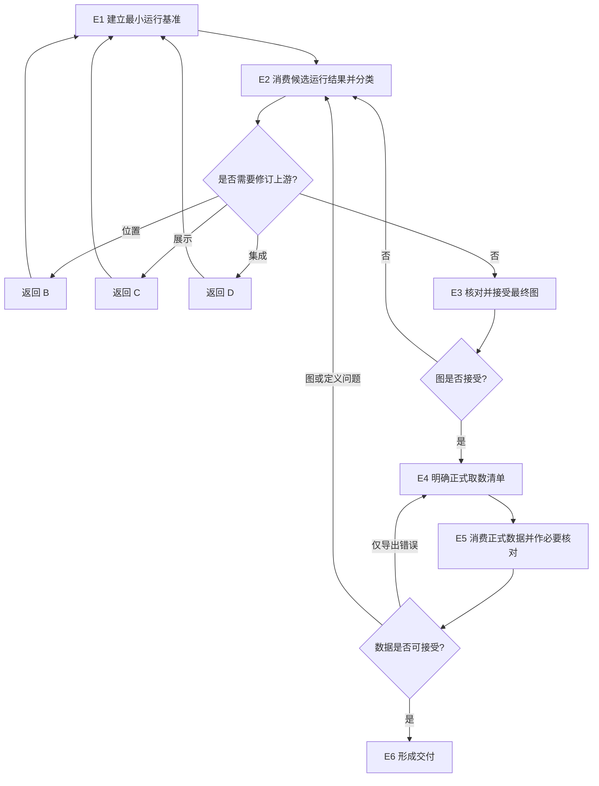

# E｜专业业务 Workflow

> 本文件只描述 E Agent／executor 的专业判断。真实运行和正式取数分别使用 [W1／W2 短执行卡](WORKER_DELEGATION.md)。

## 总图



`E1 → E2` 之间通常通过 W1 取得真实结果；`E4 → E5` 之间通常通过 W2 取得正式数据。工单字段不在本 Workflow 展开。

---

## E1｜建立最小运行基准

只固定运行和核图真正需要的引用：

```text
D 完整脚本
C2 当前预期 HTML
工作区／运行入口
输出目录
```

并简短写明 W1 可以直接修的机械问题、必须返回的语义问题。

**输出**：一条最小 `执行与核图基准`。它不是新的长报告。

随后按 [W1 短执行卡](RUN_REPAIR_ORDER_TEMPLATE.md)取得第一次真实运行反馈。除缺少必要输入或存在明确风险外，W1 应先运行一次。

---

## E2｜消费候选运行结果并分类

优先检查五件事：

1. 有没有生成可打开的 HTML；
2. 没生成时，首个真实阻断是什么；
3. 最终脚本是否仍使用 D 的实例、位置和字段；
4. `git diff` 是否只包含允许的机械修复；
5. 是否出现需要 B／C／D 判断的问题。

| 问题性质 | 后继 |
|---|---|
| 需要重新选品种、时间或多尺度位置 | 返回 B |
| 需要改变展示预期、面板、图元或表达 | 返回 C |
| 实例、字段、位置与展示代码的集成有误 | 返回 D |
| 只是语法、import、路径、已确认 API 等机械问题 | 基准不变时续发 W1 |
| 无法判断 | E 先分类，不让 Worker 猜测 |

环境版本、完整 patch 解释等只在它们确实影响结果时展开。

**输出**：简短的候选运行评价和下一步。

---

## E3｜核对并接受最终图

### 与 D 核对

确认最终脚本没有越权改变：

- 特征实例和数据入口；
- SOF、日历、品种、时间和多尺度位置；
- A 的事件、时间、身份和数值字段；
- C 的页面、面板、图元、转换和交互。

### 与 C2 当前预期 HTML 核对

确认最终图保留：

- 页面及主附图结构；
- 图元业务语义；
- A 已确认的事件位置、成员或引用关系；
- 多品种组织、图例、hover、基准和必要中间结果。

真实行情形状、点数量和坐标范围可以变化；关键结构和业务含义不能无痕变化。

**输出**：接受／限域接受／返回 B／返回 C／返回 D／阻塞。

---

## E4｜明确正式取数清单

图被接受后，只列本次真正需要的数据：

```text
已接受的最终脚本
已接受的最终 HTML／运行
要导出的图层或对象
每项需要的数据阶段
输出目录
```

这就是 `正式取数准入`。默认不要求另写完整环境快照、全量数据血缘或全部文件哈希。

随后按 [W2 短执行卡](DATA_EXPORT_ORDER_TEMPLATE.md)导出这些数据。

---

## E5｜消费正式数据并作必要核对

默认核对：

- 文件是否对应 E4 列出的图层／对象；
- 数据阶段是否正确；
- 品种、时间和行数是否合理；
- 是否绑定已接受的脚本／HTML／运行；
- 是否存在会影响本轮判断的缺失、截断或转换。

只有出现实际问题，或下游明确需要时，才进一步展开：

- Renderer／CDS／源表全量血缘；
- `viewport_final`；
- 原值／显示值详细关系；
- 完整缺失语义；
- 文件哈希和完整环境快照。

若只是导出动作错误，可在准入不变时重试 W2；若发现图或定义本身有误，返回 E2，旧准入失效。

**输出**：满足本轮用途的图与数据核对结果。

---

## E6｜形成交付

至少交付：

- E 接受的最终脚本和 HTML；
- W1 状态、日志、diff 和阻断；
- 最终图与 D／C 的核对结果；
- W2 导出的数据文件及最小映射；
- 本轮必要的一致性核对、限制和未决问题。

只有图被接受、正式数据已取得且满足本轮用途，才能标记 `DATA_READY`。
