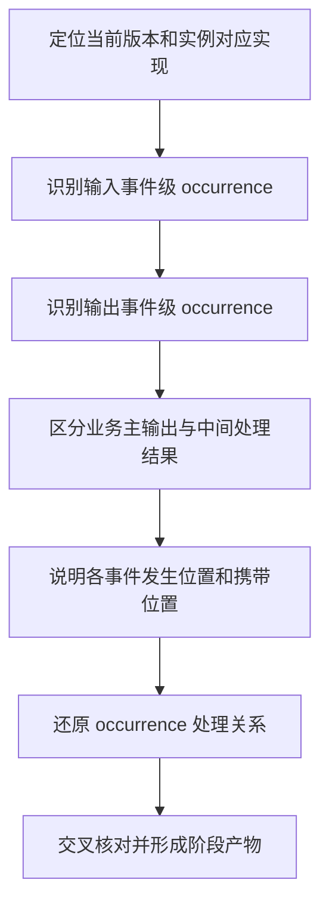

# A｜内部 Workflow

## 总图

专业判断方法写在实际使用它的步骤内。它不是另一条平行 Workflow，而是帮助该步骤从输入作出可追溯判断的依据。

## A1｜定位当前版本和实例对应实现

**目标**：确定本次特征实例真实对应的源码、类型、构造入口和公开读取接口。

**判断方法**：优先沿特征实例反查当前代码；同名旧实现、文档样例和其他分支只能作为线索，不能替代当前版本。跨仓库实现要分别记录其职责。

**输出**：当前实现来源清单及未定位项。

## A2｜识别输入事件级 occurrence

**目标**：找出特征实际消费的 Event 及每次 occurrence 携带的业务信息。

**判断方法**：

- 只有真正按离散发生参与处理的值才列为事件级 occurrence；普通参数、Behavior 当前值、Dynamic 当前状态和纯配置不因出现在输入 tuple 中就都叫输入事件。
- 需要区分直接输入事件与由子处理器先形成、再被本特征消费的事件。
- 记录事件自己的发生位置和 occurrence payload 中携带的位置，不把二者合并。

**输出**：输入事件 occurrence 记录。

## A3｜识别输出事件级 occurrence

**目标**：找出特征实际产生或公开的 Event，以及每次 occurrence 的内容、身份和发生位置。

**判断方法**：

- 区分新建一个业务结果、更新已有业务结果、确认／结束已有结果以及仅发布过程信息。
- 一个输出类型中若含多个嵌套事件或成员记录，先按真实事件边界拆解，不因表格被拆成多张就认为发生了多个事件。
- 没有新 occurrence 不能自行解释为无效、失败或状态结束。

**输出**：输出事件 occurrence 记录。

## A4｜区分业务主输出与中间处理结果

**目标**：按该特征自身的业务定义，将输出侧内容分为业务主输出和中间处理过程 occurrence／结果。

**判断方法**：

- **业务主输出**：该特征被定义出来最终要表达和交付的业务结果。
- **中间处理结果**：为形成、更新、解释或结束业务主输出而产生的过程信息。
- 是否被正式保存、是否有公开接口、是否位于主表，不决定它是不是业务主输出；公开的成员明细、形成依据、previous、overlap 等仍可能属于中间处理结果。
- 一个中间结果对观察非常重要，也不因此改变其业务角色。

**输出**：业务角色分类及判断依据。

## A5｜说明各事件发生位置和携带位置

**目标**：明确不同 Event 的 occurrence 到底发生在哪里，以及 occurrence 内还引用哪些位置。

**判断方法**：

- 先确定事件自身发生位置，例如实际点、确认点、已知点、发表点、更新点或结束点；名称按代码与业务实际使用，不要求每个特征都具备全部位置。
- 再列 occurrence payload 中携带的其他位置，例如一次确认 occurrence 携带较早的实际转折位置。
- 同一业务对象的多个时间位置必须保留共同身份；不能拆成互不相干的多个事件。
- 无法从代码确定时，记录“未确认”及所需证据，不凭字段名猜测。

**输出**：事件位置说明。

## A6｜还原 occurrence 处理关系

**目标**：说明哪些输入和中间结果怎样形成、更新、确认、结束或引用业务主输出。

**判断方法**：

- 关系必须有代码依据；时间接近不自动等于正式引用关系。
- 至少区分形成、更新、确认、结束、引用、修订／替代等真实存在的关系；不要求没有证据的关系全部填满。
- 若一个 occurrence 中包含多个成员或多个实际点，说明其如何参与后续处理，不能只画单条笼统箭头。

**输出**：特征处理关系说明。

## A7｜交叉核对并形成阶段产物

**目标**：核对事件、位置、业务角色和处理关系是否彼此一致。

**判断方法**：

- 从一个业务主输出向上追溯，能找到其必要输入和中间处理；
- 从一个输入事件向下追踪，能说明它可能产生、更新或不产生什么；
- 事件发生位置与代码触发位置不矛盾；
- 未确认项没有被写成确定事实。

**输出**：A 阶段最终产物及未确认项。
