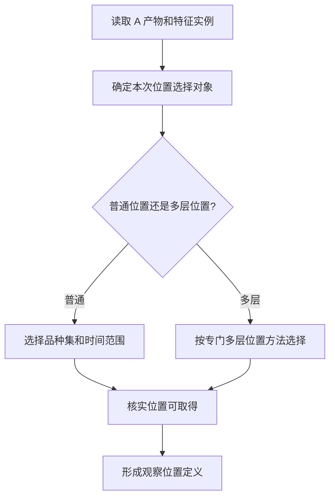

# B｜内部 Workflow

## 总图

## B1｜读取 A 产物和特征实例

**目标**：知道本次可围绕哪些事件、业务主输出和中间处理结果选位置，并确认实例中有哪些真实记录可用。

**判断方法**：只消费 A 已经说明的事件和位置语义；实例中的表名、图例或时间相同不能替代事件身份和关系。

## B2｜确定位置选择对象

**目标**：确定本次位置要围绕哪类业务主输出、输入事件或中间处理现象来选。

**判断方法**：位置选择应服务于当前要观察的特征行为，而不是服务于展示方便。若本次没有明确要观察哪类行为，记录缺口，不按任意 occurrence 随机截取。

## B3｜区分普通位置和多层位置

**目标**：判断只需品种集和时间，还是需要专门的多层数据位置选择。

**判断方法**：普通用例能够用一组品种和一个时间范围覆盖本次所需事件；若不同数据层必须各自选择并保持对应关系，则进入多层位置分支。

## B4｜选择普通观察位置

**目标**：从真实实例中选出品种集和时间范围。

**判断方法**：

- 使用能覆盖目标 occurrence 及必要上下文的时间范围；
- 品种集由事件主体和比较需要决定；
- 选择规则应当可复核，例如第一条满足某种既定条件且数据完整的 occurrence；
- 不以之后涨跌是否漂亮、最终结果是否成功作为选择标准。

## B5｜选择多层数据位置

**目标**：处理高频或其他多层数据的专门位置选择。

**当前边界**：具体方法和字段由 Owner 后续提供第一版可用定义。本 Skill 当前只保留调用点；在方法未补齐前，不自行发明层级、位置关系或抽样规则。

## B6｜核实位置可取得

**目标**：确认所选品种和时间在当前实例及数据源中真实存在，并能覆盖预期事件。

**判断方法**：允许做轻量读取或查询；若必须运行后才能知道位置是否存在，形成明确查询动作。不存在、数据缺失和无 occurrence 要分开，不用其他时间静默替换。

## B7｜形成观察位置定义

**目标**：输出 D 可直接消费的位置定义。

**判断方法**：普通位置至少包含品种集、开始时间和结束时间；选择依据和引用用于复核，但不把展示布局、图元或 HTML 放进本产物。
