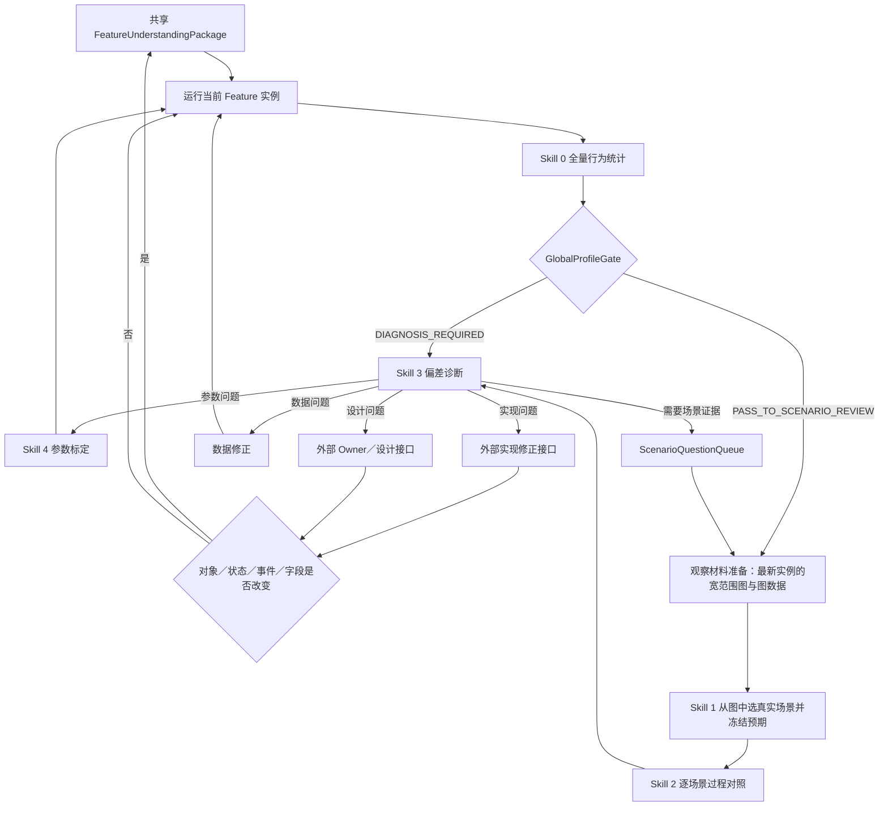

# 合理性分析 Skills V0.2

本版目标是先让 EAW 与 FQA 的合理性分析形成可运行闭环。V0.2 采用**严格串行**执行：先完成全量行为统计及其问题闭环，再准备最新实例的观察材料，最后进入真实场景选择和过程分析。

## 1. 共享前置

所有合理性 Skill 与观察材料准备共同消费：

- [`skills/feature-understanding/`](../feature-understanding/SKILL.md)
- 核心产物：`FeatureUnderstandingPackage`

该共享 Skill 负责对象、状态、事件级 occurrence、中间判断、处理关系、参数和运行结果字段的事实理解。合理性 Skill 1 不再重复查代码或还原处理链。

代码、对象、状态、事件、参数定义或运行结果字段发生实质变化后，应更新这份 Package。

## 2. 本包 Skill

| 顺序 | Skill | V0.2 职责 |
|---|---|---|
| 0 | `feature-global-behavior-profiling` | 新增：对最新运行结果做全量／分层行为统计，发现结构疑点和需要场景解释的问题，形成全量 Gate |
| 1 | `business-expectation-derivation` | 名称暂不改：在宽范围观察图与图数据完成后，挑选真实正例、负例、误报／漏报候选、参数边界和覆盖外场景，并冻结场景预期 |
| 2 | `business-evidence-comparison` | 名称暂不改：逐场景对照原始市场过程、预期 Feature 过程和实际 Feature 过程，定位第一次业务分歧 |
| 3 | `business-discrepancy-diagnosis` | 保持当前内部实现：沿处理链查根因、做参数可修复性初筛并路由 |
| 4 | `feature-instance-calibration` | 保持当前内部实现：承接可调问题，求参数可行范围、试验少量候选并验证完整实例 |

本轮不修改 Skill 3、Skill 4 的内部文件；V0.2 的串行闭环由本 README 和外层协调执行。

## 3. 严格串行外层 Workflow



### 关键规则

1. 线一（全量行为统计）和线二（真实场景分析）在 V0.2 中不是并行关系。
2. 所有已被 Skill 3 确认为参数、实现、设计或数据问题的缺陷，处理后必须重新运行 Feature 并重新做全量统计。
3. 仅凭统计无法判断业务对错的问题，进入 `ScenarioQuestionQueue`，不在线一强行定性。
4. 只有 `GlobalProfileGate = PASS_TO_SCENARIO_REVIEW` 才准备正式观察材料并进入 Skill 1/2。
5. 线二发现的问题一旦导致 Feature 行为改变，也必须回到“Feature 重跑 → 全量统计”，不能只在原图上局部复验。

## 4. 全量行为统计 Gate

### `BLOCKED`

核心版本、参数实例、对象键、事件字段或运行范围不可靠，统计不能成立。

### `DIAGNOSIS_REQUIRED`

存在尚未完成 Skill 3 诊断的结构疑点。

### `RERUN_REQUIRED`

参数、实现、设计或数据修正已经改变 Feature 行为；旧统计失效。

### `PASS_TO_SCENARIO_REVIEW`

满足：

- 当前统计绑定最新 Feature 运行结果；
- 已确认的参数问题已完成 Skill 4 并复验；
- 已确认的实现问题已由外部接口修正并复验；
- 已确认的设计问题已形成新设计、完成实现并复验；
- 剩余问题需要真实场景、图和中间过程才能判断，或只是描述性分布。

该 Gate 不代表 Feature 已合理，只代表线一职责已完成。

## 5. Skill 0 与现有 Skill 3 的兼容

Skill 3 当前输入合同不改。Skill 0 对每个 `GlobalFindingCandidate` 生成 `DiagnosisInputAdapter`，提供：

```text
FrozenExpectation／结构不变量引用
EvidenceComparisonPackage 兼容证据包
BusinessIntent 引用
ProcessingChain 引用
RelevantCodeOrRequirementRefs
DataBindingAndTimeBasis
```

Skill 0 不在适配包中提前写根因。

## 6. Skill 1 与观察材料的边界

观察材料准备只负责：

```text
基于通过全量 Gate 的最新 Feature 实例
→ 生成宽范围 CAEGraph
→ 核图
→ 导出同版本图数据
```

Skill 1 才负责从已经画好的图与图数据中选择：

- `CLEAR_POSITIVE`；
- `CLEAR_NEGATIVE`；
- `OUTPUT_FALSE_POSITIVE_CANDIDATE`；
- `POTENTIAL_FALSE_NEGATIVE`；
- `PARAMETER_BOUNDARY`；
- `OUTSIDE_CURRENT_COVERAGE`。

Skill 1/2 不直接消费完整 Feature 全量运行结果；它们消费同版本的 `ObservationMaterialPackage`。若中间字段不足，返回观察材料准备补图层或补导出。

## 7. Skill 2 的核心对照

对每个冻结案例同时保留：

```text
RawMarketProcess
ExpectedFeatureProcess
ObservedFeatureProcess
```

并定位：

```text
EarliestBusinessDivergence
```

Skill 2 只形成场景证据和疑点候选；根因继续交给 Skill 3。

## 8. 问题处理接口

### 参数问题

```text
Skill 3
→ Skill 4
→ 新参数实例
→ Feature 重跑
→ Skill 0 重跑
```

### 实现问题

```text
Skill 3
→ 外部实现修正
→ 新代码版本
→ 必要时更新 FeatureUnderstandingPackage
→ Feature 重跑
→ Skill 0 重跑
```

### 设计问题

```text
Skill 3
→ 外部 Owner／设计决策
→ 新设计实现
→ 更新 FeatureUnderstandingPackage
→ Feature 重跑
→ Skill 0 重跑
```

本轮暂不在 Skill 3/4 内部新增返回合同；外层协调必须保存诊断、修正版本和重跑引用。

## 9. 预期与证据版本规则

- 场景正式对照前，Skill 1 必须冻结 `CaseReviewSet` 和 `FrozenExpectationSet`；
- Skill 2 发现的新模式进入下一版候选预期，不得无痕回写旧版本；
- Feature 行为改变后，旧图、旧案例和旧证据只能作为历史对照，不能冒充新实例结果；
- 图、导出数据、代码版本和参数实例必须一致。

## 10. V0.2 首轮验证

先使用 EAW 的 Wall Feature 完整运行：

```text
共享理解
→ Feature 运行
→ 全量统计
→ Skill 3/4 或外部接口闭环
→ 全量 Gate
→ 观察材料准备
→ Skill 1 选场景
→ Skill 2 分析
→ 新问题闭环
```

Wall 跑通后，再以 FQA 中一个处理结构不同的 Feature 验证可迁移性，并据实际摩擦决定下一轮是否需要问题影响分级、局部重跑或场景反向驱动画图。
