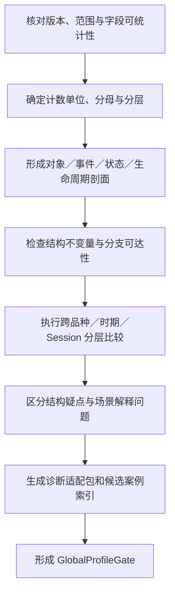

# 特征全量行为统计与结构疑点发现｜内部 Workflow

## 总图



## G1｜核对版本、范围与字段可统计性

**目标**：保证统计对象来自同一 Feature 代码版本、参数实例和运行范围。

**检查**：

- `FeatureUnderstandingPackage` 与运行结果代码版本一致；
- 参数实例／版本一致；
- 对象范围、时间范围、交易日历和 Session 可确认；
- 运行结果文件完整、无明显重复或乱序；
- 对象键、时间键和事件类型字段可读取；
- 每个拟统计中间判断在结果中是 `AVAILABLE`、`PARTIAL` 还是 `NOT_EXPOSED`。

**输出**：`StatisticsInputReadiness`。

若核心对象或事件无法可靠分组，Gate 直接为 `BLOCKED`。

## G2｜确定计数单位、分母与分层

**目标**：在统计前明确“数的是什么”。

每项统计至少说明：

```text
count_unit
object_group_key
time_basis
denominator
deduplication_rule
same_tick_rule
strata
```

示例：

- Start 按 occurrence 数，亦按新建对象数核对；
- BandUpdate 按每对象更新次数统计；
- 状态占用按逐 Tick state trace 统计；
- 生命周期长度按对象的 Start 到 End 统计；
- 同一对象同一 UTI 的多 occurrence 按 ordinal／业务阶段区分。

不得将表行数直接当作业务 occurrence 数。

## G3｜形成行为剖面

按运行结果实际可用字段形成：

### 3.1 候选与中间判断剖面

- 命中数与命中比例；
- 候选进入下一层的转化比例；
- 中间判断在不同分层中的分布。

仅统计 `AVAILABLE` 字段。

### 3.2 对象剖面

- 对象创建数；
- 同时活跃对象数；
- 对象身份连续性；
- 父子或引用完整性。

### 3.3 事件剖面

- 各事件类型数量；
- 每对象事件数；
- 每单位时间事件密度；
- 同刻多事件组合与顺序。

### 3.4 状态与转换剖面

- 各状态占用时间；
- 各转换次数；
- 状态持续时间分布；
- 非法或未声明转换。

### 3.5 生命周期剖面

- 完整／不完整生命周期；
- 生命周期长度；
- 单步、零时长或极短生命周期；
- 起点缺失、终点缺失、终结后更新。

### 3.6 reason 与分支剖面

- 各 reason 数量和比例；
- 分支是否可达；
- 多种 reason 的优先级是否造成系统性遮蔽的候选现象。

**输出**：`GlobalBehaviorProfile` 初稿。

## G4｜检查结构不变量与分支可达性

**目标**：从共享理解包中的对象模型、状态模型、处理关系和明确规则中，检查系统性结构异常。

优先检查：

- 有终点无起点；
- 更新发生在对象创建前或终结后；
- 终止状态仍继续接收业务更新；
- 状态转换不在合法关系中；
- 中间状态全部零时长或与终点同刻；
- 声明分支在完整样本中从未可达；
- 同拍 occurrence 顺序违背既定生命周期；
- 引用对象不存在或身份不闭合；
- 稀疏主输出接近逐 Tick 发生。

“从未发生”本身只形成疑点；只有在该分支的适用输入确实出现且分支仍不可达时，才形成更强结构证据。

**输出**：`StructuralFindingCandidates`。

## G5｜执行分层比较

至少按输入可支持的维度比较：

- 品种；
- 时间段／年份；
- 日盘／夜盘／开盘附近等 Session；
- 活跃度或其他已定义环境分层；
- 参数实例（若本次明确比较多个实例）。

比较内容包括：

- 候选、对象和事件密度；
- 生命周期长度；
- 状态占用；
- 分支和 reason 比例；
- 结构疑点发生率。

分层差异不能自动解释成问题，只用于生成场景解释问题或标准化疑点。

## G6｜区分两类疑点

### 6.1 结构疑点

满足以下特征之一：

- 与明确对象／生命周期不变量冲突；
- 多次重复且不依赖主观密度阈值；
- 可定位到处理链中的具体阶段；
- 值得进入根因诊断。

进入 `GlobalFindingCandidates`。

### 6.2 场景解释问题

仅凭统计无法判定业务对错，例如：

- 密度高低是否合理；
- 某类生命周期偏短是否因真实市场过程；
- 某品种分支比例不同是否有物理原因；
- 某类 reason 很少是否因为样本未覆盖。

进入 `ScenarioQuestionQueue`。

## G7｜生成诊断适配包和候选案例索引

### 7.1 `DiagnosisInputAdapter`

对每个结构疑点生成：

- 结构不变量或当前业务预期引用；
- 统计证据与代表位置；
- 数据范围、时间基础和参数版本；
- 共享处理链引用；
- 相关代码／需求引用；
- 兼容现有 Skill 3 的证据包。

不得在适配包中提前写根因。

### 7.2 `CandidateCaseIndex`

为后续场景选择提供：

```text
symbol
start/end time
finding/question id
为什么值得看
相关对象／状态／事件
```

这只是候选索引，不替代合理性 Skill 1 从已画好的图中正式选择场景。

## G8｜形成 GlobalProfileGate

根据事实给出：

### `BLOCKED`

核心版本、对象键、事件字段或数据范围不可靠。

### `DIAGNOSIS_REQUIRED`

存在尚未诊断的结构疑点。

### `RERUN_REQUIRED`

问题处理已经改变 Feature 行为，当前统计结果失效，必须使用新运行结果重做 G1～G8。

### `PASS_TO_SCENARIO_REVIEW`

已确认的参数、实现和设计问题已经闭环或本轮不存在；剩余条目需要图上场景解释，允许进入观察材料准备和场景合理性分析。

**输出**：最终 `GlobalBehaviorProfile`、各队列、适配包与 Gate。
