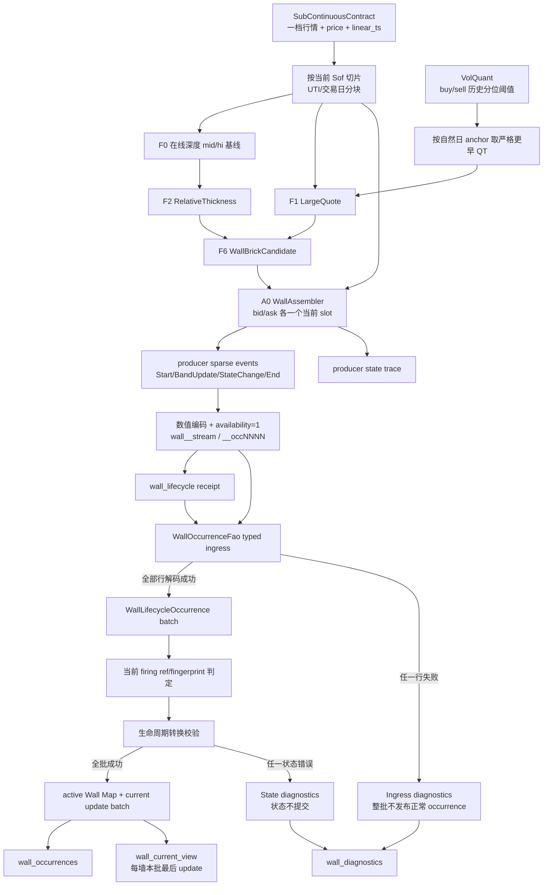

# Wall 特征结构、对象与行为理解包

> `FeatureUnderstandingPackage`  
> Package ID：`FUP-EAW-WALL-20261120-01`  
> 执行 Skill：[`feature-structure-and-behavior-understanding` v0.2.0](../../../skills/feature-understanding/SKILL.md)  
> 形成日期：2026-11-20  
> 完成状态：**PARTIAL**

## 0. 本次执行口径

### 0.1 目标特征

本包所称 **Wall 特征**不是单指某一个类，而是当前已定位的 Wall 生命周期实现链：

```text
SubContinuousContract + VolQuant
    ↓
WallAssembler（Python / TIS producer）
    ↓ wall_lifecycle receipt + wall__ packed occurrence stream
WallOccurrenceFao（Haskell typed ingress；Python 有同名配置包装）
    ↓
EawP1WallLifecycleFrp（FRP 生命周期状态维护与正式发布）
```

业务上，这条链表达的是同一个持续 Wall life：producer 负责从行情和中间判断形成、更新、休眠、恢复、结束 Wall；typed ingress 负责恢复并校验 occurrence；FRP DSU 不重新认墙，而是校验转换、维护当前状态并正式发布结果。

### 0.2 明确排除

按本次指令，以下内容没有作为本包的实现证据，也没有被执行或分析：

- `task-inputs/eaw-p1-integrated/caegraph-review/**` 中的 CAEGraph 定义、运行和快照脚本；
- `caegraph-data-30tick.zip` 及其他特征数据、图形、布局、截图和统计结果；
- `WALL_V0_REASONABLENESS_BASELINE_VALIDATION_20261119.md` 中关于“合理／不合理”的判断；
- 任何新取数、重算、观察位置选择、全量统计、参数标定或业务合理性裁决。

本包只做静态版本定位、对象／状态／occurrence／中间判断／处理关系／参数／结果字段还原。

### 0.3 证据优先级与版本边界

本次按以下优先级使用证据：

1. 固定提交的真实 TIS / FRP 源码；
2. 当前输入包中给出的默认实例脚本与版本线索；
3. 需求、设计和既有整理文档仅用于查找入口与标注差异，不用于覆盖代码事实；
4. 图形脚本和特征数据全部排除。

当前静态实现版本锁：

| 责任面 | 仓库与提交 |
|---|---|
| Python / TIS producer、输入、参数、导出与 Python 包装 | `daowei2026/tis@ef887396e0a06d6e75be47efee0f1985ad7988a3` |
| Haskell / FRP typed ingress、DSU、writer | `daowei2026/frp@cac6c912dd65a14acbd591ca57e0afd8ddb4ef13` |
| 需求／工程资料参考 | `daowei2026/feature-refinement-implementation-agent-evolution@8d58ddd3392a3e67ef5ba44adf2c4cd0c9077f9f` |

`eaw-p1-integrated` 当前只是新 Run 的输入准备目录，并未给出已经正式 GO 后的 Wall 运行身份和现场 checkout 锁。因此，本包绑定的是以上**明确静态基线和默认实例**，不宣称它们就是某个新 Run 已经现场采用的代码组合。

### 0.4 当前实例引用

当前可精确定位的默认实例为：

```text
EawP1WallLifecycleFrp(
  wallLifecycleInput=WallOccurrenceFao(
    wallOccurrenceSource=WallAssembler(/* 全部默认参数 */)
  )
)
```

输入包中的实例脚本还给出一个既有运行上下文：

| 字段 | 值 |
|---|---|
| `sof_name` | `TA_updto20240229_DBA` |
| `symbol` | `rb` |
| `calendar` | `night_end_at_2300` |
| `startDay` | `2020-12-01` |
| `endDay` | `2021-02-22` |
| 调用表达式 | `EawP1WallLifecycleFrp().run()` |
| 参数 | 默认参数 |

该脚本要求命中既有 `fields.json`，并禁止在未命中时自动补算长窗口；但对应 `EawP1WallLifecycleFrp.run-result.json` 和现场 `fields.json` 未随本次输入提供，所以“运行结果物理字段已现场核实”不能成立。

---

## 1. 核心结论

1. **业务对象是有持续身份的 Wall life，而不是单个大挂单 Tick。** 同一 source run 内由 `wall_id` 维持身份；正式语义上还必须连同 receipt / `FeatureRunIdentity` 所代表的 source-run namespace 一起解释。
2. **producer 与 FRP 分工清楚。** `WallAssembler` 认墙并产生 `Start / BandUpdate / StateChange / End`；`EawP1WallLifecycleFrp` 只恢复、校验、维护和发布，不从行情重新认墙。
3. **producer 每侧至多维护一堵当前 Wall。** bid 与 ask 各有一个 slot；两侧独立计算后，事件按同一 Tick 内 `bid → ask` 的实现顺序合并。这是实现顺序，不自动构成业务先后。
4. **Wall 的业务状态为 Alive／Dormant／Ended。** producer 的 `Empty` 是处理器 slot 空态，不是已存在 Wall 的业务状态；FRP 中分别映射为 `WallPresent / WallDormantState / WallEndedState`。
5. **四类生命周期 occurrence 是业务主事件。** `Start` 创建对象；`BandUpdate` 只更新 band/core 且不得改变 presence；`StateChange` 在 Alive 与 Dormant 间转换；`End` 终止当前 life。
6. **producer 的稀疏事件不是整条链的最终正式输出。** 它们先被编码、打包、receipt 约束，再由 typed ingress 恢复为 `WallLifecycleOccurrence`，通过 FRP 事务校验后才进入正式 occurrence/current/diagnostic writer。
7. **当前实现存在有意的信息变化。** End 在 typed payload 中只保留 `producer-reason-code-N`，不保留 producer 行里的 band/core/status；`wall_current_view` 只追加本批每堵墙的最后状态更新，不是全量快照。
8. **完成状态为 PARTIAL。** 核心对象、状态、事件、参数、处理关系和代码级结果合同已经还原；但新集成 Run 的现场版本绑定、generated ADT 物理字段、实际 `fields.json` 和三路结果读回尚未提供，不能标为 COMPLETE。

---

## 2. 当前实现来源记录 `ImplementationSourceRecord`

| 来源编号 | 仓库与版本 | 文件／入口 | 来源职责 | 已核实状态 |
|---|---|---|---|---|
| IS-01 | `observe-iterate@feat/reasonableness-analysis-v0.2-20261120` | [`task-inputs/eaw-p1-wall-lifecycle/实例运行脚本.py`](../../eaw-p1-wall-lifecycle/实例运行脚本.py) | 默认实例表达式、市场／品种／日历／日期绑定、正式 `.run()/.F/ADT` 读取意图 | 已核实；现场结果文件未提供 |
| IS-02 | `tis@ef887396…` | [`frp/EawBattleP.py`](https://github.com/daowei2026/tis/blob/ef887396e0a06d6e75be47efee0f1985ad7988a3/frp/EawBattleP.py#L34-L101) | `WallOccurrenceFao` 与 `EawP1WallLifecycleFrp` Python 默认构造、CalType、上游 source 接线 | 已核实 |
| IS-03 | `tis@ef887396…` | [`hf/prel0/wall_assembler.py`](https://github.com/daowei2026/tis/blob/ef887396e0a06d6e75be47efee0f1985ad7988a3/hf/prel0/wall_assembler.py#L431-L878) | `WallAssembler` 参数、输入、交易日分块、producer 状态机调用、稀疏事件与 state trace、receipt、packed stream | 已核实 |
| IS-04 | `tis@ef887396…` | [`hf/prel0/wall_assembler_core.py`](https://github.com/daowei2026/tis/blob/ef887396e0a06d6e75be47efee0f1985ad7988a3/hf/prel0/wall_assembler_core.py#L1-L1600) | Wall 状态、参数派生、candidate 兼容、support、band/core、Dormant、End 与事件顺序 | 已核实 |
| IS-05 | `tis@ef887396…` | [`hf/prel0/tick_quote_context.py`](https://github.com/daowei2026/tis/blob/ef887396e0a06d6e75be47efee0f1985ad7988a3/hf/prel0/tick_quote_context.py#L80-L355) | UTI 换算、事件编码、行情／QT 加载、严格前值 QT 对齐、`session_ok` 当前口径 | 已核实 |
| IS-06 | `tis@ef887396…` | [`hf/prel0/tick_quote_context_core.py`](https://github.com/daowei2026/tis/blob/ef887396e0a06d6e75be47efee0f1985ad7988a3/hf/prel0/tick_quote_context_core.py#L1-L300) | F0 深度基线、F1 大挂单、F2 相对厚度 | 已核实 |
| IS-07 | `tis@ef887396…` | [`hf/prel0/track_wall_candidates_core.py`](https://github.com/daowei2026/tis/blob/ef887396e0a06d6e75be47efee0f1985ad7988a3/hf/prel0/track_wall_candidates_core.py#L1-L185) | F6 Wall brick candidate | 已核实 |
| IS-08 | `tis@ef887396…` | [`hf/prel0/p1_dba_export.py`](https://github.com/daowei2026/tis/blob/ef887396e0a06d6e75be47efee0f1985ad7988a3/hf/prel0/p1_dba_export.py#L256-L322) | 同拍 occurrence 的物理分流、`wall__stream` 打包及 ordinal 边界 | 已核实 |
| IS-09 | `tis@ef887396…` | [`t0/gen/cc.py`](https://github.com/daowei2026/tis/blob/ef887396e0a06d6e75be47efee0f1985ad7988a3/t0/gen/cc.py#L119-L200) | `SubContinuousContract` 行情表读取 | 已核实 |
| IS-10 | `tis@ef887396…` | [`hf/qt.py`](https://github.com/daowei2026/tis/blob/ef887396e0a06d6e75be47efee0f1985ad7988a3/hf/qt.py#L23-L263) | `VolQuant` 历史窗口分位阈值 | 已核实 |
| IS-11 | `frp@cac6c912…` | [`P1/FaoIngress.hs`](https://github.com/daowei2026/frp/blob/cac6c912dd65a14acbd591ca57e0afd8ddb4ef13/src/Frp/Instance/ISL/Eaw/P1/FaoIngress.hs#L120-L330) | receipt／fields／packed row 读取、typed ingress、整批 decode gate | 已核实 |
| IS-12 | `frp@cac6c912…` | [`P1/FaoIngress.hs` Wall decoder](https://github.com/daowei2026/frp/blob/cac6c912dd65a14acbd591ca57e0afd8ddb4ef13/src/Frp/Instance/ISL/Eaw/P1/FaoIngress.hs#L553-L645) | 数字字段到 `WallLifecycleOccurrence` 的解码、域校验、occurrence ref | 已核实 |
| IS-13 | `frp@cac6c912…` | [`P1/Products.hs`](https://github.com/daowei2026/frp/blob/cac6c912dd65a14acbd591ca57e0afd8ddb4ef13/src/Frp/Instance/ISL/Eaw/P1/Products.hs#L1-L206) | receipt、`FeatureRunIdentity`、Wall identity／occurrence／current view | 已核实 |
| IS-14 | `frp@cac6c912…` | [`Interface/PreL0.hs`](https://github.com/daowei2026/frp/blob/cac6c912dd65a14acbd591ca57e0afd8ddb4ef13/src/Frp/Instance/ISL/Eaw/Interface/PreL0.hs#L155-L205) | `WallBand`、presence、availability、change、typed payload | 已核实 |
| IS-15 | `frp@cac6c912…` | [`P1/WallLifecycle.hs`](https://github.com/daowei2026/frp/blob/cac6c912dd65a14acbd591ca57e0afd8ddb4ef13/src/Frp/Instance/ISL/Eaw/P1/WallLifecycle.hs#L20-L170) | 生命周期转换、批次事务、Dynamic/current updates/diagnostics | 已核实 |
| IS-16 | `frp@cac6c912…` | [`P1/Internal/OccurrenceLedger.hs`](https://github.com/daowei2026/frp/blob/cac6c912dd65a14acbd591ca57e0afd8ddb4ef13/src/Frp/Instance/ISL/Eaw/P1/Internal/OccurrenceLedger.hs) | 当前 firing 内 exact duplicate／conflicting duplicate 判定 | 已核实 |
| IS-17 | `frp@cac6c912…` | [`P1.hs`](https://github.com/daowei2026/frp/blob/cac6c912dd65a14acbd591ca57e0afd8ddb4ef13/src/Frp/Instance/ISL/Eaw/P1.hs#L70-L210) | `EawP1WallLifecycleFrp` 类型、执行入口、ingress 与 DSU 诊断合并 | 已核实 |
| IS-18 | `frp@cac6c912…` | [`P1/Publication.hs`](https://github.com/daowei2026/frp/blob/cac6c912dd65a14acbd591ca57e0afd8ddb4ef13/src/Frp/Instance/ISL/Eaw/P1/Publication.hs#L610-L718) | `wall_occurrences`、`wall_current_view`、`wall_diagnostics` writer | 已核实 |

---

## 3. 端到端处理图



---

## 4. 业务对象记录 `BusinessObjectRecord`

### BO-01｜Wall life

| 字段 | 记录 |
|---|---|
| 对象类型 | `Wall` / Wall life |
| 对象业务含义 | 在一侧盘口上，由 Wall brick 与后续 support 形成并持续维护的一段 Wall 生命周期；不是单个 Tick，也不是裸大挂单数值 |
| 身份字段 | producer 行内 `wall_id`；typed 层为 `WallIdentity { wallIdentityLocalNo }`；业务完整解释还依赖 receipt 所冻结的 `FeatureRunIdentity` / source scope |
| 身份作用域 | `wall_id` 仅在同一 source run 内稳定；跨 chunk 延续且不复用；裸编号不是跨 run 稳定身份 |
| 创建 occurrence | `Wall.Start.ByBigQuote` / typed `WallStarted` |
| 更新 occurrence | `Wall.BandUpdate`、`Wall.StateChange`；typed 为 `WallBandUpdated`、`WallPresenceChanged` |
| 终止 occurrence | `Wall.End` / typed `WallEnded` |
| 父／子／成员关系 | 无父对象；属于 bid 或 ask 一侧；band、core、support buffer 和状态是对象成员／状态，不是新 Wall |
| 当前状态载体 | producer：bid/ask slot 及跨 chunk carry；FRP：`Map WallIdentity WallCurrentView` |
| 代码证据 | `wall_assembler_core.py` 的 `state_book`／`next_wall_id`；`Products.hs` 的 `WallIdentity`；`WallLifecycle.hs` 的 `wallViews` |
| 未确认项 | 现场是否在所有消费入口都以 source receipt 阻断跨 run 裸编号混用；见 U-01 |

### BO-02｜Wall current view（同一对象的当前投影）

| 字段 | 记录 |
|---|---|
| 对象类型 | `WallCurrentView` |
| 对象业务含义 | BO-01 的当前状态投影；不是第二个 Wall，也不是完整历史 |
| 身份字段 | 与 BO-01 相同的 `WallIdentity` |
| 身份作用域 | 同一 FRP source/run 上下文 |
| 创建／更新／终止 | 每次被接纳的 lifecycle occurrence 形成一个新的 current view；End 也形成 `WallEndedState` update |
| 当前状态载体 | 内存 `FrpDynamic (Map WallIdentity WallCurrentView)`；writer 只写本批有变化对象的 update |
| 结束后的处理 | End update 形成后，身份从 active map 删除；writer 仍保存该 Ended update |
| 代码证据 | `Products.hs::WallCurrentView`、`WallLifecycle.hs::applyWallOccurrence`、`Publication.hs::dumpWallOutputs` |
| 未确认项 | Python 侧恢复任意时点完整 Map 的正式读法和现场 generated schema；见 U-06/U-09 |

### 非业务对象边界

以下项目不应误认成独立 Wall 业务对象：

- `Empty` bid/ask slot：处理器空态；
- 大挂单、相对厚度、Wall brick、support、thin touch：中间判断或成员材料；
- `occurrence_ordinal`：同拍物理分流序号；
- `OccurrenceRef`：一次发生的幂等引用，不是 Wall identity；
- receipt / `FeatureRunIdentity`：对象命名空间和运行上下文，不是 Wall 本体；
- `wall_current_view` 的一行：同一 Wall 的状态更新记录，不是新 Wall。

---

## 5. 状态记录 `StateRecord`

| 状态编号 | 所属对象／处理器 | 状态名称 | 业务含义 | 初始／终止 | 进入条件 | 退出条件与合法后继 | 状态持续位置 |
|---|---|---|---|---|---|---|---|
| ST-00 | producer bid/ask slot | `Empty` | 当前一侧没有已维护的 Wall；处理器状态，不是 Wall life 状态 | 初始 | 初始化或上一对象已结束后等待新 candidate | candidate 出现 → 新身份 `Alive` | producer state slot / carry |
| ST-01 | BO-01 | `Alive` / FRP `WallPresent` | 当前 Wall 存在可用支撑，处于活跃维护状态 | Wall 初始业务状态 | Empty/Ended + candidate；或 Dormant + 兼容 candidate／support | BandUpdate 保持 Alive；无支撑且距离满足 → Dormant；End 条件 → Ended | producer slot；FRP active map |
| ST-02 | BO-01 | `Dormant` / FRP `WallDormantState` | Wall life 仍保留原身份，但当前缺少持续支撑／已远离，允许恢复 | 否 | Alive 且 `no_presence_run_len >= dormant_no_presence_ticks` 且 `dist_last >= dormant_far_ticks` | 兼容 candidate 或有效 support → Alive；BandUpdate 只能携带 Dormant；End 条件 → Ended | producer slot；FRP active map |
| ST-03 | BO-01 | `Ended` / FRP `WallEndedState` | 当前 Wall life 已终止 | 终止 | far hold、thin/contact、breakthrough、timeout，或同侧 relocation | producer 下一 candidate 必须分配新 `wall_id`；FRP 形成 Ended update 后从 active map 删除 | producer 可短暂保留终态；FRP writer 保留 update，active map 不保留 |
| ST-04 | FRP 处理器 | batch transaction working state | 当前 firing 内按输入顺序试应用 occurrence 的临时事务状态 | 每批重建 current-update map 与 ledger | 收到一批 typed occurrence | 全批成功才提交；任一状态错误则保留批前状态 | `WallTxn` / foldDyn 内部 |

### 5.1 producer → FRP 状态映射

| producer `status_code` | producer 名称 | typed presence／FRP state |
|---:|---|---|
| 0 | Empty | 不形成合法 lifecycle occurrence |
| 1 | Alive | `WallAlive` → `WallPresent` |
| 2 | Dormant | `WallDormant` → `WallDormantState` |
| 3 | Ended | End decoder 不读取 status；DSU 按 `WallEnded` 形成 `WallEndedState` update |

### 5.2 FRP 合法转换表

| 转换前 | 输入 change | 结果 |
|---|---|---|
| 无该身份 | Start + Alive | 建立 `WallPresent` |
| 无该身份 | Start + Dormant | `WallMustStartPresent` |
| 无该身份 | End | `WallEndBeforeStart` |
| 无该身份 | BandUpdate / PresenceChanged | `WallUpdateBeforeStart` |
| 已存在 | 再次 Start | `WallStartedTwice`，但当前 firing 的 exact duplicate 已先被 ledger 跳过 |
| Present | BandUpdate + Alive | 保持 Present，更新 band/core |
| Dormant | BandUpdate + Dormant | 保持 Dormant，更新 band/core |
| Present/Dormant | BandUpdate 携带相反 presence | `WallBandUpdateChangedPresence` |
| Present | PresenceChanged + Dormant | 转 Dormant |
| Dormant | PresenceChanged + Alive | 转 Present |
| Present/Dormant | PresenceChanged 指向原状态 | `WallInvalidPresenceTransition` |
| Present/Dormant | End | 形成 Ended update，并从 active map 删除 |

---

## 6. 事件级 occurrence 记录 `OccurrenceRecord`

### 6.1 输入边界

`SubContinuousContract` 的对齐 Tick 行、QT 行和内部候选数组是按时间轴连续消费的数据，不在本包中伪装为离散业务 occurrence。Wall 链真正对外形成的业务 occurrence 从 producer lifecycle 事件开始。

### 6.2 四类业务主 occurrence

| 事件编号 | 代码／typed 名称 | 方向与业务角色 | 一次发生代表什么 | occurrence 自身位置 | 身份 | 主要 payload | 产生／消费 |
|---|---|---|---|---|---|---|---|
| OC-01 | `4 = Wall.Start.ByBigQuote` / `WallStarted` | producer 输出；typed ingress 输入；FRP 接纳后为业务主输出 | 新 Wall life 在某一侧、某个 band/core 上建立；必须为 Alive | producer 行的 `uti` 与 `ts`；typed payload `wallLifecycleOccurredAt` 保存 UTI | source-run namespace + `wall_id` | side、band low/high/core、Alive、availability | `WallAssembler` → packed stream → decoder → lifecycle DSU |
| OC-02 | `5 = Wall.BandUpdate` / `WallBandUpdated` | 同上 | 同一 Wall 的 band/core 发生达到阈值的移动；presence 不得借此改变 | 发生 Tick 的 UTI/ts | 同一 Wall identity | side、更新后的 band/core、当前 Alive 或 Dormant、availability | support/candidate 更新 → decoder → DSU |
| OC-03 | `6 = Wall.StateChange` / `WallPresenceChanged` | 同上 | 同一 Wall 在 Alive 与 Dormant 之间切换 | 状态转换发生 Tick 的 UTI/ts | 同一 Wall identity | side、当时 band/core、新 presence、availability | dormancy/recovery 判断 → decoder → DSU |
| OC-04 | `7 = Wall.End` / `WallEnded` | 同上 | 当前 Wall life 正式结束 | 结束 Tick 的 UTI/ts | 同一 Wall identity | producer 有 `reason_code` 及数值 band/core/status；typed payload只保留 `WallEndReason "producer-reason-code-N"` | End/relocation 判断 → decoder → DSU |

### 6.3 处理／发布类 occurrence

| 事件编号 | 名称 | 业务角色 | 发生含义 | 载体／结果 |
|---|---|---|---|---|
| OC-05 | packed numeric row firing | 传输中间结果 | 一个 `wall__*` 物理行在 FRP 历史读取中到达；同一行字段被整体装箱 | `FrpEvent [(resultKey, NumericRow)]` |
| OC-06 | accepted lifecycle batch | 业务主输出发布 | 一个 firing 中全部 typed occurrence 通过 decode 和状态事务后，被正式发布；exact duplicate 不重复发布 | `wallLifecycleOccurrences` / `wall_occurrences` |
| OC-07 | current update batch | 当前投影输出 | 一个成功批次中，每堵发生变化的 Wall 发布本批最后一个 `WallCurrentView` | `wallLifecycleCurrentUpdates` / `wall_current_view` |
| OC-08 | ingress diagnostics | 诊断中间／正式诊断输出 | packed row 解码出现错误；该批正常 occurrence 不发布 | `P1IngressError` → `wall_diagnostics` |
| OC-09 | state diagnostics | 诊断中间／正式诊断输出 | typed occurrence 的生命周期转换、引用冲突等失败；状态不提交 | `WallLifecycleError` → `wall_diagnostics` |

### 6.4 occurrence payload 字段 `OccurrencePayloadField`

#### producer 数值行公共字段

| 字段 | 中文含义 | 类型 | 可缺失／缺失含义 | 位置字段 | 证据状态 |
|---|---|---|---|---:|---|
| `wall_id` | source-run 内 Wall 本地编号 | int64，必须 > 0 | 否；缺失不能解码 | 否 | 已核实 |
| `uti` | 业务发生半秒 Tick 索引 | int64 | 否 | 是，主业务位置 | 已核实 |
| 行索引／`ts` | 发生时间戳 | datetime64[ns] | 否 | 是，传输／自然时间位置 | 已核实 |
| `event_type_code` | 4 Start；5 BandUpdate；6 StateChange；7 End | int8/int | 否 | 否 | 已核实 |
| `side_code` | 1 bid；2 ask | int8/int | 否 | 否 | 已核实 |
| `status_code` | 1 Alive；2 Dormant；producer End 行可为 3 | int8/int | 非 End typed decode 必需；End typed decode 不读 | 否 | 已核实 |
| `band_lo` | Wall band 下界 | float64 | 非 End 必需且有限；End typed decode 不读 | 是，价格位置 | 已核实 |
| `band_hi` | Wall band 上界 | float64 | 非 End 必需且有限；End typed decode 不读 | 是，价格位置 | 已核实 |
| `core_price` | Wall 核心价 | float64 | 非 End 必需且有限；End typed decode 不读 | 是，价格位置 | 已核实 |
| `reason_code` | End 原因：1 far；2 thin/contact；3 breakthrough；4 timeout；5 relocation；0 无 | int8/int | 对 End 必需；非 End 无业务含义 | 否 | 已核实 |
| `availability_code` | 当前 producer 写 1=Available | int8 | typed ingress 要求 1；2–5 只被枚举但拒绝驱动正常生命周期 | 否 | 已核实 |
| `occurrence_ordinal` | 同一时间戳下的物理分流序号 | int64 | 仅同拍重复时间时加入；缺失表示无需分流 | 否 | 已核实；不是业务身份 |

#### typed `WallLifecycleOccurrence`

| 字段 | 中文含义 | 可缺失 | 说明 |
|---|---|---:|---|
| `wallOccurrenceIdentity.wallIdentityLocalNo` | 本地 Wall 编号 | 否 | 不携带 run namespace；由已验证 receipt/source 上下文补足 |
| `wallOccurrenceRef` | `wall:<localNo>:<uti>:<eventCode>` | 否 | 当前 firing 内幂等／冲突键；`__occNNNN` 不进入此键 |
| `wallLifecycleRef` | `wall:<localNo>` | 否 | 业务引用，同样依赖 source namespace |
| `wallLifecycleSymbol` | receipt source target 对应品种 | 否 | 来自 `FeatureRunIdentity` |
| `wallLifecycleSide` | BidWall / AskWall | 否 | 来自 `side_code` |
| `wallLifecycleOccurredAt` | UTI | 否 | 业务发生位置 |
| `wallLifecycleChange` | Started / BandUpdated / PresenceChanged / Ended | 否 | 非 End 携带 Measurement WallBand + presence；End 携带文本 reason |
| `wallLifecycleAvailability` | 当前正常流必须为 Available | 否 | 非 Available 会进入诊断，不驱动 lifecycle |

### 6.5 同时刻与顺序语义

- producer 可在同一 UTI 发旧墙 End 和新墙 Start，例如 same-side relocation；两条保留同一业务时间。
- `packed_occurrence_streams` 只在物理 result-key 上分为 `wall__stream`、`wall__stream__occNNNN`，不改业务时间。
- producer 先独立运行 bid，再运行 ask，最后按 `(tick_index, side_rank, event_index)` 排序；同 Tick 下 bid 先于 ask 是当前实现顺序。
- DSU 按输入列表顺序 `foldM`，自身不从相同 UTI 推导新的业务先后，也不检查 UTI 单调性。
- 当前 occurrence ref 不含 ordinal；同一 Wall、同一 UTI、同一 event type 的多条不同 payload 会共享 ref，并在同一 firing 内形成冲突。是否允许这种业务情况仍待确认。

---

## 7. 关键中间判断记录 `IntermediateDecisionRecord`

| 判断编号 | 判断名称 | 业务作用 | 输入 | 当前实现规则 | 输出／消费 | 持久化与结果位置 |
|---|---|---|---|---|---|---|
| ID-01 | QT 历史分位 | 给“大挂单”提供环境阈值 | 主力合约原始一档量；`freq/n/quantile` | 默认按交易日维护 30 期窗口，先用旧窗口算 0.997 分位，再装入当前期 | `qt.buy/qt.sell` → QT 对齐 | VolQuant 自身结果可读；Wall 最终结果不复制原 QT |
| ID-02 | QT 严格前值对齐 | 避免同日阈值直接使用当前自然日记录 | Tick 自然日 anchor、QT 索引 | `searchsorted(anchor,left)-1`；无前值时 0 | `QT_bid/QT_ask` → LargeQuote | Wall 输出未暴露逐 Tick 对齐值 |
| ID-03 | 在线深度基线 F0 | 形成单侧 mid/hi 环境基线 | 一档量、`session_ok`、`W_depth_ref_ticks`、carry | 单遍递推；hi 上升与下降速率不同；当前 session_ok 全 1 | mid/hi/obs count → F2 | 不直接暴露；carry 内部跨 chunk |
| ID-04 | LargeQuote F1 | 判定当前一档量是否达到历史大挂单门槛 | best vol、QT、session、ratio min | QT≤0 且不允许 fallback 时不命中；`best_vol/max(QT,eps) >= threshold` | flag + `large_ratio` → F6/support | 不直接暴露 |
| ID-05 | RelativeThickness F2 | 判定当前挂量相对本侧环境是 thick／thin／neutral | best vol、F0 mid/hi | 先判 `best/ref_hi >= thick_vs_hi_ratio`；否则判 `best/ref_mid <= thin_vs_mid_ratio` | thickness/upper ratio、thick/thin flag → F6/support/thin touch | 不直接暴露 |
| ID-06 | Wall brick candidate F6 | 从大挂单中筛出可作为 Wall 材料的候选 | LargeQuote、thin、best price、large ratio | 必须是大挂单；默认 thin 不允许成为 brick；价=best price，强度=large ratio | candidate/price/strength → WallAssembler | 不直接暴露 |
| ID-07 | candidate 兼容与 relocation | 决定候选并入旧 Wall 还是结束旧 life 并起新 life | candidate price、当前 core、tick size、距离阈值 | 距 core 超过 `connect_max_core_dist_ticks` → 旧墙 End(reason relocation)，同 UTI 新编号 Start | 生命周期身份和事件 | End/Start 可见；兼容判断值未暴露 |
| ID-08 | brick cluster gap | 清理过久未延续的 support cluster，但不误切 Wall identity | 当前 UTI、last brick UTI、gap max | 差值大于门槛时清空 support ring；Wall 仍是同一 life | support buffer 状态 | 不暴露 |
| ID-09 | support buffer 与 band/core | 维护 Wall 的价格范围与核心 | 近几 Tick support price/strength | 只保留窗口内有效 support；band 为 min/max；core 为强度加权均价 | band/core → state trace、BandUpdate、距离判断 | band/core 可见；support ring 不暴露 |
| ID-10 | Wall distance F7 | 描述 best/last 到当前 band 的距离、near/far | best price、last price、band、tick size | 以最小价位数计算；helper 采用 round | dist/near/far → support、dormant、End | 仅 event checkpoint 内曾形成，最终当前 `_impl` 未选择 checkpoint result-key |
| ID-11 | Wall support F8 | 判断当前一档是否继续支撑 Wall | near flag、thin、thickness ratio、large ratio | near 且非 thin；强度=`max(thickness_ratio,0)+max(large_ratio-1,0)` | support flag/strength → band/core、Alive 恢复、计数 | 不直接暴露；状态结果可间接观察 |
| ID-12 | Wall thin touch F9 | 统计近 band 的薄触及，供结束判断 | near、thin、thickness ratio | near 且 thin；进入固定窗口计数 | thin/contact ring 与比例 → End | 原始命中不直接暴露 |
| ID-13 | Dormant gate | 决定 Alive 何时休眠 | no-presence count、last 到 band 距离 | 两项同时达到门槛才 Alive→Dormant | StateChange | 事件和状态可见；门值轨迹不暴露 |
| ID-14 | Dormant recovery | 保留原身份恢复 Wall | 兼容 candidate 或有效 support | Dormant 收到任一有效材料即恢复 Alive | StateChange | 可见 |
| ID-15 | End reason priority | 决定 Wall 何时及为何结束 | far run、thin/contact、breakthrough pending、age/no-presence | 依次：far hold → thin/contact → breakthrough → timeout；先命中者生效；relocation 在 candidate 分支更早处理 | End + reason code | End/reason 可见；判断轨迹不暴露 |
| ID-16 | same-time packing | 在不改业务时间的前提下写出同拍多行 | DataFrame 重复时间索引 | 按同刻 `cumcount` 分 result-key；ordinal 仅物理字段 | `wall__stream[__occNNNN]` | AVAILABLE |
| ID-17 | receipt/source gate | 防止读取错误产品、schema、状态或目录 | receipt、source fullDir、expected kind | 校验 kind、schema、success、必填字段、artifact location 等；底层错误可直接中止加载 | 通过后才读 packed rows | receipt 可用；成功 gate 不单独输出；失败未必都成为业务诊断 |
| ID-18 | numeric row decode gate | 把数值行恢复为 typed occurrence，并做域校验 | packed row + receipt | 校验 localNo、side、UTI、availability、event/status code、有限 band/core 与区间关系 | typed occurrence 或 `P1IngressError` | diagnostic 可见；正常 decode 无独立标记 |
| ID-19 | ingress batch gate | 决定一批是否发布正常 typed occurrence | `[Either error value]` | 任一行错误 → 整批正常流为空，只发错误列表 | occurrence batch 或 diagnostics | `wall_occurrences` / `wall_diagnostics` |
| ID-20 | occurrence ref ledger | 当前 firing 内 exact duplicate 幂等、冲突检测 | occurrence ref、完整 payload | SHA1(show payload)；同 ref 同 fingerprint 跳过；同 ref 不同 fingerprint 报错；每 firing 重置 | 接纳／跳过／冲突 | ledger 不持久化；冲突进入 state diagnostic |
| ID-21 | lifecycle transition validator | 保证 Start/Update/StateChange/End 与当前状态一致 | current view + typed change | 按 §5.2 转换表 | 新 current view 或 `WallLifecycleError` | current/diagnostic 可见 |
| ID-22 | FRP batch transaction | 使一批状态与发布原子提交 | 按输入顺序的 occurrence 列表 | 全批成功才提交；任一状态错误保留批前 state，不发布正常结果 | occurrences/current updates/diagnostics | 三路正式输出 |
| ID-23 | current update collapse | 控制 current writer 的批内粒度 | 成功批次中同身份的多个变化 | `Map.insert` 只保留每墙本批最后 current view；occurrence 流仍保留每条接纳变化 | `wall_current_view` | AVAILABLE；有信息压缩 |

### 7.1 当前接线不可达／部分可达判断

- `run_wall_assembler_replay` 支持 `recent_absorb_event_type`，非零时可设置 breakthrough pending。
- 当前 `WallAssembler` wrapper 没有传入该参数，core 将 `None` 转为全零数组。
- 因而 **breakthrough End 分支在核心实现中存在，但在当前默认 wrapper 接线中没有真实 Absorb 输入来源**。它不能被写成当前实例已启用的跨特征行为。

---

## 8. 处理关系记录 `ProcessingRelationRecord`

| 关系编号 | 上游 → 下游 | 关系类型 | 条件／身份映射 | 位置映射 | 可能的信息变化 |
|---|---|---|---|---|---|
| PR-01 | `SubContinuousContract` → Wall input tape | 读取／对齐 | 当前 symbol、calendar、Sof 日期范围 | index ts；`linear_ts // 500 - 1` → UTI | 只截取日期范围；`session_ok` 当前全部设为 1 |
| PR-02 | `VolQuant` → QT tape | 历史阈值对齐 | Wall 的 `qt_*` 构造上游实例 | 每个 Tick 自然日 anchor 取严格更早 QT | 找不到前值压成 0；自然日/交易日差异需保留 |
| PR-03 | tape → F0/F1/F2/F6 | 形成中间判断 | bid/ask 独立；跨 chunk 只传 F0 carry | 与 Tick 轴对齐 | 多个数值压成 candidate flag/price/strength |
| PR-04 | F6 candidate → 新 Wall | 形成 | 当前侧 slot Empty/Ended；分配单调递增新 `wall_id` | candidate Tick 即 Start Tick | candidate 材料被压成持续对象；起点 band=core=candidate price |
| PR-05 | candidate/support → 同一 Wall | 更新／恢复 | 与当前 core 兼容；身份不变 | 当前 Tick 更新 band/core，必要时发事件 | support ring 过滤过期材料；weighted core 压缩历史 |
| PR-06 | 不兼容 candidate → 旧 End + 新 Start | 结束／替代 | 旧身份结束；新身份递增 | 同一 UTI 可有两条 occurrence | 同拍保留，但业务 life 分裂为两个 identity |
| PR-07 | 无支撑／远离／thin／timeout → StateChange 或 End | 状态转换／结束 | 依计数与优先级 | 触发 Tick | 多个内部量压成稀疏 lifecycle event 和 reason code |
| PR-08 | producer event → 数值 frame | 编码 | `wall_id` 保持；side/status/event/reason 转代码 | UTI/ts 保留 | 文本语义变为数值 code；availability 固定加 1 |
| PR-09 | 数值 frame → packed streams | 物理重排 | 身份仍在行内；不按 wall_id 拆 stream | 同拍按 ordinal 分流，时间不变 | result-key 和 ordinal 只解决物理冲突，不改变业务身份 |
| PR-10 | receipt + packed row → typed occurrence | 恢复／校验 | localNo → WallIdentity；run namespace 留在 source/receipt 上下文 | UTI 进入 payload；row timestamp 驱动 FRP 历史 firing | End 丢弃 band/core/status；reason 变成不透明文本；非 Available 转诊断 |
| PR-11 | typed batch → DSU | 确认／更新／结束 | identity 保持；ref 用于 firing 内幂等 | 按输入列表顺序处理 | exact duplicate 过滤；错误可使整批不发布 |
| PR-12 | DSU → current Dynamic | 状态维护 | active identity map；End 后删除 | 每个成功 firing 更新 | 只保存当前 active map，不保存完整历史 |
| PR-13 | DSU → `wall_occurrences` | 正式发布 | 每条接纳 occurrence 保留 identity/ref/payload | writer event time + payload UTI | exact duplicate 不重复发布 |
| PR-14 | DSU → `wall_current_view` | 当前投影发布 | 每墙一条本批最后 update | 成功批次时 | 同一批同墙多变化被压成最后一条 current update |
| PR-15 | ingress/state errors → `wall_diagnostics` | 诊断发布 | 不创建／更新 Wall business state | 错误发生 firing | ingress 与 state 两类错误合并在同一 diagnostic envelope |

---

## 9. 参数记录 `ParameterRecord`

### 9.1 当前默认参数与有效值

| 参数编号 | 参数 | 类别 | 声明默认值 | 当前默认有效值 | 单位／作用 | 主要消费位置 |
|---|---|---|---:|---:|---|---|
| PA-01 | `parameter_set_id` | 参数实例身份 | `wall-default` | 同左 | 无；receipt/实例身份 | receipt |
| PA-02 | `qt_freq` | 自由参数 | `1d` | 同左 | VolQuant 周期 | VolQuant |
| PA-03 | `qt_n` | 自由参数 | 30 | 30 | 历史周期数 | VolQuant |
| PA-04 | `qt_quantile` | 自由参数 | 0.997 | 0.997 | 分位水平 | VolQuant |
| PA-05 | `w_depth_ref_ticks` | 自由参数 | 1200 | 1200 | F0 在线基线参考 Tick 数 | F0 |
| PA-06 | `large_quote_ratio_min` | 自由参数 | 1.0 | 1.0 | 大挂单倍率门槛 | F1 |
| PA-07 | `allow_zero_qt_fallback` | policy 参数 | false | false | QT≤0 是否按 eps 兜底 | F1 |
| PA-08 | `thick_vs_hi_ratio` | 自由参数 | 1.0 | 1.0 | 对 high baseline 的 thick 门槛 | F2 |
| PA-09 | `thin_vs_mid_ratio` | 自由参数 | 0.7 | 0.7 | 对 mid baseline 的 thin 门槛 | F2 |
| PA-10 | `allow_thin_brick` | policy 参数 | false | false | thin 大挂单是否可成 brick | F6 |
| PA-11 | `p_wall_ticks` | 自由基础参数 | 1 | 1 | 价格尺度，最小价位数 | 多个价格阈值派生 |
| PA-12 | `t_wall_ticks` | 自由基础参数 | 6 | 6 | 状态窗口基础尺度 | 多个计数／持续阈值派生 |
| PA-13 | `near_band_ticks` | 派生参数 | null | 1 | 价格距离 Tick | F7/support |
| PA-14 | `far_band_ticks` | 派生参数 | null | 2 | 价格距离 Tick | F7 标记 |
| PA-15 | `connect_max_core_dist_ticks` | 派生参数 | null | 1 | candidate 到 core 的价格距离 Tick | candidate 兼容／relocation |
| PA-16 | `connect_gap_max_ticks` | 派生参数 | null | 3 | UTI／逐 Tick gap 门槛 | brick cluster 清理 |
| PA-17 | `support_buffer_keep_ticks` | 派生参数 | null | 6 | support 保留窗口 | support ring |
| PA-18 | `thin_eval_window_ticks` | 派生参数 | null | 3 | thin/contact 计数窗口 | F9/End |
| PA-19 | `band_update_min_shift_ticks` | 派生参数 | null | 1 | band/core 最小价格移动 Tick | BandUpdate |
| PA-20 | `dormant_no_presence_ticks` | 派生参数 | null | 3 | 连续无支撑计数 | Dormant/timeout |
| PA-21 | `dormant_far_ticks` | 派生参数 | null | 2 | **价格距离 Tick**，不是持续时间 | Dormant gate |
| PA-22 | `end_far_hold_ticks` | 派生参数 | null | 3 | 连续远离计数 | far End |
| PA-23 | `end_far_ticks` | 派生参数 | null | 2 | 价格距离 Tick | far run 累计 |
| PA-24 | `break_after_no_presence_ticks` | 派生参数 | null | 3 | 有 breakthrough pending 后的无支撑计数 | breakthrough End；当前 wrapper 无真实触发输入 |
| PA-25 | `wall_dead_timeout_ticks` | 派生参数 | null | 12 | `current_uti - birth_uti` 门槛 | timeout End |
| PA-26 | `allow_brick_join_dormant` | 固定 policy | true | true | Dormant 可按原身份恢复；传 false 直接报错 | 参数构造／恢复 |
| PA-27 | `thin_contact_min_hits` | 自由参数 | 3 | 3 | thin 命中最低次数 | thin/contact End |
| PA-28 | `thin_contact_frac_end` | 自由参数 | 0.6 | 0.6 | thin/contact 比例门槛 | thin/contact End |
| PA-29 | `eps_vol` | 工程安全常量 | 非公开参数 | `1e-12` | 防除零 | F1/F2 |
| PA-30 | `session_ok` policy | 当前实现固定输入 | 无参数入口 | 全 1 | 当前没有逐 Tick session 过滤 | F0/F1 |
| PA-31 | `recent_absorb_event_type` | 未接线可选输入 | wrapper 未提供 | 全 0 | Absorb 事件类型 | breakthrough pending；当前实例不可由外部触发 |

### 9.2 派生公式

令：

```text
p = max(int(p_wall_ticks), 1) = 1
t = max(int(t_wall_ticks), 1) = 6
```

默认 null 参数按代码派生：

```text
near_band_ticks                 = p       = 1
far_band_ticks                  = 2*p     = 2
connect_max_core_dist_ticks     = p       = 1
connect_gap_max_ticks           = max(1,t//2) = 3
support_buffer_keep_ticks       = t       = 6
thin_eval_window_ticks          = max(1,t//2) = 3
band_update_min_shift_ticks     = p       = 1
dormant_no_presence_ticks       = max(1,t//2) = 3
dormant_far_ticks               = 2*p     = 2
end_far_hold_ticks              = max(1,t//2) = 3
end_far_ticks                   = 2*p     = 2
break_after_no_presence_ticks   = max(1,t//2) = 3
wall_dead_timeout_ticks         = 2*t     = 12
```

本包不评价这些值是否合理，只记录当前默认实例的实际派生结果和消费位置。

---

## 10. 运行结果字段记录 `RunResultFieldRecord`

### RR-01｜`wall_assembler_sparse_events`

| 项目 | 记录 |
|---|---|
| 结果载体 | producer DataFrame / DBA result-key |
| 可用状态 | `AVAILABLE`（代码合同）；当前新 Run 实例文件未现场核实 |
| 对象分组键 | `wall_id` + source-run context |
| 时间键 | DataFrame index=`ts`；字段 `uti`；另有 `chunk_id/chunk_end_ts` |
| 去重／同刻规则 | 允许重复 `ts`；后续 packed stream 才按 ordinal 物理分流 |
| 字段 | `wall_id, uti, ts/index, event_type_code, side_code, status_code, band_lo, band_hi, core_price, reason_code, availability_code`，以及组帧时的 `chunk_id/chunk_end_ts` |
| 缺失含义 | 没有行表示该范围内没有 lifecycle event，不表示 Wall 计算失败；是否输入缺失须结合 receipt/diagnostics |
| 读取位置 | `WallAssembler` result / DBA |

### RR-02｜`wall__stream` 与 `wall__stream__occNNNN`

| 项目 | 记录 |
|---|---|
| 结果载体 | packed numeric DBA streams |
| 可用状态 | `AVAILABLE`（代码合同） |
| 对象分组键 | 行内 `wall_id`；stream key 不再按对象拆分 |
| 时间键 | 物理行 timestamp + `uti` |
| 去重／同刻规则 | 同一 timestamp 的第 0 行留在 `wall__stream`；后续行进 `__occNNNN`；可附 `occurrence_ordinal` |
| 字段 | 与 RR-01 的固定数值字段相同；发生同拍分流时增加 ordinal |
| 缺失含义 | 没有匹配 result-key 会使 typed ingress 不能正常加载，而不是“无 occurrence”的普通空值 |
| 读取位置 | `WallOccurrenceFao.wallOccurrenceIngress` |

### RR-03｜`wall_assembler_state_trace`

| 项目 | 记录 |
|---|---|
| 结果载体 | 与输入 Tick 轴对齐的 producer-private DataFrame / 分块追加 DBA |
| 可用状态 | `AVAILABLE`（supplemental artifact） |
| 对象分组键 | 每侧字段内的 `wall_id_bid / wall_id_ask`；需连同 source run |
| 时间键 | index=`ts`；字段 `uti`、`chunk_id` |
| 字段 | `wall_id_{bid,ask}`, `wall_side_code_{bid,ask}`, `wall_status_code_{bid,ask}`, `wall_band_lo_{bid,ask}`, `wall_band_hi_{bid,ask}`, `wall_core_price_{bid,ask}` |
| 缺失／零值 | `wall_id=0/status=0` 表示该侧空 slot；不能与未暴露混同 |
| 业务角色 | 重要中间／当前轨迹，不是第五个正式 Wall 业务产品 |

### RR-04｜`p1_receipts/wall_lifecycle.json`

| 项目 | 记录 |
|---|---|
| 结果载体 | JSON thin receipt |
| 可用状态 | `PARTIAL`：代码规定写出与校验，当前新 Run 的实际文件未随输入提供 |
| 关键字段 | product kind、feature instance、parameter set、source scope、actual parameters、producer-private parameters、upstream artifacts、schema/code version、artifact location、status/error |
| 身份作用 | 冻结 source-run namespace，使裸 `wall_id` 得到运行上下文 |
| 缺失含义 | 缺失会阻断 typed ingress，不等于“没有 Wall” |

### RR-05｜producer chunk summary／checkpoint／carry／chunk meta

| 项目 | 记录 |
|---|---|
| 结果载体 | runner 内部 DataFrame |
| 可用状态 | `NOT_EXPOSED` 于当前 `WallAssembler._impl()` 最终普通 result：组帧时存在，但最终只选择 sparse events 和 packed streams；state trace通过 chunk plan 单独追加 |
| 代表字段 | start/end/support/thin counts、active wall、事件点 dist/support/thin metrics、完整 carry、chunk 边界 |
| 说明 | 不能因为局部 runner 返回这些 frame，就推定正式物化结果一定包含相同 result-key |

### RR-06｜F0/F1/F2/F6 逐 Tick 中间数组

| 项目 | 记录 |
|---|---|
| 可用状态 | `NOT_EXPOSED` 于 WallAssembler 最终结果 |
| 内容 | QT 对齐值、baseline、large ratio、thickness、thick/thin、brick candidate 等 |
| 说明 | 它们真实参与形成 Wall，但当前 wrapper 即时计算并消费，不作为本 Feature 的正式独立输出 |

### RR-07｜`wall_occurrences`

| 项目 | 记录 |
|---|---|
| 结果载体 | FRP ADT event stream；writer wrapper 为 `WallOccurrenceBatch` |
| 可用状态 | `AVAILABLE`（writer 合同）；generated Python ADT 的物理展开字段 `UNCONFIRMED` |
| 对象分组键 | source/run context + `wallIdentityLocalNo` |
| 时间键 | writer event timestamp；payload `wallLifecycleOccurredAt` 为业务 UTI |
| 逻辑字段 | `wallOccurrences[]` → identity、occurrence ref、WallLifecycleEvent(ref/symbol/side/occurredAt/change/availability) |
| 去重／同刻规则 | 当前 firing exact duplicate 不重复发布；不同 occurrence 依输入顺序保留 |
| 缺失含义 | 某 firing 无事件可表示无接纳 occurrence；也可能因 decode/state 错误而整批拒绝，必须结合 diagnostics |

### RR-08｜`wall_current_view`

| 项目 | 记录 |
|---|---|
| 结果载体 | FRP ADT event stream；writer wrapper 为 `WallCurrentBatch` |
| 可用状态 | `AVAILABLE`（writer 合同）；物理展开字段 `UNCONFIRMED` |
| 对象分组键 | source/run context + WallIdentity |
| 时间键 | update firing timestamp；current occurrence 内含业务 UTI |
| 逻辑字段 | `wallCurrentViews[]` → identity、`WallBusinessState`、最后 occurrence |
| 去重／同刻规则 | 每个成功批次，每墙只保留本批最后 current view |
| 缺失含义 | 没有 update 不等于没有 active Wall；它不是每拍完整快照 |
| 重要边界 | Ended update 写出后，该 identity 已从内存 active map 删除 |

### RR-09｜`wall_diagnostics`

| 项目 | 记录 |
|---|---|
| 结果载体 | FRP ADT event stream；writer wrapper 为 `WallDiagnostic` |
| 可用状态 | `AVAILABLE`（writer 合同）；物理展开字段 `UNCONFIRMED` |
| 时间键 | 错误 firing timestamp |
| 逻辑字段 | `P1ProductDiagnostics { p1IngressDiagnostics, p1StateDiagnostics }` |
| 缺失含义 | 无诊断 event 表示未发布诊断，不等于已完成全部数据质量验收 |

### RR-10｜`wallLifecycleCurrent`

| 项目 | 记录 |
|---|---|
| 结果载体 | 内存 `FrpDynamic (Map WallIdentity WallCurrentView)` |
| 可用状态 | `AVAILABLE` 给 FRP 内部消费者；对当前持久化 Python 三路结果为 `NOT_EXPOSED` |
| 业务意义 | 当前所有 active Wall 的完整 Map |
| 与 RR-08 区别 | RR-08 是增量 update 表；RR-10 才是内存完整 current projection |

### RR-11｜当前默认实例实际读回

| 项目 | 记录 |
|---|---|
| 预期入口 | `EawP1WallLifecycleFrp().run().F` |
| 预期流 | writer 规定的三路 Wall 输出 |
| 可用状态 | `UNCONFIRMED` 于本次输入：实例脚本存在，但对应 `run-result.json`、现场 `fields.json`、generated ADT schema 和样例未提交 |
| 不能声称 | 不能声称三路实际计数、时间范围、样例、具体 Python field path 已核实 |

---

## 11. 业务主输出与中间结果分类

### 11.1 `business_main_outputs`

| 编号 | 主输出 | 依据 |
|---|---|---|
| BMO-01 | 被 typed ingress 与 lifecycle DSU 接纳的 `WallLifecycleOccurrence` 流：Start、BandUpdate、PresenceChanged、End | 这是 Wall life 的正式离散业务变化；writer=`wall_occurrences` |
| BMO-02 | Wall 当前生命周期投影 | 内存完整形态为 `wallLifecycleCurrent`；持久形态为增量 `wall_current_view` |

### 11.2 `intermediate_processing_results`

| 编号 | 中间／支持结果 | 角色 |
|---|---|---|
| IPR-01 | `SubContinuousContract` 行情与 `VolQuant` 阈值 | 上游输入，不是 Wall 输出 |
| IPR-02 | F0/F1/F2/F6、F7/F8/F9 判断 | 形成／更新／结束 Wall 所需内部判断 |
| IPR-03 | producer `wall_assembler_sparse_events` | 正式 typed lifecycle 的上游 source occurrence 材料 |
| IPR-04 | `wall_assembler_state_trace` | producer 当前轨迹与下游 P1 消费材料，不是独立业务产品 |
| IPR-05 | `wall__stream*` 与 receipt | typed ingress 传输与命名空间合同 |
| IPR-06 | current firing ledger、状态事务、current update map | FRP 内部确认与发布机制 |
| IPR-07 | `wall_diagnostics` | 正式诊断输出，但不是 Wall 业务对象本身的正向主输出 |
| IPR-08 | chunk summary/checkpoint/carry/meta | runner 内部验证和续接材料；当前正式 result 未全部暴露 |

---

## 12. 交叉核对

### 12.1 从业务主输出向上追溯

- `wall_occurrences` 中的每条 occurrence 可追溯到 typed decoder；
- decoder 可追溯到 `wall__stream*` 数值行及 receipt；
- packed 行可追溯到 `wall_assembler_sparse_events`；
- sparse event 可追溯到 candidate/support/distance/thin/end 判断；
- 这些判断可追溯到 `SubContinuousContract`、`VolQuant`、tick size、参数与跨 chunk carry。

### 12.2 从输入向下追踪

- 行情与 QT 对齐后，可能形成或不形成 LargeQuote；
- LargeQuote 还必须通过 thin gate 才成为 Wall brick；
- candidate 在空 slot 创建 Wall，在既有 Wall 上可能并入、恢复或触发 relocation；
- 即使没有新 candidate，support、距离和 thin/contact 仍可能更新状态或结束对象；
- 没有新 occurrence 不自动表示失败，也不自动表示状态结束。

### 12.3 身份一致性

- producer 在同一 source run 内跨交易日 chunk 传递 Wall carry 与 `next_wall_id`；
- packed row 保留 `wall_id`；
- typed layer恢复相同 local number；
- FRP current map、occurrence 和 current update 使用相同 `WallIdentity`；
- run namespace 不复制进每条 occurrence，必须依赖 receipt/source 上下文。

### 12.4 位置一致性

- producer 业务发生位置为 UTI，来源口径 `linear_ts // 500 - 1`；
- natural timestamp 作为 DataFrame/DBA 行时间；
- typed payload保留 UTI；
- 同拍物理分流不改时间；
- generated writer timestamp 与 payload UTI 的现场换算关系尚未随结果文件核实，因此没有强写为完全等价字段。

### 12.5 参数一致性

- 所有默认派生值均由 `make_wall_params` 反算，而不是从参数名猜测；
- `dormant_far_ticks` 实际消费为价格距离；
- 当前 `session_ok` 固定全 1；
- 当前 Absorb 输入未接线；
- `eps_vol` 是工程安全常量，不进入 Feature 参数身份。

---

## 13. 未确认项 `unconfirmed_items`

| 编号 | 未确认项 | 已确认边界 | 对下游影响 |
|---|---|---|---|
| U-01 | 新 `eaw-p1-integrated` Run 的实际 checkout、GO、receipt 和 instance identity | 本包只绑定静态 TIS/FRP commit 与默认实例线索 | 在用于正式观察／统计前必须锁定现场采用版本与实例 |
| U-02 | 跨 run 裸 `wall_id` 混用如何在全部消费入口被阻断 | typed identity 只含 localNo；receipt/source context 提供 namespace | 下游分组必须使用 run/source context + localNo，不能只用 wall_id |
| U-03 | 同一 Wall、同一 UTI、同一 event type 多条不同 payload 是否允许 | 当前 ref 不含 ordinal；同 firing 会冲突 | 若业务允许，当前引用合同不能无损表达；需另行裁决 |
| U-04 | End 后相同 localNo 的跨批 Start、重复 End、迟到更新保护 | FRP End 后删除 active map；ledger 每 firing 重置；producer 自身不复用编号 | 不能宣称 FRP 独立保存永久终态集合或跨批全历史幂等 |
| U-05 | 整批拒绝是否就是最终业务要求 | ingress 与 DSU 当前都可因一条错误拒绝整批正常输出 | 统计／观察必须同时读取 diagnostics，避免把整批空误读成无 Wall |
| U-06 | End reason 的正式业务名称和 End payload 完整性 | typed decoder只保留 `producer-reason-code-N`，不保留 End 行 band/core/status | 解释 End 原因需使用 producer code map；typed 流单独不足以恢复全部 producer End 行 |
| U-07 | `wall_current_view` 的正式 Python 恢复／重放 API | writer 是增量状态更新，不是完整 Map 快照 | 下游不能把一行当“全市场当前状态”；需按 identity 重放并正确处理 End |
| U-08 | QT 自然日前值、夜盘、暖启动、缺失日和 `session_ok=1` 的现场数据保证 | 代码规则已核实，但没有使用本次特征数据作验证 | 影响 input availability 与 LargeQuote 形成范围 |
| U-09 | 参数单位、范围和批准状态的最终需求权威 | 代码的消费单位与默认值已记录 | 本包不把代码默认值升级为 Owner 已批准的最终业务参数 |
| U-10 | TIS Python wrapper `Cache` 与 Haskell Fao `Cal` 的真实生成／运行组合 | 两端声明确有差异；实例脚本意图读取已有物化结果 | 需要现场 generated wrapper / codegen / runtime 绑定确认 |
| U-11 | generated Python ADT 的准确物理字段路径 | Haskell 类型与 writer 名称已核实；生成文件未提供 | 字段级取数任务需先取得 `fields.json` 和 ADT schema |
| U-12 | 默认实例三路输出的实际 keys、计数、时间范围与样例 | 实例脚本会记录，但结果 JSON 不在输入中 | 本包不能提供运行统计或声称 readback 已成功 |
| U-13 | breakthrough End 在当前实例的实际可达性 | core 有分支；默认 wrapper 把 Absorb 输入置零 | 当前应视为未接线路径，不得用于解释实际 End，除非实例另有接线证据 |
| U-14 | 同 Tick bid-before-ask 是否具有业务优先含义 | 当前只确认是 producer sort 的实现顺序 | 不得把它升级为业务因果顺序 |
| U-15 | producer chunk summary/checkpoint 等是否在某个现场分支另有正式导出 | 当前固定源码最终 result 未选择这些 frame | 不能从局部 runner 变量推定现场表一定存在 |

---

## 14. 完成状态与合法后继

### 14.1 完成状态

```yaml
completion_status: PARTIAL
```

理由：

- 核心实现链、业务对象、身份边界、状态、四类 occurrence、中间判断、处理关系、参数与代码级结果载体均已形成可追溯说明；
- 主要链足以让下游在明确静态版本和字段边界内继续；
- 但新集成 Run 的现场采用版本／实例、actual receipt、generated ADT schema、`fields.json` 和真实读回结果尚未提供；这些缺口会影响“当前运行实例字段已完全确认”的结论。

因此不是 `BLOCKED`，也不能标为 `COMPLETE`。

### 14.2 下游可直接使用的边界

在不越过未确认项的前提下，下游可以：

- 以 `source-run context + wall_id` 为对象键，规划 Wall 生命周期统计；
- 将 Start／BandUpdate／StateChange／End 作为业务主 occurrence；
- 将 producer sparse stream 与正式 FRP occurrence 分层，不混为同一结果表；
- 正确区分内存完整 current map 与持久增量 current update；
- 识别需要 diagnostics 联读的整批拒绝语义；
- 使用参数表定位每项规则消费位置，但不得在本阶段评价参数合理性。

下游暂不能据此声称：

- 新 Run 已使用这些 checkout 并成功运行；
- CAEGraph 数据已经证明 Wall 合理／不合理；
- generated Python 物理字段已完整验证；
- `wall_current_view` 是每拍完整快照；
- End typed payload 已无损保留 producer 全字段；
- breakthrough 分支当前已经真实接入 Absorb。

### 14.3 达到 COMPLETE 所需的最小补证

1. 冻结本次新 Run 实际采用的 TIS／FRP checkout、generated wrapper、实例参数与 source scope；
2. 提供或现场读取实际 `p1_receipts/wall_lifecycle.json`、producer `fields.json`、FRP 三路 `fields.json`／ADT schema；
3. 对同一个实例完成一次正式 `.run().F` 读回，记录实际 keys、字段结构和读取接口；
4. 核实 U-02、U-03、U-04、U-05、U-06、U-07、U-10 的合同边界，不需要在本 Skill 内做合理性裁决。

---

## 15. 规范化 `FeatureUnderstandingPackage`

```yaml
package_id: FUP-EAW-WALL-20261120-01
feature_ref:
  feature_name: EAW P1 Wall lifecycle
  code_version:
    tis: daowei2026/tis@ef887396e0a06d6e75be47efee0f1985ad7988a3
    frp: daowei2026/frp@cac6c912dd65a14acbd591ca57e0afd8ddb4ef13
  instance_ref:
    expression: EawP1WallLifecycleFrp(wallLifecycleInput=WallOccurrenceFao(wallOccurrenceSource=WallAssembler(defaults)))
    known_context:
      sof_name: TA_updto20240229_DBA
      symbol: rb
      calendar: night_end_at_2300
      startDay: 2020-12-01
      endDay: 2021-02-22
    binding_status: static-baseline-bound; new-integrated-run-not-yet-verified
implementation_sources:
  - IS-01
  - IS-02
  - IS-03
  - IS-04
  - IS-05
  - IS-06
  - IS-07
  - IS-08
  - IS-09
  - IS-10
  - IS-11
  - IS-12
  - IS-13
  - IS-14
  - IS-15
  - IS-16
  - IS-17
  - IS-18
business_objects:
  - BO-01: Wall life
  - BO-02: Wall current view projection
states:
  - ST-00: producer slot Empty
  - ST-01: Alive / WallPresent
  - ST-02: Dormant / WallDormantState
  - ST-03: Ended / WallEndedState
  - ST-04: FRP batch transaction working state
occurrences:
  - OC-01: Wall Start
  - OC-02: Wall BandUpdate
  - OC-03: Wall PresenceChanged
  - OC-04: Wall End
  - OC-05: packed numeric row firing
  - OC-06: accepted lifecycle batch
  - OC-07: current update batch
  - OC-08: ingress diagnostics
  - OC-09: state diagnostics
intermediate_decisions:
  - ID-01: QT historical quantile
  - ID-02: strict previous QT alignment
  - ID-03: depth baseline
  - ID-04: large quote
  - ID-05: relative thickness
  - ID-06: wall brick candidate
  - ID-07: compatibility and relocation
  - ID-08: brick cluster gap
  - ID-09: support buffer and weighted band/core
  - ID-10: wall distance
  - ID-11: wall support
  - ID-12: wall thin touch
  - ID-13: dormant gate
  - ID-14: dormant recovery
  - ID-15: end reason priority
  - ID-16: same-time physical packing
  - ID-17: receipt/source validation
  - ID-18: numeric row decoding
  - ID-19: ingress whole-batch gate
  - ID-20: current-firing occurrence ledger
  - ID-21: lifecycle transition validation
  - ID-22: FRP batch transaction
  - ID-23: current-update collapse
processing_relations:
  - PR-01
  - PR-02
  - PR-03
  - PR-04
  - PR-05
  - PR-06
  - PR-07
  - PR-08
  - PR-09
  - PR-10
  - PR-11
  - PR-12
  - PR-13
  - PR-14
  - PR-15
parameters:
  - PA-01..PA-31
run_result_field_map:
  - RR-01: wall_assembler_sparse_events
  - RR-02: wall__stream / wall__stream__occNNNN
  - RR-03: wall_assembler_state_trace
  - RR-04: p1_receipts/wall_lifecycle.json
  - RR-05: runner-only chunk frames
  - RR-06: unexposed F0/F1/F2/F6 arrays
  - RR-07: wall_occurrences
  - RR-08: wall_current_view
  - RR-09: wall_diagnostics
  - RR-10: in-memory wallLifecycleCurrent
  - RR-11: actual default-instance readback
business_main_outputs:
  - BMO-01: accepted WallLifecycleOccurrence stream
  - BMO-02: Wall current lifecycle projection
intermediate_processing_results:
  - IPR-01
  - IPR-02
  - IPR-03
  - IPR-04
  - IPR-05
  - IPR-06
  - IPR-07
  - IPR-08
unconfirmed_items:
  - U-01
  - U-02
  - U-03
  - U-04
  - U-05
  - U-06
  - U-07
  - U-08
  - U-09
  - U-10
  - U-11
  - U-12
  - U-13
  - U-14
  - U-15
completion_status: PARTIAL
```
