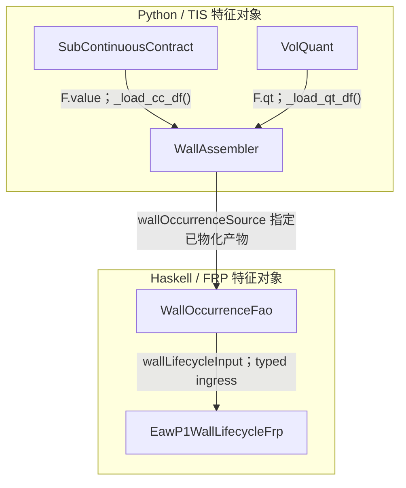

# 无二义性需求和实现文件

> 整理日期：2026-11-15。范围：Wall 生命周期链条中的五个特征对象及两个 FRP 对象的 Python 包装。
>
> 本文件把**已有需求**、**指定提交的实现事实**与**待确认/待验收事项**分开记录。文件名按本次整理要求命名，不表示缺口已经完成业务裁决，也不表示这些历史源码已构成当前可运行组合。本次未修改业务代码、未运行行情重算或生产验收。
>
> 与 [FEATURE_CONTEXT.md](./FEATURE_CONTEXT.md) 配套阅读。现役代码、参数、generated wrapper、二进制和物化目录的实际绑定，仍需在真实运行时核对。

## 一、基线、对象范围与上下游链条

### 1.1 精确基线

| 类别 | 仓库与提交 | 本文件用途 |
|---|---|---|
| TIS 源码 | `daowei2026/tis@ef887396e0a06d6e75be47efee0f1985ad7988a3` | Python 特征、输入加载、参数、业务形成和导出 |
| FRP 源码 | `daowei2026/frp@cac6c912dd65a14acbd591ca57e0afd8ddb4ef13` | Haskell Fao、typed ingress、生命周期 DSU 和 writer |
| 已有需求 | `daowei2026/feature-refinement-implementation-agent-evolution@8d58ddd3392a3e67ef5ba44adf2c4cd0c9077f9f` | P1 v0.6 业务基础及 v1.6.1 有效工程合同 |

“当前实现”在下文均指上表指定提交的静态代码，不代表仓库最新 HEAD 或现役环境。

### 1.2 只保留特征对象的数据链条



图中没有将存储介质或最终输出另画成节点，箭头表示数据依赖与职责关系。需同时准确理解：

1. `WallAssembler` 有更上游特征依赖；`_load_*` 方法内部调用上游特征的 `rerun().F`。函数名含 `load` 不表示没有上游特征。
2. `WallOccurrenceFao` 没有显式的外部 `FrpEvent` 输入端口；它依据数据源参数读取历史产物，并形成事件。
3. `WallOccurrenceFao` 与 `EawP1WallLifecycleFrp` 均显式声明 `instance Fao`。前者为 `OnlyRead`，后者在 FRP 基线为 `Cal`。
4. 运行外层产品时，代码直接调用 `wallOccurrenceIngress (wallLifecycleInput feature)`，再调用 `maintainWallLifecycle`；并非先调用内层 `Fao.doImpl`、再把该方法的返回值直接交给外层。
5. 两个 FRP 对象在 TIS 都有同名 Python 配置包装。这两个包装与对应 Haskell 类型配对，不另算两级业务计算。
6. 本图向上截断在 `SubContinuousContract`、`VolQuant`；它们读取的原始数据及主力合约映射在下文说明，不在此继续展开整个数据生产平台。

### 1.3 五个对象的职责

| 对象 | 所在端 | 核心职责 | 显式输入事件端口 |
|---|---|---|---|
| `SubContinuousContract` | Python / TIS | 把已有连续合约与日历数组装成行情表 | 无，读取数据存储 |
| `VolQuant` | Python / TIS | 根据历史一档挂单量计算分位阈值 | 无，读取合约映射和原始行情 |
| `WallAssembler` | Python / TIS | 从行情、阈值及内部度量形成 Wall 业务变化 | 无，通过加载函数获取上游特征结果 |
| `WallOccurrenceFao` | Haskell / FRP；有 Python 包装 | 读取、校验、恢复 Wall occurrence | 无，依据 source 参数加载历史数据 |
| `EawP1WallLifecycleFrp` | Haskell / FRP；有 Python 包装 | 接纳 typed occurrence，维护并发布正式状态 | Fao 参数是输入源对象；内部 DSU 接收 `FrpEvent [WallLifecycleOccurrence]` |

`rerun()` 是否触发实际重算取决于平台运行/缓存机制；本文件只确认代码中的依赖调用，不把方法名等同于必定重算。

## 二、SubContinuousContract

### 2.1 输入与参数

| 项目 | 实现事实 |
|---|---|
| 数据输入 | 当前品种的 `sub_continuous_contract/dba/<品种>_<日历>` 数组，以及 `calendar/<日历>` 中的 `natural_tsa`、`linear_tsa` |
| 显式业务参数 | `params = lambda: {}`，没有本类自行声明的参数 |
| 运行上下文 | `self.sym`、`self.sof.ori_dir`、当前 calendar；这不是“完全无输入” |
| 向 WallAssembler 提供的接口 | `SubContinuousContract().rerun().F.value` |

源码路径中的 `<品种>_<日历>` 仅表示命名规则，不记录任何实际设备、凭据或现场数据目录。

### 2.2 输出

返回 `dict(value=df)`，索引来自 `natural_tsa`。列包括：

- `trade_volume`、`open_interest`、`price`、`linear_ts`；
- `buy_price1`、`buy_vol1`、`sell_price1`、`sell_vol1`；
- `buy_order_price`、`buy_order_vol`、`sell_order_price`、`sell_order_vol`。

本链中的 `WallAssembler` 主要使用 `price`、`linear_ts` 和一档买卖价量。

### 2.3 输入到输出的转换

1. 去除 `self.sym` 中的数字，得到用于定位数据的品种名。
2. 根据当前 calendar 决定日历标识。
3. 逐列读取 `DbArray`。
4. 以日历时间数组为索引构造 DataFrame，返回 `value`。

类注释称其为“补齐半秒数据”，但该 `_impl()` 自身展示的是**读取已经准备好的数组并拼表**，没有在此实现缺失 tick 的补齐算法。日期切片在本类中被注释；本链由 `WallAssembler` 的 `_load_cc_df()` 按当前日期范围切片。

### 2.4 代码位置

- [TIS：t0/gen/cc.py，SubContinuousContract 定义及实现](https://github.com/daowei2026/tis/blob/ef887396e0a06d6e75be47efee0f1985ad7988a3/t0/gen/cc.py#L119)
- [TIS：hf/prel0/tick_quote_context.py，_load_cc_df](https://github.com/daowei2026/tis/blob/ef887396e0a06d6e75be47efee0f1985ad7988a3/hf/prel0/tick_quote_context.py#L267)

## 三、VolQuant

### 3.1 输入与参数

| 项目 | 实现事实 |
|---|---|
| 数据输入 | `load_main_contract` 得到的主力合约/交易日映射；相应合约的 `original_market/msb` 原始行情 |
| 相关列 | 一档买卖价量及时间 |
| 运行上下文 | 当前品种、Sof 数据源和日期范围 |
| 返回接口 | `.F.qt` |
| 计算模式 | `hold_cal_type() = CalType.Cache` |

| 显式参数 | 默认值 | 作用/代码约束 |
|---|---|---|
| `freq` | `"1d"` | 选择按交易日或其他频率的计算分支 |
| `n` | `30` | 历史窗口包含的周期数；代码要求 `1 <= n < 300` |
| `quantile` | `0.997` | 分位水平；代码要求 `0.5 < quantile < 1.0` |

`WallAssembler` 使用自己的 `qt_freq`、`qt_n`、`qt_quantile` 构造这个上游对象。

### 3.2 输出

返回 `{"qt": qt_df}`。`qt_df` 包含三列：

| 列 | 内容 |
|---|---|
| `value` | 窗口内买卖两侧挂单量合并后的分位值 |
| `buy` | 买一挂单量的分位值 |
| `sell` | 卖一挂单量的分位值 |

默认按交易日分支输出交易日索引；其他频率分支输出所计算 bar 的起点索引。历史窗口尚未填满时不输出该周期阈值。

### 3.3 输入到输出的转换

1. 读取交易日对应的主力合约集合和每个合约的原始行情区间。
2. 收集挂单量：买侧样本来自 `buy_vol1`，要求同一行 `sell_vol1 > 0` 且 `sell_price1 > 0`；卖侧样本反向检查买侧价量。
3. 维护 `n` 个历史周期的环形窗口。
4. 窗口已满时，先对旧窗口调用 `numpy.quantile` 计算当前输出，再将当前周期样本放入窗口。因此当前周期样本不进入该周期自身输出的阈值。
5. `freq == "1d"` 使用 `_vol_quantile_tdays`；其余走 `_vol_quantile_freq`。

代码对部分合约读取失败会记录日志并跳过，对无数据周期也会跳过；不能把产出一张阈值表直接等同于原始输入完整性已通过验收。

### 3.4 代码位置

- [TIS：hf/qt.py，VolQuant 参数与入口](https://github.com/daowei2026/tis/blob/ef887396e0a06d6e75be47efee0f1985ad7988a3/hf/qt.py#L214)
- [TIS：hf/qt.py，交易日窗口分位计算](https://github.com/daowei2026/tis/blob/ef887396e0a06d6e75be47efee0f1985ad7988a3/hf/qt.py#L42)
- [TIS：hf/qt.py，其他频率分位计算](https://github.com/daowei2026/tis/blob/ef887396e0a06d6e75be47efee0f1985ad7988a3/hf/qt.py#L121)
- [TIS：hf/prel0/track_wall_candidates.py，实际使用的 _load_qt_df](https://github.com/daowei2026/tis/blob/ef887396e0a06d6e75be47efee0f1985ad7988a3/hf/prel0/track_wall_candidates.py#L35)

## 四、WallAssembler

### 4.1 输入

| 输入 | 获取方式/含义 |
|---|---|
| 行情 `cc_df` | `SubContinuousContract().rerun().F.value`，再按 Sof 日期范围切片 |
| 阈值 `qt_df` | `VolQuant(freq=self.P.qt_freq, n=self.P.qt_n, quantile=self.P.qt_quantile).rerun().F.qt` |
| 最小价位 | 按当前品种及块内日期调用 `minimal_changes_of` |
| 时间与日历 | 行情索引、`linear_ts`、当前 calendar；用于业务 UTI 和交易日分块 |
| 跨块内部状态 | 相对厚度 carry、Wall carry、`next_wall_id`；由本次执行的上一块传递，不是外部事件流 |

父类职责：`GeneralSymbolFao` 接入单品种 Fao 框架；`DataFrameMixIn` 提供表结果适配；`WallAssemblerWrapperSupport` 提供输入接线、分块与编码；`P1DbaExportMixin` 执行分块导出和 receipt 写出。

### 4.2 全部显式参数及默认值

| 参数 | 声明默认值 | 用途 |
|---|---|---|
| `parameter_set_id` | `"wall-default"` | 参数集标识 |
| `qt_freq` | `"1d"` | VolQuant 频率 |
| `qt_n` | `30` | VolQuant 历史周期数 |
| `qt_quantile` | `0.997` | VolQuant 分位水平 |
| `w_depth_ref_ticks` | `1200` | 在线深度基线跨度 |
| `large_quote_ratio_min` | `1.0` | 大挂单倍率门槛 |
| `allow_zero_qt_fallback` | `False` | QT 非正时是否允许按 eps 兜底 |
| `thick_vs_hi_ratio` | `1.0` | 相对高位基线的厚度门槛 |
| `thin_vs_mid_ratio` | `0.7` | 相对中位基线的变薄门槛 |
| `allow_thin_brick` | `False` | 偏薄材料是否允许成为墙砖候选 |
| `p_wall_ticks` | `1` | 价位距离类默认值的基础尺度 |
| `t_wall_ticks` | `6` | 时间窗口类默认值的基础尺度 |
| `near_band_ticks` | `None` | 近价带距离门槛 |
| `far_band_ticks` | `None` | 远离价带标记的距离门槛 |
| `connect_max_core_dist_ticks` | `None` | 候选价到当前 core 的最大兼容距离 |
| `connect_gap_max_ticks` | `None` | 墙砖 cluster 的最大连接间隔 |
| `support_buffer_keep_ticks` | `None` | support buffer 保留窗口 |
| `thin_eval_window_ticks` | `None` | thin/contact 统计窗口 |
| `band_update_min_shift_ticks` | `None` | 发出 BandUpdate 的最小变化 |
| `dormant_no_presence_ticks` | `None` | 无支撑持续到休眠判定的计数门槛 |
| `dormant_far_ticks` | `None` | 休眠判断中的**价格距离**门槛，代码与 `dist_last` 比较 |
| `end_far_hold_ticks` | `None` | 连续远离到 End 的计数门槛 |
| `end_far_ticks` | `None` | 累计远离计数的价格距离门槛 |
| `break_after_no_presence_ticks` | `None` | 已有突破标记时的无支撑结束门槛 |
| `wall_dead_timeout_ticks` | `None` | 超时结束所用的存续时间门槛 |
| `allow_brick_join_dormant` | `True` | 当前实现固定要求休眠墙可按原身份恢复；显式传 False 会报错 |
| `thin_contact_min_hits` | `3` | thin-contact 结束需要的最低 thin 命中数 |
| `thin_contact_frac_end` | `0.6` | thin/contact 比例结束门槛 |

有效值由 `make_wall_params` 归一化。令 `p = int(max(p_wall_ticks, 1))`、`t = int(max(t_wall_ticks, 1))`，则未指定的值派生为：

- `near_band_ticks = connect_max_core_dist_ticks = band_update_min_shift_ticks = p`；
- `far_band_ticks = dormant_far_ticks = end_far_ticks = 2*p`；
- `connect_gap_max_ticks = thin_eval_window_ticks = dormant_no_presence_ticks = end_far_hold_ticks = break_after_no_presence_ticks = max(1, t//2)`；
- `support_buffer_keep_ticks = t`，`wall_dead_timeout_ticks = 2*t`。

显式值的截断/类型转换以源码为准。价格距离单位是最小价位数；业务 UTI 来自 `linear_ts // 500 - 1`。部分持续量按逐行计数，部分按 UTI 差值计算，不能仅凭参数后缀将两者混同。

### 4.3 输出

| 输出 | 内容 |
|---|---|
| `wall_assembler_sparse_events` | Wall 变化记录；包含 `wall_id`、`uti`、`ts`、`event_type_code`、`side_code`、`status_code`、`band_lo`、`band_hi`、`core_price`，End 时另有 `reason_code`；包装层加入 `availability_code=1` |
| `wall__stream` 及同拍物理分流 | 用于 FRP 读取的紧凑流，墙身份保留在行内 `wall_id` |
| `wall_assembler_state_trace` | 逐时点、分 bid/ask 的状态轨迹，按块写出 |
| 产品 receipt | `wall_lifecycle` 的参数、source scope、schema/code、产物位置等元数据 |

内部 runner 还产生 carry、摘要和 checkpoint；不能把 runner 的全部临时返回项都认定为本 Feature 最终独立导出的 result-key。

### 4.4 输入到输出的转换

**A. 对齐与内部度量**

1. 按日历把行情划为交易日块；从 `linear_ts` 恢复 UTI。
2. 将 `qt.buy`、`qt.sell` 分别对齐为 `QT_bid`、`QT_ask`。当前实现以自然日零点为 anchor，通过 `searchsorted(anchor, side="left") - 1` 取严格更早的一条阈值；找不到时使用 0。
3. 此接线中的 `session_ok` 当前全部为 1，这是实现事实，不代表已经逐条核验实际 session 有效性。
4. 大挂单倍率为 `best_vol / max(QT, eps_vol)`。时段无效，或 QT 非正且不允许兜底时，不判大挂单；倍率达到 `large_quote_ratio_min` 才命中。
5. 深度基线是带 carry 的在线递推；相对厚度由一档量与 mid/hi 基线的比值产生。先判 thick，再在非 thick 分支判 thin。
6. 墙砖候选要求大挂单命中，且在 `allow_thin_brick=False` 时不能命中 thin；候选价取本侧一档价，候选强度取大挂单倍率。

以上调用的是内部计算函数；此版本没有在此构造并运行独立的 F1/F2/F6 特征对象。

**B. Wall 状态形成**

当前 core 在 bid、ask 每侧最多维护一堵当前 Wall，独立运行后合并事件：

| 条件/动作 | 代码行为 |
|---|---|
| 本侧为空或已结束，且出现候选 | 分配新的 `wall_id`，建立 Alive，发 Start |
| 候选价与当前 core 距离超过 `connect_max_core_dist_ticks` | 发旧墙 End（`same_side_relocation`），同 UTI 以新编号发 Start |
| Dormant 收到兼容候选或有效 support | 恢复原墙为 Alive，发 StateChange |
| 候选间隔超过 `connect_gap_max_ticks` | 清空墙砖 support cluster；该动作本身不重新分配 Wall 身份 |
| support buffer 中存在有效材料 | band 取有效支撑价格最小/最大值；core 为支撑强度加权均价 |
| band/core 本次移动达到 `band_update_min_shift_ticks` | 发 BandUpdate |
| Alive 且无支撑计数达到 `dormant_no_presence_ticks`，并且 `dist_last >= dormant_far_ticks` | 转为 Dormant，发 StateChange |

`dist_last` 是最新价到当前 band 的最小价位距离；当前 helper 使用 round 转换距离。support 要求近价带且非 thin，强度为 `max(thickness_ratio,0) + max(large_ratio-1,0)`。

正常 End 的判断依次为：连续远离达到门槛 → thin 命中数及占比达到门槛 → 已有突破标记且无支撑达到门槛 → 存续超时且无支撑达到门槛。先匹配的原因生效；同侧 relocation 是前面候选处理中的独立结束路径。

core 虽有 `recent_absorb_event_type` 可选输入，但本 wrapper 未传入，默认全 0。因此不能据此声称本条接线已经消费 Absorb 特征或实际触发了 breakthrough 分支。

**C. 编码与导出**

1. Wall 状态、墙侧、事件和结束原因编码为数值字段。对外事件码为 `4=Start`、`5=BandUpdate`、`6=StateChange`、`7=End`；不要混用 core 私有的事件整数码。
2. 相同时间多条 occurrence 保留原时间，通过 `wall__stream__occNNNN` 等 result-key 和可选 `occurrence_ordinal` 区分物理行；ordinal 不作为业务身份。
3. 交易日之间传递 thickness carry、Wall carry 和 `next_wall_id`；分块自身不重新从墙编号 1 开始。
4. `_impl()` 返回 `P1ChunkedArtifactPlan`。正式写出时执行计划，逐块写 dense trace，再汇总/写出稀疏结果；写出成功后保存 receipt。不落盘运行则由 mixin materialize 计划。

### 4.5 代码位置

- [TIS：hf/prel0/wall_assembler.py，类定义](https://github.com/daowei2026/tis/blob/ef887396e0a06d6e75be47efee0f1985ad7988a3/hf/prel0/wall_assembler.py#L431)
- [同文件，参数](https://github.com/daowei2026/tis/blob/ef887396e0a06d6e75be47efee0f1985ad7988a3/hf/prel0/wall_assembler.py#L681)；[_impl](https://github.com/daowei2026/tis/blob/ef887396e0a06d6e75be47efee0f1985ad7988a3/hf/prel0/wall_assembler.py#L712)；[分块接线](https://github.com/daowei2026/tis/blob/ef887396e0a06d6e75be47efee0f1985ad7988a3/hf/prel0/wall_assembler.py#L232)
- [TIS：hf/prel0/wall_assembler_core.py，参数派生](https://github.com/daowei2026/tis/blob/ef887396e0a06d6e75be47efee0f1985ad7988a3/hf/prel0/wall_assembler_core.py#L119)；[状态机 kernel](https://github.com/daowei2026/tis/blob/ef887396e0a06d6e75be47efee0f1985ad7988a3/hf/prel0/wall_assembler_core.py#L823)；[replay 入口](https://github.com/daowei2026/tis/blob/ef887396e0a06d6e75be47efee0f1985ad7988a3/hf/prel0/wall_assembler_core.py#L1307)
- [TIS：hf/prel0/tick_quote_context.py，输入与 QT 对齐](https://github.com/daowei2026/tis/blob/ef887396e0a06d6e75be47efee0f1985ad7988a3/hf/prel0/tick_quote_context.py#L255)
- [TIS：hf/prel0/tick_quote_context_core.py，大挂单/厚度](https://github.com/daowei2026/tis/blob/ef887396e0a06d6e75be47efee0f1985ad7988a3/hf/prel0/tick_quote_context_core.py#L141)
- [TIS：hf/prel0/track_wall_candidates_core.py，墙砖候选](https://github.com/daowei2026/tis/blob/ef887396e0a06d6e75be47efee0f1985ad7988a3/hf/prel0/track_wall_candidates_core.py#L65)
- [TIS：hf/prel0/p1_dba_export.py，同拍物理分流](https://github.com/daowei2026/tis/blob/ef887396e0a06d6e75be47efee0f1985ad7988a3/hf/prel0/p1_dba_export.py#L256)；[紧凑流](https://github.com/daowei2026/tis/blob/ef887396e0a06d6e75be47efee0f1985ad7988a3/hf/prel0/p1_dba_export.py#L292)；[计划执行和写出](https://github.com/daowei2026/tis/blob/ef887396e0a06d6e75be47efee0f1985ad7988a3/hf/prel0/p1_dba_export.py#L540)

## 五、WallOccurrenceFao

### 5.1 输入与参数

```haskell
newtype WallOccurrenceFao = WallOccurrenceFao
  { wallOccurrenceSource :: PyAny
  }
```

| 项目 | 实现事实 |
|---|---|
| 显式参数 | `wallOccurrenceSource`，Python 默认值为 `WallAssembler()` |
| 数据输入 | 该 source 对应的已物化字段/DBA 历史数据，以及 `p1_receipts/wall_lifecycle.json` |
| 显式 FRP 输入事件 | 无 |
| 目标类型 | `CalendarTarType SymbolType` |
| 计算模式 | Haskell 与 Python 包装均为 `OnlyRead` |
| 写出能力 | 本 Fao 的 `dump` 直接报只读错误 |

构造 source 对象是选择特征配置；在这里读取 source 不等于重新运行 Wall 识别算法。

### 5.2 三个接口的输出，必须区分

| 接口 | 输出 |
|---|---|
| `instance Fao WallOccurrenceFao` 的 `load/doImpl` | `GenericFaoResult`；经 receipt 校验后调用 genericLoad |
| `Generic2AdtFao` 的 `runFao2Adt`，及 `wallOccurrenceEvent` | `FrpEvent [WallLifecycleOccurrence]`，仅返回正常 occurrence 流 |
| `wallOccurrenceIngress` | `P1DecodedIngress WallLifecycleOccurrence`：同时包含正常 occurrence 流和 `FrpEvent [P1IngressError]` 诊断流 |

外层产品使用第三个接口。该接口直接按行读取 `wall__` 前缀的物理流、解码；不能把它与第一行 genericLoad 路径视作完全相同的执行入口。

`WallLifecycleOccurrence` 包含：

- `wallOccurrenceIdentity :: WallIdentity`；
- `wallOccurrenceRef :: OccurrenceRef`；
- `wallOccurrencePayload :: WallLifecycleEvent`。

payload 包含墙引用、品种、墙侧、业务 UTI、类型化变化和可用性。变化为 `WallStarted`、`WallBandUpdated`、`WallPresenceChanged` 或 `WallEnded`。

### 5.3 输入到输出的转换

**A. 元数据与行读取**

1. 定位 source 目录，校验 receipt 的 kind、schema、success 状态及必填项。
2. 要求 receipt 中的产物位置与实际 source 目录一致。
3. typed ingress 选取 `wall__` 前缀的 result-key；按同一物理行装箱字段，合并为行事件。
4. receipt/DBA/fields 缺失、目录不匹配、列长不一致等底层错误会中止加载；并非所有错误都会自动转为诊断事件。

**B. 逐行解码**

| 输入 | 转换/校验 |
|---|---|
| `wall_id` | 正整数 local number；紧凑流必须从行字段取得；旧对象 key 可作兼容来源，并校验与行编号一致 |
| `side_code` | `1 → BidWall`；`2 → AskWall`；其他报错 |
| `uti` | 读取为业务发生时刻 |
| `availability_code` | 只有 `1` 可驱动生命周期；`2..5` 虽有类型映射，但本 decoder 拒绝其作为正常 occurrence |
| `event_type_code=4` | `WallStarted band presence` |
| `event_type_code=5` | `WallBandUpdated band presence` |
| `event_type_code=6` | `WallPresenceChanged band presence` |
| `event_type_code=7` | `WallEnded (WallEndReason "producer-reason-code-N")`，N 来自 `reason_code` |
| 非 End 的 band/core | 必须为有限数，且 `band_lo <= core_price <= band_hi` |
| 非 End 的 `status_code` | `1 → WallAlive`；`2 → WallDormant`；其他报错 |

End 分支不读取 band/core 或 status，也没有把结束原因码翻译回业务原因名称；不能把 producer 表中的所有列都视作已保留在 typed payload 中。

当前身份结构只存 `WallIdentity localNo`，run namespace 依赖已选择的 source/receipt 上下文。墙引用编码为 `wall:<localNo>`；occurrence 引用编码为 `wall:<localNo>:<uti>:<event_type_code>`。这不代表跨运行同号 Wall 相同。

**C. 批次成败**

一个当前 FRP firing/批次中，所有行解码成功才发布非空正常事件列表；任意一行解码失败，该批正常事件均不发布，发布错误列表。不是“逐行丢弃坏行后继续发布好行”。

本层不计算新墙条件、价带业务规则或生命周期状态转换；但明确实施输入有效性检查。

### 5.4 代码位置

- [FRP：src/Frp/Instance/ISL/Eaw/P1/FaoIngress.hs，类型](https://github.com/daowei2026/frp/blob/cac6c912dd65a14acbd591ca57e0afd8ddb4ef13/src/Frp/Instance/ISL/Eaw/P1/FaoIngress.hs#L240)；[Fao 实例](https://github.com/daowei2026/frp/blob/cac6c912dd65a14acbd591ca57e0afd8ddb4ef13/src/Frp/Instance/ISL/Eaw/P1/FaoIngress.hs#L313)
- [同文件，receipt/读取](https://github.com/daowei2026/frp/blob/cac6c912dd65a14acbd591ca57e0afd8ddb4ef13/src/Frp/Instance/ISL/Eaw/P1/FaoIngress.hs#L166)；[行解码](https://github.com/daowei2026/frp/blob/cac6c912dd65a14acbd591ca57e0afd8ddb4ef13/src/Frp/Instance/ISL/Eaw/P1/FaoIngress.hs#L587)
- [同文件，批次成败](https://github.com/daowei2026/frp/blob/cac6c912dd65a14acbd591ca57e0afd8ddb4ef13/src/Frp/Instance/ISL/Eaw/P1/FaoIngress.hs#L158)；[Generic2AdtFao](https://github.com/daowei2026/frp/blob/cac6c912dd65a14acbd591ca57e0afd8ddb4ef13/src/Frp/Instance/ISL/Eaw/P1/FaoIngress.hs#L1345)；[实际 typed 入口](https://github.com/daowei2026/frp/blob/cac6c912dd65a14acbd591ca57e0afd8ddb4ef13/src/Frp/Instance/ISL/Eaw/P1/FaoIngress.hs#L1375)
- [FRP：src/Frp/Instance/ISL/Eaw/P1/Products.hs，occurrence 定义](https://github.com/daowei2026/frp/blob/cac6c912dd65a14acbd591ca57e0afd8ddb4ef13/src/Frp/Instance/ISL/Eaw/P1/Products.hs#L486)
- [FRP：src/Frp/Instance/ISL/Eaw/Interface/PreL0.hs，payload 定义](https://github.com/daowei2026/frp/blob/cac6c912dd65a14acbd591ca57e0afd8ddb4ef13/src/Frp/Instance/ISL/Eaw/Interface/PreL0.hs#L161)
- [TIS：frp/EawBattleP.py，Python 包装](https://github.com/daowei2026/tis/blob/ef887396e0a06d6e75be47efee0f1985ad7988a3/frp/EawBattleP.py#L54)

## 六、EawP1WallLifecycleFrp

### 6.1 输入与参数

```haskell
newtype EawP1WallLifecycleFrp = EawP1WallLifecycleFrp
  { wallLifecycleInput :: WallOccurrenceFao
  }
```

| 项目 | 实现事实 |
|---|---|
| 显式参数 | `wallLifecycleInput`；Python 默认值为 `WallOccurrenceFao()` |
| 正常输入 | `wallOccurrenceIngress` 返回的 `FrpEvent [WallLifecycleOccurrence]` |
| 诊断输入 | 同一 ingress 返回的 `FrpEvent [P1IngressError]` |
| DSU 初始状态 | 空 active map、空去重账本、空 current update batch |
| 额外业务阈值 | 本类型没有另行声明；识别阈值在所选择的 WallAssembler 中 |
| 计算类型 | FRP 基线 `Cal`；TIS 包装基类为 `CalType.Cache`，属于需核对的运行组合差异 |

### 6.2 输出

`FaoResult EawP1WallLifecycleFrp = WallLifecycleOutputs`，包含：

| 内存字段 | 类型/含义 |
|---|---|
| `wallLifecycleOccurrences` | `FrpEvent [WallLifecycleOccurrence]`，本批接纳并发布的 occurrence |
| `wallLifecycleCurrent` | `FrpDynamic (Map WallIdentity WallCurrentView)`，完整 active map |
| `wallLifecycleCurrentUpdates` | `FrpEvent [WallCurrentView]`，本批有变化的墙的最新状态 |
| `wallLifecycleDiagnostics` | `FrpEvent (P1ProductDiagnostics WallLifecycleError)`，合并 ingress 与状态错误 |

writer 保存 `wall_occurrences`、`wall_current_view`、`wall_diagnostics` 三路结果。`wall_current_view` 是**按身份追加的状态更新记录**，并非每拍复制完整 active map；同一批同墙多次合法变化时，occurrence 流保留各次变化，而 current update 只保留该墙在本批的最后状态。

### 6.3 输入到输出的转换

1. 用输入对象调用 `wallOccurrenceIngress`，保留其诊断。
2. 把正常 occurrence 列表交给 `maintainWallLifecycle`。
3. 对每条 occurrence 先做当前批次的引用/fingerprint 判定，再按表校验转换。
4. 全批成功后提交新状态、occurrence 和 current updates；任一状态错误则保留原状态，整批不发布正常结果，只发布状态诊断。
5. 合并 ingress 诊断与状态诊断，分别通过正式 writer 写出。

| active map 中的当前状态 | 输入 | 处理 |
|---|---|---|
| 无该身份 | Start，presence=Alive | 建立 Present |
| 无该身份 | Start，presence=Dormant | `WallMustStartPresent` |
| 无该身份 | End | `WallEndBeforeStart` |
| 无该身份 | Band/Presence 更新 | `WallUpdateBeforeStart` |
| 已有该身份 | 再次 Start，且不是已跳过的当前批 exact duplicate | `WallStartedTwice` |
| Present | BandUpdate，presence=Alive | 保持 Present，更新 band/core |
| Dormant | BandUpdate，presence=Dormant | 保持 Dormant，更新 band/core |
| Present/Dormant | BandUpdate 带来相反 presence | `WallBandUpdateChangedPresence` |
| Present | PresenceChanged(Dormant) | 转为 Dormant |
| Dormant | PresenceChanged(Alive) | 转为 Present |
| Present/Dormant | PresenceChanged 指向原 presence | `WallInvalidPresenceTransition` |
| Present/Dormant | End | 形成 Ended current update，并从 active map 删除该身份 |

当前批相同 occurrence 引用且 fingerprint 相同会跳过，不重复输出；同引用不同 fingerprint 导致全批失败。fingerprint 由 `SHA1(show payload)` 形成，只用于此处去重判定，不是业务身份。

**实现边界：**`applyWallOccurrenceBatch` 每批重置去重账本；End 删除 active map 条目，代码没有另存终态身份集合。按该静态实现，后续批次同编号 Start 可被视为“无该身份”而接纳；后续普通更新则表现为 before-start 错误。不能仅凭存在 `WallUpdateAfterEnd` 错误构造器就宣称所有 End 后重用都已被禁止。这里记录代码路径，未声称该异常已经在生产样本发生。

同批处理通过 `foldM` 使用输入列表顺序；本 DSU 没有自行推导同 UTI 的业务先后，也未显式检查 occurrence UTI 相对上一事件单调递增。

### 6.4 Python 对应包装

`frp/EawBattleP.py` 同时包含：

```python
class WallOccurrenceFao(_OnlyReadTypedIngress):
    params = lambda: {"wallOccurrenceSource": WallAssembler()}

class EawP1WallLifecycleFrp(_CalculatedP1Product):
    params = lambda: {"wallLifecycleInput": WallOccurrenceFao()}

    def doFrpUpSource(self):
        return [self.P.wallLifecycleInput.P.wallOccurrenceSource]
```

它们配置 Haskell 对象及其 source。该基线中 `_CalculatedP1Product.to_df()` 主动抛错并提示读取 EawBattleP 产品；这既不是“该 Fao 没有正式 writer”的证据，也不能作为通用 `rerun().to_df()` 已可直接读取的证明。需要核实真实 generated wrapper/FrpDbaDao 入口。

### 6.5 代码位置

- [FRP：src/Frp/Instance/ISL/Eaw/P1.hs，类型](https://github.com/daowei2026/frp/blob/cac6c912dd65a14acbd591ca57e0afd8ddb4ef13/src/Frp/Instance/ISL/Eaw/P1.hs#L71)；[执行入口](https://github.com/daowei2026/frp/blob/cac6c912dd65a14acbd591ca57e0afd8ddb4ef13/src/Frp/Instance/ISL/Eaw/P1.hs#L121)；[Fao 实例](https://github.com/daowei2026/frp/blob/cac6c912dd65a14acbd591ca57e0afd8ddb4ef13/src/Frp/Instance/ISL/Eaw/P1.hs#L177)
- [FRP：src/Frp/Instance/ISL/Eaw/P1/WallLifecycle.hs，转换校验](https://github.com/daowei2026/frp/blob/cac6c912dd65a14acbd591ca57e0afd8ddb4ef13/src/Frp/Instance/ISL/Eaw/P1/WallLifecycle.hs#L48)；[批次事务](https://github.com/daowei2026/frp/blob/cac6c912dd65a14acbd591ca57e0afd8ddb4ef13/src/Frp/Instance/ISL/Eaw/P1/WallLifecycle.hs#L91)；[输出](https://github.com/daowei2026/frp/blob/cac6c912dd65a14acbd591ca57e0afd8ddb4ef13/src/Frp/Instance/ISL/Eaw/P1/WallLifecycle.hs#L103)
- [FRP：src/Frp/Instance/ISL/Eaw/P1/Internal/OccurrenceLedger.hs，去重实现](https://github.com/daowei2026/frp/blob/cac6c912dd65a14acbd591ca57e0afd8ddb4ef13/src/Frp/Instance/ISL/Eaw/P1/Internal/OccurrenceLedger.hs)
- [FRP：src/Frp/Instance/ISL/Eaw/P1/Publication.hs，正式 writer](https://github.com/daowei2026/frp/blob/cac6c912dd65a14acbd591ca57e0afd8ddb4ef13/src/Frp/Instance/ISL/Eaw/P1/Publication.hs#L681)
- [TIS：frp/EawBattleP.py，包装基类](https://github.com/daowei2026/tis/blob/ef887396e0a06d6e75be47efee0f1985ad7988a3/frp/EawBattleP.py#L34)；[产品包装](https://github.com/daowei2026/tis/blob/ef887396e0a06d6e75be47efee0f1985ad7988a3/frp/EawBattleP.py#L93)

## 七、已有需求依据与尚待消除的二义性

### 7.1 已有需求，不是根据实现新编的规则

| 需求主题 | 已有要求 | 精确来源 |
|---|---|---|
| Wall life 与 payload | Start/BandUpdate/StateChange/End；同一 life 引用保持；End 后新 Start 为新引用；错误不伪装为业务结束 | [v0.6 业务合同第二节](https://github.com/daowei2026/feature-refinement-implementation-agent-evolution/blob/8d58ddd3392a3e67ef5ba44adf2c4cd0c9077f9f/candidate_gold_cases/eaw/taskpacks_and_checkpoints/p1/EAW_P1_EXISTING_PREL0_BASE_PRODUCTS_AND_SPARSE_OCCURRENCE_V0_6_20260813/03_WALL_BUILD_ABSORB_LIFECYCLE_CONTRACTS.md) |
| FRP 责任 | producer 形成变化；FRP 维护状态/正式输出；不重新认墙 | [v1.6.1 最终架构](https://github.com/daowei2026/feature-refinement-implementation-agent-evolution/blob/8d58ddd3392a3e67ef5ba44adf2c4cd0c9077f9f/candidate_gold_cases/eaw/taskpacks_and_checkpoints/p1/EAW_P1_PREL0_BASE_PRODUCTS_ENGINEERING_DESIGN_AND_VCC_V1_6_1_20260818/02_FINAL_P1_ARCHITECTURE.md) |
| 身份与主要转换 | Wall FeatureRunIdentity + wall_local_no；Present/Dormant/Ended；禁止结束后普通更新 | [Wall DSU](https://github.com/daowei2026/feature-refinement-implementation-agent-evolution/blob/8d58ddd3392a3e67ef5ba44adf2c4cd0c9077f9f/candidate_gold_cases/eaw/taskpacks_and_checkpoints/p1/EAW_P1_PREL0_BASE_PRODUCTS_ENGINEERING_DESIGN_AND_VCC_V1_6_1_20260818/dsu/P1-DSU-01_Wall_生命周期_DSU.md) |
| 重复与事务 | exact duplicate 幂等；conflicting duplicate 不改变状态/输出；状态与发布一致 | [转换表](https://github.com/daowei2026/feature-refinement-implementation-agent-evolution/blob/8d58ddd3392a3e67ef5ba44adf2c4cd0c9077f9f/candidate_gold_cases/eaw/taskpacks_and_checkpoints/p1/EAW_P1_PREL0_BASE_PRODUCTS_ENGINEERING_DESIGN_AND_VCC_V1_6_1_20260818/tables/PRODUCT_STATE_TRANSITIONS.csv)、[DSU 事务要求](https://github.com/daowei2026/feature-refinement-implementation-agent-evolution/blob/8d58ddd3392a3e67ef5ba44adf2c4cd0c9077f9f/candidate_gold_cases/eaw/taskpacks_and_checkpoints/p1/EAW_P1_PREL0_BASE_PRODUCTS_ENGINEERING_DESIGN_AND_VCC_V1_6_1_20260818/06A_PRODUCT_DSU_PROCESS_AND_STATE_TRANSITIONS.md) |
| 同 UTI | 合法多 occurrence 不丢、不改时间；行序/回调序不提供业务 first；ordinal 仅作物理区分 | [接线合同](https://github.com/daowei2026/feature-refinement-implementation-agent-evolution/blob/8d58ddd3392a3e67ef5ba44adf2c4cd0c9077f9f/candidate_gold_cases/eaw/taskpacks_and_checkpoints/p1/EAW_P1_PREL0_BASE_PRODUCTS_ENGINEERING_DESIGN_AND_VCC_V1_6_1_20260818/08_SAME_UTI_AND_STANDARD_DBA_FAO_WIRING.md) |
| 输出及 Python 投影 | Wall occurrences/current view/diagnostics；通过既有 wrapper/FrpDbaDao 读取 | [投影表](https://github.com/daowei2026/feature-refinement-implementation-agent-evolution/blob/8d58ddd3392a3e67ef5ba44adf2c4cd0c9077f9f/candidate_gold_cases/eaw/taskpacks_and_checkpoints/p1/EAW_P1_PREL0_BASE_PRODUCTS_ENGINEERING_DESIGN_AND_VCC_V1_6_1_20260818/tables/PYTHON_PROJECTION_TABLES.csv) |
| 参数状态 | Wall 参数存在 provisional 项及需要核对精确单位的项 | [参数表](https://github.com/daowei2026/feature-refinement-implementation-agent-evolution/blob/8d58ddd3392a3e67ef5ba44adf2c4cd0c9077f9f/candidate_gold_cases/eaw/taskpacks_and_checkpoints/p1/EAW_P1_PREL0_BASE_PRODUCTS_ENGINEERING_DESIGN_AND_VCC_V1_6_1_20260818/tables/PARAMETER_SURFACE.csv) |
| 验收 | transition、duplicate/conflict、same-UTI permutation、chunk/replay、真实运行 | [验收要求](https://github.com/daowei2026/feature-refinement-implementation-agent-evolution/blob/8d58ddd3392a3e67ef5ba44adf2c4cd0c9077f9f/candidate_gold_cases/eaw/taskpacks_and_checkpoints/p1/EAW_P1_PREL0_BASE_PRODUCTS_ENGINEERING_DESIGN_AND_VCC_V1_6_1_20260818/12_PROOF_ACCEPTANCE_AND_REAL_RUN.md) |

已有工程接口形状另见 [P1TargetSignatures.hs](https://github.com/daowei2026/feature-refinement-implementation-agent-evolution/blob/8d58ddd3392a3e67ef5ba44adf2c4cd0c9077f9f/candidate_gold_cases/eaw/taskpacks_and_checkpoints/p1/EAW_P1_PREL0_BASE_PRODUCTS_ENGINEERING_DESIGN_AND_VCC_V1_6_1_20260818/reference/haskell/P1TargetSignatures.hs)。它是签名/形状指导，不能单独替代五个对象的完整业务合同。

### 7.2 待决、待核或待验收事项

| 编号 | 已确认的依据/实现事实 | 必须进一步明确或验收的内容 |
|---|---|---|
| U-01 身份边界 | 需求逻辑身份包含 run；当前 WallIdentity、WallRef 仅含 local no，namespace 依赖 source/receipt | 跨运行混用如何在各消费入口被阻断；不以本地编号相同认定同一墙 |
| U-02 同 UTI 多变化 | producer 可在同 UTI 发多条；DSU 按列表顺序处理；occurrence ref 只含 local no、UTI、event code | 同墙同 UTI 同事件类型多条是否允许；若允许如何无损区分；合法先后依据及顺序不可判定的处置 |
| U-03 End 与复用 | 需求 End 终止旧 life；当前 active map 删除终态，去重账本每批重置 | 同号后续 Start、重复 End、迟到更新、跨批 exact/conflicting duplicate 的需求与实际保护 |
| U-04 批次原子性 | ingress 和 DSU 均有全批拒绝路径；需求写逐 occurrence 原子一致性 | 一个错误是否允许使同批其他墙的合法变化全部不发布；批次边界如何定义、如何向消费者解释 |
| U-05 reason 与 payload | 业务合同要求原因可解释；decoder 只把 End reason 编成 producer-reason-code-N，End 不携带 band/core | 编码的业务解释/未知码策略、Start/StateChange 原因与不可用表示是否满足有效需求 |
| U-06 current 的读取 | writer 明确是变化更新表；内存 Dynamic 是 active map；批内每墙只保留最后 update | 消费者如何恢复任意时点状态及应用 End；API 名称/投影说明需要一致，不得读成全快照 |
| U-07 上游时间/质量 | VolQuant 与 Wall 对齐各自有历史索引规则；session_ok 当前全 1；SubContinuousContract 本类仅拼表 | 阈值可用时间、自然日/交易日/夜盘、暖启动、缺失输入及半秒补齐的真实保证 |
| U-08 参数语义 | 参数有派生、截断、固定 policy；dormant_far_ticks 在本代码中比较价格距离 | 为需求锁定准确单位、范围、有效值和边界例；不能将旧表的 provisional 状态改写为已批准最终口径 |
| U-09 运行组合与回程 | TIS 产品包装 Cache/to_df 抛错，FRP 为 Cal 且有正式 writer | 实际 checkout、codegen、执行模式及 Python 读取入口；不能直接宣称两个历史 SHA 已可配套运行 |
| U-10 证明状态 | 本文件完成源码与需求整理，未运行 fixture/真实行情 | 按前述合同补足有针对性的正反例及真实数据证据，分别报告代码事实、业务判断和未决项 |

以上事项没有在本次整理中替 Owner/专业负责人作新业务裁决。若补充最终需求，应为每项写清输入前提、合法/非法情况、正常输出、错误输出、状态改变及验收例，并与现有规范及实现差异逐项对应。

